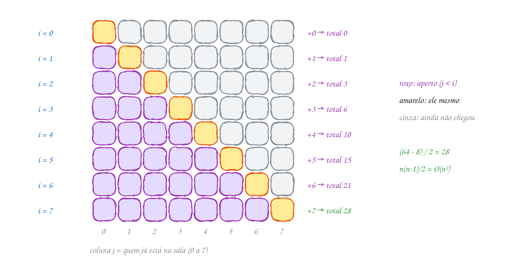
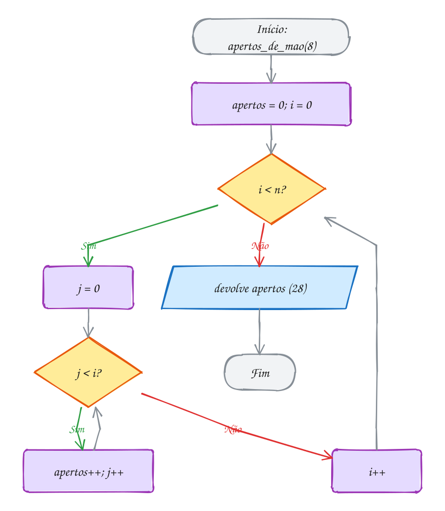
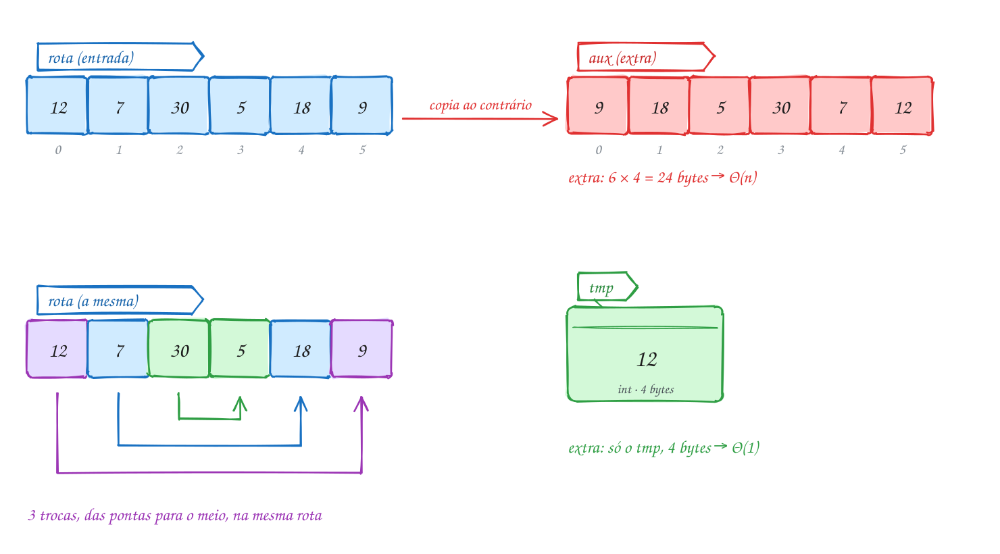

<!-- Gerado por _gerador. Para mudar este arquivo, edite _gerador/modulos/26-analise-formal/ e rode: cd _gerador && npm run gerar -->

# Módulo 26 · Notação assintótica, somatórios e espaço

No módulo 10 você aprendeu a contar passos e a dizer "isso é O(n²)" olhando
os laços. No módulo 17, a resolver recorrências e a usar Θ e Ω. Este módulo
fecha três pontas: as **definições formais** de O, Ω e Θ, com as constantes
`c` e `n₀`; os **somatórios** que dão o número exato de vezes que um laço
roda; e a **complexidade espacial**, que mede memória como se mede tempo.

A mudança na cabeça é trocar o "parece n²" pela conta. Dizer que
`3n² + 10n + 20` é Θ(n²) vira uma afirmação que se **prova** (exibindo `c₁`,
`c₂` e `n₀`) ou se **refuta** (mostrando que nenhum par serve). O laço
dependente que roda "umas n²/2 vezes" passa a rodar `n(n-1)/2` vezes, conferido
por um contador. E a função que "não usa memória" obriga a olhar a pilha da
recursão, que gasta espaço mesmo sem vetor nenhum.

Cada fórmula tem um programa em C que conta e confere. O último assunto junta
as três ideias na ficha de cinco funções: passos, bytes e frames medidos e
comparados com a fórmula.

## O que você vai aprender

- as definições de **O**, **Ω** e **Θ** com `c` e `n₀`, e como **provar** e **refutar** um limite
- a diferença entre **melhor caso**, **pior caso** e **caso médio**, e por que isso não é a mesma coisa que O, Ω e Θ
- achar `c` e `n₀` com um programa, e entender por que o programa não substitui a prova
- transformar laços em **somatórios**: aritmética, quadrados, geométrica e harmônica, com laços dependentes
- calcular o número **exato** de execuções de um laço e conferir com um contador
- a **complexidade espacial**: espaço extra, algoritmos **in-place**, o espaço da **pilha da recursão**
- a troca de **tempo por espaço**: tabelas, prefixos e memoização
- conferir uma ficha de complexidade inteira medindo passos, bytes e frames

## Antes de começar

Este módulo usa: contagem de passos e notação O (0071 e 0072), pilha de
chamadas e recursão (0031 a 0033), pilha, heap, `malloc` e `free` (0053 e 0054),
ponteiro para função (0050), busca binária (0090), insertion sort e merge
sort (0093 e 0094), recorrências e a notação Θ (0114 a 0117), permutações
por backtracking (0126), potência rápida (0131) e memoização (0138).

Faça as contas no papel **antes** de rodar (a desigualdade do `n₀`, o
somatório do laço, os bytes extras);
depois mude o `n`, dobre, e veja se o contador acompanha a fórmula. Nos
diagramas da ideia, verde é o que vale (o teto que já segura, o espaço
constante), vermelho é o que falha ou cresce com `n`, amarelo marca o ponto de
virada (o `n₀`, a razão ao dobrar `n`) e roxo é trabalho sendo contado.

Matemática: potências, logaritmos e somas. Lembre que `log₂ n` é quantas
vezes dá para dividir `n` por 2 até chegar em 1, e que `ln n` é o logaritmo
natural (`log` em `<math.h>`). O `rodar` já liga a biblioteca matemática.

O último assunto tem um TAD na pasta, `custo.h` e `custo.c`, com cinco
funções instrumentadas. O `rodar` compila o `custo.c` junto com qualquer
exemplo ou exercício da pasta; por isso, nos exercícios de lá, não dê os
nomes `custo_passos`, `custo_bytes` e `custo_prof_max` a variáveis suas.
Os exercícios de "conserte" trazem o erro de propósito, e o enunciado
avisa.

| # | Assunto | Pasta |
| --- | --- | --- |
| [0166](#0166--o-ω-e-θ-de-verdade) | O, Ω e Θ de verdade | [`0166-o-omega-theta/`](26-analise-formal/0166-o-omega-theta/) |
| [0167](#0167--somatórios-que-saem-de-laços) | Somatórios que saem de laços | [`0167-somatorios/`](26-analise-formal/0167-somatorios/) |
| [0168](#0168--complexidade-espacial) | Complexidade espacial | [`0168-complexidade-espacial/`](26-analise-formal/0168-complexidade-espacial/) |
| [0169](#0169--juntando-tudo-passos-e-bytes-conferidos) | Juntando tudo: passos e bytes conferidos | [`0169-juntando-tudo/`](26-analise-formal/0169-juntando-tudo/) |

---

## 0166 · O, Ω e Θ de verdade

A empresa que vendeu o sistema de caixa do mercadinho escreveu no contrato:
"o fechamento do dia com `n` vendas faz no máximo `4n²` operações, a partir
de 12 vendas". Você mediu o programa e contou exatamente
`f(n) = 3n² + 10n + 20` operações. A promessa vale? Para 10 vendas, o
fechamento faz 420 operações e `4 · 10² = 400`: estourou. O contrato mentiu?

Não. Ele disse "a partir de 12", e as definições de **O**, **Ω** e **Θ**
funcionam assim, com duas constantes que você escolhe: o fator **c** e o
ponto de partida **n₀**.

- **f(n) é O(g(n))** se existem `c > 0` e `n₀` tais que
  `f(n) ≤ c · g(n)` para todo `n ≥ n₀`. É um **teto**.
- **f(n) é Ω(g(n))** se existem `c > 0` e `n₀` tais que
  `f(n) ≥ c · g(n)` para todo `n ≥ n₀`. É um **piso**.
- **f(n) é Θ(g(n))** se é O e Ω ao mesmo tempo: existem `c₁`, `c₂` e `n₀`
  com `c₁ · g(n) ≤ f(n) ≤ c₂ · g(n)` para todo `n ≥ n₀`. É um **sanduíche**.

O **n₀** existe porque só interessa o que acontece com `n` grande: para
poucas vendas, os termos `10n` e `20` ainda pesam. O **c** existe porque a
constante depende da máquina e de detalhes do código; o formato do
crescimento, não.

**Provar** um limite é exibir um par `c`, `n₀` que funciona e mostrar a conta.
Para o teto com `c = 4`: `3n² + 10n + 20 ≤ 4n²` vira `n² - 10n - 20 ≥ 0`, que
vale para `n ≥ 12` (a raiz é 11,7). Para o piso com `c = 3`: `3n² + 10n + 20 ≥
3n²` vale para todo `n ≥ 1`. Logo `f(n)` é **Θ(n²)**, com `c₁ = 3`, `c₂ = 4` e
`n₀ = 12`.

**Refutar** é o contrário: mostrar que **nenhum** par serve. `f(n)` é O(n)?
Seria preciso `3n² + 10n + 20 ≤ c · n`, isto é, `3n + 10 + 20/n ≤ c`. Para
qualquer `c` que alguém escolha, basta `n > c/3` e a desigualdade quebra. Não
existe teto linear.

Há ainda um terceiro eixo, independente de O, Ω e Θ: **qual entrada**.
O **melhor caso** é a entrada de tamanho `n` que dá menos trabalho, o **pior
caso** é a que dá mais, e o **caso médio** é a média sobre todas as entradas
(com alguma hipótese de probabilidade). Cada caso é uma **função de n
diferente**, e cada uma ganha o seu O, Ω ou Θ. Na busca sequencial, o melhor
caso é Θ(1) e o pior é Θ(n).

A tabela mostra o custo medido e o teto `4n²` para `n` de 6 a 15. Até 11, o teto fica abaixo do custo (vermelho); de 12 em
diante, fica acima e não cruza mais (verde). O `n₀` é a primeira coluna verde:

<p align="center"></p>

O programa faz a busca que você faria à mão: testa todo `n` até 100 mil e
guarda o último que falhou. O `n₀` é o seguinte a ele:

```c
#include <stdio.h>

#define LIMITE 100000

// passos medidos no fechamento do caixa com n vendas
long custo(long n) {
    return 3 * n * n + 10 * n + 20;
}

// O: menor n0 com custo(n) <= c * n² para todo n de n0 até LIMITE
long n0_teto(double c) {
    long n0 = 1;
    for (long n = 1; n <= LIMITE; n++) {
        if (custo(n) > c * n * n) {
            n0 = n + 1;                 // falhou aqui: n0 tem que vir depois
        }
    }
    return n0;
}

// Ω: menor n0 com custo(n) >= c * n² para todo n de n0 até LIMITE
long n0_piso(double c) {
    long n0 = 1;
    for (long n = 1; n <= LIMITE; n++) {
        if (custo(n) < c * n * n) {
            n0 = n + 1;
        }
    }
    return n0;
}

int main(void) {
    printf(" n   custo(n)   4n²\n");
    for (long n = 10; n <= 14; n++) {
        printf("%2ld %10ld %5ld\n", n, custo(n), 4 * n * n);
    }

    double tetos[] = {4.0, 3.5, 3.0};
    for (int i = 0; i < 3; i++) {
        long n0 = n0_teto(tetos[i]);
        if (n0 > LIMITE) {
            printf("O(n²) com c = %.1f: nenhum n0 até %d\n", tetos[i], LIMITE);
        } else {
            printf("O(n²) com c = %.1f: n0 = %ld\n", tetos[i], n0);
        }
    }
    printf("Ω(n²) com c = 3.0: n0 = %ld\n", n0_piso(3.0));

    // refutar O(n): para cada c, o custo passa de c·n e não volta mais
    long cs[] = {10, 100, 1000};
    for (int i = 0; i < 3; i++) {
        long ultimo_ok = 0;
        for (long n = 1; n <= LIMITE; n++) {
            if (custo(n) <= cs[i] * n) {
                ultimo_ok = n;
            }
        }
        printf("O(n) com c = %4ld: falha de n = %ld em diante\n", cs[i], ultimo_ok + 1);
    }
    return 0;
}
// Saída:
//  n   custo(n)   4n²
// 10        420   400
// 11        493   484
// 12        572   576
// 13        657   676
// 14        748   784
// O(n²) com c = 4.0: n0 = 12
// O(n²) com c = 3.5: n0 = 22
// O(n²) com c = 3.0: nenhum n0 até 100000
// Ω(n²) com c = 3.0: n0 = 1
// O(n) com c =   10: falha de n = 1 em diante
// O(n) com c =  100: falha de n = 30 em diante
// O(n) com c = 1000: falha de n = 330 em diante
```

O fluxograma é a função `n0_teto`. Ela não para no primeiro `n` que funciona:
percorre tudo e **empurra** o `n₀` para depois de cada falha, que é como se
escreve "para todo `n ≥ n₀`" num laço. Na última parte da saída, com
`c = 1000`, o teto linear aguenta até 329 e depois quebra para sempre. Com
qualquer `c` acontece o mesmo, só que mais longe:


<p align="center"></p>

> [!WARNING]
> O, Ω e Θ **não** são "pior, melhor e médio". São tipos de limite (teto,
> piso, sanduíche), e você pode aplicar qualquer um deles a qualquer caso.
> "O pior caso da busca sequencial é Θ(n)" e "o melhor caso é Θ(1)" são duas
> frases certas. "A busca sequencial é Ω(n)" é falsa, porque o melhor caso
> termina em 1 comparação. E um programa que testa até 100 mil **não prova**
> nada para 100 mil e um: ele só acha candidatos. A prova é a conta
> `n² - 10n - 20 ≥ 0`.

> [!TIP]
> **Por dentro do C:** o `c` esconde a máquina. As 20 operações fixas e o
> `3` do `3n²` dependem de quantas instruções o `gcc` gera para cada linha, e
> isso muda com `-O0` ou `-O2`, com o processador, com o tipo (`int` ou
> `double`). O `g(n)` não muda: dobrar `n` quadruplica o trabalho em qualquer
> máquina. Um cuidado de C no próprio teste: `3 * n * n` com `n` do tipo
> `int` estoura perto de `n = 26.755` (passa de 2.147.483.647, o maior `int`),
> e estouro de `int` com sinal é comportamento indefinido. Por isso o
> programa usa `long`, que no Linux de 64 bits tem 8 bytes.

> [!NOTE]
> **Pergunta para você:** com `c = 3.1`, qual é o menor `n₀` do teto? Faça a
> conta `0,1 n² - 10n - 20 ≥ 0` antes de trocar o `3.5` por `3.1` no programa.
> O que acontece com o `n₀` quando o `c` chega perto de 3?

### Hora de praticar

Arquivos em [`0166-o-omega-theta/`](26-analise-formal/0166-o-omega-theta/).

**Exemplo A331 · Melhor, pior e médio na busca sequencial**

```c
#include <stdio.h>

int comparacoes = 0;

// procura a placa no pátio, da vaga 0 em diante
int busca(const int placas[], int n, int placa) {
    for (int i = 0; i < n; i++) {
        comparacoes++;
        if (placas[i] == placa) {
            return i;
        }
    }
    return -1;
}

// melhor, pior e média de comparações procurando cada placa que está no pátio
void tres_casos(const int placas[], int n) {
    int menor = n + 1, maior = 0;
    long soma = 0;
    for (int alvo = 0; alvo < n; alvo++) {
        comparacoes = 0;
        busca(placas, n, placas[alvo]);
        if (comparacoes < menor) menor = comparacoes;
        if (comparacoes > maior) maior = comparacoes;
        soma += comparacoes;
    }
    comparacoes = 0;
    busca(placas, n, -1);               // placa que não está no pátio
    printf("n = %4d | melhor %d | pior %4d | média %7.1f | ausente %4d\n",
           n, menor, maior, (double)soma / n, comparacoes);
}

int main(void) {
    static int patio[1000];
    for (int i = 0; i < 1000; i++) {
        patio[i] = 1000 + 7 * i;        // placas fictícias, todas diferentes
    }
    tres_casos(patio, 10);
    tres_casos(patio, 100);
    tres_casos(patio, 1000);
    return 0;
}
// Saída:
// n =   10 | melhor 1 | pior   10 | média     5.5 | ausente   10
// n =  100 | melhor 1 | pior  100 | média    50.5 | ausente  100
// n = 1000 | melhor 1 | pior 1000 | média   500.5 | ausente 1000
```

```bash
~/LPEDC/rodar 26-analise-formal/0166-o-omega-theta/A331.c
```

**Exemplo A332 · Constante ou não: olhando a razão**

```c
#include <stdio.h>
#include <math.h>

// Se a razão f(n) / g(n) fica abaixo de um número fixo quando n cresce,
// esse número serve de c: f = O(g). Se a razão cresce sem parar, nenhum c
// serve: f não é O(g).
int main(void) {
    printf(" n  2^(n+1)/2^n  4^n/2^n\n");
    for (int n = 10; n <= 50; n += 10) {
        double r1 = pow(2, n + 1) / pow(2, n);   // sempre 2
        double r2 = pow(4, n) / pow(2, n);       // é 2^n: explode
        printf("%2d %12.0f %8.2e\n", n, r1, r2);
    }

    printf("\n     n  log(n²)/log n  n²/(100n)  (n log n)/n\n");
    for (long n = 10; n <= 1000000; n *= 10) {
        double r3 = log2((double)n * n) / log2((double)n); // sempre 2
        double r4 = (double)n * n / (100.0 * n);           // n/100
        double r5 = n * log2((double)n) / n;               // log n
        printf("%7ld %13.1f %10.1f %12.1f\n", n, r3, r4, r5);
    }
    // 2^(n+1) = O(2^n) com c = 2 e log(n²) = Θ(log n) com c = 2.
    // 4^n não é O(2^n), n² não é O(100n) e n log n não é O(n):
    // as três razões passam de qualquer c que você escolher.
    return 0;
}
// Saída:
//  n  2^(n+1)/2^n  4^n/2^n
// 10            2 1.02e+03
// 20            2 1.05e+06
// 30            2 1.07e+09
// 40            2 1.10e+12
// 50            2 1.13e+15
//
//      n  log(n²)/log n  n²/(100n)  (n log n)/n
//      10           2.0        0.1          3.3
//     100           2.0        1.0          6.6
//    1000           2.0       10.0         10.0
//   10000           2.0      100.0         13.3
//  100000           2.0     1000.0         16.6
// 1000000           2.0    10000.0         19.9
```

```bash
~/LPEDC/rodar 26-analise-formal/0166-o-omega-theta/A332.c
```

#### Exercícios

**Exercício E991** · ★☆☆

O sistema do condomínio gera os boletos de n condôminos com
f(n) = 5n + 40 passos. Prove, com um programa, que f(n) é O(n): escreva
a função custo(n) e uma função acha_n0(c) que testa todo n de 1 até
10000 e devolve o menor n0 a partir do qual custo(n) <= c * n sempre
vale. Mostre o n0 para c = 6, 7, 10 e 45:


```text
Saída esperada:
c =  6: n0 = 40
c =  7: n0 = 20
c = 10: n0 = 8
c = 45: n0 = 1
```

**Dicas:**

1. Comece com n0 = 1. Toda vez que custo(n) > c * n, faça n0 = n + 1:
   o n0 tem que ficar depois da última falha.
2. Use long para n, custo e c * n.
3. Confira à mão: 5n + 40 <= 6n vira n >= 40. Quanto maior o c, menor o
   n0; com c = 45, já vale em n = 1.
4. Resposta esperada: a saída acima.

```bash
~/LPEDC/rodar 26-analise-formal/0166-o-omega-theta/E991.c
```

**Exercício E992** · ★☆☆

Montar as duplas de um campeonato de n jogadores faz f(n) = n² - 6n
comparações. Agora o limite é de baixo: prove que f(n) é Ω(n²). Escreva
acha_n0(c), que testa todo n de 1 até 10000 e devolve o menor n0 a
partir do qual custo(n) >= c * n² sempre vale (ou LIMITE + 1 se não
houver). Mostre o resultado para c = 0.5, 0.9 e 1.0:


```text
Saída esperada:
c = 0.5: n0 = 12
c = 0.9: n0 = 60
c = 1.0: nenhum n0 até 10000
```

**Dicas:**

1. É a mesma busca do texto, com o sinal trocado: a falha agora é
   custo(n) < c * n * n.
2. Use double para c; n * n em long vira double na conta c * n * n.
3. À mão: n² - 6n >= 0.5 n² vira 0.5 n >= 6, n >= 12. Com c = 1, seria
   -6n >= 0, que nunca vale para n >= 1. O piso precisa de c < 1.
4. Resposta esperada: a saída acima.

```bash
~/LPEDC/rodar 26-analise-formal/0166-o-omega-theta/E992.c
```

**Exercício E993** · ★★☆

Melhor, pior e caso médio de verdade, sem fórmula: para cada n de 3 a 7,
gere TODAS as ordens dos números 1..n (são n! ordens), ordene uma cópia
de cada uma com o insertion sort e conte as comparações entre elementos.
Mostre quantas ordens foram testadas, o menor, o maior e a média de
comparações:


```text
Saída esperada:
n = 3:    6 ordens | melhor 2 | pior  3 | média 2.67
n = 4:   24 ordens | melhor 3 | pior  6 | média 4.92
n = 5:  120 ordens | melhor 4 | pior 10 | média 7.72
n = 6:  720 ordens | melhor 5 | pior 15 | média 11.05
n = 7: 5040 ordens | melhor 6 | pior 21 | média 14.91
```

**Dicas:**

1. Gere as ordens com backtracking (assunto 0126): um vetor perm, um
   vetor bool usado e uma função permuta(perm, usado, pos, n).
2. No insertion sort, conte uma comparação a cada vez que v[j] é
   comparado com x, e saia do while com break quando v[j] <= x.
3. O melhor caso (já ordenado) é n - 1: Θ(n). O pior (ao contrário) é
   n(n-1)/2: Θ(n²). A média fica perto de n²/4: também Θ(n²).
4. Resposta esperada: a saída acima.

```bash
~/LPEDC/rodar 26-analise-formal/0166-o-omega-theta/E993.c
```

**Exercício E994** · ★★☆

Refute com um programa: n log₂ n NÃO é O(n). Para cada c em 2, 4, 8 e
16, ache o último n de 1 até 200000 em que n * log2(n) <= c * n, e
mostre a partir de onde a desigualdade quebra de vez:


```text
Saída esperada:
c =  2: falha de n = 5 em diante
c =  4: falha de n = 17 em diante
c =  8: falha de n = 257 em diante
c = 16: falha de n = 65537 em diante
```

**Dicas:**

1. log2 está em <math.h>; o rodar já liga a biblioteca matemática.
2. Guarde ultimo_ok = n sempre que a desigualdade valer; a quebra
   começa em ultimo_ok + 1.
3. n log n <= c n é o mesmo que log n <= c, isto é, n <= 2^c. Para
   qualquer c, o n = 2^c + 1 quebra o teto. Nenhum c serve.
4. Resposta esperada: a saída acima.

```bash
~/LPEDC/rodar 26-analise-formal/0166-o-omega-theta/E994.c
```

**Exercício E995** · ★★★

Conserte o programa. O sistema do torneio de futsal monta a rodada com
2n² operações; com n ímpar, um time folga e a tabela é refeita (30n a
mais). O programa diz que custo(n) <= 3n² vale "a partir de n0 = 2",
mas a conferência logo abaixo acha falhas:


```text
Saída que aparece:
custo(n) <= 3n² a partir de n0 = 2
falhas de n0 até 1000: 14
```


Corrija a função acha_n0 para que ela respeite o "para todo n >= n0" da
definição de O:


```text
Saída esperada:
custo(n) <= 3n² a partir de n0 = 30
falhas de n0 até 1000: 0
```

**Dicas:**

1. A função para no primeiro n que funciona. Com n = 2 (par) funciona,
   mas n = 3 (ímpar) volta a falhar.
2. Percorra todos os n até LIMITE e faça n0 = n + 1 a cada falha.
3. À mão: com n ímpar, 2n² + 30n <= 3n² vira n >= 30, então o último
   ímpar que falha é 29 e o n0 é 30.
4. Resposta esperada: a saída acima.

```bash
~/LPEDC/rodar 26-analise-formal/0166-o-omega-theta/E995.c
```

**Exercício E996** · ★★★

Ache as duas fatias do sanduíche do Θ por busca. A função abaixo confere
cada cliente da fila e cada par de clientes uma vez. Acrescente um
contador global de passos (um passo para o cliente sozinho e um para
cada par), rode confere_pares para todo n de 10 até 2000 e guarde o
menor (c1) e o maior (c2) valor de passos / n². Depois mostre a
contagem para n = 1000 ao lado da fórmula n(n+1)/2:


```text
Saída esperada:
de n = 10 a 2000: c1 = 0.5002, c2 = 0.5500
n = 1000: 500500 passos, n(n+1)/2 = 500500
f(n) = Θ(n²) com c1 = 0.5, c2 = 0.55 e n0 = 10
```

**Dicas:**

1. passos++ antes do laço de dentro (o cliente sozinho) e passos++ dentro
   dele (o par).
2. A razão é (n + 1) / (2n): começa em 0.55 com n = 10 e desce para 0.5
   sem nunca chegar lá. Por isso c1 = 0.5 serve para todo n.
3. Calcule a razão em double: (double)passos / ((double)n * n).
4. Resposta esperada: a saída acima.

```bash
~/LPEDC/rodar 26-analise-formal/0166-o-omega-theta/E996.c
```

---

## 0167 · Somatórios que saem de laços

Reunião de condomínio. Os moradores chegam um por vez, e cada um que entra
aperta a mão de todo mundo que já está na sala. O primeiro não cumprimenta
ninguém, o segundo cumprimenta 1, o terceiro 2... Com 8 moradores, quantos
apertos de mão acontecem? E com os 1000 moradores de um conjunto grande?

Contar passos, como no assunto 0071, é fácil quando o laço de dentro roda
sempre o mesmo número de vezes: `n` vezes `n` dá `n²`. Aqui não: o laço de
dentro depende de `i`. É um **laço dependente**, e a contagem vira uma soma
de parcelas diferentes, um **somatório**:

```text
 n-1
  Σ  i  =  0 + 1 + 2 + ... + (n-1)  =  n(n-1)/2
 i=0
```

O `Σ` (sigma) quer dizer "some a expressão da direita para cada valor de
`i`, do de baixo até o de cima". Cada laço `for` vira um `Σ`: os limites do
laço viram os limites da soma, e o que o corpo faz vira a parcela.

A fórmula fechada da soma de `0` a `n-1` sai de um truque antigo: escreva a
soma de frente para trás e de trás para frente, uma embaixo da outra. Cada
coluna soma `n-1`, e são `n` colunas. Isso é o dobro da soma: `n(n-1)/2`.
Para 8 moradores, `8 · 7 / 2 = 28`. Para 1000, 499.500. É **Θ(n²)**: o
"só metade" do laço dependente corta a constante pela metade, mas não muda
a classe.

As quatro somas que mais aparecem quando você lê laços:

| laço | somatório | fórmula | classe |
| --- | --- | --- | --- |
| `for i < n`, `for j < i` | aritmética: `Σ i` | `n(n-1)/2` | Θ(n²) |
| `for i < n`, `for j < i*i` | quadrados: `Σ i²` | `(n-1)n(2n-1)/6` | Θ(n³) |
| `for (t = 1; t < n; t *= 2)`, `for j < t` | geométrica: `1 + 2 + 4 + ...` | `2^k - 1` (menos que `2n`) | Θ(n) |
| `for p = 1..n`, `for (j = 0; j < n; j += p)` | harmônica: `Σ n/p` | `≈ n ln n` | Θ(n log n) |

A **geométrica** engana: dois laços aninhados, e mesmo assim linear, porque
a última parcela sozinha é maior que todas as outras juntas
(`512 > 1 + 2 + ... + 256`). A **harmônica** é a soma `1 + 1/2 + 1/3 + ... +
1/n`, que cresce como `ln n`; multiplicada por `n`, dá `n ln n`.

No desenho, cada linha é um morador que chega e cada quadradinho roxo é um
aperto de mão com quem já estava na sala. O triângulo roxo é metade do
quadrado de 8 por 8, sem a diagonal:

<p align="center"></p>

O programa conta os apertos com os dois laços e compara com a fórmula:

```c
#include <stdio.h>

// cada morador que chega aperta a mão de todos que já estão na sala
long apertos_de_mao(int n) {
    long apertos = 0;
    for (int i = 0; i < n; i++) {        // o morador i chega
        for (int j = 0; j < i; j++) {    // cumprimenta os i que já estão
            apertos++;
        }
    }
    return apertos;
}

int main(void) {
    printf("     n   contados   n(n-1)/2\n");
    int moradores[] = {8, 100, 1000, 20000};
    for (int k = 0; k < 4; k++) {
        long n = moradores[k];
        printf("%6ld %10ld %10ld\n", n, apertos_de_mao(moradores[k]), n * (n - 1) / 2);
    }
    return 0;
}
// Saída:
//      n   contados   n(n-1)/2
//      8         28         28
//    100       4950       4950
//   1000     499500     499500
//  20000  199990000  199990000
```

O teste `j < i?` do fluxograma é o que torna o laço dependente. Na volta de
`i = 0`, ele dá "Não" de cara; na volta de `i = 7`, dá "Sim" sete vezes. A
soma dos "Sim" de todas as voltas é o somatório:

<p align="center"></p>

### Passo a passo

Com `n = 8`, cada volta de `i` soma `i` apertos ao total:

| i (quem chega) | apertos nesta volta | total |
| --- | --- | --- |
| 0 | 0 | 0 |
| 1 | 1 | 1 |
| 2 | 2 | 3 |
| 3 | 3 | 6 |
| 4 | 4 | 10 |
| 5 | 5 | 15 |
| 6 | 6 | 21 |
| 7 | 7 | **28** |

> [!WARNING]
> A pegadinha está nos limites. `for (j = 0; j < i; j++)` roda `i` vezes, e
> a soma de `i = 0` até `n-1` dá `n(n-1)/2`. Troque para `j <= i` e cada volta
> ganha um a mais: `n(n+1)/2`. Comece `i` em 1 em vez de 0 e some de novo.
> Na classe, tanto faz (tudo é Θ(n²)); numa questão que pede o **número
> exato** de execuções, a diferença de `n` é a resposta errada. Antes de
> aplicar a fórmula, teste com `n = 1` e `n = 2` à mão.

> [!TIP]
> **Por dentro do C:** a fórmula também tem armadilha. Com `int n = 70000`,
> o produto `n * (n - 1)` passa de 4,8 bilhões e estoura o `int` (máximo de
> 2.147.483.647) **antes** da divisão por 2, mesmo que o resultado final
> (2,4 bilhões) caiba num `long`. Estouro de `int` com sinal é comportamento
> indefinido: o programa pode mostrar um número negativo ou qualquer outra
> coisa. Por isso o `main` guarda `n` num `long` antes de multiplicar. Outro
> detalhe: com `-O2`, o compilador pode reconhecer o laço que só
> incrementa um contador e trocar os dois `for` pela própria fórmula
> fechada. O laço de Θ(n²) vira uma conta de Θ(1) no código de máquina.

> [!NOTE]
> **Pergunta para você:** se cada morador que chega apertasse a mão de quem
> já está **e** a dele mesmo (troque `j < i` por `j <= i`), quantos apertos
> seriam com 8 moradores? E se cada um formasse trios com dois que já estão
> (três laços, `k < j < i`)? Escreva o somatório antes de mudar o programa.

### Hora de praticar

Arquivos em [`0167-somatorios/`](26-analise-formal/0167-somatorios/).

**Exemplo A333 · Dois laços e mesmo assim linear: a soma geométrica**

```c
#include <stdio.h>

// O backup do mercado dobra a pasta a cada mês e copia tudo o que tem:
// 1, 2, 4, 8, ... arquivos. Quanto custa copiar até passar de n?
long copias_dobrando(long n) {
    long copias = 0;
    for (long tam = 1; tam < n; tam *= 2) {  // 1, 2, 4, ..., a maior potência < n
        for (long j = 0; j < tam; j++) {
            copias++;
        }
    }
    return copias;
}

// O contrário: a fila cai pela metade a cada rodada, e cada rodada
// atende todo mundo que sobrou: n + n/2 + n/4 + ... + 1
long atendimentos_metade(long n) {
    long passos = 0;
    for (long resta = n; resta > 0; resta /= 2) {
        for (long j = 0; j < resta; j++) {
            passos++;
        }
    }
    return passos;
}

int main(void) {
    printf("       n  dobrando  metade  2n\n");
    long ns[] = {1024, 1000, 1000000};
    for (int i = 0; i < 3; i++) {
        long n = ns[i];
        printf("%8ld %9ld %7ld %8ld\n", n, copias_dobrando(n), atendimentos_metade(n), 2 * n);
    }
    // Os dois ficam abaixo de 2n: Θ(n), não Θ(n log n).
    return 0;
}
// Saída:
//        n  dobrando  metade  2n
//     1024      1023    2047     2048
//     1000      1023    1994     2000
//  1000000   1048575 1999993  2000000
```

```bash
~/LPEDC/rodar 26-analise-formal/0167-somatorios/A333.c
```

**Exemplo A334 · As lâmpadas do corredor: a soma harmônica**

```c
#include <stdio.h>
#include <math.h>

#define MAX 100000

// O corredor tem n lâmpadas apagadas. O zelador p (p = 1..n) passa e
// aperta o interruptor das lâmpadas p, 2p, 3p, ... Quantos apertos no total?
// O zelador p faz n/p apertos: n/1 + n/2 + ... + n/n.
long apertos(int n, int *acesas) {
    static int lampada[MAX + 1];
    for (int k = 1; k <= n; k++) {
        lampada[k] = 0;
    }
    long total = 0;
    for (int p = 1; p <= n; p++) {
        for (int k = p; k <= n; k += p) {
            lampada[k] = !lampada[k];
            total++;
        }
    }
    *acesas = 0;
    for (int k = 1; k <= n; k++) {
        *acesas += lampada[k];
    }
    return total;
}

int main(void) {
    printf("     n   apertos   n·H(n)   n ln n  acesas\n");
    for (int n = 10; n <= MAX; n *= 10) {
        double h = 0;                    // H(n) = 1 + 1/2 + ... + 1/n
        for (int p = 1; p <= n; p++) {
            h += 1.0 / p;
        }
        int acesas;
        long a = apertos(n, &acesas);
        printf("%6d %9ld %8.0f %8.0f %7d\n", n, a, n * h, n * log(n), acesas);
    }
    // Acesas: só as lâmpadas de número quadrado perfeito (1, 4, 9, ...),
    // que têm uma quantidade ímpar de divisores.
    return 0;
}
// Saída:
//      n   apertos   n·H(n)   n ln n  acesas
//     10        27       29       23       3
//    100       482      519      461      10
//   1000      7069     7485     6908      31
//  10000     93668    97876    92103     100
// 100000   1166750  1209015  1151293     316
```

```bash
~/LPEDC/rodar 26-analise-formal/0167-somatorios/A334.c
```

#### Exercícios

**Exercício E997** · ★☆☆

Desafio do cofrinho: no dia 1 você guarda R$ 1, no dia 2 guarda R$ 2,
e assim por diante, até o dia 365. Calcule o total de dois jeitos: com
um laço que soma dia a dia e com a fórmula fechada da soma aritmética.
Use long:


```text
Saída esperada:
pelo laço:    R$ 66795
pela fórmula: R$ 66795
```

**Dicas:**

1. O laço vai de dia = 1 até dia <= 365, somando dia ao cofre.
2. A soma de 1 até n é n(n+1)/2 (repare: de 1 até n, não de 0 até n-1).
3. Resposta esperada: R$ 66795 nas duas linhas.

```bash
~/LPEDC/rodar 26-analise-formal/0167-somatorios/E997.c
```

**Exercício E998** · ★☆☆

A função abaixo compara cada produto da prateleira com ele mesmo e com
os que vêm depois. O laço de dentro começa em j = i. Conte os
passos com um contador global (passos++ dentro do laço de dentro) e
mostre a contagem ao lado da fórmula n(n+1)/2 para n = 10, 100 e 1000:


```text
Saída esperada:
    n  passos  n(n+1)/2
   10      55        55
  100    5050      5050
 1000  500500    500500
```

**Dicas:**

1. Zere o contador antes de cada chamada.
2. Para i = 0, o laço de dentro roda n vezes; para i = n-1, uma vez.
   A soma é n + (n-1) + ... + 1.
3. Calcule a fórmula com n do tipo long.
4. Resposta esperada: a saída acima.

```bash
~/LPEDC/rodar 26-analise-formal/0167-somatorios/E998.c
```

**Exercício E999** · ★★☆

O condomínio quer saber quantas comissões de 3 moradores diferentes dá
para formar (a ordem não importa). Escreva trios(n) com três laços
dependentes, k < j < i, contando cada trio uma vez, e compare com a
fórmula n(n-1)(n-2)/6 para n = 10, 30 e 100:


```text
Saída esperada:
  n   trios  n(n-1)(n-2)/6
 10     120            120
 30    4060           4060
100  161700         161700
```

**Dicas:**

1. for i < n, for j < i, for k < j: cada trio aparece uma vez só, em
   ordem decrescente de índice.
2. O somatório é a soma, para cada i, de i(i-1)/2 (os pares abaixo de
   i). Isso dá n(n-1)(n-2)/6: três laços, Θ(n³), com constante 1/6.
3. Resposta esperada: a saída acima.

```bash
~/LPEDC/rodar 26-analise-formal/0167-somatorios/E999.c
```

**Exercício E1000** · ★★☆

Na feira, as laranjas são empilhadas em pirâmide de base quadrada: a
camada de cima tem 1 laranja (1 × 1), a segunda tem 4 (2 × 2), a
terceira 9, até a camada n, com n × n. Escreva laranjas(n) com dois
laços: o de fora percorre as camadas i = 1..n e o de dentro conta uma
laranja por vez, de 0 até i * i. Compare com a fórmula da soma dos
quadrados para n = 3, 10 e 100:


```text
Saída esperada:
  n  laranjas  n(n+1)(2n+1)/6
  3        14              14
 10       385             385
100    338350          338350
```

**Dicas:**

1. O laço de dentro depende de i de um jeito novo: roda i² vezes.
2. 1 + 4 + 9 + ... + n² = n(n+1)(2n+1)/6, que é Θ(n³).
3. Resposta esperada: a saída acima.

```bash
~/LPEDC/rodar 26-analise-formal/0167-somatorios/E1000.c
```

**Exercício E1001** · ★★★

Conserte as fórmulas. O programa conta as execuções de três laços com
n = 1024 e compara com uma fórmula fechada para cada um. Os laços estão
certos; as três fórmulas, erradas:


```text
Saída que aparece:
a: 523776 e 524800, confere: não
b: 1023 e 10240, confere: não
c: 342 e 341, confere: não
```


Corrija só as linhas formula_a, formula_b e formula_c (sem laço, só
conta com n) até as três conferirem:


```text
Saída esperada:
a: 523776 e 523776, confere: sim
b: 1023 e 1023, confere: sim
c: 342 e 342, confere: sim
```

**Dicas:**

1. a: some i para i de 0 até n-1. Teste com n = 2: o laço roda 1 vez.
2. b: 1 + 2 + 4 + ... + 512. Quanto falta para 1024?
3. c: i = 0, 3, 6, ..., 1023 são quantos valores? n / 3 em inteiro
   corta a parte quebrada; você quer arredondar para cima: (n + 2) / 3.
4. Resposta esperada: a saída acima.

```bash
~/LPEDC/rodar 26-analise-formal/0167-somatorios/E1001.c
```

**Exercício E1002** · ★★★

Na feira há n bancas, numeradas de 1 a n. O fiscal p (p = 1..n) visita
as bancas p, 2p, 3p, ... Escreva:
- visitas(n), com dois laços, contando cada visita;
- visitas_rapido(n), com UM laço só, que chega no mesmo total sabendo

```text
quantas bancas o fiscal p visita sem andar por elas.
```

Para n = 10, 100, ..., 1.000.000, mostre os dois totais, n ln n e a razão
visitas / (n ln n):


```text
Saída esperada:
      n    visitas    rápido    n ln n  razão
     10         27        27        23  1.173
    100        482       482       461  1.047
   1000       7069      7069      6908  1.023
  10000      93668     93668     92103  1.017
 100000    1166750   1166750   1151293  1.013
1000000   13970034  13970034  13815511  1.011
```

**Dicas:**

1. O fiscal p visita n / p bancas (divisão inteira).
2. visitas é Θ(n log n): a soma harmônica n/1 + n/2 + ... + n/n.
   visitas_rapido é Θ(n): uma conta por fiscal.
3. log de <math.h> é o logaritmo natural (ln). A razão desce para 1
   devagar: é isso que "≈ n ln n" quer dizer.
4. Resposta esperada: a saída acima.

```bash
~/LPEDC/rodar 26-analise-formal/0167-somatorios/E1002.c
```

---

## 0168 · Complexidade espacial

O motorista de entregas sai do centro de distribuição com a rota do dia: as
paradas 12, 7, 30, 5, 18 e 9, nessa ordem. Na volta, ele quer fazer o
caminho ao contrário. Dá para escrever a rota invertida numa folha nova,
de baixo para cima, e jogar a velha fora. Ou dá para riscar e trocar na
própria folha: a primeira com a última, a segunda com a penúltima... A
segunda opção não gasta papel. Com 6 paradas, tanto faz. Com 1 milhão, a
folha nova pesa 4 MB.

Até aqui, a análise contou **tempo** (passos). A **complexidade espacial**
conta **memória**: quantos bytes a função usa, em função de `n`, com as
mesmas notações O, Ω e Θ e as mesmas constantes `c` e `n₀`.

Quase sempre interessa o **espaço extra** (também chamado de espaço
**auxiliar**): o que a função usa **além da entrada**. A rota de `n` paradas
já existe antes da chamada; o que conta é o que a função pede a mais. Uma
função que usa um número fixo de variáveis simples tem espaço extra **Θ(1)**: é um algoritmo **in-place** (no lugar). Uma que faz uma cópia
da entrada tem espaço extra **Θ(n)**.

O espaço extra aparece em três lugares:

- **vetores e `malloc`**: um auxiliar de `n` posições é Θ(n), uma matriz
  `n × n` é Θ(n²);
- **a pilha de chamadas**: cada chamada recursiva ainda ativa ocupa um
  frame (assunto 0031). O espaço é a **profundidade máxima** vezes o tamanho
  do frame, mesmo que o total de chamadas seja muito maior;
- **tabelas para ganhar tempo**: memoização, vetor de contagem, tabela
  hash. É a troca clássica de **tempo por espaço**: pagar memória para não
  repetir trabalho.

| algoritmo | tempo | espaço extra |
| --- | --- | --- |
| inverter trocando as pontas | Θ(n) | Θ(1) |
| busca binária com laço | Θ(log n) | Θ(1) |
| busca binária recursiva | Θ(log n) | Θ(log n), da pilha |
| soma recursiva de `n` elementos | Θ(n) | Θ(n), da pilha |
| insertion sort, heapsort | Θ(n²), Θ(n log n) | Θ(1) |
| merge sort | Θ(n log n) | Θ(n), do vetor auxiliar |
| quick sort | Θ(n log n) em média | Θ(log n) em média, Θ(n) no pior, da pilha |
| counting sort com valores de 0 a k | Θ(n + k) | Θ(n + k) |

No desenho, em cima, está a rota invertida numa folha nova: 6 gavetas a
mais, `6 · 4 = 24` bytes. Embaixo, a mesma inversão no lugar: só a caixinha
`tmp`, 4 bytes, para qualquer tamanho de rota:

<p align="center"></p>

O programa faz as duas inversões e devolve quantos bytes extras cada uma
pediu. Depois repete com 1 milhão de paradas:

```c
#include <stdio.h>
#include <stdlib.h>

// inverte usando uma rota auxiliar do mesmo tamanho: Θ(n) de espaço extra
size_t inverte_copiando(int rota[], int n) {
    int *aux = malloc(n * sizeof(int));
    if (aux == NULL) {
        return 0;
    }
    for (int i = 0; i < n; i++) {
        aux[i] = rota[n - 1 - i];
    }
    for (int i = 0; i < n; i++) {
        rota[i] = aux[i];
    }
    free(aux);
    return n * sizeof(int);              // bytes extras que a função pediu
}

// inverte trocando as pontas: só uma variável extra, Θ(1) de espaço
size_t inverte_no_lugar(int rota[], int n) {
    for (int i = 0, j = n - 1; i < j; i++, j--) {
        int tmp = rota[i];
        rota[i] = rota[j];
        rota[j] = tmp;
    }
    return sizeof(int);                  // o tmp (i e j existem nas duas)
}

void mostra(const int rota[], int n) {
    for (int i = 0; i < n; i++) {
        printf(i == 0 ? "%d" : " %d", rota[i]);
    }
    printf("\n");
}

int main(void) {
    int rota[6] = {12, 7, 30, 5, 18, 9}; // paradas da entrega, na ida

    size_t b1 = inverte_copiando(rota, 6);
    printf("volta (copiando): ");
    mostra(rota, 6);
    size_t b2 = inverte_no_lugar(rota, 6);
    printf("ida (no lugar):   ");
    mostra(rota, 6);
    printf("bytes extras com 6 paradas: %zu e %zu\n", b1, b2);

    static int grande[1000000];
    printf("bytes extras com 1 milhão: %zu e %zu\n",
           inverte_copiando(grande, 1000000), inverte_no_lugar(grande, 1000000));
    return 0;
}
// Saída:
// volta (copiando): 9 18 5 30 7 12
// ida (no lugar):   12 7 30 5 18 9
// bytes extras com 6 paradas: 24 e 4
// bytes extras com 1 milhão: 4000000 e 4
```

O fluxograma segue a `inverte_no_lugar`, e nenhuma caixa dele cria memória.
O laço anda com duas marcas, `i` da esquerda e `j` da direita, e para quando
elas se cruzam: com 6 paradas, são 3 trocas. Tempo Θ(n), espaço extra Θ(1):

<p align="center"></p>

> [!WARNING]
> Recursão **custa** espaço, mesmo sem vetor. A soma recursiva
> `soma(v, n) = v[n-1] + soma(v, n-1)` não declara vetor nenhum e tem
> espaço extra Θ(n): `n` frames empilhados ao mesmo tempo. Com 1 milhão
> de elementos, a pilha (8 MB por padrão no Linux) pode estourar e o
> programa morre com *segmentation fault*. O laço equivalente usa Θ(1). Ao
> analisar espaço, procure a **profundidade máxima** da recursão, não só os
> `malloc`.

> [!TIP]
> **Por dentro do C:** a memória de um programa C tem três regiões que
> importam aqui. As variáveis locais e os frames ficam na **pilha**
> (*stack*), que é pequena e fixa: `ulimit -s` mostra 8192 KB na maioria
> dos Linux. O `malloc` pega memória do **heap**, que pode crescer até a
> RAM disponível. E o `static int grande[1000000]` do exemplo fica na área
> de **dados estáticos**, reservada antes do `main` começar: declarar esse
> vetor sem `static`, dentro do `main`, colocaria 4 MB na pilha, metade do
> limite. Por isso um Θ(n) de espaço feito com `malloc` costuma funcionar, e
> o mesmo Θ(n) feito com recursão funda costuma quebrar.


> [!NOTE]
> **Pergunta para você:** quantos bytes extras a `inverte_copiando` pediria
> para inverter 1 milhão de `double` em vez de `int`? E a
> `inverte_no_lugar`, com `tmp` do tipo `double`? Calcule e depois troque os
> tipos no programa.

### Hora de praticar

Arquivos em [`0168-complexidade-espacial/`](26-analise-formal/0168-complexidade-espacial/).

**Exemplo A335 · Quanto a recursão empilha**

```c
#include <stdio.h>

int prof = 0;      // frames vivos agora
int prof_max = 0;  // o máximo que já ficou vivo ao mesmo tempo

void entra(void) {
    prof++;
    if (prof > prof_max) {
        prof_max = prof;
    }
}

// soma dos n primeiros consumos do mês: T(n) = T(n-1) + 1
long soma_rec(const int v[], int n) {
    entra();
    long r = (n == 0) ? 0 : v[n - 1] + soma_rec(v, n - 1);
    prof--;
    return r;
}

// busca binária: cada chamada joga fora metade
int busca_rec(const int v[], int ini, int fim, int x) {
    entra();
    int r;
    if (ini >= fim) {
        r = -1;
    } else {
        int meio = ini + (fim - ini) / 2;
        if (v[meio] == x) {
            r = meio;
        } else if (x < v[meio]) {
            r = busca_rec(v, ini, meio, x);
        } else {
            r = busca_rec(v, meio + 1, fim, x);
        }
    }
    prof--;
    return r;
}

int main(void) {
    static int consumo[100000];
    for (int i = 0; i < 100000; i++) {
        consumo[i] = 2 * i;              // ordenado, para a busca binária
    }
    printf("     n  frames soma  frames busca\n");
    for (int n = 10; n <= 100000; n *= 10) {
        prof_max = 0;
        soma_rec(consumo, n);
        int f_soma = prof_max;
        prof_max = 0;
        busca_rec(consumo, 0, n, -1);    // não está: desce até o fim
        printf("%6d %12d %13d\n", n, f_soma, prof_max);
    }
    // soma: n + 1 frames, Θ(n) de pilha. busca: uns log2(n) + 1, Θ(log n).
    return 0;
}
// Saída:
//      n  frames soma  frames busca
//     10           11             5
//    100          101             8
//   1000         1001            11
//  10000        10001            15
// 100000       100001            18
```

```bash
~/LPEDC/rodar 26-analise-formal/0168-complexidade-espacial/A335.c
```

**Exemplo A336 · Trocar tempo por espaço: a tabela de idades**

```c
#include <stdio.h>

#define SOCIOS 10000
#define CONSULTAS 1000
#define IDADE_MAX 120

unsigned semente = 2024;

// gerador simples e previsível: a mesma sequência em toda execução
int sorteia(int limite) {
    semente = semente * 1103515245u + 12345u;
    return (int)((semente / 65536u) % (unsigned)limite);
}

int main(void) {
    static int idade[SOCIOS];
    for (int i = 0; i < SOCIOS; i++) {
        idade[i] = 16 + sorteia(65);     // sócios da academia: 16 a 80 anos
    }
    int pergunta[CONSULTAS];
    for (int q = 0; q < CONSULTAS; q++) {
        pergunta[q] = 16 + sorteia(65);  // "quantos sócios têm x anos?"
    }

    // jeito 1: sem memória extra, percorre todos os sócios a cada consulta
    long passos1 = 0, soma1 = 0;
    for (int q = 0; q < CONSULTAS; q++) {
        for (int i = 0; i < SOCIOS; i++) {
            passos1++;
            soma1 += (idade[i] == pergunta[q]);
        }
    }

    // jeito 2: monta uma vez a tabela de contagem e responde olhando nela
    long passos2 = 0, soma2 = 0;
    int quantos[IDADE_MAX + 1] = {0};
    for (int i = 0; i < SOCIOS; i++) {
        passos2++;
        quantos[idade[i]]++;
    }
    for (int q = 0; q < CONSULTAS; q++) {
        passos2++;
        soma2 += quantos[pergunta[q]];
    }

    printf("sem tabela: %8ld passos, %3d bytes extras, respostas somam %ld\n",
           passos1, 0, soma1);
    printf("com tabela: %8ld passos, %3zu bytes extras, respostas somam %ld\n",
           passos2, sizeof quantos, soma2);
    // Θ(n·q) de tempo e Θ(1) de espaço contra Θ(n + q) de tempo e Θ(k) de
    // espaço, com k = 121 idades possíveis.
    return 0;
}
// Saída:
// sem tabela: 10000000 passos,   0 bytes extras, respostas somam 154767
// com tabela:    11000 passos, 484 bytes extras, respostas somam 154767
```

```bash
~/LPEDC/rodar 26-analise-formal/0168-complexidade-espacial/A336.c
```

#### Exercícios

**Exercício E1003** · ★☆☆

A função potencia abaixo faz uma multiplicação por chamada. Meça quanto
ela empilha: acrescente dois contadores globais, prof (frames vivos
agora) e prof_max (o maior valor que prof já teve), e mostre a
profundidade máxima para 3^10, 3^20 e 3^30:


```text
Saída esperada:
3^10 = 59049, profundidade 11
3^20 = 3486784401, profundidade 21
3^30 = 205891132094649, profundidade 31
```

**Dicas:**

1. No começo da função: prof++ e, se prof > prof_max, prof_max = prof.
   Antes de sair: prof--. Para isso, guarde o resultado numa variável r
   e tenha um return só, no fim.
2. Zere prof_max antes de cada potência.
3. De e até 0 são e + 1 chamadas vivas ao mesmo tempo: Θ(e) de espaço
   na pilha, sem nenhum vetor.
4. Resposta esperada: a saída acima.

```bash
~/LPEDC/rodar 26-analise-formal/0168-complexidade-espacial/E1003.c
```

**Exercício E1004** · ★☆☆

A função separa abaixo copia as senhas pares para um vetor e as ímpares
para outro, só para depois contar quantas há em cada um. Isso gasta
2n inteiros de espaço extra (80 bytes para 10 senhas, 8 MB para 1 milhão).
Reescreva separa SEM malloc e sem nenhum vetor auxiliar: Θ(1) de espaço
extra. O main e a saída não mudam:


```text
Saída esperada:
pares: 6, ímpares: 4
```

**Dicas:**

1. Para contar, não é preciso guardar: basta somar 1 no contador certo.
2. Faça *pares = 0 e *impares = 0 no começo e percorra senhas uma vez.
3. Tire o #include <stdlib.h> quando não usar mais malloc.
4. Resposta esperada: pares: 6, ímpares: 4.

```bash
~/LPEDC/rodar 26-analise-formal/0168-complexidade-espacial/E1004.c
```

**Exercício E1005** · ★★☆

Escreva a potência rápida recursiva (assunto 0131): x^e é o quadrado de
x^(e/2), vezes x quando e é ímpar. Faça as contas módulo 1000000007
(para não estourar o long) e meça a profundidade máxima da pilha, como
no E1003, para 3^10, 3^1000, 3^1000000 e 3^1000000000:


```text
Saída esperada:
3^10 mod p = 59049, profundidade 5
3^1000 mod p = 56888193, profundidade 11
3^1000000 mod p = 64935414, profundidade 21
3^1000000000 mod p = 235939645, profundidade 31
```

**Dicas:**

1. #define MOD 1000000007L. Depois de cada multiplicação, faça % MOD:
   meia * meia é menor que 10^18 e cabe num long de 8 bytes.
2. O e cai pela metade a cada chamada: 10, 5, 2, 1, 0 são 5 frames.
3. Profundidade floor(log2 e) + 2: Θ(log e) de pilha. Com a versão
   do E1003, 3^1000000000 empilharia 1 bilhão de frames.
4. Resposta esperada: a saída acima.

```bash
~/LPEDC/rodar 26-analise-formal/0168-complexidade-espacial/E1005.c
```

**Exercício E1006** · ★★☆

A escala de plantão da clínica tem 7 médicos, numerados de 1 a 7. Todo
mês ela gira k posições para a direita: os k últimos passam para a
frente. Escreva gira(v, n, k) usando Θ(1) de espaço extra, sem vetor
auxiliar, com o truque das três inversões: inverta o vetor inteiro,
depois os k primeiros, depois o resto. Gire 3 posições, mostre, e depois
gire mais 11 posições e mostre de novo:


```text
Saída esperada:
5 6 7 1 2 3 4
1 2 3 4 5 6 7
```

**Dicas:**

1. Escreva antes inverte(v, ini, fim), que troca as pontas como a
   inverte_no_lugar do texto, mas só entre ini e fim.
2. 1 2 3 4 5 6 7 → (inteiro) 7 6 5 4 3 2 1 → (3 primeiros) 5 6 7 4 3 2 1
   → (resto) 5 6 7 1 2 3 4.
3. Girar 11 é o mesmo que girar 11 % 7 = 4. 3 + 4 = 7: volta ao início.
4. Resposta esperada: a saída acima.

```bash
~/LPEDC/rodar 26-analise-formal/0168-complexidade-espacial/E1006.c
```

**Exercício E1007** · ★★★

O estacionamento registrou as placas (números) que entraram no dia, em
ordem crescente, com repetições. A função sem_repetidas deixa uma cópia
de cada placa no começo do vetor e devolve quantas sobraram, mas faz
isso com um vetor auxiliar de n posições. Reescreva a função para usar
Θ(1) de espaço extra, sem malloc, mexendo no próprio vetor. A saída não
muda:


```text
Saída esperada:
12 placas, 7 distintas: 1020 1033 1047 1050 1062 1071 1088
```

**Dicas:**

1. Use dois índices: le, que percorre todo o vetor, e escreve, que marca
   a próxima posição livre do resultado.
2. Como o vetor está ordenado, uma placa é nova quando é diferente da
   última que você escreveu, placas[escreve - 1].
3. escreve nunca passa de le: você só sobrescreve posições que já leu.
4. Resposta esperada: a saída acima.

```bash
~/LPEDC/rodar 26-analise-formal/0168-complexidade-espacial/E1007.c
```

**Exercício E1008** · ★★★

De quantas formas dá para subir uma escada de n degraus, de 1 em 1 ou de
2 em 2? formas(0) = formas(1) = 1 e formas(n) = formas(n-1) + formas(n-2).
Escreva três versões e meça tempo e espaço de cada uma para n = 30:
- formas_rec(n): recursão pura, contando as chamadas e a profundidade

```text
máxima da pilha;
```

- formas_tabela(n, &bytes): um vetor de n + 1 long com malloc, preenchido

```text
de baixo para cima; devolve em bytes o tamanho do vetor;
```

- formas_duas(n): só duas variáveis long (os dois últimos valores).


```text
Saída esperada:
recursão: 1346269 formas, 2692537 chamadas, 30 frames na pilha
tabela:   1346269 formas, 248 bytes na tabela
duas:     1346269 formas, 16 bytes extras
```

**Dicas:**

1. A recursão é Θ(1,618ⁿ) de tempo, mas só Θ(n) de pilha: o ramo mais
   fundo desce de 30 até 1.
2. A tabela troca espaço por tempo: Θ(n) de tempo e (30 + 1) · 8 = 248
   bytes. Não esqueça o free.
3. Duas variáveis: Θ(n) de tempo e 2 · 8 = 16 bytes, para qualquer n.
4. Resposta esperada: a saída acima.

```bash
~/LPEDC/rodar 26-analise-formal/0168-complexidade-espacial/E1008.c
```

---

## 0169 · Juntando tudo: passos e bytes conferidos

A loja de material de construção vai trocar o sistema do caixa. O
fornecedor entregou cinco funções que trabalham sobre o vetor de preços
(em centavos) e, para cada uma, uma ficha: "tempo Θ(...), espaço extra
Θ(...)". Antes de assinar, você quer conferir as fichas com o programa
rodando.

O roteiro de conferência usa o módulo inteiro:

1. **Leia o código** e escreva a fórmula exata de passos, com os
   somatórios do assunto 0167. Escreva também o espaço extra: vetores,
   `malloc` e a profundidade máxima da recursão (assunto 0168).
2. **Instrumente**: um contador de passos dentro do laço mais interno, um
   contador de bytes ao lado de cada `malloc` e um contador de frames vivos
   na entrada e na saída de cada função.
3. **Meça e compare** com a fórmula. Se bater, a ficha está certa para
   aquele `n`.
4. **Dobre o `n`** e olhe a razão, a versão prática da definição de Θ do
   assunto 0166: se `f(n)` é Θ(n²), a razão `f(2n) / f(n)` vai para 4; se é
   Θ(n log n), fica um pouco acima de 2; se é Θ(log n), soma 1.

As cinco funções ficam num TAD, `custo.h` e `custo.c`, na pasta do assunto.
Elas compartilham três medidas: `custo_passos`, `custo_bytes` (pedidos ao
`malloc`) e `custo_prof_max` (frames vivos ao mesmo tempo). Cada uma conta
um passo num lugar escolhido de propósito: a soma conta por elemento, a
busca binária por elemento olhado, os pares por par testado, o merge sort
por elemento copiado na intercalação, e a soma recursiva por chamada.

A tabela é a ficha conferida: passos com `n = 1024`
e `n = 2048`, a razão entre eles, e o espaço extra medido. Em vermelho, o
que cresce com `n` no espaço; em verde, o que fica constante:

<p align="center"></p>

O programa roda as cinco com 1024 e 2048 preços e imprime, para cada uma,
os passos, a fórmula, os frames e os bytes:

```c
#include <stdio.h>
#include <math.h>
#include "custo.h"

// mostra uma linha: passos medidos, fórmula, frames e bytes
void linha(const char *nome, long formula) {
    printf("%-9s %8ld %8ld %7d %7zu\n", nome, custo_passos, formula,
           custo_prof_max, custo_bytes);
}

int main(void) {
    static int preco[2048];
    for (int n = 1024; n <= 2048; n *= 2) {
        for (int i = 0; i < n; i++) {
            preco[i] = 100 + 5 * i;      // preços em centavos, já ordenados
        }
        long lg = lround(log2(n));
        printf(n == 1024 ? "n = %d\n" : "\nn = %d\n", n);
        printf("função      passos  fórmula  frames   bytes\n");

        custo_zera();
        custo_soma(preco, n);
        linha("soma", n);

        custo_zera();
        custo_busca(preco, n, 1);        // 1 centavo: não está, pior caso
        linha("busca", lg + 1);

        custo_zera();
        custo_pares(preco, n, 1000);
        linha("pares", (long)n * (n - 1) / 2);

        custo_zera();
        custo_merge(preco, n);
        linha("merge", n * lg);

        custo_zera();
        custo_soma_rec(preco, n);
        linha("soma_rec", n + 1);
    }
    return 0;
}
// Saída:
// n = 1024
// função      passos  fórmula  frames   bytes
// soma          1024     1024       1       0
// busca           11       11       1       0
// pares       523776   523776       1       0
// merge        10240    10240      12    4096
// soma_rec      1025     1025    1025       0
//
// n = 2048
// função      passos  fórmula  frames   bytes
// soma          2048     2048       1       0
// busca           12       12       1       0
// pares      2096128  2096128       1       0
// merge        22528    22528      13    8192
// soma_rec      2049     2049    2049       0
```

Aqui o fluxograma desenha o roteiro, não uma função. A pergunta "a medida
bate com a fórmula?" vem antes da pergunta sobre a classe: uma fórmula
errada com a classe certa passa despercebida no "parece n²", e a
conferência exata pega o erro na hora:

<p align="center"></p>

### Passo a passo

Lendo a saída de `n = 1024` para `n = 2048`:

| função | passos | razão | ficha de tempo | frames | bytes | ficha de espaço |
| --- | --- | --- | --- | --- | --- | --- |
| soma | 1024 → 2048 | × 2 | Θ(n) | 1 → 1 | 0 | Θ(1) |
| busca | 11 → 12 | + 1 | Θ(log n) | 1 → 1 | 0 | Θ(1) |
| pares | 523.776 → 2.096.128 | × 4,00 | Θ(n²) | 1 → 1 | 0 | Θ(1) |
| merge | 10.240 → 22.528 | × 2,2 | Θ(n log n) | 12 → 13 | 4096 → 8192 | Θ(n) |
| soma_rec | 1025 → 2049 | × 2 | Θ(n) | 1025 → 2049 | 0 | Θ(n) |

As cinco fichas conferem. A soma e a soma recursiva têm o **mesmo tempo**
e espaços diferentes: a recursiva empilha um frame por elemento. E o merge
sort tem dois espaços extras: o vetor
auxiliar (Θ(n), que domina) e a pilha (Θ(log n), 12 e 13 frames).

> [!WARNING]
> A medida só vale para o que você mede. A busca conferida aqui é o **pior
> caso** (procurar 1 centavo, que não está no vetor); procurando o preço do
> meio, ela faz 1 passo. Os pares fazem `n(n-1)/2` testes em **qualquer**
> entrada, então ali melhor e pior coincidem. Antes de comparar com a
> fórmula, decida qual caso a entrada do teste representa, senão você
> "confirma" um Θ(log n) com uma busca que achou de primeira.

> [!TIP]
> **Por dentro do C:** os contadores são variáveis globais do `custo.c`.
> `custo_passos` é declarada com `extern` no `.h` e definida uma vez só no
> `.c`; o `prof` é `static`, invisível fora do arquivo. Os bytes da pilha
> não aparecem em `custo_bytes`: o `malloc` mede o **heap**, e a pilha
> só dá para medir em frames. Cada frame da `custo_soma_rec`
> guarda o endereço de retorno, o `v`, o `n` e o `s`, umas dezenas de bytes
> (o tamanho exato depende do compilador e das opções). Com o
> AddressSanitizer ligado, os frames ficam maiores, porque ele põe zonas de
> proteção em volta das variáveis locais.

> [!NOTE]
> **Pergunta para você:** se o fornecedor trocasse a busca binária com laço
> por uma busca binária **recursiva**, quais colunas da linha "busca"
> mudariam com `n = 2048`? Escreva os números que você espera antes de
> trocar.

### Hora de praticar

Arquivos em [`0169-juntando-tudo/`](26-analise-formal/0169-juntando-tudo/).

**Exemplo A337 · Prever antes de medir**

```c
#include <stdio.h>
#include <math.h>
#include "custo.h"

// Mede com n = 1000, prevê n = 8000 só pela classe (sem rodar) e confere.
// n multiplicado por 8: Θ(n) → × 8, Θ(n²) → × 64,
// Θ(n log n) → × 8 · log(8000)/log(1000), Θ(log n) → + log2(8) = + 3.
int main(void) {
    static int v[8000];
    for (int i = 0; i < 8000; i++) {
        v[i] = 3 * i;
    }
    double fator_nlogn = 8.0 * log2(8000.0) / log2(1000.0);
    long med[4], prev[4], real[4];

    custo_zera(); custo_soma(v, 1000);         med[0] = custo_passos;
    custo_zera(); custo_busca(v, 1000, -1);    med[1] = custo_passos;
    custo_zera(); custo_pares(v, 1000, -1);    med[2] = custo_passos;
    custo_zera(); custo_merge(v, 1000);        med[3] = custo_passos;

    prev[0] = med[0] * 8;
    prev[1] = med[1] + 3;
    prev[2] = med[2] * 64;
    prev[3] = lround(med[3] * fator_nlogn);

    custo_zera(); custo_soma(v, 8000);         real[0] = custo_passos;
    custo_zera(); custo_busca(v, 8000, -1);    real[1] = custo_passos;
    custo_zera(); custo_pares(v, 8000, -1);    real[2] = custo_passos;
    custo_zera(); custo_merge(v, 8000);        real[3] = custo_passos;

    const char *nome[] = {"soma", "busca", "pares", "merge"};
    printf("função   n = 1000  previsto 8000  medido 8000  erro\n");
    for (int k = 0; k < 4; k++) {
        double erro = 100.0 * fabs((double)(real[k] - prev[k])) / real[k];
        printf("%-6s %10ld %14ld %12ld %4.1f%%\n", nome[k], med[k], prev[k], real[k], erro);
    }
    // pares erra 0,1%: a fórmula é n(n-1)/2, não exatamente n²/2.
    return 0;
}
// Saída:
// função   n = 1000  previsto 8000  medido 8000  erro
// soma         1000           8000         8000  0.0%
// busca          10             13           13  0.0%
// pares      499500       31968000     31996000  0.1%
// merge        9976         103833       103808  0.0%
```

```bash
~/LPEDC/rodar 26-analise-formal/0169-juntando-tudo/A337.c
```

**Exemplo A338 · Três jeitos de achar o par: tempo contra espaço**

```c
#include <stdio.h>
#include <stdlib.h>
#include "custo.h"

#define N 2000
#define VALOR_MAX 10000

unsigned semente = 7;

int sorteia(int limite) {
    semente = semente * 1103515245u + 12345u;
    return (int)((semente / 65536u) % (unsigned)limite);
}

int main(void) {
    // vales-presente da loja (em reais); existe um par que soma o alvo?
    static int vale[N], copia[N];
    for (int i = 0; i < N; i++) {
        vale[i] = 1 + sorteia(VALOR_MAX);
        copia[i] = vale[i];
    }
    int alvo = 2 * VALOR_MAX + 1;        // nunca existe: o pior caso dos três

    // 1. testar todos os pares: Θ(n²) tempo, Θ(1) espaço
    custo_zera();
    long pares = custo_pares(vale, N, alvo);
    printf("pares:    %8ld passos, %6zu bytes, achou: %s\n", custo_passos, custo_bytes,
           pares > 0 ? "sim" : "não");

    // 2. ordenar (merge sort) e andar com duas pontas: Θ(n log n), Θ(n)
    custo_zera();
    custo_merge(copia, N);
    int i = 0, j = N - 1, achou = 0;
    while (i < j && !achou) {
        custo_passos++;
        int s = copia[i] + copia[j];
        if (s == alvo) {
            achou = 1;
        } else if (s < alvo) {
            i++;
        } else {
            j--;
        }
    }
    printf("ordenar:  %8ld passos, %6zu bytes, achou: %s\n", custo_passos, custo_bytes,
           achou ? "sim" : "não");

    // 3. tabela de presença dos valores: Θ(n) passos, Θ(VALOR_MAX) espaço
    long passos3 = 0;
    char *visto = calloc(VALOR_MAX + 1, 1);
    if (visto == NULL) {
        return 1;
    }
    achou = 0;
    for (int k = 0; k < N && !achou; k++) {
        passos3++;
        int falta = alvo - vale[k];
        if (falta >= 1 && falta <= VALOR_MAX && visto[falta]) {
            achou = 1;
        }
        visto[vale[k]] = 1;
    }
    free(visto);
    printf("tabela:   %8ld passos, %6d bytes, achou: %s\n", passos3, VALOR_MAX + 1,
           achou ? "sim" : "não");
    return 0;
}
// Saída:
// pares:     1999000 passos,      0 bytes, achou: não
// ordenar:     23951 passos,   8000 bytes, achou: não
// tabela:       2000 passos,  10001 bytes, achou: não
```

```bash
~/LPEDC/rodar 26-analise-formal/0169-juntando-tudo/A338.c
```

#### Exercícios

**Exercício E1009** · ★☆☆

Use o TAD custo.h desta pasta (o rodar compila o custo.c junto). Para
n = 1000, 2000, 4000 e 8000, meça os passos de custo_soma e de
custo_busca no pior caso (procure o valor 1, menor que todos os preços)
e mostre ao lado a fórmula floor(log2 n) + 1 da busca:


```text
Saída esperada:
    n  soma  busca  log2(n)+1
 1000  1000     10         10
 2000  2000     11         11
 4000  4000     12         12
 8000  8000     13         13
```

**Dicas:**

1. Preencha preco[i] = 50 + 2 * i (ordenado, para a busca binária).
2. Chame custo_zera() antes de cada medida e leia custo_passos depois.
3. floor e log2 estão em <math.h>. A soma dobra; a busca ganha 1.
4. Resposta esperada: a saída acima.

```bash
~/LPEDC/rodar 26-analise-formal/0169-juntando-tudo/E1009.c
```

**Exercício E1010** · ★☆☆

O depósito anotou o preço do saco de cimento em 1000 dias (em centavos,
preco[i] = 500 + (i * 37) % 1000). Qual foi a maior diferença entre dois
preços? Escreva duas funções, cada uma com seu contador global de
passos:
- diferenca_pares: testa todos os pares i < j (um passo por par);
- diferenca_uma: acha o menor e o maior numa passada (um passo por dia).


```text
Saída esperada:
pares: diferença 999 em 499500 passos
uma:   diferença 999 em 1000 passos
```

**Dicas:**

1. Não use os nomes custo_passos e companhia: eles já existem no
   custo.c desta pasta. Use, por exemplo, passos_pares e passos_uma.
2. A maior diferença é o maior preço menos o menor.
3. n(n-1)/2 = 499500 contra n = 1000: as duas usam Θ(1) de espaço extra,
   mas uma é Θ(n²) e a outra Θ(n).
4. Resposta esperada: a saída acima.

```bash
~/LPEDC/rodar 26-analise-formal/0169-juntando-tudo/E1010.c
```

**Exercício E1011** · ★★☆

Confira a ficha de ESPAÇO do merge sort do custo.h. Para n = 1000, 2000,
4000 e 8000, ordene um vetor ao contrário com custo_merge e mostre os
bytes pedidos ao malloc ao lado de 4n (sizeof(int) = 4) e a
profundidade máxima (custo_prof_max) ao lado de teto(log2 n) + 2:


```text
Saída esperada:
    n  bytes   4n  frames  teto(log2 n)+2
 1000   4000  4000      12              12
 2000   8000  8000      13              13
 4000  16000 16000      14              14
 8000  32000 32000      15              15
```

**Dicas:**

1. custo_bytes é size_t: mostre com %zu.
2. Os frames são: o custo_merge (1), mais a recursão do ordena, que
   desce até pedaços de 1 elemento: teto(log2 n) + 1 níveis.
3. O espaço extra total é Θ(n) + Θ(log n) = Θ(n): o vetor auxiliar domina.
4. Resposta esperada: a saída acima.

```bash
~/LPEDC/rodar 26-analise-formal/0169-juntando-tudo/E1011.c
```

**Exercício E1012** · ★★☆

Três funções misteriosas. Acrescente um contador global de passos
(passos++ no laço mais interno de cada uma), rode cada função com
n = 1024 e n = 2048, e escreva classe(razao), que devolve um texto
conforme a razão p(2048) / p(1024):
menor que 1.5: "constante ou log n"; menor que 2.1: "n";
menor que 3.0: "n log n"; menor que 5.0: "n²"; senão: "pior que n²".


```text
Saída esperada:
a:   10240 ->   22528, razão 2.20, classe n log n
b:  261632 -> 1047552, razão 4.00, classe n²
c:    2047 ->    4095, razão 2.00, classe n
```

**Dicas:**

1. Um vetor de ponteiros para função (assunto 0050) deixa o main com um
   laço só: void (*f[3])(int) = {misterio_a, misterio_b, misterio_c};
2. a: o laço de fora dobra (log n voltas), o de dentro anda n.
   b: laço dependente, i/2 por volta: uns n²/4.
   c: soma geométrica n + n/2 + ... + 1, menos de 2n (assunto 0167).
3. Resposta esperada: a saída acima.

```bash
~/LPEDC/rodar 26-analise-formal/0169-juntando-tudo/E1012.c
```

**Exercício E1013** · ★★★

Conserte a instrumentação. O programa deveria conferir que o insertion
sort faz n(n-1)/2 comparações no pior caso (vetor ao contrário), mas o
contador está no lugar errado:


```text
Saída que aparece:
n =  500:     499 comparações, n(n-1)/2 =  124750, confere: não
n = 1000:     999 comparações, n(n-1)/2 =  499500, confere: não
n = 2000:    1999 comparações, n(n-1)/2 = 1999000, confere: não
```


Mova o contador para que ele conte cada comparação entre elementos
(cada vez que v[j] é comparado com x). Sem mudar o algoritmo:


```text
Saída esperada:
n =  500:  124750 comparações, n(n-1)/2 =  124750, confere: sim
n = 1000:  499500 comparações, n(n-1)/2 =  499500, confere: sim
n = 2000: 1999000 comparações, n(n-1)/2 = 1999000, confere: sim
```

**Dicas:**

1. A comparação v[j] > x está na condição do while, junto com j >= 0.
   Para contar só quando ela acontece, reescreva o while com o teste
   j >= 0 na condição e o v[j] > x num if dentro, com break.
2. Conte antes do if, toda vez que for comparar.
3. No pior caso, o elemento i compara com todos os i anteriores:
   1 + 2 + ... + (n-1) = n(n-1)/2 (assunto 0167).
4. Resposta esperada: a saída acima.

```bash
~/LPEDC/rodar 26-analise-formal/0169-juntando-tudo/E1013.c
```

**Exercício E1014** · ★★★

A padaria tem as vendas de 1000 dias e recebe 1000 perguntas do tipo
"quanto vendemos do dia ini ao dia fim?". Complete o programa com os
dois jeitos de responder, contando passos e bytes extras:
- sem prefixos: para cada pergunta, some os dias de ini a fim (um passo

```text
por dia somado). Θ(n·q) de tempo, Θ(1) de espaço.
```

- com prefixos: monte com malloc um vetor prefixo de N + 1 long, com

```text
prefixo[k] = soma dos k primeiros dias (um passo por dia), e responda
cada pergunta com prefixo[fim + 1] - prefixo[ini] (um passo por
pergunta). Θ(n + q) de tempo, Θ(n) de espaço.
```

Os dois totais (a soma de todas as respostas) têm que bater:


```text
Saída esperada:
sem prefixos:  335094 passos,     0 bytes, total 185862850
com prefixos:    2000 passos,  8008 bytes, total 185862850
```

**Dicas:**

1. Os dados e as perguntas já estão prontos no main; não mude o
   sorteia nem a ordem dos sorteios, senão os números mudam.
2. Os bytes extras do segundo jeito são (N + 1) * sizeof(long) = 8008.
   Não esqueça o free.
3. Use long para os totais: passam de 185 milhões.
4. Resposta esperada: a saída acima.

```bash
~/LPEDC/rodar 26-analise-formal/0169-juntando-tudo/E1014.c
```

---

## Desafios do módulo

Problemas que misturam os assuntos do módulo. Resolva no papel e, sempre que
der, confira com um programa rodado no `rodar`.

**1. Um sanduíche cúbico.** Prove que `f(n) = 5n³ + 2n² - 7` é Θ(n³):
encontre `c₁`, `c₂` e `n₀`.

<details><summary>Resposta</summary>

Piso: `5n³ + 2n² - 7 ≥ 5n³` quando `2n² ≥ 7`, isto é, `n ≥ 2`. Teto:
`5n³ + 2n² - 7 ≤ 5n³ + 2n³ = 7n³` para todo `n ≥ 1`. Logo **`c₁ = 5`, `c₂ = 7`
e `n₀ = 2`**. Confira: `f(2) = 41`, entre `40` e `56`. Com `n = 1`, `f(1) = 0`
fica abaixo de `5`: por isso o `n₀` não pode ser 1.

</details>

**2. A exponencial vence o polinômio.** `2ⁿ` é O(n¹⁰)? A partir de que `n` a
exponencial passa de `n¹⁰` de vez?

<details><summary>Resposta</summary>

Não é. A razão `2ⁿ / n¹⁰` cresce sem limite: cada passo de `n` multiplica o
numerador por 2 e o denominador por `((n+1)/n)¹⁰`, que tende a 1. Testando,
`2ⁿ ≤ n¹⁰` vale até **n = 58** (`2⁵⁸ ≈ 2,9 · 10¹⁷` contra `58¹⁰ ≈ 4,3 · 10¹⁷`), e
de **59** em diante a exponencial fica sempre acima. Para conferir, use
`double` e `pow`: os números passam do `long`.

</details>

**3. Expoente somado e expoente multiplicado.** `2^(n+10)` é O(2ⁿ)? E
`2^(2n)`?

<details><summary>Resposta</summary>

`2^(n+10) = 1024 · 2ⁿ`: **sim**, com `c = 1024` e `n₀ = 1`. Já
`2^(2n) = 4ⁿ = 2ⁿ · 2ⁿ`: a razão para `2ⁿ` é o próprio `2ⁿ`, que passa de
qualquer `c`. **Não**. Somar no expoente multiplica por uma constante;
multiplicar o expoente muda a base.

</details>

**4. O logaritmo do fatorial.** Mostre que `log₂(n!)` é Θ(n log n), sem
usar a fórmula de Stirling.

<details><summary>Resposta</summary>

Teto: `n! = 1 · 2 · ... · n ≤ nⁿ`, então `log₂(n!) ≤ n log₂ n`. Piso: os
`n/2` maiores fatores do `n!` são todos pelo menos `n/2`, então
`n! ≥ (n/2)^(n/2)` e `log₂(n!) ≥ (n/2) log₂(n/2)`, que é pelo menos
`(n/4) log₂ n` para `n ≥ 4`. **Θ(n log n)**, com `c₁ = 1/4`, `c₂ = 1` e
`n₀ = 4`. É o limite do assunto 0117 visto pelo outro lado.

</details>

**5. O laço que dobra, contado.** Quantas vezes o `x++` executa com
`n = 1000`?

```c
for (int i = 1; i <= n; i *= 2)
    for (int j = 1; j <= i; j++)
        x++;
```

<details><summary>Resposta</summary>

O `i` vale 1, 2, 4, ..., 512 (o próximo, 1024, passa de 1000). A soma
geométrica dá `1 + 2 + ... + 512 = 1023`. **1023 vezes**, Θ(n), embora sejam
dois laços aninhados.

</details>

**6. Três laços amarrados.** Quantas vezes o `x++` executa? Dê a fórmula
e o valor para `n = 10`.

```c
for (int i = 1; i <= n; i++)
    for (int j = i; j <= n; j++)
        for (int k = i; k <= j; k++)
            x++;
```

<details><summary>Resposta</summary>

Para `i` e `j` fixos, o laço de `k` roda `j - i + 1` vezes. Chamando
`m = n - i + 1`, a soma em `j` dá `1 + 2 + ... + m = m(m+1)/2`, e somando
em `m` de 1 a `n` sai **`n(n+1)(n+2)/6`**, Θ(n³). Para `n = 10`:
`10 · 11 · 12 / 6 = 220`. Um programa com contador confirma.

</details>

**7. Quick sort sem pilha funda.** No pior caso, o quick sort recursivo
empilha `n` frames. Como mudar o código para que a pilha nunca passe de
uns `log₂ n` frames, sem mudar o tempo?

<details><summary>Resposta</summary>

Depois de particionar, faça a chamada recursiva só para o **pedaço
menor** e trate o pedaço maior com um laço (troque `ini` ou `fim` e volte
ao começo). Cada frame novo recebe no máximo metade do pedaço do anterior,
então a profundidade fica **no máximo `log₂ n` + 1**. O tempo no pior caso
continua Θ(n²): o truque só muda o espaço.

</details>

**8. A matriz que não cabe.** Um sistema de logística guarda as distâncias
entre 50 mil cidades numa matriz de `double`. Quanta memória isso exige?
E com listas de adjacência, se houver 200 mil estradas?

<details><summary>Resposta</summary>

A matriz tem `50.000² = 2,5 · 10⁹` posições de 8 bytes: **20 GB**, Θ(n²)
de espaço. As listas de adjacência guardam cada estrada duas vezes (ida e
volta): `400 mil` nós com destino, distância e ponteiro, uns 24 bytes
cada, mais o vetor de cabeças: **uns 10 MB**, Θ(n + m). Com poucas
arestas, a matriz é desperdício (assunto 0109).

</details>

**9. Caso médio com ausentes.** Numa busca sequencial em 1000 elementos,
metade das consultas procura um valor que está no vetor (em posição
uniforme) e metade procura um que não está. Qual é o número médio de
comparações?

<details><summary>Resposta</summary>

Presente: em média `(n + 1)/2 = 500,5`. Ausente: sempre `n = 1000`. A média
ponderada é `0,5 · 500,5 + 0,5 · 1000 = 750,25` comparações. Ainda Θ(n),
mas com outra constante: o caso médio depende da hipótese sobre as
entradas, e a hipótese tem que estar escrita.

</details>

**10. Divisores em série.** Quantas vezes o `x++` executa com `n = 12`? E
qual é a classe?

```c
for (int i = 1; i <= n; i++)
    for (int j = i; j <= n; j += i)
        x++;
```

<details><summary>Resposta</summary>

O laço de dentro passa pelos múltiplos de `i`: `⌊n/i⌋` vezes. Para 12:
`12 + 6 + 4 + 3 + 2 + 2 + 1 + 1 + 1 + 1 + 1 + 1 = 35`. A soma harmônica
dá **Θ(n log n)**. De quebra, o `x++` executado para cada par (`i`, `j`)
conta os divisores de cada `j`: dá para montar a tabela de divisores de 1
a `n` nesse tempo.

</details>

## Lista de exercícios práticos

30 exercícios que misturam os assuntos do módulo, no ritmo da prova do PPGI. Arquivos em [`lista/`](26-analise-formal/lista/); resoluções em `_respostas/26-analise-formal/lista/`.

### ★☆☆ Aquecimento

**Exercício P2601** · ★☆☆ · Fiscal de dois em dois

O fiscal do estacionamento confere as vagas de 2 em 2: a 0, a 2, a 4...
Escreva vagas_conferidas(n), com o laço for (i = 0; i < n; i += 2) e um
contador, e mostre a contagem ao lado da fórmula (n + 1) / 2 (divisão
inteira) para n = 10, 11, 1 e 1000:


```text
Saída esperada:
n =   10:   5 vagas, fórmula   5
n =   11:   6 vagas, fórmula   6
n =    1:   1 vagas, fórmula   1
n = 1000: 500 vagas, fórmula 500
```

**Dicas:**

1. Com n = 11, o laço passa por 0, 2, 4, 6, 8 e 10: são 6 vagas.
2. (n + 1) / 2 em inteiro é o teto de n/2. Teste com n = 1 antes de
   confiar.
3. Resposta esperada: a saída acima.

```bash
~/LPEDC/rodar 26-analise-formal/lista/P2601.c
```

---

**Exercício P2602** · ★☆☆ · O n₀ do frete

O cálculo do frete de n pacotes custa f(n) = 2n + 100 operações. Prove
com um programa que f(n) é O(n): escreva acha_n0(c), que testa todo n de
1 até 10000 e devolve o menor n0 a partir do qual 2n + 100 <= c * n
sempre vale. Mostre o n0 para c = 3, 4, 12 e 102:


```text
Saída esperada:
c =   3: n0 = 100
c =   4: n0 = 50
c =  12: n0 = 10
c = 102: n0 = 1
```

**Dicas:**

1. Comece com n0 = 1 e, a cada n que falha, faça n0 = n + 1.
2. À mão: 2n + 100 <= 3n vira n >= 100. Quanto maior o c, menor o n0.
3. Resposta esperada: a saída acima.

```bash
~/LPEDC/rodar 26-analise-formal/lista/P2602.c
```

---

**Exercício P2603** · ★☆☆ · Piso do sorteio de duplas

O sorteio de duplas do torneio de vôlei faz f(n) = n² - 20n comparações.
Mostre com um programa que f(n) é Ω(n²) com c = 0.5: ache o menor n0
(testando n de 1 até 10000) a partir do qual f(n) >= 0.5 * n² sempre
vale. Faça o mesmo com c = 0.75 e com c = 0.9:


```text
Saída esperada:
c = 0.50: n0 = 40
c = 0.75: n0 = 80
c = 0.90: n0 = 200
```

**Dicas:**

1. A falha agora é f(n) < c * n * n. Use double para c.
2. À mão: n² - 20n >= n²/2 vira n >= 40.
3. Resposta esperada: a saída acima.

```bash
~/LPEDC/rodar 26-analise-formal/lista/P2603.c
```

---

**Exercício P2604** · ★☆☆ · Turno e returno

No campeonato de turno e returno, cada time joga uma vez em casa contra
cada um dos outros. Escreva jogos(n) com dois laços (for i < n, for j < n)
que conta só os pares com i != j, e compare com a fórmula n(n-1) para
n = 4, 20 e 380:


```text
Saída esperada:
n =   4:     12 jogos, n(n-1) =     12
n =  20:    380 jogos, n(n-1) =    380
n = 380: 144020 jogos, n(n-1) = 144020
```

**Dicas:**

1. Cada time i joga em casa contra n - 1 adversários.
2. n(n-1) é o dobro de n(n-1)/2: os jogos de ida e os de volta.
3. Resposta esperada: a saída acima.

```bash
~/LPEDC/rodar 26-analise-formal/lista/P2604.c
```

---

**Exercício P2605** · ★☆☆ · Quantas vezes dá para dividir

A gráfica dobra uma folha ao meio até sobrar 1 pedaço. Escreva
cortes(n), com o laço while (n > 1) { n /= 2; } e um contador, e mostre o
resultado ao lado de floor(log2(n)) para n = 1, 2, 1000, 1024 e 1000000:


```text
Saída esperada:
n =       1:  0 cortes, floor(log2 n) =  0
n =       2:  1 cortes, floor(log2 n) =  1
n =    1000:  9 cortes, floor(log2 n) =  9
n =    1024: 10 cortes, floor(log2 n) = 10
n = 1000000: 19 cortes, floor(log2 n) = 19
```

**Dicas:**

1. floor e log2 ficam em <math.h>.
2. Divisão inteira por 2 é o mesmo que descer uma potência de 2: são
   floor(log2 n) cortes.
3. Resposta esperada: a saída acima.

```bash
~/LPEDC/rodar 26-analise-formal/lista/P2605.c
```

---

**Exercício P2606** · ★☆☆ · O primeiro débito do extrato

A função primeiro_debito procura o primeiro valor negativo do extrato e
conta as comparações. Rode-a nos três extratos de 8 lançamentos do main
e mostre as comparações de cada um, dizendo qual é o melhor caso e qual
é o pior:


```text
Saída esperada:
extrato a (melhor caso): posição 0, 1 comparações
extrato b: posição 3, 4 comparações
extrato c (pior caso): posição -1, 8 comparações
```

**Dicas:**

1. Acrescente um contador global, zerado antes de cada busca e somado a
   cada valor olhado.
2. O melhor caso olha 1 valor; o pior olha os 8 (o débito no fim ou nenhum
   débito).
3. Resposta esperada: a saída acima.

```bash
~/LPEDC/rodar 26-analise-formal/lista/P2606.c
```

---

**Exercício P2607** · ★☆☆ · A pilha do Euclides

O MDC de Euclides recursivo, mdc(a, b) = mdc(b, a % b) com mdc(a, 0) = a,
é usado para simplificar frações de receitas. Meça a profundidade máxima
da pilha (prof e prof_max globais) para mdc(84, 36), mdc(89, 55) e
mdc(1000000, 3):


```text
Saída esperada:
mdc(84, 36) = 12, profundidade 3
mdc(89, 55) = 1, profundidade 10
mdc(1000000, 3) = 1, profundidade 3
```

**Dicas:**

1. prof++ na entrada (atualizando prof_max), prof-- antes de devolver;
   guarde o resultado numa variável.
2. 89 e 55 são Fibonacci vizinhos: o pior caso do Euclides, mas ainda Θ(log
   n) de pilha.
3. Resposta esperada: a saída acima.

```bash
~/LPEDC/rodar 26-analise-formal/lista/P2607.c
```

---

**Exercício P2608** · ★☆☆ · Soma dos ímpares

Na escada da praça, o degrau k tem 2k - 1 tijolos (1, 3, 5, ...). Some os
tijolos dos n primeiros degraus com um laço for (i = 1; i < 2 * n; i += 2)
e compare com a fórmula n² para n = 10, 100 e 5000. Mostre também quantas
voltas o laço deu:


```text
Saída esperada:
n =   10:      100 tijolos em   10 voltas, n² =      100
n =  100:    10000 tijolos em  100 voltas, n² =    10000
n = 5000: 25000000 tijolos em 5000 voltas, n² = 25000000
```

**Dicas:**

1. O laço dá n voltas: i = 1, 3, ..., 2n - 1.
2. 1 + 3 + ... + (2n - 1) = n²: a soma aritmética com parcelas de 2 em 2.
3. Resposta esperada: a saída acima.

```bash
~/LPEDC/rodar 26-analise-formal/lista/P2608.c
```

---

**Exercício P2609** · ★☆☆ · Dobrou n, multiplicou por oito

A função trios_de_cores testa toda combinação (i, j, k) de n tintas, com
três laços de 0 a n - 1. Acrescente um contador de passos, rode com
n = 10, 20, 40 e 80 e mostre a razão entre cada contagem e a anterior:


```text
Saída esperada:
n = 10:   1000 passos
n = 20:   8000 passos, razão 8.0
n = 40:  64000 passos, razão 8.0
n = 80: 512000 passos, razão 8.0
```

**Dicas:**

1. São n³ passos. Dobrar n multiplica por 2³ = 8: a assinatura de Θ(n³).
2. Na primeira linha não há razão anterior; mostre só a contagem.
3. Resposta esperada: a saída acima.

```bash
~/LPEDC/rodar 26-analise-formal/lista/P2609.c
```

---

**Exercício P2610** · ★☆☆ · Quanto pesa a matriz

O mapa de calor de uma loja guarda uma matriz n × n de double. Para
n = 10, 100 e 1000, aloque a matriz com um único malloc de n * n double,
preencha tudo com 0.0, mostre quantos bytes ela ocupa (e quantos MB, com
1 MB = 1048576 bytes) e libere com free:


```text
Saída esperada:
n =   10:      800 bytes (0.00 MB)
n =  100:    80000 bytes (0.08 MB)
n = 1000:  8000000 bytes (7.63 MB)
```

**Dicas:**

1. Os bytes são n * n * sizeof(double): Θ(n²) de espaço.
2. Use size_t para os bytes e %zu no printf. Confira o NULL do malloc.
3. Resposta esperada: a saída acima.

```bash
~/LPEDC/rodar 26-analise-formal/lista/P2610.c
```

### ★★☆ Para pensar

**Exercício P2611** · ★★☆ · O sanduíche completo

O fechamento mensal da farmácia faz f(n) = 4n² + 30n + 100 operações com n
produtos. Escreva n0_teto(c) e n0_piso(c) (testando n de 1 até 100000) e
mostre o n0 do teto para c = 5, 6 e 8, e o do piso para c = 4. No fim,
escreva a conclusão com os valores de c1, c2 e n0 do Θ (use o teto com
c = 5):


```text
Saída esperada:
teto c = 5: n0 = 34
teto c = 6: n0 = 18
teto c = 8: n0 = 10
piso c = 4: n0 = 1
Θ(n²) com c1 = 4, c2 = 5 e n0 = 34
```

**Dicas:**

1. Teto: falha quando f(n) > c n². Piso: falha quando f(n) < c n².
2. À mão: 4n² + 30n + 100 <= 5n² vira n² - 30n - 100 >= 0, n >= 33,2.
3. O piso com c = 4 vale desde n = 1, então o n0 do Θ é o do teto.
4. Resposta esperada: a saída acima.

```bash
~/LPEDC/rodar 26-analise-formal/lista/P2611.c
```

---

**Exercício P2612** · ★★☆ · Caso médio com quem não está

O balcão de achados e perdidos tem 100 objetos numa lista, e a busca é
sequencial. Por experiência, 75% das consultas procuram um objeto que
está na lista (qualquer posição, com a mesma chance) e 25% procuram um
que não está. Escreva um programa que mede as comparações de verdade:
busque cada um dos 100 objetos (média dos presentes), busque um ausente,
e calcule a média ponderada. Compare com a fórmula
0.75 * (n + 1) / 2 + 0.25 * n:


```text
Saída esperada:
presentes: média 50.50, ausente: 100
caso médio medido: 62.875
fórmula:           62.875
```

**Dicas:**

1. Conte uma comparação a cada objeto olhado; o ausente olha os 100.
2. A média dos presentes é (1 + 2 + ... + 100) / 100 = 50,5.
3. O caso médio depende da hipótese sobre as consultas: mude o 0.25 e veja.
4. Resposta esperada: a saída acima.

```bash
~/LPEDC/rodar 26-analise-formal/lista/P2612.c
```

---

**Exercício P2613** · ★★☆ · Cubos de gelo

A fábrica de gelo empilha os blocos em torres: a torre i (i = 1..n) tem
i × i × i cubinhos. Escreva cubinhos(n) com dois laços, o de dentro
contando de 0 até i * i * i, e compare com a fórmula (n(n+1)/2)² (a soma
dos cubos é o quadrado da soma aritmética) para n = 4, 10 e 50:


```text
Saída esperada:
n =  4:      100 cubinhos, fórmula      100
n = 10:     3025 cubinhos, fórmula     3025
n = 50:  1625625 cubinhos, fórmula  1625625
```

**Dicas:**

1. Use long no contador e na fórmula: com n = 50, o total passa de 1,6
   milhão.
2. Σ i³ = (Σ i)². O custo é Θ(n⁴).
3. Resposta esperada: a saída acima.

```bash
~/LPEDC/rodar 26-analise-formal/lista/P2613.c
```

---

**Exercício P2614** · ★★☆ · A rede que triplica

Uma corrente de mensagens: na rodada k, 3^k pessoas recebem a mensagem
(1, 3, 9, 27, ...), e o sistema processa cada uma. Com o laço
for (t = 1; t <= n; t *= 3) e um laço de dentro de 0 até t, conte o
processamento total para n = 100, 1000 e 1000000. Mostre ao lado a
fórmula da soma geométrica (3t - 1) / 2, onde t é a última potência de 3
que entrou, e a razão total / n:


```text
Saída esperada:
n =     100: total    121, fórmula    121, razão 1.210
n =    1000: total   1093, fórmula   1093, razão 1.093
n = 1000000: total 797161, fórmula 797161, razão 0.797
```

**Dicas:**

1. 1 + 3 + 9 + ... + t = (3t - 1) / 2: a soma geométrica de razão 3.
2. A razão total / n fica sempre abaixo de 1,5: Θ(n), mesmo com dois laços.
3. Guarde a última potência de 3 usada numa variável fora do laço.
4. Resposta esperada: a saída acima.

```bash
~/LPEDC/rodar 26-analise-formal/lista/P2614.c
```

---

**Exercício P2615** · ★★☆ · Os passos do crivo

O crivo de Eratóstenes marca os múltiplos de cada primo p a partir de
p * p. Escreva o crivo com um vetor de char alocado com malloc (n + 1
posições), conte as marcações (um passo por múltiplo marcado, mesmo que
já estivesse marcado) e os primos, para n = 100, 10000 e 1000000. Mostre
também a razão marcações / (n ln ln n):


```text
Saída esperada:
n =     100:     25 primos,     104 marcações, razão 0.681
n =   10000:   1229 primos,   16981 marcações, razão 0.765
n = 1000000:  78498 primos, 2122048 marcações, razão 0.808
```

**Dicas:**

1. O laço de fora vai enquanto p * p <= n; o de dentro anda de p em p.
2. A soma n/2 + n/3 + n/5 + ... sobre os primos cresce como n ln ln n:
   quase linear.
3. log de <math.h> é o ln. O vetor tem n + 1 bytes: Θ(n) de espaço. Não
   esqueça o free.
4. Resposta esperada: a saída acima.

```bash
~/LPEDC/rodar 26-analise-formal/lista/P2615.c
```

---

**Exercício P2616** · ★★☆ · A pilha do quick sort azarado

O quick sort abaixo usa o último elemento como pivô. Meça a profundidade
máxima da recursão (prof e prof_max globais) ao ordenar 1000 senhas de
atendimento em três situações: já em ordem crescente, em ordem
decrescente e embaralhadas (com o gerador do programa):


```text
Saída esperada:
crescente  : profundidade 1000
decrescente: profundidade 1000
embaralhado: profundidade 22
```

**Dicas:**

1. Conte o frame na entrada do quick e descarte na saída, antes do return.
2. Com a entrada em ordem, cada partição tira só o pivô: 1000 níveis, Θ(n)
   de pilha.
3. Embaralhado, a profundidade fica perto de alguns log2 n: Θ(log n) em
   média.
4. Resposta esperada: a saída acima.

```bash
~/LPEDC/rodar 26-analise-formal/lista/P2616.c
```

---

**Exercício P2617** · ★★☆ · CPF repetido no cadastro

O cadastro da academia tem 5000 sócios, cada um com um código de 0 a
9999 (gerado no programa). Existe código repetido? Escreva duas versões,
contando passos e bytes extras:
- pares: compara todos os pares i < j, para no primeiro repetido;
- tabela: um vetor de 10000 char (calloc) marca os códigos já vistos;

```text
para no primeiro que já estava marcado.
```

Mostre o primeiro código repetido que cada uma acha (pela ordem em que
acham), os passos e os bytes:


```text
Saída esperada:
pares:  repetido 8249,   15994 passos,     0 bytes
tabela: repetido 3716,      81 passos, 10000 bytes
```

**Dicas:**

1. Na versão pares, o "primeiro" é o primeiro j para o menor i que tem par.
2. Na tabela, um passo por sócio olhado; os bytes são 10000.
3. Θ(n²) e Θ(1) de espaço contra Θ(n) e Θ(k) de espaço, com k = 10000
   códigos.
4. Resposta esperada: a saída acima.

```bash
~/LPEDC/rodar 26-analise-formal/lista/P2617.c
```

---

**Exercício P2618** · ★★☆ · Potência sem pilha

A potência abaixo é recursiva e linear: para 3^e, empilha e + 1 frames e
faz e multiplicações. Reescreva potencia com um laço só, sem recursão,
pelo método das potências de 2 (quadrados sucessivos): enquanto e > 0,
se e é ímpar multiplique o resultado pela base; eleve a base ao quadrado;
divida e por 2. Faça as contas módulo 1000000007 e conte as
multiplicações. Mostre o resultado e as multiplicações para e = 10, 1000
e 1000000000:


```text
Saída esperada:
3^10 mod p = 59049, 6 multiplicações
3^1000 mod p = 56888193, 16 multiplicações
3^1000000000 mod p = 235939645, 43 multiplicações
```

**Dicas:**

1. São 2 multiplicações no máximo por volta, e floor(log2 e) + 1 voltas.
2. Espaço extra Θ(1) (três variáveis) e tempo Θ(log e). A versão do
   esqueleto é Θ(e) nos dois.
3. Os resultados batem com o exercício E1005.
4. Resposta esperada: a saída acima.

```bash
~/LPEDC/rodar 26-analise-formal/lista/P2618.c
```

---

**Exercício P2619** · ★★☆ · O maior n que cabe no orçamento

O servidor da prefeitura aguenta 100 milhões de operações por consulta.
Para cada custo, ache o maior n tal que custo(n) <= 100000000: n, n log2 n,
n², n³ e 2ⁿ. Faça uma busca: dobre n até passar do orçamento e depois
faça uma busca binária entre o último que coube e o primeiro que não
coube:


```text
Saída esperada:
n      : n até 100000000
n log n: n até 4523071
n^2    : n até 10000
n^3    : n até 464
2^n    : n até 26
```

**Dicas:**

1. Calcule os custos em double: n³ e 2ⁿ estouram long rápido.
2. Guarde os cinco custos num vetor de ponteiros para função double
   f(double n).
3. Repare na escala: o orçamento que roda 100 milhões em Θ(n) roda só 26 em
   Θ(2ⁿ).
4. Resposta esperada: a saída acima.

```bash
~/LPEDC/rodar 26-analise-formal/lista/P2619.c
```

---

**Exercício P2620** · ★★☆ · A tabela de distâncias pela metade

A tabela de distâncias entre n bairros é simétrica (d[i][j] = d[j][i]) e
tem zeros na diagonal. Em vez de uma matriz n × n de double, guarde só os
pares i < j num vetor compacto de n(n-1)/2 posições, com o índice
pos(i, j) = i * n - i * (i + 1) / 2 + (j - i - 1). Preencha com
d(i, j) = 2.5 * (i + j) + 1 (só para ter valores), mostre os bytes da
matriz e do vetor para n = 100 e confira que os valores lidos pela
função distancia(i, j) (que aceita i > j e i == j) batem com a fórmula
em todos os pares:


```text
Saída esperada:
matriz: 80000 bytes
vetor:  39600 bytes
pares conferidos: 10000, erros: 0
distancia(7, 3) = 26.0
```

**Dicas:**

1. distancia(i, j): se i == j devolve 0; se i > j troca os dois; senão lê
   v[pos(i, j)].
2. Matriz: n² × 8 = 80000 bytes. Vetor: n(n-1)/2 × 8 = 39600 bytes. Mesma
   classe Θ(n²), menos da metade da memória.
3. Para conferir, conte quantos pares (i, j), com i e j de 0 a 99, dão
   diferença maior que 1e-9.
4. Resposta esperada: a saída acima.

```bash
~/LPEDC/rodar 26-analise-formal/lista/P2620.c
```

### ★★★ Desafio

**Exercício P2621** · ★★★ · As fatias que deram zero

Conserte o programa. Ele mede os passos da conferência de pares da fila
do banco, f(n) = n(n+1)/2 + 3n, e procura as fatias do sanduíche do Θ(n²):
c1 = menor e c2 = maior valor de passos / n² para n de 10 a 2000. Mas a
saída sai assim:


```text
Saída que aparece:
c1 = 0.0000, c2 = 0.0000
```


Ache o erro na conta da razão (o laço e o contador estão certos):


```text
Saída esperada:
c1 = 0.5018, c2 = 0.8500
```

**Dicas:**

1. passos / (n * n) é divisão de inteiros, e a razão é sempre menor que 1:
   dá 0 em toda a faixa.
2. Converta antes de dividir: (double)passos / ((double)n * n). Converter o
   resultado já truncado não adianta.
3. Com n = 10, a razão é (55 + 30) / 100 = 0,85. Ela desce para 0,5 sem
   chegar lá.
4. Resposta esperada: a saída acima.

```bash
~/LPEDC/rodar 26-analise-formal/lista/P2621.c
```

---

**Exercício P2622** · ★★★ · Sanduíche com logaritmo

A indexação das notas fiscais custa f(n) = n log2 n + 5n operações. Ache
por busca as fatias do Θ(n log n): para n de 2 até 100000, calcule a razão
f(n) / (n log2 n) e guarde o menor e o maior valor. Mostre também a razão
em n = 2, 1024 e 100000, e conclua com os c1, c2 e n0 que servem:


```text
Saída esperada:
n =      2: razão 6.0000
n =   1024: razão 1.5000
n = 100000: razão 1.3010
menor 1.3010, maior 6.0000
Θ(n log n) com c1 = 1, c2 = 6 e n0 = 2
```

**Dicas:**

1. A razão é 1 + 5 / log2 n: começa em 6 e desce devagar para 1.
2. Como ela nunca fica abaixo de 1, c1 = 1 vale para todo n >= 2; c2 = 6 é
   o valor em n = 2.
3. Comece em n = 2: com n = 1, log2 n = 0 e a razão divide por zero.
4. Resposta esperada: a saída acima.

```bash
~/LPEDC/rodar 26-analise-formal/lista/P2622.c
```

---

**Exercício P2623** · ★★★ · Raiz contra logaritmo

Refute com um programa: √n NÃO é O(log n). Para c = 1, 2, 5 e 10, ache o
último n de 2 até 1000000 em que sqrt(n) <= c * log2(n) e mostre a partir
de onde a desigualdade quebra de vez. Mostre também, para cada c, a razão
sqrt(n) / log2(n) em n = 1000000:


```text
Saída esperada:
c =  1: falha de n = 17 em diante
c =  2: falha de n = 257 em diante
c =  5: falha de n = 3454 em diante
c = 10: falha de n = 20520 em diante
sqrt(n) / log2(n) em n = 1000000: 50.2
```

**Dicas:**

1. Qualquer potência de n, por menor que seja o expoente, passa de qualquer
   c log n.
2. A razão em 1 milhão é a mesma para todo c (uns 50): já passou de todos
   os c testados.
3. sqrt e log2 estão em <math.h>.
4. Resposta esperada: a saída acima.

```bash
~/LPEDC/rodar 26-analise-formal/lista/P2623.c
```

---

**Exercício P2624** · ★★★ · Laço que dobra dentro do laço

Conte exatamente quantas vezes o x++ executa:


```text
for (long i = 1; i < n; i++)
    for (long j = 1; j <= i; j *= 2)
        x++;
```


O laço de dentro roda floor(log2 i) + 1 vezes. Para n potência de 2,
n = 2^k, a soma dá (k - 1) * 2^k + 1. Escreva o programa com o contador e
compare com a fórmula para k = 4, 10 e 16. Mostre também a razão
x / (n log2 n):


```text
Saída esperada:
n =     16: x =      49, fórmula      49, razão 0.766
n =   1024: x =    9217, fórmula    9217, razão 0.900
n =  65536: x =  983041, fórmula  983041, razão 0.938
```

**Dicas:**

1. Agrupe os i que têm o mesmo floor(log2 i) = m: são 2^m valores, cada um
   com m + 1 voltas.
2. Σ (m + 1) 2^m para m de 0 a k - 1 dá (k - 1) 2^k + 1. É Θ(n log n): a
   razão vai para 1.
3. Resposta esperada: a saída acima.

```bash
~/LPEDC/rodar 26-analise-formal/lista/P2624.c
```

---

**Exercício P2625** · ★★★ · Total alocado contra pico de memória

Este merge sort pede um vetor auxiliar novo a CADA intercalação, do
tamanho do pedaço, e libera logo depois. Instrumente o programa com três
medidas: o total de bytes pedidos ao malloc somando todas as chamadas,
os bytes vivos agora e o pico de bytes vivos ao mesmo tempo. Mostre as
três para n = 1024 e 4096 (o "vivos agora" no fim tem que ser 0):


```text
Saída esperada:
n = 1024: total  40960 bytes, pico  4096 bytes, vivos no fim 0
n = 4096: total 196608 bytes, pico 16384 bytes, vivos no fim 0
```

**Dicas:**

1. Some os bytes no malloc (total e vivos, atualizando o pico) e subtraia
   no free.
2. O total é 4 n log2 n: cada nível da recursão aloca n inteiros. Mas só um
   auxiliar vive por vez: o pico é 4n, o da última intercalação.
3. Espaço é o pico, não o total: Θ(n). O total pesa no tempo (o malloc
   custa), não na memória.
4. Resposta esperada: a saída acima.

```bash
~/LPEDC/rodar 26-analise-formal/lista/P2625.c
```

---

**Exercício P2626** · ★★★ · Mesma soma, pilha menor

A soma recursiva soma(v, n) = v[n-1] + soma(v, n-1) empilha n + 1 frames.
Escreva soma_meio(v, ini, fim), também recursiva, que divide o pedaço ao
meio e soma as duas metades (pedaço vazio dá 0, pedaço de 1 dá o próprio
valor). Meça chamadas e profundidade máxima das duas versões para os
100000 consumos de energia do main (consumo[i] = i % 50 + 100):


```text
Saída esperada:
linear: soma 12450000, 100001 chamadas, profundidade 100001
metade: soma 12450000, 199999 chamadas, profundidade 18
```

**Dicas:**

1. soma_meio faz uns 2n chamadas (o tempo continua Θ(n)), mas a
   profundidade cai para uns log2 n + 1.
2. Use dois contadores globais por versão, ou zere os mesmos antes de cada
   medida.
3. Espaço Θ(n) contra Θ(log n), com o mesmo resultado e o mesmo tempo.
4. Resposta esperada: a saída acima.

```bash
~/LPEDC/rodar 26-analise-formal/lista/P2626.c
```

---

**Exercício P2627** · ★★★ · Selection contra insertion

Compare o selection sort e o insertion sort em 1000 notas de alunos, nas
três entradas clássicas: já ordenada, ao contrário e embaralhada (com o
gerador do programa). Conte comparações entre elementos e movimentações
(no selection, cada troca conta 1; no insertion, cada elemento deslocado
conta 1 e a colocação do x conta 1):


```text
Saída esperada:
entrada       selection: comps   movs | insertion: comps   movs
ordenada               499500      0 |              999    999
invertida              499500    500 |           499500 500499
embaralhada            499500    990 |           250293 250302
```

**Dicas:**

1. O selection faz n(n-1)/2 = 499500 comparações em qualquer entrada:
   melhor e pior caso coincidem, Θ(n²).
2. O insertion faz n - 1 = 999 comparações na entrada ordenada (Θ(n)) e
   n(n-1)/2 na invertida.
3. Conte a troca do selection só quando o menor não está já na posição (min
   != i). Use o mesmo vetor embaralhado nos dois.
4. Resposta esperada: a saída acima.

```bash
~/LPEDC/rodar 26-analise-formal/lista/P2627.c
```

---

**Exercício P2628** · ★★★ · Estimando o expoente

Três funções sem documentação. Instrumente cada uma com um contador de
passos (no laço mais interno), rode com n = 4096 e n = 8192 e estime o
expoente p do custo n^p por p = log2(passos(2n) / passos(n)). Mostre os
passos e o p estimado com 3 casas:


```text
Saída esperada:
a:   176736 ->   498316, p = 1.495
b:  8386560 -> 33550336, p = 2.000
c:    49152 ->   106496, p = 1.115
```

**Dicas:**

1. a: o laço de dentro roda enquanto j * j < i: uns sqrt(i) passos, e a
   soma dá uns (2/3) n^1,5.
2. b: laço dependente j < i: n(n-1)/2, p perto de 2.
3. c: o de fora dobra e o de dentro anda n: n log n. O p sai um pouco acima
   de 1 (o log engana o expoente).
4. Resposta esperada: a saída acima.

```bash
~/LPEDC/rodar 26-analise-formal/lista/P2628.c
```

---

**Exercício P2629** · ★★★ · Distância de edição em duas linhas

A distância de edição (assunto 0142) entre "paralelepipedo" e
"paralelogramo" se calcula com uma tabela de (m + 1) × (k + 1) inteiros.
Mas cada linha só depende da anterior. Escreva duas versões:
- tabela: a matriz inteira com malloc;
- linhas: só dois vetores de k + 1 inteiros, trocando os papéis a cada

```text
linha.
```

Mostre a distância e os bytes de cada uma, e repita para duas palavras
de 2000 letras geradas no programa (a[i] = 'a' + i % 7, b[i] = 'a' + i % 5):


```text
Saída esperada:
curtas: tabela 6 (840 bytes), linhas 6 (112 bytes)
longas: tabela 912 (16016004 bytes), linhas 912 (16008 bytes)
```

**Dicas:**

1. d[i][j] = min(d[i-1][j] + 1, d[i][j-1] + 1, d[i-1][j-1] + (a[i-1] !=
   b[j-1])).
2. Na versão de linhas, ant e atual são dois ponteiros; no fim de cada i,
   troque-os.
3. Tempo Θ(mk) nas duas; espaço Θ(mk) contra Θ(k). Com 2000 letras: 16 MB
   contra 16 KB.
4. Resposta esperada: a saída acima.

```bash
~/LPEDC/rodar 26-analise-formal/lista/P2629.c
```

---

**Exercício P2630** · ★★★ · Três jeitos do melhor trecho

O saldo diário de uma lanchonete (lucro ou prejuízo, em reais) está no
vetor do main, gerado com saldo[i] = sorteia(201) - 100. Qual trecho de
dias seguidos dá a maior soma? Escreva três versões, cada uma com seu
contador de passos (no laço mais interno):
- cubica: para cada início e fim, soma o trecho do zero: Θ(n³);
- quadratica: para cada início, vai somando ao estender o fim: Θ(n²);
- linear (Kadane): uma passada, guardando a melhor soma que termina no

```text
dia atual: Θ(n).
```

Rode com n = 100 e n = 200 e mostre a maior soma e os passos de cada uma:


```text
Saída esperada:
n = 100
  cubica    : soma 669,   171700 passos
  quadratica: soma 669,     5050 passos
  linear    : soma 669,      100 passos
n = 200
  cubica    : soma 669,  1353400 passos
  quadratica: soma 669,    20100 passos
  linear    : soma 669,      200 passos
```

**Dicas:**

1. As três têm que dar a mesma soma. A cúbica faz Σ dos tamanhos de todos
   os trechos: n(n+1)(n+2)/6.
2. Kadane: atual = max(saldo[i], atual + saldo[i]); melhor = max(melhor,
   atual).
3. Gere os 200 saldos uma vez só; o caso n = 100 usa os 100 primeiros.
4. Ao dobrar n, os passos vão perto de × 8, × 4 e × 2.
5. Resposta esperada: a saída acima.

```bash
~/LPEDC/rodar 26-analise-formal/lista/P2630.c
```

## Questões no estilo da prova

Dez questões no formato da prova do PPGI. Marque uma alternativa antes de
abrir o gabarito.

**1.** Seja `f(n) = 3n² + 10n + 20`. Assinale a alternativa correta.

- (A) `f(n)` é O(n).
- (B) `f(n)` é Ω(n³).
- (C) `f(n)` é Θ(n²).
- (D) `f(n)` é O(n log n).
- (E) `f(n)` é Θ(n).

<details><summary>Gabarito</summary>

**C.** `3n² ≤ f(n) ≤ 4n²` para todo `n ≥ 12`. (A), (D) e (E) pedem um teto
menor que n², que nenhum `c` sustenta; (B) pede um piso n³, que `f` não
alcança. Veja 0166.

</details>

**2.** Qual é o valor de `cont` ao final do trecho, com `n = 10`?

```c
int cont = 0;
for (int i = 0; i < n; i++)
    for (int j = i; j < n; j++)
        cont++;
```

- (A) 45
- (B) 50
- (C) 55
- (D) 100
- (E) 110

<details><summary>Gabarito</summary>

**C.** Com `j` começando em `i`, a volta `i` roda `n - i` vezes:
`10 + 9 + ... + 1 = n(n+1)/2 = 55`. O 45 seria `j` começando em `i + 1`.
Veja 0167.

</details>

**3.** Qual é a complexidade de tempo do trecho abaixo, em função de `n`?

```c
for (int i = 1; i < n; i *= 2)
    for (int j = 0; j < i; j++)
        x++;
```

- (A) Θ(log n)
- (B) Θ(n)
- (C) Θ(n log n)
- (D) Θ(n²)
- (E) Θ(2ⁿ)

<details><summary>Gabarito</summary>

**B.** As voltas internas somam `1 + 2 + 4 + ...` até a maior potência de 2
menor que `n`: uma soma geométrica menor que `2n` (com `n = 1024`, dá 1023).
Dois laços aninhados não garantem Θ(n log n) nem Θ(n²). Veja 0167.

</details>

**4.** Considere a função:

```c
long soma(const int v[], int n) {
    if (n == 0) return 0;
    return v[n - 1] + soma(v, n - 1);
}
```

O espaço extra usado por `soma(v, n)` é:

- (A) Θ(1), porque a função não declara vetores.
- (B) Θ(log n), porque cada chamada reduz o problema.
- (C) Θ(n), por causa da pilha de chamadas.
- (D) Θ(n log n), por causa das somas parciais.
- (E) Θ(n²), porque cada chamada copia o vetor.

<details><summary>Gabarito</summary>

**C.** Ficam `n + 1` frames vivos ao mesmo tempo, cada um de tamanho
constante. O vetor não é copiado (passa um ponteiro), o que derruba (E).
Veja 0168.

</details>

**5.** Analise as afirmações:

- I. Se `f(n)` é Θ(g(n)), então `f(n)` é O(g(n)) e Ω(g(n)).
- II. O pior caso da busca sequencial em `n` elementos é Ω(n).
- III. Toda função que é O(n) também é O(n²).

Está correto o que se afirma em:

- (A) I, apenas.
- (B) I e II, apenas.
- (C) I e III, apenas.
- (D) II e III, apenas.
- (E) I, II e III.

<details><summary>Gabarito</summary>

**E.** I é a definição de Θ. II: o pior caso faz `n` comparações, logo é
Θ(n), e portanto Ω(n). III: se `f(n) ≤ c · n`, então `f(n) ≤ c · n²` para
`n ≥ 1`. O é um teto, e um teto mais alto continua teto. Veja 0166.

</details>

**6.** Sobre o merge sort que usa um vetor auxiliar de `n` posições, o
tempo no pior caso e o espaço extra são, respectivamente:

- (A) Θ(n log n) e Θ(1)
- (B) Θ(n²) e Θ(n)
- (C) Θ(n log n) e Θ(n)
- (D) Θ(n log n) e Θ(log n)
- (E) Θ(n) e Θ(n)

<details><summary>Gabarito</summary>

**C.** O tempo é Θ(n log n) em qualquer entrada. O espaço extra soma o
auxiliar, Θ(n), e a pilha, Θ(log n): o auxiliar domina. (D) esquece o
vetor; (A) descreve o heapsort. Veja 0168 e 0169.

</details>

**7.** Para provar que `f(n) = 5n + 40` é O(n) com a constante `c = 6`, qual
é o **menor** `n₀` possível?

- (A) 6
- (B) 8
- (C) 20
- (D) 40
- (E) 45

<details><summary>Gabarito</summary>

**D.** `5n + 40 ≤ 6n` equivale a `n ≥ 40`. O 20 serve para `c = 7` e o 8
para `c = 10`: quanto maior o `c`, menor o `n₀`. Veja 0166 (exercício E991).

</details>

**8.** Quantas vezes a instrução `t ← t + 1` é executada para `n = 6`?

```text
t ← 0
para i de 0 até n - 1 faça
    para j de i + 1 até n - 1 faça
        para k de j + 1 até n - 1 faça
            t ← t + 1
```

- (A) 20
- (B) 36
- (C) 56
- (D) 120
- (E) 216

<details><summary>Gabarito</summary>

**A.** Cada execução corresponde a um trio `i < j < k` de `{0, ..., 5}`:
`C(6, 3) = n(n-1)(n-2)/6 = 20`. O 216 seria `n³`, com os três laços
independentes. Veja 0167 (exercício E999).

</details>

**9.** Assinale a relação **falsa**.

- (A) `2^(n+1)` é O(2ⁿ).
- (B) `log₂(n²)` é Θ(log n).
- (C) `n log n` é O(n²).
- (D) `4ⁿ` é O(2ⁿ).
- (E) `100n + 5` é O(n).

<details><summary>Gabarito</summary>

**D.** `4ⁿ / 2ⁿ = 2ⁿ` cresce sem limite: nenhum `c` serve. Em (A) a razão é
2; em (B), `log₂(n²) = 2 log₂ n`; em (C), `log n ≤ n`; em (E), `c = 105`
com `n₀ = 1`. Veja 0166 (exemplo A332).

</details>

**10.** Numa busca sequencial em um vetor de 99 elementos distintos, o
valor procurado sempre está no vetor, com a mesma chance em cada posição.
O número médio de comparações é:

- (A) 1
- (B) 49
- (C) 49,5
- (D) 50
- (E) 99

<details><summary>Gabarito</summary>

**D.** Na posição `i` (contando de 1), a busca faz `i` comparações. A média
é `(1 + 2 + ... + 99) / 99 = (n + 1)/2 = 50`. (A) é o melhor caso e (E), o
pior. Veja 0166 (exemplo A331).

</details>

## Para ler mais

- CORMEN, T. H.; LEISERSON, C. E.; RIVEST, R. L.; STEIN, C. *Algoritmos: teoria e prática*. 4. ed. Rio de Janeiro: GEN LTC, 2024. Cap. 2 (análise do insertion sort: melhor, pior e caso médio), cap. 3 (notações O, Ω e Θ, com as constantes `c` e `n₀`) e apêndice A (somatórios: aritmética, geométrica e harmônica). Referência do edital: em caso de divergência, siga as definições dele.
- ZIVIANI, N. *Projeto de algoritmos: com implementações em Pascal e C*. 3. ed. São Paulo: Cengage Learning, 2010. Cap. 1 (função de complexidade, melhor, pior e caso médio, dominação assintótica e as notações O, Ω e Θ).
- SZWARCFITER, J. L.; MARKENZON, L. *Estruturas de dados e seus algoritmos*. 3. ed. Rio de Janeiro: LTC, 2010. Cap. 1 (complexidade de pior caso, de melhor caso e média; notações O, Ω e Θ).
- FEOFILOFF, P. *Análise de algoritmos* (livrinho). São Paulo: IME-USP. Disponível em: <https://www.ime.usp.br/~pf/livrinho-AA/>. Capítulos sobre ordens O, Ω e Θ e sobre somatórios.
- FEOFILOFF, P. *Algoritmos em linguagem C*. Rio de Janeiro: Elsevier, 2009. Apêndices sobre análise de desempenho e recursão.
- LINTZMAYER, C. N.; MOTA, G. O. *Análise de algoritmos e de estruturas de dados*. Santo André: UFABC; São Paulo: IME-USP, 2023. Notas de aula. Partes sobre notação assintótica e somatórios.
- TENENBAUM, A. M.; LANGSAM, Y.; AUGENSTEIN, M. J. *Estruturas de dados usando C*. São Paulo: Makron Books, 1995. Cap. 3 (recursão e o custo da pilha) e cap. 6 (eficiência da classificação).
- KERNIGHAN, B. W.; RITCHIE, D. M. *C: a linguagem de programação padrão ANSI*. Rio de Janeiro: Campus, 1989. Seções 4.4 (variáveis externas e `extern`), 4.6 (`static`) e 4.10 (recursão).
- CPPREFERENCE. *Storage duration* e *malloc*. Disponível em: <https://en.cppreference.com/w/c/language/storage_duration>.
- LINUX MAN-PAGES. *getrlimit(2)* (o limite da pilha, `RLIMIT_STACK`) e *malloc(3)*. Disponível em: <https://man7.org/linux/man-pages/man2/getrlimit.2.html>.
