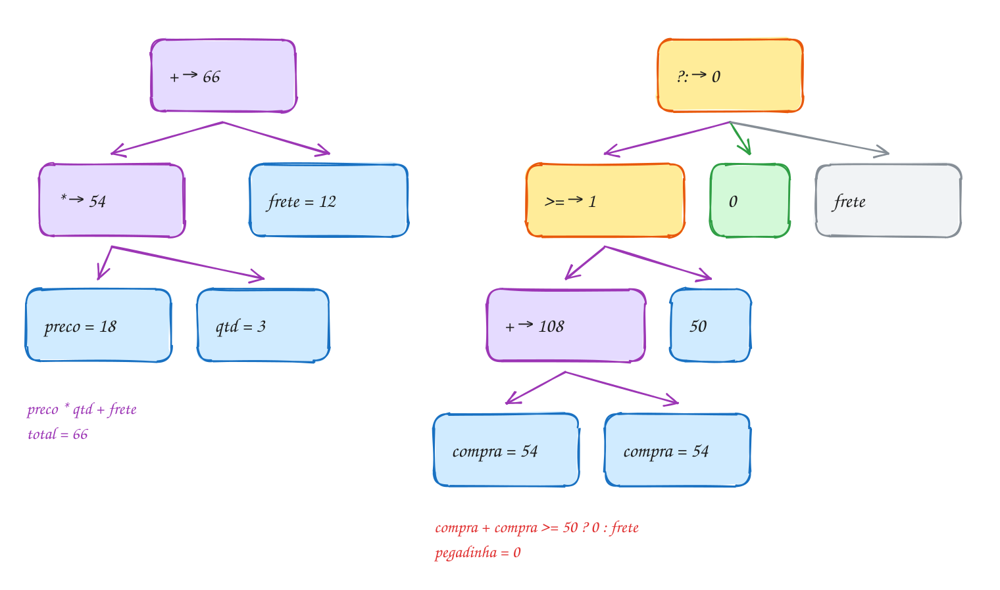
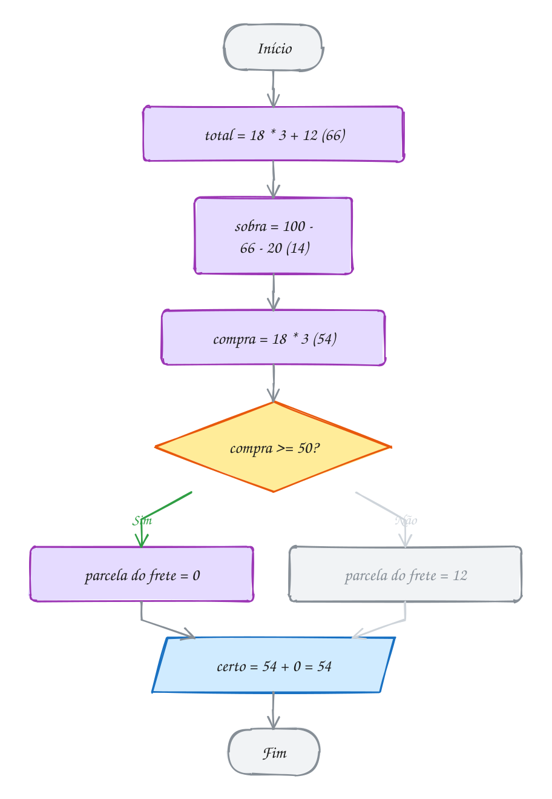
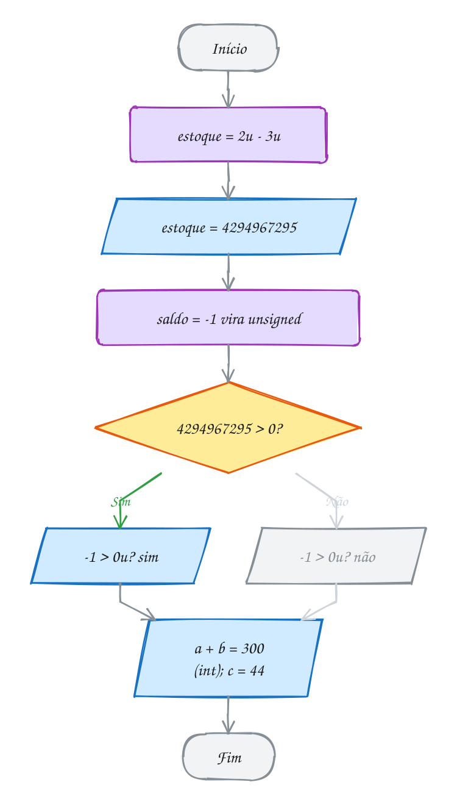
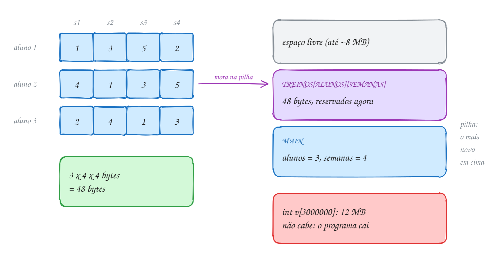
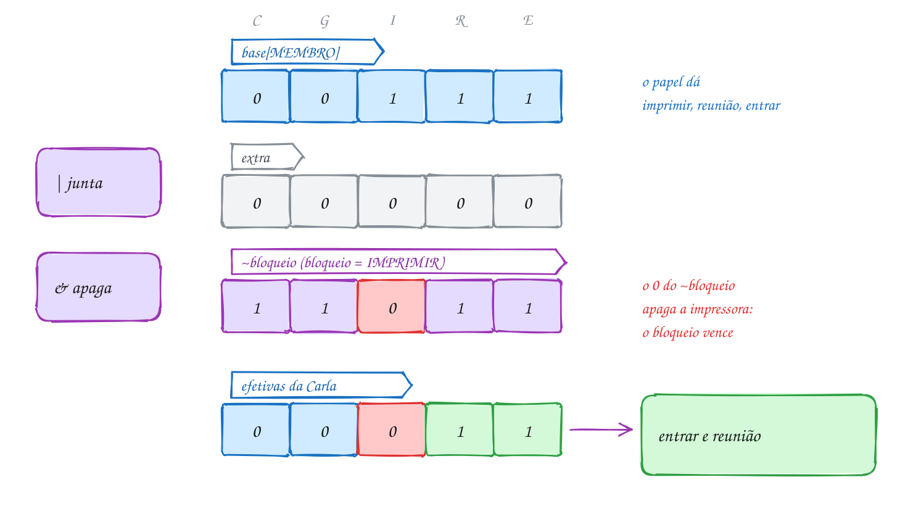
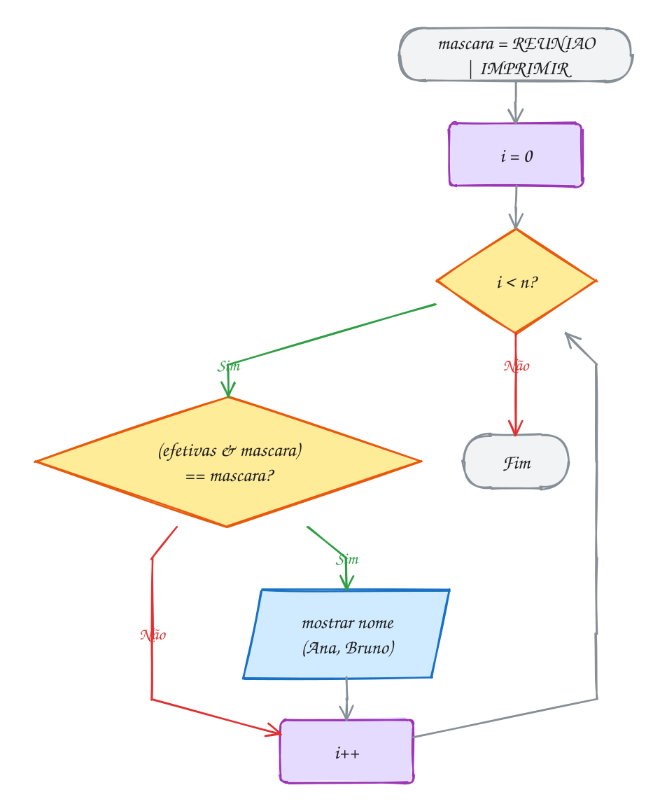

<!-- Gerado por _gerador. Para mudar este arquivo, edite _gerador/modulos/27-c-detalhes/ e rode: cd _gerador && npm run gerar -->

# Módulo 27 · Detalhes de C que caem em prova

> [!IMPORTANT]
> **Mundo 2 · Memória e dados · Rota do jogo: etapa 9 de 29 · módulo bônus ★**
>
> **Missão:** dominar as pegadinhas de precedência, sinal e VLA que a prova cobra.
>
> **Vem de:** [Módulo 08 · Tipos compostos](08-structs.md). **Segue para:** [Módulo 09 · Arquivos e linha de comando](09-arquivos.md).
>
> **Checkpoints desta fase:**
> - [ ] Ler os assuntos 0170 a 0173 e refazer os exemplos
> - [ ] Resolver os 4 exercícios de cada assunto, escrevendo o código sozinho
> - [ ] Fechar a lista prática (P2701 a P2730)
> - [ ] Enfrentar os desafios do módulo
> - [ ] Chefão: resolver as questões de prova do módulo sem consultar

Regras do C que a prova explora com código curto: precedência e ordem de
avaliação, mistura de inteiros com e sem sinal (por que `-1 > 0u` é
verdadeiro) e o vetor de tamanho variável (VLA). Relê os módulos 01 a 08 com
mais rigor.

## O que você vai aprender

- ler expressões pela **tabela de precedência e associatividade**
- separar **agrupamento** de **ordem de avaliação**, e reconhecer **efeito colateral** e o comportamento indefinido de `i = i++`
- prever a mistura de **com sinal e sem sinal**: promoção inteira, conversão aritmética usual, `-1 > 0u`
- usar `>>`, máscaras e `size_t` sem cair no negativo e no laço que desce
- criar e passar **VLAs** (`void f(int l, int c, int m[l][c])`) e conhecer o risco da pilha
- juntar tudo num controle de acesso com struct, enum, máscaras e VLA

## Antes de começar

Usa os operadores dos módulos 01 e 02, os bits e máscaras do 0065, struct e
enum do módulo 08 e `malloc`/`free` do módulo 07. Prepara os módulos 28 e 29,
que reusam máscaras e inteiros sem sinal.

Os valores dos comentários são de um PC de 64 bits com Linux e gcc: `int` e
`unsigned` com 4 bytes, `long` e `size_t` com 8. Compile com `-Wall -Wextra`:
os avisos pegam vários erros do módulo.

| # | Assunto |
| --- | --- |
| [0170](#0170--precedência-e-ordem-de-avaliação) | Precedência e ordem de avaliação |
| [0171](#0171--com-sinal-e-sem-sinal) | Com sinal e sem sinal |
| [0172](#0172--vetor-de-tamanho-variável-vla) | Vetor de tamanho variável (VLA) |
| [0173](#0173--juntando-tudo-o-controle-de-acesso) | Juntando tudo: o controle de acesso |

---

## 1. Conceitos gerais

### 0170 · Precedência e ordem de avaliação

- **Precedência**: diz qual operador pega os operandos primeiro; `*` vem antes
  de `+` (DEITEL; DEITEL, 2011, cap. 2).
- **Associatividade**: desempata operadores do mesmo nível. `100 - 66 - 20` é
  `(100 - 66) - 20`; `a = b = 5` é `a = (b = 5)` (KERNIGHAN; RITCHIE, 1988, cap. 2).
- **Três armadilhas da tabela**: `&`, `^` e `|` ficam **abaixo** do `==`; o
  `?:` fica abaixo de quase tudo; `a *= 2 + 1` é `a = a * (2 + 1)`
  (CPPREFERENCE, s.d.).
- **Ordem de avaliação**: agrupar não é calcular. Em `f() + g()` a ordem das
  chamadas não é especificada. Só `&&`, `||`, `?:` e a vírgula avaliam a
  esquerda antes da direita (ISO/IEC, 2018).
- **Curto-circuito**: em `&&`, o lado direito nem roda se o esquerdo der 0;
  em `||`, se der 1 (DEITEL; DEITEL, 2011, cap. 4).
- **Efeito colateral**: o que a expressão muda além de dar um valor (`i++`
  muda `i`, `printf` escreve). Mudar a mesma variável duas vezes sem ordem
  garantida é **comportamento indefinido**: `i = i++`, `v[i] = i++`
  (ISO/IEC, 2018).

| Nível | Operadores | Agrupa |
| --- | --- | --- |
| 1 | `()` `[]` `->` `.` `x++` `x--` | esquerda → direita |
| 2 | `++x` `--x` `+x` `-x` `!` `~` `*p` `&x` `(tipo)` `sizeof` | direita → esquerda |
| 3 | `*` `/` `%` | esquerda → direita |
| 4 | `+` `-` | esquerda → direita |
| 5 | `<<` `>>` | esquerda → direita |
| 6 | `<` `<=` `>` `>=` | esquerda → direita |
| 7 | `==` `!=` | esquerda → direita |
| 8 | `&` | esquerda → direita |
| 9 | `^` | esquerda → direita |
| 10 | `\|` | esquerda → direita |
| 11 | `&&` | esquerda → direita |
| 12 | `\|\|` | esquerda → direita |
| 13 | `?:` | direita → esquerda |
| 14 | `=` `+=` `-=` `*=` `/=` `%=` `<<=` `>>=` `&=` `^=` `\|=` | direita → esquerda |
| 15 | `,` | esquerda → direita |

> [!WARNING]
> `i = i++` é comportamento indefinido, e o gcc com `-Wall` avisa. Ele também
> avisa `x & 3 == 3` e `a || b && c`, mas **não**
> `compra + compra >= 50 ? 0 : frete`. Na dúvida, use parênteses.

### 0171 · Com sinal e sem sinal

- **Com sinal** (`int`, `signed char`, `long`): guarda negativos; num `int` de
  32 bits, de -2147483648 a 2147483647 (BACKES, 2013).
- **Sem sinal** (`unsigned`, `unsigned char`, `size_t`): vai de 0 a
  4294967295 (`UINT_MAX`). `sizeof` e `strlen` devolvem `size_t`
  (KERNIGHAN; RITCHIE, 1988, cap. 2).
- **Volta do sem sinal**: a conta é módulo 2³², como um odômetro. `2u - 3u` é
  4294967295 e `UINT_MAX + 1u` é 0. Estourar um `int` com sinal é
  comportamento indefinido (ISO/IEC, 2018).
- **Complemento de dois**: o -1 de um `int` são 32 bits ligados, que lidos como
  `unsigned` valem 4294967295 (DEITEL; DEITEL, 2011, apêndice D).
- **Promoção inteira**: `char`, `short`, `unsigned char`, `bool` e `enum`
  viram `int` antes da conta. `unsigned char` 200 + 100 dá 300 (ISO/IEC, 2018).
- **Conversão aritmética usual**: os operandos viram o tipo "maior". Entre
  `int` e `unsigned` do mesmo tamanho, ganha o `unsigned`; se o com sinal for
  maior e couber o sem sinal todo (`long` de 64 contra `unsigned` de 32), ganha
  o com sinal (KERNIGHAN; RITCHIE, 1988, cap. 2).
- **Bits e máscaras**: use `unsigned`; deslocar negativo é indefinido ou
  depende da implementação (DEITEL; DEITEL, 2011, cap. 10).

| Expressão | Resultado | Por quê |
| --- | --- | --- |
| `-1 > 0u` | verdadeiro | o `-1` vira 4294967295 |
| `-1L < 1u` | verdadeiro (Linux 64 bits) | o `unsigned` cabe no `long` |
| `2u - 3u` | 4294967295 | volta módulo 2³² |

> [!WARNING]
> `for (size_t i = n - 1; i >= 0; i--)` nunca termina: o `size_t` passa de 0
> para 18446744073709551615. Escreva `for (size_t i = n; i-- > 0;)`. E
> `strlen(a) - strlen(b) > 0` é verdadeiro sempre que os tamanhos diferem.

### 0172 · Vetor de tamanho variável (VLA)

- **VLA** (*variable length array*): vetor local cujo tamanho é uma expressão
  calculada na execução, como `int treinos[alunos][semanas];`. Veio no C99
  (ISO/IEC, 2018).
- **Onde mora**: na **pilha**; some no fim do bloco, sem `free`. Não pode ser
  `static` nem global (CPPREFERENCE, s.d.).
- **`sizeof` na execução**: `sizeof treinos` vale `alunos * semanas *
  sizeof(int)`, calculado na hora (ISO/IEC, 2018).
- **Sem inicializador**: `int v[n] = {0};` é erro no C17; zere com um laço
  (CPPREFERENCE, s.d.).
- **VLA como parâmetro**: `void f(int l, int c, int m[l][c])`. As dimensões
  vêm **antes** da matriz, porque o tipo `m[l][c]` usa as duas
  (ISO/IEC, 2018).
- **Opcional desde o C11**: o compilador sem VLA define `__STDC_NO_VLA__`
  (gcc e clang têm; o da Microsoft não). Para exigir VLA:

```c
#ifdef __STDC_NO_VLA__
#error "este programa precisa de VLA"
#endif
```

- **VLA no heap**: `int (*m)[c] = malloc(l * sizeof *m);` cria a matriz no
  heap, e `m[i][j]` continua valendo (veja o A344).

> [!WARNING]
> O VLA não avisa quando falha. A pilha do Linux tem uns **8 MB** (`ulimit -s`):
> `int v[n]` com 3 milhões de `int` derruba o programa. Use VLA só para
> tamanhos pequenos e conferidos; para o resto, `malloc`, que devolve `NULL`.

### 0173 · Juntando tudo: o controle de acesso

- **Permissão como bit**: cada permissão é um bit de um `unsigned`
  (`1u << 2`); ligar é `|`, apagar é `& ~`, testar é `&`
  (DEITEL; DEITEL, 2011, cap. 10).
- **Papel como enum**: o `enum` indexa o vetor `base`, que dá o pacote de cada
  papel (KERNIGHAN; RITCHIE, 1988, cap. 2).
- **Permissão efetiva**: `(base[u->papel] | u->extra) & ~u->bloqueio`. O `|`
  junta pacote e extras; o `~` inverte o bloqueio e o `&` apaga esses bits: o
  **bloqueio vence** (DEITEL; DEITEL, 2011, cap. 10).
- **Parênteses obrigatórios**: "tem tudo da máscara?" é
  `(efetivas & mascara) == mascara`, porque o `==` vem antes do `&`, como no 0170
  (CPPREFERENCE, s.d.).
- **Tudo `unsigned`**: `~` num `int` daria negativo, e misturar sinais abre a
  porta para o `-1 > 0u` do 0171 (ISO/IEC, 2018).
- **Planilha VLA**: `bool acesso[n][QTD_PERMS]`, com `n` numa variável (0172).

> [!WARNING]
> `efetivas(u) & mascara == mascara` vira `efetivas(u) & 1` e só olha o bit de
> ENTRAR (o gcc avisa). E `p = p | ~IMPRIMIR` no lugar de `p = p & ~IMPRIMIR`
> **liga todas as outras** permissões, sem aviso.

---

## 2. Exemplos de uso

Cada exemplo compila sozinho. Rode com o comando abaixo dele e compare com a saída no fim do código.

### 0170 · Precedência e ordem de avaliação

Três pacotes de café a R$ 18 mais R$ 12 de frete, com frete grátis a partir
de R$ 50. O operador de menor precedência fica na raiz da árvore e age por
último; no frete grátis, é o `?:`:

<p align="center"></p>

```c
#include <stdio.h>

int main(void) {
    int preco = 18, qtd = 3, frete = 12; // 3 pacotes de café a R$ 18

    int total = preco * qtd + frete;    // * antes de +: (18 * 3) + 12
    int outro = preco * (qtd + frete);  // parênteses mandam: 18 * 15
    printf("total = %d, outro = %d\n", total, outro);

    int sobra = 100 - total - 20;       // - é da esquerda: (100 - 66) - 20
    printf("sobra = %d\n", sobra);

    int a, b;
    a = b = 5;                          // = é da direita: a = (b = 5)
    a *= 2 + 1;                         // a = a * (2 + 1), não a * 2 + 1
    printf("a = %d, b = %d\n", a, b);

    int compra = preco * qtd;           // 54
    // frete grátis a partir de R$ 50: o ?: fica ABAIXO do +
    int pegadinha = compra + compra >= 50 ? 0 : frete; // ((54 + 54) >= 50) ? 0 : 12
    int certo = compra + (compra >= 50 ? 0 : frete);   // 54 + 0
    printf("pegadinha = %d, certo = %d\n", pegadinha, certo);

    int gratis = compra >= 50 && qtd >= 3; // relacionais antes de &&: (54 >= 50) && (3 >= 3)
    printf("frete grátis? %d\n", gratis);
    return 0;
}
// Saída:
// total = 66, outro = 270
// sobra = 14
// a = 15, b = 5
// pegadinha = 0, certo = 54
// frete grátis? 1
```

No fluxograma, o `?:` é uma pergunta escondida; no `certo`, ela olha só o
`compra`:

<p align="center"></p>

Com `-Wall`, o gcc avisa sobre `i = i++`:
`warning: operation on 'i' may be undefined [-Wsequence-point]`.

**Exemplo A339 · O lado direito que nem roda**

```c
#include <stdbool.h>
#include <stdio.h>

int consultas = 0; // quantas vezes o "banco" foi consultado

bool tem_saldo(int saldo, int valor) {
    consultas++;
    printf("  (consultou o saldo)\n");
    return saldo >= valor;
}

int main(void) {
    // && e ||: o lado esquerdo vai primeiro, e o direito só roda se precisar
    bool conta_ativa = false;
    printf("Pix de R$ 80 numa conta bloqueada:\n");
    if (conta_ativa && tem_saldo(200, 80)) {
        printf("  enviado\n");
    } else {
        printf("  recusado\n");
    }

    conta_ativa = true;
    printf("Pix de R$ 80 numa conta ativa:\n");
    if (conta_ativa && tem_saldo(200, 80)) {
        printf("  enviado\n");
    }
    printf("consultas ao saldo: %d\n", consultas);

    // ?: encadeado agrupa da direita: a ? x : (b ? y : z)
    int distancias[] = {3, 12, 40};
    for (int i = 0; i < 3; i++) {
        int km = distancias[i];
        int frete = km <= 5 ? 8 : km <= 15 ? 14 : 25;
        printf("%2d km -> frete R$ %d\n", km, frete);
    }

    // a vírgula: avalia a esquerda, descarta, e o valor é o da direita
    int fila[] = {1, 2, 3, 4, 5};
    for (int i = 0, j = 4; i < j; i++, j--) { // duas variáveis andando juntas
        int t = fila[i];
        fila[i] = fila[j];
        fila[j] = t;
    }
    printf("fila invertida:");
    for (int i = 0; i < 5; i++) {
        printf(" %d", fila[i]);
    }
    printf("\n");
    return 0;
}
// Saída:
// Pix de R$ 80 numa conta bloqueada:
//   recusado
// Pix de R$ 80 numa conta ativa:
//   (consultou o saldo)
//   enviado
// consultas ao saldo: 1
//  3 km -> frete R$ 8
// 12 km -> frete R$ 14
// 40 km -> frete R$ 25
// fila invertida: 5 4 3 2 1
```

```bash
gcc ~/LPEDC/material/A339.c -o ~/LPEDC/material/A339 && ~/LPEDC/material/A339
```

**Exemplo A340 · A ordem que o padrão não promete**

```c
#include <stdio.h>

int passo = 0; // marca a ordem em que as funções rodam

int pedir_pao(void) {
    printf("  pão chegou em %d\n", ++passo);
    return 7; // R$ 7
}

int pedir_cafe(void) {
    printf("  café chegou em %d\n", ++passo);
    return 5; // R$ 5
}

int main(void) {
    // a soma é sempre 12; QUEM roda primeiro, o padrão não diz
    printf("conta junta:\n");
    int conta = pedir_pao() + pedir_cafe();
    printf("  conta = %d\n", conta);

    // quando a ordem importa, separe em instruções: o ; fixa a ordem
    passo = 0;
    printf("conta em passos:\n");
    int pao = pedir_pao();
    int cafe = pedir_cafe();
    printf("  conta = %d\n", pao + cafe);

    // pré e pós-incremento, cada um sozinho na sua instrução
    int senha = 41;
    int chamada = senha++; // usa 41, depois senha vira 42
    printf("chamou %d, próxima senha %d\n", chamada, senha);
    chamada = ++senha;     // senha vira 43, depois usa 43
    printf("chamou %d, próxima senha %d\n", chamada, senha);

    // sizeof não avalia a expressão: o ++ abaixo NÃO acontece
    int n = 10;
    size_t bytes = sizeof(n++);
    printf("sizeof(n++) = %zu, n continua %d\n", bytes, n);
    return 0;
}
// Saída (a ordem da "conta junta" é a do gcc deste PC; outro compilador
// pode chamar o café primeiro):
// conta junta:
//   pão chegou em 1
//   café chegou em 2
//   conta = 12
// conta em passos:
//   pão chegou em 1
//   café chegou em 2
//   conta = 12
// chamou 41, próxima senha 42
// chamou 43, próxima senha 43
// sizeof(n++) = 4, n continua 10
```

```bash
gcc ~/LPEDC/material/A340.c -o ~/LPEDC/material/A340 && ~/LPEDC/material/A340
```

### 0171 · Com sinal e sem sinal

Uma loja vendeu 3 fones de um estoque `unsigned` de 2. O desenho mostra os 4
bytes do saldo -1 e as duas leituras; a comparação com `0u` usa a sem sinal:

<p align="center"></p>

```c
#include <limits.h>
#include <stdio.h>

int main(void) {
    unsigned estoque = 2;  // 2 fones na prateleira
    estoque = estoque - 3; // vendeu 3: unsigned não tem negativo, dá a volta
    printf("estoque = %u (UINT_MAX = %u)\n", estoque, UINT_MAX);

    int saldo = -1;        // R$ -1 na conta
    unsigned zero = 0u;
    // saldo > zero misturaria int e unsigned: o int viraria unsigned.
    // O gcc avisa (-Wsign-compare); aqui a conversão vai escrita, à vista
    printf("(unsigned)saldo = %u\n", (unsigned)saldo);
    printf("-1 > 0u? %s\n", (unsigned)saldo > zero ? "sim" : "não");
    printf("-1 > 0?  %s\n", saldo > 0 ? "sim" : "não");

    unsigned char a = 200, b = 100; // dois bytes de 0 a 255
    printf("a + b = %d\n", a + b);  // promoção: os dois viram int antes da soma
    unsigned char c = a + b;        // guardar num byte corta: 300 - 256
    printf("c = %d\n", c);
    return 0;
}
// Saída:
// estoque = 4294967295 (UINT_MAX = 4294967295)
// (unsigned)saldo = 4294967295
// -1 > 0u? sim
// -1 > 0?  não
// a + b = 300
// c = 44
```

No fluxograma, a pergunta real é sobre 4294967295:

<p align="center"></p>

**Exemplo A341 · Descendo com size_t sem cair do zero**

```c
#include <stdio.h>
#include <string.h>

int main(void) {
    int notas[] = {7, 9, 6, 10};
    size_t n = sizeof notas / sizeof notas[0]; // sizeof devolve size_t

    // testa e depois desce: i vale n-1, n-2, ..., 0 dentro do laço
    printf("de trás para a frente:");
    for (size_t i = n; i-- > 0;) {
        printf(" %d", notas[i]);
    }
    printf("\n");

    // a mesma forma não faz nada com um vetor vazio
    size_t vazio = 0;
    int voltas = 0;
    for (size_t i = vazio; i-- > 0;) {
        voltas++;
    }
    printf("com n = 0: %d voltas\n", voltas);

    // por que "for (size_t i = n - 1; ...)" é perigoso: n - 1 com n = 0
    printf("vazio - 1 = %zu\n", vazio - 1);

    // diferença de tamanhos: size_t menos size_t nunca é negativo
    const char *a = "Ana";
    const char *b = "Bernardo";
    printf("strlen(a) - strlen(b) = %zu\n", strlen(a) - strlen(b));
    printf("Ana é mais longo? %s (com a subtração)\n", strlen(a) - strlen(b) > 0 ? "sim" : "não");
    printf("Ana é mais longo? %s (comparando direto)\n", strlen(a) > strlen(b) ? "sim" : "não");
    return 0;
}
// Saída:
// de trás para a frente: 10 6 9 7
// com n = 0: 0 voltas
// vazio - 1 = 18446744073709551615
// strlen(a) - strlen(b) = 18446744073709551611
// Ana é mais longo? sim (com a subtração)
// Ana é mais longo? não (comparando direto)
```

```bash
gcc ~/LPEDC/material/A341.c -o ~/LPEDC/material/A341 && ~/LPEDC/material/A341
```

**Exemplo A342 · Promoção, conversão e deslocamento**

```c
#include <stdio.h>

int main(void) {
    // promoção inteira: o byte vira int antes do ~
    unsigned char x = 0x0F; // 0000 1111
    printf("~x = %d\n", ~x);                          // ~15 em int
    printf("(unsigned char)~x = %d\n", (unsigned char)~x); // de volta a 1 byte
    printf("sizeof x = %zu, sizeof(x + x) = %zu\n", sizeof x, sizeof(x + x));

    // conversão aritmética usual
    int i = -1;
    unsigned u = 1u;
    printf("i + u = %u\n", i + u);  // i vira unsigned: 4294967295 + 1 dá a volta
    printf("i - u = %u\n", i - u);  // seria -2, mas o resultado é unsigned
    long l = -1;                    // long de 64 bits cabe todo unsigned
    printf("l - u = %ld\n", l - u); // aqui o u vira long, e o -2 sobrevive

    // deslocamento à direita: divide por 2 a cada casa, mas arredonda diferente
    int queda = -17;
    // (o >> de um negativo depende do compilador; o gcc copia o bit de sinal)
    printf("-17 / 4 = %d, -17 >> 2 = %d\n", queda / 4, queda >> 2);
    unsigned positivo = 17u;
    printf(" 17 / 4 = %u,  17 >> 2 = %u\n", positivo / 4, positivo >> 2);

    // máscara: o cartão guarda o mês da validade nos 4 bits de baixo
    // e o ano (desde 2000) nos bits de cima
    unsigned validade = (31u << 4) | 9u; // 09/2031
    printf("validade: %02u/%u\n", validade & 0xFu, 2000u + (validade >> 4));
    return 0;
}
// Saída:
// ~x = -16
// (unsigned char)~x = 240
// sizeof x = 1, sizeof(x + x) = 4
// i + u = 0
// i - u = 4294967294
// l - u = -2
// -17 / 4 = -4, -17 >> 2 = -5
//  17 / 4 = 4,  17 >> 2 = 4
// validade: 09/2031
```

```bash
gcc ~/LPEDC/material/A342.c -o ~/LPEDC/material/A342 && ~/LPEDC/material/A342
```

### 0172 · Vetor de tamanho variável (VLA)

Uma planilha de treinos em que alunos e semanas só chegam na digitação. Com 3
alunos e 4 semanas, ela tem 12 `int`: 48 bytes na pilha:

<p align="center"></p>

```c
#include <stdio.h>

// treinos fictícios de cada aluno em cada semana (1 a 5)
void preencher(int l, int c, int m[l][c]) {
    for (int i = 0; i < l; i++) {
        for (int j = 0; j < c; j++) {
            m[i][j] = (3 * i + 2 * j) % 5 + 1;
        }
    }
}

// as dimensões vêm ANTES da matriz: o tipo m[l][c] usa l e c
int total_do_aluno(int l, int c, int m[l][c], int aluno) {
    int soma = 0;
    for (int j = 0; j < c; j++) {
        soma += m[aluno][j];
    }
    return soma;
}

int main(void) {
    int alunos, semanas;
    printf("Alunos e semanas: ");
    if (scanf("%d %d", &alunos, &semanas) != 2 || alunos < 1 || alunos > 100 ||
        semanas < 1 || semanas > 52) {
        printf("valores inválidos\n"); // VLA de tamanho <= 0 é indefinido
        return 1;
    }

    int treinos[alunos][semanas]; // VLA: o tamanho só existe agora
    printf("sizeof treinos = %zu bytes\n", sizeof treinos); // calculado na hora

    preencher(alunos, semanas, treinos);
    for (int i = 0; i < alunos; i++) {
        printf("aluno %d:", i + 1);
        for (int j = 0; j < semanas; j++) {
            printf(" %d", treinos[i][j]);
        }
        printf("  total %d\n", total_do_aluno(alunos, semanas, treinos, i));
    }
    return 0;
}
// Saída (digitando 3 4):
// Alunos e semanas: 3 4
// sizeof treinos = 48 bytes
// aluno 1: 1 3 5 2  total 11
// aluno 2: 4 1 3 5  total 13
// aluno 3: 2 4 1 3  total 10
```

No fluxograma, a validação vem **antes** do VLA: depois da declaração não há
como desistir nem saber se deu certo:

<p align="center"></p>

**Exemplo A343 · O sizeof que é calculado na hora**

```c
#include <stdio.h>

// uma barra do gráfico de vendas: o tamanho do vetor muda a cada chamada
void barra(const char *dia, int vendas) {
    char linha[vendas + 1]; // as estrelas + o '\0'
    for (int i = 0; i < vendas; i++) {
        linha[i] = '#';
    }
    linha[vendas] = '\0';
    printf("%s %-9s (sizeof linha = %zu)\n", dia, linha, sizeof linha);
}

int main(void) {
#ifdef __STDC_NO_VLA__
    printf("este compilador não tem VLA\n");
    return 1;
#else
    printf("este compilador tem VLA\n");
#endif

    const char *dias[] = {"seg", "ter", "qua", "qui"};
    int vendas[] = {3, 7, 5, 8};
    for (int i = 0; i < 4; i++) {
        barra(dias[i], vendas[i]); // cada chamada cria e destrói o seu VLA
    }

    // sizeof de um tipo VLA também é uma conta em tempo de execução
    int n = 6;
    printf("sizeof(int[n]) com n = %d: %zu\n", n, sizeof(int[n]));
    printf("sizeof(double[n][2]):      %zu\n", sizeof(double[n][2]));
    return 0;
}
// Saída:
// este compilador tem VLA
// seg ###       (sizeof linha = 4)
// ter #######   (sizeof linha = 8)
// qua #####     (sizeof linha = 6)
// qui ########  (sizeof linha = 9)
// sizeof(int[n]) com n = 6: 24
// sizeof(double[n][2]):      96
```

```bash
gcc ~/LPEDC/material/A343.c -o ~/LPEDC/material/A343 && ~/LPEDC/material/A343
```

**Exemplo A344 · A matriz grande vai para o heap**

```c
#include <stdio.h>
#include <stdlib.h>

// a função não sabe se a matriz veio da pilha ou do heap: tanto faz
long long somar(int l, int c, int m[l][c]) {
    long long soma = 0;
    for (int i = 0; i < l; i++) {
        for (int j = 0; j < c; j++) {
            soma += m[i][j];
        }
    }
    return soma;
}

int main(void) {
    int l = 2000, c = 1000; // 2 milhões de int: 8 MB, a pilha inteira

    // int m[l][c]; aqui derrubaria o programa. No heap, cabe:
    // m é um ponteiro para linhas de c int (um tipo VLA)
    int (*m)[c] = malloc(l * sizeof *m);
    if (m == NULL) {
        printf("sem memória\n"); // o malloc avisa; o VLA não avisaria
        return 1;
    }
    printf("sizeof *m = %zu bytes por linha\n", sizeof *m);
    printf("total = %zu bytes\n", l * sizeof *m);

    for (int i = 0; i < l; i++) {
        for (int j = 0; j < c; j++) {
            m[i][j] = i + j; // continua m[i][j], como numa matriz comum
        }
    }
    printf("m[1999][999] = %d\n", m[1999][999]);
    printf("soma = %lld\n", somar(l, c, m));

    free(m); // um malloc, um free: a matriz é um bloco só
    return 0;
}
// Saída:
// sizeof *m = 4000 bytes por linha
// total = 8000000 bytes
// m[1999][999] = 2998
// soma = 2998000000
```

```bash
gcc ~/LPEDC/material/A344.c -o ~/LPEDC/material/A344 && ~/LPEDC/material/A344
```

### 0173 · Juntando tudo: o controle de acesso

Um coworking dá permissões por papel (visitante, membro, admin), com
exceções. A Carla é membro (`00111`) com a impressora bloqueada; o desenho faz
a conta bit a bit:

<p align="center"></p>

```c
#include <stdbool.h>
#include <stdio.h>

typedef enum { VISITANTE, MEMBRO, ADMIN, QTD_PAPEIS } Papel;

// cada permissão é um bit
#define ENTRAR   (1u << 0) // E
#define REUNIAO  (1u << 1) // R
#define IMPRIMIR (1u << 2) // I
#define GARAGEM  (1u << 3) // G
#define CONFIG   (1u << 4) // C
#define QTD_PERMS 5

typedef struct {
    char nome[16];
    Papel papel;
    unsigned extra;    // concedidas além do papel
    unsigned bloqueio; // retiradas, mesmo que o papel dê
} Usuario;

// o que cada papel ganha de saída (na ordem do enum)
const unsigned base[QTD_PAPEIS] = {
    ENTRAR,                                          // visitante
    ENTRAR | REUNIAO | IMPRIMIR,                     // membro
    ENTRAR | REUNIAO | IMPRIMIR | GARAGEM | CONFIG,  // admin
};

unsigned efetivas(const Usuario *u) {
    return (base[u->papel] | u->extra) & ~u->bloqueio; // o bloqueio vence
}

bool pode(const Usuario *u, unsigned mascara) {
    return (efetivas(u) & mascara) == mascara; // tem TODAS da máscara
}

int main(void) {
    Usuario equipe[] = {
        {"Ana", ADMIN, 0, 0},
        {"Bruno", MEMBRO, GARAGEM, 0},
        {"Carla", MEMBRO, 0, IMPRIMIR}, // estourou a cota da impressora
        {"Davi", VISITANTE, REUNIAO, 0},
    };
    int n = 4; // uma variável: a matriz abaixo é um VLA
    const char *papeis[QTD_PAPEIS] = {"visitante", "membro", "admin"};

    bool acesso[n][QTD_PERMS]; // usuário x permissão
    for (int i = 0; i < n; i++) {
        for (int b = 0; b < QTD_PERMS; b++) {
            acesso[i][b] = pode(&equipe[i], 1u << b);
        }
    }

    printf("usuario  papel      E R I G C\n");
    for (int i = 0; i < n; i++) {
        printf("%-8s %-10s", equipe[i].nome, papeis[equipe[i].papel]);
        for (int b = 0; b < QTD_PERMS; b++) {
            printf(" %c", acesso[i][b] ? 'X' : '-');
        }
        printf("\n");
    }

    printf("pode REUNIAO | IMPRIMIR:");
    for (int i = 0; i < n; i++) {
        if (pode(&equipe[i], REUNIAO | IMPRIMIR)) {
            printf(" %s", equipe[i].nome);
        }
    }
    printf("\n");
    return 0;
}
// Saída:
// usuario  papel      E R I G C
// Ana      admin      X X X X X
// Bruno    membro     X X X X -
// Carla    membro     X X - - -
// Davi     visitante  X X - - -
// pode REUNIAO | IMPRIMIR: Ana Bruno
```

O fluxograma é um laço pela equipe com uma comparação de bits por pessoa:

<p align="center"></p>

**Exemplo A345 · Auditoria: quem fugiu do pacote do papel**

```c
#include <stdio.h>

typedef enum { VISITANTE, MEMBRO, ADMIN, QTD_PAPEIS } Papel;

#define ENTRAR   (1u << 0)
#define REUNIAO  (1u << 1)
#define IMPRIMIR (1u << 2)
#define GARAGEM  (1u << 3)
#define CONFIG   (1u << 4)
#define QTD_PERMS 5

typedef struct {
    char nome[16];
    Papel papel;
    unsigned extra;
    unsigned bloqueio;
} Usuario;

const unsigned base[QTD_PAPEIS] = {
    ENTRAR,
    ENTRAR | REUNIAO | IMPRIMIR,
    ENTRAR | REUNIAO | IMPRIMIR | GARAGEM | CONFIG,
};

unsigned efetivas(const Usuario *u) {
    return (base[u->papel] | u->extra) & ~u->bloqueio;
}

// escreve as letras dos bits ligados, ou "nada"
void letras(unsigned m, char saida[QTD_PERMS + 1]) {
    const char nomes[] = "ERIGC";
    int k = 0;
    for (int b = 0; b < QTD_PERMS; b++) {
        if (m & (1u << b)) {
            saida[k++] = nomes[b];
        }
    }
    saida[k] = '\0';
}

int contar_bits(unsigned m) {
    int n = 0;
    while (m != 0) {
        m &= m - 1; // apaga o bit 1 mais baixo
        n++;
    }
    return n;
}

int main(void) {
    Usuario equipe[] = {
        {"Ana", ADMIN, 0, 0},
        {"Bruno", MEMBRO, GARAGEM, 0},
        {"Carla", MEMBRO, 0, IMPRIMIR},
        {"Davi", VISITANTE, REUNIAO, ENTRAR | CONFIG}, // bloqueio de algo que nem tinha
    };
    for (int i = 0; i < 4; i++) {
        unsigned b = base[equipe[i].papel];
        unsigned e = efetivas(&equipe[i]);
        unsigned diferentes = b ^ e;     // XOR: 1 onde o papel e o real discordam
        unsigned ganhou = e & ~b;        // tem, mas o papel não dava
        unsigned perdeu = b & ~e;        // o papel dava, mas não tem
        char g[QTD_PERMS + 1], p[QTD_PERMS + 1];
        letras(ganhou, g);
        letras(perdeu, p);
        printf("%-6s %d diferença(s)  ganhou: %-3s perdeu: %s\n", equipe[i].nome,
               contar_bits(diferentes), g[0] ? g : "-", p[0] ? p : "-");
    }
    return 0;
}
// Saída:
// Ana    0 diferença(s)  ganhou: -   perdeu: -
// Bruno  1 diferença(s)  ganhou: G   perdeu: -
// Carla  1 diferença(s)  ganhou: -   perdeu: I
// Davi   2 diferença(s)  ganhou: R   perdeu: E
```

```bash
gcc ~/LPEDC/material/A345.c -o ~/LPEDC/material/A345 && ~/LPEDC/material/A345
```

**Exemplo A346 · O que a equipe inteira tem**

```c
#include <stdio.h>

#define ENTRAR   (1u << 0)
#define REUNIAO  (1u << 1)
#define IMPRIMIR (1u << 2)
#define GARAGEM  (1u << 3)
#define CONFIG   (1u << 4)
#define QTD_PERMS 5

void mostrar(const char *titulo, unsigned m) {
    const char nomes[] = "ERIGC";
    for (int b = 0; b < QTD_PERMS; b++) {
        printf("%c", (m & (1u << b)) ? nomes[b] : '-');
    }
    printf("  %s\n", titulo);
}

int main(void) {
    // as permissões efetivas de uma equipe de tamanho variável
    unsigned todas[] = {
        ENTRAR | REUNIAO | IMPRIMIR | GARAGEM,
        ENTRAR | REUNIAO | GARAGEM,
        ENTRAR | REUNIAO,
        ENTRAR | REUNIAO,
        ENTRAR | IMPRIMIR,
    };
    int n = 5;
    unsigned equipe[n]; // VLA: só a equipe deste turno
    for (int i = 0; i < n; i++) {
        equipe[i] = todas[i];
    }

    unsigned alguem = 0;     // começa sem nada: o OU vai acendendo
    unsigned todo_mundo = ~0u; // começa com tudo: o E vai apagando
    for (int i = 0; i < n; i++) {
        alguem |= equipe[i];
        todo_mundo &= equipe[i];
    }
    mostrar("alguém tem", alguem);
    mostrar("todo mundo tem", todo_mundo);
    mostrar("ninguém tem (dos 5 bits)", ~alguem & ((1u << QTD_PERMS) - 1)); // só 5 bits

    // contagem por permissão numa matriz VLA permissão x pessoa
    int perms = QTD_PERMS;
    int tem[perms][n];
    for (int b = 0; b < perms; b++) {
        for (int i = 0; i < n; i++) {
            tem[b][i] = (equipe[i] >> b) & 1u;
        }
    }
    printf("quantos têm cada uma:");
    for (int b = 0; b < perms; b++) {
        int soma = 0;
        for (int i = 0; i < n; i++) {
            soma += tem[b][i];
        }
        printf(" %c=%d", "ERIGC"[b], soma);
    }
    printf("\n");
    return 0;
}
// Saída:
// ERIG-  alguém tem
// E----  todo mundo tem
// ----C  ninguém tem (dos 5 bits)
// quantos têm cada uma: E=5 R=4 I=2 G=2 C=0
```

```bash
gcc ~/LPEDC/material/A346.c -o ~/LPEDC/material/A346 && ~/LPEDC/material/A346
```

---

## 3. Exercícios práticos

Cada exercício é um arquivo em `material/` com o esqueleto, as dicas e o espaço para a resposta. Compile como os exemplos: `gcc ~/LPEDC/material/E007.c -o ~/LPEDC/material/E007 && ~/LPEDC/material/E007`. Resoluções em `_respostas/27-c-detalhes/`.

### 0170 · Precedência e ordem de avaliação

**Exercício E1016** · ★☆☆

Escreva um programa que mostre, para cada expressão abaixo, o valor dela
como está e o valor da mesma conta com todos os parênteses no jeito que o
C agrupa. Os dois números de cada linha têm que bater. Para as duas
últimas, que são atribuições, mostre as variáveis depois da instrução.

```text
100 / 10 / 5      2 - 3 - 4      2 * 3 % 4
a = b = c = 7     x = 5; x -= 1 + 2
```

```text
Saída esperada:
100 / 10 / 5 = 2   ((100 / 10) / 5) = 2
2 - 3 - 4 = -5   ((2 - 3) - 4) = -5
2 * 3 % 4 = 2   ((2 * 3) % 4) = 2
a = b = c = 7 -> a = 7, b = 7, c = 7
x -= 1 + 2 -> x = 2
```

**Exercício E1017** · ★★☆

Escreva as duas funções abaixo, que fazem o trabalho de x++ e ++x
recebendo o endereço da variável:

```text
int pos_incremento(int *p)  // devolve o valor antigo, depois soma 1
int pre_incremento(int *p)  // soma 1, depois devolve o valor novo
```

No main, comece com a = 5, calcule b = a++ * 2 e c = ++a * 2 com os
operadores e mostre a linha "com ++". Refaça as mesmas contas com as
suas funções, em a2, b2 e c2, e mostre a linha "com funcoes".

```text
Saída esperada:
com ++:      a = 7, b = 10, c = 14
com funcoes: a = 7, b = 10, c = 14
```

**Exercício E1018** · ★★☆

Quatro amigos alugaram uma casa de praia por R$ 2400 para 3 dias.
Escreva um programa, com int total, pessoas e dias, que mostre:

```text
- o custo por pessoa por dia: o total dividido por (pessoas x dias);
- quanto cada um paga: a sua parte do total mais R$ 50 de limpeza
  quando a estadia passa de 2 dias;
- o desconto à vista: 10% do total.
```

```text
Saída esperada:
por pessoa por dia: R$ 200
cada um paga: R$ 650
desconto à vista: R$ 240
```

**Exercício E1020** · ★★★

Um colega escreveu a busca de um código no estoque assim:

```text
while (v[i] != alvo && i < n) i++;
```

Quando o código não existe, ele lê v[n], que fica fora do vetor (o
AddressSanitizer acusa). Escreva a versão segura:

```text
int procurar(const int *v, int n, int alvo, int *lidos)
```

Ela devolve o índice do alvo, ou -1, e conta em *lidos quantas vezes leu
uma casa do vetor. Teste com os códigos {12, 7, 30, 7, 55}, procurando 30
e 99, e com um vetor vazio (n = 0).

```text
Saída esperada:
procurar 30: indice 2, leituras 3
procurar 99: indice -1, leituras 5
vetor vazio: indice -1, leituras 0
```

### 0171 · Com sinal e sem sinal

**Exercício E1021** · ★☆☆

Um unsigned char é um odômetro de 0 a 255. Escreva um programa que:

```text
- começa um unsigned char contador em 250 e, num laço de 10 voltas,
  soma 1 e mostra o valor, tudo na mesma linha;
- começa um unsigned char vidas em 2 e, num laço de 3 voltas, tira 1 e
  mostra o valor.
```

```text
Saída esperada:
contador: 251 252 253 254 255 0 1 2 3 4
vidas: 1 0 255
```

**Exercício E1023** · ★★☆

Este laço, que deveria mostrar a fila de trás para a frente, nunca
termina (e o gcc avisa que "i >= 0" é sempre verdadeiro):

```text
for (size_t i = n - 1; i >= 0; i--) printf(" %s", fila[i]);
```

Escreva, com índices size_t que descem sem cair do zero:

```text
- void mostrar_ao_contrario(const char *fila[], size_t n): mostra os
  nomes do último ao primeiro, ou "(nada)" se n for 0;
- size_t ultimo_par(const int *v, size_t n): procura de trás para a
  frente e devolve o índice do último número par, ou n se não houver.
```

Teste com a fila {"Ana", "Bia", "Caio"}, com uma fila vazia, e com os
vetores {3, 8, 5, 4, 7} e {1, 3}.

```text
Saída esperada:
fila: Caio Bia Ana
fila vazia: (nada)
ultimo par em {3, 8, 5, 4, 7}: indice 3
ultimo par em {1, 3}: nenhum
```

**Exercício E1024** · ★★☆

Escreva duas funções que não caiam na armadilha do size_t, que nunca é
negativo:

```text
const char *mais_longo(const char *a, const char *b)
size_t restantes(const char *msg, size_t limite)
```

mais_longo devolve o nome mais comprido (no empate, o segundo).
restantes diz quantos caracteres ainda cabem numa mensagem de até
limite caracteres, e dá 0 quando a mensagem já passou. No main, chame
mais_longo com ("Ana", "Bernardo") e ("Bernardo", "Ana"), e restantes com
"Oi, tudo bem?" e com "Chego em 15 minutos, me espera", ambas com limite 20.

```text
Saída esperada:
mais longo: Bernardo
mais longo: Bernardo
restam 7 caracteres
restam 0 caracteres
```

**Exercício E1025** · ★★★

Um leitor de código de barras manda os bytes de um boleto e, no fim, um
byte verificador: o número que, somado a todos os bytes, dá 0 módulo 256.
Escreva:

```text
- unsigned char verificador(const unsigned char *d, size_t n);
- bool confere(const unsigned char *d, size_t n, unsigned char v), que
  soma os bytes e o v e diz se o byte da soma é 0.
```

Teste com os bytes {0x12, 0xA0, 0xFF, 0x31} e depois troque o 0xA0 por
0xA1, como se um bit tivesse se perdido na transmissão.

```text
Saída esperada:
verificador = 0x1E
original: confere
alterado: nao confere
```

### 0172 · Vetor de tamanho variável (VLA)

**Exercício E1027** · ★☆☆

Escreva void multiplos(int base, int n), que cria um VLA int t[n], guarda
nele os n primeiros múltiplos de base, mostra os valores e, no fim da
linha, o sizeof t. Chame com (7, 3) e com (9, 5).

```text
Saída esperada:
7: 7 14 21 (12 bytes)
9: 9 18 27 36 45 (20 bytes)
```

**Exercício E1029** · ★★☆

Escreva duas funções com parâmetros VLA:

```text
void mostrar(int l, int c, int m[l][c])
void transpor(int l, int c, int a[l][c], int t[c][l])
```

A transposta troca linhas por colunas: t[j][i] = a[i][j]. No main, com
int l = 2, c = 3, crie os VLAs a[l][c] e t[c][l], preencha a com 1 a 6
(linha por linha), transponha e mostre as duas.

```text
Saída esperada:
original (2 x 3):
  1  2  3
  4  5  6
transposta (3 x 2):
  1  4
  2  5
  3  6
```

**Exercício E1030** · ★★☆

Escreva um programa que calcule o preço médio de n = 3000000 produtos.
Guarde os preços num vetor double *precos obtido com malloc (24 MB não
cabem na pilha, por isso nada de VLA), confira se deu NULL e libere com
free no fim. O preço do produto i é i % 100 + 0.5.

```text
Saída esperada:
n = 3000000, media = R$ 50.00
```

**Exercício E1031** · ★★★

Duas lojas fazem a compra do mês de 3 produtos (arroz, feijão, café), e
dois fornecedores, A e B, cobram preços diferentes. Multiplique a matriz
de quantidades (lojas x produtos) pela de preços (produtos x
fornecedores) para obter o custo de cada loja em cada fornecedor:

```text
void multiplicar(int l, int m, int c, int a[l][m], int b[m][c], int r[l][c])
```

Depois mostre o custo e o fornecedor mais barato para cada loja.

```text
quantidades:  loja 1: 10, 0, 5     loja 2: 2, 8, 4
preços:       arroz: A 3, B 4      feijão: A 6, B 5    café: A 2, B 1
```

```text
Saída esperada:
loja 1: A = R$ 40, B = R$ 45 -> melhor A
loja 2: A = R$ 62, B = R$ 52 -> melhor B
```

### 0173 · Juntando tudo: o controle de acesso

**Exercício E1033** · ★☆☆

Escreva as três operações básicas sobre as permissões de uma pessoa:

```text
void conceder(unsigned *p, unsigned m)  // liga os bits de m
void revogar(unsigned *p, unsigned m)   // desliga os bits de m
bool tem(unsigned p, unsigned m)        // p tem TODOS os bits de m?
```

Comece com p = ENTRAR, conceda REUNIAO | IMPRIMIR, revogue IMPRIMIR e
teste REUNIAO e depois REUNIAO | IMPRIMIR, mostrando p a cada passo.

```text
Saída esperada:
inicio: 1
conceder R|I: 7
revogar I: 3
tem R? sim
tem R|I? nao
```

**Exercício E1035** · ★★☆

Escreva duas funções sobre as permissões:

```text
unsigned revogar(unsigned p, unsigned m)  // p sem os bits de m
bool tem_todas(unsigned p, unsigned m)    // p tem TODOS os bits de m?
```

No main, comece com p = ENTRAR | REUNIAO | IMPRIMIR, revogue IMPRIMIR,
mostre p e teste REUNIAO | IMPRIMIR e depois ENTRAR | REUNIAO.

```text
Saída esperada:
depois de revogar: 3
tem R e I? nao
tem E e R? sim
```

**Exercício E1036** · ★★☆

O coworking quer descobrir permissões que ninguém usa. A matriz uso
guarda, para cada pessoa (linha) e cada dia (coluna), a máscara dos
recursos que ela usou. Escreva, com a matriz como parâmetro VLA:

```text
unsigned usado(int n, int d, unsigned uso[n][d], int i)
```

que junta (com |) tudo o que a pessoa i usou nos d dias. Depois mostre,
para cada pessoa, o que usou e o que tem mas nunca usou (as efetivas
estão no vetor efetivas), no formato E R I G C com '-'.

```text
Saída esperada:
Ana: usou ER--C, nunca usou --IG-
Bruno: usou ERIG-, nunca usou -----
Carla: usou E----, nunca usou -R---
```

**Exercício E1037** · ★★★

Quando alguém pede um conjunto de permissões, o coworking oferece o
papel mais barato que cobre o pedido. Escreva:

```text
int menor_papel(unsigned pedido)
```

que devolve o primeiro papel (VISITANTE, MEMBRO, ADMIN, nessa ordem) cujo
pacote base tem TODAS as permissões do pedido, ou -1 se nenhum tem. E,
para cada pedido, mostre também o que falta ao visitante (o que o pedido
tem e o pacote do visitante não tem), como texto E R I G C.

Teste com os pedidos ENTRAR, REUNIAO | IMPRIMIR, GARAGEM e 1u << 5 (uma
sexta permissão, que nenhum papel dá).

```text
Saída esperada:
pedido E----: visitante (falta ao visitante: -----)
pedido -RI--: membro (falta ao visitante: -RI--)
pedido ---G-: admin (falta ao visitante: ---G-)
pedido -----: nenhum (falta ao visitante: -----)
```

### Lista do módulo

30 exercícios que misturam os assuntos do módulo, no ritmo da prova. Arquivos P2701.c a P2730.c, em `material/`; resoluções em `_respostas/27-c-detalhes/lista/`.

#### ★☆☆ Aquecimento

**Exercício P2701** · ★☆☆ · A calculadora do caixa

Escreva int calcular(int a, char op, int b, int *resultado), que usa um
switch sobre op ('+', '-', '*', '/') para fazer a conta e guardar em
*resultado. Ela devolve 1 se deu certo, 0 se a divisão é por zero e -1 se
a operação não existe. No main, faça as contas abaixo e mostre cada uma.

```text
12 + 5    12 - 5    12 * 5    12 / 5    7 / 0    12 % 5
```

```text
Saída esperada:
12 + 5 = 17
12 - 5 = 7
12 * 5 = 60
12 / 5 = 2
7 / 0: divisão por zero
12 % 5: operação inválida
```

---

**Exercício P2702** · ★☆☆ · Dígitos com do/while

Escreva int contar_digitos(unsigned n) e unsigned somar_digitos(unsigned n),
as duas com do/while. O do/while roda o corpo pelo menos uma vez, e é
exatamente isso que faz o 0 ter 1 dígito. Teste com 0, 7, 2026 e 1000000.

```text
Saída esperada:
0: 1 dígito(s), soma 0
7: 1 dígito(s), soma 7
2026: 4 dígito(s), soma 10
1000000: 7 dígito(s), soma 1
```

---

**Exercício P2703** · ★☆☆ · A conta de luz

A conta de luz cobra cada kWh pela tarifa mais a bandeira, e soma uma taxa
fixa. Com 250 kWh, tarifa de 80 centavos, bandeira de 10 centavos por kWh e
taxa de R$ 15,00, a conta é R$ 240,00. O programa abaixo compila sem aviso,
mas as duas contas estão erradas. Conserte só com parênteses e com a ordem
das operações.

```text
Saída esperada:
total: R$ 240.00
bandeira: 11% do preço do kWh
```

---

**Exercício P2704** · ★☆☆ · Quatro operações sobre um bit

Escreva as funções abaixo, com n de 0 a 7, e uma void mostrar(unsigned x)
que escreve os 8 bits de baixo de x:

```text
bool testar(unsigned x, int n)
unsigned ligar(unsigned x, int n)
unsigned desligar(unsigned x, int n)
unsigned inverter(unsigned x, int n)
```

Comece com x = 0x2C e mostre o que se pede.

```text
Saída esperada:
x = 00101100
bit 3 ligado? sim
ligar 0 -> 00101101
desligar 5 -> 00001100
inverter 7 -> 10101100
```

---

**Exercício P2705** · ★☆☆ · Para onde vai o negativo

Converter um valor para um tipo sem sinal é sempre definido: o C soma ou
subtrai 2^bits até o valor caber. Escreva um programa que guarde cada valor
abaixo numa variável do tipo pedido e mostre o resultado:

```text
-1 em unsigned char      256 em unsigned char    300 em unsigned char
-2 em unsigned short     -3 em unsigned
```

```text
Saída esperada:
(unsigned char)-1 = 255
(unsigned char)256 = 0
(unsigned char)300 = 44
(unsigned short)-2 = 65534
(unsigned)-3 = 4294967293
```

---

**Exercício P2706** · ★☆☆ · Três idades em ordem

Escreva void trocar(int *a, int *b) e void ordenar3(int *a, int *b, int *c),
que deixa os três valores em ordem crescente usando só trocar. No main, as
idades da família são 30, 12 e 25, em três variáveis separadas.

```text
Saída esperada:
antes: 30 12 25
depois: 12 25 30
```

---

**Exercício P2707** · ★☆☆ · A lista da feira no arquivo

Grave a lista da feira no arquivo p2707_feira.txt, um item por linha no
formato nome;preço, com fopen e fprintf. Feche, abra de novo para leitura,
leia cada linha com fscanf e some os preços. No fim, apague o arquivo com
remove.

```text
banana 6.50    tomate 8.90    alface 3.00    queijo 22.40
```

```text
Saída esperada:
gravados 4 itens
banana: R$ 6.50
tomate: R$ 8.90
alface: R$ 3.00
queijo: R$ 22.40
total da feira: R$ 40.80
```

---

**Exercício P2708** · ★☆☆ · Dia útil ou fim de semana

Crie typedef enum { DOM, SEG, TER, QUA, QUI, SEX, SAB } Dia; e um vetor com
os nomes. Escreva const char *tipo(Dia d) com um switch em que DOM e SAB
dividem o mesmo case (um embaixo do outro, sem break entre eles) e os
outros dias caem no default. Mostre o tipo de DOM, QUA e SAB e, no fim, o
dia que fica 2 depois de QUA, usando que um enum é um int.

```text
Saída esperada:
DOM: fim de semana
QUA: dia útil
SAB: fim de semana
QUA + 2 = SEX (5)
```

---

**Exercício P2709** · ★☆☆ · Notas válidas com macros

Defina, com #define, a constante QTD_NOTAS (5) e as macros
QUADRADO(x) e ENTRE(x, a, b) (verdadeiro se a <= x <= b), com todos os
parênteses que uma macro precisa. Para as notas {7, 11, -1, 10, 5}, diga
quais são válidas (de 0 a 10) e some os quadrados das válidas.

```text
Saída esperada:
nota 7: válida
nota 11: inválida
nota -1: inválida
nota 10: válida
nota 5: válida
válidas: 3, soma dos quadrados: 174
```

---

**Exercício P2710** · ★☆☆ · A semana mais quente

As máximas da semana em Manaus foram {28, 31, 33, 29, 35, 30, 27}, de
domingo (dia 0) a sábado (dia 6). Escreva um programa que mostre a média
com duas casas, quantos dias ficaram acima da média e o dia mais quente.

```text
Saída esperada:
média = 30.43
acima da média: 3 dias
mais quente: 35 no dia 4
```

#### ★★☆ Para pensar

**Exercício P2711** · ★★☆ · O estoque que não fica negativo

Com typedef struct { char nome[20]; unsigned qtd; double preco; } Produto;,
escreva:

```text
bool vender(Produto *p, unsigned q)  // recusa se não houver q unidades
double valor_estoque(const Produto v[], int n)
```

Como qtd é unsigned, uma venda maior que o estoque daria a volta para um
número enorme: vender tem que conferir ANTES de subtrair. Estoque inicial:
café (10 a R$ 18.00), açúcar (4 a R$ 5.50), leite (12 a R$ 6.00). Venda 3
cafés, 5 açúcares e 12 leites.

```text
Saída esperada:
vender 3 café: ok
vender 5 açúcar: recusada (só 4)
vender 12 leite: ok
café: 7, açúcar: 4, leite: 0
valor em estoque: R$ 148.00
```

---

**Exercício P2712** · ★★☆ · A célula da planilha (union com etiqueta)

Uma célula de planilha guarda um inteiro, um número real ou um texto, um
de cada vez. Monte uma union com etiqueta:

```text
typedef enum { INTEIRO, REAL, TEXTO } Tipo;
typedef struct { Tipo tipo; union { int i; double d; char s[16]; } v; } Celula;
```

Escreva void mostrar(const Celula *c), com um switch sobre c->tipo que lê
só o campo certo da union. Mostre as células 42, 3.14 e "feira" e, no fim,
o sizeof de Celula e da union.

```text
Saída esperada:
inteiro: 42
real: 3.14
texto: feira
sizeof(Celula) = 24, sizeof da union = 16
```

---

**Exercício P2713** · ★★☆ · Quem ganhou o jogo da velha

Escreva char vencedor(char t[3][3]), que devolve 'X' ou 'O' se alguma linha,
coluna ou diagonal tem três iguais, ou '-' se ninguém ganhou. Teste com os
dois tabuleiros abaixo ('.' é casa vazia).

```text
tabuleiro 1:  X O .     tabuleiro 2:  X O X
              O X .                   X O O
              . O X                   O X X
```

```text
Saída esperada:
tabuleiro 1: vencedor X
tabuleiro 2: vencedor -
```

---

**Exercício P2714** · ★★☆ · Um processador de brinquedo

Um processador de brinquedo tem instruções de 1 byte: os bits 7-6 são o
código da operação (00 LOAD, 01 ADD, 10 SUB, 11 JMP) e os bits 5-0 são o
operando (0 a 63). Escreva um programa que, com um switch, execute os bytes
{0x05, 0x47, 0x83, 0xC0} sobre um acumulador que começa em 0, mostrando
cada instrução decodificada.

```text
Saída esperada:
0x05: LOAD 5 -> acc = 5
0x47: ADD 7 -> acc = 12
0x83: SUB 3 -> acc = 9
0xC0: JMP 0 (fim do programa)
```

---

**Exercício P2715** · ★★☆ · O inverno em Gramado

O programa abaixo compila sem nenhum aviso, mas as duas funções erram por
misturar int e unsigned:

```text
- media devolve a média das temperaturas, e sai um número absurdo;
- compara devolve -1, 0 ou 1 conforme a é menor, igual ou maior que b, e
  diz que 3 é maior que 7.
```

Conserte as duas sem mudar as assinaturas.

```text
Saída esperada:
média: -2.00
compara(3, 7) = -1
compara(7, 3) = 1
compara(5, 5) = 0
```

---

**Exercício P2716** · ★★☆ · A tabela de distâncias da BR

Quatro cidades ficam na mesma rodovia, nos quilômetros {0, 12, 30, 45}.
Com int n = 4, crie um VLA int d[n][n] com a distância entre cada par
(|km[i] - km[j]|), mostre a tabela e o par mais distante. Escreva o
preenchimento e a busca como funções com parâmetro VLA.

```text
Saída esperada:
  0 12 30 45
 12  0 18 33
 30 18  0 15
 45 33 15  0
mais distantes: 0 e 3 (45 km)
```

---

**Exercício P2717** · ★★☆ · Boletim em arquivo binário

Com typedef struct { char nome[16]; float nota; } Aluno;, grave os 4
alunos abaixo de uma vez no arquivo p2717_boletim.bin com fwrite. Feche,
abra de novo, leia registro por registro com fread e mostre só os
aprovados (nota >= 7). No fim, apague o arquivo.

```text
Ana 8.5    Bruno 6.0    Caio 7.0    Duda 4.5
```

```text
Saída esperada:
gravados 4 registros (80 bytes)
aprovado: Ana (8.5)
aprovado: Caio (7.0)
```

---

**Exercício P2718** · ★★☆ · A catraca do ônibus

A catraca tem dois estados, typedef enum { TRAVADA, LIBERADA } Estado;, e
recebe dois eventos: 'M' (moeda) e 'P' (empurrar). Travada, a moeda
libera e o empurrão é bloqueado; liberada, o empurrão deixa passar e trava
de novo, e uma moeda a mais é desperdiçada. Processe a sequência "PMPMMPP"
com um do/while sobre a string e um switch sobre o estado, contando
passagens, moedas, moedas desperdiçadas e bloqueios.

```text
Saída esperada:
passagens: 2
moedas: 3 (1 desperdiçada)
bloqueios: 2
```

---

**Exercício P2719** · ★★☆ · Ordenar andando com ponteiros

Sem usar índice nenhum (nada de v[i]), só aritmética de ponteiros, escreva:

```text
int *maior(int *ini, int *fim)   // o maior em [ini, fim); fim fica de fora
void ordenar(int *ini, int *fim) // ordem crescente, por seleção
```

Ordenar coloca o maior do trecho na última posição, encurta o trecho e
repete. Use com o vetor {42, 7, 19, 88, 3} e mostre o índice do maior
com a diferença de ponteiros.

```text
Saída esperada:
maior: 88 no índice 3
ordenado: 3 7 19 42 88
```

---

**Exercício P2720** · ★★☆ · Uma biblioteca de bits em macros

Escreva quatro macros para mexer em bits de um uint8_t, com todos os
parênteses que uma macro precisa:

```text
BIT(n)        o número só com o bit n ligado
LIGA(x, n)    x com o bit n ligado
DESLIGA(x, n) x com o bit n desligado
TESTA(x, n)   1 se o bit n de x está ligado, senão 0
```

Para provar que as macros estão blindadas, use argumentos com
expressões: comece com uint8_t flags = 0; ligue o bit 1 + 1 e o bit 6,
desligue o bit 2 * 3 e teste !TESTA(flags, 2) e TESTA(flags, 7 - 1).

```text
Saída esperada:
BIT(1 + 1) = 4
depois de ligar 2 e 6: 68
depois de desligar 6: 4
!TESTA(flags, 2) = 0
TESTA(flags, 7 - 1) = 0
```

#### ★★★ Desafio

**Exercício P2721** · ★★★ · Calculadora de notação polonesa reversa

Na notação polonesa reversa, o operador vem depois dos operandos e não
existe precedência nem parênteses: "3 4 + 2 *" é (3 + 4) * 2. Escreva
int avaliar(const char *expr, int *resultado), que percorre a string com um
ponteiro, empilha cada dígito (só operandos de 0 a 9) num vetor e, a cada
operador (+ - * /), desempilha dois, faz a conta com um switch e empilha o
resultado. Devolve 1 se deu certo e 0 se a expressão é inválida (faltou
operando, divisão por zero ou sobrou mais de um número).

```text
Saída esperada:
3 4 + 2 * = 14
5 1 2 + 4 * + 3 - = 14
9 2 3 * - = 3
4 + = expressão inválida
8 0 / = expressão inválida
```

---

**Exercício P2722** · ★★★ · O byte de trás para a frente

Escreva, para uint8_t, as funções abaixo e mostre os resultados para o
byte 0x1D (00011101):

```text
int contar(uint8_t b)          // quantos bits 1
int paridade(uint8_t b)        // 1 se a quantidade de bits 1 é ímpar
uint8_t espelhar(uint8_t b)    // bit 0 vira bit 7, bit 1 vira bit 6...
uint8_t girar(uint8_t b, int n) // gira n casas à esquerda (0 a 7)
```

```text
Saída esperada:
b = 00011101 (0x1D)
bits ligados: 4
paridade: 0
espelhado: 10111000 (0xB8)
girado 3: 11101000 (0xE8)
girado 0: 00011101 (0x1D)
```

---

**Exercício P2723** · ★★★ · O sensor que manda bytes

Um sensor de temperatura manda cada leitura num byte em complemento de
dois (-128 a 127), e um segundo sensor manda leituras de 12 bits. Sem
depender de conversão "definida pela implementação", escreva:

```text
int de_byte(uint8_t b)       // 0x80 a 0xFF são negativos
uint8_t para_byte(int v)     // o caminho de volta, de -128 a 127
int de_12_bits(unsigned x)   // estende o sinal: o bit 11 é o sinal
```

Converta os bytes {0x00, 0x7F, 0x80, 0xFF, 0xF6}, volte o -10 para byte e
leia os valores de 12 bits 0x7FF e 0xFF6.

```text
Saída esperada:
0x00 -> 0
0x7F -> 127
0x80 -> -128
0xFF -> -1
0xF6 -> -10
-10 -> 0xF6
12 bits: 0x7FF -> 2047, 0xFF6 -> -10
```

---

**Exercício P2724** · ★★★ · Figuras lidas de um arquivo

Grave no arquivo p2724_figuras.txt as linhas abaixo (uma letra e as
medidas) e depois leia o arquivo com fscanf. Cada figura vai para uma
struct com etiqueta: typedef enum { CIRCULO, RETANGULO, TRIANGULO } Forma;
e uma union com as medidas de cada forma. Calcule a área de cada uma com
um switch (triângulo pelos três lados, com a fórmula de Heron) e a soma.
Apague o arquivo no fim.

```text
C 2
R 3 4
T 3 4 5
```

```text
Saída esperada:
círculo de raio 2.0: 12.57
retângulo 3.0 x 4.0: 12.00
triângulo 3.0, 4.0, 5.0: 6.00
área total: 30.57
```

```bash
gcc ~/LPEDC/material/P2724.c -o ~/LPEDC/material/P2724 -lm && ~/LPEDC/material/P2724
```

---

**Exercício P2725** · ★★★ · Girar a foto 90 graus

Uma foto em tons de cinza é uma matriz de pixels. Escreva, com parâmetros
VLA:

```text
void girar(int l, int c, int a[l][c], int r[c][l])  // 90° no sentido horário
void mostrar(int l, int c, int m[l][c])
bool iguais(int l, int c, int a[l][c], int b[l][c])
```

Gire a foto 2 x 3 abaixo e mostre o resultado. Depois, com uma 3 x 3
preenchida de 1 a 9, gire quatro vezes seguidas e confira que voltou à
original.

```text
1 2 3
4 5 6
```

```text
Saída esperada:
girada (3 x 2):
  4  1
  5  2
  6  3
4 giros na 3 x 3 voltam ao original? sim
```

---

**Exercício P2726** · ★★★ · A tabela do campeonato com qsort

Com typedef struct { char nome[16]; int pontos; int saldo; } Time; e
typedef enum { POR_PONTOS, POR_NOME } Criterio;, escreva duas comparadoras
para o qsort e uma função void ordenar(Time v[], int n, Criterio c) que
escolhe a comparadora com um switch, guardando-a num ponteiro para função.
Por pontos: mais pontos primeiro; no empate, maior saldo.

```text
Times: Remo (10, +3), Paysandu (12, +5), Nacional (10, +6), Fast (7, -2)
```

```text
Saída esperada:
por pontos: Paysandu 12, Nacional 10, Remo 10, Fast 7
por nome: Fast 7, Nacional 10, Paysandu 12, Remo 10
```

---

**Exercício P2727** · ★★★ · O wc de bolso

Escreva um programa que grave o texto abaixo no arquivo p2727_texto.txt,
feche, e depois o leia caractere por caractere com fgetc, contando linhas
(quantidade de '\n'), palavras (sequências de não espaços) e bytes, como o
comando wc do Linux. Apague o arquivo no fim.

```text
"Bom dia\nfeira no domingo\n\ncafe com pao\n"
```

```text
Saída esperada:
linhas: 4
palavras: 8
bytes: 39
```

---

**Exercício P2728** · ★★★ · O crivo de Eratóstenes em bits

Para achar os primos até 100, o crivo de Eratóstenes marca os múltiplos
de cada primo. Em vez de um vetor de 101 bool, use um vetor de uint32_t
em que cada bit é um número: o número k fica no bit k % 32 da palavra
k / 32. Escreva as macros ou funções para marcar e testar um bit, rode o
crivo e mostre quantos primos existem até 100, os maiores que 80 e
quantos bytes o vetor ocupou.

```text
Saída esperada:
primos até 100: 25
maiores que 80: 83 89 97
vetor de bits: 16 bytes
```

---

**Exercício P2729** · ★★★ · O relatório de vendas com quatro bugs

O relatório abaixo compila sem nenhum aviso e roda até o fim, mas tem
quatro bugs, cada um uma pegadinha deste módulo. Três aparecem na saída; o
quarto só aparece quando a função dos dias recebe n = 0. Conserte os quatro
sem reescrever o programa e acrescente, no fim do main, a linha que chama a
função com n = 0 e mostra quantos dias ela mostrou.

```text
Saída esperada:
total: R$ 1500
comissão (5%): R$ 75
média por vendedor: R$ 500
dias de trás para a frente: 600 500 400
vendas sem nenhum dia: 0 dias
```

---

**Exercício P2730** · ★★★ · O extrato do Pix

Juntando tudo. Grave o extrato abaixo no arquivo p2730_pix.txt (dia;tipo;
valor em centavos;flags), leia de volta para um vetor de structs e gere o
relatório. O tipo é 'R' (recebido) ou 'E' (enviado) e vira um enum; as
flags são bits: AGENDADO = 1u << 0 e CONTESTADO = 1u << 1.

```text
1;R;250000;0
1;E;12000;0
2;E;8990;2
2;E;4500;0
3;R;3000;1
3;E;30000;0
```

Descubra quantos dias o extrato tem (o maior dia lido) e crie dois VLAs,
long saldo_dia[dias] e long gasto_dia[dias]. Mostre o saldo de cada dia,
o saldo final, o dia de maior gasto e o total contestado.

```text
Saída esperada:
dia 1: +2380.00
dia 2: -134.90
dia 3: -270.00
saldo final: R$ 1975.10
maior gasto: dia 3 (R$ 300.00)
contestadas: 1 (R$ 89.90)
```

---

### Desafios do módulo

Problemas para resolver num arquivo seu, misturando os assuntos do módulo. Do
médio ao difícil.

**1. A tabela na prática.** Escreva um programa que mostre o valor de cada
expressão abaixo e, ao lado, a mesma expressão com todos os parênteses do
jeito que o C agrupa: `2 + 3 * 4 % 5`, `1 << (2 + 1)`, `(5 & 3) | 8`,
`10 - 2 - 3`, `!0 + 1`, `-3 % 2`, `(7 > 3) > 1` e `~0u >> 28`.

<details><summary>Resposta</summary>

4, 8, 9, 5, 2, -1, 0 e 15. Os que mais enganam: `%` está no nível do `*`,
então `3 * 4 % 5` é `(3 * 4) % 5` = 2; `7 > 3 > 1` compara o **resultado**
de `7 > 3` (que é 1) com 1, e dá 0; `-3 % 2` é -1, porque o resto tem o sinal
do dividendo; e `~0u >> 28` desloca 32 bits ligados e sobram 4: 15.
Algumas dessas, sem os parênteses, fazem o gcc avisar: deixe os parênteses.

</details>

**2. Ano bissexto numa linha.** Escreva `bool bissexto(int a)` com uma
expressão só e teste com 1900, 2000, 2024 e 2026.

<details><summary>Resposta</summary>

`(a % 4 == 0 && a % 100 != 0) || a % 400 == 0`. Sem os parênteses o valor é
o mesmo, porque `&&` vem antes de `||`, mas o gcc avisa ("suggest parentheses
around '&&' within '||'"), e com razão: quem lê não precisa lembrar da
tabela. Resultado: 1900 não, 2000 sim, 2024 sim, 2026 não.

</details>

**3. Contar bits ligados.** Escreva `int contar_bits(unsigned x)` com o
truque `x &= x - 1` e teste com `0xF0F0`. Por que o parâmetro precisa ser
`unsigned`?

<details><summary>Resposta</summary>

`x - 1` apaga o bit 1 mais baixo e liga os zeros à direita dele; o `&` com
`x` apaga exatamente esse bit. O laço roda uma vez por bit ligado: `0xF0F0`
dá **8**. Com `int`, um `x` negativo faria `x - 1` estourar em `INT_MIN - 1`,
comportamento indefinido; com `unsigned`, a conta dá a volta e está definida.

</details>

**4. Girar bits.** Escreva `unsigned girar(unsigned x, unsigned n)`, que
empurra os bits `n` casas para a esquerda e traz de volta, pela direita, os
que caíram. Teste `girar(0x80000001, 1)` e `girar(x, 0)`.

<details><summary>Resposta</summary>

`(x << n) | (x >> (32 - n))`, mas com cuidado: com `n = 0`, o `x >> 32`
desloca pela largura inteira do tipo, o que é comportamento indefinido (o
UBSan acusa). Faça `n &= 31;` e, se `n == 0`, devolva `x`. `girar(0x80000001,
1)` dá **0x00000003**: o bit 31 voltou como bit 0.

</details>

**5. O valor absoluto que não cabe.** `abs(INT_MIN)` é comportamento
indefinido, porque 2147483648 não cabe num `int`. Escreva `unsigned
modulo(int x)` que funcione para qualquer `int`, inclusive `INT_MIN`.

<details><summary>Resposta</summary>

`x < 0 ? 0u - (unsigned)x : (unsigned)x`. A conversão `(unsigned)x` é sempre
definida (soma 2³² ao negativo), e a subtração sem sinal também. Para
`INT_MIN`, `(unsigned)x` é 2147483648, e `0u - 2147483648u` dá **2147483648**,
o valor certo, agora num tipo que comporta.

</details>

**6. A média que não estoura.** Com `unsigned a = 4000000000u, b =
4000000002u;`, `(a + b) / 2` dá um valor absurdo. Escreva duas versões
corretas da média.

<details><summary>Resposta</summary>

`a + b` passa de `UINT_MAX` e dá a volta. Versão 1: `a + (b - a) / 2`, com
`a <= b` (a diferença nunca estoura). Versão 2, sem exigir ordem:
`(a & b) + ((a ^ b) >> 1)`: os bits comuns contam inteiros, os diferentes
contam pela metade. As duas dão **4000000001**. É o mesmo erro clássico do
`meio = (ini + fim) / 2` da busca binária.

</details>

**7. Espiral numa matriz VLA.** Leia `l` e `c`, crie `int m[l][c]` e preencha
de 1 até `l * c` em espiral, no sentido horário, começando no canto de cima à
esquerda. Mostre o resultado para 3 x 4.

<details><summary>Resposta</summary>

Guarde quatro limites (cima, baixo, esquerda, direita) e ande: a linha de
cima para a direita, a coluna da direita para baixo, a linha de baixo para a
esquerda, a coluna da esquerda para cima, fechando um limite a cada lado.
Pare quando o contador passar de `l * c`. Para 3 x 4: `1 2 3 4` / `10 11 12
5` / `9 8 7 6`. Confira `l` e `c` antes de criar o VLA.

</details>

**8. Triângulo de Pascal.** Leia `n` (até 30), crie `long long t[n][n]` e
mostre a linha 10 do triângulo de Pascal.

<details><summary>Resposta</summary>

`t[i][0] = t[i][i] = 1` e, no meio, `t[i][j] = t[i - 1][j - 1] + t[i -
1][j]`. A linha 10 (contando a primeira como 0) é **1 10 45 120 210 252 210
120 45 10 1**. Com `n = 30`, o VLA tem 30 × 30 × 8 = 7200 bytes, tranquilo
na pilha. Use `long long`: os valores do meio passam de `INT_MAX` perto da
linha 34.

</details>

**9. O byte com dois nomes.** Mostre os 8 bits de `signed char s = -5` e o
valor dos mesmos bits lidos como `unsigned char`. Depois calcule `~5 + 1` e
compare.

<details><summary>Resposta</summary>

Os bits são `11111011`. Como `unsigned char`, valem **251** (= 256 - 5). E
`~5 + 1` dá -5: é o complemento de dois, a regra que o processador usa para
negativos. Para mostrar os bits sem armadilha, converta antes:
`unsigned char u = (unsigned char)s;` e desloque `u`, nunca o negativo.

</details>

**10. Soma com aviso de estouro.** Escreva `bool somar(int a, int b, int
*r)`, que guarda `a + b` em `*r` e devolve `true`, ou devolve `false` sem
somar quando o resultado não caberia num `int`. Teste com `INT_MAX` e 1, e
com -5 e 3.

<details><summary>Resposta</summary>

Não dá para somar e conferir depois: o estouro com sinal já é comportamento
indefinido. Teste antes: se `b > 0 && a > INT_MAX - b`, estoura para cima; se
`b < 0 && a < INT_MIN - b`, para baixo. Nenhuma dessas subtrações estoura.
`somar(INT_MAX, 1, &r)` devolve `false`; `somar(-5, 3, &r)` devolve `true`
com `r = -2`.

</details>

### Questões do POSCOMP

Questões reais do POSCOMP (SBC) sobre este módulo. O enunciado está no caderno oficial: abra o link, resolva e confira o gabarito.

| Ano | Questão | Assunto | Gabarito | Prova |
| --- | --- | --- | --- | --- |
| 2019 | 27 | Saída de código em linguagem C | A | [caderno](https://www.sbc.org.br/wp-content/uploads/2025/02/0518.002_Exame_POSCOMP_2019.pdf) |
| 2024 | 33 | Saída de código C com deslocamento de bits | C | [caderno](https://www2.uesb.br/curso/cienciadacomputacao/wp-content/uploads/2026/05/caderno_2024.pdf) |

### Questões no estilo da prova

Questões de múltipla escolha, como as da prova do PPGI. Resolva no papel,
marque a letra e só então abra o gabarito. Os trechos de código estão dentro
de um `main` com `#include <stdio.h>`; foram compilados e rodados no gcc (os
que geram aviso, também: o aviso não impede de rodar).

**1.** O que o trecho abaixo mostra?

```c
int a = 5, b = 10;
int r = a + b > 12 ? 1 : 0 + 100;
printf("%d", r);
```

- (A) 1
- (B) 101
- (C) 100
- (D) 16
- (E) 0

<details><summary>Gabarito</summary>

**(A).** O `?:` tem precedência menor que `+` e `>`: a expressão é
`((a + b) > 12) ? 1 : (0 + 100)`. Como 15 > 12, vale 1. O `+ 100` faz parte
só do ramo do "senão". Veja 0170.

</details>

**2.** Qual a saída?

```c
int x = 6;
if (x & 1 == 0) printf("par");
else printf("impar");
```

- (A) par
- (B) impar
- (C) erro de compilação
- (D) comportamento indefinido
- (E) nada é impresso

<details><summary>Gabarito</summary>

**(B).** O `==` vem antes do `&`: a condição é `x & (1 == 0)`, isto é,
`6 & 0`, que é 0. Cai no `else`, mesmo com 6 sendo par. Compila (com um
aviso do gcc). O certo é `(x & 1) == 0`. Veja 0170 e 0065.

</details>

**3.** Qual a saída?

```c
unsigned int u = 1;
int i = -1;
printf("%s", i < u ? "menor" : "maior");
```

- (A) menor
- (B) erro de compilação
- (C) maior
- (D) depende do valor de lixo de `i`
- (E) comportamento indefinido

<details><summary>Gabarito</summary>

**(C).** Pela conversão aritmética usual, o `int` vira `unsigned`: -1 vira
4294967295, que é maior que 1. A conversão é definida pelo padrão; o gcc
avisa com `-Wsign-compare`. Veja 0171.

</details>

**4.** Sobre o laço abaixo, é correto afirmar:

```c
for (unsigned i = 3; i >= 0; i--)
    printf("%u ", i);
```

- (A) mostra `3 2 1 0` e termina.
- (B) mostra `3 2 1` e termina.
- (C) não mostra nada.
- (D) nunca termina: depois do 0, `i` vira 4294967295.
- (E) não compila, porque `i` é `unsigned`.

<details><summary>Gabarito</summary>

**(D).** Um `unsigned` é sempre `>= 0`, então a condição nunca é falsa. Ao
descer de 0, `i` dá a volta para `UINT_MAX`. O certo é
`for (unsigned i = 4; i-- > 0;)`. Veja 0171.

</details>

**5.** Qual a saída?

```c
unsigned char c = 250;
int s = c + 10;
c = c + 10;
printf("%d %d", s, c);
```

- (A) comportamento indefinido
- (B) 4 4
- (C) 260 260
- (D) 4 260
- (E) 260 4

<details><summary>Gabarito</summary>

**(E).** Na soma, `c` sofre promoção inteira e vira `int`: 250 + 10 = 260,
guardado em `s`, um `int`. Ao guardar de volta em `c`, sobra o resto da
divisão por 256: 4. Conversão para sem sinal é sempre definida. Veja 0171.

</details>

**6.** Sobre `switch`, operadores bit a bit, `union` e `enum`, num sistema com
`int` de 32 bits, analise as afirmações.

- I. Com `unsigned char c = 0xF0;`, a expressão `~c` vale -241, porque `c` é
  promovido a `int` antes do `~`.
- II. Num `switch`, um `case` sem `break` no fim deixa a execução seguir para
  o `case` seguinte.
- III. Numa `union` com um `int` e um `char[8]`, o tamanho é a soma dos
  tamanhos dos membros, 12 bytes.
- IV. Num `enum` sem valores explícitos, o primeiro enumerador vale 0 e os
  seguintes crescem de 1 em 1.

Marque a alternativa **CORRETA**.

- (A) I, II e IV, apenas.
- (B) I e III, apenas.
- (C) II e III, apenas.
- (D) II, III e IV, apenas.
- (E) I, II, III e IV.

<details><summary>Gabarito</summary>

**(A).** I: `~0x000000F0` é `0xFFFFFF0F`, que como `int` vale -241. Só ao
guardar de volta num `unsigned char` sobraria o byte `0x0F`. II: é o "cair para o
próximo caso" do `switch` (fall-through). III é falsa: os membros da `union`
**compartilham** o mesmo espaço, e o tamanho é o do maior membro (arredondado
pelo alinhamento): 8 bytes. IV: é a regra do `enum`. Veja 0170, 0171 e 0172.

</details>

**7.** Sobre os vetores de tamanho variável (VLA) no C17, analise as
afirmações.

- I. `int v[n] = {0};`, com `n` variável, é válido sempre que `n > 0`.
- II. O `sizeof` de um VLA é calculado em tempo de execução.
- III. Desde o C11 o suporte a VLA é opcional, e o compilador que não o aceita
  define `__STDC_NO_VLA__`.
- IV. Se faltar memória, a declaração do VLA devolve `NULL`.

Marque a alternativa **CORRETA**.

- (A) I e II, apenas.
- (B) II e III, apenas.
- (C) I e IV, apenas.
- (D) III e IV, apenas.
- (E) II, III e IV, apenas.

<details><summary>Gabarito</summary>

**(B).** II: como o tamanho só é conhecido na execução, o `sizeof` também é.
III: é o que o padrão diz. I é falsa: VLA não aceita inicializador no C17
(um `memset` ou um laço faz o serviço). IV é falsa: VLA não é ponteiro e não
avisa falha; quem devolve `NULL` é o `malloc`. Veja 0172.

</details>

**8.** Qual protótipo recebe corretamente uma matriz de `l` linhas e `c`
colunas, com `l` e `c` conhecidos só na execução?

- (A) `void f(int m[l][c], int l, int c);`
- (B) `void f(int l, int c, int m[][]);`
- (C) `void f(int l, int c, int m[l][c]);`
- (D) `void f(int m[][], int l, int c);`
- (E) `void f(int l, int c, int m[l][]);`

<details><summary>Gabarito</summary>

**(C).** Num parâmetro VLA, as dimensões precisam ser declaradas **antes** da
matriz, porque o tipo `m[l][c]` usa os dois nomes. Em (A), `l` e `c` ainda
não existem quando `m` é lida. Em (B), (D) e (E), falta o número de colunas,
e o compilador precisa dele para calcular `m[i][j]`. Veja 0172.

</details>

**9.** Qual a saída?

```c
int i = 0, j = 0;
if (i++ || ++j) i += 10;
printf("%d %d", i, j);
```

- (A) 1 1
- (B) 10 1
- (C) 11 0
- (D) 11 1
- (E) 10 0

<details><summary>Gabarito</summary>

**(D).** `i++` vale 0 (o valor antigo) e deixa `i` = 1. Como o lado esquerdo
do `||` deu falso, o direito roda: `++j` deixa `j` = 1 e vale 1. A condição
é verdadeira e `i += 10` dá 11. O `||` garante que o lado esquerdo termina,
`++` incluído, antes do direito. Veja 0170.

</details>

**10.** Qual a saída?

```c
#define QUAD(x) x * x
printf("%d", QUAD(2 + 3));
```

- (A) 25
- (B) erro de compilação
- (C) 13
- (D) 10
- (E) 11

<details><summary>Gabarito</summary>

**(E).** O `#define` só troca texto: `QUAD(2 + 3)` vira `2 + 3 * 2 + 3`, que
pela precedência é 2 + 6 + 3 = 11. Para dar 25, a macro precisa de
parênteses: `#define QUAD(x) ((x) * (x))`. Veja 0170 e 0004.

</details>

## Para ler mais

- DEITEL, P.; DEITEL, H. *C: como programar*. 6. ed. São Paulo: Pearson, 2011. Cap. 2 a 4: operadores, precedência, associatividade e ordem de avaliação; cap. 10: manipulação de bits; apêndice D: sistemas de numeração e complemento de dois.
- KERNIGHAN, B. W.; RITCHIE, D. M. *The C programming language*. 2. ed. Englewood Cliffs: Prentice Hall, 1988. Cap. 2: tipos, operadores e expressões (seção 2.7, conversões de tipo; 2.12, precedência e ordem de avaliação).
- BACKES, A. *Linguagem C: completa e descomplicada*. Rio de Janeiro: Elsevier, 2013. Cap. 2 e 3: tipos, modificadores `signed`/`unsigned` e operadores.
- ISO/IEC. *ISO/IEC 9899:2018: Information technology: programming languages: C*. Genebra: ISO, 2018. Seções 6.3.1 (conversões aritméticas), 6.5 (expressões) e 6.7.6.2 (declaradores de vetor, VLA).
- CPPREFERENCE. *C operator precedence*; *Order of evaluation*; *Implicit conversions*; *Array declaration* (VLA). Disponível em: <https://en.cppreference.com/w/c/language>.
- GNU. *Using the GNU Compiler Collection (GCC)*: *Warning options* (`-Wparentheses`, `-Wsign-compare`, `-Wsequence-point`, `-Wtype-limits`). Disponível em: <https://gcc.gnu.org/onlinedocs/gcc/Warning-Options.html>.
