<!-- Gerado por _gerador. Para mudar este arquivo, edite _gerador/modulos/28-estruturas-complementos/ e rode: cd _gerador && npm run gerar -->

# Módulo 28 · Estruturas: o que faltava

> [!IMPORTANT]
> **Mundo 6 · Tabelas hash · Rota do jogo: etapa 20 de 29 · módulo bônus ★**
>
> **Missão:** fechar as lacunas de listas, árvores e hash que a prova cobra.
>
> **Vem de:** [Módulo 15 · Tabelas hash](15-hash.md). **Segue para:** [Módulo 16 · Grafos](16-grafos.md).
>
> **Checkpoints desta fase:**
> - [ ] Ler os assuntos 0174 a 0181 e refazer os exemplos
> - [ ] Resolver os 4 exercícios de cada assunto, escrevendo o código sozinho
> - [ ] Fechar a lista prática (P2801 a P2830)
> - [ ] Enfrentar os desafios do módulo
> - [ ] Chefão: resolver as questões de prova do módulo sem consultar

Completa listas, árvores e hash dos módulos 11, 14 e 15 com as versões do
Cormen: lista com sentinela, sucessor com ponteiro para o pai, remoção na AVL,
rubro-negra clássica, hash por multiplicação, sondagem quadrática e dupla e
ordenação estável por chave composta. Termina com uma agenda que junta tudo.

## O que você vai aprender

- a **lista dupla circular com sentinela** (`L.nil`) e o truque da chave
  guardada nela
- o vocabulário das árvores (**grau**, **nível**, **profundidade**,
  **altura**, **fator de balanceamento**), **sucessor** e **antecessor** com
  ponteiro para o pai
- a **remoção na AVL**: filho com fator 0 e rotações até a raiz
- a **rubro-negra clássica**: as **cinco propriedades**, os **casos do tio**,
  a **altura negra** e h ≤ 2 log₂(n + 1)
- as funções hash do Cormen: **divisão** (por que `m` primo) e
  **multiplicação** (`A` de Knuth, versão em inteiros)
- **sondagem linear, quadrática e dupla**, **lápide** e **fator de carga**
- o **pigeonhole sort**, ordenação **estável** e **chave composta**

## Antes de começar

Supõe lista dupla e circular (0079, 0080), BST (0099, 0100), AVL (0101),
hash (0105 a 0107), estabilidade (0096, 0120), ponteiro para struct (0062) e
TAD (0074).

Cada assunto tem um TAD na pasta (`sentinela.h`, `arvpai.h`, `avlrem.h`,
`vermelhopreto.h`, `espalha.h`, `sondagem.h`, `pombal.h`, `agenda.h`), e o
texto mostra só o pedaço do `.c` que importa. Compile junto os `.c` de apoio:

```bash
gcc ~/LPEDC/material/A353.c ~/LPEDC/material/0177-vermelhopreto.c -o ~/LPEDC/material/A353 -lm && ~/LPEDC/material/A353
```

Convenções do Cormen: altura conta arestas (folha 0, árvore vazia -1), a raiz
está no nível 0 e o fator é `altura(esq) - altura(dir)`. Confira a definição
do enunciado, porque alguns livros mudam isso.

Nos desenhos, a sentinela e o nó preto são cinza; nas tabelas hash, amarelo
marca as posições olhadas e verde, onde achou a chave.

| # | Assunto |
| --- | --- |
| [0174](#0174--lista-com-sentinela) | Lista com sentinela |
| [0175](#0175--conceitos-e-sucessor) | Conceitos e sucessor |
| [0176](#0176--avl-remoção) | AVL: remoção |
| [0177](#0177--rubro-negra-clássica) | Rubro-negra clássica |
| [0178](#0178--hash-divisão-e-multiplicação) | Hash: divisão e multiplicação |
| [0179](#0179--sondagem-quadrática-e-dupla) | Sondagem quadrática e dupla |
| [0180](#0180--pigeonhole-e-chave-composta) | Pigeonhole e chave composta |
| [0181](#0181--juntando-tudo) | Juntando tudo |

---

> [!NOTE]
> Cada assunto é um capítulo: **Conceito** (a explicação), **Exemplos de uso** (programas que compilam sozinhos: rode com o comando abaixo de cada um e compare com a saída no fim do código) e **Exercícios** (cada um é um arquivo em `material/` com o esqueleto, as dicas e o espaço para a resposta; resoluções em `_respostas/28-estruturas-complementos/`).

## 0174 · Lista com sentinela

### Conceito

- **Nó sentinela** (`L.nil`): um nó falso, sem dado, entre o último e o
  primeiro. A lista vira **dupla e circular**, e nenhum `NULL` sobra dentro
  dela (CORMEN et al., 2024, cap. 10).
- **Por que existe**: na lista dupla comum, o primeiro e o último têm `NULL` de
  um lado, e cada `NULL` é um caso especial na remoção (TENENBAUM; LANGSAM;
  AUGENSTEIN, 1995).
- **Lista vazia**: a sentinela aponta para si (`nil.prox == &nil`);
  `nil.prox` é o primeiro e `nil.ant` é o último (CORMEN et al., 2024, cap. 10).
- **Inserir depois de `y`**: quatro ponteiros, sempre os mesmos, com `y`
  podendo ser a sentinela (começo) ou o último (fim).
- **Remover `x`**: `x->ant->prox = x->prox` e `x->prox->ant = x->ant`. Duas
  linhas, sem `if` (CELES; CERQUEIRA; RANGEL, 2016).
- **Buscar com a chave na sentinela**: guarde a chave procurada em `nil`
  antes do laço; ele sempre para e faz um teste por volta em vez de dois. Se
  parar na sentinela, não achou (CORMEN et al., 2024, cap. 10).
- **Custo**: um nó a mais por lista. Como a sentinela fica dentro da `ListaS`,
  `&L->nil` é fixo e os laços sabem onde parar.

> [!WARNING]
> A sentinela **não é um dado**: o laço para quando volta a ela e começa em
> `L->nil.prox`. Nunca passe `&L->nil` para `sent_remove`: ela não veio do
> `malloc`, e o `free` derruba o programa.

### Exemplos de uso

Uma barbearia guarda as fichas de espera. Chegam 12, 25 e 7; a 25 desiste e
sai. A busca pela 40, que não existe, para na sentinela (o nó cinza):

<p align="center">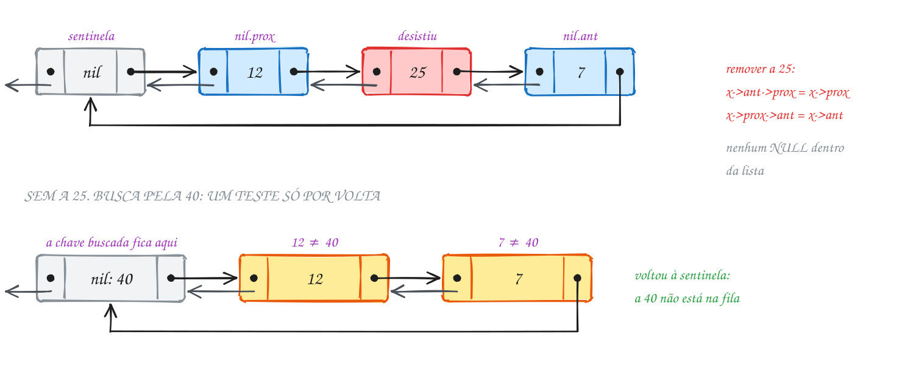</p>

As três funções centrais do `sentinela.c`; o `n` conta só os nós reais:

```c
NoS *sent_insere_apos(ListaS *L, NoS *y, int chave) {
    NoS *x = malloc(sizeof(NoS));
    if (x == NULL) {
        return NULL;
    }
    x->chave = chave;
    x->prox = y->prox; // y sempre tem vizinho: no mínimo, a sentinela
    x->ant = y;
    y->prox->ant = x;
    y->prox = x;
    L->n++;
    return x;
}

NoS *sent_busca(ListaS *L, int chave) {
    L->nil.chave = chave; // a sentinela guarda a chave: o laço sempre para
    NoS *x = L->nil.prox;
    while (x->chave != chave) {
        x = x->prox;
    }
    return x; // se for &L->nil, a chave não estava na lista
}

void sent_remove(ListaS *L, NoS *x) {
    x->ant->prox = x->prox;
    x->prox->ant = x->ant;
    free(x);
    L->n--;
}
```

O programa da barbearia:

```c
#include <stdio.h>
#include "sentinela.h"

int main(void) {
    ListaS *fila = sent_cria();
    if (fila == NULL) {
        return 1;
    }
    sent_insere_fim(fila, 12); // fichas na ordem de chegada
    sent_insere_fim(fila, 25);
    sent_insere_fim(fila, 7);
    printf("Fila: ");
    sent_mostra(fila);

    NoS *x = sent_busca(fila, 25); // a ficha 25 desistiu
    if (x != &fila->nil) {
        sent_remove(fila, x);
    }
    printf("Sem a 25: ");
    sent_mostra(fila);
    printf("De trás para a frente: ");
    sent_mostra_inverso(fila);

    x = sent_busca(fila, 40);
    printf("Ficha 40: %s\n", x == &fila->nil ? "não está na fila" : "na fila");
    printf("Na fila: %d\n", fila->n);

    sent_libera(fila);
    return 0;
}
// Saída:
// Fila: [ 12 25 7 ]
// Sem a 25: [ 12 7 ]
// De trás para a frente: [ 7 12 ]
// Ficha 40: não está na fila
// Na fila: 2
```

A busca da ficha 40 passa pelo 12 e pelo 7 e para na sentinela, que guarda
40. "Parou na sentinela?" separa "achou" de "não está":

<p align="center">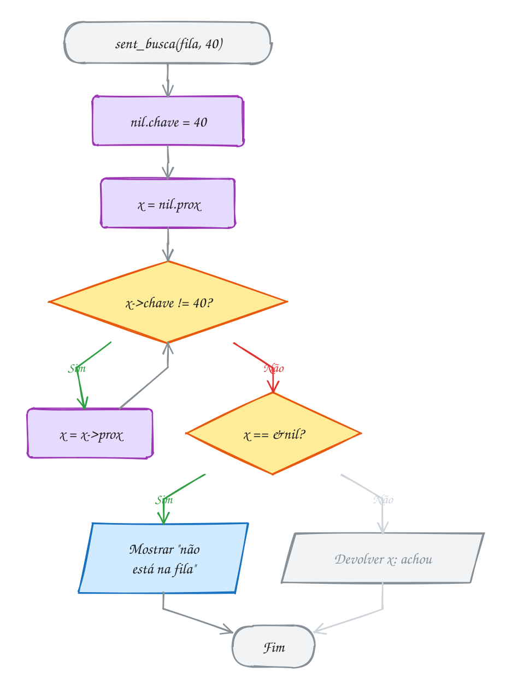</p>

**Exemplo A347 · Vazia, um nó, vários: o mesmo código**

```c
#include <stdio.h>
#include "0174-sentinela.h"

// mostra a lista e para onde a sentinela aponta
void raio_x(const char *passo, const ListaS *L) {
    printf("%s ", passo);
    sent_mostra(L);
    printf("    nil.prox é %s | nil.ant é %s | n = %d\n",
           L->nil.prox == &L->nil ? "a própria nil" : "um nó",
           L->nil.ant == &L->nil ? "a própria nil" : "um nó", L->n);
}

int main(void) {
    ListaS *L = sent_cria();
    if (L == NULL) {
        return 1;
    }
    raio_x("criada:", L);

    NoS *a = sent_insere_fim(L, 50); // lista vazia: nenhum if especial
    raio_x("insere 50 no fim:", L);

    sent_remove(L, a); // remove o único nó: o mesmo código de sempre
    raio_x("remove o 50:", L);

    sent_insere_fim(L, 10);
    sent_insere_fim(L, 20);
    sent_insere_fim(L, 30);
    raio_x("insere 10, 20, 30:", L);

    sent_remove(L, L->nil.prox); // o primeiro
    sent_remove(L, L->nil.ant);  // o último
    raio_x("tira o primeiro e o último:", L);

    sent_libera(L);
    return 0;
}
// Saída:
// criada: [ ]
//     nil.prox é a própria nil | nil.ant é a própria nil | n = 0
// insere 50 no fim: [ 50 ]
//     nil.prox é um nó | nil.ant é um nó | n = 1
// remove o 50: [ ]
//     nil.prox é a própria nil | nil.ant é a própria nil | n = 0
// insere 10, 20, 30: [ 10 20 30 ]
//     nil.prox é um nó | nil.ant é um nó | n = 3
// tira o primeiro e o último: [ 20 ]
//     nil.prox é um nó | nil.ant é um nó | n = 1
```

```bash
gcc ~/LPEDC/material/A347.c ~/LPEDC/material/0174-sentinela.c -o ~/LPEDC/material/A347 && ~/LPEDC/material/A347
```

**Exemplo A348 · Juntar duas filas em O(1)**

```c
#include <stdio.h>
#include "0174-sentinela.h"

// o caixa b fecha: a fila dele vai inteira para o fim da fila a.
// Quatro ponteiros, não importa o tamanho das filas.
void concatena(ListaS *a, ListaS *b) {
    if (b->n == 0) {
        return; // b vazia: a sentinela de b não pode entrar em a
    }
    NoS *ultimo_a = a->nil.ant;
    NoS *primeiro_b = b->nil.prox;
    NoS *ultimo_b = b->nil.ant;

    ultimo_a->prox = primeiro_b; // costura o fim de a no começo de b
    primeiro_b->ant = ultimo_a;
    ultimo_b->prox = &a->nil;    // o fim de b passa a fechar o anel de a
    a->nil.ant = ultimo_b;
    a->n += b->n;

    b->nil.prox = &b->nil; // b fica vazia, pronta para outro uso
    b->nil.ant = &b->nil;
    b->n = 0;
}

int main(void) {
    ListaS *caixa1 = sent_cria();
    ListaS *caixa2 = sent_cria();
    if (caixa1 == NULL || caixa2 == NULL) {
        sent_libera(caixa1 != NULL ? caixa1 : caixa2);
        return 1;
    }
    int f1[] = {101, 102, 103};
    int f2[] = {201, 202, 203, 204};
    for (int i = 0; i < 3; i++) {
        sent_insere_fim(caixa1, f1[i]);
    }
    for (int i = 0; i < 4; i++) {
        sent_insere_fim(caixa2, f2[i]);
    }
    printf("Caixa 1: ");
    sent_mostra(caixa1);
    printf("Caixa 2: ");
    sent_mostra(caixa2);

    concatena(caixa1, caixa2);
    printf("O caixa 2 fechou.\n");
    printf("Caixa 1: ");
    sent_mostra(caixa1);
    printf("Ao contrário: ");
    sent_mostra_inverso(caixa1);
    printf("Caixa 2: ");
    sent_mostra(caixa2);
    printf("Tamanhos: %d e %d\n", caixa1->n, caixa2->n);

    sent_libera(caixa1);
    sent_libera(caixa2);
    return 0;
}
// Saída:
// Caixa 1: [ 101 102 103 ]
// Caixa 2: [ 201 202 203 204 ]
// O caixa 2 fechou.
// Caixa 1: [ 101 102 103 201 202 203 204 ]
// Ao contrário: [ 204 203 202 201 103 102 101 ]
// Caixa 2: [ ]
// Tamanhos: 7 e 0
```

```bash
gcc ~/LPEDC/material/A348.c ~/LPEDC/material/0174-sentinela.c -o ~/LPEDC/material/A348 && ~/LPEDC/material/A348
```

### Exercícios

**Exercício E1039** · ★☆☆

O carrinho do mercado virou uma lista com sentinela (sentinela.h). Os
preços, em centavos, entram no fim: 1250, 899, 2340 e 475. Escreva
soma(L), que percorre do L->nil.prox até voltar à sentinela e devolve o
total. Mostre a lista e o total em reais.

```text
Saída esperada:
Carrinho: [ 1250 899 2340 475 ]
Total: R$ 49.64
```

```bash
gcc ~/LPEDC/material/E1039.c ~/LPEDC/material/0174-sentinela.c -o ~/LPEDC/material/E1039 && ~/LPEDC/material/E1039
```

**Exercício E1041** · ★★☆

A agenda do dentista guarda os horários do dia (em HHMM) em ordem. Escreva
insere_ordenado(L, h), que anda a partir de L->nil.prox enquanto não voltou
à sentinela e a chave é menor que h, e então insere antes do nó onde
parou, com sent_insere_apos(L, p->ant, h). Isso vale para a lista
vazia, para o começo e para o fim, sem nenhum caso especial. Insira 1400,
900, 1630, 800 e 1100 e mostre a lista depois de cada um.

```text
Saída esperada:
[ 1400 ]
[ 900 1400 ]
[ 900 1400 1630 ]
[ 800 900 1400 1630 ]
[ 800 900 1100 1400 1630 ]
```

```bash
gcc ~/LPEDC/material/E1041.c ~/LPEDC/material/0174-sentinela.c -o ~/LPEDC/material/E1041 && ~/LPEDC/material/E1041
```

**Exercício E1042** · ★★☆

O leitor de código de barras do caixa travou e registrou o mesmo produto
várias vezes. Escreva remove_todas(L, codigo), que tira da lista com
sentinela (sentinela.h) todos os nós com aquele código e devolve quantos
saíram. A lista tem 7, 3, 3, 9, 3, 5, 3. Remova os 3 e depois os 8.

```text
Saída esperada:
Antes: [ 7 3 3 9 3 5 3 ]
Removidos 4 do código 3: [ 7 9 5 ]
Removidos 0 do código 8: [ 7 9 5 ]
```

```bash
gcc ~/LPEDC/material/E1042.c ~/LPEDC/material/0174-sentinela.c -o ~/LPEDC/material/E1042 && ~/LPEDC/material/E1042
```

**Exercício E1044** · ★★★

O ônibus chegou ao ponto final e volta pelo mesmo caminho: a lista de
paradas tem que ser invertida. Escreva inverte(L), que inverte a lista com
sentinela (sentinela.h) sem criar nem liberar nó nenhum: em cada nó,
INCLUINDO a sentinela, troque ant com prox. Teste com as paradas 10, 20,
30, 40 e com uma lista vazia (que deve continuar funcionando sem if).

```text
Saída esperada:
ida:   [ 10 20 30 40 ]
volta: [ 40 30 20 10 ]
volta ao contrário: [ 10 20 30 40 ]
vazia invertida: [ ]
```

```bash
gcc ~/LPEDC/material/E1044.c ~/LPEDC/material/0174-sentinela.c -o ~/LPEDC/material/E1044 && ~/LPEDC/material/E1044
```

---

## 0175 · Conceitos e sucessor

### Conceito

- **Grau**: quantos filhos o nó tem; grau 0 é **folha**. O grau da árvore é o
  maior grau entre os nós (SZWARCFITER; MARKENZON, 2010).
- **Profundidade** e **nível**: arestas do nó até a raiz, que tem
  profundidade 0. Alguns livros contam o nível a partir de 1: confira o
  enunciado (CORMEN et al., 2024, cap. 12).
- **Altura**: o maior número de arestas do nó até uma folha abaixo. Folha tem
  altura 0 e árvore vazia, -1 (CORMEN et al., 2024, cap. 12).
- **Fator de balanceamento**: `altura(esq) - altura(dir)`, que a AVL mantém
  em -1, 0 ou 1 (ADELSON-VELSKY; LANDIS, 1962).
- **Sucessor** de `x`: a menor chave maior que `x`. Com subárvore direita, é o
  **mínimo** dela; sem ela, sobe enquanto vier de um filho direito, e o
  primeiro ancestral alcançado por um filho esquerdo é a resposta
  (CORMEN et al., 2024, cap. 12).
- **Ponteiro `pai`** (`x.p` no Cormen): permite a subida, sem pilha nem
  recursão; custa 8 bytes por nó. O **antecessor** é o espelho, e os dois
  custam O(h) (CORMEN et al., 2024, cap. 12).

> [!WARNING]
> Trocar o lado na subida (`x == y->esq` no lugar de `x == y->dir`) dá um
> "sucessor" **menor** que `x`. Toda inserção, remoção ou rotação também tem
> que acertar o `pai` (o da raiz fica `NULL`).

### Exemplos de uso

Os horários de ônibus de uma rodoviária entram numa BST na ordem 8h00, 6h15,
10h30, 7h00, 6h50, 9h20, 12h00, 7h30. O sucessor das 8h00 é caso 1 (10h30 e
depois à esquerda, 9h20); o das 7h30 é caso 2 e sobe até o 8h00. Ao lado de
cada nó, a profundidade e a altura:

<p align="center">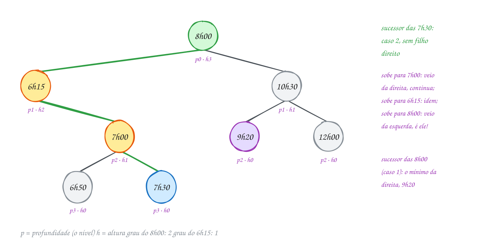</p>

O sucessor no `arvpai.c`:

```c
NoP *ap_sucessor(NoP *x) {
    if (x->dir != NULL) {
        return ap_minimo(x->dir); // caso 1: o menor da subárvore direita
    }
    NoP *y = x->pai; // caso 2: sobe até chegar por um filho esquerdo
    while (y != NULL && x == y->dir) {
        x = y;
        y = y->pai;
    }
    return y;
}
```

O painel mostra os conceitos de três nós e as perguntas de horário:

```c
#include <stdio.h>
#include "arvpai.h"

void hora(const NoP *x) {
    if (x == NULL) {
        printf("nenhum");
    } else {
        printf("%dh%02d", x->chave / 100, x->chave % 100);
    }
}

int main(void) {
    int saidas[] = {800, 615, 1030, 700, 650, 920, 1200, 730};
    NoP *raiz = NULL;
    for (int i = 0; i < 8; i++) {
        raiz = ap_insere(raiz, saidas[i]);
    }
    int olhar[] = {800, 615, 730};
    for (int i = 0; i < 3; i++) {
        NoP *x = ap_busca(raiz, olhar[i]);
        printf("%4d: grau %d | nível %d | altura %d | fator %2d\n", x->chave,
               ap_grau(x), ap_profundidade(x), ap_altura(x), ap_fator(x));
    }
    printf("Altura da árvore: %d\n", ap_altura(raiz));

    int perguntas[] = {730, 800};
    for (int i = 0; i < 2; i++) {
        NoP *x = ap_busca(raiz, perguntas[i]);
        printf("Depois das ");
        hora(x);
        printf(" sai o das ");
        hora(ap_sucessor(x));
        printf("; antes, o das ");
        hora(ap_antecessor(x));
        printf("\n");
    }
    raiz = ap_libera(raiz);
    return 0;
}
// Saída:
//  800: grau 2 | nível 0 | altura 3 | fator  1
//  615: grau 1 | nível 1 | altura 2 | fator -2
//  730: grau 0 | nível 3 | altura 0 | fator  0
// Altura da árvore: 3
// Depois das 7h30 sai o das 8h00; antes, o das 7h00
// Depois das 8h00 sai o das 9h20; antes, o das 7h30
```

O fluxograma segue o sucessor das 7h30: sobe duas vezes vindo da direita; na
terceira, o 6h15 é filho esquerdo do 8h00 e o laço para:

<p align="center">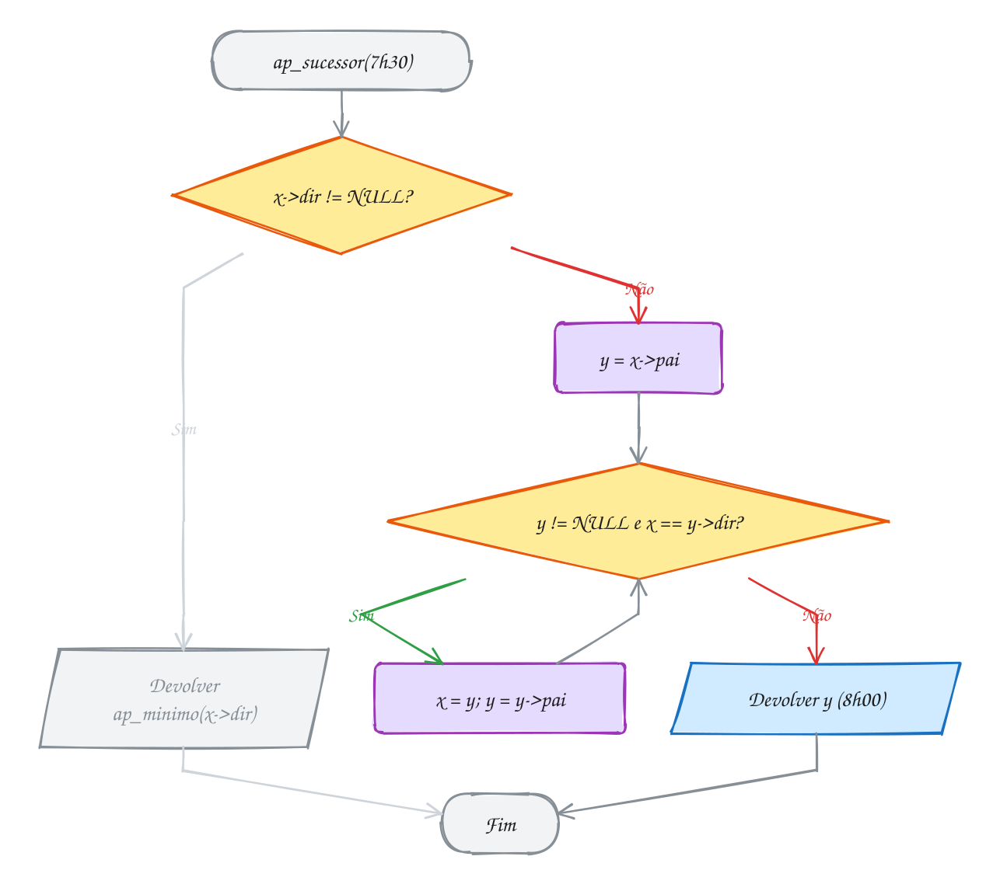</p>

**Exemplo A349 · Em ordem sem recursão e sem pilha**

```c
#include <stdio.h>
#include "0175-arvpai.h"

static int passos = 0; // quantos ponteiros (esq, dir ou pai) foram seguidos

static NoP *minimo_contando(NoP *x) {
    while (x->esq != NULL) {
        x = x->esq;
        passos++;
    }
    return x;
}

// o mesmo TREE-SUCCESSOR do arvpai.c, contando cada ponteiro seguido
static NoP *sucessor_contando(NoP *x) {
    if (x->dir != NULL) {
        passos++;
        return minimo_contando(x->dir);
    }
    NoP *y = x->pai;
    passos++;
    while (y != NULL && x == y->dir) {
        x = y;
        y = y->pai;
        passos++;
    }
    return y;
}

int main(void) {
    int codigos[] = {50, 30, 70, 20, 40, 60, 80, 35, 45, 65};
    int n = 10;
    NoP *raiz = NULL;
    for (int i = 0; i < n; i++) {
        raiz = ap_insere(raiz, codigos[i]);
    }
    printf("Em ordem:");
    for (NoP *x = minimo_contando(raiz); x != NULL; x = sucessor_contando(x)) {
        printf(" %d", x->chave);
    }
    printf("\n%d nós, %d ponteiros seguidos: cada aresta 2 vezes (%d) + o pai NULL da raiz\n",
           n, passos, 2 * (n - 1));
    printf("Média por sucessor: %.1f, embora um só possa custar a altura (%d)\n",
           (double)passos / n, ap_altura(raiz));

    raiz = ap_libera(raiz);
    return 0;
}
// Saída:
// Em ordem: 20 30 35 40 45 50 60 65 70 80
// 10 nós, 19 ponteiros seguidos: cada aresta 2 vezes (18) + o pai NULL da raiz
// Média por sucessor: 1.9, embora um só possa custar a altura (3)
```

```bash
gcc ~/LPEDC/material/A349.c ~/LPEDC/material/0175-arvpai.c -o ~/LPEDC/material/A349 && ~/LPEDC/material/A349
```

**Exemplo A350 · O próximo ônibus a partir de agora**

```c
#include <stdio.h>
#include "0175-arvpai.h"

// teto: a menor chave >= k (NULL se não existe). Desce da raiz guardando o
// último nó em que virou à esquerda: ele é o candidato.
NoP *teto(NoP *r, int k) {
    NoP *candidato = NULL;
    while (r != NULL) {
        if (r->chave == k) {
            return r;
        }
        if (k < r->chave) {
            candidato = r; // r serve, mas pode haver um menor à esquerda
            r = r->esq;
        } else {
            r = r->dir;
        }
    }
    return candidato;
}

// piso: a maior chave <= k (o espelho)
NoP *piso(NoP *r, int k) {
    NoP *candidato = NULL;
    while (r != NULL) {
        if (r->chave == k) {
            return r;
        }
        if (k > r->chave) {
            candidato = r;
            r = r->dir;
        } else {
            r = r->esq;
        }
    }
    return candidato;
}

void hora(const NoP *x) {
    if (x == NULL) {
        printf("   --");
    } else {
        printf("%2dh%02d", x->chave / 100, x->chave % 100);
    }
}

int main(void) {
    int saidas[] = {800, 615, 1030, 700, 650, 920, 1200, 730};
    NoP *raiz = NULL;
    for (int i = 0; i < 8; i++) {
        raiz = ap_insere(raiz, saidas[i]);
    }
    int agora[] = {600, 731, 920, 1100, 1300};
    for (int i = 0; i < 5; i++) {
        printf("Cheguei às %2dh%02d | último que saiu: ", agora[i] / 100, agora[i] % 100);
        hora(piso(raiz, agora[i]));
        printf(" | próximo: ");
        hora(teto(raiz, agora[i]));
        printf("\n");
    }
    raiz = ap_libera(raiz);
    return 0;
}
// Saída:
// Cheguei às  6h00 | último que saiu:    -- | próximo:  6h15
// Cheguei às  7h31 | último que saiu:  7h30 | próximo:  8h00
// Cheguei às  9h20 | último que saiu:  9h20 | próximo:  9h20
// Cheguei às 11h00 | último que saiu: 10h30 | próximo: 12h00
// Cheguei às 13h00 | último que saiu: 12h00 | próximo:    --
```

```bash
gcc ~/LPEDC/material/A350.c ~/LPEDC/material/0175-arvpai.c -o ~/LPEDC/material/A350 && ~/LPEDC/material/A350
```

### Exercícios

**Exercício E1045** · ★☆☆

O estoque guarda os códigos 50, 30, 70, 20, 40, 60, 80, 35, 45 e 65,
inseridos nessa ordem numa BST (arvpai.h). Escreva conta_graus(r, conta),
que percorre a árvore e soma em conta[g] quantos nós têm grau g (0, 1 ou
2 filhos). Mostre as três contagens, o grau da árvore (o maior grau que
aparece) e quantas folhas ela tem.

```text
Saída esperada:
grau 0: 5 nós
grau 1: 1 nós
grau 2: 4 nós
grau da árvore: 2 | folhas: 5
```

```bash
gcc ~/LPEDC/material/E1045.c ~/LPEDC/material/0175-arvpai.c -o ~/LPEDC/material/E1045 && ~/LPEDC/material/E1045
```

**Exercício E1047** · ★★☆

A loja de calçados guarda os preços (em centavos) numa BST com pai
(arvpai.h): 1890, 990, 2450, 1290, 3100, 750 e 2100, nessa ordem. Mostre os
preços do mais caro ao mais barato SEM recursão: comece no ap_maximo e
ande com ap_antecessor até chegar em NULL. Depois mostre os vizinhos do
preço 12.90 (o antecessor e o sucessor dele).

```text
Saída esperada:
Do mais caro ao mais barato: 31.00 24.50 21.00 18.90 12.90 9.90 7.50
Vizinhos de 12.90: 9.90 e 18.90
```

```bash
gcc ~/LPEDC/material/E1047.c ~/LPEDC/material/0175-arvpai.c -o ~/LPEDC/material/E1047 && ~/LPEDC/material/E1047
```

**Exercício E1048** · ★★☆

Nem toda BST tem ponteiro para o pai. Escreva
sucessor_sem_pai(raiz, chave), que acha o sucessor descendo da raiz: se o
nó da chave tem subárvore direita, é o mínimo dela; senão, é o ÚLTIMO nó
em que a descida virou à esquerda. Com os códigos 50, 30, 70, 20, 40, 60,
80, 35, 45, 65 (arvpai.h), mostre o sucessor de cada chave (-1 para o
maior) e confira com ap_sucessor, contando quantas respostas batem.

```text
Saída esperada:
20 -> 30
30 -> 35
35 -> 40
40 -> 45
45 -> 50
50 -> 60
60 -> 65
65 -> 70
70 -> 80
80 -> -1
iguais ao ap_sucessor: 10 de 10
```

```bash
gcc ~/LPEDC/material/E1048.c ~/LPEDC/material/0175-arvpai.c -o ~/LPEDC/material/E1048 && ~/LPEDC/material/E1048
```

**Exercício E1050** · ★★★

Escreva altura_se_avl(r), que devolve a altura da árvore se TODO nó tiver
fator de balanceamento -1, 0 ou 1, e -2 se algum nó estiver fora disso.
Ela tem que fazer uma passada só (O(n)): cada nó usa as alturas que os
filhos devolveram, sem chamar ap_altura. Escreva também
mostra_desequilibrados(r), que lista (em ordem) os nós com fator fora de
-1..1, com o fator. Teste três BSTs (arvpai.h): os horários 800, 615,
1030, 700, 650, 920, 1200, 730; os códigos 50, 30, 70, 20, 40, 60, 80, 35,
45, 65; e as chaves 1 a 5 em ordem.

```text
Saída esperada:
horários: não é AVL. Desequilibrados: 615 (fator -2)
códigos: é AVL, altura 3
crescente: não é AVL. Desequilibrados: 1 (fator -4) 2 (fator -3) 3 (fator -2)
```

```bash
gcc ~/LPEDC/material/E1050.c ~/LPEDC/material/0175-arvpai.c -o ~/LPEDC/material/E1050 && ~/LPEDC/material/E1050
```

---

## 0176 · AVL: remoção

### Conceito

- **Remoção na AVL**: começa como a da BST (0100). Folha some; com um filho,
  o filho ocupa o lugar; com dois, a chave do **sucessor** é copiada e o
  sucessor é removido lá embaixo (SZWARCFITER; MARKENZON, 2010).
- **Conserto na volta**: tirar um nó encurta um caminho. Na volta da
  recursão, cada ancestral recalcula a altura, confere o fator e, se passar
  de 1 ou -1, faz a rotação do 0101 (ADELSON-VELSKY; LANDIS, 1962).
- **Filho com fator 0**: na remoção, o filho do lado pesado pode ter fator 0,
  o que nunca ocorre na inserção. Fator 0 ou de mesmo sinal: **rotação
  simples**; sinal contrário: **dupla** (SZWARCFITER; MARKENZON, 2010).
- **Várias rotações**: a rotação pode deixar a subárvore um nível mais baixa,
  e o desequilíbrio sobe para o avô. Uma remoção pode rodar até a raiz:
  O(log n) rotações no pior caso (ZIVIANI, 2010).
- **Cópia da chave**: com dois filhos, o código copia a chave do sucessor e
  libera o nó dele; um ponteiro guardado para esse nó fica pendurado.

> [!WARNING]
> Copiar da inserção o teste `avr_fator(r->esq) <= 0` faz a dupla com fator 0
> e deixa a árvore torta. Só o sinal **contrário** pede a dupla. E não existe
> "fiz uma rotação, acabou": todo ancestral passa pelo `rebalanceia`.

### Exemplos de uso

Uma lanchonete guarda 16 pedidos numa AVL de altura 4, e o 30 sai. O 28 fica
pesado à esquerda com o filho 25 pendendo para a direita: rotação dupla. A
subárvore cai de altura e a raiz 20 desequilibra: rotação simples, e o 12 vira
a raiz:

<p align="center">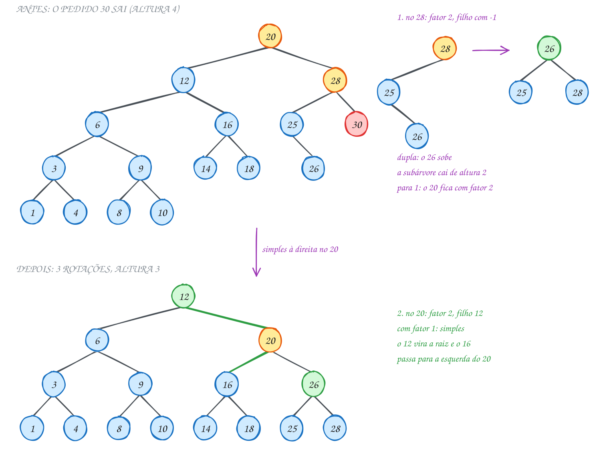</p>

A remoção do `avlrem.c`, com o `rebalanceia` das duas operações:

```c
static NoA *rebalanceia(NoA *r) {
    atualiza(r);
    int fb = avr_fator(r);
    if (fb > 1) {
        if (avr_fator(r->esq) < 0) { // só -1 pede a dupla; 0 e 1, a simples
            r->esq = rot_esquerda(r->esq);
        }
        return rot_direita(r);
    }
    if (fb < -1) {
        if (avr_fator(r->dir) > 0) {
            r->dir = rot_direita(r->dir);
        }
        return rot_esquerda(r);
    }
    return r;
}

NoA *avr_remove(NoA *r, int chave) {
    if (r == NULL) {
        return NULL; // não estava na árvore
    }
    if (chave < r->chave) {
        r->esq = avr_remove(r->esq, chave);
    } else if (chave > r->chave) {
        r->dir = avr_remove(r->dir, chave);
    } else if (r->esq == NULL || r->dir == NULL) {
        NoA *filho = r->esq != NULL ? r->esq : r->dir; // 0 ou 1 filho
        free(r);
        return filho; // o filho (já AVL) ocupa o lugar; o pai confere
    } else {
        NoA *s = r->dir; // 2 filhos: copia o sucessor e remove ele
        while (s->esq != NULL) {
            s = s->esq;
        }
        r->chave = s->chave;
        r->dir = avr_remove(r->dir, s->chave);
    }
    return rebalanceia(r); // na volta, cada ancestral se confere
}
```

O painel da cozinha:

```c
#include <stdio.h>
#include "avlrem.h"

int main(void) {
    int pedidos[] = {20, 12, 28, 6, 16, 25, 30, 3, 9, 14, 18, 26, 1, 4, 10, 8};
    NoA *raiz = NULL;
    for (int i = 0; i < 16; i++) {
        raiz = avr_insere(raiz, pedidos[i]);
    }
    printf("Antes:  pré");
    avr_pre_ordem(raiz);
    printf(" | altura %d\n", avr_altura(raiz));

    int antes = avr_rotacoes();
    raiz = avr_remove(raiz, 30); // o pedido 30 foi entregue
    printf("Depois: pré");
    avr_pre_ordem(raiz);
    printf(" | altura %d\n", avr_altura(raiz));
    printf("Rotações nesta remoção: %d | fator da raiz: %d\n",
           avr_rotacoes() - antes, avr_fator(raiz));

    raiz = avr_libera(raiz);
    return 0;
}
// Saída:
// Antes:  pré 20 12 6 3 1 4 9 8 10 16 14 18 28 25 26 30 | altura 4
// Depois: pré 12 6 3 1 4 9 8 10 20 16 14 18 26 25 28 | altura 3
// Rotações nesta remoção: 3 | fator da raiz: 0
```

São 3 rotações simples: a dupla no 28 conta 2, a simples no 20 conta 1. O
fluxograma mostra o `rebalanceia` no 28 (fator 2, filho com fator -1) e, no 20,
o outro ramo (filho com fator 1, só a rotação à direita):

<p align="center">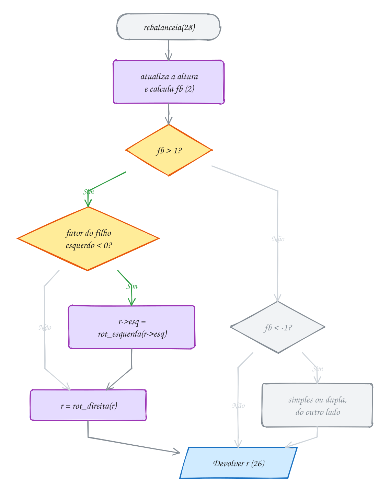</p>

#### Passo a passo

O 30 é folha e devolve `NULL` ao 28. Daí para cima, cada nó confere a si
mesmo:

| Nó na volta | Altura esq / dir | Fator | Filho pesado | Conserto | Altura da subárvore |
| --- | --- | --- | --- | --- | --- |
| 28 | 1 / -1 | 2 | 25, fator -1 | dupla: esquerda no 25, direita no 28 | era 2, fica 1 (o 26 sobe) |
| 20 | 3 / 1 | 2 | 12, fator 1 | simples: direita no 20 | era 4, fica 3 (o 12 sobe) |

O conserto no 28 **encurtou** a subárvore e levou o desequilíbrio ao 20. Se o
28 tivesse voltado à altura 2, a remoção pararia ali.

**Exemplo A351 · Esvaziando pela esquerda**

```c
#include <stdio.h>
#include "0176-avlrem.h"

int main(void) {
    NoA *raiz = NULL;
    for (int k = 1; k <= 15; k++) { // 15 chaves: árvore perfeita de altura 3
        raiz = avr_insere(raiz, k);
    }
    printf("Cheia: pré");
    avr_pre_ordem(raiz);
    printf("\n");
    for (int k = 1; k <= 10; k++) { // tira sempre o menor
        int antes = avr_rotacoes();
        raiz = avr_remove(raiz, k);
        printf("tira %2d: rotações %d | altura %d | raiz %2d\n", k,
               avr_rotacoes() - antes, avr_altura(raiz), raiz->chave);
    }
    printf("Sobrou: pré");
    avr_pre_ordem(raiz);
    printf("\n");
    raiz = avr_libera(raiz);
    return 0;
}
// Saída:
// Cheia: pré 8 4 2 1 3 6 5 7 12 10 9 11 14 13 15
// tira  1: rotações 0 | altura 3 | raiz  8
// tira  2: rotações 0 | altura 3 | raiz  8
// tira  3: rotações 1 | altura 3 | raiz  8
// tira  4: rotações 0 | altura 3 | raiz  8
// tira  5: rotações 0 | altura 3 | raiz  8
// tira  6: rotações 1 | altura 3 | raiz 12
// tira  7: rotações 1 | altura 3 | raiz 12
// tira  8: rotações 0 | altura 2 | raiz 12
// tira  9: rotações 0 | altura 2 | raiz 12
// tira 10: rotações 0 | altura 2 | raiz 12
// Sobrou: pré 12 11 14 13 15
```

```bash
gcc ~/LPEDC/material/A351.c ~/LPEDC/material/0176-avlrem.c -o ~/LPEDC/material/A351 && ~/LPEDC/material/A351
```

**Exemplo A352 · Fator 0 no filho: o caso que só a remoção tem**

```c
#include <stdio.h>
#include "0176-avlrem.h"

NoA *monta(const int *v, int n) {
    NoA *r = NULL;
    for (int i = 0; i < n; i++) {
        r = avr_insere(r, v[i]);
    }
    return r;
}

void relata(const char *nome, NoA *r, int sai) {
    printf("%s\n  antes:  pré", nome);
    avr_pre_ordem(r);
    printf(" | altura %d | fator do filho esquerdo %d\n", avr_altura(r), avr_fator(r->esq));
    r = avr_remove(r, sai);
    printf("  tira %d: pré", sai);
    avr_pre_ordem(r);
    printf(" | altura %d\n", avr_altura(r));
    avr_libera(r);
}

int main(void) {
    int a[] = {20, 10, 30, 5, 15}; // o 10 tem os dois filhos: fator 0
    int b[] = {20, 10, 30, 5};     // o 10 só tem o 5: fator 1
    relata("Filho com fator 0:", monta(a, 5), 30);
    relata("Filho com fator 1:", monta(b, 4), 30);
    return 0;
}
// Saída:
// Filho com fator 0:
//   antes:  pré 20 10 5 15 30 | altura 2 | fator do filho esquerdo 0
//   tira 30: pré 10 5 20 15 | altura 2
// Filho com fator 1:
//   antes:  pré 20 10 5 30 | altura 2 | fator do filho esquerdo 1
//   tira 30: pré 10 5 20 | altura 1
```

```bash
gcc ~/LPEDC/material/A352.c ~/LPEDC/material/0176-avlrem.c -o ~/LPEDC/material/A352 && ~/LPEDC/material/A352
```

### Exercícios

**Exercício E1051** · ★☆☆

A biblioteca guarda as matrículas dos leitores com livro emprestado numa
AVL (avlrem.h). Insira 50, 25, 75, 10, 30, 60, 80, 5, 15, 27, 55 e 1, nessa
ordem. Depois os leitores 80, 75 e 60 devolvem os livros: remova os três,
um por vez, mostrando a pré-ordem, a altura e quantas rotações cada
remoção fez (use avr_rotacoes antes e depois).

```text
Saída esperada:
início:  pré 50 25 10 5 1 15 30 27 75 60 55 80 | altura 4
tira 80: pré 25 10 5 1 15 50 30 27 60 55 75 | altura 3 | rotações 2
tira 75: pré 25 10 5 1 15 50 30 27 60 55 | altura 3 | rotações 0
tira 60: pré 25 10 5 1 15 50 30 27 55 | altura 3 | rotações 0
```

```bash
gcc ~/LPEDC/material/E1051.c ~/LPEDC/material/0176-avlrem.c -o ~/LPEDC/material/E1051 && ~/LPEDC/material/E1051
```

**Exercício E1053** · ★★☆

A fila de prioridade do pronto-socorro está guardada numa AVL (avlrem.h):
a menor chave é a mais urgente. Insira as chaves i * 7 % 20, para i de 0
a 19 (são 0 a 19 embaralhados). Depois atenda até esvaziar: ache a menor
chave (descendo tudo à esquerda), mostre e remova. No fim, mostre a
altura que a árvore tinha no começo e quantas rotações o esvaziamento
custou.

```text
Saída esperada:
Atendidos: 0 1 2 3 4 5 6 7 8 9 10 11 12 13 14 15 16 17 18 19
Altura no começo: 4 | rotações para esvaziar: 7
```

```bash
gcc ~/LPEDC/material/E1053.c ~/LPEDC/material/0176-avlrem.c -o ~/LPEDC/material/E1053 && ~/LPEDC/material/E1053
```

**Exercício E1054** · ★★☆

Escreva uma AVL de int do zero (sem TAD): No com chave, altura, esq e dir;
alt (altura de NULL é -1), atualiza, gira_dir, gira_esq, equilibra,
insere, pre (pré-ordem) e libera. Na remoção, remove_chave, o nó com dois
filhos recebe a chave do ANTECESSOR (o maior da subárvore esquerda), que
é removido dali; o rebalanceamento acontece na volta da recursão.
Insira 40, 20, 60, 10, 30, 50, 70, 25, 35, remova o 40 e depois o 20,
mostrando a pré-ordem a cada passo e, no fim, a altura.

```text
Saída esperada:
início:  pré 40 20 10 30 25 35 60 50 70
tira 40: pré 35 20 10 30 25 60 50 70
tira 20: pré 35 25 10 30 60 50 70
altura final: 2
```

```bash
gcc ~/LPEDC/material/E1054.c ~/LPEDC/material/0176-avlrem.c -o ~/LPEDC/material/E1054 && ~/LPEDC/material/E1054
```

**Exercício E1056** · ★★★

Na inserção, a AVL faz no máximo uma rotação (simples ou dupla). Na
remoção, não: o conserto pode subir até a raiz. O pior caso é a árvore de
Fibonacci de altura h: a esquerda é uma árvore de Fibonacci de altura h - 1
e a direita, de altura h - 2 (todo nó tem fator 1). Escreva
fibonacci(h), que monta essa árvore direto com malloc (NoA de avlrem.h,
campo altura preenchido, chaves 1, 2, 3... em ordem), e, para h de 2 a 9,
remova a MAIOR chave com avr_remove e mostre quantos nós havia, quantas
rotações a remoção fez e a altura depois.

```text
Saída esperada:
altura 2:   4 nós | rotações 1 | altura depois 1
altura 3:   7 nós | rotações 1 | altura depois 2
altura 4:  12 nós | rotações 2 | altura depois 3
altura 5:  20 nós | rotações 2 | altura depois 4
altura 6:  33 nós | rotações 3 | altura depois 5
altura 7:  54 nós | rotações 3 | altura depois 6
altura 8:  88 nós | rotações 4 | altura depois 7
altura 9: 143 nós | rotações 4 | altura depois 8
```

```bash
gcc ~/LPEDC/material/E1056.c ~/LPEDC/material/0176-avlrem.c -o ~/LPEDC/material/E1056 && ~/LPEDC/material/E1056
```

---

## 0177 · Rubro-negra clássica

### Conceito

- **Árvore rubro-negra**: BST em que cada nó tem cor e valem cinco
  propriedades: (1) todo nó é vermelho ou preto; (2) a raiz é preta; (3) toda
  folha (`T.nil`) é preta; (4) nó vermelho tem os dois filhos pretos; (5) todo
  caminho de um nó até as folhas abaixo tem o mesmo número de pretos
  (CORMEN et al., 2024, cap. 13).
- **Origem**: o esquema de duas cores para árvores balanceadas é de Guibas e
  Sedgewick; a LLRB do 0145 é uma variante (GUIBAS; SEDGEWICK, 1978).
- **Sentinela `T.nil`**: as folhas não guardam chave; todas são um nó só,
  preto, como na lista do 0174. O pai da raiz também é `T.nil`
  (CORMEN et al., 2024, cap. 13).
- **Altura negra** `bh(x)`: pretos de `x` até uma folha, sem contar `x`. Como
  `bh(raiz) >= h/2`, sai **h ≤ 2 log₂(n + 1)** e busca custa O(log n)
  (CORMEN et al., 2024, cap. 13).
- **Inserção**: pendura `z` como na BST e o pinta de **vermelho**. Só a
  propriedade 4 pode quebrar, e o conserto olha o **tio** de `z`
  (CORMEN et al., 2024, cap. 13).
- **Remoção**: quatro casos, olhando o **irmão**; custa O(log n) e faz no
  máximo **três rotações** (SZWARCFITER; MARKENZON, 2010).

| Caso | Situação | O que fazer |
| --- | --- | --- |
| 1 | tio **vermelho** | pinta pai e tio de preto, o avô de vermelho, e **sobe**: `z` vira o avô |
| 2 | tio **preto**, `z` em **triângulo** (filho direito de um filho esquerdo, ou o espelho) | gira no pai e cai no caso 3 |
| 3 | tio **preto**, `z` em **linha** (filho esquerdo de um filho esquerdo, ou o espelho) | pinta o pai de preto e o avô de vermelho, gira no avô. Acabou |

O caso 1 só troca cores e pode subir até a raiz; os casos 2 e 3 fazem no
máximo duas rotações e encerram. No fim, a raiz vira preta.

> [!WARNING]
> Erros comuns: esquecer de **subir** no caso 1 (`z = avo`) e trocar a ordem
> de cores e rotação no caso 3. Na prova, `bh(x)` **não conta o próprio x** e
> **conta a folha `T.nil`**.

### Exemplos de uso

Uma central de entregas recebe os pacotes 50, 30, 70, 20, 25, 40 e 45, quase
em ordem. O 20 tem tio vermelho (caso 1); o 25 forma triângulo (casos 2 e 3);
o 45 fica em linha (caso 3, espelho). O antes e o depois de cada caso:

<p align="center">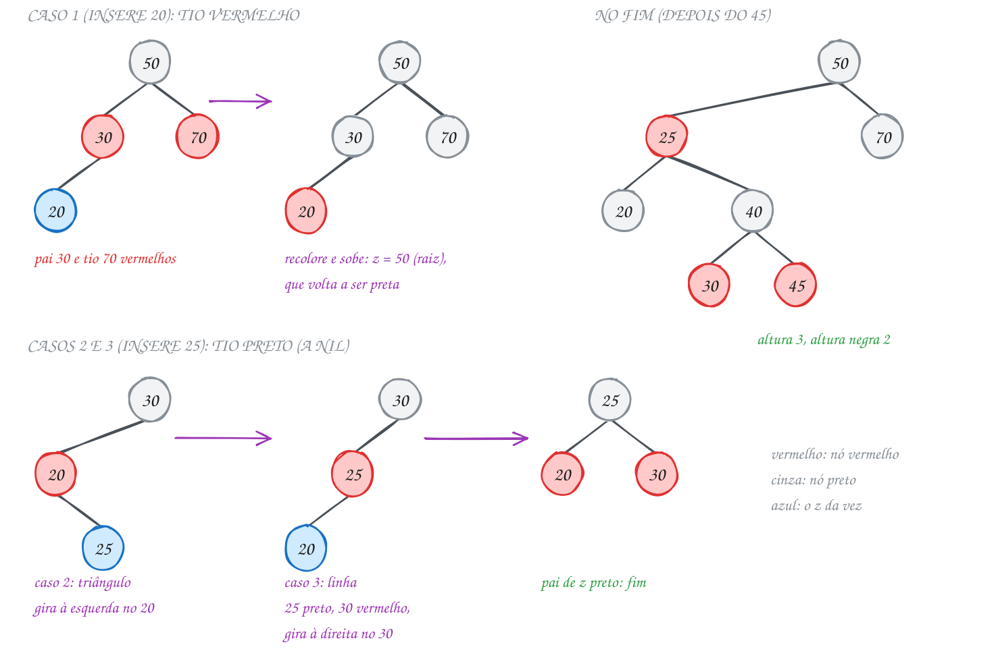</p>

O conserto no `vermelhopreto.c` (pai filho esquerdo; o outro lado é o
espelho). O `T->casos` conta cada caso:

```c
static void conserta(ArvVP *T, NoVP *z) {
    while (z->pai->cor == VERMELHO) {
        NoVP *avo = z->pai->pai;
        if (z->pai == avo->esq) {
            NoVP *tio = avo->dir;
            if (tio->cor == VERMELHO) { // caso 1: tio vermelho, recolore e sobe
                z->pai->cor = PRETO;
                tio->cor = PRETO;
                avo->cor = VERMELHO;
                z = avo;
                T->casos[1]++;
            } else {
                if (z == z->pai->dir) { // caso 2: tio preto, z em "triângulo"
                    z = z->pai;
                    gira_esquerda(T, z);
                    T->casos[2]++;
                }
                z->pai->cor = PRETO; // caso 3: tio preto, z em "linha"
                z->pai->pai->cor = VERMELHO;
                gira_direita(T, z->pai->pai);
                T->casos[3]++;
            }
        } else {
            // o espelho: troque esq por dir e esquerda por direita
        }
    }
    T->raiz->cor = PRETO; // propriedade 2: a raiz é preta
}
```

O laço nunca testa `NULL`: o tio pode ser a sentinela, preta, e cai nos casos
2 e 3. O cliente:

```c
#include <stdio.h>
#include "vermelhopreto.h"

int main(void) {
    int pacotes[] = {50, 30, 70, 20, 25, 40, 45};
    ArvVP *T = vp_cria();
    if (T == NULL) {
        return 1;
    }
    for (int i = 0; i < 7; i++) {
        int c1 = T->casos[1], c2 = T->casos[2], c3 = T->casos[3];
        vp_insere(T, pacotes[i]);
        printf("Insere %d: pré", pacotes[i]);
        vp_pre_ordem(T);
        printf(" | casos 1/2/3: %d %d %d\n", T->casos[1] - c1, T->casos[2] - c2, T->casos[3] - c3);
    }
    printf("Altura %d, altura negra %d, propriedades: %s\n", vp_altura(T),
           vp_altura_negra(T), vp_confere(T) ? "ok" : "quebradas");
    vp_libera(T);
    return 0;
}
// Saída:
// Insere 50: pré 50 | casos 1/2/3: 0 0 0
// Insere 30: pré 50 30* | casos 1/2/3: 0 0 0
// Insere 70: pré 50 30* 70* | casos 1/2/3: 0 0 0
// Insere 20: pré 50 30 20* 70 | casos 1/2/3: 1 0 0
// Insere 25: pré 50 25 20* 30* 70 | casos 1/2/3: 0 1 1
// Insere 40: pré 50 25* 20 30 40* 70 | casos 1/2/3: 1 0 0
// Insere 45: pré 50 25* 20 40 30* 45* 70 | casos 1/2/3: 0 0 1
// Altura 3, altura negra 2, propriedades: ok
```

O fluxograma é o conserto do pacote 25: tio preto (a sentinela), `z` em
triângulo. Caso 2 e caso 3 na mesma volta, e o laço termina:

<p align="center">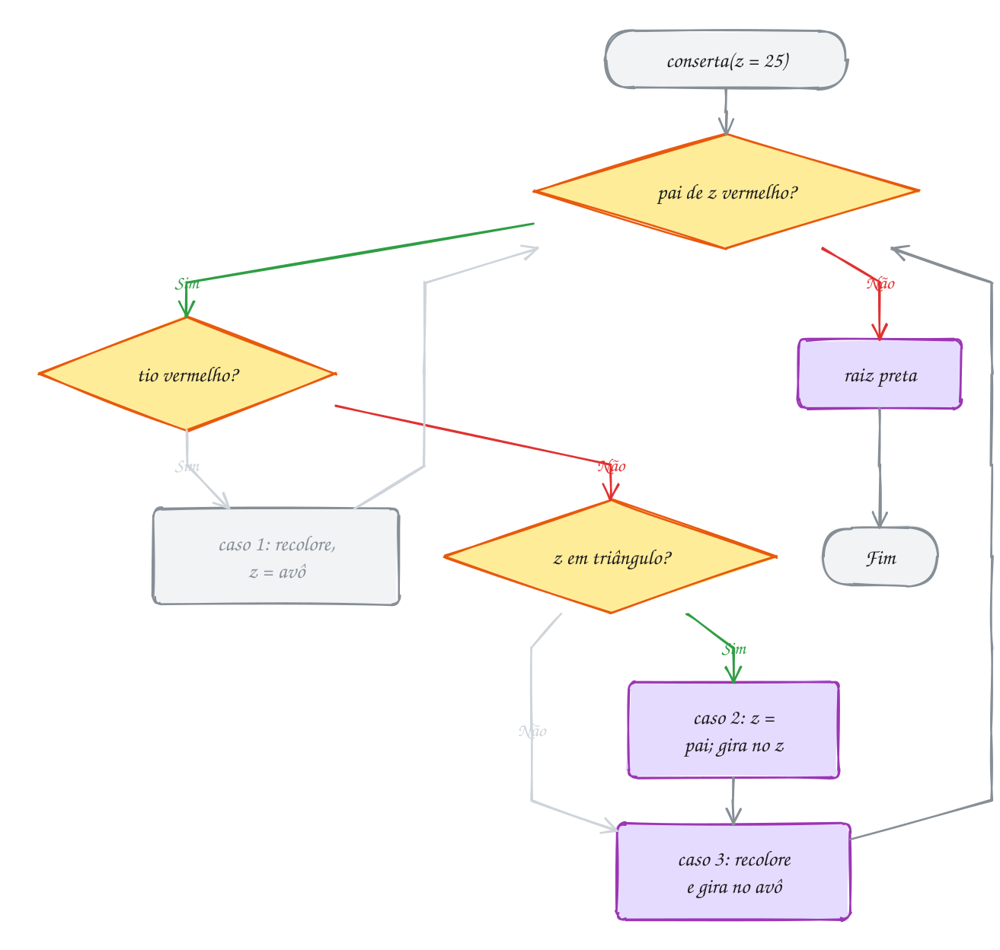</p>

#### Passo a passo

O conserto de três inserções. "Pai" e "avô" são os de `z` no início da linha:

| Inserção | z | Pai | Tio | Caso | O que acontece | Depois |
| --- | --- | --- | --- | --- | --- | --- |
| 20 | 20 | 30 vermelho | 70 vermelho | 1 | 30 e 70 pretos, 50 vermelho; `z = 50` | 50 é a raiz: o laço para e ela volta a preto |
| 25 | 25 | 20 vermelho | nil (preto) | 2 | triângulo: `z = 20`, gira à esquerda no 20 | o 25 fica entre o 30 e o 20 |
| 25 | 20 | 25 vermelho | nil (preto) | 3 | 25 preto, 30 vermelho, gira à direita no 30 | 25 com 20\* e 30\*; o pai de `z` é preto, fim |
| 40 | 40 | 30 vermelho | 20 vermelho | 1 | 30 e 20 pretos, 25 vermelho; `z = 25` | o pai do 25 é o 50, preto: fim |
| 45 | 45 | 40 vermelho | nil (preto) | 3 (espelho) | 40 preto, 30 vermelho, gira à esquerda no 30 | 40 com 30\* e 45\* |

Duas rotações no 25, uma no 45, nenhuma no 20 e no 40. A altura negra só
cresce quando o caso 1 chega à raiz: a árvore cresce **por cima**.

**Exemplo A353 · A altura que a rubro-negra garante**

```c
#include <math.h>
#include <stdio.h>
#include "0177-vermelhopreto.h"

void testa(const char *nome, int n, int passo) {
    ArvVP *T = vp_cria();
    if (T == NULL) {
        return;
    }
    for (int i = 0; i < n; i++) {
        vp_insere(T, (int)((long)i * passo % n)); // passo 1: crescente
    }
    int bh = vp_altura_negra(T);
    printf("%-12s n = %d | altura %2d | altura negra %2d | 2^bh - 1 = %4d <= n? %s | regras: %s\n",
           nome, n, vp_altura(T), bh, (1 << bh) - 1, (1 << bh) - 1 <= n ? "sim" : "não",
           vp_confere(T) ? "ok" : "quebradas");
    vp_libera(T);
}

int main(void) {
    testa("crescente:", 1000, 1);
    testa("embaralhada:", 1000, 7919);
    testa("crescente:", 4095, 1);
    printf("Limite 2 log2(n + 1): %.1f para n = 1000 e %.1f para n = 4095\n",
           2 * log2(1001.0), 2 * log2(4096.0));
    return 0;
}
// Saída:
// crescente:   n = 1000 | altura 16 | altura negra  9 | 2^bh - 1 =  511 <= n? sim | regras: ok
// embaralhada: n = 1000 | altura 11 | altura negra  6 | 2^bh - 1 =   63 <= n? sim | regras: ok
// crescente:   n = 4095 | altura 21 | altura negra 11 | 2^bh - 1 = 2047 <= n? sim | regras: ok
// Limite 2 log2(n + 1): 19.9 para n = 1000 e 24.0 para n = 4095
```

```bash
gcc ~/LPEDC/material/A353.c ~/LPEDC/material/0177-vermelhopreto.c -o ~/LPEDC/material/A353 -lm && ~/LPEDC/material/A353
```

**Exemplo A354 · Quantas vezes cada caso aparece**

```c
#include <stdio.h>
#include "0177-vermelhopreto.h"

int main(void) {
    int n = 10000;
    ArvVP *T = vp_cria();
    if (T == NULL) {
        return 1;
    }
    int max_rot = 0, max_caso1 = 0;
    for (int i = 0; i < n; i++) {
        int rot = T->rotacoes, c1 = T->casos[1];
        vp_insere(T, (int)((long)i * 7919 % n));
        if (T->rotacoes - rot > max_rot) {
            max_rot = T->rotacoes - rot;
        }
        if (T->casos[1] - c1 > max_caso1) {
            max_caso1 = T->casos[1] - c1;
        }
    }
    printf("%d inserções embaralhadas\n", n);
    printf("caso 1 (tio vermelho, recolore): %d vezes\n", T->casos[1]);
    printf("caso 2 (tio preto, triângulo):   %d vezes\n", T->casos[2]);
    printf("caso 3 (tio preto, linha):       %d vezes\n", T->casos[3]);
    printf("rotações: %d no total, no máximo %d numa inserção\n", T->rotacoes, max_rot);
    printf("recolorações (caso 1) seguidas numa inserção: no máximo %d\n", max_caso1);
    printf("altura %d, altura negra %d\n", vp_altura(T), vp_altura_negra(T));
    vp_libera(T);
    return 0;
}
// Saída:
// 10000 inserções embaralhadas
// caso 1 (tio vermelho, recolore): 4401 vezes
// caso 2 (tio preto, triângulo):   8 vezes
// caso 3 (tio preto, linha):       3347 vezes
// rotações: 3355 no total, no máximo 2 numa inserção
// recolorações (caso 1) seguidas numa inserção: no máximo 7
// altura 15, altura negra 8
```

```bash
gcc ~/LPEDC/material/A354.c ~/LPEDC/material/0177-vermelhopreto.c -o ~/LPEDC/material/A354 && ~/LPEDC/material/A354
```

### Exercícios

**Exercício E1057** · ★☆☆

Insira os pacotes 1 a 10, em ordem, numa rubro-negra (vermelhopreto.h) e
escreva conta_vermelhos(T, x), que percorre a subárvore de x e conta os
nós vermelhos. A recursão para na sentinela (x == &T->nil), e
não em NULL. Mostre a pré-ordem, os vermelhos, os pretos e a altura negra.

```text
Saída esperada:
pré: 4 2 1 3 6 5 8* 7 9 10*
vermelhos: 2 | pretos: 8 | altura negra: 3
```

```bash
gcc ~/LPEDC/material/E1057.c ~/LPEDC/material/0177-vermelhopreto.c -o ~/LPEDC/material/E1057 && ~/LPEDC/material/E1057
```

**Exercício E1059** · ★★☆

O Cormen prova que a subárvore de qualquer nó x tem pelo menos
2^bh(x) - 1 nós, onde bh(x) é a altura negra de x: quantos pretos há de x
(sem contar x) até uma folha nil (contando a nil). Confira isso nó por
nó. Insira 40, 20, 60, 10, 30, 50, 70, 5, 15, 25 (vermelhopreto.h) e
escreva bh(T, x), nos(T, x) e tabela(T, x), que mostra em ordem, para
cada nó: chave, cor, bh, nós da subárvore, 2^bh - 1 e "ok" se a
desigualdade vale.

```text
Saída esperada:
  5 vermelho bh 1 | nós  1 | 2^bh - 1 = 1 ok
 10 preto    bh 1 | nós  3 | 2^bh - 1 = 1 ok
 15 vermelho bh 1 | nós  1 | 2^bh - 1 = 1 ok
 20 vermelho bh 2 | nós  6 | 2^bh - 1 = 3 ok
 25 vermelho bh 1 | nós  1 | 2^bh - 1 = 1 ok
 30 preto    bh 1 | nós  2 | 2^bh - 1 = 1 ok
 40 preto    bh 2 | nós 10 | 2^bh - 1 = 3 ok
 50 vermelho bh 1 | nós  1 | 2^bh - 1 = 1 ok
 60 preto    bh 1 | nós  3 | 2^bh - 1 = 1 ok
 70 vermelho bh 1 | nós  1 | 2^bh - 1 = 1 ok
```

```bash
gcc ~/LPEDC/material/E1059.c ~/LPEDC/material/0177-vermelhopreto.c -o ~/LPEDC/material/E1059 && ~/LPEDC/material/E1059
```

**Exercício E1060** · ★★☆

Acompanhe o conserto da rubro-negra. Insira as senhas 10, 20, 30, 15, 25,
5, 1 e 27 (vermelhopreto.h) e, depois de cada uma, mostre quantas vezes
cada caso do conserto rodou NAQUELA inserção (use T->casos[1], [2] e [3]
antes e depois) e a pré-ordem. No fim, mostre o total de rotações.

```text
Saída esperada:
insere 10: caso 1: 0 | caso 2: 0 | caso 3: 0 | pré 10
insere 20: caso 1: 0 | caso 2: 0 | caso 3: 0 | pré 10 20*
insere 30: caso 1: 0 | caso 2: 0 | caso 3: 1 | pré 20 10* 30*
insere 15: caso 1: 1 | caso 2: 0 | caso 3: 0 | pré 20 10 15* 30
insere 25: caso 1: 0 | caso 2: 0 | caso 3: 0 | pré 20 10 15* 30 25*
insere  5: caso 1: 0 | caso 2: 0 | caso 3: 0 | pré 20 10 5* 15* 30 25*
insere  1: caso 1: 1 | caso 2: 0 | caso 3: 0 | pré 20 10* 5 1* 15 30 25*
insere 27: caso 1: 0 | caso 2: 1 | caso 3: 1 | pré 20 10* 5 1* 15 27 25* 30*
rotações no total: 3
```

```bash
gcc ~/LPEDC/material/E1060.c ~/LPEDC/material/0177-vermelhopreto.c -o ~/LPEDC/material/E1060 && ~/LPEDC/material/E1060
```

**Exercício E1061** · ★★★

Escreva a inserção da rubro-negra do Cormen à mão, com a sentinela nil
(variável global, preta, que serve de folha e de pai da raiz):
gira_esq, gira_dir, conserta (os casos 1, 2 e 3 e o espelho deles),
insere(chave) e libera. Escreva também:

```text
void pre(const No *x)    // pré-ordem; vermelho leva "*" depois da chave
int fiscal(const No *x)  // pretos de x até a nil (nil inclusive), ou
                         // -1 se a propriedade 4 ou a 5 falhar
```

Insira os pacotes 1 a 10, em ordem, mostre a pré-ordem e o veredito do
fiscal sobre a raiz.

```text
Saída esperada:
pré: 4 2 1 3 6 5 8* 7 9 10*
fiscal: as cinco propriedades valem
```

```bash
gcc ~/LPEDC/material/E1061.c ~/LPEDC/material/0177-vermelhopreto.c -o ~/LPEDC/material/E1061 && ~/LPEDC/material/E1061
```

---

## 0178 · Hash: divisão e multiplicação

### Conceito

- **Método da divisão**: **h(k) = k mod m**. É rápido, mas o `m` decide tudo
  (CORMEN et al., 2024, cap. 11).
- **m ruins**: `m = 2^p` usa só os p bits de baixo de `k` (`k & (m - 1)`);
  `m = 10^d`, só os d últimos dígitos; `m = 2^p - 1` não distingue duas letras
  trocadas de lugar num texto (CORMEN et al., 2024, cap. 11).
- **m bom**: um **primo longe de uma potência de 2**. Para 2000 chaves com uns
  3 por balde, 673 serve (longe de 512 e de 1024) (CORMEN et al., 2024, cap. 11).
- **Método da multiplicação**: **h(k) = ⌊m · (k·A mod 1)⌋**, com `0 < A < 1`.
  A parte fracionária mistura todos os dígitos de `k`, e o `m` pode ser até
  potência de 2 (CORMEN et al., 2024, cap. 11).
- **Constante de Knuth**: **A ≈ (√5 − 1) / 2 = 0,6180339887...**; chaves
  seguidas pulam pela tabela inteira (KNUTH, 1998).
- **Versão em inteiros**: com 32 bits e `m = 2^p`, troque `A` por
  **s = ⌊A · 2^32⌋ = 2654435769**. O balde são os p bits de cima dos 32 de
  baixo de `k · s`: `(k * s) >> (32 - p)` com `uint32_t` (KNUTH, 1998).

> [!WARNING]
> O produto **tem que ser `unsigned`**: com `int`, `k * 2654435769` estoura
> (comportamento indefinido). E pegue os bits **de cima** (`>> (32 - p)`), não
> os de baixo (`& (m - 1)`), que repetem o problema da divisão por 2^p.

### Exemplos de uso

Um atacadão registra fardos de 16 unidades pelo número do último item: 16,
32, 48 até 160. Com `k % 16`, os dez caem no balde 0. Os fardos passam por
divisão por 16, divisão por 13 e multiplicação com m = 16; no desenho, a conta
do fardo 48:

<p align="center">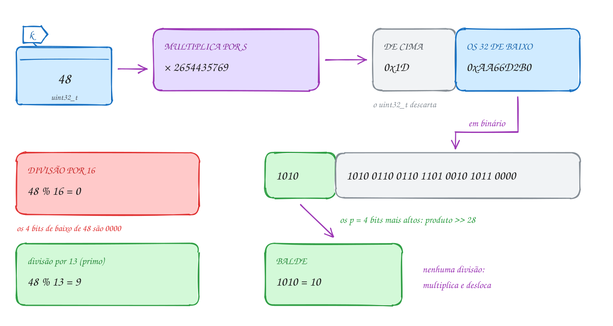</p>

No `espalha.c`, as duas multiplicações:

```c
int esp_multiplicacao(uint32_t k, int m) {
    double produto = k * ESP_A;
    double fracao = produto - floor(produto); // k*A mod 1: só a parte depois da vírgula
    return (int)(m * fracao);
}

int esp_mult_desloca(uint32_t k, int p) {
    uint32_t produto = k * ESP_S; // unsigned: a conta é feita mod 2^32, sem estouro
    return (int)(produto >> (32 - p));
}
```

O programa do atacadão:

```c
#include <stdio.h>
#include "espalha.h"

int main(void) {
    int div16[16] = {0}, div13[13] = {0}, mult16[16] = {0};
    printf("fardo | k %% 16 | k %% 13 | multiplicação (m = 16)\n");
    for (uint32_t k = 16; k <= 160; k += 16) {
        int a = esp_divisao(k, 16), b = esp_divisao(k, 13), c = esp_mult_desloca(k, 4);
        div16[a]++;
        div13[b]++;
        mult16[c]++;
        printf("%5u | %6d | %6d | %d\n", k, a, b, c);
    }
    printf("Balde mais cheio: %d | %d | %d\n", esp_maior_balde(div16, 16),
           esp_maior_balde(div13, 13), esp_maior_balde(mult16, 16));
    return 0;
}
// Saída:
// fardo | k % 16 | k % 13 | multiplicação (m = 16)
//    16 |      0 |      3 | 14
//    32 |      0 |      6 | 12
//    48 |      0 |      9 | 10
//    64 |      0 |     12 | 8
//    80 |      0 |      2 | 7
//    96 |      0 |      5 | 5
//   112 |      0 |      8 | 3
//   128 |      0 |     11 | 1
//   144 |      0 |      1 | 15
//   160 |      0 |      4 | 14
// Balde mais cheio: 10 | 1 | 2
```

Com 16, os dez num balde só; com 13, nenhuma colisão; com a multiplicação,
uma (16 e 160). O fluxograma confere o `p` (deslocar 32 bits ou mais é
indefinido), multiplica, deixa o `uint32_t` cortar e desloca:

<p align="center">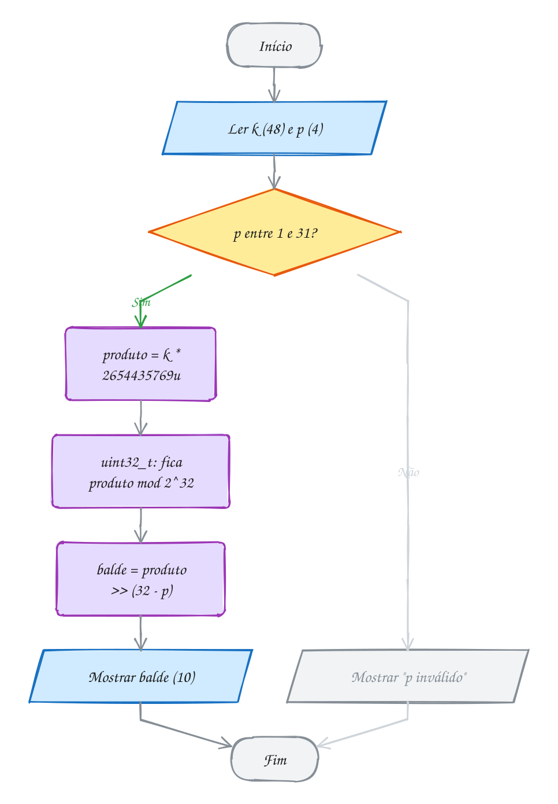</p>

**Exemplo A355 · Potência de 2 só enxerga os bits de baixo**

```c
#include <stdio.h>
#include "0178-espalha.h"

int main(void) {
    // etiquetas do estoque: o lote fica no byte de cima, o item embaixo é 0
    uint32_t etiquetas[] = {0x1A00, 0x2B00, 0x3C00, 0x4D00, 0x5E00};
    printf("etiqueta | k %% 256 | k & 255 | k %% 251\n");
    for (int i = 0; i < 5; i++) {
        uint32_t k = etiquetas[i];
        printf("  0x%04X | %7d | %7u | %d\n", (unsigned)k, esp_divisao(k, 256), k & 255u,
               esp_divisao(k, 251));
    }

    // o mesmo vale em base 10: m = 100 só olha os dois últimos dígitos
    uint32_t precos[] = {1500, 2300, 4700, 990, 12000}; // em centavos
    printf("preço | k %% 100 | k %% 97\n");
    for (int i = 0; i < 5; i++) {
        printf("%5u | %7d | %d\n", precos[i], esp_divisao(precos[i], 100),
               esp_divisao(precos[i], 97));
    }
    return 0;
}
// Saída:
// etiqueta | k % 256 | k & 255 | k % 251
//   0x1A00 |       0 |       0 | 130
//   0x2B00 |       0 |       0 | 215
//   0x3C00 |       0 |       0 | 49
//   0x4D00 |       0 |       0 | 134
//   0x5E00 |       0 |       0 | 219
// preço | k % 100 | k % 97
//  1500 |       0 | 45
//  2300 |       0 | 69
//  4700 |       0 | 44
//   990 |      90 | 20
// 12000 |       0 | 69
```

```bash
gcc ~/LPEDC/material/A355.c ~/LPEDC/material/0178-espalha.c -o ~/LPEDC/material/A355 -lm && ~/LPEDC/material/A355
```

**Exemplo A356 · Multiplicação com double e com deslocamento**

```c
#include <math.h>
#include <stdio.h>
#include "0178-espalha.h"

// a fórmula floor(m * (k*A mod 1)) com qualquer A
int mult_com_A(uint32_t k, int m, double A) {
    double produto = k * A;
    return (int)(m * (produto - floor(produto)));
}

int main(void) {
    // 1. as duas versões dão o mesmo balde? m = 1024 = 2^10
    double a_exato = ESP_S / 4294967296.0; // s / 2^32: o A que os inteiros usam
    int dif_knuth = 0, dif_exato = 0;
    for (uint32_t k = 0; k < 100000; k++) {
        int inteiro = esp_mult_desloca(k, 10);
        dif_knuth += esp_multiplicacao(k, 1024) != inteiro;
        dif_exato += mult_com_A(k, 1024, a_exato) != inteiro;
    }
    printf("k de 0 a 99999, m = 1024, comparado com o deslocamento:\n");
    printf("  double com A = 0.6180339887...: %d baldes diferentes\n", dif_knuth);
    printf("  double com A = s / 2^32:        %d baldes diferentes\n", dif_exato);

    // 2. a versão com double aceita qualquer m; a de inteiros, só 2^p
    printf("m = 1000 (não é potência de 2): k = 123456 -> %d\n", esp_multiplicacao(123456, 1000));

    // 3. chaves seguidas espalham bem? 1000 chaves em m = 64
    int div[64] = {0}, mult[64] = {0};
    for (uint32_t k = 5000; k < 6000; k++) {
        div[esp_divisao(k, 64)]++;
        mult[esp_mult_desloca(k, 6)]++;
    }
    printf("1000 chaves seguidas, m = 64 (ideal: 15.6 por balde)\n");
    printf("  divisão: balde mais cheio com %d\n", esp_maior_balde(div, 64));
    printf("  multiplicação: balde mais cheio com %d\n", esp_maior_balde(mult, 64));

    // 4. mas múltiplos de 64 derrubam a divisão, não a multiplicação
    int div2[64] = {0}, mult2[64] = {0};
    for (uint32_t i = 1; i <= 1000; i++) {
        div2[esp_divisao(64 * i, 64)]++;
        mult2[esp_mult_desloca(64 * i, 6)]++;
    }
    printf("1000 múltiplos de 64, m = 64\n");
    printf("  divisão: balde mais cheio com %d\n", esp_maior_balde(div2, 64));
    printf("  multiplicação: balde mais cheio com %d\n", esp_maior_balde(mult2, 64));
    return 0;
}
// Saída:
// k de 0 a 99999, m = 1024, comparado com o deslocamento:
//   double com A = 0.6180339887...: 592 baldes diferentes
//   double com A = s / 2^32:        0 baldes diferentes
// m = 1000 (não é potência de 2): k = 123456 -> 4
// 1000 chaves seguidas, m = 64 (ideal: 15.6 por balde)
//   divisão: balde mais cheio com 16
//   multiplicação: balde mais cheio com 17
// 1000 múltiplos de 64, m = 64
//   divisão: balde mais cheio com 1000
//   multiplicação: balde mais cheio com 17
```

```bash
gcc ~/LPEDC/material/A356.c ~/LPEDC/material/0178-espalha.c -o ~/LPEDC/material/A356 -lm && ~/LPEDC/material/A356
```

### Exercícios

**Exercício E1063** · ★☆☆

A transportadora espalha os CEPs de entrega numa tabela de m = 97 baldes
(97 é primo e fica longe de 64 e de 128). Use esp_divisao (espalha.h) para
mostrar o balde de cada CEP: 69050000, 69020120, 69099999, 01310100,
20040002 e 69050097. Mostre o CEP com 8 dígitos (zeros à esquerda).

```text
Saída esperada:
     CEP | balde (m = 97)
69050000 | 65
69020120 | 61
69099999 | 12
01310100 | 18
20040002 | 93
69050097 | 65
```

```bash
gcc ~/LPEDC/material/E1063.c ~/LPEDC/material/0178-espalha.c -o ~/LPEDC/material/E1063 -lm && ~/LPEDC/material/E1063
```

**Exercício E1065** · ★★☆

O almoxarifado recebe 1000 caixas numeradas de 64 em 64 (64, 128, ...,
64000). Compare três funções (espalha.h): divisão com m = 64, divisão com
m = 61 e multiplicação em inteiros com m = 64 (p = 6). Para cada uma,
conte as chaves por balde e mostre quantos baldes foram usados e o
tamanho do mais cheio.

```text
Saída esperada:
divisão, m = 64:        1 baldes usados, o mais cheio com 1000
divisão, m = 61:       61 baldes usados, o mais cheio com 17
multiplicação, m = 64: 64 baldes usados, o mais cheio com 17
```

```bash
gcc ~/LPEDC/material/E1065.c ~/LPEDC/material/0178-espalha.c -o ~/LPEDC/material/E1065 -lm && ~/LPEDC/material/E1065
```

**Exercício E1066** · ★★☆

Escolha o m de uma tabela com encadeamento pelo método da divisão. Para n
chaves e um fator de carga alvo alfa, o m é o menor primo >= n / alfa
(arredondado para cima), mas que fique a pelo menos (n / alfa) / 8 de
distância da potência de 2 mais próxima; se ficar perto demais, tente o
próximo primo. Escreva eh_primo, primo_a_partir(x), distancia_potencia(m)
e escolhe(n, alfa), e teste (2000, 3), (3000, 2), (5000, 5) e (100, 2).

```text
Saída esperada:
n = 2000, alfa = 3: alvo 667 -> m = 673 (a 161 da potência de 2 mais perto)
n = 3000, alfa = 2: alvo 1500 -> m = 1511 (a 487 da potência de 2 mais perto)
n = 5000, alfa = 5: alvo 1000 -> m = 1151 (a 127 da potência de 2 mais perto)
n = 100, alfa = 2: alvo 50 -> m = 53 (a 11 da potência de 2 mais perto)
```

```bash
gcc ~/LPEDC/material/E1066.c ~/LPEDC/material/0178-espalha.c -o ~/LPEDC/material/E1066 -lm && ~/LPEDC/material/E1066
```

**Exercício E1068** · ★★★

O método da multiplicação aceita m = 2^p, e isso permite uma tabela que
DOBRA de tamanho. Escreva uma tabela hash com encadeamento (listas) cujo
índice é (k * 2654435769u) >> (32 - p), com uint32_t. Ela começa com m = 4
e, antes de inserir, se n + 1 passar de m, dobra: cria 2m baldes vazios e
move cada nó para o balde novo (o índice muda, porque p muda), sem malloc
novo por item, mostrando "dobrou: m = ... (n = ...)". Insira as
matrículas 1000, 2000, ..., 100000 e mostre n, m, o fator de carga e o
tamanho da maior lista. Libere tudo no fim.

```text
Saída esperada:
dobrou: m = 8 (n = 4)
dobrou: m = 16 (n = 8)
dobrou: m = 32 (n = 16)
dobrou: m = 64 (n = 32)
dobrou: m = 128 (n = 64)
fim: n = 100, m = 128, fator de carga 0.78, maior lista 2
```

```bash
gcc ~/LPEDC/material/E1068.c ~/LPEDC/material/0178-espalha.c -o ~/LPEDC/material/E1068 -lm && ~/LPEDC/material/E1068
```

---

## 0179 · Sondagem quadrática e dupla

### Conceito

- **Sequência de sondagem**: no endereçamento aberto, cada chave tem uma lista
  de posições `h(k, 0), h(k, 1), ...`. A inserção para na primeira livre; a
  busca refaz o caminho até achar a chave ou uma livre (CORMEN et al., 2024, cap. 11).
- **Linear**: `h(k, i) = (h'(k) + i) mod m`. Sofre **agrupamento primário**:
  toda chave que cai em qualquer ponto de um bloco ocupado vai para o fim dele
  e o aumenta (CORMEN et al., 2024, cap. 11).
- **Quadrática**: `h(k, i) = (h'(k) + c₁·i + c₂·i²) mod m`. Os saltos crescem
  (1, 4, 9...) e os blocos se desfazem, mas sobra o **agrupamento
  secundário**: chaves com o mesmo `h'(k)` seguem a mesma trilha
  (TENENBAUM; LANGSAM; AUGENSTEIN, 1995).
- **Dispersão dupla**: `h(k, i) = (h₁(k) + i·h₂(k)) mod m`. O passo depende
  da chave, nunca é 0 e é primo com `m`; com `m` primo, `h₂(k) = 1 + (k mod
  (m - 1))` (CORMEN et al., 2024, cap. 11).
- **Fator de carga** `α = n / m`: com hash uniforme, a busca sem sucesso faz
  no máximo `1 / (1 - α)` sondagens em média, e a com sucesso,
  `(1/α) · ln(1 / (1 - α))`. Com α = 0,9: 10 e 2,6 (CORMEN et al., 2024, cap. 11).
- **Lápide** (*tombstone*): a remoção marca a posição como removida, nunca
  como livre, senão corta o caminho de quem pulou por ela. A busca passa reto;
  a inserção pode reaproveitar (TENENBAUM; LANGSAM; AUGENSTEIN, 1995).

> [!WARNING]
> O passo `h₂(k)` **não pode ser 0** nem ter fator comum com `m`: com `m = 12`
> e passo 4, a chave visita só 3 posições. Na quadrática com carga acima de
> 1/2, a inserção pode falhar **com posições livres**.

### Exemplos de uso

Um guarda-volumes de 13 armários usa `cartão % 13`, e os cartões 18, 31, 44,
20 e 57 entram nas três tabelas; quatro deles começam no armário 5. No
desenho, as posições que a busca do 57 olha:

<p align="center">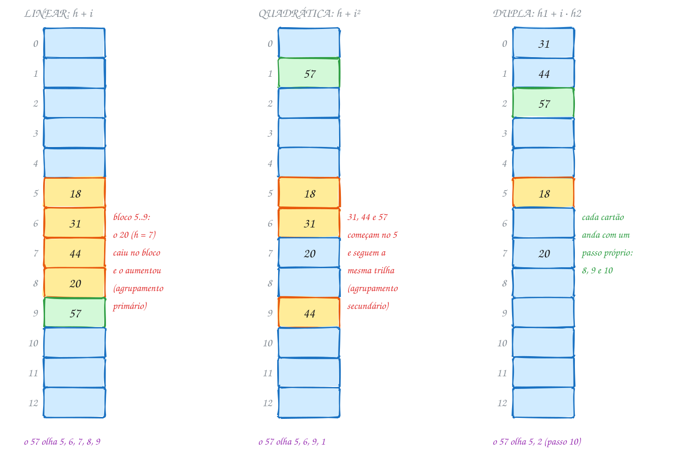</p>

A sequência de sondagem do `sondagem.c` (modo escolhido na criação):

```c
int sd_posicao(const Sondagem *t, int chave, int i) {
    int m = t->m;
    int h1 = chave % m;
    switch (t->modo) {
    case SD_LINEAR:
        return (h1 + i) % m;
    case SD_QUADRATICA:
        return (int)((h1 + (long)i * i) % m);
    default: { // dupla: o passo h2 depende da chave e nunca é 0
        int h2 = 1 + chave % (m - 1);
        return (int)((h1 + (long)i * h2) % m);
    }
    }
}
```

Inserção, busca e remoção chamam `sd_posicao(t, chave, i)`. O
guarda-volumes:

```c
#include <stdio.h>
#include "sondagem.h"

int main(void) {
    const char *nomes[] = {"linear:    ", "quadrática:", "dupla:     "};
    int cartoes[] = {18, 31, 44, 20, 57};
    printf("           ");
    for (int j = 0; j < 13; j++) {
        printf(" %3d", j);
    }
    printf("\n");
    for (int modo = 0; modo < 3; modo++) {
        Sondagem *t = sd_cria(13, (ModoSondagem)modo);
        if (t == NULL) {
            return 1;
        }
        int total = 0;
        for (int i = 0; i < 5; i++) {
            int s;
            sd_insere(t, cartoes[i], &s);
            total += s;
        }
        printf("%s", nomes[modo]);
        sd_mostra(t);
        int s;
        sd_busca(t, 57, &s);
        printf("            sondagens para guardar: %d | para achar o 57: %d\n", total, s);
        sd_libera(t);
    }
    return 0;
}
// Saída:
//               0   1   2   3   4   5   6   7   8   9  10  11  12
// linear:       .   .   .   .   .  18  31  44  20  57   .   .   .
//             sondagens para guardar: 13 | para achar o 57: 5
// quadrática:   .  57   .   .   .  18  31  20   .  44   .   .   .
//             sondagens para guardar: 11 | para achar o 57: 4
// dupla:       31  44  57   .   .  18   .  20   .   .   .   .   .
//             sondagens para guardar: 8 | para achar o 57: 2
```

Na linear, o 20 cai no meio do bloco e vai para o 8. Na quadrática, 31, 44 e
57 repetem a trilha 5, 6, 9, 1. Na dupla, cada um sai do 5 com um passo
diferente. O fluxograma é a inserção do 57 na dupla: `(5 + 10) % 13 = 2` está
livre:

<p align="center">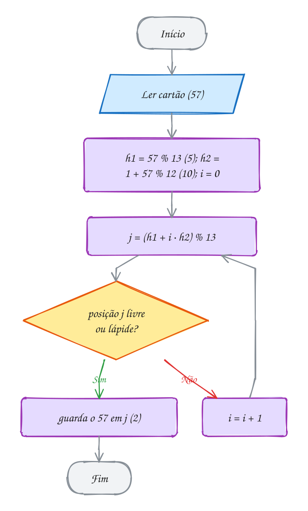</p>

**Exemplo A357 · Medindo os agrupamentos**

```c
#include <stdio.h>
#include "0179-sondagem.h"

static unsigned semente;

int sorteia(void) { // gerador congruente simples: chaves de 0 a 999999
    semente = semente * 1103515245u + 12345u;
    return (int)((semente >> 8) % 1000000);
}

int main(void) {
    int m = 1009;
    double cargas[] = {0.5, 0.7, 0.9};
    printf("busca sem sucesso: média de sondagens (m = %d)\n", m);
    printf("carga | 1/(1-a) | linear | quadrática | dupla\n");
    for (int c = 0; c < 3; c++) {
        double media[3];
        for (int modo = 0; modo < 3; modo++) {
            Sondagem *t = sd_cria(m, (ModoSondagem)modo);
            if (t == NULL) {
                return 1;
            }
            semente = 2024; // as mesmas chaves para os três modos
            while (sd_carga(t) < cargas[c]) {
                sd_insere(t, sorteia(), NULL);
            }
            long soma = 0;
            for (int i = 0; i < 1000; i++) { // chaves >= 1000000: nunca inseridas
                int s;
                sd_busca(t, 1000000 + i, &s);
                soma += s;
            }
            media[modo] = soma / 1000.0;
            sd_libera(t);
        }
        printf(" %.1f  | %7.1f | %6.1f | %10.1f | %5.1f\n", cargas[c], 1 / (1 - cargas[c]),
               media[0], media[1], media[2]);
    }
    return 0;
}
// Saída:
// busca sem sucesso: média de sondagens (m = 1009)
// carga | 1/(1-a) | linear | quadrática | dupla
//  0.5  |     2.0 |    2.7 |        2.1 |   2.0
//  0.7  |     3.3 |    5.8 |        3.6 |   3.3
//  0.9  |    10.0 |   44.9 |       10.6 |  10.4
```

```bash
gcc ~/LPEDC/material/A357.c ~/LPEDC/material/0179-sondagem.c -o ~/LPEDC/material/A357 && ~/LPEDC/material/A357
```

**Exemplo A358 · Lápides que se acumulam**

```c
#include <stdio.h>
#include "0179-sondagem.h"

// média de sondagens de 500 buscas por chaves que não estão na tabela
double media_sem_sucesso(const Sondagem *t) {
    long soma = 0;
    for (int i = 0; i < 500; i++) {
        int s;
        sd_busca(t, 900000 + i, &s);
        soma += s;
    }
    return soma / 500.0;
}

void relata(const char *quando, const Sondagem *t) {
    printf("%-23s chaves %3d | lápides %3d | busca sem sucesso: %5.1f sondagens\n", quando,
           sd_tamanho(t), sd_lapides(t), media_sem_sucesso(t));
}

int main(void) {
    int m = 211;
    Sondagem *t = sd_cria(m, SD_DUPLA);
    if (t == NULL) {
        return 1;
    }
    int presentes[100]; // as 100 chaves que estão na tabela agora
    for (int i = 0; i < 100; i++) {
        presentes[i] = i * 37 + 1;
        sd_insere(t, presentes[i], NULL);
    }
    relata("inicial:", t);

    int proxima = 10000; // troca 400 vezes: sai uma chave antiga, entra uma nova
    for (int rodada = 1; rodada <= 400; rodada++) {
        int k = (rodada * 7) % 100;
        sd_remove(t, presentes[k]);
        presentes[k] = proxima;
        proxima += 13;
        sd_insere(t, presentes[k], NULL);
        if (rodada == 100 || rodada == 400) {
            char rotulo[32];
            snprintf(rotulo, sizeof rotulo, "depois de %d trocas:", rodada);
            relata(rotulo, t);
        }
    }

    Sondagem *nova = sd_cria(m, SD_DUPLA); // reconstruir: reinsere só as chaves vivas
    if (nova == NULL) {
        sd_libera(t);
        return 1;
    }
    for (int i = 0; i < 100; i++) {
        sd_insere(nova, presentes[i], NULL);
    }
    sd_libera(t);
    relata("depois de reconstruir:", nova);
    sd_libera(nova);
    return 0;
}
// Saída:
// inicial:                chaves 100 | lápides   0 | busca sem sucesso:   2.4 sondagens
// depois de 100 trocas:   chaves 100 | lápides  68 | busca sem sucesso:   5.0 sondagens
// depois de 400 trocas:   chaves 100 | lápides 111 | busca sem sucesso: 211.0 sondagens
// depois de reconstruir:  chaves 100 | lápides   0 | busca sem sucesso:   2.8 sondagens
```

```bash
gcc ~/LPEDC/material/A358.c ~/LPEDC/material/0179-sondagem.c -o ~/LPEDC/material/A358 && ~/LPEDC/material/A358
```

### Exercícios

**Exercício E1069** · ★☆☆

Com m = 13 (sondagem.h), mostre as 6 primeiras posições da sequência de
sondagem das chaves 44 e 57 nos três modos (SD_LINEAR, SD_QUADRATICA e
SD_DUPLA), usando sd_posicao(t, chave, i) para i de 0 a 5. As duas chaves
começam na posição 5: veja em qual modo as sequências se separam.

```text
Saída esperada:
chave 44
  linear:      5  6  7  8  9 10
  quadrática:  5  6  9  1  8  4
  dupla:       5  1 10  6  2 11
chave 57
  linear:      5  6  7  8  9 10
  quadrática:  5  6  9  1  8  4
  dupla:       5  2 12  9  6  3
```

```bash
gcc ~/LPEDC/material/E1069.c ~/LPEDC/material/0179-sondagem.c -o ~/LPEDC/material/E1069 && ~/LPEDC/material/E1069
```

**Exercício E1071** · ★★☆

Dispersão dupla com m = 16, uma potência de 2. A regra do Cormen: o passo
h2(k) tem que ser ÍMPAR, para ser primo com 16 e visitar todas as
posições. Escreva, sem o TAD, h1(k) = k % 16 e h2(k) = 2 * ((k / 16) % 8)
+ 1 (os bits que o h1 não usa), e insira os cartões 3, 19, 35, 51, 67 e
83 (todos com h1 = 3) num vetor de 16 posições (-1 é livre). Mostre o h2,
a posição e as sondagens de cada um e a tabela no fim.

```text
Saída esperada:
 3: h2 =  1 -> posição  3, 1 sondagens
19: h2 =  3 -> posição  6, 2 sondagens
35: h2 =  5 -> posição  8, 2 sondagens
51: h2 =  7 -> posição 10, 2 sondagens
67: h2 =  9 -> posição 12, 2 sondagens
83: h2 = 11 -> posição 14, 2 sondagens
tabela: . . . 3 . . 19 . 35 . 51 . 67 . 83 .
```

```bash
gcc ~/LPEDC/material/E1071.c ~/LPEDC/material/0179-sondagem.c -o ~/LPEDC/material/E1071 && ~/LPEDC/material/E1071
```

**Exercício E1072** · ★★☆

A sondagem quadrática h(k, i) = (k % m + i²) % m não visita todas as
posições: com m primo, só (m + 1) / 2 delas são diferentes. Com uma
tabela de m = 7 (sondagem.h, SD_QUADRATICA), mostre a sequência da chave
0 para i de 0 a 6 e as posições que ela nunca visita. Depois insira 0, 7,
14, 21 e 28 (todas começam no 0), mostrando a posição de cada uma (-1 é
falha), a tabela e a carga. A 28 não entra, com três posições livres.

```text
Saída esperada:
sequência da chave 0: 0 1 4 2 2 4 1
nunca visitadas: 3 5 6
insere  0: posição 0
insere  7: posição 1
insere 14: posição 4
insere 21: posição 2
insere 28: posição -1
tabela:   0   7  21   .  14   .   .
carga 0.57 e a chave 28 ficou de fora
```

```bash
gcc ~/LPEDC/material/E1072.c ~/LPEDC/material/0179-sondagem.c -o ~/LPEDC/material/E1072 && ~/LPEDC/material/E1072
```

**Exercício E1074** · ★★★

Escreva, sem o TAD, uma tabela de dispersão dupla que cresce: um vetor de
int (-1 livre), m primo, h1 = k % m e h2 = 1 + k % (m - 1). Antes de
inserir, se (n + 1) / m passar de 0.5, ela cresce para o menor primo >=
2m, reinsere as chaves antigas (com o m novo, as posições mudam) e mostra
"cresceu: m = ... -> ... (n = ...)". Comece com m = 7, insira as chaves
7919 * i % 100000, para i de 0 a 39, e no fim mostre n, m, a carga e a
média de sondagens para achar cada uma das 40 chaves. Libere o vetor.

```text
Saída esperada:
cresceu: m = 7 -> 17 (n = 3)
cresceu: m = 17 -> 37 (n = 8)
cresceu: m = 37 -> 79 (n = 18)
cresceu: m = 79 -> 163 (n = 39)
fim: n = 40, m = 163, carga 0.25, média de sondagens 1.38
```

```bash
gcc ~/LPEDC/material/E1074.c ~/LPEDC/material/0179-sondagem.c -o ~/LPEDC/material/E1074 && ~/LPEDC/material/E1074
```

---

## 0180 · Pigeonhole e chave composta

### Conceito

- **Pigeonhole sort** (casas de pombo): para chave inteira num intervalo
  pequeno `[min, max]`. Cria `r = max - min + 1` casas; põe cada registro no
  fim da fila da sua casa e depois esvazia as casas em ordem. Custa O(n + r).
- **Primo do counting sort** (0120): o counting só conta e calcula posições;
  o pigeonhole guarda os registros, cada casa uma fila.
- **Ordenação estável**: registros com chaves iguais saem na ordem relativa em
  que entraram. O pigeonhole é estável porque cada casa é uma fila
  (ZIVIANI, 2010).
- **Quem é estável**: merge (se no empate pegar da esquerda) e inserção (se só
  deslocar quem é estritamente maior). Os não estáveis trocam elementos
  distantes (ZIVIANI, 2010).
- **Chave composta com comparador**: compara o campo principal e, no empate,
  o secundário. É o jeito do `qsort`, que o padrão não garante estável
  (CPPREFERENCE, s.d.).
- **Chave composta em passadas**: ordene pela chave menos importante e, com
  método estável, pela mais importante. A última passada manda; as anteriores
  desempatam, como no radix LSD (CORMEN et al., 2024).
- **Memória proporcional a `r`**: CPF (11 dígitos) pediria 100 bilhões de
  casas; para chaves grandes, use o radix (0121).

| Estáveis | Não estáveis |
| --- | --- |
| bubble, inserção, merge sort, counting, radix (LSD), bucket (com filas), pigeonhole | seleção, shell sort, quick sort, heapsort |

> [!WARNING]
> Nas passadas em sequência, a ordem é **da menos importante para a mais
> importante**: para "por cidade e, dentro dela, por nota", ordene pela nota e
> por último pela cidade. E a última passada **tem** que ser estável.

### Exemplos de uso

Uma professora ordena a turma pela nota do simulado (0 a 10), e quem empata
fica na ordem da chamada. A chamada já está em ordem de nome, então uma
passada estável pela nota entrega a chave composta (nota, nome):

<p align="center">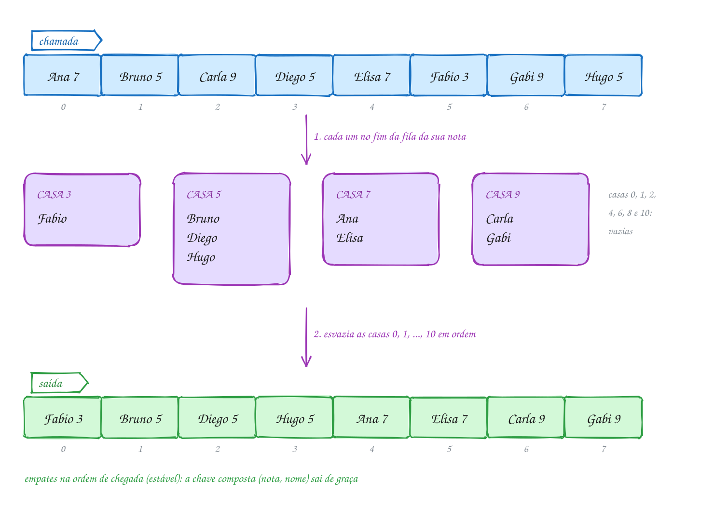</p>

No `pombal.c`, a casa é uma fila de índices em três vetores (`primeiro`,
`ultimo` e `prox`), sem `malloc` por aluno. As duas passadas:

```c
    for (int i = 0; i < n; i++) { // 1. cada aluno entra no fim da fila da sua casa
        int c = v[i].nota - min;
        prox[i] = -1;
        if (primeiro[c] == -1) {
            primeiro[c] = i;
        } else {
            prox[ultimo[c]] = i;
        }
        ultimo[c] = i;
    }
    int k = 0;
    for (int c = 0; c < casas; c++) { // 2. esvazia as casas em ordem
        for (int i = primeiro[c]; i != -1; i = prox[i]) {
            saida[k++] = v[i];
        }
    }
```

O programa compara com a seleção:

```c
#include <stdio.h>
#include "pombal.h"

int main(void) {
    Aluno chamada[] = { // em ordem alfabética, como na lista de chamada
        {"Ana", 7, 1},   {"Bruno", 5, 2}, {"Carla", 9, 1}, {"Diego", 5, 1},
        {"Elisa", 7, 2}, {"Fabio", 3, 2}, {"Gabi", 9, 2},  {"Hugo", 5, 1},
    };
    int n = 8;
    Aluno a[8], b[8];
    for (int i = 0; i < n; i++) {
        a[i] = chamada[i];
        b[i] = chamada[i];
    }
    if (pb_pigeonhole(a, n, 0, 10) != 0) { // notas de 0 a 10: 11 casas
        return 1;
    }
    printf("Pigeonhole: ");
    pb_mostra(a, n);
    pb_selecao(b, n);
    printf("Seleção:    ");
    pb_mostra(b, n);
    return 0;
}
// Saída:
// Pigeonhole: Fabio(3) Bruno(5) Diego(5) Hugo(5) Ana(7) Elisa(7) Carla(9) Gabi(9)
// Seleção:    Fabio(3) Bruno(5) Diego(5) Hugo(5) Elisa(7) Ana(7) Gabi(9) Carla(9)
```

Na seleção, a Elisa passou na frente da Ana: na primeira volta, o Fabio trocou
com a Ana, que foi parar depois da Elisa. O fluxograma tem as duas passadas,
sem comparação entre alunos:

<p align="center">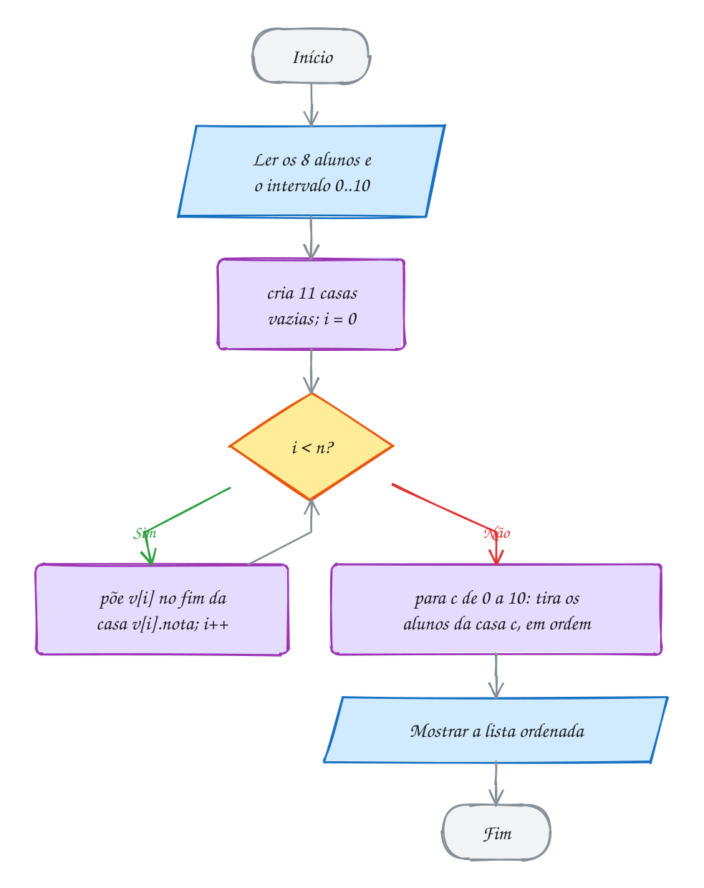</p>

**Exemplo A359 · A tabela do campeonato com qsort**

```c
#include <stdio.h>
#include <stdlib.h>
#include <string.h>

typedef struct {
    char nome[16];
    int pontos, vitorias, saldo, gols_pro;
} Time;

// chave composta: pontos, vitórias, saldo e gols pró (do maior para o
// menor) e, se empatar em tudo, o nome em ordem alfabética
int compara(const void *a, const void *b) {
    const Time *x = a;
    const Time *y = b;
    if (x->pontos != y->pontos) {
        return y->pontos - x->pontos; // maior primeiro: y - x
    }
    if (x->vitorias != y->vitorias) {
        return y->vitorias - x->vitorias;
    }
    if (x->saldo != y->saldo) {
        return y->saldo - x->saldo;
    }
    if (x->gols_pro != y->gols_pro) {
        return y->gols_pro - x->gols_pro;
    }
    return strcmp(x->nome, y->nome); // o desempate final deixa a ordem total
}

int main(void) {
    Time t[] = {
        {"Ipiranga", 20, 6, 8, 19},  {"Aleixo", 23, 7, 10, 22}, {"Coroado", 20, 6, 8, 21},
        {"Flores", 20, 5, 12, 25},   {"Japiim", 23, 7, 10, 22}, {"Educandos", 17, 5, 1, 15},
    };
    int n = 6;
    qsort(t, (size_t)n, sizeof(Time), compara);
    printf("   %-10s %3s %3s %4s %3s\n", "time", "P", "V", "SG", "GP");
    for (int i = 0; i < n; i++) {
        printf("%d. %-10s %3d %3d %4d %3d\n", i + 1, t[i].nome, t[i].pontos, t[i].vitorias,
               t[i].saldo, t[i].gols_pro);
    }
    return 0;
}
// Saída:
//    time         P   V   SG  GP
// 1. Aleixo      23   7   10  22
// 2. Japiim      23   7   10  22
// 3. Coroado     20   6    8  21
// 4. Ipiranga    20   6    8  19
// 5. Flores      20   5   12  25
// 6. Educandos   17   5    1  15
```

```bash
gcc ~/LPEDC/material/A359.c ~/LPEDC/material/0180-pombal.c -o ~/LPEDC/material/A359 && ~/LPEDC/material/A359
```

**Exemplo A360 · Duas passadas estáveis viram uma chave composta**

```c
#include <stdio.h>
#include "0180-pombal.h"

// inserção pela turma (estável), para a segunda passada
void insercao_por_turma(Aluno *v, int n) {
    for (int i = 1; i < n; i++) {
        Aluno x = v[i];
        int j = i - 1;
        while (j >= 0 && v[j].turma > x.turma) {
            v[j + 1] = v[j];
            j--;
        }
        v[j + 1] = x;
    }
}

// seleção pela turma (não estável), para comparar
void selecao_por_turma(Aluno *v, int n) {
    for (int i = 0; i < n - 1; i++) {
        int m = i;
        for (int j = i + 1; j < n; j++) {
            if (v[j].turma < v[m].turma) {
                m = j;
            }
        }
        Aluno t = v[i];
        v[i] = v[m];
        v[m] = t;
    }
}

void mostra(const Aluno *v, int n) {
    for (int i = 0; i < n; i++) {
        printf(" %d:%s(%d)", v[i].turma, v[i].nome, v[i].nota);
    }
    printf("\n");
}

int main(void) {
    Aluno chamada[] = {
        {"Ana", 7, 1},   {"Bruno", 5, 2}, {"Carla", 9, 1}, {"Diego", 5, 1},
        {"Elisa", 7, 2}, {"Fabio", 3, 2}, {"Gabi", 9, 2},  {"Hugo", 5, 1},
    };
    int n = 8;
    Aluno a[8], b[8];
    for (int i = 0; i < n; i++) {
        a[i] = chamada[i];
    }
    // objetivo: por turma e, dentro da turma, por nota
    if (pb_pigeonhole(a, n, 0, 10) != 0) { // 1ª passada: a chave secundária
        return 1;
    }
    for (int i = 0; i < n; i++) {
        b[i] = a[i];
    }
    printf("1ª passada (nota): ");
    mostra(a, n);
    insercao_por_turma(a, n); // 2ª passada: a principal, com método estável
    printf("2ª estável (turma):");
    mostra(a, n);
    selecao_por_turma(b, n); // a mesma 2ª passada com a seleção
    printf("2ª com seleção:    ");
    mostra(b, n);
    return 0;
}
// Saída:
// 1ª passada (nota):  2:Fabio(3) 2:Bruno(5) 1:Diego(5) 1:Hugo(5) 1:Ana(7) 2:Elisa(7) 1:Carla(9) 2:Gabi(9)
// 2ª estável (turma): 1:Diego(5) 1:Hugo(5) 1:Ana(7) 1:Carla(9) 2:Fabio(3) 2:Bruno(5) 2:Elisa(7) 2:Gabi(9)
// 2ª com seleção:     1:Diego(5) 1:Hugo(5) 1:Ana(7) 1:Carla(9) 2:Fabio(3) 2:Elisa(7) 2:Bruno(5) 2:Gabi(9)
```

```bash
gcc ~/LPEDC/material/A360.c ~/LPEDC/material/0180-pombal.c -o ~/LPEDC/material/A360 && ~/LPEDC/material/A360
```

### Exercícios

**Exercício E1075** · ★☆☆

A academia quer as idades dos alunos da turma de iniciantes em ordem. As
idades vão de 18 a 25: 22, 19, 25, 18, 22, 20, 19, 24, 22, 18. Escreva o
pigeonhole sort para números inteiros: um vetor casa[] com uma posição
para cada idade possível (25 - 18 + 1 = 8), conte quantos caem em cada
casa e depois esvazie as casas em ordem de volta no vetor. Mostre também
quantas casas foram usadas.

```text
Saída esperada:
ordenadas: 18 18 19 19 20 22 22 22 24 25
casas usadas: 6 de 8
```

```bash
gcc ~/LPEDC/material/E1075.c ~/LPEDC/material/0180-pombal.c -o ~/LPEDC/material/E1075 && ~/LPEDC/material/E1075
```

**Exercício E1077** · ★★☆

Teste a estabilidade de três ordenações do pombal.h. Monte 10 alunos com
nomes a0 a a9, as notas 4, 8, 4, 2, 8, 4, 6, 2, 8, 6 e, no campo turma, a
posição original (0 a 9). Escreva eh_estavel(v, n): depois de ordenar,
entre vizinhos de nota igual, a posição original tem que crescer. Ordene
uma cópia com pb_selecao, outra com pb_insercao e outra com pb_pigeonhole
e mostre o veredito e o resultado de cada uma.

```text
Saída esperada:
seleção:    não estável | a3(2) a7(2) a2(4) a0(4) a5(4) a6(6) a9(6) a1(8) a8(8) a4(8)
inserção:   estável     | a3(2) a7(2) a0(4) a2(4) a5(4) a6(6) a9(6) a1(8) a4(8) a8(8)
pigeonhole: estável     | a3(2) a7(2) a0(4) a2(4) a5(4) a6(6) a9(6) a1(8) a4(8) a8(8)
```

```bash
gcc ~/LPEDC/material/E1077.c ~/LPEDC/material/0180-pombal.c -o ~/LPEDC/material/E1077 && ~/LPEDC/material/E1077
```

**Exercício E1078** · ★★☆

A previsão do frio na serra: ordene as leituras da MAIS QUENTE para a
MAIS FRIA com um pigeonhole sort estável escrito por você. As
temperaturas vão de -5 a 8 graus (14 casas; a casa de t é t - (-5)). Cada
casa é uma fila de índices, como no pombal.c, e as casas são esvaziadas
da mais quente para a mais fria. Leituras: Urubici -3, Gramado 4,
Curitiba 8, Sao Joaquim -5, Lages 4, Bom Jardim -3, Canela 4, Caxias 6.

```text
Saída esperada:
  8 Curitiba
  6 Caxias
  4 Gramado
  4 Lages
  4 Canela
 -3 Urubici
 -3 Bom Jardim
 -5 Sao Joaquim
```

```bash
gcc ~/LPEDC/material/E1078.c ~/LPEDC/material/0180-pombal.c -o ~/LPEDC/material/E1078 && ~/LPEDC/material/E1078
```

**Exercício E1079** · ★★★

A secretaria quer a lista dos inscritos do vestibular por CIDADE (código
1, 2 ou 3) e, dentro de cada cidade, por NOTA, da menor para a maior.
Escreva ordena_por_cidade e ordena_por_nota, duas inserções (que são
estáveis) sobre Inscrito, e chame-as na ordem que dá o resultado certo
(a chave principal fica por último). Inscritos (nome, cidade, nota):
Ana 1 62, Teo 2 70, Nina 3 91, Rui 1 80, Bia 2 48, Lia 1 62, Caio 3 55,
Ivo 2 70, Joao 1 55. Mostre uma linha por cidade.

```text
Saída esperada:
1:Joao(55) 1:Ana(62) 1:Lia(62) 1:Rui(80)
2:Bia(48) 2:Teo(70) 2:Ivo(70)
3:Caio(55) 3:Nina(91)
```

```bash
gcc ~/LPEDC/material/E1079.c ~/LPEDC/material/0180-pombal.c -o ~/LPEDC/material/E1079 && ~/LPEDC/material/E1079
```

---

## 0181 · Juntando tudo

### Conceito

- **Pacientes numa hash com dispersão dupla** (0179), pelo CPF: busca exata
  em O(1) em média, com `m = 101` primo e carga abaixo de 1/2
  (CORMEN et al., 2024, cap. 11).
- **Horários numa rubro-negra** com sentinela (0177), pela hora em HHMM:
  marcar custa O(log n); "a próxima depois de tal hora" é o teto seguido do
  **sucessor** (0175) (CORMEN et al., 2024, cap. 13).
- **Fila de espera numa lista dupla circular com sentinela** (0174): entra no
  fim e sai do começo ou do meio, sem caso especial (CORMEN et al., 2024, cap. 10).
- **Ligação por chaves**: o nó da árvore guarda o CPF, o paciente guarda o
  horário, a fila guarda CPFs. Rotação ou sondagem não invalidam as outras
  estruturas.
- **Horário vago**: a rubro-negra do 0177 não tem remoção; a consulta
  desmarcada deixa `cpf = 0` no nó, como a lápide da hash.
- **Tipo opaco**: o `.h` só declara `typedef struct Agenda Agenda`; dá para
  trocar a rubro-negra por uma AVL sem mudar o cliente (CELES; CERQUEIRA;
  RANGEL, 2016).

> [!WARNING]
> Quando duas estruturas guardam a mesma informação, elas mudam **juntas**.
> Se o cancelamento zerar só a árvore (`x->cpf`) e esquecer a hash
> (`p->horario`), a paciente nunca mais consegue marcar.

### Exemplos de uso

A recepção de um posto de saúde cadastra cinco pacientes. Carla marca às
8h00, Ana às 9h00, Bruno às 10h30; Diego e Elisa esperam pelas 9h00. Ana
desmarca e Diego assume. As estruturas depois disso:

<p align="center">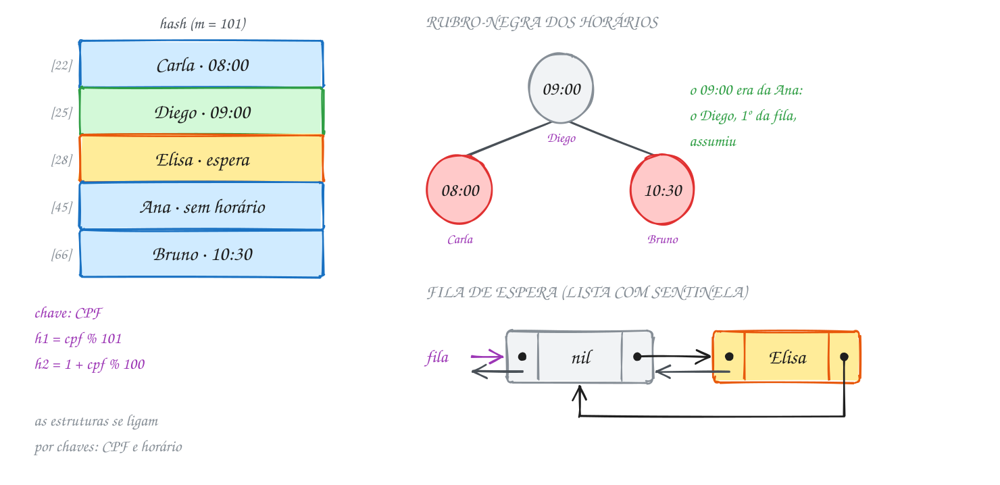</p>

O `agenda.c` reúne as três implementações (com `static`). A operação que as
junta é o cancelamento:

```c
int ag_cancela(Agenda *a, int horario) {
    NoAg *x = busca_no(a, horario);  // rubro-negra: O(log n)
    if (x == &a->nil || x->cpf == 0) {
        return -1;
    }
    paciente(a, x->cpf)->horario = -1; // hash: O(1) em média
    x->cpf = 0;
    a->consultas--;
    if (a->na_fila == 0) {
        return 0; // ninguém esperando: o horário fica vago na árvore
    }
    int cpf = a->fila.prox->cpf; // fila: o primeiro, sem if de lista vazia
    ag_marca(a, horario, cpf);   // ag_marca já tira ele da fila
    return cpf;
}
```

O programa da recepção:

```c
#include <stdio.h>
#include "agenda.h"

int main(void) {
    Agenda *a = ag_cria();
    if (a == NULL) {
        return 1;
    }
    ag_cadastra(a, 123456789, "Ana");
    ag_cadastra(a, 987654321, "Bruno");
    ag_cadastra(a, 111222333, "Carla");
    ag_cadastra(a, 444555666, "Diego");
    ag_cadastra(a, 777888999, "Elisa");

    ag_marca(a, 900, 123456789);
    ag_marca(a, 1030, 987654321);
    ag_marca(a, 800, 111222333);
    if (!ag_marca(a, 900, 444555666)) {
        printf("09:00 já está ocupado: Diego vai para a espera\n");
        ag_espera(a, 444555666);
    }
    ag_espera(a, 777888999);
    ag_mostra(a);
    ag_mostra_espera(a);

    int quem = ag_cancela(a, 900); // a Ana desmarcou
    printf("Ana desmarcou as 09:00; quem assumiu: %s\n", ag_nome(a, quem));
    int h = ag_proximo(a, 845);
    printf("Próxima consulta depois das 08:45: %02d:%02d\n", h / 100, h % 100);
    ag_mostra(a);
    ag_mostra_espera(a);
    ag_estatisticas(a);
    ag_libera(a);
    return 0;
}
// Saída:
// 09:00 já está ocupado: Diego vai para a espera
// 08:00  Carla
// 09:00  Ana
// 10:30  Bruno
// Espera: Diego Elisa
// Ana desmarcou as 09:00; quem assumiu: Diego
// Próxima consulta depois das 08:45: 09:00
// 08:00  Carla
// 09:00  Diego
// 10:30  Bruno
// Espera: Elisa
// Horários na árvore: 3 (3 com consulta) | altura 1 | altura negra 1
// Pacientes: 5 em 101 posições | média de sondagens: 1.00
// Na fila de espera: 1
```

O fluxograma segue o cancelamento das 9h00: a Ana fica sem horário e, como a
fila não está vazia, o Diego assume e sai dela:

<p align="center">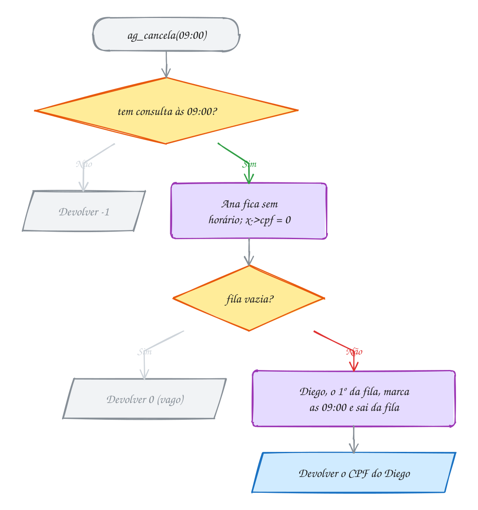</p>

**Exemplo A361 · Um dia cheio, marcado em ordem**

```c
#include <stdio.h>
#include "0181-agenda.h"

int main(void) {
    Agenda *a = ag_cria();
    if (a == NULL) {
        return 1;
    }
    // 44 consultas de 15 em 15 minutos, das 07:00 às 17:45, marcadas em
    // ordem de horário: o pior caso para uma BST comum
    int n = 0;
    unsigned semente = 2026; // gerador simples: CPFs inventados, sempre os mesmos
    for (int hora = 7; hora <= 17; hora++) {
        for (int min = 0; min < 60; min += 15) {
            semente = semente * 1103515245u + 12345u;
            int cpf = 100000000 + (int)((semente >> 4) % 800000000u);
            char nome[24];
            snprintf(nome, sizeof nome, "Paciente %02d", n + 1);
            if (ag_cadastra(a, cpf, nome)) {
                ag_marca(a, hora * 100 + min, cpf);
            }
            n++;
        }
    }
    ag_estatisticas(a);
    printf("(uma BST comum, com os horários em ordem, teria altura %d)\n", n - 1);

    int tarde[50];
    int k = ag_intervalo(a, 1600, 1759, tarde, 50);
    printf("Depois das 16h: %d consultas:", k);
    for (int i = 0; i < k; i++) {
        printf(" %02d:%02d", tarde[i] / 100, tarde[i] % 100);
    }
    printf("\n");
    ag_libera(a);
    return 0;
}
// Saída:
// Horários na árvore: 44 (44 com consulta) | altura 7 | altura negra 4
// Pacientes: 44 em 101 posições | média de sondagens: 1.36
// Na fila de espera: 0
// (uma BST comum, com os horários em ordem, teria altura 43)
// Depois das 16h: 8 consultas: 16:00 16:15 16:30 16:45 17:00 17:15 17:30 17:45
```

```bash
gcc ~/LPEDC/material/A361.c ~/LPEDC/material/0181-agenda.c -o ~/LPEDC/material/A361 && ~/LPEDC/material/A361
```

**Exemplo A362 · Encaixes ao longo do dia**

```c
#include <stdio.h>
#include "0181-agenda.h"

void cancela(Agenda *a, int horario) {
    int quem = ag_cancela(a, horario);
    printf("Cancela %02d:%02d: ", horario / 100, horario % 100);
    if (quem > 0) {
        printf("%s assume o horário\n", ag_nome(a, quem));
    } else if (quem == 0) {
        printf("ninguém na espera, o horário fica vago\n");
    } else {
        printf("não havia consulta\n");
    }
}

int main(void) {
    Agenda *a = ag_cria();
    if (a == NULL) {
        return 1;
    }
    int cpfs[] = {210000001, 210000002, 210000003, 210000004, 210000005, 210000006};
    const char *nomes[] = {"Gil", "Ines", "Joel", "Kátia", "Luan", "Mara"};
    for (int i = 0; i < 6; i++) {
        ag_cadastra(a, cpfs[i], nomes[i]);
    }
    ag_marca(a, 1400, cpfs[0]);
    ag_marca(a, 1430, cpfs[1]);
    ag_marca(a, 1500, cpfs[2]);
    ag_espera(a, cpfs[3]);
    ag_espera(a, cpfs[4]);
    ag_mostra_espera(a);

    cancela(a, 1430); // Kátia, a primeira da fila, assume
    cancela(a, 1400); // Luan assume
    cancela(a, 1500); // fila vazia: vago
    cancela(a, 1600); // nunca houve consulta
    ag_mostra(a);

    // a Mara liga e pega o horário vago das 15:00; a Kátia não pode marcar outro
    printf("Mara marca 15:00: %s\n", ag_marca(a, 1500, cpfs[5]) ? "ok" : "recusado");
    int h = ag_horario_de(a, cpfs[3]);
    printf("Kátia marca 16:00: %s (já tem as %02d:%02d)\n",
           ag_marca(a, 1600, cpfs[3]) ? "ok" : "recusado", h / 100, h % 100);
    ag_mostra(a);
    ag_mostra_espera(a);
    ag_libera(a);
    return 0;
}
// Saída:
// Espera: Kátia Luan
// Cancela 14:30: Kátia assume o horário
// Cancela 14:00: Luan assume o horário
// Cancela 15:00: ninguém na espera, o horário fica vago
// Cancela 16:00: não havia consulta
// 14:00  Luan
// 14:30  Kátia
// 15:00  (vago)
// Mara marca 15:00: ok
// Kátia marca 16:00: recusado (já tem as 14:30)
// 14:00  Luan
// 14:30  Kátia
// 15:00  Mara
// Espera: (ninguém)
```

```bash
gcc ~/LPEDC/material/A362.c ~/LPEDC/material/0181-agenda.c -o ~/LPEDC/material/A362 && ~/LPEDC/material/A362
```

### Exercícios

**Exercício E1081** · ★☆☆

Use a agenda (agenda.h). Cadastre Rosa (301000001), Saulo (301000002),
Tania (301000003) e Ugo (301000004). Marque Rosa às 11:00, Saulo às
08:30 e Tania às 13:15. Tente marcar o Ugo às 08:30 e o CPF 301000005
(que não existe) às 09:00, mostrando uma mensagem para cada recusa, e
mostre a agenda.

```text
Saída esperada:
Ugo: 08:30 ocupado
CPF 301000005: não cadastrado
08:30  Saulo
11:00  Rosa
13:15  Tania
```

```bash
gcc ~/LPEDC/material/E1081.c ~/LPEDC/material/0181-agenda.c -o ~/LPEDC/material/E1081 && ~/LPEDC/material/E1081
```

**Exercício E1083** · ★★☆

O plantão da clínica funciona em três turnos: manhã (00:00 a 11:59), tarde
(12:00 a 17:59) e noite (18:00 a 23:59). Cadastre 10 pacientes (CPFs
500000001 a 500000010, nomes P1 a P10) e marque, nessa ordem, os horários
07:30, 11:15, 12:00, 19:45, 09:00, 14:00, 18:30, 11:59, 16:00 e 21:00. Com
ag_intervalo, mostre quantas consultas há em cada turno e quais são.

```text
Saída esperada:
manhã (4): 07:30 09:00 11:15 11:59
tarde (3): 12:00 14:00 16:00
noite (3): 18:30 19:45 21:00
```

```bash
gcc ~/LPEDC/material/E1083.c ~/LPEDC/material/0181-agenda.c -o ~/LPEDC/material/E1083 && ~/LPEDC/material/E1083
```

**Exercício E1084** · ★★☆

Escreva remarca(a, cpf, novo), que muda a consulta do paciente para o
horário novo (agenda.h). Ela recusa (devolve false) se o paciente não tem
consulta ou se o horário novo já está ocupado (confira com ag_intervalo(a,
novo, novo, ...)). Senão, desmarca o antigo com ag_cancela (se alguém da
espera assumir, mostre quem) e marca o novo. Teste: Zeca (601000001) às
09:00, Alice (601000002) às 10:00 e Breno (601000003) na espera; remarque
o Zeca para 10:00 e depois para 11:00.

```text
Saída esperada:
Zeca para 10:00: recusado
Zeca para 11:00:
  Breno assume as 09:00
  ok
09:00  Breno
10:00  Alice
11:00  Zeca
Espera: (ninguém)
```

```bash
gcc ~/LPEDC/material/E1084.c ~/LPEDC/material/0181-agenda.c -o ~/LPEDC/material/E1084 && ~/LPEDC/material/E1084
```

**Exercício E1085** · ★★★

A fila de espera da clínica ganhou prioridade: idosos (60 anos ou mais)
passam na frente dos outros, mas, entre os idosos, vale a ordem de
chegada (e entre os demais também). Escreva, com uma lista dupla circular
com sentinela escrita por você (struct com nome, idade, ant e prox),
entra(fila, nome, idade): o idoso entra logo DEPOIS do último idoso da
fila (ou logo depois da sentinela, se não houver nenhum); os demais
entram no fim. Sem nenhum caso especial para fila vazia. Chegam, nesta
ordem: Ana 35, Beto 70, Caio 22, Dora 65, Enzo 81, Fabi 40. Mostre a fila
depois de cada chegada e libere tudo no fim.

```text
Saída esperada:
Ana
Beto* Ana
Beto* Ana Caio
Beto* Dora* Ana Caio
Beto* Dora* Enzo* Ana Caio
Beto* Dora* Enzo* Ana Caio Fabi
```

```bash
gcc ~/LPEDC/material/E1085.c ~/LPEDC/material/0181-agenda.c -o ~/LPEDC/material/E1085 && ~/LPEDC/material/E1085
```

---

## Lista do módulo

30 exercícios que misturam os assuntos do módulo, no ritmo da prova. Arquivos P2801.c a P2830.c, em `material/`; resoluções em `_respostas/28-estruturas-complementos/lista/`.

### ★☆☆ Aquecimento

**Exercício P2801** · ★☆☆ · A fila do caixa com sentinela

O caixa rápido do mercado atende pela ordem de chegada. Escreva, do zero,
uma lista dupla circular com nó sentinela (a struct da lista guarda o nó
nil dentro dela): inicia(L), insere_fim(L, senha), mostra(L) do primeiro
ao último, mostra_inverso(L) do último ao primeiro e libera(L). Entram as
senhas 31, 32, 33 e 34. Mostre a fila nos dois sentidos e, no fim, se a
sentinela da lista vazia aponta para ela mesma.

```text
Saída esperada:
ida:   [ 31 32 33 34 ]
volta: [ 34 33 32 31 ]
vazia: nil aponta para ela mesma? sim
```

---

**Exercício P2802** · ★☆☆ · A chave guardada na sentinela

Na busca com sentinela do Cormen, a chave procurada é copiada para
nil.chave antes do laço, e o laço só testa x->chave != k. Monte a lista
com sentinela 4, 8, 15, 16, 23, 42 (insira no fim) e escreva busca(L, k,
&comparacoes), que devolve o nó achado (ou &L->nil) e conta quantas vezes
x->chave != k foi avaliado. Busque 15, 42 e 99.

```text
Saída esperada:
15: achou, 3 comparações
42: achou, 6 comparações
99: não está, 7 comparações
```

---

**Exercício P2803** · ★☆☆ · O grau de cada nó

O catálogo da livraria guarda os códigos 60, 30, 90, 20, 45, 75, 40, 50,
95 numa BST (insira nessa ordem). Escreva grau(x), que devolve quantos
filhos x tem, e mostre, em ordem, cada chave com o grau entre parênteses.
Depois mostre o grau da árvore (o maior grau) e quantas folhas ela tem.

```text
Saída esperada:
em ordem: 20(0) 30(2) 40(0) 45(2) 50(0) 60(2) 75(0) 90(2) 95(0)
grau da árvore: 2 | folhas: 5
```

---

**Exercício P2804** · ★☆☆ · Quantos nós em cada nível

Com a mesma árvore do P2803 (60, 30, 90, 20, 45, 75, 40, 50, 95), escreva
profundidade(x), que sobe pelo ponteiro pai contando arestas, e altura(x),
em arestas (vazia: -1). Mostre quantos nós há em cada nível, de 0 até a
altura da árvore, e quais são.

```text
Saída esperada:
nível 0: 60 (1 nós)
nível 1: 30 90 (2 nós)
nível 2: 20 45 75 95 (4 nós)
nível 3: 40 50 (2 nós)
altura: 3
```

---

**Exercício P2805** · ★☆☆ · O fator de cada nó

Ainda com a árvore do P2803 (60, 30, 90, 20, 45, 75, 40, 50, 95), mostre
em ordem cada chave com o seu fator de balanceamento, altura(esq) -
altura(dir), e diga no fim se a árvore é AVL (todo fator em -1, 0 ou 1).
Depois insira 55 e repita.

```text
Saída esperada:
fatores: 20(0) 30(-1) 40(0) 45(0) 50(0) 60(1) 75(0) 90(0) 95(0)
é AVL
fatores: 20(0) 30(-2) 40(0) 45(-1) 50(-1) 55(0) 60(2) 75(0) 90(0) 95(0)
não é AVL
```

---

**Exercício P2806** · ★☆☆ · Mínimo, máximo e sucessor

O painel de embarque guarda os horários (HHMM) 1210, 830, 1545, 700, 945,
1400, 1700, 900 numa BST com ponteiro para o pai. Escreva minimo(x),
maximo(x) e sucessor(x) (o TREE-SUCCESSOR do Cormen: com subárvore
direita, o mínimo dela; sem, sobe até chegar por um filho esquerdo).
Mostre o primeiro e o último voo e o sucessor de 945, de 1210 e de 1700.

```text
Saída esperada:
primeiro: 700 | último: 1700
depois de 945: 1210
depois de 1210: 1400
depois de 1700: nenhum
```

---

**Exercício P2807** · ★☆☆ · Divisão e colisões

A locadora de bicicletas espalha as matrículas 1013, 2026, 3039, 4052,
5065, 1500, 2600 e 3700 numa tabela de m = 13 baldes com h(k) = k mod 13.
Mostre o balde de cada matrícula, o número de colisões (chaves que caem
num balde já ocupado) e repita com m = 10.

```text
Saída esperada:
m = 13: 12 11 10 9 8 5 0 8 | colisões: 1
m = 10: 3 6 9 2 5 0 0 0 | colisões: 2
```

---

**Exercício P2808** · ★☆☆ · Multiplicação em ponto flutuante

Escreva h(k, m) = floor(m · (k·A mod 1)) com A = (raiz de 5 - 1) / 2, em
double. Para as senhas 10, 20, ..., 80 e m = 8, mostre o balde de cada uma
e quantos baldes diferentes foram usados. Compare com k mod 8.

```text
Saída esperada:
senha | mult | k % 8
   10 |    1 | 2
   20 |    2 | 4
   30 |    4 | 6
   40 |    5 | 0
   50 |    7 | 2
   60 |    0 | 4
   70 |    2 | 6
   80 |    3 | 0
baldes usados: multiplicação 7, divisão 4
```

```bash
gcc ~/LPEDC/material/P2808.c -o ~/LPEDC/material/P2808 -lm && ~/LPEDC/material/P2808
```

---

**Exercício P2809** · ★☆☆ · Sondagem linear e a tabela final

O estacionamento tem 11 vagas e usa h(k, i) = (k mod 11 + i) mod 11.
Entram as placas (só os números) 23, 45, 12, 34, 56, 9 e 1. Para cada uma,
mostre a vaga e quantas sondagens fez; no fim, imprima a tabela inteira
("." para vaga livre).

```text
Saída esperada:
23 -> vaga  1 (1 sondagens)
45 -> vaga  2 (2 sondagens)
12 -> vaga  3 (3 sondagens)
34 -> vaga  4 (4 sondagens)
56 -> vaga  5 (5 sondagens)
 9 -> vaga  9 (1 sondagens)
 1 -> vaga  6 (6 sondagens)
tabela: . 23 45 12 34 56 1 . . 9 .
```

---

**Exercício P2810** · ★☆☆ · Pigeonhole dos dados

Num jogo de tabuleiro, foram anotados 15 lançamentos de um dado: 3, 6, 1,
3, 5, 2, 6, 6, 4, 1, 3, 5, 6, 2, 3. Ordene com o pigeonhole sort (uma casa
para cada face, de 1 a 6) e mostre a sequência ordenada e quantas vezes
saiu cada face.

```text
Saída esperada:
frequências: 1:2 2:2 3:4 4:1 5:2 6:4
ordenados: 1 1 2 2 3 3 3 3 4 5 5 6 6 6 6
```

### ★★☆ Para pensar

**Exercício P2811** · ★★☆ · Sondagem quadrática

Refaça o estacionamento do P2809 (m = 11, placas 23, 45, 12, 34, 56, 9 e
1) com sondagem quadrática: h(k, i) = (k mod 11 + i * i) mod 11. Mostre a
vaga e as sondagens de cada placa, a tabela final e o total de sondagens.
Compare com o P2809.

```text
Saída esperada:
23 -> vaga  1 (1 sondagens)
45 -> vaga  2 (2 sondagens)
12 -> vaga  5 (3 sondagens)
34 -> vaga 10 (4 sondagens)
56 -> vaga  6 (5 sondagens)
 9 -> vaga  9 (1 sondagens)
 1 -> vaga  4 (6 sondagens)
tabela: . 23 45 . 1 12 56 . . 9 34
total de sondagens: 22
```

---

**Exercício P2812** · ★★☆ · Dispersão dupla

Agora com dispersão dupla, numa tabela de m = 13: h(k, i) = (h1(k) + i ·
h2(k)) mod 13, com h1(k) = k mod 13 e h2(k) = 1 + (k mod 11). Insira 14,
27, 40, 53, 66, 79 (todas com h1 = 1) e 5. Mostre o passo h2, a posição e
as sondagens de cada uma, a tabela final e o total de sondagens.

```text
Saída esperada:
14: passo  4 ->  1 (1 sondagens)
27: passo  6 ->  7 (2 sondagens)
40: passo  8 ->  9 (2 sondagens)
53: passo 10 -> 11 (2 sondagens)
66: passo  1 ->  2 (2 sondagens)
79: passo  3 ->  4 (2 sondagens)
 5: passo  6 ->  5 (1 sondagens)
tabela: . 14 66 . 79 5 . 27 . 40 . 53 .
total de sondagens: 12
```

---

**Exercício P2813** · ★★☆ · A lápide no meio do caminho

Numa tabela de m = 7 com sondagem linear, cada posição tem um estado:
LIVRE, OCUPADA ou LAPIDE. Escreva insere (reaproveita a primeira lápide do
caminho), busca (para na LIVRE, passa reto pela LAPIDE) e remove (marca
LAPIDE). Insira 10, 17, 24 e 5 (os três primeiros começam no 3), remova o
17, busque o 24, insira 31 e mostre a tabela depois de cada passo ("."
livre, "x" lápide).

```text
Saída esperada:
inseridos:   .  .  . 10 17 24  5
tira 17:     .  .  . 10  x 24  5
busca 24: posição 5
insere 31:   .  .  . 10 31 24  5
```

---

**Exercício P2814** · ★★☆ · Do maior para o menor com o antecessor

A tabela de recordes do fliperama guarda as pontuações 5200, 3100, 8800,
2500, 4700, 7600, 9900, 4100 numa BST com ponteiro para o pai. Escreva
antecessor(x) (o espelho do sucessor: com subárvore esquerda, o máximo
dela; sem, sobe até chegar por um filho direito) e mostre o ranking, do
maior para o menor, sem recursão: comece no máximo e ande pelo antecessor.
Mostre também o antecessor do 4700 e do 2500.

```text
Saída esperada:
ranking: 9900 8800 7600 5200 4700 4100 3100 2500
antes de 4700: 4100 | antes de 2500: nenhum
```

---

**Exercício P2815** · ★★☆ · O fiscal da rubro-negra

Três árvores foram coloridas à mão e você tem que conferir se são rubro-
negras. Cada nó tem chave, cor ('V' ou 'P') e dois filhos (NULL faz o
papel da folha nil, preta). Escreva fiscal(x), que devolve a altura negra
de x (pretos de x até NULL, contando x, sem contar o NULL) ou -1 se: um
vermelho tem filho vermelho, ou os dois lados têm alturas negras
diferentes. Confira também a raiz preta. As árvores (pré-ordem, com o
filho vazio como -):

```text
A: 20P (10V (5P, 15P), 30P (-, 35V))
B: 20P (10V (5V, 15P), 30P)
C: 20P (10P (5P, -), 30P)
```

Monte-as com uma função novo(chave, cor, esq, dir) que usa malloc.

```text
Saída esperada:
A: rubro-negra, altura negra 2
B: não é rubro-negra
C: não é rubro-negra
```

---

**Exercício P2816** · ★★☆ · Escreva a remoção da AVL

Escreva, do zero, uma AVL com inserção e remoção (nó com altura guardada,
rotações à esquerda e à direita e um equilibra que serve para as duas
operações; na remoção de nó com dois filhos, use o sucessor). Conte as
rotações simples num contador global (a dupla conta 2). Insira 30, 20, 40,
10, 25, 35, 50, 5, 15, 45, 1 e remova 35, 40 e 25, mostrando a pré-ordem,
a altura e as rotações de cada remoção.

```text
Saída esperada:
início: pré 30 10 5 1 20 15 25 40 35 50 45 | altura 3
tira 35: pré 30 10 5 1 20 15 25 45 40 50 | altura 3 | rotações 2
tira 40: pré 30 10 5 1 20 15 25 45 50 | altura 3 | rotações 0
tira 25: pré 30 10 5 1 20 15 45 50 | altura 3 | rotações 0
```

---

**Exercício P2817** · ★★☆ · Quem é estável?

Os pedidos do delivery chegam com número (1 a 8, a ordem de chegada) e
bairro (código 1 a 3): (1,2) (2,1) (3,2) (4,3) (5,1) (6,3) (7,2) (8,1).
Ordene cópias pelo bairro com a inserção, com a seleção e com o pigeonhole
(uma fila por bairro), e escreva estavel(v, n): entre vizinhos de mesmo
bairro, o número de chegada tem que crescer. Mostre cada resultado como
numero:bairro e o veredito.

```text
Saída esperada:
inserção:   2:1 5:1 8:1 1:2 3:2 7:2 4:3 6:3 | estável
seleção:    2:1 5:1 8:1 1:2 7:2 3:2 4:3 6:3 | não estável
casas:      2:1 5:1 8:1 1:2 3:2 7:2 4:3 6:3 | estável
```

---

**Exercício P2818** · ★★☆ · A classificação da corrida

Na corrida de rua do bairro, a classificação é pelo tempo (em segundos, o
menor primeiro); no empate, o mais velho fica na frente; se ainda empatar,
o nome em ordem alfabética. Escreva o comparador composto e ordene com
qsort: Lia 1520 s 34 anos, Davi 1490 s 28, Rita 1520 s 41, Caio 1490 s 28,
Bia 1610 s 22, Teo 1520 s 41. Mostre posição, nome, tempo em min:s e
idade.

```text
Saída esperada:
1. Caio  24:50  28 anos
2. Davi  24:50  28 anos
3. Rita  25:20  41 anos
4. Teo   25:20  41 anos
5. Lia   25:20  34 anos
6. Bia   26:50  22 anos
```

---

**Exercício P2819** · ★★☆ · Aniversários em duas passadas

O RH quer os aniversários do ano em ordem de mês e, dentro do mês, de dia.
Faça duas passadas de pigeonhole estável: primeiro pelo dia (31 casas),
depois pelo mês (12 casas). Datas (dia/mês) e nomes: Ana 15/3, Beto 2/11,
Cris 28/3, Duda 2/3, Enzo 15/1, Fábio 9/11, Gil 1/12, Hana 30/1. Mostre a
lista depois de cada passada.

```text
Saída esperada:
por dia: Gil 1/12 Beto 2/11 Duda 2/3 Fabio 9/11 Ana 15/3 Enzo 15/1 Cris 28/3 Hana 30/1
por mês: Enzo 15/1 Hana 30/1 Duda 2/3 Ana 15/3 Cris 28/3 Beto 2/11 Fabio 9/11 Gil 1/12
```

---

**Exercício P2820** · ★★☆ · Múltiplos de 32 na tabela

Os lotes do almoxarifado têm números múltiplos de 32: 32, 64, ..., 3200
(100 lotes). Compare, numa tabela de m = 32 baldes, a divisão k mod 32 e a
multiplicação em inteiros (k * 2654435769u) >> 27, com uint32_t. Mostre
para cada uma quantos baldes ficaram vazios e o tamanho do balde mais
cheio. Depois repita a divisão com m = 31.

```text
Saída esperada:
vazios 31 | mais cheio 100 | divisão, m = 32
vazios  5 | mais cheio   5 | multiplicação, m = 32
vazios  0 | mais cheio   4 | divisão, m = 31
```

### ★★★ Desafio

**Exercício P2821** · ★★★ · A rubro-negra do Cormen, do zero

Escreva a rubro-negra clássica com a sentinela nil (um nó preto global que
faz o papel de toda folha e do pai da raiz): rotações à esquerda e à
direita que acertam o pai, inserção como na BST com o nó novo vermelho e o
conserto com os três casos do tio (e os espelhos). Conte quantas vezes
cada caso rodou. Insira 30, 15, 60, 10, 20, 50, 70, 5, 1, 55, 65, 80 e 90
e mostre a pré-ordem (vermelhos com *), as contagens, a altura negra e o
resultado de um fiscal das propriedades 4 e 5.

```text
Saída esperada:
pré: 30 15 5 1* 10* 20 60 50 55* 70* 65 80 90*
caso 1: 5 | caso 2: 0 | caso 3: 1
altura negra: 3 | fiscal: ok
```

---

**Exercício P2822** · ★★★ · A remoção que esqueceu de subir

Ache o bug. A cozinha guarda os pedidos numa AVL, e o pedido 30 foi
entregue. A remoção apaga o nó direitinho, mas a árvore fica torta: o
fiscal reclama. O erro está no FIM de remove_chave: a volta da recursão só
recalcula a altura, sem rebalancear. Conserte e rode de novo.

```text
Saída esperada:
pré: 12 6 3 1 4 9 8 10 20 16 14 18 26 25 28
altura 3 | rotações na remoção: 3
fiscal: AVL ok
```

**Resposta esperada:** troque "atualiza(r); return r;" por "return equilibra(r);" no fim de remove_chave. Com a correção, a saída é a de cima.

---

**Exercício P2823** · ★★★ · O passo zero da dispersão dupla

Ache o bug. O guarda-volumes usa dispersão dupla com m = 11: h1(k) =
k mod 11 e um passo h2(k). Entram os cartões 21, 32, 10 e 43, todos com h1 = 10.
O cartão 10 "não coube", com a tabela quase vazia. O erro está em UMA
conta do passo. Conserte e rode de novo.

```text
Saída esperada:
21: passo 2 -> 10
32: passo 3 -> 2
10: passo 1 -> 0
43: passo 4 -> 3
tabela: 10 . 32 43 . . . . . . 21
```

**Resposta esperada:** o passo é 1 + k % (M - 1), não k % (M - 1). Com a correção, a saída é a de cima.

---

**Exercício P2824** · ★★★ · Lápides demais: hora de reconstruir

Uma tabela de sondagem linear com m = 13 sofre com as lápides. Escreva
insere, busca (contando sondagens) e remove (com lápide). Insira as chaves
1, 14, 27, 40, 53 e 66 (todas começam no 1), remova 14, 27, 40 e 53 e meça
quantas sondagens custa buscar o 79 (que não está). Depois reconstrua:
crie uma tabela nova só com as chaves vivas, meça de novo e mostre as duas
tabelas ("." livre, "x" lápide).

```text
Saída esperada:
antes:   . 1 x x x x 66 . . . . . .
busca 79: 7 sondagens
depois:  . 1 66 . . . . . . . . . .
busca 79: 3 sondagens
```

---

**Exercício P2825** · ★★★ · As três sondagens lado a lado

Compare as três sondagens numa tabela de m = 17 com as mesmas chaves,
nesta ordem: 20, 37, 54, 71, 88, 5, 22, 39 (as cinco primeiras começam no
3). Linear: (k mod 17 + i) mod 17; quadrática: (k mod 17 + i * i) mod 17;
dupla: (k mod 17 + i * (1 + k mod 16)) mod 17. Para cada método, imprima a
tabela final e o total de sondagens.

```text
Saída esperada:
linear:      .  .  . 20 37 54 71 88  5 22 39  .  .  .  .  .  . | 30 sondagens
quadrática:  .  . 88 20 37  5 22 54  . 39  .  . 71  .  .  .  . | 21 sondagens
dupla:       .  . 22 20  .  5  .  .  . 37 54 71 88 39  .  .  . | 15 sondagens
```

---

**Exercício P2826** · ★★★ · Relatório por intervalo

O sistema da farmácia guarda os códigos dos remédios 412, 157, 890, 233,
501, 678, 120, 345, 999, 460 numa BST com pai. Escreva teto(raiz, a) (o
primeiro nó com chave >= a, descendo da raiz) e sucessor(x), e com eles
relatorio(raiz, a, b), que mostra em ordem as chaves de a até b e conta
quantas chamadas de sucessor foram feitas. Teste [200, 500], [0, 150],
[900, 2000] e [600, 650].

```text
Saída esperada:
[200, 500]: 233 345 412 460 (4 sucessores)
[0, 150]: 120 (1 sucessores)
[900, 2000]: 999 (1 sucessores)
[600, 650]: (0 sucessores)
```

---

**Exercício P2827** · ★★★ · A AVL mais magra de cada altura

A AVL com o menor número de nós para a altura h (a árvore de Fibonacci)
tem N(h) = N(h - 1) + N(h - 2) + 1 nós, com N(0) = 1 e N(1) = 2. Calcule
N(h) de baixo para cima, para h de 0 a 12, e mostre também o máximo,
2^(h+1) - 1, e a razão h / log2(N(h) + 1), que cresce devagar em direção a
1,44: a AVL mais torta é no máximo uns 44% mais alta que a perfeita.

```text
Saída esperada:
 h | mínimo | máximo | h / log2(N + 1)
 0 |      1 |      1 | 0.00
 1 |      2 |      3 | 0.63
 2 |      4 |      7 | 0.86
 3 |      7 |     15 | 1.00
 4 |     12 |     31 | 1.08
 5 |     20 |     63 | 1.14
 6 |     33 |    127 | 1.18
 7 |     54 |    255 | 1.21
 8 |     88 |    511 | 1.24
 9 |    143 |   1023 | 1.26
10 |    232 |   2047 | 1.27
11 |    376 |   4095 | 1.29
12 |    609 |   8191 | 1.30
```

```bash
gcc ~/LPEDC/material/P2827.c -o ~/LPEDC/material/P2827 -lm && ~/LPEDC/material/P2827
```

---

**Exercício P2828** · ★★★ · A tabela do campeonato em duas passadas

A liga do bairro tem os times em ordem alfabética, com pontos (0 a 30) e
saldo de gols (-10 a 10): Aleixo 13 +4, Betânia 16 -1, Coroado 13 +4, Dom
Pedro 16 +6, Educandos 9 -3, Flores 13 -2, Glória 16 -1. A classificação é
por pontos, depois saldo (os dois do maior para o menor) e, no empate
total, nome. Faça com duas passadas de pigeonhole estável, esvaziando as
casas da maior para a menor: primeiro pelo saldo (21 casas), depois pelos
pontos (31 casas). Mostre a tabela.

```text
Saída esperada:
1. Dom Pedro: 16 pontos, saldo +6
2. Betânia: 16 pontos, saldo -1
3. Glória: 16 pontos, saldo -1
4. Aleixo: 13 pontos, saldo +4
5. Coroado: 13 pontos, saldo +4
6. Flores: 13 pontos, saldo -2
7. Educandos: 9 pontos, saldo -3
```

---

**Exercício P2829** · ★★★ · O cache da biblioteca

O sistema da biblioteca guarda as 3 páginas do catálogo mais recentes num
cache. A ordem de uso fica numa lista dupla circular com sentinela (a mais
recente logo depois da sentinela) e, para achar a página sem percorrer a
lista, uma tabela de sondagem linear com m = 7 leva o número da página ao
nó dela (com lápide na remoção). A cada acesso: se a página está no cache
(acerto), o nó vai para a frente; senão (falta), se o cache está cheio,
sai o último da lista (o menos recente), e a página nova entra na frente.
Acessos: 7 0 1 2 0 3 0 4 2 3 0 3 2. Mostre, a cada acesso, A (acerto) ou F
(falta) e o cache; no fim, o total de faltas.

```text
Saída esperada:
7: F [ 7 ]
0: F [ 0 7 ]
1: F [ 1 0 7 ]
2: F [ 2 1 0 ]
0: A [ 0 2 1 ]
3: F [ 3 0 2 ]
0: A [ 0 3 2 ]
4: F [ 4 0 3 ]
2: F [ 2 4 0 ]
3: F [ 3 2 4 ]
0: F [ 0 3 2 ]
3: A [ 3 0 2 ]
2: A [ 2 3 0 ]
faltas: 9 de 13
```

---

**Exercício P2830** · ★★★ · O painel de voos

O painel do aeroporto guarda os horários (HHMM) 1415, 905, 1830, 640,
1120, 1600, 2210, 1000 numa BST com ponteiro para o pai. Escreva teto(r,
h) (o primeiro voo às h ou depois), piso(r, h) (o último às h ou antes) e
a remoção do Cormen com transplanta(raiz, u, v), que põe a subárvore v no
lugar de u acertando o pai (no caso dos dois filhos, o sucessor y sobe
para o lugar do nó removido). Para as horas 1130 e 1415, mostre o piso e o
teto; cancele os voos 1415 (a raiz, com dois filhos) e 640 e repita,
mostrando também a árvore em pré-ordem.

```text
Saída esperada:
pré: 1415 905 640 1120 1000 1830 1600 2210
  1130: antes 1120, depois 1415
  1415: antes 1415, depois 1415
sem 1415 e 640: pré 1600 905 1120 1000 1830 2210
  1130: antes 1120, depois 1600
  1415: antes 1120, depois 1600
```

---

## Desafios do módulo

Problemas para resolver no papel e, quando fizer sentido, num arquivo `.c` seu
usando os TADs do módulo. Eles misturam os assuntos.

**1. A lista que não tem ponta.** Numa lista com sentinela que contém 10, 20 e
30, faça, nesta ordem: insira 5 no começo, remova o último, insira 40 depois
do último (`sent_insere_apos(L, L->nil.ant, 40)`), busque o 20 e remova o nó
achado. Como fica a lista, de frente para trás e de trás para a frente?
Quantas vezes você precisou de um `if` para tratar uma ponta?

<details><summary>Resposta</summary>

**[ 5 10 40 ]** e, de trás, **[ 40 10 5 ]**. Nenhum `if`: a inserção no
começo é "depois da sentinela", a remoção do último é `sent_remove(L,
L->nil.ant)` e a inserção no fim é "depois do último". Caminho: faça as
operações uma a uma desenhando os quatro ponteiros de cada inserção e os dois
de cada remoção.

</details>

**2. Sucessores numa árvore torta.** Insira 40, 20, 60, 10, 30, 50, 70, 25, 35
e 33, nesta ordem, numa BST com pai. Qual é o sucessor de 35, o antecessor de
40, o sucessor de 30 e o antecessor de 25? Qual é o grau do 30, a
profundidade do 33, a altura da árvore e o fator de balanceamento do 20?

<details><summary>Resposta</summary>

Sucessor de 35: **40** (caso 2: sobe por 30 e 20, que foram alcançados pela
direita, até o 40, alcançado pela esquerda). Antecessor de 40: **35** (o
máximo da esquerda). Sucessor de 30: **33** (o mínimo da subárvore do 35).
Antecessor de 25: **20** (sobe: 25 é filho esquerdo do 30, que é filho
direito do 20). Grau do 30: **2**; profundidade do 33: **4**; altura: **4**;
fator do 20: altura(10) - altura(30) = 0 - 2 = **-2**. Confira com `arvpai.h`.

</details>

**3. A AVL que esvazia.** Insira 1 a 7 numa AVL (sai a árvore perfeita com o 4
na raiz) e remova 1, 2 e 3, nesta ordem. Quantas rotações cada remoção faz e
qual é a pré-ordem no fim?

<details><summary>Resposta</summary>

Tirar 1: **0** rotações; tirar 2: **0**; tirar 3: **1** (o 4 fica sem
filhos à esquerda e com a subárvore do 6, de altura 1, à direita: fator -2,
filho 6 com fator 0, rotação simples à esquerda). Pré-ordem final:
**6 4 5 7**. Repare no fator 0 do filho: só a remoção produz esse caso, e ele
pede a rotação simples.

</details>

**4. O menor AVL de cada altura.** Qual é o menor número de nós de uma AVL de
altura 5? Quantas rotações a remoção da maior chave faz nessa árvore?

<details><summary>Resposta</summary>

N(h) = N(h - 1) + N(h - 2) + 1, com N(0) = 1 e N(1) = 2: 1, 2, 4, 7, 12,
**20**. É a árvore de Fibonacci do E1056. Tirar a maior chave dela faz **2**
rotações: em geral, ⌊h/2⌋, uma a cada dois níveis, porque cada conserto
encurta a subárvore e passa o desequilíbrio para o avô.

</details>

**5. Rubro-negra em ordem.** Insira 1 a 8, em ordem, numa rubro-negra
clássica. Qual é a pré-ordem (marque os vermelhos), quantas vezes rodou cada
caso do conserto, quantas rotações houve, qual é a altura e a altura negra?

<details><summary>Resposta</summary>

Pré-ordem **4 2\* 1 3 6\* 5 7 8\***. Caso 1: **3** vezes; caso 2: **0**; caso
3: **4** vezes, portanto **4** rotações. Altura **3**, altura negra **2**.
Com chaves crescentes, o novo nó sempre fica "em linha" com o pai e o avô
(filho direito de filho direito): nunca há triângulo, então o caso 2 não
aparece. Confira com `T->casos` do `vermelhopreto.h`.

</details>

**6. O limite da rubro-negra.** Uma rubro-negra tem 1000 nós. Qual é a maior
altura possível? E a menor? Uma rubro-negra com altura negra 4 pode ter 12
nós?

<details><summary>Resposta</summary>

Maior: h ≤ 2 log₂(1001) ≈ 19,9, então no máximo **19**. Menor: a de qualquer
árvore binária com 1000 nós, ⌈log₂(1001)⌉ - 1 = **9**. Com altura negra 4 a
árvore tem pelo menos 2⁴ - 1 = **15** nós, então **não** pode ter 12. O A353
mede: 1000 chaves crescentes dão altura 16.

</details>

**7. Duas funções, uma chave.** Para k = 1000 e m = 16, calcule o balde pelo
método da divisão e pela multiplicação em inteiros (s = 2654435769, p = 4). E
para k = 1001?

<details><summary>Resposta</summary>

Divisão: 1000 % 16 = **8**; 1001 % 16 = **9** (chaves vizinhas, baldes
vizinhos). Multiplicação: os 4 bits altos de (1000 · s) mod 2³² dão **0**; para
1001, **10**. A multiplicação espalha chaves vizinhas para longe uma da outra,
mas não promete evitar o balde 0. Confira com `esp_mult_desloca`.

</details>

**8. Três sondagens, mesmas chaves.** Numa tabela de m = 11, insira 4, 15, 26,
37 e 48 (todas começam no 4) com sondagem linear e com quadrática
(h + i²). Em que posição cada uma fica e quantas sondagens custa a última?

<details><summary>Resposta</summary>

Linear: 4, 5, 6, 7, 8; a 48 faz **5** sondagens. Quadrática: 4, 5, 8, 2
(4 + 9 = 13, mod 11) e 9 (4 + 16 = 20, mod 11); a 48 também faz **5**. As
posições mudam, mas como todas começam no 4, a quadrática repete a mesma
trilha para todas: agrupamento secundário. Só a dispersão dupla separaria as
trilhas.

</details>

**9. Dupla com passo bom e passo ruim.** Numa tabela de m = 11 com
h₁(k) = k mod 11 e h₂(k) = 1 + (k mod 10), insira 22, 33, 44, 55 e 66. Depois
diga por que h₂(k) = k mod 10 (sem o 1) seria um erro.

<details><summary>Resposta</summary>

Posições **0, 4, 5, 6 e 7**, com 1, 2, 2, 2 e 2 sondagens (passos 3, 4, 5, 6
e 7 a partir do 0). Sem o `+ 1`, as chaves terminadas em 0 (como 110) teriam
passo **0**: a sequência ficaria parada na mesma posição e a inserção
falharia com a tabela quase vazia.

</details>

**10. Lista de aprovados.** O resultado do vestibular tem cidade, curso e
nota. A lista final é por cidade; dentro da cidade, por curso; dentro do
curso, da maior nota para a menor. Usando só ordenações estáveis de uma chave
por vez, quais passadas você faz e em que ordem? E com `qsort`?

<details><summary>Resposta</summary>

Da chave menos importante para a mais importante: **nota (decrescente),
depois curso, depois cidade**, todas com método estável (inserção, merge,
counting ou pigeonhole, se o intervalo for pequeno). Com `qsort`, **uma
passada** com um comparador composto: compara cidade; se empatar, curso; se
empatar, a nota ao contrário. Como o `qsort` não é estável, um último
desempate (nome ou matrícula) deixa a ordem determinada.

</details>

**11. Custos da agenda.** Na agenda do 0181, com n pacientes cadastrados, c
horários na árvore e f pessoas na fila, qual é o custo de: cadastrar,
marcar, achar a próxima consulta depois de certa hora, cancelar com fila e
listar k consultas de um intervalo?

<details><summary>Resposta</summary>

Cadastrar: **O(1)** em média (a carga fica abaixo de 1/2). Marcar: **O(log
c)** na rubro-negra, mais O(1) na hash; se o paciente estava na fila,
`ag_marca` ainda o procura nela, **O(f)**. Próxima consulta: **O(log c)** se
não houver horários vagos no caminho (teto + sucessor). Cancelar: O(log c) +
O(1) + a marcação do primeiro da fila. Intervalo: **O(log c + k)**.

</details>

## Questões no estilo da prova

Questões objetivas no formato da Prova de Conhecimentos do PPGI: uma
alternativa certa. Onde o enunciado não disser outra coisa, a raiz fica no
nível 1 e a folha tem altura 1.

**1.** A lista duplamente encadeada abaixo é circular, com nó sentinela
(`nil`). A função remove o nó `x`, que é um nó real da lista:

```c
typedef struct No {
    int chave;
    struct No *ant, *prox;
} No;

void remover(No *x) {
    free(x);
    x->ant->prox = x->prox;
    x->prox->ant = x->ant;
}
```

Qual é o defeito?

- (A) Falta tratar o caso de `x` ser o único nó da lista.
- (B) Falta testar se `x` é a sentinela, que nunca pode sair.
- (C) As duas linhas de religação estão na ordem trocada.
- (D) Lê `x->ant` e `x->prox` depois do `free(x)`; o `free` deveria vir depois das duas atribuições.
- (E) Falta zerar `x->ant` e `x->prox` para a lista não ficar com ponteiros soltos.

<details><summary>Gabarito</summary>

**D.** O `free` devolve o bloco, e as três linhas seguintes leem e usam o
conteúdo dele: é uso depois de liberar, comportamento indefinido (o valgrind
acusa "Invalid read", e o gcc avisa com `-Wall`). A ordem certa é religar os
vizinhos e só então liberar. Com a sentinela, o único nó não pede caso
especial (A), e a ordem das duas religações tanto faz (C). Veja 0174.

</details>

**2.** Numa ABB sem balanceamento são inseridas as chaves
`60 35 85 20 45 75 95 40 55 50`, nesta ordem. Usando o `TREE-SUCCESSOR` do
Cormen (com ponteiro para o pai), quais são o sucessor do 45 e o sucessor do
60, respectivamente?

- (A) 50 e 75
- (B) 55 e 85
- (C) 50 e 85
- (D) 55 e 75
- (E) 40 e 75

<details><summary>Gabarito</summary>

**A.** Se o nó tem filho direito, o sucessor é o mínimo dessa subárvore. O 45
tem o 55 à direita, e o mínimo a partir dele, descendo pela esquerda, é o 50
(o 55 é só o filho direito, não o mínimo). O 60 tem o 85 à direita, e o 85
tem o 75 à esquerda. Sem filho direito, sobe-se até o primeiro ancestral
de quem o nó descende pela esquerda. Veja 0175.

</details>

**3.** Uma árvore binária perfeita (todos os níveis completos) tem 63 nós.
Qual é a altura dela e quantas folhas ela tem?

- (A) altura 5; 31 folhas
- (B) altura 6; 31 folhas
- (C) altura 6; 32 folhas
- (D) altura 7; 32 folhas
- (E) altura 7; 64 folhas

<details><summary>Gabarito</summary>

**C.** O nível `k` tem 2^(k-1) nós: 1 + 2 + 4 + 8 + 16 + 32 = 63, seis níveis,
logo a altura é 6 (folha com altura 1). As folhas são o último nível: 32,
que é (n + 1)/2. A (A) usaria altura em arestas (5) e erraria as folhas. Se a
prova trocasse para a altura em arestas, a resposta mudaria para 5: leia a
convenção do enunciado. Veja 0175.

</details>

**4.** Numa AVL vazia são inseridas as chaves `60 30 80 20 40 70 90 10 50 65`,
nesta ordem (nenhuma rotação acontece). Em seguida remove-se o 90. Qual é a
pré-ordem depois da remoção e do rebalanceamento?

- (A) `60 30 20 10 40 50 80 70 65`; nenhuma rotação
- (B) `60 30 20 10 40 50 70 65 80`; rotação simples à direita no 80
- (C) `60 30 20 10 40 50 65 70 80`; rotação dupla (esquerda no 70, direita no 80)
- (D) `60 30 20 10 40 50 70 65 80`; rotação dupla (esquerda no 70, direita no 80)
- (E) `30 20 10 60 40 50 80 70 65`; rotação simples à direita na raiz 60

<details><summary>Gabarito</summary>

**B.** O 90 é folha e sai. O 80 fica com o 70 (e o 65 embaixo) à esquerda e
nada à direita: fator 2. O filho esquerdo, 70, tem fator 1 (o 65 à esquerda
dele): caso esquerda-esquerda, uma rotação simples à direita no 80 faz o 70
subir, com o 65 e o 80 de filhos. A (A) deixa a árvore desequilibrada. A (C)
e a (D) seriam o caso zigue-zague, que exigiria o 65 à direita do 70. A raiz
continua com fator 1, sem rotação (E). Veja 0176.

</details>

**5.** Considere as afirmações:

I. Na rubro-negra clássica, uma inserção faz no máximo 2 rotações.\
II. Na rubro-negra clássica, uma remoção faz no máximo 3 rotações.\
III. Na AVL, uma remoção faz no máximo 1 rotação, com certeza.

Está(ão) correta(s):

- (A) Apenas I.
- (B) Apenas II e III.
- (C) Apenas III.
- (D) Apenas I e III.
- (E) Apenas I e II.

<details><summary>Gabarito</summary>

**E.** São os limites do Cormen: `RB-INSERT-FIXUP` rotaciona no máximo duas
vezes (o recolorir é que pode subir pela árvore) e `RB-DELETE-FIXUP`, no
máximo três. Na III, "com certeza" derruba: numa AVL, depois de rotacionar, a
subárvore pode encolher e o desequilíbrio subir, até uma rotação por nível. É
a diferença entre as duas árvores na remoção. Veja 0176 e 0177.

</details>

**6.** Uma tabela hash com `m = 1000` posições usa o método da multiplicação,
`h(k) = ⌊m · (k · A mod 1)⌋`, com `A = (√5 - 1)/2 ≈ 0,6180339887`. Para a
chave `k = 350`, o valor de `h(k)` é:

- (A) 311
- (B) 216
- (C) 618
- (D) 688
- (E) 350

<details><summary>Gabarito</summary>

**A.** 350 · 0,6180339887 = 216,3119...; o `mod 1` fica só com a parte
fracionária, 0,3119...; multiplicando por 1000 dá 311,9..., e o piso é 311.
A (B) é a parte inteira, que o `mod 1` descarta; a (D), o complemento
1 - 0,3119; a (C), o próprio `A · 1000`. Veja 0178.

</details>

**7.** Uma tabela de endereçamento aberto tem `m = 11` e usa sondagem
quadrática, `h(k, i) = (k mod 11 + i²) mod 11`. Inserem-se, nesta ordem, as
chaves `14 25 36 47 5 16 27` numa tabela vazia. Conte uma colisão cada vez que
a sondagem cai numa posição ocupada. Em que posição fica o 27 e quantas
colisões houve ao todo?

- (A) posição 7; 9 colisões
- (B) posição 6; 15 colisões
- (C) posição 9; 15 colisões
- (D) posição 9; 9 colisões
- (E) posição 8; 10 colisões

<details><summary>Gabarito</summary>

**D.** O 14 vai para a posição 3. O 25 (também 3): tenta 3 e 4, 1 colisão. O
36: 3, 4 e 3 + 4 = 7, 2 colisões. O 47: 3, 4, 7 e 3 + 9 = 12 mod 11 = 1, 3
colisões. O 5 cai livre na 5. O 16 (também 5): 5 e 6, 1 colisão. O 27
(também 5): 5, 6 e 5 + 4 = 9, 2 colisões. Total 0 + 1 + 2 + 3 + 0 + 1 + 2 = 9.
Com sondagem linear, o total seria 15: a quadrática desfaz os blocos. Veja
0179.

</details>

**8.** Considere as afirmações sobre endereçamento aberto:

I. Na sondagem linear, chaves com `h'(k)` diferentes podem passar a seguir a
mesma trilha: é o agrupamento primário.\
II. Na dispersão dupla, duas chaves com o mesmo `h₁(k)` seguem
necessariamente a mesma sequência de sondagem.\
III. Na sondagem quadrática `(h'(k) + i²) mod m`, com `m` primo, a sequência
de uma chave visita só cerca de metade das posições.\
IV. Ao remover uma chave, a posição deve virar lápide, e não livre.

Estão corretas:

- (A) Apenas I e II.
- (B) Apenas I, III e IV.
- (C) Apenas II e IV.
- (D) Apenas I e III.
- (E) I, II, III e IV.

<details><summary>Gabarito</summary>

**B.** A I descreve o bloco da linear: quem cai em qualquer ponto dele vai
para o fim. A II cai no "necessariamente": o passo `h₂(k)` depende da chave,
então chaves com o mesmo `h₁` costumam andar com passos diferentes (na
quadrática, sim, a trilha é a mesma: colisão secundária). Na III, os
quadrados módulo um primo `m` assumem só (m + 1)/2 valores. Na IV, uma posição
livre cortaria o caminho de quem passou por ali. Veja 0179.

</details>

**9.** A lista de chamada, em ordem alfabética, traz (nome, turma, nota): Ana
(2, 7), Bia (1, 9), Caio (2, 5), Duda (3, 7), Edu (1, 5), Fabi (3, 9), Gil
(2, 9), Hana (1, 7) e Ivo (2, 7). Quer-se ordenar por turma crescente e, dentro
da turma, por nota crescente, com empates na ordem original. Fazem-se duas
passadas estáveis de pigeonhole: primeiro pela nota, depois pela turma. Qual é
a ordem final?

- (A) `Bia Edu Hana Ana Caio Gil Ivo Duda Fabi`
- (B) `Edu Caio Hana Ana Ivo Duda Bia Gil Fabi`
- (C) `Edu Hana Bia Caio Ivo Ana Gil Duda Fabi`
- (D) `Bia Hana Edu Gil Ana Ivo Caio Fabi Duda`
- (E) `Edu Hana Bia Caio Ana Ivo Gil Duda Fabi`

<details><summary>Gabarito</summary>

**E.** Depois da passada pela nota: Caio Edu Ana Duda Hana Ivo Bia Fabi Gil
(a Ana antes do Ivo, empatados). A passada estável pela turma separa nas
turmas 1 (Edu, Hana, Bia), 2 (Caio, Ana, Ivo, Gil) e 3 (Duda, Fabi), mantendo
dentro de cada uma a ordem anterior. A (A) é só a passada pela turma, sem
ordenar a nota; a (B) inverte as passadas (a turma vira o critério
secundário); a (C) troca Ana e Ivo, o que um método não estável pode fazer; a
(D) usa nota decrescente. Veja 0180.

</details>

**10.** Considere as afirmações:

I. O pigeonhole sort é estável quando cada casa é uma fila.\
II. O custo O(n + r), com r o número de valores possíveis, faz dele sempre
mais rápido que o merge sort.\
III. Para ordenar por chave composta com passadas estáveis, ordena-se
primeiro pela chave menos importante e por último pela mais importante.\
IV. O selection sort é estável, pois só troca quando acha um elemento
estritamente menor.

Estão corretas:

- (A) Apenas I.
- (B) Apenas II e IV.
- (C) Apenas I e III.
- (D) Apenas I, III e IV.
- (E) Apenas II, III e IV.

<details><summary>Gabarito</summary>

**C.** A I vale: a fila devolve quem entrou primeiro. A II cai no "sempre":
se `r` for muito maior que `n` (chaves de 0 a 10^9 para mil registros), o
n + r é pior que n log n. A III é a regra do radix LSD: a última passada manda
e as anteriores só desempatam. Na IV, a troca é a distância e pula por cima de
iguais: em `2a 2b 1`, o 1 troca com o `2a` e o `2a` termina depois do `2b`.
Veja 0180 e 0096.

</details>

## Para ler mais

- CORMEN, T. H.; LEISERSON, C. E.; RIVEST, R. L.; STEIN, C. *Algoritmos: teoria e prática*. 4. ed. Rio de Janeiro: GEN LTC, 2024. Caps. 10 (listas com sentinela), 12 (árvores binárias de busca: sucessor e antecessor), 13 (árvores rubro-negras) e 11 (tabelas hash: divisão, multiplicação, endereçamento aberto).
- CELES, W.; CERQUEIRA, R.; RANGEL, J. L. *Introdução a estruturas de dados: com técnicas de programação em C*. 2. ed. Rio de Janeiro: Elsevier, 2016. Listas duplamente encadeadas e circulares, árvores e tabelas de dispersão.
- TENENBAUM, A. M.; LANGSAM, Y.; AUGENSTEIN, M. J. *Estruturas de dados usando C*. São Paulo: Makron Books, 1995. Listas com nó de cabeçalho, árvores balanceadas e métodos de hashing (sondagem e dispersão dupla).
- SZWARCFITER, J. L.; MARKENZON, L. *Estruturas de dados e seus algoritmos*. 3. ed. Rio de Janeiro: LTC, 2010. Árvores AVL (inserção e remoção), árvores rubro-negras e tabelas de dispersão.
- ZIVIANI, N. *Projeto de algoritmos com implementações em Pascal e C*. 3. ed. São Paulo: Cengage Learning, 2010. Ordenação (estabilidade), árvores balanceadas e transformação de chave (hashing).
- FEOFILOFF, P. *Algoritmos em linguagem C*. Rio de Janeiro: Elsevier, 2009. Listas encadeadas com cabeça, árvores de busca e tabelas de símbolos.
- KNUTH, D. E. *The art of computer programming*. v. 3: Sorting and searching. 2. ed. Reading: Addison-Wesley, 1998. Seção 6.4 (hashing: o método da multiplicação e a razão áurea).
- GUIBAS, L. J.; SEDGEWICK, R. A dichromatic framework for balanced trees. In: SYMPOSIUM ON FOUNDATIONS OF COMPUTER SCIENCE, 19., 1978, Ann Arbor. *Proceedings* [...]. IEEE, 1978. p. 8-21.
- ADELSON-VELSKY, G. M.; LANDIS, E. M. An algorithm for the organization of information. *Soviet Mathematics Doklady*, v. 3, p. 1259-1263, 1962.
- KERNIGHAN, B. W.; RITCHIE, D. M. *C: a linguagem de programação padrão ANSI*. Rio de Janeiro: Campus, 1989. Seção 6.5 (estruturas autorreferenciadas) e 5.11 (ponteiros para funções, usados pelo `qsort`).
- CPPREFERENCE. *qsort*. Disponível em: <https://en.cppreference.com/w/c/algorithm/qsort>.
- CPPREFERENCE. *Fixed width integer types* (`uint32_t`). Disponível em: <https://en.cppreference.com/w/c/types/integer>.
