<!-- Gerado por _gerador. Para mudar este arquivo, edite _gerador/modulos/29-grafos-e-np/ e rode: cd _gerador && npm run gerar -->

# Módulo 29 · Grafos: ciclos e cortes; problemas difíceis

> [!IMPORTANT]
> **Mundo 7 · Grafos · Rota do jogo: etapa 23 de 29**
>
> **Missão:** separar problemas fáceis dos NP-completos e entender aproximação.
>
> **Vem de:** [Módulo 23 · Grafos: estrutura e caminhos](23-grafos-avancados.md). **Segue para:** [Módulo 17 · Medindo algoritmos recursivos](17-analise-avancada.md).
>
> **Checkpoints desta fase:**
> - [ ] Ler os assuntos 0182 a 0189 e refazer os exemplos
> - [ ] Resolver os 4 exercícios de cada assunto, escrevendo o código sozinho
> - [ ] Fechar a lista prática (P2901 a P2930)
> - [ ] Enfrentar os desafios do módulo
> - [ ] Chefão: resolver as questões de prova do módulo sem consultar

Fecha os grafos dos módulos 16 e 23. A primeira metade (0182 a 0185) é
algoritmo: Euler, ciclo hamiltoniano, pontes e articulações, cadeia de
matrizes. A segunda (0186 a 0189) é a teoria de P e NP, reduções e
aproximação, e o que fazer quando o problema é difícil.

## O que você vai aprender

- **grau**, o **lema do aperto de mãos** e **passeio, trajeto, caminho,
  circuito e ciclo** (nomes do Cormen e do edital)
- a condição de **Euler** e o **Hierholzer**
- o **ciclo hamiltoniano** por backtracking e por que é difícil quando o
  euleriano é fácil
- **pontes** e **articulações** com uma DFS só (`tin` e `low`), com o caso
  especial da raiz
- a **cadeia de matrizes** por programação dinâmica
- **certificado**, **verificação polinomial**, **P**, **NP**, **NP-difícil**,
  **NP-completo**, **SAT** e **3-SAT**
- **redução polinomial**: conjunto independente, **clique** e **cobertura de
  vértices**; 3-SAT para clique
- **algoritmos aproximados**: cobertura 2-aproximada, **bin packing** e
  **caixeiro viajante** métrico
- o caixeiro viajante exato por **Held-Karp** e quando trocar pelo
  aproximado

## Antes de começar

Usa matriz de adjacência e DFS (0109, 0111), componentes conexos (0150), Prim
(0153), backtracking (0032, 0126, 0127), programação dinâmica (0138 a 0140),
`qsort` (0096) e máscaras de bits (0065).

Cada arquivo traz o algoritmo completo, sem TAD. Nos grafos, a origem é roxa,
as arestas verdes são as escolhidas e o amarelo marca os vértices de corte.

Convenções do módulo:

- vértices de 0 a V-1, nomes num vetor à parte, vizinhos em **ordem crescente
  de índice** (decide os empates);
- grafo não dirigido guarda cada aresta **duas vezes** na matriz; dirigido,
  uma;
- conjuntos pequenos são **máscaras de bits** num `int`;
- distâncias em **quarteirões**, `|dx| + |dy|`, que respeita a desigualdade
  triangular;
- os nomes seguem o **Cormen**, e o texto avisa quando o edital usa outro.

| # | Assunto |
| --- | --- |
| [0182](#0182--caminhos-e-ciclos) | Caminhos e ciclos |
| [0183](#0183--hamiltoniano) | Hamiltoniano |
| [0184](#0184--pontes-e-articulações) | Pontes e articulações |
| [0185](#0185--cadeia-de-matrizes) | Cadeia de matrizes |
| [0186](#0186--p-e-np) | P e NP |
| [0187](#0187--reduções) | Reduções |
| [0188](#0188--aproximação) | Aproximação |
| [0189](#0189--juntando-tudo) | Juntando tudo |

---

> [!NOTE]
> Cada assunto é um capítulo: **Conceito** (a explicação), **Exemplos de uso** (programas que compilam sozinhos: rode com o comando abaixo de cada um e compare com a saída no fim do código) e **Exercícios** (cada um é um arquivo em `material/` com o esqueleto, as dicas e o espaço para a resposta; resoluções em `_respostas/29-grafos-e-np/`).

## 0182 · Caminhos e ciclos

### Conceito

- **Grau**: quantas arestas tocam o vértice (um laço conta 2). No dirigido, há
  grau de entrada e de saída (CORMEN et al., 2024, apêndice B).
- **Lema do aperto de mãos**: cada aresta conta duas vezes, então a soma dos
  graus é **2 × E** e o número de vértices de grau ímpar é par
  (CORMEN et al., 2024, apêndice B).
- **Passeio, trajeto, caminho, circuito, ciclo**: os nomes mudam conforme o
  que pode se repetir (tabela). O **comprimento** é o número de arestas. Aqui
  vale a coluna do edital (SZWARCFITER, 2018).
- **Circuito euleriano**: usa **toda aresta exatamente uma vez**. Num grafo
  conexo, existe se e só se todos os graus são pares; trajeto aberto, se e só
  se há exatamente dois ímpares, que são as pontas (LINTZMAYER; MOTA, 2023).
- **Por que pares**: cada vez que o percurso entra numa esquina, sai por outra
  rua; só a saída e a chegada escapam. No dirigido: entrada = saída em todo
  vértice (CORMEN et al., 2024, cap. 20).
- **Hierholzer**: anda por arestas não usadas, apagando-as, até travar; volta
  pela pilha até um vértice com aresta sobrando e encaixa o desvio. O(V + E)
  com lista, O(V²) com matriz (HIERHOLZER; WIENER, 1873).

| O que pode repetir | Cormen | Edital e teoria dos grafos | Também chamado |
| --- | --- | --- | --- |
| vértices e arestas | caminho | **passeio** | percurso (*walk*) |
| vértices, mas nenhuma aresta | (sem nome) | **trajeto** | trilha (*trail*) |
| nada | caminho simples | **caminho** | (*path*) |
| fechado, nenhuma aresta repetida | (sem nome) | **circuito** | trilha fechada |
| fechado, nenhum vértice repetido | ciclo simples | **ciclo** | |

> [!WARNING]
> "Todos os graus pares" só garante o circuito se o grafo for **conexo**: dois
> triângulos separados têm todos os graus 2 e nenhum circuito. E euleriano
> passa por toda **aresta**; hamiltoniano (0183), por todo **vértice**.

### Exemplos de uso

O caminhão da coleta de lixo precisa passar por todas as 8 ruas de um bairro
de 6 esquinas e voltar à garagem. Em roxo, os graus; nas ruas, a ordem da
passagem:

<p align="center">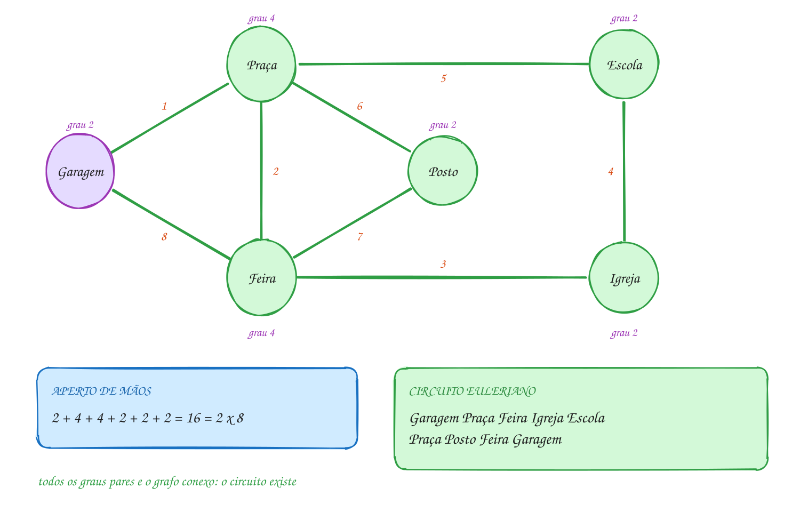</p>

O código guarda as ruas numa matriz de contagem, confere Euler e roda o
Hierholzer com pilha explícita:

```c
#include <stdbool.h>
#include <stdio.h>

#define V 6
#define MAX_RUAS 16

const char *esquinas[V] = {"Garagem", "Praça", "Feira", "Escola", "Igreja", "Posto"};
int rua[V][V]; // rua[u][v] = quantas ruas ligam u e v (mão dupla)

int grau(int u) {
    int g = 0;
    for (int v = 0; v < V; v++) g += rua[u][v];
    return g;
}

// Hierholzer: anda por ruas ainda não usadas; quando trava, a esquina
// sai da pilha e entra no circuito (de trás para frente)
int hierholzer(int inicio, int circuito[]) {
    int pilha[MAX_RUAS + 1], topo = 0, n = 0;
    pilha[topo++] = inicio;
    while (topo > 0) {
        int u = pilha[topo - 1];
        int v = 0;
        while (v < V && rua[u][v] == 0) v++;
        if (v < V) {                  // ainda há rua livre saindo de u
            rua[u][v]--, rua[v][u]--; // apaga a rua: não passa de novo
            pilha[topo++] = v;
        } else {                      // travou: u está pronto
            circuito[n++] = u;
            topo--;
        }
    }
    return n;
}

int main(void) {
    int ruas[][2] = {{0, 1}, {0, 2}, {1, 2}, {1, 3}, {1, 5}, {2, 4}, {2, 5}, {3, 4}};
    int e = 8;
    for (int k = 0; k < e; k++) {
        rua[ruas[k][0]][ruas[k][1]]++;
        rua[ruas[k][1]][ruas[k][0]]++;
    }

    int soma = 0, impares = 0;
    for (int u = 0; u < V; u++) {
        printf("grau(%s) = %d\n", esquinas[u], grau(u));
        soma += grau(u);
        if (grau(u) % 2 != 0) impares++;
    }
    printf("Soma dos graus: %d = 2 x %d ruas\n", soma, e);
    if (impares != 0) {
        printf("%d esquinas de grau ímpar: não há circuito\n", impares);
        return 0;
    }

    int circuito[MAX_RUAS + 1];
    int n = hierholzer(0, circuito);
    printf("Circuito:");
    for (int i = n - 1; i >= 0; i--) printf(" %s", esquinas[circuito[i]]);
    printf("\n(%d ruas, cada uma uma vez)\n", n - 1);
    return 0;
}
// Saída:
// grau(Garagem) = 2
// grau(Praça) = 4
// grau(Feira) = 4
// grau(Escola) = 2
// grau(Igreja) = 2
// grau(Posto) = 2
// Soma dos graus: 16 = 2 x 8 ruas
// Circuito: Garagem Praça Feira Igreja Escola Praça Posto Feira Garagem
// (8 ruas, cada uma uma vez)
```

Cada volta olha o topo da pilha: com rua livre, avança e a apaga; sem, a
esquina vai para o circuito:

<p align="center">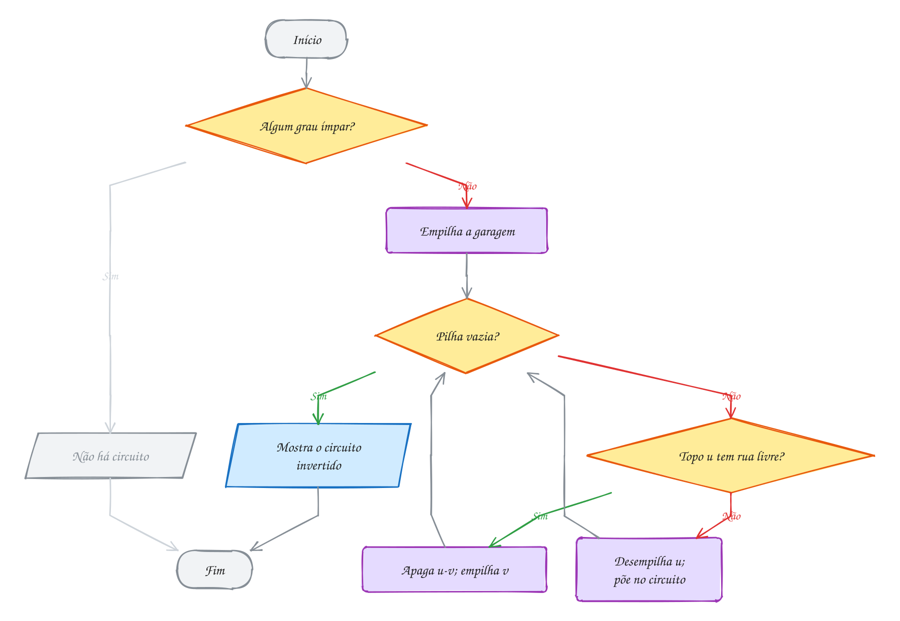</p>

#### Passo a passo

A pilha depois de cada passo (topo à direita). O primeiro passeio fecha cedo
e deixa 5 ruas para trás; o desvio sai da Feira e é encaixado ali:

| Passo | Pilha | Circuito (ao contrário) |
| --- | --- | --- |
| G → P → F → G | G P F G | |
| G travou | G P F | G |
| F → I → E → P → S → F | G P F I E P S F | G |
| todos travam, um a um | | G F S P E I F P G |

Invertido: Garagem Praça Feira Igreja Escola Praça Posto Feira Garagem. Praça
e Feira repetem: é um **circuito**, não um **ciclo**. O A363 faz as contas de
grau num dirigido; o A364 desenha a casinha "sem tirar o lápis", um trajeto
aberto.

**Exemplo A363 · Seguidores: grau de entrada e de saída**

```c
#include <stdio.h>

#define V 5

// grafo DIRIGIDO: segue[a][b] = 1 quer dizer "a segue b"
const char *perfis[V] = {"Ana", "Beto", "Caio", "Duda", "Elis"};
int segue[V][V];

int main(void) {
    int setas[][2] = {{0, 1}, {0, 3}, {1, 3}, {2, 3}, {4, 3}, {3, 0}, {2, 0}, {4, 2}};
    int e = 8;
    for (int k = 0; k < e; k++) segue[setas[k][0]][setas[k][1]] = 1;

    int soma_entrada = 0, soma_saida = 0, famoso = 0, maior = -1;
    printf("perfil  segue (saída)  seguidores (entrada)\n");
    for (int u = 0; u < V; u++) {
        int saida = 0, entrada = 0;
        for (int v = 0; v < V; v++) {
            saida += segue[u][v];   // linha u: setas que saem de u
            entrada += segue[v][u]; // coluna u: setas que chegam em u
        }
        printf("%-6s  %13d  %20d\n", perfis[u], saida, entrada);
        soma_saida += saida;
        soma_entrada += entrada;
        if (entrada > maior) maior = entrada, famoso = u;
    }
    printf("Soma das saídas: %d; soma das entradas: %d; setas: %d\n", soma_saida, soma_entrada, e);
    printf("Mais seguido: %s, com %d seguidores\n", perfis[famoso], maior);
    return 0;
}
// Saída:
// perfil  segue (saída)  seguidores (entrada)
// Ana                 2                     2
// Beto                1                     1
// Caio                2                     1
// Duda                1                     4
// Elis                2                     0
// Soma das saídas: 8; soma das entradas: 8; setas: 8
// Mais seguido: Duda, com 4 seguidores
//
// No dirigido, cada seta conta uma vez na saída de quem segue e uma vez na
// entrada de quem é seguido. As duas somas dão E, e juntas dão 2E: é o
// mesmo aperto de mãos, dividido em dois. Grau de entrada é a coluna da
// matriz; grau de saída é a linha.
```

```bash
gcc ~/LPEDC/material/A363.c -o ~/LPEDC/material/A363 && ~/LPEDC/material/A363
```

**Exemplo A364 · A casinha sem tirar o lápis do papel**

```c
#include <stdio.h>

#define V 5
#define MAX_TRACOS 8

// os cantos da casinha: A e B no chão, C e D no alto das paredes, E no telhado
const char nome[V] = {'A', 'B', 'C', 'D', 'E'};
int traco[V][V];

int grau(int u) {
    int g = 0;
    for (int v = 0; v < V; v++) g += traco[u][v];
    return g;
}

int main(void) {
    // chão, paredes, teto, o X dentro e as duas águas do telhado
    int tracos[][2] = {{0, 1}, {0, 2}, {1, 3}, {2, 3}, {0, 3}, {1, 2}, {2, 4}, {3, 4}};
    for (int k = 0; k < MAX_TRACOS; k++) {
        traco[tracos[k][0]][tracos[k][1]] = 1;
        traco[tracos[k][1]][tracos[k][0]] = 1;
    }

    int impares[V], n_impares = 0;
    for (int u = 0; u < V; u++)
        if (grau(u) % 2 != 0) impares[n_impares++] = u;
    printf("Cantos de grau ímpar: %d\n", n_impares);
    if (n_impares != 0 && n_impares != 2) {
        printf("Impossível sem tirar o lápis\n");
        return 0;
    }
    int inicio = n_impares == 2 ? impares[0] : 0; // trajeto aberto: começa num ímpar

    // Hierholzer: o mesmo do texto, agora a partir de um vértice ímpar
    int pilha[MAX_TRACOS + 1], topo = 0, ordem[MAX_TRACOS + 1], n = 0;
    pilha[topo++] = inicio;
    while (topo > 0) {
        int u = pilha[topo - 1], v = 0;
        while (v < V && traco[u][v] == 0) v++;
        if (v < V) {
            traco[u][v] = traco[v][u] = 0;
            pilha[topo++] = v;
        } else {
            ordem[n++] = u;
            topo--;
        }
    }
    printf("Desenho: ");
    for (int i = n - 1; i >= 0; i--) printf("%c%s", nome[ordem[i]], i > 0 ? "-" : "\n");
    printf("Começa em %c e termina em %c\n", nome[ordem[n - 1]], nome[ordem[0]]);
    return 0;
}
// Saída:
// Cantos de grau ímpar: 2
// Desenho: A-B-C-A-D-C-E-D-B
// Começa em A e termina em B
//
// Os dois cantos do chão têm grau 3; os outros, grau par. Por isso o
// desenho é um TRAJETO aberto (nenhum traço repete) que tem de começar num
// canto do chão e terminar no outro. Comece em C e você trava com um traço
// sobrando, por mais que tente.
```

```bash
gcc ~/LPEDC/material/A364.c -o ~/LPEDC/material/A364 && ~/LPEDC/material/A364
```

### Exercícios

**Exercício E1087** · ★☆☆

A ciclovia do parque liga seis pontos: Bosque, Lago, Mirante, Ponte,
Quiosque e Trilha (índices 0 a 5). Os trechos, todos de mão dupla, são:

```text
Bosque-Lago, Bosque-Mirante, Lago-Mirante, Lago-Ponte,
Mirante-Quiosque, Ponte-Quiosque, Quiosque-Trilha
```

Escreva o programa do zero: monte a matriz de adjacência, mostre o grau de
cada ponto, a soma dos graus (confira o lema do aperto de mãos) e quantos
pontos têm grau ímpar.

```text
Saída esperada:
Bosque: 2
Lago: 3
Mirante: 3
Ponte: 2
Quiosque: 3
Trilha: 1
Soma dos graus: 14 (2 x 7 trechos)
Pontos de grau ímpar: 4
```

**Exercício E1089** · ★★☆

Escreva um programa com o tipo Grafo (nome, v e a matriz m[MAXV][MAXV], em
que m[a][b] conta as arestas paralelas entre a e b) e a função
analisa(const Grafo *g), que diz se o grafo tem circuito euleriano,
trajeto euleriano aberto (entre quais vértices) ou nenhum dos dois, e
por quê. Confira a conexidade (por DFS) antes dos graus. Analise, nesta
ordem, quatro grafos (arestas entre vértices numerados a partir de 0):

```text
bairro (6 vértices): 0-1 0-2 1-2 1-3 1-5 2-4 2-5 3-4
casinha (5): 0-1 0-2 1-3 2-3 0-3 1-2 2-4 3-4
triângulos (6): 0-1 1-2 2-0 3-4 4-5 5-3
pontes (4): 0-1 0-1 0-2 0-2 0-3 1-3 2-3
```

```text
Saída esperada:
bairro: circuito euleriano
casinha: trajeto euleriano de 0 a 1
triângulos: nenhum (desconexo)
pontes: nenhum (4 vértices ímpares)
```

**Exercício E1090** · ★★☆

O caminhão do gás roda num centro só de ruas de mão única. Os pontos são
Depósito, Mercado, Praça, Hospital e Escola (0 a 4), e as ruas:

```text
Depósito->Mercado, Mercado->Praça, Praça->Depósito,
Praça->Hospital, Hospital->Escola, Escola->Praça
```

Escreva o programa: a função balanceado() mostra cada ponto em que o
grau de entrada é diferente do de saída e devolve true se não houver
nenhum; a função circuito(inicio) roda o Hierholzer DIRIGIDO e mostra o
circuito. Depois, simule uma obra que inverte a rua Hospital->Escola
(vira Escola->Hospital) e rode de novo.

```text
Saída esperada:
Antes da obra:
Circuito: Depósito Mercado Praça Hospital Escola Praça Depósito
Depois da obra:
Hospital: entram 2, saem 0
Escola: entram 0, saem 2
Sem circuito
```

**Exercício E1092** · ★★★

O envelope fechado é um quadrado com as duas diagonais: cantos A, B, C, D
e os traços A-B, B-C, C-D, D-A, A-C, B-D. Todo canto tem grau 3, então
não dá para desenhar sem tirar o lápis. Com 2k cantos ímpares, o mínimo
é k traços. Escreva o programa que acha esses traços:

```text
1. conte os cantos ímpares e mostre quantos traços são necessários;
2. crie um vértice falso X ligado aos dois últimos ímpares (eles viram
   pares, e sobram 2 ímpares);
3. rode o Hierholzer a partir do primeiro ímpar;
4. mostre o trajeto cortado onde aparece o X: cada pedaço é um traço.
```

```text
Saída esperada:
Cantos ímpares: 4 -> 2 traços
Traço 1: A B C A D C
Traço 2: D B
```

---

## 0183 · Hamiltoniano

### Conceito

- **Ciclo hamiltoniano**: ciclo que passa por **todos os vértices**, cada um
  uma vez. **Caminho hamiltoniano** é o mesmo sem voltar ao começo
  (CORMEN et al., 2024, cap. 34).
- **Sem teste simples**: não se conhece condição necessária e suficiente nem
  algoritmo polinomial; o problema é NP-completo (KARP, 1972).
- **Condição de Dirac** (só suficiente): com V ≥ 3 e todo grau ≥ V/2, o ciclo
  existe. Um ciclo puro de 100 vértices tem grau 2 e é hamiltoniano mesmo
  assim (SZWARCFITER, 2018).
- **Backtracking**: monta a rota por posição; põe em `pos` um vizinho ainda
  não usado do último vértice, desce para `pos + 1` e, se travar, **desfaz** a
  escolha (ZIVIANI, 2010).
- **Economias**: fixe `rota[0] = 0` (divide o trabalho por V) e use `usada[]`
  para cortar repetição. No pior caso sobram (V - 1)! ordens: com 15
  vértices, 87 bilhões.

| | Euler (0182) | Hamilton |
| --- | --- | --- |
| passa uma vez por cada | aresta | vértice |
| teste | graus pares + conexo | nenhum teste rápido conhecido |
| custo para achar | O(V + E) | exponencial no pior caso |
| classe (0186) | P | NP-completo |

> [!WARNING]
> Esquecer o `usada[v] = false` depois da chamada recursiva deixa "queimado"
> todo vértice de uma tentativa que falhou, e o programa diz "não existe" para
> grafos que têm ciclo.

### Exemplos de uso

Um carro-forte abastece cinco agências e volta à base, parando uma vez em
cada. A primeira tentativa trava no Shopping, sem via para a Base; o
backtracking volta ao Mercado, troca Porto por Shopping e fecha pelo Porto:

<p align="center">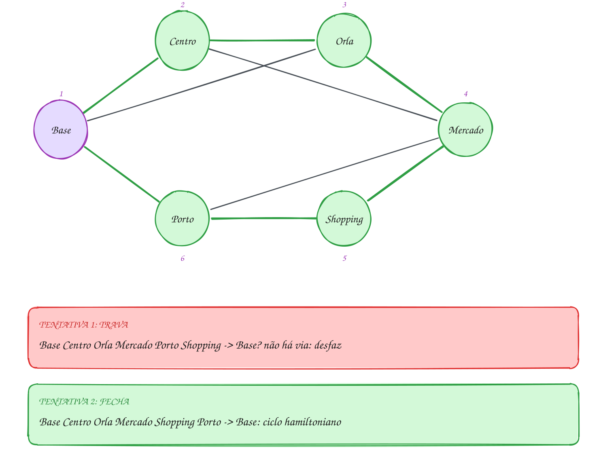</p>

O código conta as chamadas da recursão:

```c
#include <stdbool.h>
#include <stdio.h>

#define V 6

const char *agencias[V] = {"Base", "Centro", "Orla", "Mercado", "Porto", "Shopping"};
int via[V][V];
int rota[V];   // rota[i] = i-ésima agência visitada
bool usada[V];
long chamadas = 0;

// tenta pôr uma agência na posição pos da rota
bool hamilton(int pos) {
    chamadas++;
    if (pos == V) return via[rota[V - 1]][rota[0]]; // fecha o ciclo na Base?
    for (int v = 1; v < V; v++) {
        if (!via[rota[pos - 1]][v] || usada[v]) continue;
        rota[pos] = v;
        usada[v] = true;
        if (hamilton(pos + 1)) return true;
        usada[v] = false; // desfaz: volta atrás e tenta outra
    }
    return false;
}

int main(void) {
    int vias[][2] = {{0, 1}, {0, 2}, {0, 4}, {1, 2}, {1, 3}, {2, 3}, {3, 4}, {3, 5}, {4, 5}};
    for (int k = 0; k < 9; k++) via[vias[k][0]][vias[k][1]] = via[vias[k][1]][vias[k][0]] = 1;

    rota[0] = 0;
    usada[0] = true;
    if (hamilton(1)) {
        printf("Ciclo hamiltoniano:");
        for (int i = 0; i < V; i++) printf(" %s", agencias[rota[i]]);
        printf(" %s\n", agencias[rota[0]]);
    } else {
        printf("Não existe ciclo hamiltoniano\n");
    }
    printf("Chamadas da recursão: %ld\n", chamadas);
    return 0;
}
// Saída:
// Ciclo hamiltoniano: Base Centro Orla Mercado Shopping Porto Base
// Chamadas da recursão: 8
```

Este grafo não tem circuito euleriano (quatro agências de grau ímpar) e tem
ciclo hamiltoniano. O fluxograma mostra uma chamada de `hamilton(pos)`: o
trabalho está no laço que escolhe o vizinho e na linha que desfaz a escolha:

<p align="center">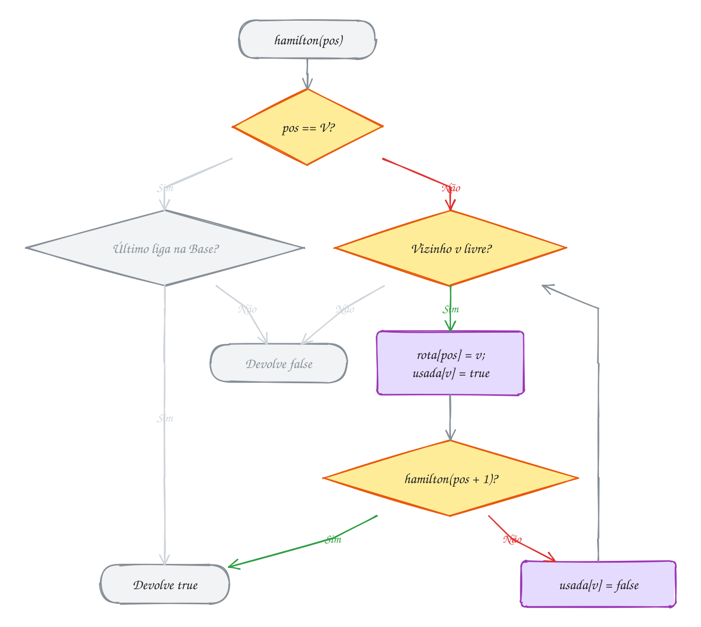</p>

**Exemplo A365 · Euleriano sim, hamiltoniano não**

```c
#include <stdbool.h>
#include <stdio.h>

#define V 5

// duas trilhas em triângulo que se cruzam no Mirante (formato de gravata)
const char *pontos[V] = {"Mirante", "Cachoeira", "Gruta", "Lagoa", "Pedra"};
int trilha[V][V];
int rota[V];
bool usado[V];
long chamadas = 0;

bool hamilton(int pos) {
    chamadas++;
    if (pos == V) return trilha[rota[V - 1]][rota[0]];
    for (int v = 1; v < V; v++) {
        if (!trilha[rota[pos - 1]][v] || usado[v]) continue;
        rota[pos] = v;
        usado[v] = true;
        if (hamilton(pos + 1)) return true;
        usado[v] = false;
    }
    return false;
}

int main(void) {
    int trechos[][2] = {{0, 1}, {1, 2}, {2, 0}, {0, 3}, {3, 4}, {4, 0}};
    for (int k = 0; k < 6; k++) trilha[trechos[k][0]][trechos[k][1]] = trilha[trechos[k][1]][trechos[k][0]] = 1;

    int impares = 0;
    for (int u = 0; u < V; u++) {
        int g = 0;
        for (int v = 0; v < V; v++) g += trilha[u][v];
        printf("grau(%s) = %d\n", pontos[u], g);
        if (g % 2) impares++;
    }
    printf("Circuito euleriano: %s\n", impares == 0 ? "sim (todos os graus pares)" : "não");

    rota[0] = 0;
    usado[0] = true;
    printf("Ciclo hamiltoniano: %s\n", hamilton(1) ? "sim" : "não");
    printf("Chamadas até desistir: %ld\n", chamadas);
    return 0;
}
// Saída:
// grau(Mirante) = 4
// grau(Cachoeira) = 2
// grau(Gruta) = 2
// grau(Lagoa) = 2
// grau(Pedra) = 2
// Circuito euleriano: sim (todos os graus pares)
// Ciclo hamiltoniano: não
// Chamadas até desistir: 9
//
// O guia percorre as seis trilhas sem repetir nenhuma (Mirante, Cachoeira,
// Gruta, Mirante, Lagoa, Pedra, Mirante), mas passa duas vezes pelo
// Mirante. Um ciclo hamiltoniano teria de cruzar o Mirante uma vez só, e
// ele é a única ligação entre os dois triângulos: impossível. O Euler
// respondeu com uma conta de graus; o backtracking só respondeu "não"
// depois de esgotar todas as rotas.
```

```bash
gcc ~/LPEDC/material/A365.c -o ~/LPEDC/material/A365 && ~/LPEDC/material/A365
```

**Exemplo A366 · Quando a resposta é não: o custo explode**

```c
#include <stdbool.h>
#include <stdio.h>

#define MAXV 12

int n; // vértices em uso: n - 1 formam um grafo completo, o último é uma "folha"
int adj[MAXV][MAXV];
int rota[MAXV];
bool usado[MAXV];
long chamadas;

bool hamilton(int pos) {
    chamadas++;
    if (pos == n) return adj[rota[n - 1]][rota[0]];
    for (int v = 1; v < n; v++) {
        if (!adj[rota[pos - 1]][v] || usado[v]) continue;
        rota[pos] = v;
        usado[v] = true;
        if (hamilton(pos + 1)) return true;
        usado[v] = false;
    }
    return false;
}

int main(void) {
    printf("vértices  chamadas  fatorial (V-2)!\n");
    long fat = 1;
    for (n = 4; n <= 11; n++) {
        for (int a = 0; a < n; a++)
            for (int b = 0; b < n; b++) adj[a][b] = 0;
        for (int a = 0; a < n - 1; a++) // os n - 1 primeiros: todos ligados a todos
            for (int b = 0; b < n - 1; b++) adj[a][b] = a != b;
        adj[1][n - 1] = adj[n - 1][1] = 1; // a folha só se liga ao vértice 1

        for (int v = 0; v < n; v++) usado[v] = false;
        chamadas = 0;
        rota[0] = 0;
        usado[0] = true;
        bool achou = hamilton(1);
        fat *= n - 2 > 1 ? n - 2 : 1;
        printf("%8d  %8ld  %15ld  %s\n", n, chamadas, fat, achou ? "achou" : "não existe");
    }
    return 0;
}
// Saída:
// vértices  chamadas  fatorial (V-2)!
//        4         7                2  não existe
//        5        21                6  não existe
//        6        81               24  não existe
//        7       391              120  não existe
//        8      2283              720  não existe
//        9     15657             5040  não existe
//       10    123301            40320  não existe
//       11   1096011           362880  não existe
//
// A folha tem grau 1: nenhum ciclo pode entrar e sair dela, e a resposta é
// "não" para qualquer tamanho. Um teste de grau resolveria na hora, mas o
// backtracking puro não sabe disso e tenta as rotas dos n - 1 vértices do
// grafo completo. Cada vértice a mais multiplica as chamadas por quase n:
// é o crescimento fatorial. Com 20 vértices seriam mais de 10^16 chamadas.
```

```bash
gcc ~/LPEDC/material/A366.c -o ~/LPEDC/material/A366 && ~/LPEDC/material/A366
```

### Exercícios

**Exercício E1093** · ★☆☆

Achar um ciclo hamiltoniano é difícil; conferir um é fácil. O mapa das
agências tem 6 vértices (0 a 5) e as vias 0-1, 0-2, 0-4, 1-2, 1-3, 2-3,
3-4, 3-5 e 4-5, guardadas na matriz via. Escreva
bool eh_ciclo_hamiltoniano(const int rota[], int n), que recebe uma rota
(sem repetir o primeiro no fim) e responde se ela é um ciclo
hamiltoniano: tem os V vértices, nenhum repetido, e cada vizinho da rota
(inclusive o último com o primeiro) tem via. Teste as quatro rotas:

```text
rota 1: 0 1 2 3 5 4    rota 2: 0 1 2 3 4 5
rota 3: 0 2 1 3 5 4    rota 4: 0 1 3 5 4 1
```

```text
Saída esperada:
Rota 1: válida
Rota 2: inválida
Rota 3: válida
Rota 4: inválida
```

**Exercício E1095** · ★★☆

O carro-forte quer saber quantas rotas diferentes existem, não só uma.
Escreva int conta(int pos), uma variação do hamilton do texto que não
para na primeira rota: soma quantas rotas completas existem a partir da
Base. Cada ciclo aparece duas vezes (uma em cada sentido), então divida
por 2 para ter os ciclos distintos. Rode no mapa das agências e no grafo
completo de 5 vértices (todos ligados a todos).

```text
Saída esperada:
Agências: 4 rotas, 2 ciclos distintos
Completo com 5: 24 rotas, 12 ciclos distintos
```

**Exercício E1096** · ★★☆

Num quadrangular de turno único, cinco times jogaram todos contra todos
(sem empate): Bahia, Ceará, Fortaleza, Remo e Sport (0 a 4). Resultados,
vencedor primeiro:

```text
Bahia x Ceará, Fortaleza x Bahia, Bahia x Sport, Remo x Bahia,
Ceará x Fortaleza, Ceará x Remo, Sport x Ceará, Fortaleza x Remo,
Fortaleza x Sport, Sport x Remo
```

O jornalista quer pôr os cinco numa fila em que cada time venceu o
seguinte. Isso é um CAMINHO hamiltoniano num grafo DIRIGIDO (seta do
vencedor para o perdedor). Escreva o backtracking que acha a primeira
fila, tentando os inícios e os vizinhos em ordem de índice.

```text
Saída esperada:
Bahia > Ceará > Fortaleza > Sport > Remo
```

**Exercício E1098** · ★★★

O passeio do cavalo: num tabuleiro 5 x 5, o cavalo do xadrez sai do canto
de cima à esquerda e precisa pisar em todas as 25 casas, uma vez cada. É
um CAMINHO hamiltoniano no grafo em que cada casa é um vértice e cada
salto em L é uma aresta, mas você não precisa montar a matriz: os
vizinhos saem das oito jogadas. Escreva o backtracking
bool passeio(int l, int c, int k), que põe o número k na casa (l, c) e
tenta os saltos nesta ordem (linha, coluna):

```text
(+2,+1) (+1,+2) (-1,+2) (-2,+1) (-2,-1) (-1,-2) (+1,-2) (+2,-1)
```

Mostre o tabuleiro com a ordem das casas (%3d) e o número de chamadas.

```text
Saída esperada:
  1  6 15 10 21
 14  9 20  5 16
 19  2  7 22 11
  8 13 24 17  4
 25 18  3 12 23
Chamadas: 8840
```

---

## 0184 · Pontes e articulações

### Conceito

- **Ponte** (aresta de corte): aresta cuja remoção aumenta o número de
  componentes conexos (0150) (SZWARCFITER, 2018).
- **Vértice de articulação** (ponto de corte): vértice cuja remoção, com suas
  arestas, aumenta o número de componentes (SZWARCFITER, 2018).
- **Uma DFS só**: tirar cada aresta e rodar uma DFS custa O(E · (V + E)); a
  DFS com dois números por vértice resolve em O(V + E) (TARJAN, 1972).
- **tin[u]**: o tempo de descoberta de `u`. **low[u]**: o menor `tin` que a
  subárvore de `u` alcança descendo pela árvore e usando **uma** aresta de
  volta (FEOFILOFF, s.d., *Algoritmos para grafos*).
- **Só dois tipos de aresta**: na DFS não dirigida há arestas da árvore e de
  volta (a um ancestral); nenhuma cruza para o lado (CORMEN et al., 2024, cap. 20).
- **As regras**, para `u - v` da árvore: **ponte** se `low[v] > tin[u]`;
  **articulação** se `low[v] >= tin[u]` e `u` não é a raiz; a **raiz** é
  articulação só com dois ou mais filhos na DFS (TARJAN, 1972).

> [!WARNING]
> Usar `low[v] >= tin[u]` também na raiz sempre dá verdadeiro e a marca como
> articulação sem ser. E trocar `>` por `>=` na ponte cria pontes falsas em
> toda aresta que entra num ciclo.

### Exemplos de uso

Uma operadora liga sete bairros de Manaus com fibra: que cabo cortado deixa
bairro sem sinal? Do Centro, a DFS desce em ordem de índice. Ao lado de cada
bairro, `tin/low`; verdes são as pontes, amarelos as articulações:

<p align="center">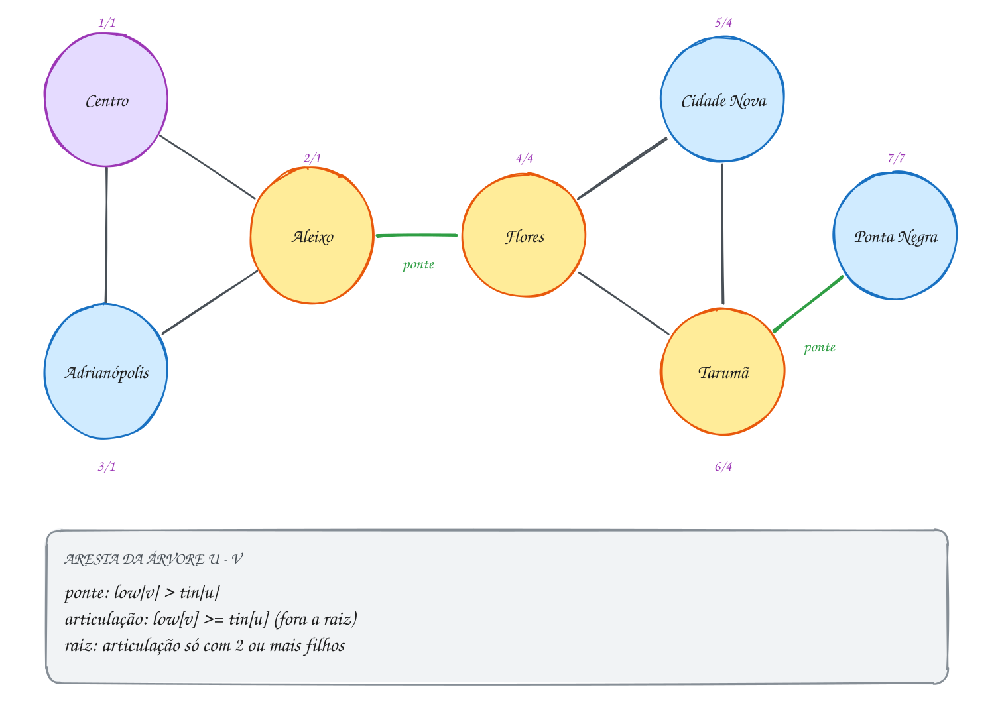</p>

```c
#include <stdbool.h>
#include <stdio.h>

#define V 7

const char *bairros[V] = {"Centro", "Aleixo", "Adrianópolis", "Flores", "Cidade Nova", "Tarumã", "Ponta Negra"};
int fibra[V][V];
int tin[V];    // tempo de descoberta (0 = ainda não visitado)
int low[V];    // menor tin que a subárvore alcança com UMA aresta de volta
bool corte[V]; // vértice de articulação
int relogio = 0;

void dfs(int u, int pai) {
    tin[u] = low[u] = ++relogio;
    int filhos = 0;
    for (int v = 0; v < V; v++) {
        if (!fibra[u][v] || v == pai) continue;
        if (tin[v] != 0) {                  // aresta de volta: v é ancestral
            if (tin[v] < low[u]) low[u] = tin[v];
            continue;
        }
        filhos++;
        dfs(v, u);                          // aresta da árvore u - v
        if (low[v] < low[u]) low[u] = low[v];
        if (low[v] > tin[u])                // v não volta acima de u
            printf("Ponte: %s - %s\n", bairros[u], bairros[v]);
        if (pai != -1 && low[v] >= tin[u])  // v não volta acima de u nem pula u
            corte[u] = true;
    }
    if (pai == -1 && filhos >= 2) corte[u] = true; // raiz: caso especial
}

int main(void) {
    int cabos[][2] = {{0, 1}, {1, 2}, {2, 0}, {1, 3}, {3, 4}, {4, 5}, {5, 3}, {5, 6}};
    for (int k = 0; k < 8; k++) fibra[cabos[k][0]][cabos[k][1]] = fibra[cabos[k][1]][cabos[k][0]] = 1;

    dfs(0, -1);
    printf("Articulações:");
    for (int u = 0; u < V; u++)
        if (corte[u]) printf(" %s", bairros[u]);
    printf("\n");
    for (int u = 0; u < V; u++) printf("%s: tin %d, low %d\n", bairros[u], tin[u], low[u]);
    return 0;
}
// Saída:
// Ponte: Tarumã - Ponta Negra
// Ponte: Aleixo - Flores
// Articulações: Aleixo Flores Tarumã
// Centro: tin 1, low 1
// Aleixo: tin 2, low 1
// Adrianópolis: tin 3, low 1
// Flores: tin 4, low 4
// Cidade Nova: tin 5, low 4
// Tarumã: tin 6, low 4
// Ponta Negra: tin 7, low 7
```

As duas perguntas vêm **na volta** da recursão, com `low[v]` completo:

<p align="center">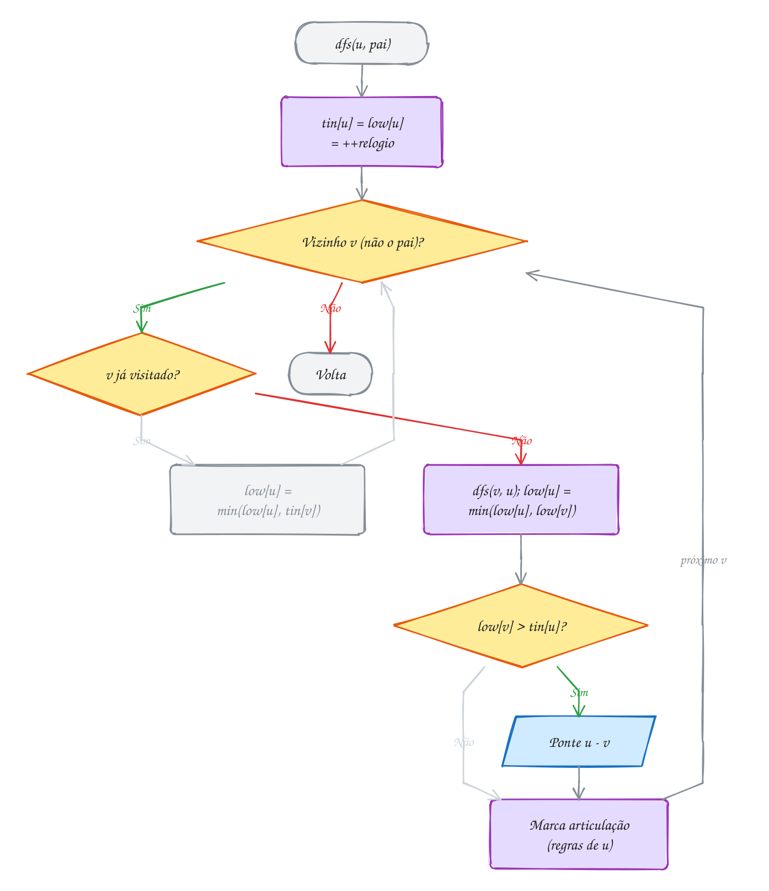</p>

#### Passo a passo

| Evento | tin / low atualizados | Conclusão |
| --- | --- | --- |
| entra em Centro, Aleixo, Adrianópolis | tin 1, 2, 3 | |
| Adrianópolis vê Centro (volta) | low[Adrianópolis] = 1 | |
| volta a Aleixo | low[Aleixo] = 1 | Aleixo - Adrianópolis não é ponte (1 ≤ 2) |
| entra em Flores, Cidade Nova, Tarumã | tin 4, 5, 6 | |
| Tarumã vê Flores (volta) | low[Tarumã] = 4 | |
| entra em Ponta Negra; ela não tem volta | tin 7, low 7 | 7 > 6: **ponte** Tarumã - Ponta Negra; Tarumã é **articulação** |
| volta a Cidade Nova | low = 4 | 4 ≤ 5: nada |
| volta a Flores | low = 4 | 4 ≥ 4: Flores é **articulação**; 4 > 4 é falso: não é ponte |
| volta a Aleixo | low[Flores] = 4 | 4 > 2: **ponte** Aleixo - Flores; Aleixo é **articulação** |
| volta ao Centro (raiz) | | um filho só: **não** é articulação |

Flores é articulação, mas Flores - Cidade Nova não é ponte (o triângulo tem
dois caminhos): a diferença é o `>` contra o `>=`.

**Exemplo A367 · A raiz da DFS é um caso à parte**

```c
#include <stdbool.h>
#include <stdio.h>

#define V 5

// linhas de ônibus: Terminal, Bosque e Campus em triângulo; Terminal segue
// sozinho até a Vila, e a Vila até o Sítio
const char *pontos[V] = {"Terminal", "Bosque", "Campus", "Vila", "Sítio"};
int linha[V][V];
int tin[V], low[V], relogio;
bool certo[V], ingenuo[V]; // com e sem o caso especial da raiz

void dfs(int u, int pai) {
    tin[u] = low[u] = ++relogio;
    int filhos = 0;
    for (int v = 0; v < V; v++) {
        if (!linha[u][v] || v == pai) continue;
        if (tin[v] != 0) {
            if (tin[v] < low[u]) low[u] = tin[v];
            continue;
        }
        filhos++;
        dfs(v, u);
        if (low[v] < low[u]) low[u] = low[v];
        if (low[v] >= tin[u]) {
            ingenuo[u] = true;               // aplica a regra a todo mundo
            if (pai != -1) certo[u] = true;  // fora a raiz
        }
    }
    if (pai == -1 && filhos >= 2) certo[u] = true;
}

void roda(int raiz) {
    relogio = 0;
    for (int u = 0; u < V; u++) tin[u] = 0, certo[u] = ingenuo[u] = false;
    dfs(raiz, -1);
    printf("Raiz %s\n  regra certa:", pontos[raiz]);
    for (int u = 0; u < V; u++)
        if (certo[u]) printf(" %s", pontos[u]);
    printf("\n  sem caso da raiz:");
    for (int u = 0; u < V; u++)
        if (ingenuo[u]) printf(" %s", pontos[u]);
    printf("\n");
}

int main(void) {
    int trechos[][2] = {{0, 1}, {1, 2}, {2, 0}, {0, 3}, {3, 4}};
    for (int k = 0; k < 5; k++) linha[trechos[k][0]][trechos[k][1]] = linha[trechos[k][1]][trechos[k][0]] = 1;
    roda(0);
    roda(1);
    return 0;
}
// Saída:
// Raiz Terminal
//   regra certa: Terminal Vila
//   sem caso da raiz: Terminal Vila
// Raiz Bosque
//   regra certa: Terminal Vila
//   sem caso da raiz: Terminal Bosque Vila
//
// Com raiz no Terminal, ele tem dois filhos na árvore (Bosque e Vila) e é
// articulação de verdade: as duas regras concordam. Com raiz no Bosque, a
// DFS desce Bosque -> Terminal -> Campus e volta ao Bosque pelo Campus: um
// filho só. Sem o caso especial, o Bosque aparece como articulação, mas
// tire o Bosque e o resto continua ligado. A resposta certa não pode
// depender de onde a DFS começa, e com o caso especial não depende.
```

```bash
gcc ~/LPEDC/material/A367.c -o ~/LPEDC/material/A367 && ~/LPEDC/material/A367
```

**Exemplo A368 · Conferindo na força bruta: corta e conta**

```c
#include <stdbool.h>
#include <stdio.h>

#define V 7

const char *bairros[V] = {"Centro", "Aleixo", "Adrianópolis", "Flores", "Cidade Nova", "Tarumã", "Ponta Negra"};
int fibra[V][V];
bool visto[V];
long passos = 0; // quantas casas da matriz foram olhadas

void dfs(int u, int fora) { // fora = vértice desligado (-1 se nenhum)
    visto[u] = true;
    for (int v = 0; v < V; v++) {
        passos++;
        if (fibra[u][v] && !visto[v] && v != fora) dfs(v, fora);
    }
}

int componentes(int fora) {
    for (int u = 0; u < V; u++) visto[u] = false;
    int c = 0;
    for (int u = 0; u < V; u++)
        if (u != fora && !visto[u]) c++, dfs(u, fora);
    return c;
}

int main(void) {
    int cabos[][2] = {{0, 1}, {1, 2}, {2, 0}, {1, 3}, {3, 4}, {4, 5}, {5, 3}, {5, 6}};
    for (int k = 0; k < 8; k++) fibra[cabos[k][0]][cabos[k][1]] = fibra[cabos[k][1]][cabos[k][0]] = 1;

    int base = componentes(-1);
    printf("Componentes da rede inteira: %d\n", base);
    for (int k = 0; k < 8; k++) { // corta um cabo, conta, religa
        int a = cabos[k][0], b = cabos[k][1];
        fibra[a][b] = fibra[b][a] = 0;
        if (componentes(-1) > base) printf("Ponte: %s - %s\n", bairros[a], bairros[b]);
        fibra[a][b] = fibra[b][a] = 1;
    }
    printf("Articulações:");
    for (int u = 0; u < V; u++) // desliga um bairro, conta os que sobram
        if (componentes(u) > base) printf(" %s", bairros[u]);
    printf("\nCasas da matriz olhadas: %ld\n", passos);
    return 0;
}
// Saída:
// Componentes da rede inteira: 1
// Ponte: Aleixo - Flores
// Ponte: Tarumã - Ponta Negra
// Articulações: Aleixo Flores Tarumã
// Casas da matriz olhadas: 735
//
// O mesmo resultado do texto, com um custo bem diferente: uma DFS completa
// para cada cabo e outra para cada bairro, E + V + 1 = 16 buscas de até V²
// casas cada. O algoritmo do texto faz UMA busca (49 casas). Com mil
// bairros e cinco mil cabos, seriam 6 mil buscas contra uma.
```

```bash
gcc ~/LPEDC/material/A368.c -o ~/LPEDC/material/A368 && ~/LPEDC/material/A368
```

### Exercícios

**Exercício E1099** · ★☆☆

As rodovias em volta de Manaus ligam seis cidades: Manaus, Iranduba,
Manacapuru, Novo Airão, Rio Preto da Eva e Itacoatiara (0 a 5):

```text
Manaus-Iranduba, Iranduba-Manacapuru, Manacapuru-Manaus,
Manacapuru-Novo Airão, Manaus-Rio Preto da Eva,
Rio Preto da Eva-Itacoatiara
```

Escreva do zero a versão força bruta (como o A368): para achar as
pontes, tire cada rodovia, conte os componentes e devolva a rodovia; para
achar as articulações, "desligue" cada cidade e conte os componentes das
outras.

```text
Saída esperada:
Pontes:
  Manacapuru - Novo Airão
  Manaus - Rio Preto da Eva
  Rio Preto da Eva - Itacoatiara
Articulações:
  Manaus
  Manacapuru
  Rio Preto da Eva
```

**Exercício E1101** · ★★☆

A operadora do texto quer saber o tamanho do estrago de cada ponte:
cortando o cabo, quantos bairros ficam sem sinal? Mude a DFS do texto
para que ela devolva o tamanho da subárvore (int dfs(int u, int pai)) e,
em cada ponte u - v, mostre quantos bairros ficam do lado de v. No fim,
mostre quantos bairros a DFS alcançou a partir do Centro.

```text
Saída esperada:
Cortar Tarumã - Ponta Negra isola 1 bairro(s)
Cortar Aleixo - Flores isola 4 bairro(s)
Bairros alcançados: 7
```

**Exercício E1102** · ★★☆

A distribuidora de energia tem oito subestações: Usina, Norte, Sul,
Leste, Oeste, Porto, Vila e Serra (0 a 7). As linhas:

```text
Usina-Norte, Usina-Sul, Norte-Sul, Norte-Leste, Norte-Oeste,
Leste-Oeste, Sul-Porto, Porto-Vila, Porto-Serra
```

Não basta saber quais subestações são articulações: a distribuidora quer
saber em QUANTOS pedaços a rede parte sem cada uma. Escreva a DFS com tin
e low (raiz na Usina) que conta isso e mostre só as que partem a rede.

```text
Saída esperada:
Sem Norte, a rede parte em 2 pedaços
Sem Sul, a rede parte em 2 pedaços
Sem Porto, a rede parte em 3 pedaços
```

**Exercício E1103** · ★★★

A rede de energia do E1102 tem oito subestações: Usina, Norte, Sul,
Leste, Oeste, Porto, Vila e Serra (0 a 7). As linhas:

```text
Usina-Norte, Usina-Sul, Norte-Sul, Norte-Leste, Norte-Oeste,
Leste-Oeste, Sul-Porto, Porto-Vila, Porto-Serra
```

Escreva a DFS com tin e low (raiz na Usina, vizinhos em ordem de índice,
ignorando só o pai) que mostra as linhas críticas (pontes). Cada ponte é
mostrada ao voltar da recursão, no formato "Linha crítica: u - v".
Linhas dentro de um triângulo têm caminho alternativo e não aparecem.

```text
Saída esperada:
Linha crítica: Porto - Vila
Linha crítica: Porto - Serra
Linha crítica: Sul - Porto
```

---

## 0185 · Cadeia de matrizes

### Conceito

- **Custo de um produto**: uma `p × q` vezes uma `q × r` dá uma `p × r`, e
  cada uma das `p · r` casas soma `q` produtos: **p · q · r** multiplicações
  (CORMEN et al., 2024, cap. 14).
- **Associatividade**: `(A B) C = A (B C)`; os parênteses mudam só o
  trabalho. Quatro matrizes têm 5 parentizações; 20 têm mais de 1,7 bilhão
  (números de Catalan) (CORMEN et al., 2024, cap. 14).
- **Subestrutura ótima**: a última multiplicação corta a cadeia em algum `k`,
  e cada metade também está na melhor ordem. Com `Ai` de tamanho
  `p[i-1] × p[i]` (FEOFILOFF, s.d., *Análise de algoritmos*):

```text
m[i][i] = 0
m[i][j] = min sobre k de i até j-1:  m[i][k] + m[k+1][j] + p[i-1] · p[k] · p[j]
```

- **Tabela `s`**: `s[i][j]` guarda o `k` vencedor, para remontar os
  parênteses (CORMEN et al., 2024, cap. 14).
- **Ordem de preencher**: `m[i][j]` depende de cadeias menores, então o laço
  externo é o **tamanho** da cadeia; a tabela enche diagonal por diagonal.
  **O(n³)** de tempo e O(n²) de espaço (CORMEN et al., 2024, cap. 14).
- **Estouro**: o `(long)` antes de `p[i - 1] * p[k] * p[j]` evita que o
  produto de três `int` estoure.

> [!WARNING]
> Preencher linha por linha calcula `m[1][3]` antes de `m[2][3]` existir e usa
> zero no lugar de 9000. Preencha por tamanho de cadeia. E `Ai` é
> `p[i-1] × p[i]`: `p` tem n + 1 números.

### Exemplos de uso

Uma rede de farmácias multiplica quatro tabelas: 10 × 30, 30 × 5, 5 × 60 e
60 × 10. Numa ordem são 5 mil multiplicações; noutra, 33 mil. A diagonal
principal é zero, cada diagonal acima usa as de baixo, e `m[1][4]` é a
resposta:

<p align="center">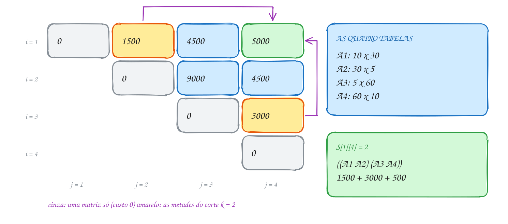</p>

```c
#include <limits.h>
#include <stdio.h>

#define N 4 // quantas matrizes

// A1 é 10x30, A2 é 30x5, A3 é 5x60, A4 é 60x10: Ai tem p[i-1] linhas e p[i] colunas
const int p[N + 1] = {10, 30, 5, 60, 10};
long m[N + 1][N + 1]; // m[i][j]: menor custo para multiplicar Ai..Aj
int s[N + 1][N + 1];  // s[i][j]: onde cortar Ai..Aj na melhor ordem

void parenteses(int i, int j) {
    if (i == j) {
        printf("A%d", i);
        return;
    }
    printf("(");
    parenteses(i, s[i][j]);
    printf(" ");
    parenteses(s[i][j] + 1, j);
    printf(")");
}

int main(void) {
    for (int tam = 2; tam <= N; tam++) {         // cadeias de 2, depois 3, ...
        for (int i = 1; i + tam - 1 <= N; i++) {
            int j = i + tam - 1;
            m[i][j] = LONG_MAX;
            for (int k = i; k < j; k++) {        // corta entre Ak e Ak+1
                long custo = m[i][k] + m[k + 1][j] + (long)p[i - 1] * p[k] * p[j];
                if (custo < m[i][j]) {
                    m[i][j] = custo;
                    s[i][j] = k;
                }
            }
        }
    }
    printf("Tabela m (multiplicações):\n");
    for (int i = 1; i <= N; i++) {
        for (int j = 1; j <= N; j++) {
            if (j < i) printf("%8s", "-");
            else printf("%8ld", m[i][j]);
        }
        printf("\n");
    }
    printf("Melhor ordem: ");
    parenteses(1, N);
    printf("\nCusto: %ld multiplicações\n", m[1][N]);
    return 0;
}
// Saída:
// Tabela m (multiplicações):
//        0    1500    4500    5000
//        -       0    9000    4500
//        -       -       0    3000
//        -       -       -       0
// Melhor ordem: ((A1 A2) (A3 A4))
// Custo: 5000 multiplicações
```

São três laços: tamanho da cadeia, início `i` e corte `k`, que guarda o
menor:

<p align="center">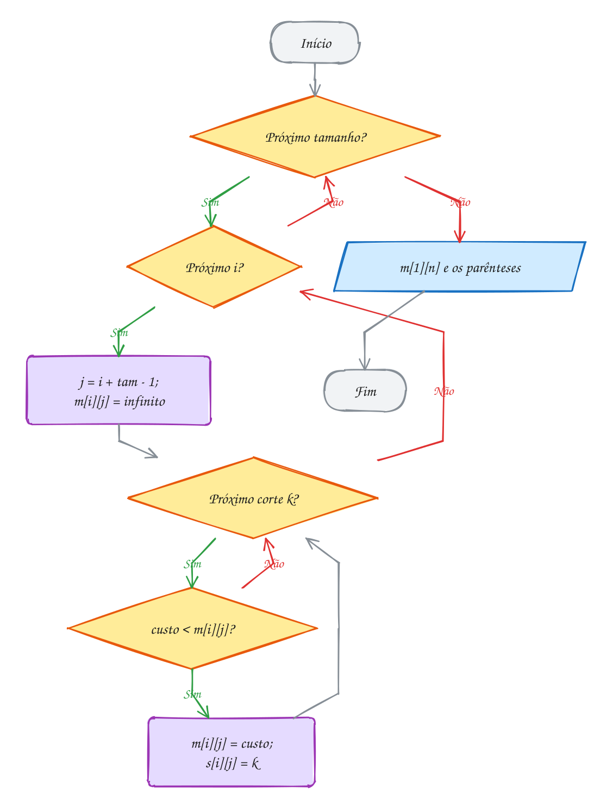</p>

#### Passo a passo

Com `p = {10, 30, 5, 60, 10}`. Cada linha é uma casa, na ordem em que o
programa preenche; o vencedor está em negrito:

| Casa | Cortes testados (k) | m | s |
| --- | --- | --- | --- |
| m[1][2] | k=1: 10·30·5 = 1500 | 1500 | 1 |
| m[2][3] | k=2: 30·5·60 = 9000 | 9000 | 2 |
| m[3][4] | k=3: 5·60·10 = 3000 | 3000 | 3 |
| m[1][3] | k=1: 0 + 9000 + 10·30·60 = 27000; **k=2: 1500 + 0 + 10·5·60 = 4500** | 4500 | 2 |
| m[2][4] | **k=2: 0 + 3000 + 30·5·10 = 4500**; k=3: 9000 + 0 + 30·60·10 = 27000 | 4500 | 2 |
| m[1][4] | k=1: 0 + 4500 + 3000 = 7500; **k=2: 1500 + 3000 + 500 = 5000**; k=3: 4500 + 0 + 6000 = 10500 | 5000 | 2 |

`s[1][4] = 2` corta em `(A1 A2)(A3 A4)`. Da esquerda para a direita, `((A1 A2)
A3) A4` custaria 10500; a pior ordem, `(A1 (A2 A3)) A4`, 33000. O A370
multiplica matrizes reais na ordem ótima.

**Exemplo A369 · Quantas ordens existem e quanto custa testar todas**

```c
#include <limits.h>
#include <stdio.h>

#define MAXN 16

int p[MAXN + 1];
long chamadas;

// força bruta recursiva: tenta todos os cortes, sem lembrar de nada
long melhor(int i, int j) {
    chamadas++;
    if (i == j) return 0;
    long menor = LONG_MAX;
    for (int k = i; k < j; k++) {
        long c = melhor(i, k) + melhor(k + 1, j) + (long)p[i - 1] * p[k] * p[j];
        if (c < menor) menor = c;
    }
    return menor;
}

// quantas parentizações diferentes uma cadeia de n matrizes tem
long ordens(int n) {
    long t[MAXN + 1] = {0};
    t[1] = 1;
    for (int m = 2; m <= n; m++)
        for (int k = 1; k < m; k++) t[m] += t[k] * t[m - k]; // corte depois da k-ésima
    return t[n];
}

int main(void) {
    for (int i = 0; i <= MAXN; i++) p[i] = 5 + (i * 7) % 11; // dimensões quaisquer
    printf(" n      ordens  chamadas (força bruta)  casas da PD\n");
    for (int n = 2; n <= MAXN; n += 2) {
        chamadas = 0;
        melhor(1, n);
        printf("%2d  %10ld  %22ld  %11d\n", n, ordens(n), chamadas, n * (n + 1) / 2);
    }
    return 0;
}
// Saída:
//  n      ordens  chamadas (força bruta)  casas da PD
//  2           1                       3            3
//  4           5                      27           10
//  6          42                     243           21
//  8         429                    2187           36
// 10        4862                   19683           55
// 12       58786                  177147           78
// 14      742900                 1594323          105
// 16     9694845                14348907          136
//
// A recursão sem memória recalcula as mesmas cadeias sem parar: as
// chamadas são exatamente 3^(n-1). A PD calcula cada casa m[i][j] uma vez
// só: n(n+1)/2 casas, com no máximo n cortes cada. Para n = 16, 14 milhões
// de chamadas contra 136 casas.
```

```bash
gcc ~/LPEDC/material/A369.c -o ~/LPEDC/material/A369 && ~/LPEDC/material/A369
```

**Exemplo A370 · Multiplicando de verdade e contando**

```c
#include <stdio.h>
#include <stdlib.h>

#define N 4

const int p[N + 1] = {10, 30, 5, 60, 10};
long contas = 0; // multiplicações de números feitas de verdade

typedef struct {
    int lin, col;
    long *v; // lin * col números, linha após linha
} Matriz;

Matriz nova(int lin, int col) {
    Matriz m = {lin, col, calloc((size_t)lin * col, sizeof(long))};
    if (m.v == NULL) {
        fprintf(stderr, "sem memória\n");
        exit(1);
    }
    return m;
}

Matriz multiplica(Matriz a, Matriz b) { // a.col == b.lin
    Matriz c = nova(a.lin, b.col);
    for (int i = 0; i < a.lin; i++)
        for (int j = 0; j < b.col; j++)
            for (int k = 0; k < a.col; k++) {
                c.v[i * c.col + j] += a.v[i * a.col + k] * b.v[k * b.col + j];
                contas++;
            }
    return c;
}

long soma(Matriz m) {
    long s = 0;
    for (int i = 0; i < m.lin * m.col; i++) s += m.v[i];
    return s;
}

int main(void) {
    Matriz a[N + 1];
    for (int t = 1; t <= N; t++) { // Ai: p[t-1] x p[t], valores pequenos
        a[t] = nova(p[t - 1], p[t]);
        for (int i = 0; i < a[t].lin * a[t].col; i++) a[t].v[i] = (i + t) % 3;
    }

    // ordem ótima da PD: (A1 A2)(A3 A4)
    contas = 0;
    Matriz x = multiplica(a[1], a[2]), y = multiplica(a[3], a[4]), r1 = multiplica(x, y);
    printf("(A1 A2)(A3 A4): %ld multiplicações, soma do resultado %ld\n", contas, soma(r1));

    // da esquerda para a direita: ((A1 A2) A3) A4
    contas = 0;
    Matriz z = multiplica(a[1], a[2]), w = multiplica(z, a[3]), r2 = multiplica(w, a[4]);
    printf("((A1 A2) A3) A4: %ld multiplicações, soma do resultado %ld\n", contas, soma(r2));

    Matriz todas[] = {x, y, r1, z, w, r2};
    for (int i = 0; i < 6; i++) free(todas[i].v);
    for (int t = 1; t <= N; t++) free(a[t].v);
    return 0;
}
// Saída:
// (A1 A2)(A3 A4): 5000 multiplicações, soma do resultado 986000
// ((A1 A2) A3) A4: 10500 multiplicações, soma do resultado 986000
//
// O resultado é o mesmo (a associatividade garante), e as contas batem com
// a tabela m: 5000 na ordem ótima, 10500 na ordem "natural". Repare também
// na memória: a ordem ruim cria uma intermediária de 10 x 60 (600 números);
// a ótima, uma de 10 x 5 e outra de 5 x 10 (100 números).
```

```bash
gcc ~/LPEDC/material/A370.c -o ~/LPEDC/material/A370 && ~/LPEDC/material/A370
```

### Exercícios

**Exercício E1105** · ★☆☆

Três tabelas de uma pesquisa eleitoral: A tem 50 x 10, B tem 10 x 40 e
C tem 40 x 30. Escreva a função long custo(int p, int q, int r), que dá o
número de multiplicações de uma matriz p x q por uma q x r, e use-a para
comparar as duas ordens possíveis de calcular A B C. Mostre qual é a
melhor e quantas vezes ela é mais barata (uma casa decimal).

```text
Saída esperada:
(A B) C: 80000 multiplicações
A (B C): 27000 multiplicações
Melhor: A (B C), 3.0 vezes mais barata
```

**Exercício E1107** · ★★☆

O texto preenche a tabela de baixo para cima. Escreva a versão de cima
para baixo, com memoização (0138): long custo(int i, int j) segue a
recorrência ao pé da letra, mas guarda cada m[i][j] numa tabela memo e
devolve direto quando já calculou. Use sete matrizes,
p = 8, 20, 4, 15, 6, 25, 10, 12, e conte as chamadas e as casas
realmente calculadas.

```text
Saída esperada:
Custo mínimo: 3464
Chamadas com memória: 113
Casas calculadas: 21
```

**Exercício E1108** · ★★☆

Para convencer o chefe de que vale a pena pensar na ordem, o analista
quer mostrar a melhor e a PIOR ordem de uma cadeia de cinco matrizes,
p = 40, 5, 50, 2, 30, 8. Escreva o programa que preenche duas tabelas ao
mesmo tempo (mínimo e máximo, cada uma com o seu s), mostra as duas
parentizações com os custos e quantas vezes a pior custa a melhor.

```text
Saída esperada:
Melhor: ((A1 (A2 A3)) (A4 A5)) = 2020
Pior:   (((A1 A2) (A3 A4)) A5) = 82600
A pior custa 40.9 vezes a melhor
```

**Exercício E1110** · ★★★

Um colega propõe uma regra gulosa (0133) para fugir da tabela: "olhe os
pares vizinhos e multiplique primeiro o mais barato; repita até sobrar
uma matriz". Teste a ideia na cadeia p = 10, 20, 5, 40, 30, 2. Escreva:

```text
long guloso(void): mostra cada junção e devolve o total;
long otimo(void): a PD do texto, devolvendo m[1][5].
```

```text
Saída esperada:
Guloso (junta o par vizinho mais barato):
  junta 10x20 com 20x5: 1000
  junta 10x5 com 5x40: 2000
  junta 40x30 com 30x2: 2400
  junta 10x40 com 40x2: 800
Guloso: 6200
PD: 3400
```

---

## 0186 · P e NP

### Conceito

- **Problema de decisão**: resposta **sim ou não** ("existe rota de no máximo
  300 km?"). Otimização vira decisão com um limite (CORMEN et al., 2024, cap. 34).
- **P**: problemas de decisão que se **resolvem** em tempo polinomial, O(n^k)
  com k fixo: caminho mínimo, Euler (0182), pontes (0184)
  (CORMEN et al., 2024, cap. 34).
- **NP**: um "sim" tem um **certificado** (prova curta) que um
  **verificador** confere em tempo polinomial. Quem resolve rápido confere
  rápido: **P ⊆ NP** (LINTZMAYER; MOTA, 2023).
- **NP-difícil**: todo problema de NP se reduz a ele em tempo polinomial
  (0187). **NP-completo**: está em NP **e** é NP-difícil. Um NP-completo
  polinomial daria P = NP, questão em aberto (KLEINBERG; TARDOS, 2006, cap. 8).
- **SAT**: fórmula em **forma normal conjuntiva** (um E de **cláusulas**, cada
  uma um OU de **literais** `x` ou `não x`); existe atribuição que deixa todas
  verdadeiras? Foi o primeiro NP-completo (COOK, 1971).
- **3-SAT**: no máximo três literais por cláusula (no Cormen, exatamente
  três); continua NP-completo (KARP, 1972).
- **Força bruta com máscara**: as 2ⁿ atribuições são os valores de um
  contador; o bit `v - 1` diz se `v` é verdadeira, lido com
  `(mascara >> (v - 1)) & 1`.

| Classe | O que se exige | Exemplos |
| --- | --- | --- |
| P | resolver em tempo polinomial | caminho mínimo, Euler, pontes, MST |
| NP | verificar um "sim" em tempo polinomial | tudo de P, SAT, clique, hamiltoniano |
| NP-completo | estar em NP e ser NP-difícil | SAT, 3-SAT, clique, cobertura de vértices, ciclo hamiltoniano |
| NP-difícil | todo NP se reduz a ele (pode nem estar em NP) | os NP-completos, caixeiro viajante (otimização) |

> [!WARNING]
> **NP não quer dizer "não polinomial"**, e sim *polinomial não
> determinístico*. NP-completo é "sem algoritmo polinomial conhecido", não
> "impossível". E reduzir A a B mostra que B é **pelo menos tão difícil**
> quanto A, não o contrário (0187).

### Exemplos de uso

Um churrasco da firma com cinco condições sobre Ana, Beto, Caio e Davi.
Conferir um palpite é rápido; achar um grupo pode exigir todas as
combinações. O palpite falha na quinta cláusula, e a força bruta acha uma
atribuição na décima primeira de 16:

<p align="center">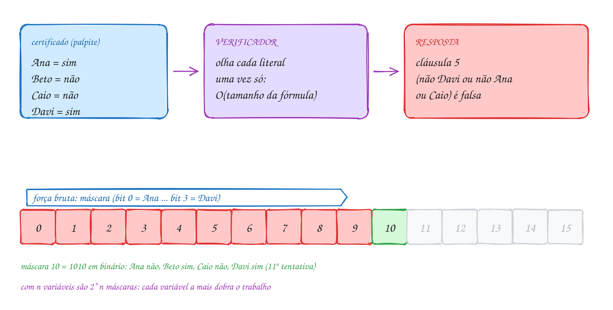</p>

A fórmula é uma matriz de literais `+v` / `-v` (como no DIMACS), com zero ao
fim de cada cláusula:

```c
#include <stdbool.h>
#include <stdio.h>

#define NV 4 // variáveis: 1 Ana, 2 Beto, 3 Caio, 4 Davi
#define NC 5 // cláusulas
#define MAXL 3

const char *nomes[NV + 1] = {"", "Ana", "Beto", "Caio", "Davi"};
// cada cláusula é um OU de literais; +v = "v vai", -v = "v não vai"; 0 encerra
const int formula[NC][MAXL + 1] = {
    {1, 2, 0},   // Ana ou Beto (alguém precisa levar a churrasqueira)
    {-1, -3, 0}, // Ana e Caio brigaram: não os dois
    {3, 4, 0},   // Caio ou Davi (alguém faz o carvão pegar)
    {-2, 4, 0},  // Beto só vai se Davi for
    {-4, -1, 3}, // se Davi e Ana forem, Caio tem que ir
};

// verificador: O(tamanho da fórmula). vai[v] é a atribuição (o certificado)
bool satisfaz(const bool vai[]) {
    for (int c = 0; c < NC; c++) {
        bool algum = false;
        for (int i = 0; i < MAXL && formula[c][i] != 0; i++) {
            int lit = formula[c][i];
            if ((lit > 0 && vai[lit]) || (lit < 0 && !vai[-lit])) algum = true;
        }
        if (!algum) return false; // uma cláusula falsa derruba tudo
    }
    return true;
}

void mostra(const bool vai[]) {
    for (int v = 1; v <= NV; v++) printf(" %s=%s", nomes[v], vai[v] ? "sim" : "não");
    printf("\n");
}

int main(void) {
    bool palpite[NV + 1] = {false, true, false, false, true}; // Ana e Davi
    printf("Palpite:");
    mostra(palpite);
    printf("Verificador: %s\n", satisfaz(palpite) ? "satisfaz" : "não satisfaz");

    // força bruta: as 2^n atribuições, como os bits de um contador
    long testadas = 0;
    for (int mascara = 0; mascara < (1 << NV); mascara++) {
        bool vai[NV + 1] = {false};
        for (int v = 1; v <= NV; v++) vai[v] = (mascara >> (v - 1)) & 1;
        testadas++;
        if (satisfaz(vai)) {
            printf("Achei depois de %ld de %d tentativas:", testadas, 1 << NV);
            mostra(vai);
            return 0;
        }
    }
    printf("Insatisfatível: %ld tentativas\n", testadas);
    return 0;
}
// Saída:
// Palpite: Ana=sim Beto=não Caio=não Davi=sim
// Verificador: não satisfaz
// Achei depois de 11 de 16 tentativas: Ana=não Beto=sim Caio=não Davi=sim
```

O fluxograma é o verificador, O(tamanho da fórmula). A força bruta o chama
até 2ⁿ vezes:

<p align="center">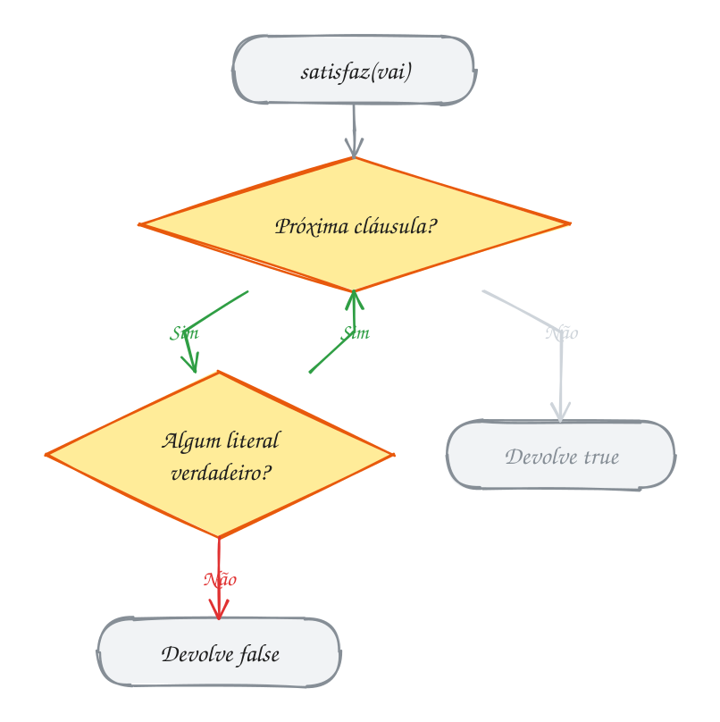</p>

**Exemplo A371 · Quanto 2^n cresce**

```c
#include <stdbool.h>
#include <stdio.h>

#define MAXN 20

int n;            // variáveis em uso
long olhados = 0; // literais examinados pelo verificador

// fórmula insatisfatível de propósito: (x1) e (não x1), mais
// (x1 ou x2 ou ... ou xn); a força bruta precisa testar tudo
bool satisfaz(const bool x[]) {
    olhados++;
    if (!x[1]) return false; // cláusula (x1)
    olhados++;
    if (x[1]) return false;  // cláusula (não x1)
    for (int v = 1; v <= n; v++) {
        olhados++;
        if (x[v]) return true;
    }
    return false;
}

int main(void) {
    printf(" n    atribuições   literais olhados\n");
    for (n = 4; n <= MAXN; n += 4) {
        olhados = 0;
        bool achou = false;
        for (long m = 0; m < (1L << n) && !achou; m++) {
            bool x[MAXN + 1];
            for (int v = 1; v <= n; v++) x[v] = (m >> (v - 1)) & 1;
            achou = satisfaz(x);
        }
        printf("%2d  %13ld  %17ld\n", n, 1L << n, olhados);
    }
    printf("\nA um bilhão de atribuições por segundo:\n");
    double segundos = 1.0;
    for (int k = 1; k <= 30; k++) segundos *= 2;  // 2^30
    printf("  n = 30: %.1f segundo(s)\n", segundos / 1e9);
    for (int k = 31; k <= 50; k++) segundos *= 2; // 2^50
    printf("  n = 50: %.1f dias\n", segundos / 1e9 / 86400);
    for (int k = 51; k <= 70; k++) segundos *= 2; // 2^70
    printf("  n = 70: %.0f anos\n", segundos / 1e9 / 86400 / 365);
    return 0;
}
// Saída:
//  n    atribuições   literais olhados
//  4             16                 24
//  8            256                384
// 12           4096               6144
// 16          65536              98304
// 20        1048576            1572864
//
// A um bilhão de atribuições por segundo:
//   n = 30: 1.1 segundo(s)
//   n = 50: 13.0 dias
//   n = 70: 37436 anos
//
// O verificador é barato (aqui, 1 ou 2 literais por chamada, em média 1,5),
// mas a força bruta o chama 2^n vezes. Somar 4 variáveis multiplica o
// trabalho por 16. Com 70 variáveis (uma escala de plantão pequena), nem
// todos os computadores do mundo juntos dariam conta. É por isso que os
// programas de SAT de verdade cortam caminho com backtracking e
// propagação, e ainda assim existem fórmulas que os derrubam.
```

```bash
gcc ~/LPEDC/material/A371.c -o ~/LPEDC/material/A371 && ~/LPEDC/material/A371
```

**Exemplo A372 · Boletos que fecham o Pix: soma de subconjuntos**

```c
#include <stdbool.h>
#include <stdio.h>

#define N 7

const char *boletos[N] = {"luz", "água", "internet", "gás", "condomínio", "celular", "academia"};
const int valor[N] = {186, 66, 99, 115, 420, 49, 89}; // em reais

// verificador: confere um certificado (quais boletos) em O(n)
bool confere(const bool usa[], int alvo) {
    int soma = 0;
    for (int i = 0; i < N; i++)
        if (usa[i]) soma += valor[i];
    return soma == alvo;
}

void mostra(const bool usa[]) {
    for (int i = 0; i < N; i++)
        if (usa[i]) printf(" %s(%d)", boletos[i], valor[i]);
    printf("\n");
}

int main(void) {
    int pix = 400; // a mãe mandou R$ 400 para pagar contas: quais fecham certinho?

    bool palpite[N] = {true, true, true, false, false, true, false}; // luz, água, internet, celular
    printf("Palpite:");
    mostra(palpite);
    printf("Soma bate com R$ %d? %s\n", pix, confere(palpite, pix) ? "sim" : "não");

    int tentativas = 0;
    for (int m = 0; m < (1 << N); m++) { // todos os 2^7 = 128 subconjuntos
        bool usa[N];
        for (int i = 0; i < N; i++) usa[i] = (m >> i) & 1;
        tentativas++;
        if (confere(usa, pix)) {
            printf("Achei na tentativa %d:", tentativas);
            mostra(usa);
            return 0;
        }
    }
    printf("Nenhum grupo fecha R$ %d\n", pix);
    return 0;
}
// Saída:
// Palpite: luz(186) água(66) internet(99) celular(49)
// Soma bate com R$ 400? sim
// Achei na tentativa 14: luz(186) internet(99) gás(115)
//
// Dois certificados diferentes para o mesmo "sim". Conferir qualquer um
// custa uma soma; achar um sem palpite custou 14 das 128 tentativas aqui,
// mas no pior caso (quando a resposta é "não") são todas as 2^n. A soma de
// subconjuntos é NP-completa. Quando os valores são pequenos (em reais,
// até alguns milhares), uma PD parecida com a mochila do 0140 resolve em
// O(n · alvo), e isso não contradiz nada: o alvo é um número, e o tamanho
// da entrada é o número de DÍGITOS dele. Um dígito a mais no alvo
// multiplica o trabalho da PD por 10.
```

```bash
gcc ~/LPEDC/material/A372.c -o ~/LPEDC/material/A372 && ~/LPEDC/material/A372
```

### Exercícios

**Exercício E1111** · ★☆☆

A padaria decide o fim de semana com três variáveis: x1 = abrir sábado,
x2 = abrir domingo, x3 = contratar um folguista. As regras, em FNC:

```text
(x1 ou x2)                     abre pelo menos um dia
(não x1 ou x3)                 abrir sábado exige folguista
(não x2 ou x3)                 abrir domingo também
(não x1 ou não x2 ou não x3)   o caixa não fecha com os três
```

Escreva o verificador int primeira_falsa(const bool x[]), que devolve 0
se a atribuição satisfaz a fórmula ou o número (1 a 4) da primeira
cláusula falsa, e a função testa(numero, x), que mostra o resultado.
Guarde a fórmula como int formula[4][3] no formato +v / -v, com 0
sobrando nas cláusulas de dois literais. Teste três atribuições
(x1, x2, x3): (sim, não, sim), (sim, sim, sim) e (não, sim, não).

```text
Saída esperada:
Atribuição 1: satisfaz
Atribuição 2: não satisfaz (cláusula 4 falsa)
Atribuição 3: não satisfaz (cláusula 3 falsa)
```

**Exercício E1113** · ★★☆

No texto, a força bruta para na primeira atribuição que satisfaz o
churrasco. Agora o organizador quer TODAS as opções de grupo. Escreva o
programa com a mesma fórmula do texto (Ana, Beto, Caio, Davi; cláusulas
{1, 2}, {-1, -3}, {3, 4}, {-2, 4}, {-4, -1, 3}), percorra as 16 máscaras
e mostre, numeradas, só os nomes de quem vai em cada grupo válido, além
do total.

```text
Saída esperada:
Grupo 1: Beto Davi
Grupo 2: Beto Caio Davi
Total: 2 de 16 atribuições
```

**Exercício E1114** · ★★☆

Colorir um grafo com 3 cores também é NP-completo. A coordenação precisa
marcar seis provas em três turnos (manhã, tarde, noite) sem que um aluno
tenha duas no mesmo turno. Provas: Cálculo, Física, Química, Algoritmos,
Inglês, Desenho (0 a 5). Pares em conflito:

```text
Cálculo-Física, Cálculo-Química, Física-Química, Física-Algoritmos,
Química-Algoritmos, Algoritmos-Inglês, Cálculo-Inglês, Inglês-Desenho,
Algoritmos-Desenho
```

Escreva:

```text
1. o verificador bool valida(const int turno[]), que mostra o primeiro
   conflito que achar (pares a < b em ordem) e devolve false;
2. teste o palpite da coordenação: turnos 0, 1, 2, 0, 1, 0;
3. a força bruta pelas 3^6 = 729 escalas, contando em base 3 (o
   algarismo p do código é o turno da prova p), parando na primeira
   válida.
```

```text
Saída esperada:
Palpite da coordenação:
  conflito: Algoritmos e Desenho de manhã
  inválido
Primeira escala válida (tentativa 141):
  Cálculo: noite
  Física: tarde
  Química: manhã
  Algoritmos: noite
  Inglês: tarde
  Desenho: manhã
```

**Exercício E1115** · ★★★

Por que 3-SAT é tão difícil quanto SAT? Porque toda cláusula longa vira
cláusulas de 3 literais com variáveis novas, sem mudar a resposta. A
cláusula (x1 ou x2 ou x3 ou x4 ou x5) vira:

```text
(x1 ou x2 ou y1) (não y1 ou x3 ou y2) (não y2 ou x4 ou x5)
```

Escreva o programa que:

```text
1. gera essas K - 2 cláusulas para K = 5 numa matriz int nova[3][3]
   (literais 1 a 5 são x1..x5; 6 e 7 são y1 e y2) e as mostra;
2. confere a equivalência por força bruta: para cada uma das 32
   atribuições dos x, a cláusula original é verdadeira exatamente
   quando EXISTE uma escolha de y1, y2 que satisfaz as três novas.
```

```text
Saída esperada:
(x1 ou x2 ou y1)
(não y1 ou x3 ou y2)
(não y2 ou x4 ou x5)
Equivalentes em 32 de 32 atribuições dos x
```

---

## 0187 · Reduções

### Conceito

- **Redução polinomial** (A ≤p B): algoritmo polinomial que transforma toda
  instância de A numa de B com **a mesma resposta**. A não é mais difícil que
  B (CORMEN et al., 2024, cap. 34).
- **Dois usos**: resolver A com um programa de B; ou provar dificuldade: se A
  é NP-difícil e A ≤p B, B também é (LINTZMAYER; MOTA, 2023).
- **Conjunto independente**: vértices sem nenhuma aresta entre eles.
  **Clique**: vértices com todas as arestas entre eles. **Cobertura de
  vértices**: vértices que tocam toda aresta. Os três são NP-completos na
  versão "existe um de tamanho k?" (KARP, 1972).
- **Complemento** de G: tem aresta entre os pares que G não liga. S é
  independente em G se e só se S é clique no complemento, e se e só se
  **V − S** é cobertura de G. Montar o complemento custa O(V²)
  (CORMEN et al., 2024, cap. 34).
- **Do 3-SAT à clique**: cada cláusula vira um grupo de vértices, um por
  literal; ligue vértices de cláusulas diferentes que não se contradizem. Uma
  clique com um vértice por cláusula dá uma atribuição que satisfaz a fórmula
  (CORMEN et al., 2024, cap. 34).
- **Máscaras**: o complemento de um conjunto é `todos & ~comissao`, com
  `todos = (1 << V) - 1`; o do grafo é `paz[a][b] = a != b && !briga[a][b]`.

> [!WARNING]
> A pegadinha é o sentido. Para provar que X é difícil, reduza um difícil
> conhecido **a X**. Reduzir X a SAT só mostra que X não é mais difícil que
> SAT. E a redução precisa ser polinomial.

### Exemplos de uso

Uma síndica quer a maior comissão sem nenhum par que já brigou, e o sobrinho
tem um programa que acha o maior grupo de amigos. À esquerda, G e a maior
comissão; no meio, o complemento, em que ela vira clique; à direita, os
outros três são a cobertura:

<p align="center">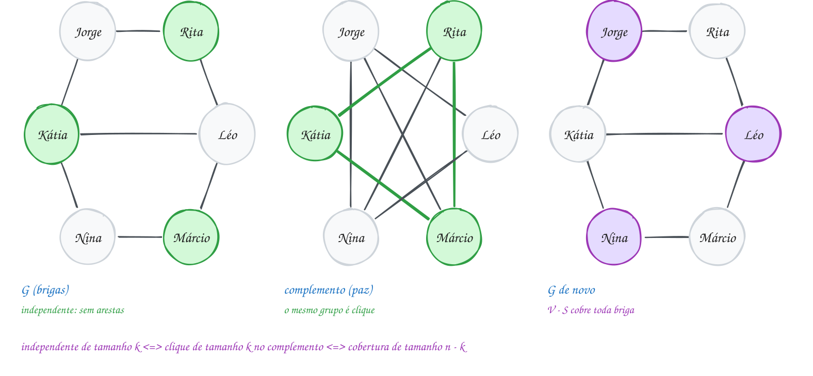</p>

A força bruta de clique é a **caixa-preta**; a redução é a montagem de
`paz`:

```c
#include <stdbool.h>
#include <stdio.h>

#define V 6

const char *moradores[V] = {"Jorge", "Rita", "Kátia", "Léo", "Márcio", "Nina"};
int briga[V][V];    // G: aresta = os dois brigaram
int paz[V][V];      // complemento de G: aresta = não brigaram

// a "caixa-preta": maior clique por força bruta (devolve a máscara)
int maior_clique(int g[V][V]) {
    int melhor = 0, tam_melhor = 0;
    for (int m = 1; m < (1 << V); m++) {
        bool ok = true;
        int tam = 0;
        for (int a = 0; a < V; a++) {
            if (!(m >> a & 1)) continue;
            tam++;
            for (int b = a + 1; b < V; b++)
                if ((m >> b & 1) && !g[a][b]) ok = false;
        }
        if (ok && tam > tam_melhor) melhor = m, tam_melhor = tam;
    }
    return melhor;
}

void mostra(const char *rotulo, int m) {
    int tam = 0;
    printf("%s:", rotulo);
    for (int v = 0; v < V; v++)
        if (m >> v & 1) printf(" %s", moradores[v]), tam++;
    printf(" (%d)\n", tam);
}

int main(void) {
    int brigas[][2] = {{0, 1}, {0, 2}, {1, 3}, {2, 3}, {3, 4}, {4, 5}, {2, 5}};
    for (int k = 0; k < 7; k++) briga[brigas[k][0]][brigas[k][1]] = briga[brigas[k][1]][brigas[k][0]] = 1;

    // a redução: montar o complemento custa O(V²)
    for (int a = 0; a < V; a++)
        for (int b = 0; b < V; b++) paz[a][b] = a != b && !briga[a][b];

    int comissao = maior_clique(paz);         // clique no complemento...
    mostra("Comissão sem brigas", comissao);   // ...é conjunto independente em G
    int todos = (1 << V) - 1;
    mostra("Mediadores (cobertura)", todos & ~comissao); // o resto cobre toda briga
    return 0;
}
// Saída:
// Comissão sem brigas: Rita Kátia Márcio (3)
// Mediadores (cobertura): Jorge Léo Nina (3)
```

Os três passos de toda redução: transformar a entrada, chamar o resolvedor do
outro problema e traduzir a resposta:

<p align="center">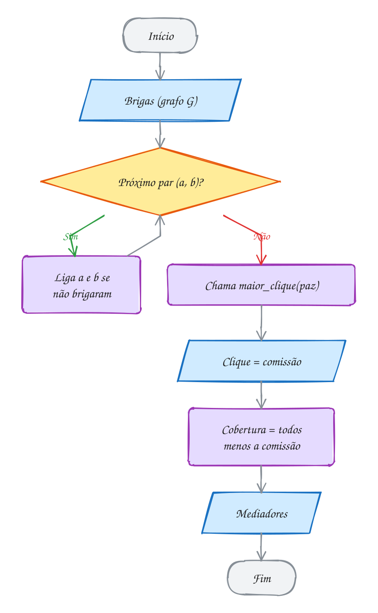</p>

**Exemplo A373 · De 3-SAT para clique: a construção em C**

```c
#include <stdbool.h>
#include <stdio.h>

#define M 3      // cláusulas
#define NV 3     // variáveis
#define V (3 * M) // um vértice por literal

// (x1 ou não x2 ou x3) e (não x1 ou x2 ou x3) e (x1 ou x2 ou não x3)
const int formula[M][3] = {{1, -2, 3}, {-1, 2, 3}, {1, 2, -3}};
int lit[V];   // o literal de cada vértice
int adj[V][V];

void mostra_lit(int l) {
    printf("%sx%d", l < 0 ? "não " : "", l < 0 ? -l : l);
}

int main(void) {
    // a redução: O(m²) vértices e arestas, polinomial
    for (int c = 0; c < M; c++)
        for (int i = 0; i < 3; i++) lit[3 * c + i] = formula[c][i];
    int arestas = 0;
    for (int a = 0; a < V; a++)
        for (int b = a + 1; b < V; b++) {
            bool outra_clausula = a / 3 != b / 3;
            bool compativel = lit[a] != -lit[b]; // x e não x nunca se ligam
            if (outra_clausula && compativel) adj[a][b] = adj[b][a] = 1, arestas++;
        }
    printf("Grafo: %d vértices, %d arestas\n", V, arestas);

    // clique de tamanho M: no máximo um vértice por cláusula, então basta
    // escolher um literal de cada uma (3^M escolhas)
    for (int esc = 0; esc < 27; esc++) {
        int v[M], r = esc;
        for (int c = 0; c < M; c++) v[c] = 3 * c + r % 3, r /= 3;
        bool clique = true;
        for (int i = 0; i < M; i++)
            for (int j = i + 1; j < M; j++)
                if (!adj[v[i]][v[j]]) clique = false;
        if (!clique) continue;

        printf("Clique:");
        for (int c = 0; c < M; c++) printf(" v%d(", v[c]), mostra_lit(lit[v[c]]), printf(")");
        bool valor[NV + 1] = {false}; // variável não citada fica falsa
        for (int c = 0; c < M; c++)
            if (lit[v[c]] > 0) valor[lit[v[c]]] = true;
        printf("\nAtribuição:");
        for (int x = 1; x <= NV; x++) printf(" x%d=%s", x, valor[x] ? "V" : "F");
        printf("\n");
        return 0;
    }
    printf("Sem clique de tamanho %d: fórmula insatisfatível\n", M);
    return 0;
}
// Saída:
// Grafo: 9 vértices, 21 arestas
// Clique: v0(x1) v4(x2) v6(x1)
// Atribuição: x1=V x2=V x3=F
//
// Dos 27 pares entre cláusulas diferentes, só 6 são contraditórios (x e
// não x) e ficam de fora: sobram 21 arestas. A clique escolhe um literal
// por cláusula sem contradição; tornar esses literais verdadeiros satisfaz
// as três cláusulas. A volta também vale: de uma atribuição que satisfaz,
// pegue um literal verdadeiro por cláusula e eles formam uma clique. Por
// isso "a fórmula é satisfatível" e "o grafo tem clique de tamanho m" têm
// sempre a mesma resposta.
```

```bash
gcc ~/LPEDC/material/A373.c -o ~/LPEDC/material/A373 && ~/LPEDC/material/A373
```

**Exemplo A374 · Caminho hamiltoniano usando quem só sabe achar ciclo**

```c
#include <stdbool.h>
#include <stdio.h>

#define MAXV 8

int n;
int adj[MAXV][MAXV];
int rota[MAXV];
bool usado[MAXV];

// a caixa-preta: acha ciclo hamiltoniano (backtracking do 0183)
bool ciclo(int pos) {
    if (pos == n) return adj[rota[n - 1]][rota[0]];
    for (int v = 1; v < n; v++) {
        if (!adj[rota[pos - 1]][v] || usado[v]) continue;
        rota[pos] = v;
        usado[v] = true;
        if (ciclo(pos + 1)) return true;
        usado[v] = false;
    }
    return false;
}

bool tem_ciclo(void) {
    for (int v = 0; v < n; v++) usado[v] = false;
    rota[0] = 0;
    usado[0] = true;
    return ciclo(1);
}

int main(void) {
    const char *pontos[MAXV] = {"Mirante", "Cachoeira", "Gruta", "Lagoa", "Pedra", "X"};
    n = 5; // a gravata do A365
    int trechos[][2] = {{0, 1}, {1, 2}, {2, 0}, {0, 3}, {3, 4}, {4, 0}};
    for (int k = 0; k < 6; k++) adj[trechos[k][0]][trechos[k][1]] = adj[trechos[k][1]][trechos[k][0]] = 1;
    printf("Ciclo hamiltoniano na gravata: %s\n", tem_ciclo() ? "sim" : "não");

    // a redução: um vértice novo X ligado a todos
    int x = n++;
    for (int v = 0; v < x; v++) adj[x][v] = adj[v][x] = 1;
    if (!tem_ciclo()) {
        printf("Sem caminho hamiltoniano\n");
        return 0;
    }
    int ix = 0; // onde o X caiu no ciclo
    while (rota[ix] != x) ix++;
    printf("Ciclo com o X:");
    for (int i = 0; i < n; i++) printf(" %s", pontos[rota[i]]);
    printf("\nCaminho (corta o X):");
    for (int i = 1; i < n; i++) printf(" %s", pontos[rota[(ix + i) % n]]);
    printf("\n");
    return 0;
}
// Saída:
// Ciclo hamiltoniano na gravata: não
// Ciclo com o X: Mirante Cachoeira Gruta X Lagoa Pedra
// Caminho (corta o X): Lagoa Pedra Mirante Cachoeira Gruta
//
// O grafo novo tem ciclo hamiltoniano exatamente quando o original tem
// caminho hamiltoniano: o X entra pela ponta final do caminho e sai pela
// inicial, porque está ligado a todos. A redução custa O(V): um vértice e
// V arestas. Ela mostra que CAMINHO <=p CICLO; como caminho hamiltoniano é
// NP-completo, ciclo hamiltoniano também é NP-difícil.
```

```bash
gcc ~/LPEDC/material/A374.c -o ~/LPEDC/material/A374 && ~/LPEDC/material/A374
```

### Exercícios

**Exercício E1117** · ★☆☆

Num torneio de várzea todos devem jogar contra todos. Cinco times (Azul,
Verde, Rubro, Preto, Branco; 0 a 4) já fizeram estes jogos:

```text
Azul x Verde, Azul x Rubro, Verde x Preto, Rubro x Preto,
Preto x Branco, Azul x Branco
```

Os jogos que faltam são exatamente as arestas do grafo complemento.
Escreva void complemento(int g[V][V], int c[V][V]) e use-a para mostrar
os jogos que faltam (pares a < b) e a conta de conferência.

```text
Saída esperada:
Jogos que faltam:
  Azul x Preto
  Verde x Rubro
  Verde x Branco
  Rubro x Branco
6 jogos feitos + 4 faltando = 10
```

**Exercício E1119** · ★★☆

O shopping vai abrir um corredor temático e quer o MAIOR grupo de lojas
sem concorrência entre si (um conjunto independente). Resolva por
redução a clique: escreva int maior_clique(int g[V][V]), que testa as
máscaras de bits de 1 a 2^V - 1 e devolve a da maior clique (no empate,
a primeira máscara), monte o complemento de concorre em g2, chame
maior_clique e mostre as lojas escolhidas e quantas são.

Lojas: Açaí, Bazar, Café, Doces, Ervas, Farmácia, Gelato (0 a 6).
Concorrem: Açaí-Café, Açaí-Doces, Açaí-Gelato, Bazar-Ervas, Café-Gelato,
Doces-Gelato, Ervas-Farmácia, Farmácia-Gelato.

```text
Saída esperada:
Lojas no corredor: Bazar Café Doces Farmácia (4)
```

**Exercício E1120** · ★★☆

Generalize a construção do A373. Escreva a função
void reduz(const char *nome, int m, const int f[][3]), que recebe uma
fórmula 3-CNF com m cláusulas, monta o grafo da redução (um vértice por
literal, aresta entre literais de cláusulas diferentes que não se
contradizem), conta vértices e arestas e procura uma clique com um
vértice de cada cláusula. Teste nas duas fórmulas:

```text
F1: (x1 ou x2 ou x3) (não x1 ou não x2 ou x3)
    (x1 ou não x2 ou não x3) (não x1 ou x2 ou não x3)
F2: as 8 cláusulas possíveis com x1, x2, x3 (cada uma com ou sem "não")
```

```text
Saída esperada:
F1: 12 vértices, 42 arestas, clique de 4? sim (satisfatível)
F2: 24 vértices, 204 arestas, clique de 8? não (insatisfatível)
```

**Exercício E1122** · ★★★

Reduza 3-COLORAÇÃO a SAT: transforme um grafo numa fórmula que é
satisfatível exatamente quando o grafo pode ser pintado com 3 cores sem
vizinhos iguais. Use a variável var(v, c) = 3v + c + 1 para "o vértice v
tem a cor c" (cores 0 vermelho, 1 verde, 2 azul) e três tipos de
cláusula, nesta ordem:

```text
para cada vértice v: (v tem cor 0 ou cor 1 ou cor 2)
                     e, para cada par de cores a < b, (não a ou não b)
para cada aresta u-v e cada cor c: (não u tem c ou não v tem c)
```

Depois resolva a fórmula por força bruta (2^12 atribuições) e traduza a
primeira solução de volta para cores. Teste o losango (0-1, 0-2, 1-2,
1-3, 2-3) e o completo K4 (todas as 6 arestas entre 0, 1, 2, 3).

```text
Saída esperada:
Losango: 12 variáveis, 31 cláusulas
  vértice 0: vermelho
  vértice 1: azul
  vértice 2: verde
  vértice 3: vermelho
Completo K4: 12 variáveis, 34 cláusulas
  sem 3-coloração
```

---

## 0188 · Aproximação

### Conceito

- **Algoritmo de aproximação**: polinomial, com custo no máximo **ρ vezes o
  ótimo** (minimização) em **qualquer** entrada. O ρ é o **fator de
  aproximação**; a prova compara com um limite inferior do ótimo
  (CORMEN et al., 2024, cap. 35).
- **Bin packing**: guardar itens no menor número de caixas de capacidade C.
  NP-difícil; o limite inferior é `soma / C` arredondado para cima
  (KLEINBERG; TARDOS, 2006, cap. 11).
- **First fit** (FF): cada item vai para a primeira caixa em que cabe, ou abre
  outra. Nunca sobram duas caixas com metade ou menos: no máximo 2 × ótimo
  (cerca de 1,7 × na análise fina) (KLEINBERG; TARDOS, 2006, cap. 11).
- **First fit decrescente** (FFD): ordena do maior para o menor e faz o mesmo;
  garantia de cerca de 11/9 × ótimo, mais uma constante.
- **Cobertura de vértices 2-aproximada**: enquanto houver aresta descoberta
  u-v, ponha **as duas pontas**. As arestas escolhidas não têm ponta em comum
  e o ótimo precisa de uma de cada (CORMEN et al., 2024, cap. 35).
- **Caixeiro viajante métrico**: com a **desigualdade triangular**, monte a
  árvore geradora mínima (Prim, 0153), percorra em pré-ordem e volte ao
  começo: no máximo 2 × ótimo. Sem a desigualdade, nenhum fator constante é
  possível, salvo se P = NP (CORMEN et al., 2024, cap. 35).

> [!WARNING]
> "Aproximado" não é "chute": o fator vale para **toda** entrada e vem com
> prova. E o guloso "pega o vértice de maior grau" para cobertura **não** tem
> fator constante; o 2-aproximado é o "pega as duas pontas".

### Exemplos de uso

Um barco de Manaus a Parintins leva 10 toneladas por viagem e recebe oito
cargas: 4, 4, 6, 9, 2, 6, 7 e 7. Em cima, o first fit na ordem de chegada;
embaixo, o decrescente, que bate o limite inferior de 5 viagens:

<p align="center">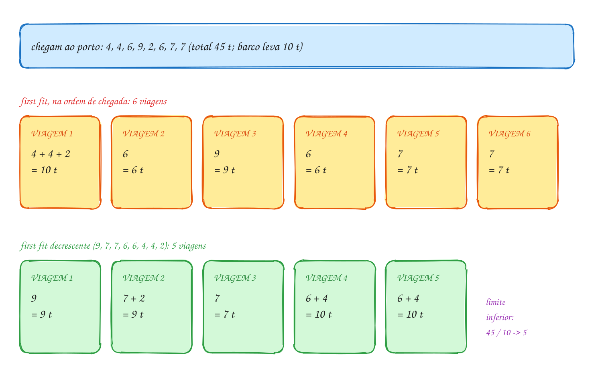</p>

```c
#include <stdio.h>
#include <stdlib.h>

#define N 8
#define CAPACIDADE 10 // toneladas por viagem do barco

int compara_desc(const void *a, const void *b) {
    return *(const int *)b - *(const int *)a;
}

// first fit: cada carga vai para a PRIMEIRA viagem em que ainda cabe
int first_fit(const int carga[], int n, int viagem[][N], int qtd[]) {
    int livre[N], viagens = 0;
    for (int i = 0; i < n; i++) {
        int v = 0;
        while (v < viagens && livre[v] < carga[i]) v++;
        if (v == viagens) livre[viagens++] = CAPACIDADE, qtd[v] = 0; // abre outra viagem
        livre[v] -= carga[i];
        viagem[v][qtd[v]++] = carga[i];
    }
    return viagens;
}

void mostra(const char *nome, int viagens, int viagem[][N], const int qtd[]) {
    printf("%s: %d viagens\n", nome, viagens);
    for (int v = 0; v < viagens; v++) {
        int soma = 0;
        printf("  viagem %d:", v + 1);
        for (int i = 0; i < qtd[v]; i++) printf(" %d", viagem[v][i]), soma += viagem[v][i];
        printf("  (%d t)\n", soma);
    }
}

int main(void) {
    int carga[N] = {4, 4, 6, 9, 2, 6, 7, 7}; // na ordem em que chegam ao porto
    int viagem[N][N], qtd[N];

    int total = 0;
    for (int i = 0; i < N; i++) total += carga[i];
    printf("Total: %d t; limite inferior: %d viagens\n", total, (total + CAPACIDADE - 1) / CAPACIDADE);

    int ff = first_fit(carga, N, viagem, qtd);
    mostra("First fit", ff, viagem, qtd);

    qsort(carga, N, sizeof carga[0], compara_desc); // maiores primeiro
    int ffd = first_fit(carga, N, viagem, qtd);
    mostra("First fit decrescente", ffd, viagem, qtd);
    return 0;
}
// Saída:
// Total: 45 t; limite inferior: 5 viagens
// First fit: 6 viagens
//   viagem 1: 4 4 2  (10 t)
//   viagem 2: 6  (6 t)
//   viagem 3: 9  (9 t)
//   viagem 4: 6  (6 t)
//   viagem 5: 7  (7 t)
//   viagem 6: 7  (7 t)
// First fit decrescente: 5 viagens
//   viagem 1: 9  (9 t)
//   viagem 2: 7 2  (9 t)
//   viagem 3: 7  (7 t)
//   viagem 4: 6 4  (10 t)
//   viagem 5: 6 4  (10 t)
```

O first fit para uma carga procura a primeira viagem com espaço ou abre uma
nova. Custa O(n²) no pior caso:

<p align="center">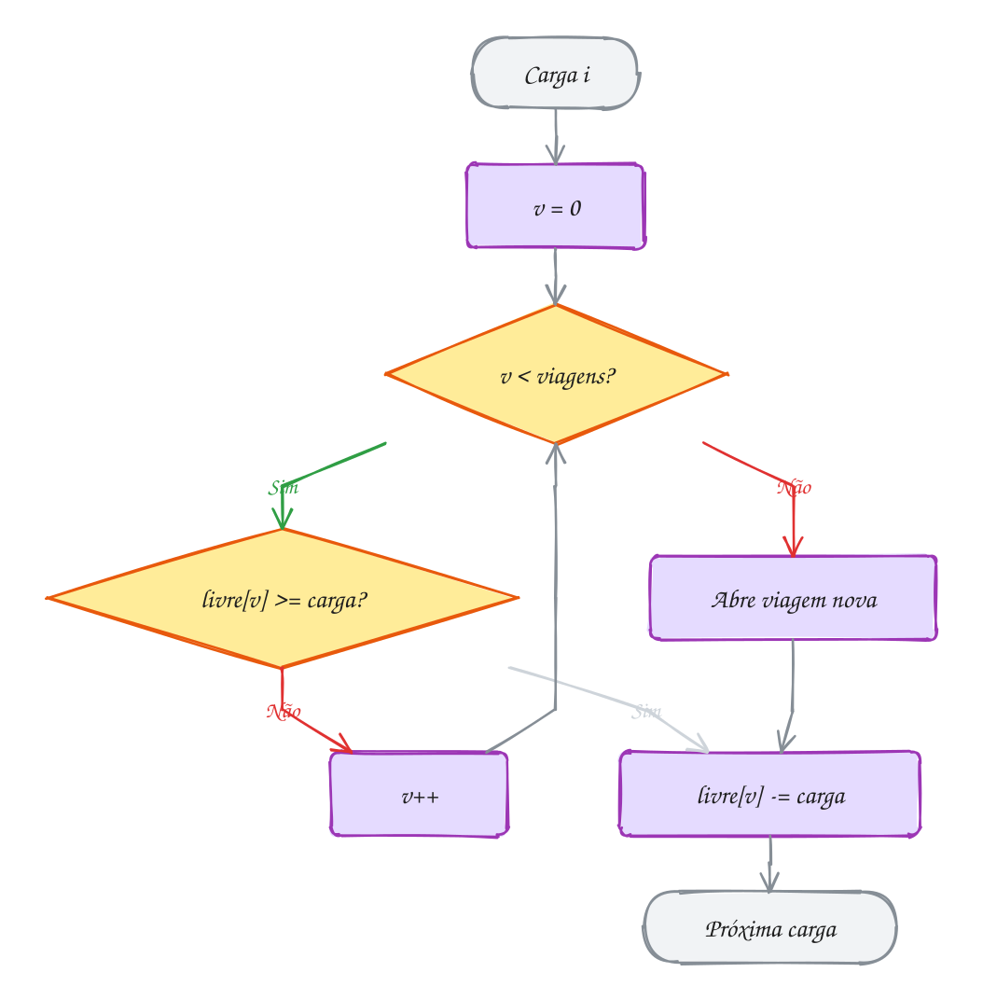</p>

**Exemplo A375 · Cobertura de vértices: as duas pontas contra o ótimo**

```c
#include <stdbool.h>
#include <stdio.h>

#define V 8
#define E 9

// corredores de um galpão (arestas) entre os pontos 0 a 7; um segurança num
// ponto vigia todos os corredores que chegam nele
const int corredor[E][2] = {{0, 1}, {1, 2}, {2, 3}, {3, 4}, {4, 5}, {5, 6}, {6, 7}, {1, 6}, {2, 5}};

int main(void) {
    // 2-aproximado: pega uma aresta descoberta e põe as DUAS pontas
    bool aprox[V] = {false};
    int tam_aprox = 0;
    printf("Arestas escolhidas:");
    for (int k = 0; k < E; k++) {
        int a = corredor[k][0], b = corredor[k][1];
        if (aprox[a] || aprox[b]) continue; // já coberta
        printf(" %d-%d", a, b);
        aprox[a] = aprox[b] = true;
        tam_aprox += 2;
    }
    printf("\nAproximado: %d seguranças em", tam_aprox);
    for (int v = 0; v < V; v++)
        if (aprox[v]) printf(" %d", v);

    // ótimo por força bruta: 2^8 subconjuntos
    int melhor = V + 1, mascara_otima = 0;
    for (int m = 0; m < (1 << V); m++) {
        bool cobre = true;
        for (int k = 0; k < E && cobre; k++)
            if (!(m >> corredor[k][0] & 1) && !(m >> corredor[k][1] & 1)) cobre = false;
        int tam = 0;
        for (int v = 0; v < V; v++) tam += m >> v & 1;
        if (cobre && tam < melhor) melhor = tam, mascara_otima = m;
    }
    printf("\nÓtimo: %d seguranças em", melhor);
    for (int v = 0; v < V; v++)
        if (mascara_otima >> v & 1) printf(" %d", v);
    printf("\nRazão: %.2f (a garantia é 2)\n", (double)tam_aprox / melhor);
    return 0;
}
// Saída:
// Arestas escolhidas: 0-1 2-3 4-5 6-7
// Aproximado: 8 seguranças em 0 1 2 3 4 5 6 7
// Ótimo: 4 seguranças em 0 2 4 6
// Razão: 2.00 (a garantia é 2)
//
// Aqui o aproximado bate exatamente no pior caso: as quatro arestas
// escolhidas não têm ponta em comum (formam um emparelhamento), e o ótimo
// precisa de pelo menos uma ponta de cada uma, ou seja, pelo menos 4. O
// aproximado põe as duas pontas: 8 = 2 x 4. Ele nunca passa disso, mas
// também não faz melhor quando o emparelhamento é "perfeito" assim.
// Custo: O(E) contra O(2^V · E) da força bruta.
```

```bash
gcc ~/LPEDC/material/A375.c -o ~/LPEDC/material/A375 && ~/LPEDC/material/A375
```

**Exemplo A376 · Caixeiro viajante métrico: a árvore mínima vira rota**

```c
#include <stdbool.h>
#include <stdio.h>
#include <stdlib.h>

#define N 6

// pontos de uma cidade em quarteirões (x, y); distância = quarteirões andados
const char *pontos[N] = {"Loja", "Ana", "Bia", "Caio", "Davi", "Elis"};
const int px[N] = {0, 5, 2, 1, 7, 4};
const int py[N] = {0, 4, 4, 4, 2, 0};
int d[N][N];
int pai[N];           // pai na árvore geradora mínima
int rota[N], tam_rota = 0;

void preordem(int u) { // visita u e depois os filhos, em ordem de índice
    rota[tam_rota++] = u;
    for (int v = 0; v < N; v++)
        if (v != u && pai[v] == u) preordem(v);
}

int custo(const int r[]) {
    int c = 0;
    for (int i = 0; i < N; i++) c += d[r[i]][r[(i + 1) % N]];
    return c;
}

int melhor = 1 << 30, atual[N];
bool usado[N];

void forca_bruta(int pos, int acum) { // todas as rotas que começam na Loja
    if (acum >= melhor) return;
    if (pos == N) {
        if (acum + d[atual[N - 1]][0] < melhor) melhor = acum + d[atual[N - 1]][0];
        return;
    }
    for (int v = 1; v < N; v++) {
        if (usado[v]) continue;
        usado[v] = true;
        atual[pos] = v;
        forca_bruta(pos + 1, acum + d[atual[pos - 1]][v]);
        usado[v] = false;
    }
}

int main(void) {
    for (int a = 0; a < N; a++)
        for (int b = 0; b < N; b++) d[a][b] = abs(px[a] - px[b]) + abs(py[a] - py[b]);

    // Prim O(N²) a partir da Loja
    int chave[N];
    bool na_arvore[N] = {false};
    for (int v = 0; v < N; v++) chave[v] = 1 << 30, pai[v] = -1;
    chave[0] = 0;
    int peso_arvore = 0;
    for (int k = 0; k < N; k++) {
        int u = -1;
        for (int v = 0; v < N; v++)
            if (!na_arvore[v] && (u == -1 || chave[v] < chave[u])) u = v;
        na_arvore[u] = true;
        peso_arvore += chave[u];
        for (int v = 0; v < N; v++)
            if (!na_arvore[v] && d[u][v] < chave[v]) chave[v] = d[u][v], pai[v] = u;
    }

    preordem(0);
    printf("Árvore mínima: %d quarteirões\nRota aproximada:", peso_arvore);
    for (int i = 0; i < N; i++) printf(" %s", pontos[rota[i]]);
    printf(" %s = %d quarteirões\n", pontos[0], custo(rota));

    atual[0] = 0;
    usado[0] = true;
    forca_bruta(1, 0);
    printf("Ótimo (força bruta): %d quarteirões\n", melhor);
    printf("Garantia: rota <= 2 x árvore = %d\n", 2 * peso_arvore);
    return 0;
}
// Saída:
// Árvore mínima: 17 quarteirões
// Rota aproximada: Loja Elis Ana Bia Caio Davi Loja = 30 quarteirões
// Ótimo (força bruta): 22 quarteirões
// Garantia: rota <= 2 x árvore = 34
//
// A distância em quarteirões (|dx| + |dy|) respeita a desigualdade
// triangular, então a garantia vale: 30 <= 2 x 17 = 34 <= 2 x 22. A rota
// saiu 36% acima do ótimo, longe do dobro. Repare na volta Davi -> Loja:
// a pré-ordem termina longe de casa, e é aí que mora a perda. A árvore
// (17) é sempre menor que o ótimo (22), porque apagar uma aresta da rota
// ótima deixa uma árvore geradora.
```

```bash
gcc ~/LPEDC/material/A376.c -o ~/LPEDC/material/A376 && ~/LPEDC/material/A376
```

### Exercícios

**Exercício E1123** · ★☆☆

Um barco menor só tem um porão aberto por vez: se a carga não cabe na
viagem atual, ela parte e abre-se outra (não dá para voltar a uma viagem
anterior). Isso é o NEXT FIT. Escreva int next_fit(const int carga[],
int n) e compare com o first fit do texto e com o limite inferior, para
as cargas 6, 5, 6, 5, 1, 7, 2, 2, 5, 4 (capacidade 10).

```text
Saída esperada:
Limite inferior: 5 viagens
Next fit: 7 viagens
First fit: 5 viagens
```

**Exercício E1125** · ★★☆

Considere as câmeras de uma cidade (esquinas A a G; ruas A-B, B-C, C-D,
D-E, E-F, F-G, B-F, C-E). Escreva a cobertura 2-aproximada do texto como função
int cobertura(int rua[E][2], bool em[]), que examina as ruas na ordem do
vetor, e uma força bruta int otimo(int rua[E][2]). Rode a aproximação
com duas ordens das mesmas ruas:

```text
ordem 1: A-B, B-C, C-D, D-E, E-F, F-G, B-F, C-E
ordem 2: B-F, C-E, A-B, B-C, C-D, D-E, E-F, F-G
```

```text
Saída esperada:
Ordem 1: 6 câmeras em A B C D E F
Ordem 2: 4 câmeras em B C E F
Ótimo: 4 câmeras
```

**Exercício E1126** · ★★☆

Compare o first fit (FF) e o first fit decrescente (FFD) em três listas
de cargas (barco de 10 t), sem estragar a lista original. Escreva a
função compara(nome, carga, n), que copia a lista com memcpy, ordena a
cópia em ordem decrescente com qsort e mostra FF, FFD e o limite
inferior.

```text
Lista 1: 4, 4, 6, 9, 2, 6, 7, 7
Lista 2: 2, 2, 2, 2, 2, 2, 7, 7, 7, 7, 7, 7
Lista 3: 3, 3, 3, 3, 3, 3, 4, 4, 4, 4, 4, 4, 5
```

```text
Saída esperada:
Lista 1: FF 6, FFD 5, limite 5
Lista 2: FF 7, FFD 6, limite 6
Lista 3: FF 6, FFD 6, limite 5
```

**Exercício E1127** · ★★★

Escreva a 2-aproximação do caixeiro viajante métrico para um passeio
turístico com sete pontos (coordenadas em quarteirões; a distância é
|dx| + |dy|). O programa deve:

```text
- montar a matriz d de distâncias;
- rodar o Prim O(N²) a partir da Base, guardando pai[] (no empate,
  vale o menor índice);
- void preordem(int u): a rota é a pré-ordem da árvore (u primeiro,
  depois os filhos de u em ordem de índice);
- int custo(const int r[]): o tamanho da rota fechada;
- achar o ótimo por força bruta, fixando a Base no começo.
```

```text
Saída esperada:
Árvore mínima: 21 quarteirões
Rota aproximada: Base Feira Igreja Zoo Museu Teatro Praia Base = 34 quarteirões
Ótimo (força bruta): 30 quarteirões
Garantia: rota <= 2 x árvore = 42
```

---

## 0189 · Juntando tudo

### Conceito

- **Caixeiro viajante** (TSP): o **ciclo hamiltoniano** de custo mínimo
  (0183). A versão de decisão ("existe volta de no máximo L?") é NP-completa
  por redução do ciclo hamiltoniano: arestas do grafo custam 1, as que faltam
  custam 2 (CORMEN et al., 2024, cap. 34).
- **Métrico**: com desigualdade triangular, a árvore mínima dá uma
  2-aproximação (0188) (CORMEN et al., 2024, cap. 35).
- **Força bruta**: fixe o ponto de partida e teste as (n − 1)! ordens; 87
  bilhões com 15 pontos.
- **Held-Karp**: programação dinâmica sobre subconjuntos. `dp[S][j]` é o menor
  caminho que sai da origem, passa exatamente pelos pontos de S e termina em
  j. Só importam o conjunto e o último ponto, não a ordem (HELD; KARP, 1962):

```text
dp[{0}][0] = 0
dp[S ∪ {k}][k] = min sobre j em S:  dp[S][j] + d[j][k]
resposta = min sobre j:  dp[todos][j] + d[j][0]
```

- **Custo do Held-Karp**: 2ⁿ conjuntos × n finais × n extensões, **O(n² ·
  2ⁿ)** de tempo e **O(n · 2ⁿ)** de memória, bem menos que n!
  (HELD; KARP, 1962).
- **Quando usar cada um**: até uns 20 pontos, Held-Karp resolve em segundos
  (o limite é a memória); acima, aproximação com melhoria local, como o
  2-opt.
- **Bits sem parênteses**: `s >> j & 1` e `s | 1 << k` funcionam porque `>>`
  e `<<` vêm antes de `&` e `|` (0170).

| n | (n − 1)! rotas | n² · 2ⁿ (Held-Karp) | n² (aproximado) |
| --- | --- | --- | --- |
| 8 | 5 040 | 16 384 | 64 |
| 15 | 8,7 · 10¹⁰ | 7,4 · 10⁶ | 225 |
| 20 | 1,2 · 10¹⁷ | 4,2 · 10⁸ | 400 |
| 30 | 8,8 · 10³⁰ | 9,7 · 10¹¹ | 900 |

> [!WARNING]
> A garantia de 2 × ótimo só vale com a **desigualdade triangular**; com
> distâncias quaisquer, nenhum algoritmo polinomial tem fator constante, a
> menos que P = NP. Held-Karp é **exato** e exponencial; a árvore é
> **aproximada** e polinomial.

### Exemplos de uso

O entregador de uma farmácia tem sete endereços e quer a volta mais curta,
com distâncias em quarteirões (|dx| + |dy|). À esquerda, a rota exata; à
direita, a da árvore mínima, com voltas desnecessárias no fim:

<p align="center">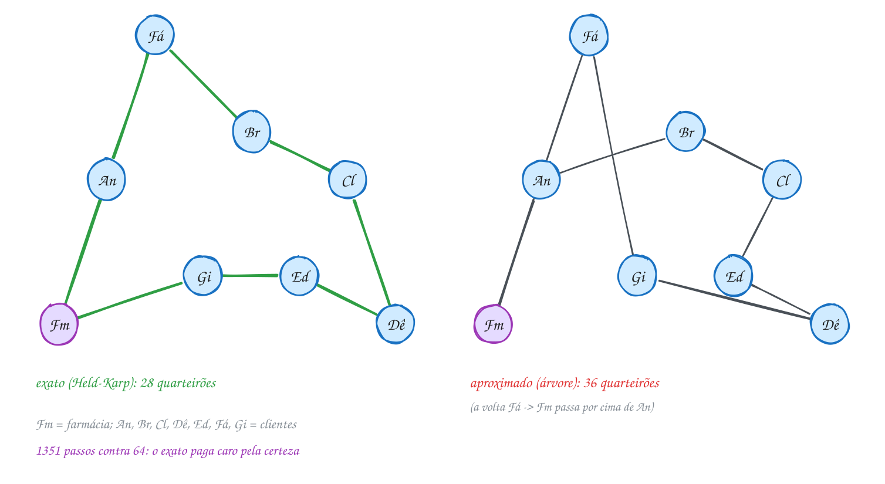</p>

S é uma máscara de bits (0186); o bit 0, a farmácia, está sempre ligado, por
isso o laço anda de 2 em 2:

```c
#include <stdbool.h>
#include <stdio.h>
#include <stdlib.h>

#define N 8
#define INF 1000000000

const char *pontos[N] = {"Farmácia", "Ana", "Bruno", "Clara", "Dênis", "Edna", "Fábio", "Gil"};
const int px[N] = {0, 1, 4, 6, 7, 5, 2, 3};
const int py[N] = {0, 3, 4, 3, 0, 1, 6, 1};
int d[N][N];
long passos;

// exato: Held-Karp. dp[S][j] = menor caminho que sai da farmácia, passa
// por todos de S e termina em j
int dp[1 << N][N], ant[1 << N][N];

int exato(int rota[]) {
    for (int s = 0; s < (1 << N); s++)
        for (int j = 0; j < N; j++) dp[s][j] = INF;
    dp[1][0] = 0;
    for (int s = 1; s < (1 << N); s += 2)        // só conjuntos com a farmácia (bit 0)
        for (int j = 0; j < N; j++) {
            if (!(s >> j & 1) || dp[s][j] == INF) continue;
            for (int k = 1; k < N; k++) {        // estende o caminho até k
                if (s >> k & 1) continue;
                passos++;
                int t = s | 1 << k, c = dp[s][j] + d[j][k];
                if (c < dp[t][k]) dp[t][k] = c, ant[t][k] = j;
            }
        }
    int todos = (1 << N) - 1, fim = 1;
    for (int j = 2; j < N; j++)
        if (dp[todos][j] + d[j][0] < dp[todos][fim] + d[fim][0]) fim = j;
    int custo = dp[todos][fim] + d[fim][0];
    for (int i = N - 1, s = todos, j = fim; i >= 0; i--) { // volta pelos anteriores
        rota[i] = j;
        int a = ant[s][j];
        s &= ~(1 << j);
        j = a;
    }
    return custo;
}

// aproximado: árvore mínima (Prim) + pré-ordem
int pai[N], tam;
void preordem(int u, int rota[]) {
    rota[tam++] = u;
    for (int v = 1; v < N; v++)
        if (pai[v] == u) preordem(v, rota);
}

int aproximado(int rota[]) {
    int chave[N];
    bool dentro[N] = {false};
    for (int v = 0; v < N; v++) chave[v] = INF, pai[v] = -1;
    chave[0] = 0;
    for (int k = 0; k < N; k++) {
        int u = -1;
        for (int v = 0; v < N; v++)
            if (!dentro[v] && (u == -1 || chave[v] < chave[u])) u = v;
        dentro[u] = true;
        for (int v = 0; v < N; v++, passos++)
            if (!dentro[v] && d[u][v] < chave[v]) chave[v] = d[u][v], pai[v] = u;
    }
    tam = 0;
    preordem(0, rota);
    int custo = 0;
    for (int i = 0; i < N; i++) custo += d[rota[i]][rota[(i + 1) % N]];
    return custo;
}

void mostra(const char *nome, int custo, const int rota[]) {
    printf("%s: %d quarteirões, %ld passos\n ", nome, custo, passos);
    for (int i = 0; i < N; i++) printf(" %s", pontos[rota[i]]);
    printf(" %s\n", pontos[0]);
}

int main(void) {
    for (int a = 0; a < N; a++)
        for (int b = 0; b < N; b++) d[a][b] = abs(px[a] - px[b]) + abs(py[a] - py[b]);
    int rota[N];

    passos = 0;
    int c1 = exato(rota);
    mostra("Exato (Held-Karp)", c1, rota);
    passos = 0;
    int c2 = aproximado(rota);
    mostra("Aproximado (árvore)", c2, rota);
    printf("O aproximado gasta %.0f%% a mais\n", 100.0 * (c2 - c1) / c1);
    return 0;
}
// Saída:
// Exato (Held-Karp): 28 quarteirões, 1351 passos
//   Farmácia Gil Edna Dênis Clara Bruno Fábio Ana Farmácia
// Aproximado (árvore): 36 quarteirões, 64 passos
//   Farmácia Ana Bruno Clara Edna Dênis Gil Fábio Farmácia
// O aproximado gasta 29% a mais
```

O aproximado errou por 29%, longe do dobro permitido, e fez 64 passos contra
1351. O fluxograma é a decisão de um programa real: poucos pontos, exato;
muitos, aproximado e melhorado:

<p align="center">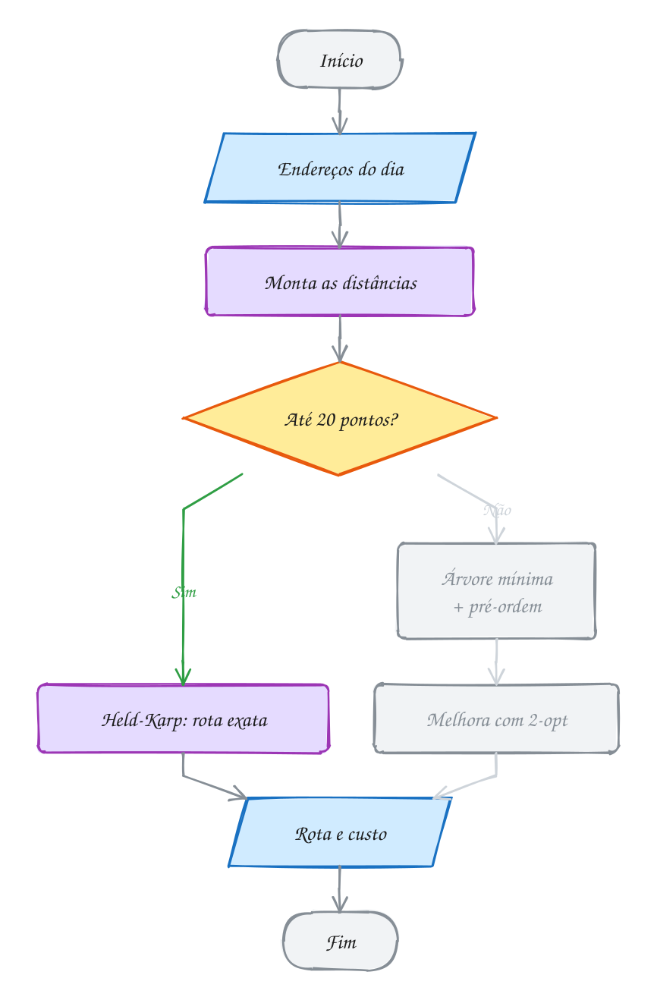</p>

**Exemplo A377 · Até onde o exato aguenta**

```c
#include <stdio.h>
#include <stdlib.h>

#define MAXN 16
#define INF 1000000000

int n, d[MAXN][MAXN];
int dp[1 << MAXN][MAXN]; // 4 MB: global, fora da pilha

long held_karp(int *custo) {
    long passos = 0;
    for (int s = 0; s < (1 << n); s++)
        for (int j = 0; j < n; j++) dp[s][j] = INF;
    dp[1][0] = 0;
    for (int s = 1; s < (1 << n); s += 2)
        for (int j = 0; j < n; j++) {
            if (!(s >> j & 1) || dp[s][j] == INF) continue;
            for (int k = 1; k < n; k++) {
                if (s >> k & 1) continue;
                passos++;
                int t = s | 1 << k, c = dp[s][j] + d[j][k];
                if (c < dp[t][k]) dp[t][k] = c;
            }
        }
    *custo = INF;
    for (int j = 1; j < n; j++)
        if (dp[(1 << n) - 1][j] + d[j][0] < *custo) *custo = dp[(1 << n) - 1][j] + d[j][0];
    return passos;
}

int main(void) {
    unsigned semente = 2024; // gerador simples: os mesmos pontos em toda execução
    int px[MAXN], py[MAXN];
    for (int i = 0; i < MAXN; i++) {
        semente = semente * 1103515245u + 12345u;
        px[i] = (int)(semente >> 16) % 20;
        semente = semente * 1103515245u + 12345u;
        py[i] = (int)(semente >> 16) % 20;
    }
    printf(" n  rota ótima  passos Held-Karp  memória da tabela  (n-1)! rotas\n");
    for (n = 4; n <= MAXN; n += 4) {
        for (int a = 0; a < n; a++)
            for (int b = 0; b < n; b++) d[a][b] = abs(px[a] - px[b]) + abs(py[a] - py[b]);
        int custo;
        long passos = held_karp(&custo);
        double fat = 1;
        for (int k = 2; k < n; k++) fat *= k;
        printf("%2d  %10d  %16ld  %14.1f KB  %12.0f\n", n, custo, passos,
               (double)(1 << n) * n * sizeof(int) / 1024, fat);
    }
    printf("Para n = 25: tabela de %.1f GB\n", (double)(1 << 25) * 25 * sizeof(int) / (1024.0 * 1024 * 1024));
    return 0;
}
// Saída:
//  n  rota ótima  passos Held-Karp  memória da tabela  (n-1)! rotas
//  4          52                15             0.2 KB             6
//  8          66              1351             8.0 KB          5040
// 12          74             56331           192.0 KB      39916800
// 16          78           1720335          4096.0 KB  1307674368000
// Para n = 25: tabela de 3.1 GB
//
// Os pontos vêm de um gerador linear congruente com semente fixa: a saída
// é sempre a mesma. Cada 4 pontos a mais multiplicam os passos do
// Held-Karp por 30 a 90 e a memória por 16 x (n+4)/n; a força bruta
// multiplica por milhares. Em 16 pontos, 1,7 milhão de passos contra 1,3
// trilhão de rotas. Mas a tabela cresce junto: com 25 pontos ela já não
// cabe na memória de um notebook comum, e o exato para de ser opção.
```

```bash
gcc ~/LPEDC/material/A377.c -o ~/LPEDC/material/A377 && ~/LPEDC/material/A377
```

**Exemplo A378 · 2-opt: desfazendo os cruzamentos da rota aproximada**

```c
#include <stdio.h>
#include <stdlib.h>

#define N 8

const char *pontos[N] = {"Farmácia", "Ana", "Bruno", "Clara", "Dênis", "Edna", "Fábio", "Gil"};
const int px[N] = {0, 1, 4, 6, 7, 5, 2, 3};
const int py[N] = {0, 3, 4, 3, 0, 1, 6, 1};
int d[N][N];

int custo(const int r[]) {
    int c = 0;
    for (int i = 0; i < N; i++) c += d[r[i]][r[(i + 1) % N]];
    return c;
}

void inverte(int r[], int i, int j) { // inverte o trecho r[i..j]
    while (i < j) {
        int t = r[i];
        r[i++] = r[j];
        r[j--] = t;
    }
}

int main(void) {
    for (int a = 0; a < N; a++)
        for (int b = 0; b < N; b++) d[a][b] = abs(px[a] - px[b]) + abs(py[a] - py[b]);

    int rota[N] = {0, 1, 2, 3, 5, 4, 7, 6}; // a rota da árvore mínima do texto
    printf("Início: %d quarteirões\n", custo(rota));

    // 2-opt: troca as arestas (a, b) e (c, e) por (a, c) e (b, e) se encurtar
    int melhorou = 1;
    while (melhorou) {
        melhorou = 0;
        for (int i = 1; i < N - 1 && !melhorou; i++)
            for (int j = i + 1; j < N && !melhorou; j++) {
                int a = rota[i - 1], b = rota[i], c = rota[j], e = rota[(j + 1) % N];
                int ganho = d[a][b] + d[c][e] - d[a][c] - d[b][e];
                if (ganho > 0) {
                    inverte(rota, i, j);
                    printf("  inverte %s..%s: -%d -> %d\n", pontos[b], pontos[c], ganho, custo(rota));
                    melhorou = 1;
                }
            }
    }
    printf("Final:");
    for (int i = 0; i < N; i++) printf(" %s", pontos[rota[i]]);
    printf(" %s = %d quarteirões\n", pontos[0], custo(rota));
    return 0;
}
// Saída:
// Início: 36 quarteirões
//   inverte Ana..Gil: -2 -> 34
//   inverte Dênis..Edna: -2 -> 32
//   inverte Ana..Fábio: -4 -> 28
// Final: Farmácia Gil Edna Dênis Clara Bruno Fábio Ana Farmácia = 28 quarteirões
//
// Inverter um trecho da rota troca duas arestas por outras duas; quando a
// soma das novas é menor, a rota encurta. Aqui, três inversões levaram a
// rota da árvore (36) até o ótimo do Held-Karp (28), com algumas
// centenas de contas. Nem sempre o 2-opt chega ao ótimo: ele para num
// ótimo LOCAL, onde nenhuma troca de duas arestas ajuda. Mas cada volta é
// O(n²), e na prática ele costuma ficar a poucos por cento do ótimo.
```

```bash
gcc ~/LPEDC/material/A378.c -o ~/LPEDC/material/A378 && ~/LPEDC/material/A378
```

### Exercícios

**Exercício E1129** · ★☆☆

O padeiro entrega pão em quatro pontos e volta. Coordenadas em
quarteirões: Padaria (0, 0), Escola (3, 2), Posto (5, 5), Banco (1, 4),
Feira (4, 0). Escreva o programa que monta a matriz de distâncias
(|dx| + |dy|), mostra a tabela (nomes com %8s no cabeçalho e %-8s nas
linhas, números com %8d) e calcula o custo de duas rotas fechadas:

```text
rota 1: Padaria Escola Posto Banco Feira (e volta)
rota 2: Padaria Feira Escola Posto Banco (e volta)
```

```text
Saída esperada:
         Padaria  Escola   Posto   Banco   Feira
Padaria        0       5      10       5       4
Escola         5       0       5       4       3
Posto         10       5       0       5       6
Banco          5       4       5       0       7
Feira          4       3       6       7       0
Rota 1: 26 quarteirões
Rota 2: 22 quarteirões
```

**Exercício E1131** · ★★☆

Confira o Held-Karp do texto pela força bruta das permutações (0126):
escreva void permuta(int pos, int acum, bool poda), que monta todas as
rotas a partir da farmácia (rota[0] = 0) para os mesmos oito pontos do
texto, guarda o menor custo em melhor e conta as chamadas e as rotas
completas. Com poda = true, a função volta logo no começo se acum já
chegou a melhor (branch and bound, 0127). Rode as duas versões.

```text
Saída esperada:
Sem poda: ótimo 28, 5040 rotas completas, 13700 chamadas
Com poda: ótimo 28, 110 rotas completas, 6977 chamadas
```

**Exercício E1132** · ★★☆

Escreva o Held-Karp para a padaria do E1129 (cinco pontos, distância
|dx| + |dy|) com a tabela dp[1 << N][N], sem guardar a tabela de
anteriores (a memória do servidor não comporta outra do mesmo tamanho).
Mostre a menor volta e reconstrua a rota só com dp[][]: o ponto que veio
antes de k no conjunto s é o primeiro j (de s sem k) tal que
dp[s sem k][j] + d[j][k] == dp[s][k]. Comece em (todos, fim) e ande para
trás até sobrar só a padaria. No empate do último ponto, vale o menor
índice.

```text
Saída esperada:
Menor volta: 22 quarteirões
Rota: Padaria Feira Escola Posto Banco Padaria
```

**Exercício E1133** · ★★★

Monte o planejador de entregas do fluxograma: a função
void planeja(const char *nome, const int px[], const int py[], int n)
calcula as distâncias em quarteirões e decide sozinha:

```text
- até 12 pontos: Held-Karp, mostra o custo exato;
- mais que isso: árvore mínima (Prim a partir do ponto 0) + pré-ordem,
  depois 2-opt (A378) até nenhuma troca melhorar; mostra o peso da
  árvore, o custo da rota antes e depois do 2-opt.
```

Teste com a manhã (os 8 pontos do texto) e a tarde: 30 pontos gerados
assim, com semente = 7 (unsigned), para i de 0 a 29:

```text
semente = semente * 1103515245u + 12345u;  x[i] = (int)(semente >> 16) % 25;
semente = semente * 1103515245u + 12345u;  y[i] = (int)(semente >> 16) % 25;
```

```text
Saída esperada:
Manhã (8 pontos): exato, 28 quarteirões
Tarde (30 pontos): aproximado, árvore 111, rota 172, com 2-opt 148
```

---

## Lista do módulo

30 exercícios que misturam os assuntos do módulo, no ritmo da prova. Arquivos P2901.c a P2930.c, em `material/`; resoluções em `_respostas/29-grafos-e-np/lista/`.

### ★☆☆ Aquecimento

**Exercício P2901** · ★☆☆ · Graus do metrô

O metrô tem sete estações (0 a 6): Sé, Luz, Brás, Arena, Parque, Vila e
Porto. Os trilhos, de mão dupla, ligam:

```text
Sé-Luz, Sé-Brás, Luz-Brás, Luz-Arena, Brás-Parque, Arena-Parque,
Parque-Vila, Arena-Vila, Vila-Porto
```

Escreva o programa do zero: mostre o grau de cada estação, a estação de
maior grau (a primeira, em caso de empate), a soma dos graus comparada
com 2E e quantas estações têm grau ímpar.

```text
Saída esperada:
Sé: 2
Luz: 3
Brás: 3
Arena: 3
Parque: 3
Vila: 3
Porto: 1
Maior grau: Luz (3)
Soma dos graus: 18 = 2 x 9
Estações de grau ímpar: 6
```

---

**Exercício P2902** · ★☆☆ · Fontes e sumidouros

A reforma de uma casa tem oito tarefas (0 a 7): Projeto, Demolição,
Elétrica, Hidráulica, Reboco, Piso, Pintura e Limpeza. A seta a -> b diz
"a precisa acabar antes de b":

```text
Projeto->Demolição, Demolição->Elétrica, Demolição->Hidráulica,
Elétrica->Reboco, Hidráulica->Reboco, Reboco->Piso, Reboco->Pintura,
Piso->Limpeza, Pintura->Limpeza
```

Escreva o programa: mostre o grau de entrada e o de saída de cada tarefa,
confira que as duas somas dão E e liste as FONTES (grau de entrada 0:
podem começar já) e os SUMIDOUROS (grau de saída 0: ninguém depende delas).

```text
Saída esperada:
Projeto: entrada 0, saída 1
Demolição: entrada 1, saída 2
Elétrica: entrada 1, saída 1
Hidráulica: entrada 1, saída 1
Reboco: entrada 2, saída 2
Piso: entrada 1, saída 1
Pintura: entrada 1, saída 1
Limpeza: entrada 2, saída 0
Somas: entrada 9, saída 9
Fontes: Projeto
Sumidouros: Limpeza
```

**Resposta esperada:** Num grafo sem ciclo existe sempre pelo menos uma fonte e um sumidouro.

---

**Exercício P2903** · ★☆☆ · Passeio, trajeto ou caminho

No parque há seis quiosques (A a F) e as trilhas A-B, B-C, C-D, D-A, B-D,
D-E, E-F. Um corredor anota a sequência de quiosques por onde passou.
Escreva int classifica(const char *s), que devolve 0 se a sequência não é
um passeio (alguma trilha não existe), 1 para passeio (repete trilha), 2
para trajeto (repete quiosque, não trilha), 3 para caminho (não repete
nada). Se a sequência for fechada, os nomes viram passeio fechado,
circuito e ciclo. Mostre o nome e o COMPRIMENTO (número de trilhas).
Teste: ABCD, ABCDB, ABCDBA, ABCDA, DEFD.

```text
Saída esperada:
ABCD    caminho, comprimento 3
ABCDB   trajeto, comprimento 4
ABCDBA  passeio fechado, comprimento 5
ABCDA   ciclo, comprimento 4
DEFD    não é passeio, comprimento 3
```

**Resposta esperada:** DEFD falha porque não existe a trilha F-D, por mais que a sequência pareça um triângulo.

---

**Exercício P2904** · ★☆☆ · Diagnóstico de Euler por lista de arestas

Três prefeituras mandaram o mapa das ruas como lista de arestas (pode
haver duas ruas entre as mesmas esquinas). Para cada mapa, diga se o
caminhão da varrição consegue passar por toda rua uma vez e voltar
(circuito), passar por toda rua sem voltar (trajeto, dizendo de onde a
onde) ou nenhum dos dois:

```text
Mapa 1 (5 esquinas): 0-1, 1-2, 2-0, 2-3, 3-4, 4-2
Mapa 2 (5 esquinas): 0-1, 1-2, 2-3, 3-0, 0-2, 1-3, 1-4, 4-3
Mapa 3 (6 esquinas): 0-1, 1-2, 2-0, 3-4, 4-5, 5-3
```

Escreva void diagnostico(int nv, int ne, int a[][2]) e use-a nos três.

```text
Saída esperada:
Mapa 1: circuito
Mapa 2: trajeto de 0 a 2
Mapa 3: nenhum (desconexo)
```

**Resposta esperada:** O mapa 3 tem todos os graus pares e mesmo assim não tem circuito.

---

**Exercício P2905** · ★☆☆ · Conferindo a rota do ônibus circular

O ônibus circular passa por seis pontos (0 a 5), numa cidade de ruas de
mão única. As ruas dirigidas são:

```text
0->1, 1->2, 2->3, 3->4, 4->5, 5->0, 1->4, 3->1, 4->2, 2->0
```

A empresa recebeu quatro propostas de rota (começando no ponto 0; a volta
ao 0 fica subentendida) e quer saber quais são ciclos hamiltonianos
DIRIGIDOS. Escreva o verificador bool valida(const int r[], int n), que
mostra "ok" ou o primeiro problema: "falta ponto", "repete o ponto X" ou
"não há rua X->Y" (inclusive na volta).

```text
A: 0 1 2 3 4 5     B: 0 1 4 2 3 1     C: 0 1 4 5 2 3     D: 0 1 4 2 3
```

```text
Saída esperada:
A: ok
B: repete o ponto 1
C: não há rua 5->2
D: falta ponto
```

**Resposta esperada:** O verificador custa O(n): é por isso que o problema do ciclo hamiltoniano está em NP.

---

**Exercício P2906** · ★☆☆ · Verificador de cobertura com limite

A versão de decisão da cobertura de vértices pergunta: "existe uma
cobertura com no máximo k vértices?". O certificado é a própria lista.
Uma rede tem sete roteadores (0 a 6) e os cabos:

```text
0-1, 0-2, 1-3, 2-3, 3-4, 4-5, 4-6, 5-6
```

Escreva bool confere(const int c[], int tam, int k), que mostra o
veredito e o primeiro cabo descoberto, se houver. Teste os certificados
{0, 3, 4, 5} com k = 4, {1, 2, 4, 6} com k = 4, {0, 3, 4, 6} com k = 3 e
{1, 2, 5, 6} com k = 4.

```text
Saída esperada:
aceito
aceito
rejeitado: 4 vértices, limite 3
rejeitado: cabo 3-4 descoberto
```

**Resposta esperada:** Conferir custa O(V + E); achar a menor cobertura é NP-difícil.

---

**Exercício P2907** · ★☆☆ · Clique ou independente?

Numa turma de oito alunos (0 a 7), as amizades são:

```text
0-1, 0-2, 0-3, 1-2, 1-3, 2-3, 3-4, 4-5, 5-6, 6-7, 4-6
```

Escreva int tipo(const int s[], int k), que devolve 2 se o grupo é uma
clique (todos amigos entre si), 1 se é independente (nenhum par amigo) e
0 se não é nenhum dos dois, e mostre o resultado para os grupos
{0, 1, 2, 3}, {0, 4, 7}, {4, 5, 6}, {2, 5, 7} e {3, 4, 5}.

```text
Saída esperada:
{0, 1, 2, 3}: clique
{0, 4, 7}: independente
{4, 5, 6}: clique
{2, 5, 7}: independente
{3, 4, 5}: nenhum dos dois
```

**Resposta esperada:** Os dois verificadores custam O(k²).

---

**Exercício P2908** · ★☆☆ · Custo de uma ordem de multiplicação

Cinco matrizes têm dimensões p = 6, 2, 9, 4, 7, 3 (Ai é p[i-1] x p[i]).
Calcule, com uma função long custo_esq(int i, int j) e outra
long custo_dir(int i, int j), o número de multiplicações das duas ordens
"ingênuas": da esquerda para a direita, ((((A1 A2) A3) A4) A5), e da
direita para a esquerda, (A1 (A2 (A3 (A4 A5)))). Mostre também as
dimensões do resultado.

```text
Saída esperada:
Resultado: 6 x 3
Da esquerda: 618
Da direita: 282
```

**Resposta esperada:** Nenhuma das duas é a ótima: a PD do 0185 acha uma ordem com 206 multiplicações.

---

**Exercício P2909** · ★☆☆ · O verificador do caixeiro viajante

A versão de decisão do caixeiro viajante é: "existe uma volta por todas
as cidades com custo no máximo L?". Cinco cidades (0 a 4) têm a matriz
de distâncias (km) do main abaixo; -1 quer dizer "sem estrada". Escreva
bool aceita(const int r[], int n, int limite), que confere o certificado
(é uma permutação das 5 cidades, toda estrada existe, a volta incluída)
e compara o custo com o limite. Teste:

```text
0 1 2 3 4 com L = 90      0 2 4 1 3 com L = 100
0 1 3 2 4 com L = 100     0 1 3 2 4 com L = 90
```

```text
Saída esperada:
aceito (custo 87)
rejeitado (sem estrada 4-1)
aceito (custo 94)
rejeitado (custo 94 > 90)
```

**Resposta esperada:** O mesmo certificado pode ser aceito para um L e rejeitado para outro.

---

**Exercício P2910** · ★☆☆ · Mudança em caminhões

Uma família vai se mudar e o caminhão leva 12 m³ por viagem. Os volumes,
na ordem em que estão na sala, são 5, 7, 3, 8, 4, 2, 6, 3 m³. Escreva o
first fit decrescente (ordene uma cópia com qsort) e mostre o conteúdo de
cada viagem, quanto sobra nela e o limite inferior.

```text
Saída esperada:
Viagem 1: 8 4 (sobram 0)
Viagem 2: 7 5 (sobram 0)
Viagem 3: 6 3 3 (sobram 0)
Viagem 4: 2 (sobram 10)
Limite inferior: 4 viagens
```

**Resposta esperada:** a saída acima: o FFD bateu o limite inferior, logo é ótimo aqui.

### ★★☆ Para pensar

**Exercício P2911** · ★★☆ · Circuito com ruas paralelas

O mapa da varrição tem cinco esquinas (0 a 4) e sete ruas, numeradas na
ordem da lista; entre 0 e 1 há duas ruas paralelas, e entre 2 e 4 também:

```text
r0: 0-1   r1: 1-0   r2: 1-2   r3: 2-3   r4: 3-1   r5: 2-4   r6: 4-2
```

A matriz 0/1 não guarda ruas paralelas, então trabalhe com a lista e um
vetor bool usada[7]. Escreva o Hierholzer com pilha: no topo u, pegue a
rua livre de MENOR número que toca u, marque-a e empilhe a outra ponta.
Mostre o circuito (esquinas) e a ordem das ruas usadas.

```text
Saída esperada:
Circuito: 0 1 2 4 2 3 1 0
Ruas: r0 r2 r5 r6 r3 r4 r1
```

**Resposta esperada:** Todos os graus são pares (2, 4, 4, 2, 2), então o circuito existe.

---

**Exercício P2912** · ★★☆ · Trajeto euleriano dirigido

Um barco de passeio faz trechos de rio que só podem ser navegados no
sentido da correnteza. Portos 0 a 4, trechos dirigidos:

```text
0->1, 1->2, 2->0, 0->3, 3->1, 1->4
```

O barco quer navegar todos os trechos uma vez cada, sem precisar voltar
ao início. Escreva o programa que mostra saída - entrada de cada porto,
escolhe o início (o porto com saída - entrada = 1; se todos forem 0, o
porto 0) e roda o Hierholzer dirigido a partir dele.

```text
Saída esperada:
Porto 0: saída - entrada = 1
Porto 1: saída - entrada = 0
Porto 2: saída - entrada = 0
Porto 3: saída - entrada = 0
Porto 4: saída - entrada = -1
Trajeto: 0 1 2 0 3 1 4
```

**Resposta esperada:** O trajeto termina no porto 4, o único com entrada - saída = 1.

---

**Exercício P2913** · ★★☆ · Todos os caminhos hamiltonianos de s a t

Um fiscal precisa visitar as seis obras de uma avenida (0 a 5), cada uma
uma vez, saindo do escritório na obra 0 e terminando em casa, perto da
obra 5. As vias entre as obras são:

```text
0-1, 0-2, 1-2, 1-3, 2-3, 2-4, 3-4, 3-5, 4-5
```

Escreva o backtracking que lista TODOS os caminhos hamiltonianos de 0 a
5 (vizinhos em ordem de índice) e conta as chamadas da recursão.

```text
Saída esperada:
Caminho 1: 0 1 2 3 4 5
Caminho 2: 0 1 2 4 3 5
Caminho 3: 0 1 3 2 4 5
Caminho 4: 0 2 1 3 4 5
Total: 4 caminhos, 26 chamadas
```

**Resposta esperada:** a saída acima (com a poda do 5).

---

**Exercício P2914** · ★★☆ · Pontes com lista de adjacência

Uma rede de oito servidores (0 a 7) tem os cabos:

```text
0-1, 1-2, 2-0, 2-3, 3-4, 4-5, 5-3, 5-6, 6-7
```

Monte o grafo como LISTA de adjacência dinâmica (cada vértice com um vetor
alocado com malloc do tamanho do seu grau) e rode a DFS com tin e low a
partir do 0. Mostre as pontes, na ordem em que a DFS as acha, e as
articulações, em ordem de índice. Libere tudo no fim.

```text
Saída esperada:
Ponte: 6-7
Ponte: 5-6
Ponte: 2-3
Articulações: 2 3 5 6
```

**Resposta esperada:** Com lista, a DFS custa O(V + E) em vez de O(V²).

---

**Exercício P2915** · ★★☆ · A rede é robusta?

Uma rede é "robusta" para a operadora quando é conexa e nenhum cabo
sozinho a desconecta (não tem ponte). Escreva void avalia(const char *nome,
int nv, int ne, int c[][2]) que conta os componentes e as pontes (uma
DFS com tin e low por componente) e dá o veredito. Teste:

```text
R1 (6 nós): 0-1, 1-2, 2-0, 3-4, 4-5, 5-3
R2 (6 nós): 0-1, 1-2, 2-0, 2-3, 3-4, 4-5, 5-3
R3 (6 nós): 0-1, 1-2, 2-3, 3-4, 4-5, 5-0, 0-3
```

```text
Saída esperada:
R1: 2 componente(s), 0 ponte(s): frágil
R2: 1 componente(s), 1 ponte(s): frágil
R3: 1 componente(s), 0 ponte(s): robusta
```

**Resposta esperada:** R1 não tem ponte, mas está partida em dois; R2 está inteira, mas o cabo 2-3 é ponte.

---

**Exercício P2916** · ★★☆ · Tabela de cortes e parênteses

Seis matrizes têm dimensões p = 20, 40, 10, 6, 15, 30, 12 (Ai é
p[i-1] x p[i]). Preencha m e s pela PD do 0185 (laço externo pelo
tamanho da cadeia) e mostre a tabela s (só i < j; "-" no resto, cada
casa com %3s ou %3d), o custo mínimo e a parentização ótima.

```text
Saída esperada:
Tabela s:
  -  1  1  3  3  3
  -  -  2  3  3  3
  -  -  -  3  3  3
  -  -  -  -  4  5
  -  -  -  -  -  5
  -  -  -  -  -  -
Custo mínimo: 13500
Ordem: ((A1 (A2 A3)) ((A4 A5) A6))
```

---

**Exercício P2917** · ★★☆ · Contando as soluções de uma fórmula

A escala de um posto de saúde usa cinco variáveis (x1 a x5: cada médico
está ou não de plantão) e esta fórmula 3-CNF, guardada no formato +v/-v:

```text
(x1 ou x2 ou x3) (não x1 ou não x2 ou x4) (x2 ou não x3 ou x5)
(não x4 ou não x5 ou x1) (x3 ou x4 ou não x2) (não x1 ou não x3 ou não x5)
```

Escreva o verificador e a força bruta pelas 2^5 máscaras (bit v-1 é xv).
Mostre cada atribuição que satisfaz como uma sequência de 0 e 1 (x1 a
x5) e o total.

```text
Saída esperada:
10000
01100
10010
01010
11010
01110
11110
10001
00101
01101
10011
11011
Total: 12 de 32
```

---

**Exercício P2918** · ★★☆ · Clique pelo resolvedor de independente

Agora o contrário do 0187: você só tem uma caixa-preta que acha o MAIOR
CONJUNTO INDEPENDENTE (já pronta no esqueleto) e precisa achar a maior
clique de uma rede de colaboração entre sete pesquisadores (0 a 6):

```text
0-1, 0-2, 0-3, 1-2, 1-3, 2-3, 2-4, 3-4, 4-5, 5-6, 4-6
```

Complete o main: monte o complemento, chame maior_independente nele e
mostre a clique e o tamanho. Mostre também a menor cobertura de
vértices do COMPLEMENTO (o resto dos vértices).

```text
Saída esperada:
Maior clique: 0 1 2 3 (4)
Cobertura do complemento: 4 5 6 (3)
```

---

**Exercício P2919** · ★★☆ · Quão longe do ótimo fica a 2-aproximação?

Rode a cobertura de vértices 2-aproximada (arestas na ordem dada; aresta
descoberta -> as duas pontas entram) e a cobertura ótima por força bruta
em três grafos de 8 vértices, e mostre a razão:

```text
caminho: 0-1, 1-2, 2-3, 3-4, 4-5, 5-6, 6-7
estrela: 0-1, 0-2, 0-3, 0-4, 0-5, 0-6, 0-7
completo + caminho: 0-1, 0-2, 0-3, 1-2, 1-3, 2-3, 4-5, 5-6, 6-7
```

Escreva void compara(const char *nome, int ne, int a[][2]).

```text
Saída esperada:
caminho: aprox 8, ótimo 4, razão 2.00
estrela: aprox 2, ótimo 1, razão 2.00
completo + caminho: aprox 8, ótimo 5, razão 1.60
```

**Resposta esperada:** A razão nunca passa de 2: no caminho e na estrela ela bate exatamente em 2; com o K4 ela cai.

---

**Exercício P2920** · ★★☆ · Quatro heurísticas contra o ótimo

Nove encomendas (em kg) vão em motos que levam 10 kg: 6, 3, 7, 2, 5, 4,
5, 3, 5. Compare next fit, first fit, best fit e first fit decrescente
com o ótimo, que você acha por backtracking: tente pôr cada encomenda
(na ordem decrescente) em cada moto já aberta onde caiba ou numa nova, e
corte quando o número de motos já igualar o melhor achado.

```text
Saída esperada:
Next fit: 5
First fit: 5
Best fit: 5
First fit decrescente: 4
Ótimo: 4
```

**Resposta esperada:** Soma 40: o limite inferior é 4.

### ★★★ Desafio

**Exercício P2921** · ★★★ · A raiz que não é articulação

Uma malha de ciclovias tem sete pontos (0 a 6) e os trechos:

```text
0-1, 1-2, 2-0, 1-3, 3-4, 4-1, 4-5, 5-6
```

Tirando o ponto 0, o resto continua ligado. Mas o programa abaixo, que
roda a DFS a partir do 0, diz que ele é articulação.

```text
Saída que aparece:
Articulações: 0 1 4 5
```

```text
Saída esperada:
Articulações: 1 4 5
```

O programa compila e roda sem erro; o problema é de lógica. Conserte-o.

---

**Exercício P2922** · ★★★ · A dimensão trocada

A cadeia tem quatro matrizes, p = 8, 20, 4, 30, 6 (Ai é p[i-1] x p[i]).
O programa abaixo segue a recorrência do 0185, mas devolve um custo e
uma ordem errados.

```text
Saída que aparece:
Custo: 3600
Ordem: (A1 ((A2 A3) A4))
```

```text
Saída esperada:
Custo: 1552
Ordem: ((A1 A2) (A3 A4))
```

O programa compila e roda sem erro; o problema é de lógica. Conserte-o.

---

**Exercício P2923** · ★★★ · O carteiro e as duas esquinas ímpares

O carteiro precisa passar por toda rua do bairro e voltar ao correio
(esquina 0). Se o grafo tem exatamente duas esquinas ímpares, ele terá de
repetir ruas: o mínimo a mais é a distância mais curta entre essas duas
esquinas (problema do carteiro chinês). Ruas com o comprimento em metros:

```text
0-1 100, 1-2 80, 2-3 120, 3-0 90, 2-4 60, 4-5 70, 5-2 50, 1-4 200
```

Escreva o programa: some os comprimentos, ache as esquinas ímpares, rode
Floyd-Warshall (0155) e mostre a distância extra e o total percorrido.

```text
Saída esperada:
Ruas: 770 m
Esquinas ímpares: 1 e 4
Extra: 140 m
Total: 910 m
```

**Resposta esperada:** Repare que o carteiro não repete a rua 1-4 (200 m): ele refaz 1-2-4, que soma 140 m.

---

**Exercício P2924** · ★★★ · Código de Gray: um ciclo hamiltoniano no hipercubo

No hipercubo de dimensão 4, os vértices são os números de 0 a 15 e dois
são vizinhos quando diferem em exatamente um bit. O código de Gray,
g(i) = i ^ (i >> 1), percorre os 16 vértices formando um ciclo
hamiltoniano. Escreva o programa que gera a sequência, mostra cada
vértice em binário (4 dígitos) e confere com um verificador: 16 vértices
distintos, e cada vizinho da sequência (inclusive o último com o
primeiro) difere em um bit só.

```text
Saída esperada:
0000 0001 0011 0010 0110 0111 0101 0100
1100 1101 1111 1110 1010 1011 1001 1000
Ciclo hamiltoniano: sim
```

**Resposta esperada:** Para o hipercubo, achar o ciclo é fácil porque o grafo tem estrutura; o difícil é o caso geral.

---

**Exercício P2925** · ★★★ · De 3-SAT para conjunto independente

Outra redução clássica: 3-SAT para CONJUNTO INDEPENDENTE. Cada literal de
cada cláusula vira um vértice; ligue (1) os três vértices de uma mesma
cláusula entre si (um triângulo) e (2) todo par de vértices
contraditórios (x e não x), em qualquer cláusula. A fórmula é
satisfatível se e só se o grafo tem um conjunto independente de tamanho
m (o número de cláusulas). Para

```text
(x1 ou x2 ou não x3) (não x1 ou x3 ou x4) (não x2 ou não x4 ou x3)
(x1 ou não x3 ou não x4)
```

monte o grafo, mostre quantas arestas ele tem, procure pela força bruta
(máscaras de 12 bits com exatamente 4 bits ligados, em ordem crescente)
o primeiro conjunto independente de tamanho 4 e traduza-o numa
atribuição (variável não escolhida fica falsa). Confira a atribuição na
fórmula.

```text
Saída esperada:
Grafo: 12 vértices, 21 arestas
Independente: x1 x3 não x2 x1
Atribuição: x1=V x2=F x3=V x4=F
Satisfaz a fórmula? sim
```

**Resposta esperada:** São 12 arestas dos triângulos mais as dos pares contraditórios.

---

**Exercício P2926** · ★★★ · De ciclo hamiltoniano para caixeiro viajante

A redução que prova que o caixeiro viajante é NP-difícil: dado um grafo
G com n vértices, monte a matriz de custos d[a][b] = 1 se a-b é aresta
de G e 2 se não é. G tem ciclo hamiltoniano se e só se a volta mais
barata custa exatamente n. Escreva a redução e resolva o caixeiro pelo
Held-Karp, para dois grafos de 6 vértices:

```text
G1: 0-1, 0-2, 0-4, 1-2, 1-3, 2-3, 3-4, 3-5, 4-5   (as agências do 0183)
G2: 0-1, 1-2, 2-0, 0-3, 3-4, 4-0, 0-5, 5-1        (gravata com um extra)
```

```text
Saída esperada:
G1: volta mais barata = 6 -> tem ciclo hamiltoniano
G2: volta mais barata = 7 -> não tem
```

---

**Exercício P2927** · ★★★ · Rota mais curta que termina em casa

O entregador da farmácia do 0189 não volta para a farmácia: depois da
última entrega ele vai para casa, que fica no ponto do Gil (índice 7).
Pontos (quarteirões): Farmácia (0,0), Ana (1,3), Bruno (4,4),
Clara (6,3), Dênis (7,0), Edna (5,1), Fábio (2,6), Gil (3,1).
Adapte o Held-Karp para CAMINHO hamiltoniano de 0 até 7: a resposta é
dp[todos][7], sem volta. Reconstrua a rota com uma tabela ant[][] e
compare com a volta fechada (28 quarteirões).

```text
Saída esperada:
Caminho até a casa: 24 quarteirões
Farmácia -> Ana -> Fábio -> Bruno -> Clara -> Dênis -> Edna -> Gil
Volta fechada era 28; terminar no Gil economiza 4
```

---

**Exercício P2928** · ★★★ · Exato contra três aproximações

Compare quatro jeitos de montar a volta do entregador em três dias
diferentes, cada um com 9 pontos (o ponto 0 é a loja). Os pontos de cada
dia vêm deste gerador, com semente = 11 * dia (dia = 1, 2, 3), coordenadas
de 0 a 14 e distância em quarteirões:

```text
semente = semente * 1103515245u + 12345u;  x[i] = (int)(semente >> 16) % 15;
semente = semente * 1103515245u + 12345u;  y[i] = (int)(semente >> 16) % 15;
```

Para cada dia mostre: o ótimo (Held-Karp), o vizinho mais próximo, a
árvore mínima em pré-ordem e a árvore seguida de 2-opt, com a razão de
cada aproximação para o ótimo (%.2f).

```text
Saída esperada:
dia  ótimo  vizinho     árvore      árvore+2opt
  1     52   60 (1.15)   60 (1.15)   52 (1.00)
  2     44   58 (1.32)   54 (1.23)   44 (1.00)
  3     58   68 (1.17)   70 (1.21)   58 (1.00)
```

**Resposta esperada:** A árvore nunca passa de 2 vezes o ótimo; o vizinho mais próximo não tem essa garantia.

---

**Exercício P2929** · ★★★ · Cobertura exata por ramificação

A cobertura de vértices é NP-difícil, mas existe um truque quando a
resposta k é pequena: pegue uma aresta descoberta u-v; alguma das pontas
TEM de estar na cobertura. Então tente u (e resolva com k - 1) e, se não
der, tente v. São no máximo 2^k ramos, não importa o tamanho do grafo.
Num grafo de 12 vértices (0 a 11) com as arestas

```text
0-1, 1-2, 2-3, 3-0, 4-5, 5-6, 6-4, 7-8, 8-9, 9-10, 10-11, 11-7, 0-4, 2-7
```

escreva bool cobre(int k), que decide se existe cobertura de tamanho no
máximo k, e ache o menor k testando k = 0, 1, 2, ... Conte as chamadas e
compare com as 2^12 máscaras da força bruta. Mostre a cobertura achada.

```text
Saída esperada:
Menor cobertura: 7 vértices: 0 2 4 5 7 8 10
Chamadas: 319 (força bruta: 4096 máscaras)
```

**Resposta esperada:** As chamadas somam todos os k testados, e mesmo assim ficam bem abaixo de 4096.

---

**Exercício P2930** · ★★★ · A praça sem ruas

O bairro tem as esquinas 0 a 5 com as ruas 0-1, 1-2, 2-0, 2-3, 3-4, 4-5,
5-2 (todos os graus pares) e acabou de ganhar a esquina 6, uma praça que
ainda não tem rua nenhuma. O caminhão de lixo continua podendo passar por
toda rua uma vez e voltar, mas o programa abaixo diz que não.

```text
Saída que aparece:
Sem circuito: o bairro está partido
```

```text
Saída esperada:
Tem circuito euleriano
```

O programa compila e roda sem erro; o problema é de lógica. Conserte-o.

---

## Desafios do módulo

Problemas para resolver no papel e, quando fizer sentido, num arquivo `.c`
seu. Eles misturam os assuntos do módulo.

**1. Graus impossíveis.** Existe um grafo simples com cinco vértices, todos
de grau 3? E com seis vértices de graus 5, 5, 4, 3, 2, 1?

<details><summary>Resposta</summary>

O primeiro **não**: a soma dos graus seria 15, ímpar, e ela precisa ser 2E.
O segundo tem soma 20 (par), mas também **não** existe: os dois vértices de
grau 5 são ligados a todos os outros cinco, então o vértice de grau 1 já
estaria ligado a dois. A soma par é necessária, não suficiente. Caminho:
lema do aperto de mãos e um argumento de contagem.

</details>

**2. Königsberg com pontes novas.** As sete pontes de Königsberg ligam 4
margens com graus 5, 3, 3 e 3. Quantas pontes novas, no mínimo, permitem um
circuito euleriano? E um trajeto aberto?

<details><summary>Resposta</summary>

São **4** vértices ímpares. Cada ponte nova muda a paridade de duas pontas.
Para o circuito, **2** pontes (pareando os ímpares). Para o trajeto aberto,
basta sobrarem 2 ímpares: **1** ponte. É o raciocínio do E1092 ao contrário.

</details>

**3. Euler e Hamilton no cubo.** O cubo tem 8 vértices e 12 arestas, todos os
vértices de grau 3. Ele tem circuito euleriano? E ciclo hamiltoniano?

<details><summary>Resposta</summary>

Circuito euleriano, **não** (grau 3 é ímpar). Ciclo hamiltoniano, **sim**:
numere os vértices de 000 a 111 e percorra 000, 001, 011, 010, 110, 111,
101, 100 e volte. Cada passo troca um bit só (é o código de Gray). Um dos
dois pode existir sem o outro.

</details>

**4. Pontes numa árvore.** Numa árvore com n vértices, quantas pontes
existem? Quem são as articulações?

<details><summary>Resposta</summary>

**Todas as n - 1 arestas** são pontes: árvore não tem ciclo, então nenhuma
aresta tem caminho alternativo. As articulações são **os vértices de grau
pelo menos 2** (os que não são folhas), desde que n ≥ 3. Confira com o
programa do texto: em árvore, `low[v] = tin[v]` para todo v.

</details>

**5. Ponte e articulação andam juntas?** Se u - v é ponte, u é articulação?
E o contrário: toda articulação toca uma ponte?

<details><summary>Resposta</summary>

Ponte u - v implica que u é articulação **se u tiver grau pelo menos 2**
(se u for folha, tirá-lo não separa nada). O contrário é **falso**: no
texto, Flores é articulação e as duas arestas dela que ficam no triângulo
não são pontes; numa gravata (A365), o Mirante é articulação e não toca
ponte nenhuma.

</details>

**6. Três matrizes.** A1 é 2 × 50, A2 é 50 × 2 e A3 é 2 × 50. Qual a melhor
ordem e quantas multiplicações ela custa? E a pior?

<details><summary>Resposta</summary>

`(A1 A2) A3`: 2 · 50 · 2 + 2 · 2 · 50 = 200 + 200 = **400**. A outra,
`A1 (A2 A3)`: 50 · 2 · 50 + 2 · 50 · 50 = 5000 + 5000 = **10000**, 25 vezes
mais. Regra de bolso: elimine logo a dimensão grande que está "no meio".

</details>

**7. Certificado para o "não".** Para "o grafo tem ciclo hamiltoniano?", o
certificado do sim é a rota. Qual seria um certificado curto para o "não
tem"?

<details><summary>Resposta</summary>

**Não se conhece nenhum.** "Não ter ciclo hamiltoniano" é um problema de
**co-NP**, e ninguém sabe se NP = co-NP. Em casos especiais existe prova
curta (um vértice de grau 1, uma articulação), mas não em geral. É por isso
que o backtracking do A365 só diz "não" depois de esgotar tudo.

</details>

**8. Estrela.** Na estrela com um centro e 5 pontas, qual a maior clique, o
maior conjunto independente e a menor cobertura? Quanto a 2-aproximação da
cobertura devolve?

<details><summary>Resposta</summary>

Maior clique: **2** (qualquer aresta). Maior independente: **5** (as
pontas). Menor cobertura: **1** (o centro), e 5 + 1 = 6 = n, como manda o
teorema do 0187. A 2-aproximação pega uma aresta e põe as duas pontas:
**2**, exatamente o dobro do ótimo.

</details>

**9. O first fit na ordem pior.** Capacidade 10 e itens 2, 2, 2, 2, 8, 8, 8, 8
(nessa ordem). Quantas caixas o first fit usa? E o first fit decrescente?

<details><summary>Resposta</summary>

First fit: os quatro 2 enchem 8 da primeira caixa, e cada 8 vai sozinho:
**5** caixas. Decrescente: cada 8 abre uma caixa e cada 2 completa uma: **4**,
que é o limite inferior (40 / 10). A ordem dos itens decide o resultado.

</details>

**10. Garantia em números.** Num caixeiro viajante métrico, a árvore geradora
mínima pesa 50. Entre quais valores está o ótimo? E a rota da pré-ordem?

<details><summary>Resposta</summary>

O ótimo é **maior que 50** (tirando uma aresta do ciclo ótimo sobra uma
árvore geradora, que pesa pelo menos 50) e a rota da pré-ordem é **no máximo
100** (duas vezes a árvore). Logo 50 < ótimo ≤ rota ≤ 100.

</details>

**11. Memória do Held-Karp.** Com `int` de 4 bytes, quanto ocupa a tabela
`dp[1 << n][n]` para n = 20 e para n = 30? E a de anteriores?

<details><summary>Resposta</summary>

n = 20: 2²⁰ × 20 × 4 bytes = **80 MB**. n = 30: 2³⁰ × 30 × 4 bytes =
**120 GB** (mais 120 GB para os anteriores, se guardados). O tempo,
O(n² 2ⁿ), também pesa, mas é a memória que costuma parar o exato primeiro.
O E1132 reconstrói a rota sem a segunda tabela.

</details>

## Questões do POSCOMP

Questões reais do POSCOMP (SBC) sobre este módulo. O enunciado está no caderno oficial: abra o link, resolva e confira o gabarito.

| Ano | Questão | Assunto | Gabarito | Prova |
| --- | --- | --- | --- | --- |
| 2019 | 40 | Classes P, NP e NP-completo | E | [caderno](https://www.sbc.org.br/wp-content/uploads/2025/02/0518.002_Exame_POSCOMP_2019.pdf) |
| 2024 | 37 | Autômatos, Turing e NP-completo (assertivas) | E | [caderno](https://www2.uesb.br/curso/cienciadacomputacao/wp-content/uploads/2026/05/caderno_2024.pdf) |

## Questões no estilo da prova

Questões objetivas como as da prova do PPGI. Todo código foi compilado e
rodado antes de fixar o gabarito.

**Questão 1.** Um grafo simples não dirigido tem 6 vértices e 9 arestas.
Cinco vértices têm graus 3, 3, 4, 2 e 2. Qual o grau do sexto?

- (A) 1
- (B) 2
- (C) 3
- (D) 4
- (E) 5

<details><summary>Gabarito</summary>

**(D)**. Pelo lema do aperto de mãos, a soma dos graus é 2 × 9 = 18. Os
cinco somam 14, então o sexto tem grau 4. Veja 0182.

</details>

**Questão 2.** Qual destes grafos tem circuito euleriano?

- (A) o completo K4
- (B) o bipartido completo K3,3
- (C) o cubo (8 vértices, grau 3)
- (D) a casinha do A364
- (E) o completo K5

<details><summary>Gabarito</summary>

**(E)**. No K5 todo vértice tem grau 4 (par) e o grafo é conexo. K4, K3,3 e
o cubo têm todos os graus iguais a 3; a casinha tem dois vértices de grau 3
(tem trajeto aberto, não circuito). Veja 0182.

</details>

**Questão 3.** O que o programa mostra?

```c
#include <stdio.h>

int main(void) {
    int g[5][5] = {{0, 1, 1, 0, 0},
                   {1, 0, 1, 1, 1},
                   {1, 1, 0, 1, 1},
                   {0, 1, 1, 0, 0},
                   {0, 1, 1, 0, 0}};
    int impares = 0;
    for (int u = 0; u < 5; u++) {
        int grau = 0;
        for (int v = 0; v < 5; v++) grau += g[u][v];
        if (grau % 2) impares++;
    }
    if (impares == 0) printf("circuito\n");
    else if (impares == 2) printf("trajeto\n");
    else printf("nenhum\n");
    return 0;
}
```

- (A) `circuito`
- (B) `trajeto`
- (C) `nenhum`
- (D) nada
- (E) o programa não compila

<details><summary>Gabarito</summary>

**(A)**. Os graus são 2, 4, 4, 2, 2: nenhum ímpar. (O programa não confere a
conexidade, mas este grafo é conexo.) Veja 0182.

</details>

**Questão 4.** Sobre circuito euleriano e ciclo hamiltoniano, analise as
afirmações.

- I. Decidir se existe circuito euleriano está em P: basta conferir a
  conexidade e se todos os graus são pares.
- II. Verificar se uma sequência de vértices dada é um ciclo hamiltoniano é
  polinomial, mas decidir se o grafo tem algum é NP-completo.
- III. Todo grafo conexo com todos os graus pares tem ciclo hamiltoniano.

Marque a alternativa **CORRETA**.

- (A) I, apenas.
- (B) II, apenas.
- (C) I e II, apenas.
- (D) II e III, apenas.
- (E) I e III, apenas.

<details><summary>Gabarito</summary>

**(C)**. I e II são verdadeiras. III é falsa: a gravata do A365 tem todos os
graus pares (circuito euleriano) e nenhum ciclo hamiltoniano. Para o
hamiltoniano não se conhece teste rápido, só o verificador polinomial. Veja
0183 e 0186.

</details>

**Questão 5.** O programa abaixo roda a DFS com `tin` e `low`. O que ele
mostra?

```c
#include <stdio.h>

int g[6][6], tin[6], low[6], t = 0;

void dfs(int u, int p) {
    tin[u] = low[u] = ++t;
    for (int v = 0; v < 6; v++) {
        if (!g[u][v] || v == p) continue;
        if (tin[v]) { if (tin[v] < low[u]) low[u] = tin[v]; continue; }
        dfs(v, u);
        if (low[v] < low[u]) low[u] = low[v];
        if (low[v] > tin[u]) printf("%d-%d\n", u, v);
    }
}

int main(void) {
    int e[][2] = {{0, 1}, {1, 2}, {2, 0}, {2, 3}, {3, 4}, {4, 5}, {5, 3}};
    for (int k = 0; k < 7; k++) g[e[k][0]][e[k][1]] = g[e[k][1]][e[k][0]] = 1;
    dfs(0, -1);
    return 0;
}
```

- (A) nada
- (B) `2-3`
- (C) `2-3` e `3-4`
- (D) `0-1` e `2-3`
- (E) `2-3`, `3-4` e `4-5`

<details><summary>Gabarito</summary>

**(B)**. São dois triângulos (0-1-2 e 3-4-5) ligados pela aresta 2-3, a única
ponte. Dentro de cada triângulo há caminho alternativo, então `low[v]` volta
ao ancestral e o teste `low[v] > tin[u]` falha. Veja 0184.

</details>

**Questão 6.** Matrizes A1 (5 × 10), A2 (10 × 3), A3 (3 × 12) e A4 (12 × 5).
Qual o menor número de multiplicações escalares para calcular A1 A2 A3 A4?

- (A) 405
- (B) 330
- (C) 580
- (D) 630
- (E) 750

<details><summary>Gabarito</summary>

**(A)**. A ordem ótima é `(A1 A2)(A3 A4)`: 150 + 180 + 5 · 3 · 5 = 405. Da
esquerda para a direita custaria 150 + 180 + 300 = 630; `A1 (A2 (A3 A4))`,
580. O 330 é `m[1][3]` (e também `m[2][4]`), não a cadeia inteira. Veja
0185.

</details>

**Questão 7.** Sobre as classes P e NP, analise as afirmações.

- I. P ⊆ NP.
- II. NP é a classe dos problemas que não têm algoritmo polinomial.
- III. Se algum problema NP-completo tiver algoritmo polinomial, então
  P = NP.
- IV. Já foi provado que P ≠ NP.

Marque a alternativa **CORRETA**.

- (A) I e II, apenas.
- (B) II e IV, apenas.
- (C) III e IV, apenas.
- (D) I e III, apenas.
- (E) I, II e III, apenas.

<details><summary>Gabarito</summary>

**(D)**. NP é "verificável em tempo polinomial", não "não polinomial" (II é
falsa), e todo problema de P é verificável rápido (I). III é a razão de se
procurar um algoritmo rápido para qualquer NP-completo. IV é falsa: P versus
NP está em aberto. Veja 0186.

</details>

**Questão 8.** Para provar que um problema novo X é NP-difícil, basta:

- (A) reduzir X a SAT em tempo polinomial.
- (B) mostrar que a força bruta de X é exponencial.
- (C) reduzir em tempo polinomial um problema NP-completo conhecido a X.
- (D) mostrar um verificador polinomial para X.
- (E) reduzir X a um problema de P.

<details><summary>Gabarito</summary>

**(C)**. Se um NP-completo Y satisfaz Y ≤p X, um algoritmo rápido para X
resolveria Y. A alternativa (A) é o sentido errado: mostra só que X não é
mais difícil que SAT. (D) mostra que X está em NP, não que é difícil.
Veja 0187.

</details>

**Questão 9.** Num grafo G com 10 vértices, o maior conjunto independente tem
4 vértices. Então:

- (A) a maior clique de G tem 6 vértices.
- (B) a maior clique do complemento de G tem 4 vértices e a menor cobertura de
  vértices de G tem 6.
- (C) a menor cobertura de vértices de G tem 4 vértices.
- (D) a maior clique do complemento de G tem 6 vértices.
- (E) não dá para concluir nada sobre clique e cobertura.

<details><summary>Gabarito</summary>

**(B)**. S é independente em G ⇔ S é clique no complemento ⇔ V − S é
cobertura de G. Maior independente com 4 dá maior clique do complemento com
4 e menor cobertura com 10 − 4 = 6. Sobre a clique do próprio G nada se
conclui (A). Veja 0187.

</details>

**Questão 10.** O programa aplica o first fit com caixas de capacidade 10.
O que ele mostra?

```c
#include <stdio.h>

int main(void) {
    int item[] = {5, 7, 5, 2, 4, 2, 5, 1, 6}, livre[9], caixas = 0;
    for (int i = 0; i < 9; i++) {
        int c = 0;
        while (c < caixas && livre[c] < item[i]) c++;
        if (c == caixas) livre[caixas++] = 10;
        livre[c] -= item[i];
    }
    printf("%d\n", caixas);
    return 0;
}
```

- (A) 3
- (B) 4
- (C) 9
- (D) 6
- (E) 5

<details><summary>Gabarito</summary>

**(E)**. As caixas ficam (5 5), (7 2 1), (4 2), (5) e (6). O limite inferior
é 37 / 10 → 4, e 4 caixas são possíveis, por exemplo (5 5), (7 2 1),
(6 4) e (5 2): o first fit não é ótimo, mas tem garantia. Veja 0188.

</details>

## Para ler mais

- CORMEN, T. H.; LEISERSON, C. E.; RIVEST, R. L.; STEIN, C. *Algoritmos: teoria e prática*. 4. ed. Rio de Janeiro: GEN LTC, 2024. Apêndice B (grafos: graus, caminhos, ciclos), cap. 20 (busca em profundidade e o problema do percurso de Euler), cap. 14 (multiplicação de cadeia de matrizes), cap. 34 (NP-completude: verificação, reduções, SAT, 3-SAT, clique, cobertura de vértices, ciclo hamiltoniano, caixeiro viajante) e cap. 35 (algoritmos de aproximação: cobertura de vértices e caixeiro viajante métrico).
- ZIVIANI, N. *Projeto de algoritmos com implementações em Pascal e C*. 3. ed. São Paulo: Cengage Learning, 2010. Cap. 7 (algoritmos em grafos) e cap. 9 (problemas NP-completos e algoritmos aproximados).
- SZWARCFITER, J. L. *Teoria computacional de grafos: os algoritmos*. Rio de Janeiro: Elsevier, 2018. Capítulos sobre conectividade (articulações e pontes), ciclos eulerianos e hamiltonianos.
- SZWARCFITER, J. L.; MARKENZON, L. *Estruturas de dados e seus algoritmos*. 3. ed. Rio de Janeiro: LTC, 2010. Capítulo sobre grafos.
- FEOFILOFF, P. *Algoritmos para grafos*. São Paulo: IME-USP. Disponível em: <https://www.ime.usp.br/~pf/algoritmos_para_grafos/>. Seções sobre pontes, articulações e ciclos eulerianos.
- FEOFILOFF, P. *Análise de algoritmos*. São Paulo: IME-USP. Disponível em: <https://www.ime.usp.br/~pf/analise_de_algoritmos/>. Seções sobre programação dinâmica, P, NP e reduções.
- LINTZMAYER, C. N.; MOTA, G. O. *Análise de algoritmos e de estruturas de dados*. Santo André: UFABC; São Paulo: IME-USP, 2023. Rascunho. Capítulos sobre trilhas eulerianas, redução e P versus NP.
- KLEINBERG, J.; TARDOS, É. *Algorithm design*. Boston: Pearson, 2006. Cap. 8 (NP e intratabilidade) e cap. 11 (algoritmos de aproximação, bin packing).
- SEDGEWICK, R.; WAYNE, K. *Algorithms*. 4. ed. Boston: Addison-Wesley, 2011. Seção 6.5 (reduções e intratabilidade). Disponível em: <https://algs4.cs.princeton.edu/>.
- HIERHOLZER, C.; WIENER, C. Über die Möglichkeit, einen Linienzug ohne Wiederholung und ohne Unterbrechung zu umfahren. *Mathematische Annalen*, v. 6, n. 1, p. 30-32, 1873.
- TARJAN, R. E. Depth-first search and linear graph algorithms. *SIAM Journal on Computing*, v. 1, n. 2, p. 146-160, 1972.
- COOK, S. A. The complexity of theorem-proving procedures. In: ACM SYMPOSIUM ON THEORY OF COMPUTING, 3., 1971, Shaker Heights. *Proceedings* [...]. New York: ACM, 1971. p. 151-158.
- KARP, R. M. Reducibility among combinatorial problems. In: MILLER, R. E.; THATCHER, J. W. (ed.). *Complexity of computer computations*. New York: Plenum, 1972. p. 85-103.
- HELD, M.; KARP, R. M. A dynamic programming approach to sequencing problems. *Journal of the SIAM*, v. 10, n. 1, p. 196-210, 1962.
- CHRISTOFIDES, N. *Worst-case analysis of a new heuristic for the travelling salesman problem*. Pittsburgh: Carnegie Mellon University, 1976. Relatório técnico 388.
