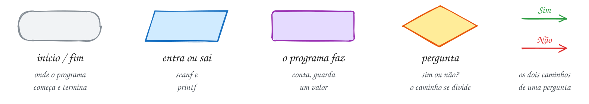

# LPEDC · Lógica de Programação, Estrutura de Dados e C

Um livro de estudo, em português, de lógica de programação, linguagem C e estruturas de dados,
escrito para a Prova de Conhecimentos do Mestrado do PPGI/UFAM (edital 070/2026, prova em
27/11/2026). Começa no primeiro programa em C e vai até grafos, programação dinâmica e problemas
NP-completos, sempre no nível que a prova cobra.

> [!IMPORTANT]
> Para estudar até a prova, comece pelo [plano dia a dia](PPGI.md#comece-aqui) do
> [`PPGI.md`](PPGI.md). A [`TRILHA.md`](TRILHA.md) mostra o que vem antes de quê.

## Como ler este livro

Cada **módulo** é um arquivo `.md` e funciona como uma parte do livro. Dentro dele, cada
**assunto** é um capítulo com número fixo (`0005 · printf`) e sempre a mesma ordem:

1. **Conceito**: a explicação em texto corrido, do problema à ideia, com a fonte de cada definição.
   Leia com calma, como um livro.
2. **Exemplos de uso**: um caso do dia a dia com desenho e fluxograma, e programas completos que
   compilam sozinhos. Rode cada um, mude um valor e rode de novo.
3. **Exercícios**: do ★☆☆ (aquecimento) ao ★★★ (desafio). Cada um é um arquivo em `material/` com
   o esqueleto e as dicas; resolva sem olhar a resposta, que fica em `_respostas/`.

No fim de cada módulo vêm a lista do módulo, os desafios e as questões reais de prova com gabarito.
A ordem do sumário é a ordem de estudo: os módulos com ★ são bônus e entram no ponto em que ajudam.

## Sumário

<!-- sumario:inicio -->

### Mundo 1 · Primeiros passos

**1. [Módulo 01 · Fundamentos de C](01-fundamentos.md)**: compilar o primeiro programa, guardar valores em variáveis e mostrar resultados.

- [0001 · O primeiro programa](01-fundamentos.md#0001--o-primeiro-programa)
- [0002 · Variáveis](01-fundamentos.md#0002--variáveis)
- [0003 · Tipos e limites](01-fundamentos.md#0003--tipos-e-limites)
- [0004 · Constantes](01-fundamentos.md#0004--constantes)
- [0005 · printf](01-fundamentos.md#0005--printf)
- [0006 · scanf](01-fundamentos.md#0006--scanf)
- [0007 · Aritmética](01-fundamentos.md#0007--aritmética)
- [0008 · Conversão e cast](01-fundamentos.md#0008--conversão-e-cast)
- [0009 · Atribuição, ++ e --](01-fundamentos.md#0009--atribuição--e---)
- [0010 · math.h](01-fundamentos.md#0010--mathh)
- [0011 · Juntando tudo](01-fundamentos.md#0011--juntando-tudo)

**2. [Módulo 02 · Decisões](02-condicionais.md)**: fazer o programa escolher caminhos com `if`, `else` e `switch`.

- [0012 · Relacionais e a verdade em C](02-condicionais.md#0012--relacionais-e-a-verdade-em-c)
- [0013 · Lógicos: E, OU, NÃO](02-condicionais.md#0013--lógicos-e-ou-não)
- [0014 · if](02-condicionais.md#0014--if)
- [0015 · if/else e o = no lugar do ==](02-condicionais.md#0015--ifelse-e-o--no-lugar-do-)
- [0016 · else if, if aninhado e o else pendurado](02-condicionais.md#0016--else-if-if-aninhado-e-o-else-pendurado)
- [0017 · Ternário: condição ? a : b](02-condicionais.md#0017--ternário-condição--a--b)
- [0018 · switch, case, break e fall-through](02-condicionais.md#0018--switch-case-break-e-fall-through)
- [0019 · Juntando tudo: a conta de luz](02-condicionais.md#0019--juntando-tudo-a-conta-de-luz)

**3. [Módulo 03 · Laços](03-repeticoes.md)**: repetir tarefas com `while`, `do...while` e `for`.

- [0020 · While](03-repeticoes.md#0020--while)
- [0021 · Do-while](03-repeticoes.md#0021--do-while)
- [0022 · For](03-repeticoes.md#0022--for)
- [0023 · Break e continue](03-repeticoes.md#0023--break-e-continue)
- [0024 · Laços aninhados](03-repeticoes.md#0024--laços-aninhados)
- [0025 · Padrões de laço](03-repeticoes.md#0025--padrões-de-laço)
- [0026 · Aleatórios](03-repeticoes.md#0026--aleatórios)
- [0027 · Juntando tudo](03-repeticoes.md#0027--juntando-tudo)

**4. [Módulo 04 · Funções e modularização](04-funcoes.md)**: dividir o programa em funções, entender escopo e pilha de chamadas e usar recursão.

- [0028 · Funções](04-funcoes.md#0028--funções)
- [0029 · Parâmetros e passagem por valor](04-funcoes.md#0029--parâmetros-e-passagem-por-valor)
- [0030 · Escopo e tempo de vida](04-funcoes.md#0030--escopo-e-tempo-de-vida)
- [0031 · A pilha de chamadas](04-funcoes.md#0031--a-pilha-de-chamadas)
- [0032 · Recursão](04-funcoes.md#0032--recursão)
- [0033 · Recursão na prática: Fibonacci, Hanói e Euclides](04-funcoes.md#0033--recursão-na-prática-fibonacci-hanói-e-euclides)
- [0034 · Módulos: .h, .c e compilação separada](04-funcoes.md#0034--módulos-h-c-e-compilação-separada)
- [0035 · Pré-processador: macros e #ifdef](04-funcoes.md#0035--pré-processador-macros-e-ifdef)
- [0036 · Juntando tudo: o caixa da lanchonete](04-funcoes.md#0036--juntando-tudo-o-caixa-da-lanchonete)

### Mundo 2 · Memória e dados

**5. [Módulo 05 · Vetores, matrizes e strings](05-vetores-e-strings.md)**: guardar vários valores juntos e trabalhar com texto.

- [0037 · Vetores](05-vetores-e-strings.md#0037--vetores)
- [0038 · Vetores e funções](05-vetores-e-strings.md#0038--vetores-e-funções)
- [0039 · Matrizes](05-vetores-e-strings.md#0039--matrizes)
- [0040 · Caracteres](05-vetores-e-strings.md#0040--caracteres)
- [0041 · Strings](05-vetores-e-strings.md#0041--strings)
- [0042 · Lendo strings](05-vetores-e-strings.md#0042--lendo-strings)
- [0043 · Juntando tudo](05-vetores-e-strings.md#0043--juntando-tudo)

**6. [Módulo 06 · Ponteiros](06-ponteiros.md)**: enxergar endereços de memória e usá-los.

- [0044 · Memória e endereços](06-ponteiros.md#0044--memória-e-endereços)
- [0045 · Ponteiros](06-ponteiros.md#0045--ponteiros)
- [0046 · Passagem por referência](06-ponteiros.md#0046--passagem-por-referência)
- [0047 · Ponteiros e vetores](06-ponteiros.md#0047--ponteiros-e-vetores)
- [0048 · Ponteiros e strings](06-ponteiros.md#0048--ponteiros-e-strings)
- [0049 · Ponteiro para ponteiro](06-ponteiros.md#0049--ponteiro-para-ponteiro)
- [0050 · Ponteiro para função](06-ponteiros.md#0050--ponteiro-para-função)
- [0051 · void * e cast](06-ponteiros.md#0051--void--e-cast)
- [0052 · Juntando tudo: o ranking da feira](06-ponteiros.md#0052--juntando-tudo-o-ranking-da-feira)

**7. [Módulo 07 · Memória dinâmica](07-memoria-dinamica.md)**: pedir e devolver memória durante a execução, sem vazar.

- [0053 · Pilha e heap](07-memoria-dinamica.md#0053--pilha-e-heap)
- [0054 · malloc e free](07-memoria-dinamica.md#0054--malloc-e-free)
- [0055 · calloc e realloc](07-memoria-dinamica.md#0055--calloc-e-realloc)
- [0056 · Matriz dinâmica](07-memoria-dinamica.md#0056--matriz-dinâmica)
- [0057 · Erros de memória](07-memoria-dinamica.md#0057--erros-de-memória)
- [0058 · Juntando tudo](07-memoria-dinamica.md#0058--juntando-tudo)

**8. [Módulo 08 · Tipos compostos](08-structs.md)**: agrupar dados com `struct`, `union`, `enum` e operações com bits.

- [0059 · Struct](08-structs.md#0059--struct)
- [0060 · Typedef](08-structs.md#0060--typedef)
- [0061 · Vetor de structs](08-structs.md#0061--vetor-de-structs)
- [0062 · Ponteiro para struct](08-structs.md#0062--ponteiro-para-struct)
- [0063 · Enum](08-structs.md#0063--enum)
- [0064 · Union](08-structs.md#0064--union)
- [0065 · Bits, máscaras e flags](08-structs.md#0065--bits-máscaras-e-flags)
- [0066 · Juntando tudo: o cardápio](08-structs.md#0066--juntando-tudo-o-cardápio)

**9. [Módulo 27 · Detalhes de C que caem em prova](27-c-detalhes.md)** ★: dominar as pegadinhas de precedência, sinal e VLA que a prova cobra.

- [0170 · Precedência e ordem de avaliação](27-c-detalhes.md#0170--precedência-e-ordem-de-avaliação)
- [0171 · Com sinal e sem sinal](27-c-detalhes.md#0171--com-sinal-e-sem-sinal)
- [0172 · Vetor de tamanho variável (VLA)](27-c-detalhes.md#0172--vetor-de-tamanho-variável-vla)
- [0173 · Juntando tudo: o controle de acesso](27-c-detalhes.md#0173--juntando-tudo-o-controle-de-acesso)

**10. [Módulo 09 · Arquivos e linha de comando](09-arquivos.md)**: ler e gravar arquivos e receber argumentos na linha de comando.

- [0067 · Arquivos texto](09-arquivos.md#0067--arquivos-texto)
- [0068 · Arquivos binários](09-arquivos.md#0068--arquivos-binários)
- [0069 · Argumentos da linha de comando](09-arquivos.md#0069--argumentos-da-linha-de-comando)
- [0070 · Juntando tudo: a caderneta de gastos](09-arquivos.md#0070--juntando-tudo-a-caderneta-de-gastos)

### Mundo 3 · Custo e estruturas lineares

**11. [Módulo 10 · Pensar como cientista da computação](10-analise.md)**: medir o custo de um algoritmo e escrever tipos abstratos de dado.

- [0071 · Eficiência: contar passos](10-analise.md#0071--eficiência-contar-passos)
- [0072 · Notação O: como o custo cresce](10-analise.md#0072--notação-o-como-o-custo-cresce)
- [0073 · Invariantes de laço e corretude](10-analise.md#0073--invariantes-de-laço-e-corretude)
- [0074 · TAD: interface (.h) e implementação (.c)](10-analise.md#0074--tad-interface-h-e-implementação-c)

**12. [Módulo 26 · Notação assintótica, somatórios e espaço](26-analise-formal.md)** ★: provar custos com O, Ω, Θ e somatórios.

- [0166 · O, Ω e Θ de verdade](26-analise-formal.md#0166--o-ω-e-θ-de-verdade)
- [0167 · Somatórios que saem de laços](26-analise-formal.md#0167--somatórios-que-saem-de-laços)
- [0168 · Complexidade espacial](26-analise-formal.md#0168--complexidade-espacial)
- [0169 · Juntando tudo: passos e bytes conferidos](26-analise-formal.md#0169--juntando-tudo-passos-e-bytes-conferidos)

**13. [Módulo 11 · Listas](11-listas.md)**: montar listas encadeadas simples, duplas e circulares.

- [0075 · Vetor dinâmico](11-listas.md#0075--vetor-dinâmico)
- [0076 · Lista encadeada](11-listas.md#0076--lista-encadeada)
- [0077 · Busca e remoção](11-listas.md#0077--busca-e-remoção)
- [0078 · Lista ordenada](11-listas.md#0078--lista-ordenada)
- [0079 · Lista dupla](11-listas.md#0079--lista-dupla)
- [0080 · Lista circular](11-listas.md#0080--lista-circular)
- [0081 · Juntando tudo](11-listas.md#0081--juntando-tudo)

**14. [Módulo 12 · Pilhas e filas](12-pilhas-e-filas.md)**: usar pilhas, filas e deques.

- [0082 · Pilha](12-pilhas-e-filas.md#0082--pilha)
- [0083 · Pilha encadeada](12-pilhas-e-filas.md#0083--pilha-encadeada)
- [0084 · Pilha na prática: parênteses e notação pós-fixa](12-pilhas-e-filas.md#0084--pilha-na-prática-parênteses-e-notação-pós-fixa)
- [0085 · Fila](12-pilhas-e-filas.md#0085--fila)
- [0086 · Fila encadeada](12-pilhas-e-filas.md#0086--fila-encadeada)
- [0087 · Deque](12-pilhas-e-filas.md#0087--deque)
- [0088 · Juntando tudo: a calculadora de expressões](12-pilhas-e-filas.md#0088--juntando-tudo-a-calculadora-de-expressões)

### Mundo 4 · Buscar e ordenar

**15. [Módulo 13 · Busca e ordenação](13-busca-e-ordenacao.md)**: buscar e ordenar com os algoritmos clássicos e comparar seus custos.

- [0089 · Busca sequencial](13-busca-e-ordenacao.md#0089--busca-sequencial)
- [0090 · Busca binária](13-busca-e-ordenacao.md#0090--busca-binária)
- [0091 · Bubble sort](13-busca-e-ordenacao.md#0091--bubble-sort)
- [0092 · Selection sort](13-busca-e-ordenacao.md#0092--selection-sort)
- [0093 · Insertion sort](13-busca-e-ordenacao.md#0093--insertion-sort)
- [0094 · Merge sort](13-busca-e-ordenacao.md#0094--merge-sort)
- [0095 · Quick sort](13-busca-e-ordenacao.md#0095--quick-sort)
- [0096 · Comparando: estabilidade, custo e qsort](13-busca-e-ordenacao.md#0096--comparando-estabilidade-custo-e-qsort)

**16. [Módulo 18 · Ordenação além da comparação e seleção](18-ordenacao-linear.md)**: ordenar sem comparar: counting, radix e bucket sort.

- [0119 · Shell sort](18-ordenacao-linear.md#0119--shell-sort)
- [0120 · Counting sort](18-ordenacao-linear.md#0120--counting-sort)
- [0121 · Radix sort](18-ordenacao-linear.md#0121--radix-sort)
- [0122 · Bucket sort](18-ordenacao-linear.md#0122--bucket-sort)
- [0123 · Quickselect](18-ordenacao-linear.md#0123--quickselect)
- [0124 · Juntando tudo](18-ordenacao-linear.md#0124--juntando-tudo)

### Mundo 5 · Árvores

**17. [Módulo 14 · Árvores](14-arvores.md)**: montar árvore binária, ABB, AVL e heap.

- [0097 · Árvores](14-arvores.md#0097--árvores)
- [0098 · Árvore binária e percursos](14-arvores.md#0098--árvore-binária-e-percursos)
- [0099 · BST: busca e inserção](14-arvores.md#0099--bst-busca-e-inserção)
- [0100 · BST: remoção](14-arvores.md#0100--bst-remoção)
- [0101 · AVL: balanceamento e rotações](14-arvores.md#0101--avl-balanceamento-e-rotações)
- [0102 · Heap e fila de prioridade](14-arvores.md#0102--heap-e-fila-de-prioridade)
- [0103 · Heapsort](14-arvores.md#0103--heapsort)
- [0104 · Juntando tudo](14-arvores.md#0104--juntando-tudo)

**18. [Módulo 22 · Árvores e conjuntos avançados](22-arvores-avancadas.md)**: conhecer rubro-negra, árvore B, trie e union-find.

- [0144 · Árvores gerais: primeiro filho, próximo irmão](22-arvores-avancadas.md#0144--árvores-gerais-primeiro-filho-próximo-irmão)
- [0145 · Rubro-negra esquerdista (LLRB): inserção](22-arvores-avancadas.md#0145--rubro-negra-esquerdista-llrb-inserção)
- [0146 · Árvore B: busca, divisão e inserção](22-arvores-avancadas.md#0146--árvore-b-busca-divisão-e-inserção)
- [0147 · Trie: árvore de prefixos e autocompletar](22-arvores-avancadas.md#0147--trie-árvore-de-prefixos-e-autocompletar)
- [0148 · Union-find: conjuntos disjuntos](22-arvores-avancadas.md#0148--union-find-conjuntos-disjuntos)
- [0149 · Juntando tudo: corretor ortográfico](22-arvores-avancadas.md#0149--juntando-tudo-corretor-ortográfico)

### Mundo 6 · Tabelas hash

**19. [Módulo 15 · Tabelas hash](15-hash.md)**: montar tabelas hash com encadeamento e endereçamento aberto.

- [0105 · A ideia e a função hash](15-hash.md#0105--a-ideia-e-a-função-hash)
- [0106 · Encadeamento](15-hash.md#0106--encadeamento)
- [0107 · Endereçamento aberto](15-hash.md#0107--endereçamento-aberto)
- [0108 · Juntando tudo: o contador de palavras](15-hash.md#0108--juntando-tudo-o-contador-de-palavras)

**20. [Módulo 28 · Estruturas: o que faltava](28-estruturas-complementos.md)** ★: fechar as lacunas de listas, árvores e hash que a prova cobra.

- [0174 · Lista com sentinela](28-estruturas-complementos.md#0174--lista-com-sentinela)
- [0175 · Conceitos e sucessor](28-estruturas-complementos.md#0175--conceitos-e-sucessor)
- [0176 · AVL: remoção](28-estruturas-complementos.md#0176--avl-remoção)
- [0177 · Rubro-negra clássica](28-estruturas-complementos.md#0177--rubro-negra-clássica)
- [0178 · Hash: divisão e multiplicação](28-estruturas-complementos.md#0178--hash-divisão-e-multiplicação)
- [0179 · Sondagem quadrática e dupla](28-estruturas-complementos.md#0179--sondagem-quadrática-e-dupla)
- [0180 · Pigeonhole e chave composta](28-estruturas-complementos.md#0180--pigeonhole-e-chave-composta)
- [0181 · Juntando tudo](28-estruturas-complementos.md#0181--juntando-tudo)

### Mundo 7 · Grafos

**21. [Módulo 16 · Grafos](16-grafos.md)**: representar grafos e percorrer com BFS, DFS e Dijkstra.

- [0109 · Grafos](16-grafos.md#0109--grafos)
- [0110 · BFS: busca em largura](16-grafos.md#0110--bfs-busca-em-largura)
- [0111 · DFS: busca em profundidade](16-grafos.md#0111--dfs-busca-em-profundidade)
- [0112 · Dijkstra: caminho mínimo](16-grafos.md#0112--dijkstra-caminho-mínimo)
- [0113 · Juntando tudo: a central de entregas](16-grafos.md#0113--juntando-tudo-a-central-de-entregas)

**22. [Módulo 23 · Grafos: estrutura e caminhos](23-grafos-avancados.md)**: ordenar topologicamente, achar árvore geradora mínima e caminhos mínimos.

- [0150 · Componentes e ciclos](23-grafos-avancados.md#0150--componentes-e-ciclos)
- [0151 · Ordenação topológica](23-grafos-avancados.md#0151--ordenação-topológica)
- [0152 · Kruskal: árvore geradora mínima](23-grafos-avancados.md#0152--kruskal-árvore-geradora-mínima)
- [0153 · Prim: a árvore que cresce](23-grafos-avancados.md#0153--prim-a-árvore-que-cresce)
- [0154 · Bellman-Ford: pesos negativos](23-grafos-avancados.md#0154--bellman-ford-pesos-negativos)
- [0155 · Floyd-Warshall: todos os pares](23-grafos-avancados.md#0155--floyd-warshall-todos-os-pares)
- [0156 · Juntando tudo: o assistente do calouro](23-grafos-avancados.md#0156--juntando-tudo-o-assistente-do-calouro)

**23. [Módulo 29 · Grafos: ciclos e cortes; problemas difíceis](29-grafos-e-np.md)**: separar problemas fáceis dos NP-completos e entender aproximação.

- [0182 · Caminhos e ciclos](29-grafos-e-np.md#0182--caminhos-e-ciclos)
- [0183 · Hamiltoniano](29-grafos-e-np.md#0183--hamiltoniano)
- [0184 · Pontes e articulações](29-grafos-e-np.md#0184--pontes-e-articulações)
- [0185 · Cadeia de matrizes](29-grafos-e-np.md#0185--cadeia-de-matrizes)
- [0186 · P e NP](29-grafos-e-np.md#0186--p-e-np)
- [0187 · Reduções](29-grafos-e-np.md#0187--reduções)
- [0188 · Aproximação](29-grafos-e-np.md#0188--aproximação)
- [0189 · Juntando tudo](29-grafos-e-np.md#0189--juntando-tudo)

### Mundo 8 · Técnicas de projeto

**24. [Módulo 17 · Medindo algoritmos recursivos](17-analise-avancada.md)**: resolver recorrências e aplicar o teorema mestre.

- [0114 · Recorrências e árvore de recursão](17-analise-avancada.md#0114--recorrências-e-árvore-de-recursão)
- [0115 · Teorema mestre](17-analise-avancada.md#0115--teorema-mestre)
- [0116 · Análise amortizada](17-analise-avancada.md#0116--análise-amortizada)
- [0117 · Limite inferior da ordenação](17-analise-avancada.md#0117--limite-inferior-da-ordenação)
- [0118 · Juntando tudo](17-analise-avancada.md#0118--juntando-tudo)

**25. [Módulo 19 · Enumeração e backtracking](19-backtracking.md)**: explorar todas as soluções com poda.

- [0125 · Subconjuntos](19-backtracking.md#0125--subconjuntos)
- [0126 · Permutações](19-backtracking.md#0126--permutações)
- [0127 · Backtracking](19-backtracking.md#0127--backtracking)
- [0128 · N-rainhas](19-backtracking.md#0128--n-rainhas)
- [0129 · Labirinto](19-backtracking.md#0129--labirinto)
- [0130 · Juntando tudo](19-backtracking.md#0130--juntando-tudo)

**26. [Módulo 20 · Divisão e conquista e algoritmos gulosos](20-dc-e-gulosos.md)**: dividir para conquistar e escolher o melhor local.

- [0131 · Divisão e conquista](20-dc-e-gulosos.md#0131--divisão-e-conquista)
- [0132 · Inversões e subvetor de soma máxima](20-dc-e-gulosos.md#0132--inversões-e-subvetor-de-soma-máxima)
- [0133 · Algoritmos gulosos](20-dc-e-gulosos.md#0133--algoritmos-gulosos)
- [0134 · Seleção de intervalos](20-dc-e-gulosos.md#0134--seleção-de-intervalos)
- [0135 · Mochila fracionária](20-dc-e-gulosos.md#0135--mochila-fracionária)
- [0136 · Código de Huffman](20-dc-e-gulosos.md#0136--código-de-huffman)
- [0137 · Juntando tudo](20-dc-e-gulosos.md#0137--juntando-tudo)

**27. [Módulo 21 · Programação dinâmica](21-programacao-dinamica.md)**: guardar subproblemas repetidos para ganhar velocidade.

- [0138 · Memoização](21-programacao-dinamica.md#0138--memoização)
- [0139 · Troco com programação dinâmica](21-programacao-dinamica.md#0139--troco-com-programação-dinâmica)
- [0140 · Mochila 0/1](21-programacao-dinamica.md#0140--mochila-01)
- [0141 · Maior subsequência comum (LCS)](21-programacao-dinamica.md#0141--maior-subsequência-comum-lcs)
- [0142 · Distância de edição](21-programacao-dinamica.md#0142--distância-de-edição)
- [0143 · Juntando tudo: um mini-diff](21-programacao-dinamica.md#0143--juntando-tudo-um-mini-diff)

**28. [Módulo 24 · Busca de padrões em texto](24-busca-de-padroes.md)**: achar padrões em texto com KMP, Horspool e Rabin-Karp.

- [0157 · Força bruta](24-busca-de-padroes.md#0157--força-bruta)
- [0158 · KMP](24-busca-de-padroes.md#0158--kmp)
- [0159 · Horspool](24-busca-de-padroes.md#0159--horspool)
- [0160 · Rabin-Karp](24-busca-de-padroes.md#0160--rabin-karp)
- [0161 · Juntando tudo](24-busca-de-padroes.md#0161--juntando-tudo)

**29. [Módulo 25 · Estruturas especiais](25-estruturas-extras.md)**: conhecer matriz esparsa, skip list e listas autoajustáveis.

- [0162 · Matriz esparsa](25-estruturas-extras.md#0162--matriz-esparsa)
- [0163 · Skip list](25-estruturas-extras.md#0163--skip-list)
- [0164 · Listas autoajustáveis](25-estruturas-extras.md#0164--listas-autoajustáveis)
- [0165 · Juntando tudo](25-estruturas-extras.md#0165--juntando-tudo)

<!-- sumario:fim -->

### Depois do último capítulo

Para treinar no ritmo da prova:

- [`SIMULADOS.md`](SIMULADOS.md): 3 simulados de 20 questões no formato atual;
- [`PROVAS.md`](PROVAS.md): as 11 provas de 2016 a 2023, com gabarito comentado;
- quiz das provas, com o porquê de cada alternativa: **[jhollyfer.github.io/LPEDC](https://jhollyfer.github.io/LPEDC/)**.

## Preparar o computador

```bash
sudo pacman -S --needed base-devel gdb valgrind git     # Arch Linux
sudo apt install build-essential gdb valgrind git       # Debian / Ubuntu
git clone https://github.com/jhollyfer/LPEDC ~/LPEDC
```

No Windows, use o WSL com Ubuntu (`wsl --install`). No macOS, `xcode-select --install`.

Para rodar um arquivo (o `-o` dá o nome do executável):

```bash
gcc ~/LPEDC/material/A003.c -o ~/LPEDC/material/A003 && ~/LPEDC/material/A003
```

Para mandar a entrada sem digitar, ou passar argumentos:

```bash
gcc ~/LPEDC/material/A011.c -o ~/LPEDC/material/A011 && printf '25\n' | ~/LPEDC/material/A011
gcc ~/LPEDC/material/A137.c -o ~/LPEDC/material/A137 && ~/LPEDC/material/A137 um dois tres
```

**Flags de estudo**: acrescente `-std=c17 -Wall -Wextra -pedantic -g -fsanitize=address,undefined -lm`
antes do `-o`. O compilador passa a apontar a linha de erros de memória e de estouro de inteiro.
Para vazamento difícil, use `valgrind` no executável compilado com `-g`. Assuntos com TAD têm `.c` de
apoio (`0076-lista.c`); o comando do exemplo já os inclui.

## As cores dos desenhos

Azul é dado entrando ou saindo, roxo é o programa agindo, amarelo (losango) é pergunta, verde é o
caminho seguido, cinza o que não é usado e vermelho é erro.

<p align="center"></p>

## De onde veio o conteúdo

O texto foi escrito do zero com base nos fichamentos em [`_fontes/`](_fontes/). Cada conceito cita
a obra; a referência completa fica em "Para ler mais", no fim de cada módulo:

- CORMEN, T. H. et al. *Algoritmos: teoria e prática*. 4. ed. GEN LTC, 2024 (referência principal do edital do PPGI).
- ZIVIANI, N. *Projeto de algoritmos com implementações em Pascal e C*. 3. ed. Cengage Learning, 2010.
- CELES, W.; CERQUEIRA, R.; RANGEL, J. L. *Introdução a estruturas de dados*. 2. ed. Elsevier, 2016.
- BACKES, A. *Linguagem C: completa e descomplicada*. Elsevier, 2013 (e a apostila *Linguagem C: descomplicada*).
- DEITEL, P.; DEITEL, H. *C: como programar*. Pearson.
- FEOFILOFF, P. *Algoritmos em linguagem C*. Elsevier, 2009.
- CELES, W.; RANGEL, J. L. *Apostila de estruturas de dados*. PUC-Rio, 2002.
- TENENBAUM, A.; LANGSAM, Y.; AUGENSTEIN, M. *Estruturas de dados usando C*. Makron Books.
- ROCHA, A. M. A.; BORGES, A. R. O. S. *Programação, estruturas de dados e algoritmos em C*. Universidade de Aveiro.
- LAUREANO, M. *Estrutura de dados com algoritmos e C*. Rio de Janeiro: Brasport, 2008.
- LEAL, G. C. L. *Algoritmos e lógica de programação II*. Unicesumar.
- CARVALHO, V. A. *Lógica de programação*. IFES.
- ANTONELLO, R. *Linguagem C*.
- HARA, C.; ZOLA, W.; DELGADO, A. L. N. *Linguagem C: notas de aula*. UFPR, 2008.
- MARTINS, L. G. A. *Apostila de linguagem C*. UFU.
- SENAI-RS. *Fundamentos de linguagem C*. 1997.
- UNICAMP. *Introdução à linguagem C*. Centro de Computação.
- Apostila "slago" de C e o apêndice *Manual de sintaxe da linguagem C*.

---

**Para quem for mexer no material.** Os `.md` dos módulos e os SVGs são gerados a partir de
[`_gerador/`](_gerador/); nunca edite o `.md` do módulo à mão. Regras em
[`docs/RULES.md`](docs/RULES.md), ponto de partida para agentes em [`AGENTS.md`](AGENTS.md).

```bash
cd _gerador && npm install
npm run gerar           # tudo
npm run gerar -- 03-    # só o módulo 03
```

A fonte Excalifont (`_gerador/fonte/`) vem do projeto Excalidraw, sob a licença SIL Open Font License.
