# Provas anteriores do PPGI/UFAM (Prova de Conhecimento)

Cadernos de questões enviados pelo dono. Os editais de 2016 a 2019 estão na íntegra, com o gabarito
oficial lido nas folhas de resposta, as questões anuladas marcadas e as figuras em
`_fontes/provas-figuras/`. Os editais 057/2022, 020/2023 e 071/2023 vêm do texto dos cadernos.
Erros de digitação do original foram mantidos.

---

## Edital 032/2016

Fontes: `ProvaSelecao032-2016.pdf` (caderno de questões) e `Gabarito_ProvaEdital032-2016.pdf` (gabarito final).
Questões 1, 5, 7, 11 e 17 foram anuladas. Esta prova não tem figuras (o vetor da Questão 01 é texto).

#### Gabarito final

| Questão | Resp. | Questão | Resp. |
|---|---|---|---|
| 01 | Anulada | 11 | Anulada |
| 02 | C | 12 | B |
| 03 | E | 13 | E |
| 04 | B | 14 | B |
| 05 | Anulada | 15 | A |
| 06 | D | 16 | B |
| 07 | Anulada | 17 | Anulada |
| 08 | B | 18 | C |
| 09 | D | 19 | D |
| 10 | B | 20 | D |

### Questões

#### QUESTÃO 01 (anulada)
Suponha que você recebeu a tarefa de depurar uma implementação de Quicksort, cujo objetivo é para classificar um vetor em ordem crescente. Considere que o pivô escolhido terá o valor 4 e que você executou até o momento apenas o particionamento completo gerado com o pivô, sem ter realizado ainda qualquer chamada recursiva. Sobre as afirmações:

`4 1 2 3 17 2 22 3`

I) Dependendo da implementação da partição, a ordem dos elementos nesse momento pode ser 3, 1, 2, 3, 2, 17, 22 e 4
II) É impossível que uma implementação de Quicksort tenha escolhido o 4 como pivô
III) Dependendo da implementação da partição, a ordem dos elementos nesse momento poderia ser 3, 1, 2, 3, 2, 4, 17 e 22
IV) Dependendo da implementação da partição, a ordem dos elementos nesse momento poderia ser 4, 1, 2, 3, 2, 3, 17 e 22

a) Apenas I está correta
b) Apenas II está correta
c) Apenas I e III estão corretas
d) Apenas III e IV estão corretas
e) Apenas III está correta

#### QUESTÃO 02
Quantas vezes o símbolo '#' é impresso pela função teste quando chamada com parâmetro 5 (teste(5))?

```c
void teste (int i) {
  if (i > 1) {
    teste (i/2);
    teste (i/2);
  }
  printf( "#"); /*imprime símbolo # na tela */
}
```

a) 3
b) 4
c) 7
d) 8
e) Nenhuma das alternativas anteriores

#### QUESTÃO 03
Quando um novo nó é removido no meio de uma lista encadeada dinâmica, qual das seguintes afirmações é verdadeira:

a) Somente os nós que aparecem após o novo nó precisam ser movidos
b) Somente os nós que aparecem antes do novo nó precisam ser movidos
c) Os nós que aparecem antes do novo nó e o último nó precisam ser movidos
d) Os nós que aparecem depois do novo nó e o primeiro nó precisam ser movidos
e) Nenhuma das opções acima

#### QUESTÃO 04
Se você tem que implementar um algoritmo de ordenação que tem um tempo de execução competitivo quando comparado a outros, e que não varia muito seu desempenho em função da entrada de dados fornecida. Qual das opções é melhor?

a) Ordenação por inserção
b) Heapsort
c) Quicksort
d) Tanto Quicksort quanto Heapsort atendem aos requisitos
e) Hash

#### QUESTÃO 05 (anulada)
Se em uma árvore binária de pesquisa a diferença de altura entre a sub-árvore a esquerda e a sub-árvore a direita de um dos nós for maior que 1, pode-se concluir que:

a) A árvore é uma árvore AVL
b) Trata-se com certeza de uma árvore binária sem balanceamento
c) Trata-se com certeza de uma árvore vermelho e preto
d) Tal árvore não pode existir por não se tratar de uma árvore binária de pesquisa
e) Nenhuma das alternativas anteriores

#### QUESTÃO 06
Uma estrutura de dados bastante útil quando deseja-se armazenar elementos para recupera-los posteriormente em ordem reversa a de inserção:

a) A árvore é uma árvore AVL
b) Um hash
c) Uma fila de prioridades com ordenação reversa de prioridade
d) Uma pilha
e) Uma árvore vermelho e preto

#### QUESTÃO 07 (anulada)
Considere as afirmações sobre busca binária:

i) é utilizada apenas sobre vetores ordenados
ii) pode determinar se uma chave está ou não com um número de comparações de chave inferior a 2log2 n passos, onde n é o tamanho do vetor.
iii) Supera a busca sequencial quando o vetor é grande, por exemplo com mais que mil elementos, e está ordenado.

a) Apenas as afirmações II e III estão corretas
b) Apenas as afirmações I e II estão corretas
c) Apenas as afirmações I e III estão corretas
d) Todas as afirmações estão corretas
e) Nenhuma das alternativas anteriores

#### QUESTÃO 08
Considere os códigos de funções abaixo, assumindo que os mesmos são usados dentro de um programa e que os todos os cabeçalhos necessários são incluídos:

```c
/*QUADRO I) Código para inserir em uma lista
encadeada. Cada nó da lista tem um campo
prox, que é usado para encadea-lo ao próximo
elemento, e tem um dado do tipo int. */
/* prim é um ponteiro para o ponteiro ao
primeiro elemento da lista */
void insere(tipoNo **prim, int d) {
  tipoNo *aux;
  aux = (tipoNo *)malloc(sizeof(tipoNo));
  if(aux) { aux ->prox = *prim;
    *prim = aux;
    aux -> dado = d;
  }
}
```

```c
/*QUADRO II) Código para remover primeiro
elemento de uma lista encadeada. Cada nó da
lista tem um campo prox, que é usado para
encadea-lo ao próximo elemento, e tem um
dado do tipo int. */
/* prim é um ponteiro para o ponteiro ao
primeiro elemento da lista */
1. void remove (tipoNo **prim){
2.   tipoNo *aux;
3.   if(*prim) { aux = *prim;
4.     *prim = aux->prox;
5.     free(*prim);
6.     *prim = aux;
7.   }
8. }
```

Marque a alternativa correta dentre as afirmações abaixo:

a) Os dois códigos executam as tarefas propostas sem gerar qualquer tipo de erro de lógica, de vazamento de memória ou falha de segmentação
b) Apenas os código I realiza sem erros a tarefa descrita nos comentários
c) Apenas os código II realiza sem erros a tarefa descrita nos comentários
d) Os dois códigos não executam suas tarefas como descrito nos comentários, mas também não geram vazamento de memória
e) O primeiro código gera vazamento de memória e o segundo não realiza a tarefa descrita nos comentários

#### QUESTÃO 09
Considere as afirmações sobre um hash por encadeamento:

I) Suas colisões secundárias podem prejudicar seu desempenho
II) Não funciona com número de chaves maior que o tamanho da tabela hash
III) O número médio de operações esperado para realizar uma inserção é constante quando computado em função do tamanho da tabela se o hash for bem projetado

Sobre as afirmações, sabe-se que:

a) Todas são verdadeiras
b) Todas são falsas
c) Apenas I e III são verdadeiras
d) Apenas III é verdadeira
e) Apenas I e II são verdadeiras

#### QUESTÃO 10
Considere os códigos de funções abaixo, assumindo que os mesmos são usados dentro de um programa e que os todos os cabeçalhos necessários são incluídos:

```c
/*QUADRO I) função que retorna 1 se a chave
de busca chave, passada como parâmetro, ocorre
dentro de um vetor de inteiros ordenado e
retorna 0 caso a chave não ocorra no vetor. O
vetor tem tamanho determinado pelo parâmetro
tm */
int buscaChave(int v[], int chave, int tm) {
  while((tm>= 0) && (v[tm]!= chave)) tm --;
  if (tm >= 0) return 1;
  return 0;
}
```

```c
/* QUADRO II) Conta ocorrências de uma
chave na lista encadeada, retornando o total de
ocorrências , zero caso a chave não ocorra
*/
int ContaOcorrenciasChave(tipoNo *prim, int
chave) {
  tipoNo *aux = prim;
  int cont = 0;
  int x;;
  for (x = 0; aux[x] != NULL; x++){
    if(aux[x]. dado == chave) cont++;
  }
  return cont;
}
```

Marque a alternativa correta dentre as afirmações abaixo:

a) Os dois códigos executam as tarefas propostas sem gerar qualquer tipo de erro de lógica ou de vazamento de memória
b) Apenas os código I executa sem erros a tarefa proposta
c) Apenas o código II executa sem erros a tarefa proposta
d) Os dois códigos geram erros de vazamento de memória ou de falha de segmentação
e) Nenhuma das alternativas anteriores

#### QUESTÃO 11 (anulada)
Considere as afirmações sobre um hash por encadeamento:

I) Tem como desvantagem o fato de não ordenar as chaves inseridas
II) O número médio de operações esperado para realizar uma busca é constante quando computado em função do tamanho da tabela se o hash for bem projetado
III) Mesmo quando bem implementado, ocupa mais espaço extra do que uma árvore-b em memória.

Sobre as afirmações, sabe-se que:

a) Todas são verdadeiras
b) Todas são falsas
c) Apenas I e III são verdadeiras
d) Apenas III é verdadeira
e) Apenas I e II são verdadeiras

#### QUESTÃO 12
Marque a resposta correta. Ao inserirmos as chaves 1, 2 e 3, 4, 5, 6 em uma árvore AVL, sua altura (medida como a quantidade máxima de nós em um caminho entre a raiz e uma folha da árvore, incluindo a raiz e a folha na conta) será:

a) 2
b) 3
c) 4
d) 5
e) 6

#### QUESTÃO 13
Sobre uma árvore binária de pesquisa sem balanceamento, pode-se afirmar que:

I) São estruturas de dados que, quando degeneradas, têm custo de inserção proporcional ao número de chaves inseridas
II) Não servem para armazenar dados quando deseja-se ter acesso aos mesmos de maneira ordenada
III) Têm como principal custo extra de memória os dois apontadores que indicam os nós à esquerda e à direita de cada nó criado

Sobre as afirmações, sabe-se que:

a) Apenas I é verdadeira
b) Apenas I e II são verdadeiras
c) Todas as afirmações são verdadeiras
d) Apenas II e III são verdadeiras
e) Nenhuma das alternativas anteriores está correta

#### QUESTÃO 14
Sobre árvores binárias de pesquisa sem balanceamento, pode-se afirmar que:

I) É uma estrutura de dados inerentemente recursiva, sendo impossível implementar uma busca em uma árvore de maneira não recursiva
II) É uma estrutura de dados inerentemente recursiva, sendo impossível implementar uma inserção em uma árvore de maneira não recursiva
III) Em muitos casos práticos, pode ter custo de busca com número de operações proporcional a log n, onde n é o número de elementos inseridos na árvore

Sobre as afirmações, sabe-se que:

a) Apenas I e II estão corretas
b) Apenas III está correta
c) Apenas I e III estão corretas
d) Apenas II e III estão corretas
e) Nenhuma das alternativas anteriores

#### QUESTÃO 15
Marque a resposta correta. Ao inserirmos as chaves 1, 2 e 3, 4, 5, 6 em uma árvore AVL, a diferença de altura entre as sub-árvores à esquerda e à direita do nó raiz será:

a) 0
b) 1
c) 2
d) 3
e) 4

#### QUESTÃO 16
Considere um vetor não ordenado utilizado para armazenar chaves únicas (sem repetição). Pode-se afirmar que:

I) O melhor algoritmo para busca no vetor é a busca binária mesmo que o vetor não esteja ordenado, independente do número de elementos do vetor e da quantidade de buscas a serem realizadas
II) Uma busca binária implementada no vetor não funcionaria adequadamente, fornecendo resultados errados a menos que fosse feita uma ordenação
III) Um algoritmo de busca sequencial funcionaria e daria resultados comparando a chave com todas as posições do vetor na pior das hipóteses

Sobre as afirmações, sabe-se que:

a) Apenas as afirmações I e III estão corretas
b) Apenas as afirmações II e III estão corretas
c) Todas as afirmações estão corretas
d) Todas as afirmações estão erradas
e) Nenhuma das alternativas anteriores

#### QUESTÃO 17 (anulada)
Considere as afirmações abaixo:

I) O RADIX sort não realiza comparação entre chaves para realizar a ordenação de um vetor
II) O número de vezes que é necessário passar por todos os elementos do vetor no RADIX sort é proporcional ao número médio de dígitos dos elementos do vetor na base utilizada pelo algoritmo para ordenação
III) O RADIX sort requer um espaço extra de armazenamento proporcional ao tamanho do vetor

Sobre as afirmações, sabe-se que:

a) Apenas a afirmação I é verdadeira
b) Apenas a afirmação II é verdadeira
c) Apenas a afirmação III é verdadeira
d) Apenas as afirmações II e III são verdadeiras
e) Nenhuma das alternativas anteriores

#### QUESTÃO 18
Considere que o vetor abaixo será ordenado com o algoritmo de ordenação por seleção

`4 5 2 3 17 2 1 22`

Considerando-se que o vetor tem sua primeira posição contada como 0 (zero), a primeira troca de valores entre posições do vetor ocorrerá entre:

a) posição 0 e posição 2
b) posição 0 e posição 7
c) Posição 0 e posição 6
d) Posição 1 e posição 6
e) Posição 3 e posição 5

#### QUESTÃO 19
Considere os vetores abaixo

VetI: `1 2 3 4 5 6 8 7`
VetII: `7 8 8 5 4 3 2 1`

E considere as afirmações a seguir:

I) A ordenação por inserção é melhor que a ordenação por seleção em VetI se considerarmos o número de comparações entre chaves realizadas pelos dois algoritmos
II) O RADIX sort executado em base 10 realiza um número menor de operações (instruções) nos dois casos quando comparado ao mergesort
III) O RADIX sort executado em base 10 realiza um número menor de operações apenas em VetII quando comparado ao mergesort, ocorrendo o oposto em VetI

Sobre as afirmações, sabe-se que:

a) Apenas a afirmação I é verdadeira
b) Apenas a afirmação II é verdadeira
c) Apenas a afirmação III é verdadeira
d) Apenas as afirmações I e II são verdadeiras
e) Apenas as afirmações I e III são verdadeiras

#### QUESTÃO 20
Considere as afirmações abaixo:

I) Pode-se determinar o maior elemento de um vetor ordenado a um custo constante (realizando-se um número constante de operações)
II) Pode-se inverter a ordem de um vetor já ordenado fazendo-se um número de trocas de posições igual à metade do tamanho do tamanho do vetor e sem ter que criar uma cópia do mesmo
III) O Quicksort é sempre a opção mais rápida (com menor tempo de execução) para ordenar qualquer vetor de qualquer tamanho e com qualquer ordenação inicial das chaves

Sobre as afirmações, sabe-se que:

a) Todas as afirmações são verdadeiras
b) Apenas I é verdadeira
c) Apenas I e III são verdadeiras
d) Apenas I e II são verdadeiras
e) Nenhuma das alternativas anteriores

---

## Edital 053/2016

Fontes: `Prova_Edital053-2016.pdf` (caderno) e `Cartão_Resposta-Edital053-2016.pdf` (cartão com o gabarito marcado).
Nenhuma questão anulada. Figura em `2016-053/figuras/` (Q11).

### Gabarito

| Questão | Resp. | Questão | Resp. |
|---|---|---|---|
| 01 | A | 11 | C |
| 02 | A | 12 | B |
| 03 | A | 13 | A |
| 04 | C | 14 | A |
| 05 | E | 15 | B |
| 06 | D | 16 | A |
| 07 | A | 17 | E |
| 08 | A | 18 | A |
| 09 | A | 19 | A |
| 10 | D | 20 | A |

### Questões

#### QUESTÃO 01
Seja um vetor de inteiros com 400 elementos distintos ordenados em ordem crescente. Qual é o número máximo de iterações necessárias para encontrar um elemento qualquer desse vetor, caso seja utilizado o algoritmo de busca binária?

a) 9
b) 8
c) 7
d) 200
e) 400

#### QUESTÃO 02
Sobre as funções abaixo,

```c
Função I
int fatorial(int i) {
  if (i <= 1) {
    return 1;
  } else {
    fatorial(i-1);
  }
}

Função II
void fatorial() {
  int fat[0] = 1;
  for (int j=1; ; j++) {
    fat[j] = j * fat[j-1];
  }
}
```

Assinale a alternativa CORRETA:

a) Somente a função I é recursiva.
b) Ambas as funções são recursivas.
c) Somente a função II é recursiva.
d) A função I não é recursivo e a função II é orientada a objeto.
e) Ambas as funções não são recursivas.

#### QUESTÃO 03
As seguintes afirmações sobre árvores estão corretas, com EXCEÇÃO de:

a) É um grafo conexo que admite ciclos.
b) É um grafo conexo e há exatamente um caminho entre dois vértices quaisquer.
c) Uma árvore com n vértices possui n-1 arestas.
d) Toda árvore é um grafo, mas nem todo grafo é uma árvore.
e) Uma união disjunta de árvores forma uma floresta

#### QUESTÃO 04
Considere que o vetor abaixo será ordenado com o algoritmo de ordenação por seleção.

`4 5 5 3 17 2 1 22`

Considerando-se que o vetor tem sua primeira posição contada como 0 (zero), a segunda troca de valores entre posições do vetor ocorrerá entre:

a) Posição 0 e posição 2
b) Posição 0 e posição 7
c) Posição 1 e posição 5
d) Posição 1 e posição 6
e) Posição 3 e posição 5

#### QUESTÃO 5
Considere uma estrutura de fila (disciplina FIFO) de números inteiros com duas operações: INSERE(n) e RETIRA( ). Considere, também, que a representação do estado da fila em um instante qualquer é realizada listando os elementos, de forma que o primeiro elemento, da esquerda para a direita, é o mais antigo presente na fila.

Se a fila começa vazia, a sequência:

INSERE(2) → INSERE(3) → RETIRA() → INSERE(1) → RETIRA() → INSERE(4) → INSERE(5) → RETIRA() → RETIRA()

O estado final da fila será:

a) 1 2 3 4 5
b) 2 3 1 4 5
c) 3 1 4
d) 4 5
e) 5

#### QUESTÃO 6
Marque a alternativa CORRETA.
Uma lista duplamente encadeada tem como característica ser formada por elementos que:

a) se concatenam de forma circular, de tal maneira que, ao chegar ao final da lista, o próximo elemento volta a ser o primeiro.
b) contêm, além de um ou mais campos chave, mais um campo de ponteiro: o próximo, que permite o acesso ao elemento que sucede o atual (o próximo) presente na mesma lista.
c) contêm, além de um campo chave, mais um campo de ponteiro: o próximo, que permite o acesso ao elemento que sucede o atual (o próximo) presente na mesma lista, de tal forma que os campos chave estão ordenados, ou seja, a chave do próximo é sempre maior ou igual à chave do atual elemento.
d) contêm, além de um ou mais campos chave, dois outros campos de ponteiros: próximo e anterior, que permitem o acesso aos elementos adjacentes (próximo e anterior) presentes na mesma lista.
e) Estão em posições adjacentes da memória, permitindo o acesso sequencial ao próximo e ao anterior de cada elemento pelo simples uso de um índice.

#### QUESTÃO 7
Considere a estrutura de dados Árvore Binária de Busca (ABB). Se inserirmos numa ABB inicialmente vazia os nós: 60, 10, 20, 80, 15, 75, 12 e 77, nessa ordem. Dado que a raiz encontra-se no nível 1, a altura da árvore e o nível do nó 15, respectivamente, serão:

a) 5 e 4
b) 5 e 5
c) 6 e 5
d) 6 e 4
e) 7 e 3

#### QUESTÃO 8
Sabendo que as seguintes operações foram realizadas:

1. Dados foram inseridos numa PILHA na seguinte ordem: 11, 12, 23, 14, 25, 50, 8, 18, 29, 10.
2. Repetiu-se 10 vezes o par de operações: retirada da PILHA; inserção na FILA.
3. A FILA foi exibida (impressa).
4. Repetiu-se 10 vezes o par de operações: retirada da FILA; inserção na PILHA.
5. A PILHA foi exibida (impressa).

As possíveis estruturas exibidas nas operações 3 e 5 são:

I) FILA (começo) 10 - 29 - 18 - 8 - 50 - 25 - 14 - 23 - 12 - 11 (fim)
II) PILHA: (topo) 11 - 12 - 23 - 14 - 25 - 50 - 8 - 18 - 29 - 10
III) PILHA: (topo) 10 - 29 - 18 - 8 - 50 - 25 - 14 - 23 - 12 - 11
IV) FILA: (começo) 11 - 12 - 23 - 14 - 25 - 50 - 8 - 18 - 29 – 10 (fim)
V) A PILHA mostrada fica com os elementos em ordem invertida dos dados de entrada

As estruturas exibidas CORRETAMENTE nas operações 3 e 5 são:

a) I e II
b) I e
c) II e III
d) III e IV
e) III e IV

*(Nota: a alternativa b) aparece incompleta no PDF original, e d) e e) são idênticas.)*

#### QUESTÃO 9
Os registros em uma lista duplamente encadeada com 20 elementos possuem, cada um, três campos:

1. próximo: um ponteiro para o próximo elemento da lista;
2. valor: informação armazenada pelo elemento;
3. anterior: um ponteiro para o elemento anterior da lista.

Sendo "Z" o décimo elemento desta lista e "X" e "Y" dois outros elementos que não pertencem à lista, sendo apontados, respectivamente, pelos seguintes ponteiros "PZ", "PX" e "PY", considere o trecho de código abaixo.

```
PY->próximo = PX;
PX->anterior = PY;
PX->próximo = PZ->próximo;
PZ->próximo->anterior = PX;
PZ->próximo = PY;
PY->anterior = PZ;
```

Este trecho de código é usado para inserir na lista os elementos:

a) Y, logo após o Z, e X, logo após o Y.
b) Y, antes do Z, e X, logo após o Z
c) Y, antes do Z, e X, antes do Y.
d) X, logo após o Z, e Y, logo após o X.
e) X, antes do Z, e Y, logo após o Z.

#### QUESTÃO 10
Considere as afirmações sobre um hash linear (sem encadeamento):

I) É obrigatório o uso de várias funções de hash
II) Não funciona com número de chaves maior que o tamanho da tabela hash
III) Quando acontece uma colisão, o valor a ser inserido é colocado no local no lugar do já existente.

Sobre as afirmações, sabe-se que:

a) Todas são verdadeiras
b) Todas são falsas
c) Apenas I e III são verdadeiras
d) Apenas II é verdadeira
e) Apenas I e II são verdadeiras

#### QUESTÃO 11
As sequências que representam os percursos da árvore da figura em pós-ordem e in-ordem são, respectivamente:

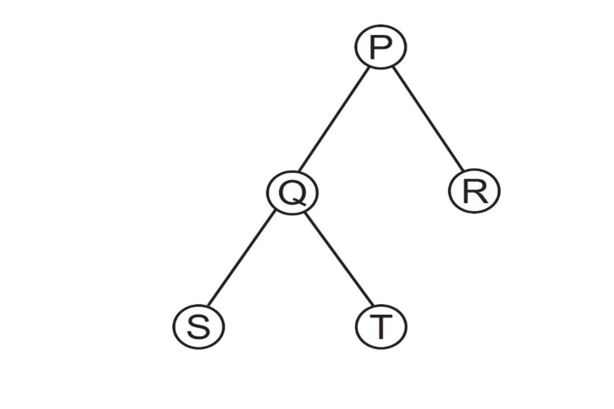

a) P Q S T R e P Q S T R
b) S T Q P R e S T Q R P
c) S T Q R P e S Q T P R
d) R P Q T S e S T Q R P
e) P T Q R S e P Q S T R

#### QUESTÃO 12
Considere as afirmações sobre hash linear e hash encadeado

I) Hash encadeado funciona melhor em disco, pois as chaves sempre ficam próximas uma das outras, facilitando a varredura.
II) Para uma tabela hash de tamanho M, tanto o hash linear quanto o hash encadeado podem receber uma quantidade de chaves C, onde C > M.
III) Quanto acontece uma colisão no hash encadeado, a chave é inserida na posição livre mais próxima da chave original.

Sobre as afirmações, sabe-se que:

a) Todas são verdadeiras
b) Todas são falsas
c) Apenas I e III são verdadeiras
d) Apenas II é verdadeira
e) Apenas I e II são verdadeiras

#### QUESTÃO 13
Em uma árvore AVL, todos os nós têm grau

a) 0, 1 ou 2.
b) divisível por 2.
c) 2
d) 1 e 2
e) maior ou igual a 2.

#### QUESTÃO 14
A estrutura de dados conhecida como Árvore Binária de Busca (ABB) encontra diversas aplicações em soluções práticas. Sobre esta estrutura é CORRETO afirmar:

a) Uma ABB é um conjunto finito de nós que possui um nó especial, chamado raiz, do qual partem os nós de duas árvores binárias distintas: a da esquerda e a da direita.
b) Quando os elementos a serem inseridos na ABB estão em ordem crescente, resulta em uma ABB com altura mínima.
c) Para se utilizar uma ABB como método de ordenação, basta fazer o caminhamento ou percurso "em-ordem" e obter todos os elementos ordenados.
d) Uma característica que confere à ABB grande agilidade na pesquisa e recuperação de elementos é que seus nós são sempre rearranjados de forma que a árvore resultante é sempre perfeitamente balanceada.
e) ABB são um caso especial de listas encadeadas em que nenhum nó aponta para mais de 2 sucessores.

#### QUESTÃO 15
Considere as afirmações a seguir sobre os algoritmos de ordenação Quicksort, MergeSort, HeapSort e InsertionSort

I) São algoritmos estáveis: InsertionSort, QuickSort e MergeSorte
II) Pior caso tem número de operações quadrático (proporcional a uma constante vezes n²): InsertionSort, QuickSort
III) Utiliza um espaço extra proporcional a n² (proporcional ao quadrado do número de elementos): HeapSort,
IV) A ordem das entradas é incapaz de influenciar o desempenho do algoritmo: InsertionSort, MergeSort

Marque a alternativa que indica TODAS as afirmações INCORRETAS feitas:

a) I e IV
b) I , III e IV
c) I, II e III
d) I, II, III e IV
e) II e IV

#### QUESTÃO 16
Uma árvore AVL é uma árvore binária de busca com balanceamento automático que respeita algumas propriedades fundamentais. Como todas as árvores, ela tem uma propriedade chamada altura. Sabendo que a altura de uma folha é igual a um e que a altura de um nó pai é igual ao máximo das alturas de seus filhos mais um, qual estrutura NÃO pode representar uma árvore AVL?

a) Uma árvore com três nós e altura igual a três
b) Uma árvore com seis nós e altura igual a três
c) Uma árvore com três nós e altura igual a dois
d) Uma árvore vazia
e) Uma árvore com dois nós

#### QUESTÃO 17
Considere os códigos de funções abaixo, assumindo que os mesmos são usados dentro de um programa e que os todos os cabeçalhos necessários são incluídos:

```c
/*QUADRO I) função que retorna 1 se a chave
de busca chave, passada como parâmetro, ocorre
dentro de um vetor de inteiros ordenado e
retorna 0 caso a chave não ocorra no vetor. O
vetor tem tamanho determinado pelo parâmetro
tm */
int buscaChave(int v[],int chave,int tm) {
  while((tm>= 0) && (v[tm]!= chave)) tm--;
  if (tm >= 0) return 0;
  return 1;
}
```

```c
/* QUADRO II) Conta ocorrências de uma
chave na lista encadeada, retornando o total de
ocorrências , zero caso a chave não ocorra
*/
int ContaOcorrenciasChave(tipoNo *prim, int
chave) {
  tipoNo *aux = prim;
  int cont = 0;
  int x;
  for (x = 0; aux[x] != NULL; x++){
    if(aux[x]. dado == chave) cont++;
  }
  return x;
}
```

Marque a alternativa correta dentre as afirmações abaixo:

a) Os dois códigos executam as tarefas propostas sem gerar qualquer tipo de erro de lógica ou de vazamento de memória
b) Apenas o código I executa sem erros a tarefa proposta
c) Apenas o código II executa sem erros a tarefa proposta
d) Os dois códigos geram erros de vazamento de memória ou de falha de segmentação
e) Nenhuma das alternativas anteriores

#### QUESTÃO 18
Considere as definições a seguir.

I) O nível do nó raiz de uma árvore é 1.
II) O nível de qualquer nó subsequente é igual ao nível do seu nó pai mais 1.
III) A profundidade de uma árvore é igual ao maior nível encontrado dentre todos os seus nós

Partindo-se das premissas acima, a menor e a maior quantidade de nós, respectivamente, que poderiam existir em uma árvore binária de profundidade 4 são:

a) 4 e 15
b) 3 e 15
c) 3 e 16
d) 4 e 16
e) 5 e 14

#### QUESTÃO 19
Uma árvore binária completa tem no 5º nível uma quantidade de nós igual a

a) 16
b) 15
c) 31
d) 64
e) 32

#### QUESTÃO 20
Considere uma árvore binária de busca cujos nós armazenam números inteiros variando de 1 a 100, na qual se quer buscar o número 54. Qual das seguintes sequências representa uma sequência de busca válida dentro desta árvore?

a) 5, 18, 34, 60, 40, 52, 54
b) 25, 27, 28, 26, 60, 50, 58, 54
c) 37, 70, 32, <não encontrou>
d) 40, 70, 43, 44, 73, 57, 54
e) Nenhuma das alternativas anteriores

---

## Edital 024/2017

Fontes: `Prova_Edital024-2017.pdf` (caderno) e `Gabarito_Cartão_Resposta-Edital024-2017.pdf` (folha de respostas com o gabarito marcado).
Questões 9 e 17 foram anuladas. Figuras em `2017-024/figuras/` (Q08, Q10, Q17).

### Gabarito

| Questão | Resp. | Questão | Resp. |
|---|---|---|---|
| 01 | A | 11 | A |
| 02 | A | 12 | C |
| 03 | D | 13 | B |
| 04 | A | 14 | D |
| 05 | B | 15 | B |
| 06 | D | 16 | E |
| 07 | A | 17 | Anulada |
| 08 | E | 18 | E |
| 09 | Anulada | 19 | A |
| 10 | E | 20 | D |

### Questões

#### QUESTÃO 01
Avaliando as seguintes sentenças a respeito de estrutura de dados:

I. A diferença entre árvore binária de busca e árvores AVL é o fato de que a segunda pode se reconfigurar dinamicamente, com o intuito de manter um bom nível de balanceamento.
II. Uma pilha garante que o último elemento inserido seja localizado no seu topo. Porém, do ponto de vista conceitual, qualquer elemento da pilha pode ser removido, ainda que não esteja no seu topo.
III. Do ponto de vista conceitual, não há diferença alguma entre uma estrutura de array e uma lista encadeada.
IV. Tabelas hash são estruturas de dados indicadas para armazenar grande volume de dados. Apesar dessas estruturas permitirem acesso indexado, mais de um elemento pode ter o mesmo índice. Elementos com o mesmo índice podem ser armazenados em uma mesma lista encadeada.

É CORRETO afirmar que:

a) apenas I e IV são verdadeiras.
b) apenas I é verdadeira.
c) apenas III e IV são verdadeiras.
d) apenas II e III são verdadeiras.
e) apenas I, II e IV são verdadeiras.

#### QUESTÃO 02
Marque a alternativa CORRETA.
Qual dos algoritmos abaixo apresenta o menor custo (em termos de número comparações entre elementos) ao considerar-se, para cada algoritmo, a pior disposição possível para os elementos do vetor a ser ordenado. Considere que o vetor a ser ordenado é muito grande, acima de 1 milhão de elementos.

a) Heapsort
b) Quicksort
c) Inserção
d) Seleção
e) Nenhuma das anteriores porque todos apresentam custo igual

#### QUESTÃO 03
Marque a alternativa CORRETA.
Qual dos algoritmos abaixo apresenta o menor custo (em termos de número movimentações de elementos realizadas) ao considerar-se, para cada algoritmo, a pior disposição possível para os elementos do vetor a ser ordenado. Considere que o vetor a ser ordenado é muito grande, acima de 1 milhão de elementos.

a) Heapsort
b) Quicksort
c) Inserção
d) Seleção
e) Mergesort

#### QUESTÃO 04
Considere as seguintes afirmações sobre a estrutura lista encadeada dinâmica e marque a alternativa CORRETA.

I. A busca em tal estrutura realiza menos comparações do que a melhor opção de algoritmo de busca em um vetor ordenado quando se considera o pior cenário para cada estrutura.
II. É uma estrutura de dados usada para ordenar chaves por ser mais eficiente no processo de ordenação que o heapsort
III. É tipicamente utilizada como estrutura de dados básica na implementação de hash por endereçamento aberto

a) As três afirmações são falsas
b) As três afirmações são verdadeiras
c) Apenas a afirmação I é verdadeira
d) Apenas a afirmação II é verdadeira
e) Apenas a afirmação III é verdadeira

#### QUESTÃO 05
Dada uma lista encadeada onde cada nó da lista é do tipo No, cujos campos são um ponteiro para o próximo elemento (campo prox) e um dado do tipo inteiro (campo dado). Dado também quatro (4) opções (versões) de funções para realizar a busca por um elemento em uma lista encadeada, onde recebe-se um ponteiro para o primeiro elemento da lista e uma chave. A função de busca deve retornar 1 (um) caso encontre o elemento buscado e 0 (zero) em caso contrário.

Com base nas informações anteriores, considere que: (1) a lista encadeada não possui um nó cabeça de lista, portanto todos os nós contém valores presentes na lista; (2) todos os tipos de dados foram previamente declarados no programa; (3) a função não deve ter problemas de alocação de memória, seja por deixar de alocar dinamicamente dados necessários ou por causar alocação dinâmica de dados desnecessária.

Analise as funções abaixo e marque a alternativa CORRETA

```c
/* versão I */
int busca(No *prim, int chave) {
  No *aux = (No *) malloc(sizeof(No));
  aux = prim;
  while(aux!= NULL) {
    if(aux->dado == chave) return 1;
    aux = aux>prox;
  }
  return 0;
}

/* versão II */
int busca(No *prim, int chave) {
  while(prim!= NULL) {
    if(prim->dado == chave) return 1;
    prim = prim->prox;
  }
  return 0;
}

/* versão III */
int busca(No *prim, int chave) {
  No * aux = prim;
  while(prim->prox!= NULL) {
    if(prim->dado == chave) return 1;
    aux = aux->prox;
  }
  return 0;
}

/* versão IV */
int busca(No *prim, int chave) {
  No *aux = (No *) malloc(sizeof(No));
  while(aux->prox!= NULL) {
    if(aux->dado == chave) return 1;
    aux = aux>prox;
  }
  return 0;
}
```

a) A versão I está correta e não apresenta problemas de alocação de memória.
b) A versão II está correta e não apresenta problemas de alocação de memória.
c) A versão III está correta e não apresenta problemas de alocação de memória
d) A versão IV está correta e não apresenta problemas de alocação de memória
e) Nenhuma das alternativas anteriores está correta

#### QUESTÃO 06
Após a inserção da sequencia de números 3, 4, 6, 8 e 9 em uma pilha, o resultado CORRETO de 3 remoções sucessivas seria:

a) 3, 4 e 6, nesta ordem
b) 6, 3 e 4, nesta ordem
c) 6, 8 e 9, nesta ordem
d) 9, 8 e 6, nesta ordem
e) Nenhuma das alternativas anteriores

#### QUESTÃO 07
Considere as seguintes afirmações:

I. Hash por encadeamento nunca apresenta colisões secundárias
II. Hash por encadeamento jamais permite que o número de comparações entre chaves em uma operação de busca passe de log n, onde n é o número de chaves inseridas no hash.
III. Hash por encadeamento realiza sempre menos comparações entre chaves do que qualquer hash por endereçamento aberto.

Marque a alternativa CORRETA:

a) Apenas a afirmação I é verdadeira
b) Apenas a afirmação II é verdadeira
c) Apenas a afirmação III é verdadeira
d) Apenas as afirmações II e III são verdadeiras
e) Nenhuma das alternativas anteriores está correta

#### QUESTÃO 08
Considere as seguintes árvores onde são apresentados apenas os valores das chaves em cada nó, sem mostrar o valor de outros campos eventualmente existentes. Considerando em todos os casos que as árvores não estão em processo de rotação por inserção de chaves, estando portanto em seu estado final após a inserção do conjunto de chaves mostrado.

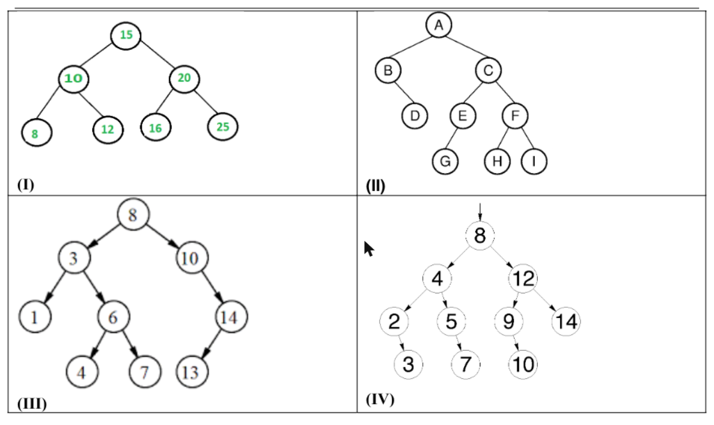

É CORRETO afirmar que:

a) Apenas a árvore do quadro I poderia ser uma árvore AVL
b) Todas as opções apresentadas nos quadros de I a IV podem ser exemplos de árvores AVL
c) Nenhuma das 4 opções apresentadas podem ser exemplos de árvores AVL
d) Apenas as opções I e III podem ser exemplos de árvores AVL
e) Nenhuma das alternativas anteriores (de A até D) está correta

#### QUESTÃO 09 (anulada)
Marque a alternativa CORRETA:
Considere uma estrutura de fila (disciplina FIFO) de números inteiros com duas operações: INSERE (n) e RETIRA ( ). Considere, também, que a representação do estado da fila em um instante qualquer é realizada listando os elementos, de forma que o primeiro elemento, da esquerda para a direita, é o mais antigo presente na fila.

Se a fila começa vazia, a sequência:

INSERE (b) → INSERE (c) → RETIRA ( ) → INSERE (a) → RETIRA ( ) → INSERE (e) → INSERE (e) → RETIRA ( ) → RETIRA ( )

levará a uma fila no estado:

a) a b c e
b) e a
c) a
d) b c a e
e) c a e

#### QUESTÃO 10
Considere as seguintes árvores onde são apresentados apenas os valores das chaves em cada nó, sem mostrar o valor de outros campos eventualmente existentes. Considerando em todos os casos que as árvores não estão em processo de rotação por inserção de chaves, estando portanto em seu estado final após a inserção do conjunto de chaves mostrado.

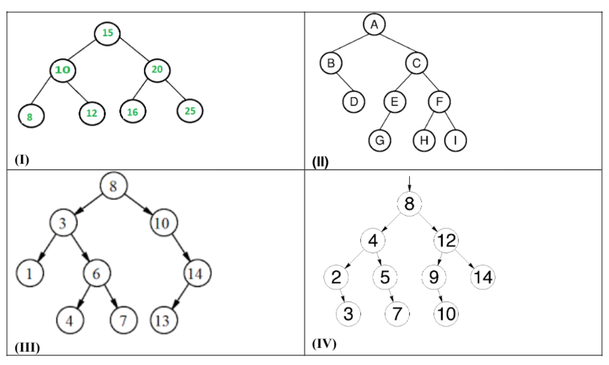

É CORRETO afirmar que:

a) Apenas a árvore do quadro I poderia ser uma árvore binária de pesquisa sem balanceamento
b) Todas as 4 opções podem ser exemplos de árvores binárias de pesquisa sem balanceamento
c) Nenhuma das 4 opções pode ser uma árvore binária de pesquisa sem balanceamento
d) Apenas as opções II e III podem de árvores binárias de pesquisa sem balanceamento
e) Nenhuma das alternativas anteriores (de A até D) está correta

#### QUESTÃO 11
Sabendo que um arvore binária com 5 nós tem como resultados dos seus percursos pós-ordem e in-ordem, respectivamente S T Q R P e S Q T P R.
É CORRETO afirmar:

a) O nó raiz tem o valor P
b) Q é um nó folha
c) S é um nó interno
d) T é filho de S
e) Todas as alternativas estão corretas

#### QUESTÃO 12
Sobre as afirmações abaixo:

I. A busca sequencial só pode ser realizada corretamente em vetores que não estejam ordenados
II. A busca por uma chave em um vetor ordenado pode ser realizada corretamente com número constante de operações, não dependendo do tamanho do vetor.
III. Pode-se encontrar o maior elemento de um vetor não ordenado com um algoritmo que realiza um número de operações proporcional ao tamanho do vetor na pior das situação possível para o algoritmo.

Pode-se dizer que:

a) Apenas I está correta
b) Apenas II está correta
c) Apenas III está correta
d) Apenas II e III estão corretas
e) Apenas I e III estão corretas

#### QUESTÃO 13
Dada uma lista encadeada onde cada nó da lista é do tipo No, cujos campos são um ponteiro para o próximo elemento (campo prox) e um dado do tipo inteiro (campo dado). Considere que: (1) a lista encadeada não possui um nó cabeça de lista, portanto todos os nós contém valores presentes na lista; (2) todos os tipos de dados foram previamente declarados no programa; (3) a função não deve ter problemas de alocação de memória, seja por deixar de alocar dinamicamente dados necessários ou por causar alocação dinâmica de dados desnecessária.

Marque a alternativa CORRETA sobre as funções função I e função II

```c
/* função I */
void funcaoI(No *prim, int chave) {
  No *aux = (No *) malloc(sizeof(No));
  aux ->chave = chave;
  aux->prox = prim;
  prim = aux;
}

/* função II */
void funcaoI(No **prim, int chave) {
  No *aux = (No *) malloc(sizeof(No));
  aux ->chave = chave;
  aux->prox = *prim;
  *prim = aux;
}
```

a) Apenas a função função I pode ser usada para inserir corretamente elementos em uma pilha sem gerar qualquer problema de alocação de memória ou erro na pilha.
b) Apenas a função função II pode ser usada para inserir corretamente elementos em uma pilha sem gerar qualquer problema de alocação de memória ou erro na pilha.
c) Ambas as funções podem ser usadas para inserir elementos em uma pilha sem gerar qualquer problema de alocação de memória ou erro na pilha.
d) Apenas a função função I serve para inserir corretamente elementos em uma lista encadeada sem gerar erros, mas não em uma pilha.
e) Apenas a função função II serve para inserir corretamente elementos em uma lista encadeada sem gerar erros, mas não em uma pilha.

#### QUESTÃO 14
Considere as afirmações sobre um hash linear (sem encadeamento):

I. No evento de uma colisão, o valor a ser inserido é sempre colocado no início do array;
II. A busca pela chave é realizada utilizando busca binária (mais eficiente)
III. É obrigatório o uso de funções diferentes para inserção e remoção de chaves
IV. É projetado para funcionar com arrays de tamanho previamente definido.

Sobre as afirmações, sabe-se que:

a) Todas são verdadeiras
b) Todas são falsas
c) Apenas II e IV são verdadeiras
d) Apenas IV é verdadeira
e) Apenas I e II são verdadeiras

#### QUESTÃO 15
Considere as afirmações sobre hash linear vs hash encadeado

I. Para uma tabela hash de tamanho M, tanto o hash linear quanto o hash encadeado podem receber uma quantidade de chaves C, onde C > M.
II. Quanto acontece uma colisão no hash encadeado, a chave é inserida na posição livre mais próxima da chave original.
III. Hash linear funciona melhor em disco, pois as chaves obrigatoriamente ficam em espaços separados de memória, facilitando a varredura.
IV. O uso de uma segunda função de hash (no hash encadeado), garante um melhor espalhamento das chaves pela tabela hash

Sobre as afirmações, sabe-se que:

a) Todas são verdadeiras
b) Todas são falsas
c) Apenas I e III são verdadeiras
d) Apenas III é verdadeira
e) Apenas I e II são verdadeiras

#### QUESTÃO 16
Considere que o vetor a seguir é uma heap mínima (assuma índice do array iniciando em zero)

`4 5 7 10 13 11 15 22`

Marque a alternativa que contem a afirmativa CORRETA:

a) Essa heap possui todos os nós folhas na mesma altura
b) Ao alterar o valor 22 por 6, 2 trocas são necessárias para corrigir a heap
c) O valor no índice 7 precisa ser necessariamente menor que o do índice 4
d) O valor no índice 6 precisa ser obrigatoriamente maior que o do índice 1
e) Ao alterar o valor 13 por 8, nada precisa ser feito para corrigir a heap

#### QUESTÃO 17 (anulada)
As árvores são estruturas de dados poderosas e se subdividem em vários tipos, cada um dos quais com suas características próprias. Relacione os tipos de árvores, apresentados na coluna da esquerda, com as suas respectivas características, indicadas na coluna da direita:

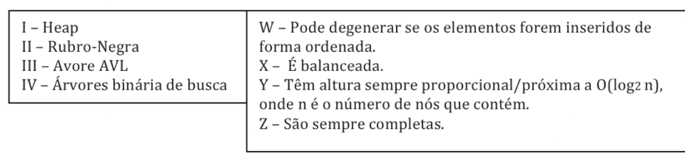

| Tipo de árvore | Característica |
|---|---|
| I – Heap | W – Pode degenerar se os elementos forem inseridos de forma ordenada. |
| II – Rubro-Negra | X – É balanceada. |
| III – Avore AVL | Y – Têm altura sempre proporcional/próxima a O(log2 n), onde n é o número de nós que contém. |
| IV – Árvores binária de busca | Z – São sempre completas. |

Estão CORRETAS as associações:

a) I –X, IV – Z , II – Y
b) I – Z , IV– X , III – W
c) I – Z , IV– X , III – Y
d) I –Y , IV– W , III – X
e) I –X , IV– W , II – Y

#### QUESTÃO 18
Considere o código abaixo, assumindo que o mesmo é usado dentro de um programa e que os todos os cabeçalhos necessários são incluídos:

```c
// Conta ocorrências de uma chave na lista encadeada, retornando o total de ocorrências , zero caso a chave não ocorra
int ContaOcorrenciasChave(tipoNo *prim, int chave) {
  tipoNo *aux = prim;
  int cont = 0;
  int x;
  for (x = 0; aux[x] != NULL; x++){
    if(aux[x].dado == chave)
      cont++;
  }
  return x;
}
```

Marque a alternativa CORRETA dentre as afirmações abaixo:

a) O código executa a tarefas proposta sem gerar qualquer tipo de erro de lógica ou de vazamento de memória
b) O código nem compila
c) O código executa a tarefa proposta sem erros de lógica
d) O código não gera erro de segmentação
e) Nenhuma das alternativas anteriores

#### QUESTÃO 19
Uma lista encadeada simples é uma estrutura que corresponde a uma sequência lógica de entradas ou nós. Cada nó armazena a localização do próximo elemento na sequência, ou seja, de seu nó sucessor.

Marque a alternativa CORRETA:

a) A existência de um ponteiro apontando para o 1º elemento e outro para o fim da lista permite que a inserção ou deleção de dados de um nó que esteja nas extremidades da lista seja rapidamente executada
b) Enquanto a entrada que determina o topo da lista é mantida em um nó descritor dessa lista, a entrada que marca o fim da lista é mantida em todos os nós da lista.
c) O armazenamento de uma lista requer uma área contígua de memória para permitir a otimização no processamento de busca de valores chaves na lista
d) O armazenamento de uma lista requer uma área contígua de memória. Como listas são estruturas previamente projetadas e definidas, normalmente são definidos procedimentos que permitem inserir e remover valores com eficiência.
e) Para estabelecer a ligação entre um nó já pertencente a uma lista e um novo nó, basta fazer com que o novo nó referencie no campo next, o nó que anteriormente era referenciado pelo nó original, desde que esse campo não tenha o valor nulo

#### QUESTÃO 20
Marque a alternativa CORRETA. Uma lista duplamente encadeada tem como característica ser formada por elementos que:

a) Se concatenam de forma circular, de tal maneira que, ao chegar ao final da lista, o próximo elemento volta a ser o primeiro.
b) Contêm, além de um ou mais campos chave, mais um campo de ponteiro: o próximo, que permite o acesso ao elemento que sucede o atual (o próximo) presente na mesma lista.
c) Contêm, além de um campo chave, mais um campo de ponteiro: o próximo, que permite o acesso ao elemento que sucede o atual (o próximo) presente na mesma lista, de tal forma que os campos chave estão ordenados, ou seja, a chave do próximo é sempre maior ou igual à chave do atual elemento.
d) Contêm, além de um ou mais campos chave, dois outros campos de ponteiros: próximo e anterior, que permitem o acesso aos elementos adjacentes (próximo e anterior) presentes na mesma lista.
e) Estão em posições adjacentes da memória, permitindo o acesso sequencial ao próximo e ao anterior de cada elemento pelo simples uso de um índice.

---

## Edital 055/2017

Fontes: `Prova_Edital_055-2017.pdf` (caderno) e `Gabarito-Edital055-2017.pdf` (gabarito).
Questões 3, 9 e 10 foram anuladas. Figuras em `2017-055/figuras/` (Q01, Q04, Q16).

### Gabarito

| Questão | Resp. | Questão | Resp. |
|---|---|---|---|
| 01 | E | 11 | D |
| 02 | C | 12 | C |
| 03 | Anulada | 13 | E |
| 04 | B | 14 | B |
| 05 | D | 15 | B |
| 06 | C | 16 | B |
| 07 | D | 17 | E |
| 08 | B | 18 | E |
| 09 | Anulada | 19 | A |
| 10 | Anulada | 20 | A |

### Questões

#### QUESTÃO 01
Considere a função em pseudocódigo a seguir:

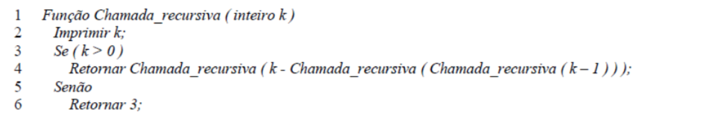

Marque a alternativa CORRETA.
A execução da função Chamada_recursiva(1) faz com que o algoritmo execute indefinidamente. Para este caso, os cinco primeiros valores impressos são:

A) 1, 0, 3, 1 e 0.
B) 1, 0, 3, 1 e 2.
C) 1, 0, 3, 2 e 0.
D) 1, 0, 3, 2 e 3.
E) 1, 0, 3, 2 e 1.

#### QUESTÃO 02
Marque a alternativa INCORRETA.
Estrutura de Dados básicas como Fila são tipicamente usadas em uma gama variada de aplicações computacionais, EXCETO:

A) Sequência de trabalhos submetidas à impressora compartilhada em rede de computadores, onde o primeiro trabalho recebido será o primeiro trabalho a ter sua solicitação atendida.
B) Fila de processos de comunicação em redes de computadores.
C) Estruturas hierárquicas de diretórios e subdiretórios.
D) Buffer para gravação de dados em mídia.
E) Atendimento de processos requisitados ao um sistema operacional.

#### QUESTÃO 03 (anulada)
Suponha que se tem números entre 1 e 1000 em uma Árvore Binária de Busca e se quer procurar pelo número 363. Qual das afirmativas a seguir não poderia ser a sequência de nós examinados?

A) 2, 252, 401, 398, 330, 344, 397, 363.
B) 924, 220, 911, 244, 898, 258, 362, 363.
C) 925, 202, 911, 240, 912, 245, 363.
D) 2, 399, 387, 219, 266, 382, 381, 278, 363.
E) 935, 278, 347, 621, 299, 392, 358, 363.

#### QUESTÃO 04
Observe a árvore binária de pesquisa sem balanceamento:

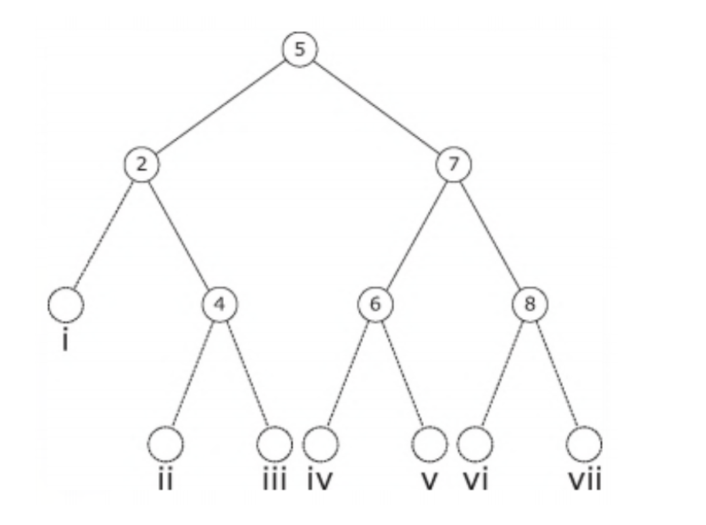

Considere as afirmativas a seguir.

I. Os nós 6 e 8 são irmãos.
II. O nó 4 é uma das raízes da árvore.
III. O nó com valor 3, ao ser inserido, ocuparia a posição iv.
IV. O nó com valor 1, ao ser inserido, ocuparia a posição i.

Marque a alternativa CORRETA:

A) Apenas a afirmativa III está correta.
B) Apenas as afirmativas I e IV estão corretas.
C) Apenas as afirmativas II e III estão corretas.
D) Apenas as afirmativas I, II e IV estão corretas.
E) Todas as afirmativas estão corretas.

#### QUESTÃO 05
Quando um algoritmo de hash produz um endereço para uma chave e esse endereço já está ocupado, isso é chamado de __________.

A) Sinônimo
B) Inicial
C) Prospecção
D) Colisão
E) Overflow

#### QUESTÃO 06
Considere uma tabela hash com resolução de colisões por encadeamento com as seguintes características:

- As chaves são as letras A,B,C,D,H,J,K,M,N,O,P,R,S,T,U;
- A tabela possui 11 posições, referenciadas pelos índices de 0 até 10;
- A função de hash é definida como hash(x)=posição(x) mod 11, onde x é a chave, e posição(x) é a posição da chave no alfabeto ABCDEFGHIJKLMNOPQRSTUVWXYZ, tal que posição("A") retorna 1 e posição("Z") retorna 26.

Analise as afirmativas sobre a tabela após seu preenchimento com as chaves listadas acima.

I. Nenhuma chave foi alocada à posição 6;
II. A chave "K" foi alocada à posição zero;
III. As chaves "B" e "N" colidiram na posição 3;
IV. Apenas uma letra foi alocada à posição 9.

Com base nessas afirmativas, marque a alternativa CORRETA:

A) Apenas as afirmativas I e II estão corretas.
B) Apenas as afirmativas I e IV estão corretas.
C) Apenas as afirmativas I, II e IV estão corretas.
D) Apenas as afirmativas II e III.
E) Apenas as afirmativas II, III e IV estão corretas.

#### QUESTÃO 07
Marque a alternativa CORRETA.
Suponha que T seja uma árvore binária de pesquisa sem balanceamento inicialmente vazia, e considere a inserção dos elementos 30, 50, 60, 20, 40, 10 e 25 em T, exatamente nessa ordem. Qual das sequências abaixo corresponde a um percurso de T em pré-ordem?

A) 30 50 60 40 20 25 10
B) 10 25 20 40 60 50 30
C) 10 20 25 30 40 50 60
D) 30 20 10 25 50 40 60
E) 60 50 40 30 25 20 10

#### QUESTÃO 08
Marque a alternativa CORRETA.
Considerando um array R que contém 1.000.000 de chaves ordenadas, assinale o número máximo de acessos a R necessários para encontrar uma determinada chave ao se utilizar o algoritmo de busca binária.

A) 10
B) 20
C) 40
D) 80
E) 160

#### QUESTÃO 09 (anulada)
Para remoção de uma chave cuja página esteja com o número mínimo, em árvore B, é CORRETO afirmar que:

A) Deve-se fazer o processo de SPLIT sempre na página onde se encontrar a chave.
B) Deve-se fazer o processo de SPLIT na página onde se encontrar a chave, exceto quanto é um elemento da raiz da árvore.
C) Se a página onde se encontrar a chave não é folha, deve-se fazer procedimento de concatenação ou redistribuição, considerando os irmãos.
D) Remove-se a chave, e a substitui por uma chave do nó irmão.
E) No caso de só haver uma única página, a remoção não causa a necessidade de balanceamento.

#### QUESTÃO 10 (anulada)
Sobre árvores B e árvores binárias, analise as afirmativas e assinale a alternativa CORRETA.

I. De forma diferente das árvores binárias, cada nó de uma árvore B deverá sempre ter mais de dois filhos.
II. Um nó de árvore B tem um campo ou um método para indicar se é um nó folha ou não. Característica esta herdada da AVL.
III. As folhas da árvore B são dispostas mais flexivelmente que as da árvore binária: suas folhas poderão estar em níveis diferentes, desde zero até o valor da altura da árvore.
IV. A árvore B tem um método de balanceamento muito custoso, por isso, sua indicação para trabalhar com dispositivos de armazenamento secundário deve ser avaliada com muita cautela.

A) Todas as afirmativas estão corretas.
B) Somente as afirmativas II e III estão corretas
C) Somente as afirmativas I, II e IV estão corretas.
D) Somente as afirmativas I, III e IV estão corretas.
E) Todas as afirmativas estão incorretas

#### QUESTÃO 11
Considere as seguintes afirmações sobre a estrutura lista encadeada dinâmica

I. A busca em tal estrutura realiza menos comparações do que a melhor opção de algoritmo de busca em um vetor ordenado quando se considera o pior cenário para cada estrutura.
II. É uma estrutura de dados usada unicamente no armazenamento de grandes quantidades de chaves por lista, dado o seu dinamismo e velocidade de busca quando comparada a outras estruturas de dados.
III. É utilizada como estrutura de dados na implementação de alguns tipos de hash.

Marque a alternativa CORRETA:

A) As três afirmações são falsas
B) Apenas a afirmação I é verdadeira
C) Apenas a afirmação II é verdadeira
D) Apenas a afirmação III é verdadeira
E) Apenas as afirmações I e II são verdadeiras.

#### QUESTÃO 12
Qual dos algoritmos abaixo apresenta o menor custo (em termos de número comparações entre elementos) ao considerar-se que o vetor passado está previamente ordenado, a menos da ocorrência de duas chaves consecutivas que estão com posições trocadas. Considere que o vetor a ser ordenado é muito grande, com mais de 1 milhão de elementos.

A) Heapsort.
B) Quicksort.
C) Inserção.
D) Seleção.
E) Nenhuma das anteriores, pois todos apresentam custo igual.

#### QUESTÃO 13
Marque a alternativa CORRETA.
Considerando-se para cada algoritmo o pior cenário possível em termos de uso de espaço, são algoritmos que utilizam espaço extra constante, independentemente do número de elementos do vetor de entrada a ser ordenado:

A) Mergesort e Seleção.
B) Quicksort e Mergesort.
C) Mergesort e Heapsort.
D) Inserção e Quicksort.
E) Nenhuma das alternativas acima está correta.

#### QUESTÃO 14
Sobre as afirmações abaixo:

I. Pode-se implementar uma busca em um vetor não ordenado a custo máximo inferior a n/2 operações, onde n é o número de elementos do vetor, desde que a chave buscada ocorra no vetor, não importando qual a posição em que a mesma ocorre.
II. A busca por uma chave em um vetor ordenado pode ser realizada corretamente com um número de operações proporcional a log2 n, onde n é o número de elementos do vetor.
III. O número de comparações realizadas para determinar se uma chave de busca está ou não em um vetor não ordenado é sempre menor do que o número de comparações envolvendo a mesma chave de busca em uma lista encadeada dinâmica, desde que a quantidade e a ordem dos elementos inseridos nas duas estruturas seja a mesma.

Marque a alternativa CORRETA:

A) Apenas a afirmativa I está correta.
B) Apenas a afirmativa II está correta.
C) Apenas a afirmativa III está correta.
D) Todas as afirmativas estão corretas.
E) Nenhuma das afirmativas está corretas.

#### QUESTÃO 15
Considere as seguintes afirmações:

I. Hash por encadeamento pode apresentar colisões secundárias.
II. Hash por encadeamento pode permitir que o número de comparações entre chaves em uma operação de busca passe de √n, onde n é o número de chaves inseridas no hash.
III. Hash por endereçamento aberto realiza sempre menos comparações entre chaves do que qualquer hash por encadeamento.

Marque a alternativa CORRETA:

A) Apenas a afirmação I é verdadeira.
B) Apenas a afirmação II é verdadeira.
C) Apenas a afirmação III é verdadeira.
D) Apenas as afirmações II e III são verdadeiras.
E) Apenas as afirmações I e III são verdadeiras.

*(Nota: o símbolo da raiz em "√n" não aparece na extração de texto; confirmei no PDF renderizado.)*

#### QUESTÃO 16
Considere as seguintes árvores onde são apresentados apenas os valores das chaves em cada nó, sem mostrar o valor de outros campos eventualmente existentes. Além disso, note que em todos os casos, as árvores não estão em processo de rotação por inserção de chaves, estando portanto em seu estado final após a inserção do conjunto de chaves mostrado.

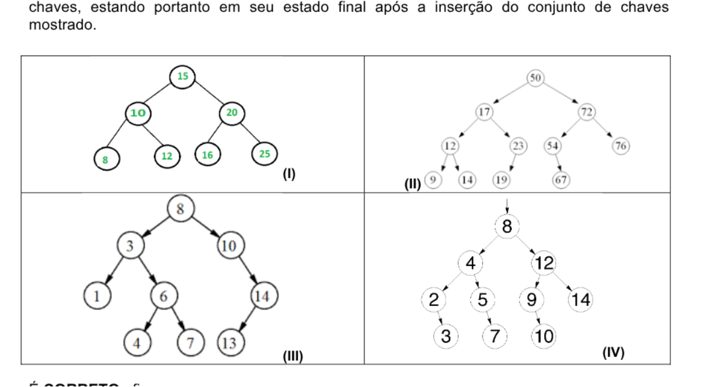

É CORRETO afirmar que:

A) Apenas a árvore do quadro I poderia ser uma árvore AVL.
B) Apenas a árvore III não poderia ser uma árvore AVL.
C) Nenhuma das 4 opções apresentadas poderiam ser exemplos de árvores AVL.
D) Apenas as opções I e II podem ser exemplos de árvores AVL.
E) Nenhuma das alternativas anteriores (de A, B, C ou D) está correta.

#### QUESTÃO 17
Após a inserção da sequencia de números 10, 1, 3, 4, 6, 8 e 9 em uma pilha, o resultado de três (3) remoções sucessivas seria:

A) 10, 1 e 3 nessa ordem
B) 4, 3 e 1 nessa ordem
C) 6, 8 e 9 nessa ordem
D) 3, 1 e 10 nessa ordem
E) Nenhuma das alternativas anteriores (A, B, C ou D) está correta

#### QUESTÃO 18
Considere uma lista encadeada onde cada nó da lista é do tipo No, cujos campos são um ponteiro para o próximo elemento (campo prox) e um dado do tipo inteiro (campo dado). Considere que a lista encadeada não possui um nó cabeça de lista, portanto todos os nós contém valores presentes na lista. Considere que todos os tipos de dados foram previamente declarados no programa. Considere que a função não deve ter problemas de alocação de memória, seja por deixar de alocar dinamicamente dados necessários ou por causar alocação dinâmica de dados desnecessária.

```c
/* funcaoI */
void funcaoI(No *prim, int chave) {
  No *aux = (No *) malloc(sizeof(No));
  aux->chave = chave;
  aux->prox = prim;
  prim = aux;
}

/* funcaoII */
void funcaoII(No **prim, int chave) {
  No *aux = (No *) malloc(sizeof(No));
  aux->chave = chave;
  aux->prox = *prim;
  *prim = aux;
}
```

Dadas as considerações, pode-se dizer sobre as funções funcaoI e funcaoII que:

A) Apenas a função funcaoI pode ser usada para inserir corretamente elementos em uma fila sem gerar qualquer problema de alocação de memória ou erro na fila.
B) Apenas a função funcaoII pode ser usada para inserir corretamente elementos em uma fila sem gerar qualquer problema de alocação de memória ou erro na fila.
C) Ambas as funções podem ser usadas para inserir elementos em uma fila sem gerar qualquer problema de alocação de memória ou erro na fila.
D) Apenas a função funcaoI serve para inserir corretamente elementos em uma lista encadeada sem gerar erros, mas não em uma fila.
E) Apenas a função funcaoII serve para inserir corretamente elementos em uma lista encadeada sem gerar erros, mas não em uma fila.

#### QUESTÃO 19
Suponha que você recebeu a tarefa de depurar uma implementação de Quicksort, cujo objetivo é classificar um vetor em ordem decrescente. Após a primeira etapa da partição ser concluída, o conteúdo do vetor está na seguinte ordem:

`20 22 24 18 13 9 3 10`

Qual das seguintes afirmações está CORRETA sobre a fase de partição?

A) O pivô que gerou a partição pode ter o valor 13 ou 18.
B) O pivô que gerou a partição pode ter o valor 13, mas não pode ter o valor 18.
C) O pivô que gerou a partição pode ter o valor 18, mas não pode ter o valor 13.
D) O pivô que gerou a partição não pode ter o valor 13 nem 18.
E) O conteúdo do vetor não pode representar o resultado da etapa partição.

#### QUESTÃO 20
Ao inserirmos as chaves 2, 4, 6, 8, 10 e 12, nessa ordem, em uma árvore AVL que estava originalmente vazia, a diferença de altura entre a sub-árvores que está à direita da raiz e a sub-árvore que está à esquerda da raiz será:

A) 0.
B) 2.
C) 4.
D) 6.
E) 8.

---

## Edital 023/2018

Fontes: `Prova-Edital023-2018.pdf` (caderno) e `Folha_Resposta_-_Gabarito.pdf` (folha de respostas com o gabarito marcado).
A Questão 5 foi anulada. Figuras em `2018-023/figuras/` (Q04 e Q10).

Observações sobre o caderno original: as Questões 03 e 05 têm enunciado idêntico, e o vetor da Questão 12 aparece no PDF como `32 8 12 16 20 24 28 16 36`.

### Gabarito

| Questão | Resp. | Questão | Resp. |
|---|---|---|---|
| 01 | C | 11 | C |
| 02 | C | 12 | E |
| 03 | D | 13 | E |
| 04 | B | 14 | D |
| 05 | Anulada | 15 | D |
| 06 | C | 16 | B |
| 07 | B | 17 | D |
| 08 | C | 18 | D |
| 09 | A | 19 | E |
| 10 | D | 20 | C |

### Questões

#### QUESTÃO 01
Dois vetores ordenados, contendo, cada um deles, N números inteiros, precisam ser unidos em outro vetor maior, que conterá os 2N números, que também serão armazenados de forma ordenada. A complexidade de tempo de melhor caso desse processo será, então,

a) O(1), pois se precisa fazer apenas uma cópia simples de cada um dos elementos originais.
b) O(log N), pois se usa a busca binária para determinar qual será o próximo elemento copiado para o vetor de destino.
c) O(N), pois se precisa fazer uma cópia de cada um dos elementos originais, o que implica uma varredura completa de cada vetor de origem.
d) O(Nlog N), pois se precisa fazer uma busca de cada elemento para depois inseri-lo no vetor de destino.
e) O(N²), pois, como há dois vetores, precisa-se fazer dois laços de forma aninhada (um dentro do outro), gerando uma multiplicação das quantidades de elementos.

#### QUESTÃO 02
Dadas as seguintes afirmações a respeito de árvores B,

I. Em uma árvore B de ordem "m" cada nó tem, no máximo, "m" filhos.
II. Em uma árvore B de ordem "m" cada nó (exceto a raíz e as folhas) tem pelo menos "m/2" filhos.
III. Árvores B precisam ser rebalanceadas frequentemente.
IV. Um nó não-folha com "k" filhos deve ter k chaves.
V. Todas as folhas aparecem no mesmo nível e carregam informação.

estão CORRETOS os itens

a) I e III, apenas.
b) I, III, IV e V.
c) I, II e V, apenas.
d) III, IV e V, apenas.
e) II, III e IV, apenas.

#### QUESTÃO 03
Analise as duas afirmativas a seguir, relacionadas a árvores de busca:

I. Uma árvore AVL é uma árvore binária de busca autobalanceada que respeita algumas propriedades fundamentais.
II. Como todas as árvores, ela tem uma propriedade chamada altura, que é igual ao valor da altura de sua raiz.

Sabendo que a altura de uma folha é igual a um (01) e que a altura de um nó pai é igual ao máximo das alturas de seus filhos mais um, qual estrutura NÃO pode representar uma árvore AVL?

a) Uma árvore vazia
b) Uma árvore com dois nós
c) Uma árvore com três nós e altura igual a dois
d) Uma árvore com três nós e altura igual a três
e) Uma árvore com seis nós e altura igual a três

#### QUESTÃO 04
Um heap (fila de prioridade) é uma estrutura de dados muito importante, que tem duas utilidades principais: organizar acesso a um recurso com base na prioridade dos requerentes (processos, impressões, etc.) ou servir como base a um algoritmo de ordenação muito eficiente denominado heapsort. Para poder servir a esses propósitos, um heap possui uma série de propriedades especiais que têm que ser mantidas por todas as operações nelas realizadas. Levando em consideração estas propriedades, analise as afirmativas abaixo.

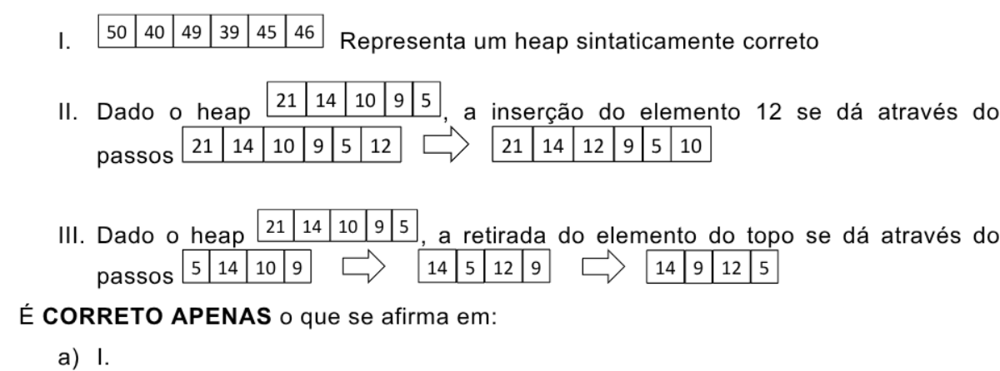

I. `50 40 49 39 45 46` representa um heap sintaticamente correto
II. Dado o heap `21 14 10 9 5`, a inserção do elemento 12 se dá através dos passos `21 14 10 9 5 12` ⇒ `21 14 12 9 5 10`
III. Dado o heap `21 14 10 9 5`, a retirada do elemento do topo se dá através dos passos `5 14 10 9` ⇒ `14 5 12 9` ⇒ `14 9 12 5`

É CORRETO APENAS o que se afirma em:

a) I.
b) II.
c) III.
d) I e II.
e) II e III.

#### QUESTÃO 05 (anulada)
Analise as duas afirmativas a seguir, relacionadas a árvores de busca:

I. Uma árvore AVL é uma árvore binária de busca autobalanceada que respeita algumas propriedades fundamentais.
II. Como todas as árvores, ela tem uma propriedade chamada altura, que é igual ao valor da altura de sua raiz.

Sabendo que a altura de uma folha é igual a um (01) e que a altura de um nó pai é igual ao máximo das alturas de seus filhos mais um, qual estrutura NÃO pode representar uma árvore AVL?

a) Uma árvore vazia
b) Uma árvore com dois nós
c) Uma árvore com três nós e altura igual a dois
d) Uma árvore com três nós e altura igual a três
e) Uma árvore com seis nós e altura igual a três

#### QUESTÃO 06
Uma lista ordenada de N números é inserida em uma pilha e depois retirada, sendo que, a cada POP, o elemento retirado é inserido em uma árvore de busca binária. Após a completa inserção de todos os elementos nesta árvore, são feitas buscas de números na mesma. O tempo médio de busca de um número nesta árvore é

a) O(1)
b) O(log N)
c) O(N)
d) O(Nlog N)
e) O(N2)

#### QUESTÃO 07
Assinale cada afirmativa abaixo como verdadeira (V) ou falsa (F). Em seguida, marque a opção que corresponde à sequência CORRETA.

( ) Uma árvore não-vazia é balanceada AVL se, pelo menos, uma de suas árvores, esquerda ou direita, for balanceada AVL;
( ) As árvores cheias são árvores balanceadas AVL;
( ) Uma boa condição de balanceamento AVL deve assegurar que a altura de uma árvore com n nós é da ordem de O(log n);
( ) Uma árvore AVL é uma árvore balanceada pela altura;
( ) Ao inserir ou remover um item em uma árvore AVL, o custo adicional para balancear esta árvore é da ordem de O(n/2).

a) V - V - F - V - V
b) F - V - V - V - F
c) V - F - F - V - F
d) F - V - V - F - V
e) F - F - V - V - F

#### QUESTÃO 08
Considere uma estrutura do tipo árvore binária que começa vazia. Nela são introduzidos os números 2, 10, 5, 7, 1, 0 e 8, exatamente nessa ordem. Se essa árvore for lida em pós-ordem, que sequência de números será impressa?

a) 2, 1, 0, 8, 7, 5, 10
b) 2, 1, 0, 10, 5, 7, 8
c) 0, 1, 8, 7, 5, 10, 2
d) 0, 1, 2, 8, 7, 5, 10
e) 0, 1, 2, 10, 5, 7, 8

#### QUESTÃO 09
Os registros em uma lista, duplamente encadeada com 20 elementos possuem cada um três campos:

- próximo: um ponteiro para o próximo elemento da lista;
- valor: informação armazenada pelo elemento;
- anterior: um ponteiro para o elemento anterior da lista.

Sendo "Z" o décimo elemento desta lista e "X" e "Y" dois outros elementos que não pertencem à lista, com seus respectivos ponteiros "pZ", "pX" e "pY", considere o trecho de código abaixo.

```
pY↑.próximo = pX;
pX↑.anterior = pY;
pX↑.próximo = pZ↑.próximo;
pZ↑.próximo↑.anterior = pX;
pZ↑.próximo = pY;
pY↑.anterior = pZ;
```

Este trecho de código é usado para inserir na lista os elementos:

a) Y, logo após o Z, e X, logo após o Y.
b) Y, antes do Z, e X, logo após o Z.
c) Y, antes do Z, e X, antes do Y.
d) X, logo após o Z, e Y, logo após o X.
e) X, antes do Z, e Y, logo após o Z.

#### QUESTÃO 10
Considere a seguinte árvore de pesquisa binária:

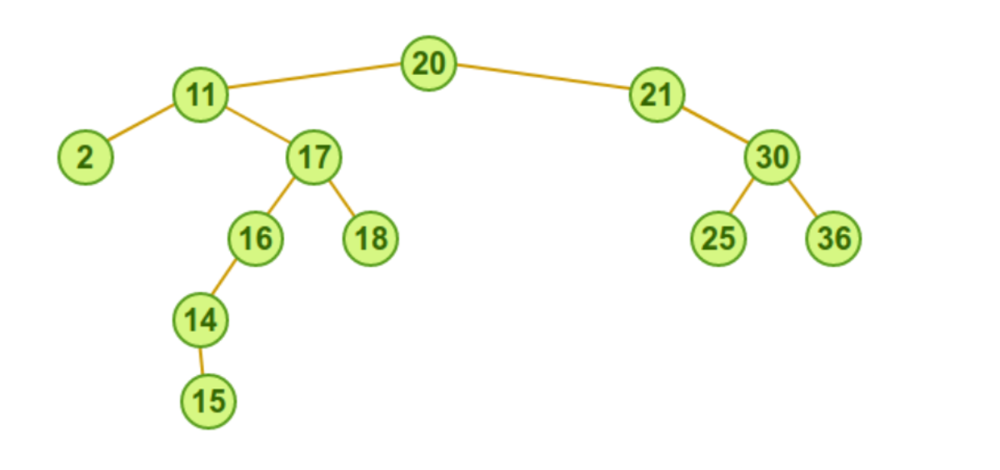

Ao executarmos o procedimento de remoção da raiz, na nova árvore binária de busca, teremos como novo nó raiz:

a) 11
b) 2
c) 17
d) 18
e) Nenhuma das anteriores

#### QUESTÃO 11
Considere o algoritmo a seguir que define a função recursiva "f".

```
função f(n){
  se n igual a 1 então retorne 0
  se n igual a 2 então retorne 1
  setorne f(n-1) + f(n-2)
}
```

Qual o valor retornado pela função "f" ao ser invocada passando o valor 4 como argumento?

a) 0
b) 1
c) 2
d) 3
e) 4

#### QUESTÃO 12
Considere o vetor ordenado abaixo e indique quais os valores serão comparados com a chave de busca de valor 20 se for realizada uma busca binária no vetor. Considere que a primeira posição do vetor é a posição 0.

`32 | 8 | 12 | 16 | 20 | 24 | 28 | 16 | 36`

a) Chaves 20, 12, 8 e 4, nessa ordem
b) Chaves 20, 28,32 e 36, nessa ordem
c) Chaves 4, 8, 12, 16 e 20, nessa ordem
d) Chaves 36, 32, 28 e 24, nessa ordem
e) Apenas a chave 20

#### QUESTÃO 13
Considere uma estrutura de dados do tipo vetor. Com respeito a tal estrutura, é CORRETO que seus componentes são, caracteristicamente:

a) heterogêneos e com acesso FIFO.
b) heterogêneos e com acesso LIFO.
c) heterogêneos e com acesso indexado-sequencial.
d) homogêneos e acesso não indexado.
e) homogêneos e de acesso aleatório por intermédio de índices.

#### QUESTÃO 14
Considere as afirmações sobre busca binária:

I) é utilizada apenas sobre vetores ordenados
II) pode determinar se uma chave está ou não com um número de comparações de chave inferior a 2log2 n passos, onde n é o tamanho do vetor.
III) Supera a busca sequencial quando o vetor é grande, por exemplo com mais que mil elementos, e está ordenado.

a) Apenas as afirmações II e III estão corretas
b) Apenas as afirmações I e II estão corretas
c) Apenas as afirmações I e III estão corretas
d) Todas as afirmações estão corretas
e) Nenhuma das alternativas anteriores

#### QUESTÃO 15
As árvores são estruturas de dados poderosas e se subdividem em vários tipos, cada um dos quais com suas características próprias. Relacione os tipos de árvores, apresentados na coluna da esquerda, com as suas respectivas características, indicadas na coluna da direita:

| Tipo de árvore | Característica |
|---|---|
| I – Heap | W – Pode degenerar se os elementos forem inseridos de forma ordenada. |
| II – Rubro-Negra | X – É balanceada. |
| III – Avore AVL | Y – Têm altura sempre proporcional/próxima a O(log2 n), onde n é o número de nós que contém. |
| IV – Árvores binária de busca | Z – São sempre completas. |

Estão CORRETAS as associações:

a) I–X, IV–Z, II–Y
b) I–Z, IV–X, III–W
c) I–Z, IV–X, III–Y
d) I–Y, IV–W, III–X
e) I–X, IV–W, II–Y

#### QUESTÃO 16
Sobre o algoritmo de ordenação heapsort, marque a alternativa CORRETA:

a) Utiliza ordenação por árvore de decisão, ao invés de ordenação por comparação
b) A estrutura de dados que utiliza, chamada heap, pode ser interpretada como uma árvore binária
c) Seu desempenho de pior caso é pior do que o do algoritmo quicksort
d) Todas as alternativas estão corretas
e) Nenhuma das alternativas está correta

#### QUESTÃO 17
Considerando os algoritmos de ordenação Quicksort, MergeSort, HeapSort e InsertionSort

I. São algoritmos estáveis: HeapSort, QuickSort e MergeSort
II. A complexidade de uso de espaço é O(n²): HeapSort,
III. A ordem das entradas é incapaz de influenciar o desempenho do algoritmo: InsertionSort, MergeSort
IV. Melhor caso da complexidade de tempo em Ω(n) : InsertionSort
V. A complexidade de uso de espaço é O(n): MergeSort

Marque a alternativa que indica SOMENTE afirmações INCORRETAS feitas:

a) I IV e V
b) I , III e IV
c) I, II, III e IV
d) I, II e III
e) II e V

#### QUESTÃO 18
Considere uma tabela de espalhamento (hash table) de comprimento igual a 11, na qual a técnica de resolução de colisões utilizada é a de encadeamento. Nessa tabela, as posições são numeradas (indexadas) com os valores 0, 1, 2, ..., 10, o mapeamento de chaves para posições usa a função hash definida por h(k) = k mod 11, onde k é o valor da chave, e mod é o operador de módulo, e os números 1, 5, 18, 20, 4, 12, 10, 34, 15, 28 e 17 foram as chaves inseridas, nessa ordem, nessa tabela de espalhamento que estava inicialmente vazia. Qual a quantidade de posições em que houve colisão durante as inserções das chaves?

a) 0
b) 1
c) 2
d) 3
e) 4

#### QUESTÃO 19
Marque a alternativa CORRETA. Uma lista encadeada simples é uma estrutura que corresponde a uma sequência lógica de entradas ou nós. Cada nó armazena a localização do próximo elemento na sequência, ou seja, de seu nó sucessor. Nessa estrutura:

a) Para estabelecer a ligação entre um nó já pertencente a uma lista e um novo nó, basta fazer com que o novo nó referencie no, campo next, o nó que anteriormente era referenciado pelo nó original, desde que esse campo não tenha o valor nulo.
b) A existência de um ponteiro apontando para o 1º elemento e outro para o fim da lista permite que a inserção ou deleção de dados de um nó que esteja no meio da lista seja rapidamente executada.
c) Enquanto a entrada que determina o topo da lista é mantida em um nó descritor dessa lista, a entrada que marca o fim da lista é mantida fora do descritor.
d) O armazenamento de uma lista requer uma área contígua de memória para permitir a otimização no processamento de criação e remoção de nós da lista.
e) O armazenamento de uma lista não requer uma área contígua de memória. Como listas são estruturas dinâmicas, normalmente são definidos procedimentos que permitem criar e remover nós na memória.

#### QUESTÃO 20
A estrutura de dados é um modo de armazenamento e organização de dados para que possam ser usados eficientemente. Dentre as alternativas abaixo, sobre as afirmações de estrutura de dados, escolha a CORRETA:

I. Uma fila é uma estrutura de dados em que cada elemento tem um ou mais elementos associados.
II. A árvore é uma estrutura de dados baseada no princípio Last-in, First-out (LIFO), na qual os dados que foram inseridos primeiro serão os últimos a serem removidos.
III. Uma lista é uma estrutura de dados linear, que pode ser encadeada, a qual é composta por nós que apontam para o próximo elemento e o último elemento apontará para nulo.
IV. As pilhas são estruturas baseadas no princípio First-in, First-out (FIFO), em que os elementos que foram inseridos no início são os primeiros a serem removidos.

a) Somente a afirmação I é verdadeira.
b) Somente a afirmação II é verdadeira.
c) Somente a afirmação III é verdadeira.
d) Somente a afirmação IV é verdadeira.
e) Todas as afirmativas são verdadeiras.

---

## Edital 061/2018

Fontes: `Caderno_-_Edital061-2018.pdf` (caderno) e `Folha_Resposta_-_Gabarito_01-02-2018.pdf` (folha de respostas com o gabarito marcado).
Questões 3, 4, 8, 9 e 17 foram anuladas. Figura em `2018-061/figuras/` (Q03).

### Gabarito

| Questão | Resp. | Questão | Resp. |
|---|---|---|---|
| 01 | B | 11 | E |
| 02 | D | 12 | A |
| 03 | Anulada | 13 | C |
| 04 | Anulada | 14 | E |
| 05 | B | 15 | E |
| 06 | D | 16 | A |
| 07 | E | 17 | Anulada |
| 08 | Anulada | 18 | E |
| 09 | Anulada | 19 | D |
| 10 | A | 20 | A |

### Questões

#### QUESTÃO 01
Considere um arquivo sequencial com 10.000 registros, cujas chaves identificadoras são números inteiros de até 8 dígitos. Para criar um índice tipo hashing para esse arquivo, contendo endereços de 0 até 11.999, a mais adequada definição para uma função de hashing f(x), onde x é uma chave e (a mod b) é o resto da divisão de a por b, seria:

a) f = x mod 1000 + 12
b) f = x mod 12000
c) f = x / 10000
d) f = x / 11999
e) f = (x – 11999) /10000

#### QUESTÃO 02
Matrizes são estruturas de dados de n-dimensões. Por simplicidade, chamaremos de matrizes as matrizes bidimensionais numéricas (que armazenam números inteiros). Sendo assim, marque a alternativa INCORRETA.

a) Uma matriz de m linhas e n colunas contêm (m * n) dados.
b) Uma matriz pode ser representada utilizando listas ligadas.
c) A soma dos elementos de uma matriz pode ser calculada fazendo dois laços aninhados, um sobre as linhas e o outro sobre as colunas.
d) A soma de duas matrizes de m linhas e n colunas resulta em uma matriz de 2*m linhas e 2*n colunas.
e) O produto de duas matrizes de n linhas e n colunas resulta em uma matriz de n linhas e n colunas.

#### QUESTÃO 03 (anulada)
Considere a árvore AVL abaixo para responder à questão.

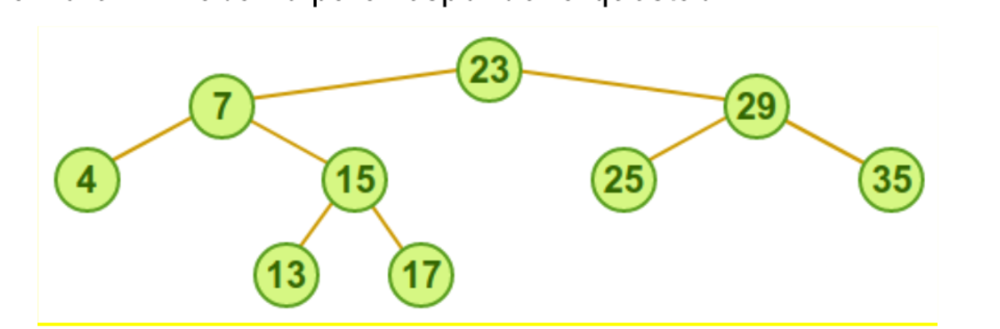

Qual é a sequência de chaves que constrói a referida árvore AVL, inicialmente vazia?

a) 23 – 7 – 29 – 15 – 4 – 25 – 35 – 13 – 17
b) 23 – 13 – 35 – 7 – 4 – 29 – 15 – 25 – 17
c) 23 – 29 – 7 – 17 – 13 – 4 – 35 – 25 – 15
d) 23 – 25 – 7 – 15 – 4 – 13 – 35 – 29 – 17
e) 23 – 7 – 29 – 17 – 4 – 35 -15 – 25 – 13

#### QUESTÃO 04 (anulada)
Considere as afirmativas sobre métodos de ordenação. Sabendo que N se refere ao número de elementos do conjunto, a alternativa INCORRETA é:

a) Os algoritmos Bubble sort e Selection sort são ambos O(N²).
b) O Selection sort é o método mais rápido para qualquer tamanho de N se os elementos já estão ordenados, pois este é o seu melhor caso, que é O(Log2 N).
c) No método Quicksort, inicialmente o vetor é dividido em uma sublista da direita e uma da esquerda, de modo que todo elemento da sublista da esquerda seja menor que os da direita. Em seguida, ordenam-se, pelo mesmo processo, as duas sublistas de forma recursiva.
d) O tempo de execução dos algoritmos de ordenação aumenta na medida em que aumentamos o número de chaves se considerarmos o pior caso.
e) O método Quicksort é, essencialmente, uma aplicação do princípio "dividir para conquistar".

#### QUESTÃO 05
A árvore binária de busca, formada pela inserção dos números 100, 80, 25, 72, 23, 42 e 5, nesta ordem, terá como nós folha os números __I__ e __II__, e como pai do nó 72 o número __III__. As lacunas I, II e III são preenchidas CORRETAMENTE e, respectivamente, por:

a) 100 – 80 – 100
b) 5 – 42 – 25
c) 23 – 25 – 72
d) 25 – 72 – 100
e) 72 – 5 – 23

#### QUESTÃO 06
Marque a alternativa CORRETA. O método de ordenação QuickSort (ordenação rápida) é um método sofisticado de ordenação de vetores que:

a) Considera em cada passo somente um único elemento sucessor na sequência fonte e todos os elementos do vetor destino para encontrar o ponto correto da inserção.
b) Ordena todos os elementos que estiverem a intervalos de 4 posições entre si na sequência corrente.
c) É baseado nos princípios de ordenação por inserção direta através de incrementos decrescentes.
d) O Quicksort é um algoritmo que pode usar espaço extra linear no pior caso.
e) É baseado nos princípios de ordenação por seleção direta que consiste na seleção repetitiva da menor dentre as chaves de n elementos, e depois dentre os n-1 elementos restantes, e assim por diante.

#### QUESTÃO 07
Avaliando as sentenças seguintes a respeito de estrutura de dados,

I. A diferença entre árvore binária simples e árvores AVL é o fato de que a segunda pode se reconfigurar dinamicamente, com o intuito de manter um bom nível de balanceamento.
II. Uma pilha garante que o último elemento inserido seja localizado no seu topo.
III. Do ponto de vista conceitual, não há diferença alguma entre uma estrutura de array e uma lista encadeada.
IV. Tabelas hash são estruturas de dados indicadas para armazenar grande volume de dados.

Verifica-se que:

a) As sentenças I e IV são verdadeiras.
b) Apenas a sentença I é verdadeira.
c) As sentenças III e IV são verdadeiras
d) As sentenças II e III são verdadeiras.
e) Apenas I, II e IV são verdadeiras.

#### QUESTÃO 08 (anulada)
É INCORRETO afirmar que:

a) A fila de prioridade, uma estrutura de dados linear, é uma versão especial da fila.
b) Uma lista linear é uma estrutura de dados onde elementos do mesmo tipo são organizados de forma sequencial.
c) Na pilha, uma estrutura não linear, os elementos são colocados e retirados por um único lado da lista, ou seja, pelo topo.
d) Na tabela de Hash por endereçamento aberto, a chave é transformada num índice inteiro que é usado para acessar os dados.
e) Um array pode ser alocado dinamicamente, situação na qual ele passa a ser denominado lista ligada ou lista encadeada.

#### QUESTÃO 09 (anulada)
Para uma árvore B, de ordem "m", o número mínimo de descendentes para um nível "d" da árvore é de:

a) 2 * m/2 (d-1)
b) d * m/2
c) (m*d/2) 2
d) [(m*d/2) 2 ]/2
e) d*(m/2) 2

*(Nota: as alternativas usam expoentes e possivelmente símbolos de teto que a extração de texto não preservou. Os expoentes aparecem soltos acima, e vale conferir a notação no PDF original.)*

#### QUESTÃO 10
Dois vetores, v1 e v2, capazes de armazenar N inteiros cada um, estão ordenados de forma crescente e têm a propriedade de que o último elemento de v1 (v1[N-1]) é menor que o primeiro elemento de v2 (v2[0]). É retirado um elemento de cada vez de cada um desses vetores alternadamente, e cada elemento retirado é colocado em uma fila. Posteriormente, os elementos são retirados da fila e inseridos em uma árvore binária de busca. A árvore é percorrida em ordem simétrica, e os elementos são inseridos, assim que retirados, em uma pilha. Depois, cada elemento é retirado da pilha e inserido alternadamente em um dos vetores, começando por v1. Diante do exposto, conclui-se que:

a) v1[i] ≥ v2[i], ∀ i = 0,1,...,N-1
b) v1[i] ≤ v2[i], ∀ i = 0,1,...,N-1
c) v1[N-1] > v2[0]
d) As listas não estão mais ordenadas.
e) Todos os elementos de v1 estão armazenados em v2 e vice-versa.

#### QUESTÃO 11
Para remoção de uma chave cuja página esteja com o número mínimo, em árvore B, é CORRETO afirmar que:

a) Deve-se fazer o processo de SPLIT sempre na página onde se encontrar a chave.
b) Deve-se fazer o processo de SPLIT na página onde se encontrar a chave, exceto quanto é um elemento da raiz da árvore.
c) Se a página onde se encontrar a chave não é folha, deve-se fazer procedimento de concatenação ou redistribuição, considerando os irmãos.
d) Remove-se a chave, e a substitui por uma chave do nó irmão.
e) No caso de só haver uma única página, a remoção não causa a necessidade de balanceamento.

#### QUESTÃO 12
Lista circular encadeada é uma das estruturas de dados dinâmicas básicas. Uma questão que deve ser resolvida pelo algoritmo de busca em lista circular encadeada é:

a) Saber quando finalizar a busca, se o elemento procurado não estiver na lista circular.
b) Retornar o elemento anterior ao buscado, dada a propriedade de circularidade da lista.
c) Devolver o número de elementos constantes na lista.
d) Parar a busca assim que encontrar um elemento cujo ponteiro para o próximo elemento tenha valor nulo, o que indica o fim da lista.
e) Devolver o ponteiro de marcação de início, em sua nova posição

#### QUESTÃO 13
Suponha que uma Árvore Binária de Busca possui números entre 1 e 1000 e que se quer procurar pelo número 363. Qual sequência abaixo NÃO poderia ser a sequência de nós examinados?

a) 2, 252, 401, 398, 330, 344, 397, 363.
b) 924, 220, 911, 244, 898, 258, 362, 363.
c) 925, 202, 911, 240, 912, 245, 363.
d) 2, 399, 387, 219, 266, 382, 381, 278, 363.
e) 935, 278, 347, 621, 350, 392, 358, 363.

#### QUESTÃO 14
Analise as afirmativas a seguir sobre árvores B e árvores binárias

I. Diferente das árvores binárias, cada nó de uma árvore B deverá sempre ter mais de dois filhos.
II. Um nó de árvore B tem um campo ou um método para indicar se é um nó folha ou não. Característica esta herdada da AVL.
III. As folhas da árvore B são dispostas mais flexivelmente que as da árvore binária: suas folhas poderão estar em níveis diferentes, desde zero até o valor da altura da árvore.
IV. A árvore B tem um método de balanceamento muito custoso, por isso, sua indicação para trabalhar com dispositivos de armazenamento secundário, deve ser avaliada com muita cautela.

e assinale a alternativa CORRETA.

a) Todas as afirmativas estão corretas.
b) Somente as afirmativas II e III estão corretas
c) Somente as afirmativas I, II e IV estão corretas.
d) Somente as afirmativas I, III e IV estão corretas.
e) Todas as afirmativas estão incorretas

#### QUESTÃO 15
Se em uma árvore binária de pesquisa a diferença de altura entre a subárvore à esquerda e a subarvore à direita de um dos nós for maior que 1, pode-se concluir que:

a) A árvore é uma árvore AVL.
b) Trata-se com certeza de uma árvore binária sem balanceamento.
c) Trata-se com certeza de uma árvore vermelho e preto.
d) Tal árvore não pode existir por não se tratar de uma árvore binária de pesquisa.
e) Nenhuma das alternativas anteriores está correta.

#### QUESTÃO 16
Considere as seguintes afirmações:

I. Hash por encadeamento nunca apresenta colisões secundárias
II. Hash por encadeamento jamais permite que o número de comparações entre chaves em uma operação de busca passe de log n, onde n é o número de chaves inseridas no hash.
III. Hash por encadeamento realiza sempre menos comparações entre chaves do que qualquer hash por endereçamento aberto.

Agora marque a alternativa CORRETA:

a) Apenas a afirmação I é verdadeira
b) Apenas a afirmação II é verdadeira
c) Apenas a afirmação III é verdadeira
d) Apenas as afirmações II e III são verdadeiras
e) Nenhuma das alternativas anteriores está correta

#### QUESTÃO 17 (anulada)
Considere as afirmações abaixo:

I. O RADIX sort não realiza comparação entre chaves para realizar a ordenação de um vetor
II. O número de vezes que é necessário passar por todos os elementos do vetor no RADIX sort é proporcional ao número médio de dígitos dos elementos do vetor na base utilizada pelo algoritmo para ordenação
III. O RADIX sort requer um espaço extra de armazenamento proporcional ao tamanho do vetor

Sobre as afirmações, sabe-se que:

a) Apenas a afirmação I é verdadeira
b) Apenas a afirmação II é verdadeira
c) Apenas a afirmação III é verdadeira
d) Apenas as afirmações II e III são verdadeiras
e) Nenhuma das afirmações é verdadeira

#### QUESTÃO 18
Considere as afirmações sobre um hash por encadeamento:

I. Tem como desvantagem o fato de não ordenar as chaves inseridas
II. O número médio de operações esperado para realizar uma busca é constante se o hash for bem projetado
III. Mesmo quando bem implementado, ocupa mais espaço extra do que uma árvore B em memória.

Sobre as afirmações, sabe-se que:

a) Todas as afirmações são verdadeiras
b) Todas as afirmações são falsas
c) Apenas as afirmações I e III são verdadeiras
d) Apenas a afirmação III é verdadeira
e) Apenas as afirmações I e II são verdadeiras

#### QUESTÃO 19
Quanto ao algoritmo e estrutura de dados no caso de árvore AVL, analise as afirmativas abaixo como verdadeiras (V) ou falsas (F) e assinale a alternativa que apresenta a sequência CORRETA de cima para baixo:

( ) Uma árvore AVL é dita balanceada quando, para cada nó da árvore, a diferença entre as alturas das suas sub-árvores (direita e esquerda) não é maior do que um.
( ) Caso haja diferença de altura maior que 1 ente as sub-árvores à direita e à esquerda de qualquer nó, é necessário que se realizem rotações com o objetivo de reduzir tal diferença.
( ) A operação de rotação realizada em um ponto da árvore, após a inserção, pode resultar em uma árvore ainda desbalanceada, podendo ser necessária a realização de novas rotações que, na pior das hipóteses, podem ser propagadas até a raiz.

a) F-V-V
b) F-F-V
c) V-F-F
d) V-V-F
e) V-V-V

#### QUESTÃO 20
Dados os seguinte valores de entrada - 11, 12, 23, 14, 25, 50, 8, 18, 29, 10 -, insira-os em uma PILHA. Em seguida retire cada um dos valores da PILHA e insira numa FILA. Mostre a FILA. Depois retire os dados da FILA e insira na PILHA. Mostre a PILHA.

As valores MOSTRADOS ficam

I. FILA (começo) 10 - 29 - 18 - 8 - 50 - 25 - 14 - 23 - 12 - 11 (fim)
II. PILHA: (topo) 11 - 12 - 23 - 14 - 25 - 50 - 8 - 18 - 29 - 10
III. PILHA: (topo) 10 - 29 - 18 - 8 - 50 - 25 - 14 - 23 - 12 - 11
IV. FILA: (começo) 11 - 12 - 23 - 14 - 25 - 50 - 8 - 18 - 29 – 10 (fim)

Está CORRETO o que se afirma APENAS em:

a) I e II
b) I e IV
c) II e III
d) III e IV
e) III e IV

---

## Edital 033/2019

Fontes: `CadernoQuestões-Edital033-2019.pdf` (caderno) e `Folha_Resposta-Gabarito.pdf` (gabarito parcial).
Questões 5, 10, 13 e 15 constam como anuladas no gabarito parcial. Figuras em `2019-033/figuras/` (Q02, Q04, Q16, Q19).

#### Gabarito parcial

| Questão | Resp. | Questão | Resp. |
|---|---|---|---|
| 01 | A | 11 | B |
| 02 | D | 12 | B |
| 03 | A | 13 | Anulada |
| 04 | C | 14 | D |
| 05 | Anulada | 15 | Anulada |
| 06 | D | 16 | E |
| 07 | B | 17 | C |
| 08 | D | 18 | A |
| 09 | A | 19 | A |
| 10 | Anulada | 20 | B |

### Questões

#### QUESTÃO 01
Sabendo que o algoritmo Quick Sort classifica os elementos em ordem crescente usando o primeiro elemento como pivô, qual das seguintes sequências de entrada irá requerer o maior número de comparações quando o algoritmo for aplicado?

a) 22 25 33 42 56 67 89
b) 63 70 47 42 36 38 73
c) 42 25 22 33 67 56 89
d) 13 52 25 58 10 22 17
e) 23 25 33 42 11 22 30

#### QUESTÃO 02
A parte essencial do Heap Sort é a construção do heap máximo. Considerando a árvore mostrada abaixo, o nó 24 viola a propriedade do heap máximo. Uma vez que o procedimento de heap é aplicado a ele, em que posição ele estará?

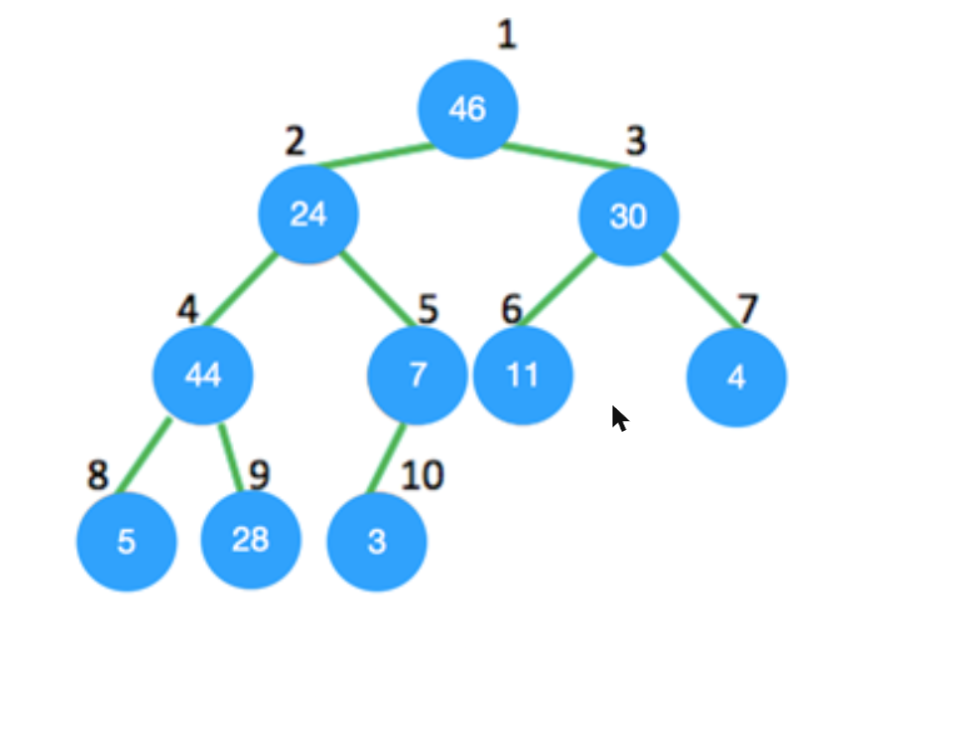

a) 4
b) 5
c) 8
d) 9
e) 6

#### QUESTÃO 03
Considere a seguinte operação em uma pilha de tamanho 5:
Push(1); Pop(); Push(2); Push(3); Pop(); Push(4); Pop(); Pop(); Push(5);
Após a todos as operações serem realizadas, o número de elementos presentes na pilha é:

a) 1
b) 2
c) 3
d) 4
e) 5

#### QUESTÃO 04
A figura abaixo mostra uma árvore B de ordem 5. Qual é o resultado da remoção do nó 130 dessa árvore?

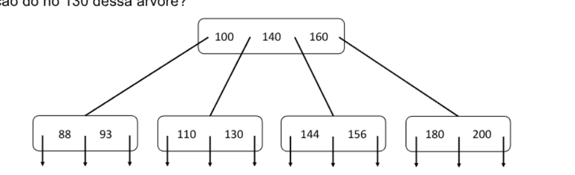

Alternativas a) e b):

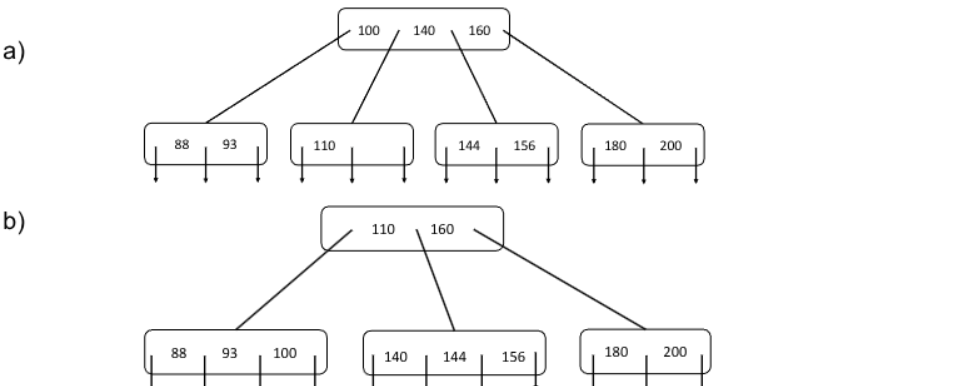

Alternativas c) e d):

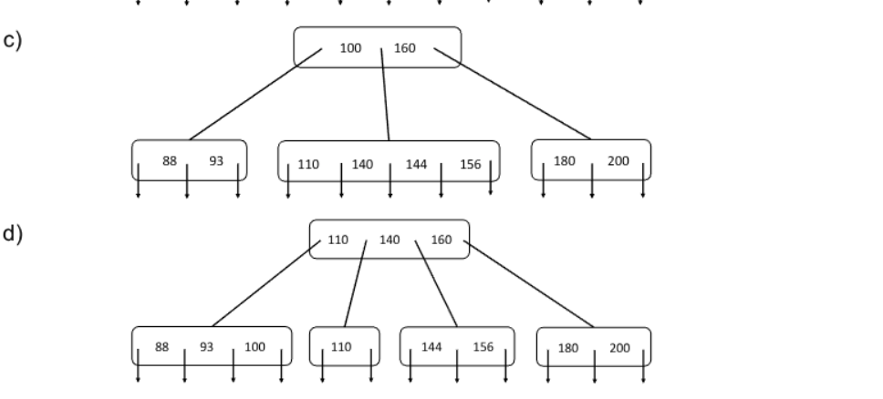

e) Nenhuma das anteriores

#### QUESTÃO 05 (anulada)
No pior dos casos, o número de comparações necessárias para pesquisar uma lista simplesmente encadeada de comprimento n para um dado elemento é

a) log2 n
b) n/2
c) log2 n - 1
d) n
e) Nenhuma das anteriores

#### QUESTÃO 06
Qual é a saída da seguinte função que inicia apontando para o primeiro nó da seguinte lista encadeada?

`1->2->3->4->5->6`

```c
void fun(struct node* start)
{
  if(start == NULL)
    return;
  printf("%d ", start->data);
  if(start->next != NULL )
    fun(start->next->next);
  printf("%d ", start->data);
}
```

a) 1 4 6 6 4 1
b) 1 3 5 1 3 5
c) 1 2 3 5
d) 1 3 5 5 3 1
e) Nenhuma das anteriores

#### QUESTÃO 07
Qual estrutura de dados é comumente usada para implementar recursão?

a) Queue (fila)
b) Stack (pilha)
c) Array (vetor)
d) Lista
e) Matriz

#### QUESTÃO 08
Quais são, respectivamente, o pior caso e o caso médio de uma árvore de busca binária em termos de complexidade?

a) O(n), O(n)
b) O(logn), O(logn)
c) O(logn), O(n)
d) O(n), O(logn)
e) Nenhuma das respostas anteriores.

#### QUESTÃO 09
Uma árvore B de ordem 4 e de altura 3, onde ordem é o número máximo de filhos em cada nó, terá um máximo de chaves igual a?

a) 255
b) 63
c) 127
d) 188
e) 256

#### QUESTÃO 10 (anulada)
Suponha uma tabela hash vazia com tamanho m = 17, utilizando o método da divisão para chaves de valores naturais e endereçamento aberto. Considere as sentenças abaixo:

I. Após inserir as chaves 5, 10, 22, 42 e 39, utilizando sondagem linear, terá havido um total de 2 colisões
II. As chaves 5, 10, 22, 42 e 39 poderiam ser inseridas sem colisão se utilizássemos uma função dispersão dupla (double hash)
III. É possível inserir 17 chaves nessa tabela sem que ocorra nenhuma colisão.

Marque a alternativa CORRETA

a) Somente a sentença I está correta
b) As sentenças I e II estão correta
c) Somente a sentença III está correta
d) As sentenças I e III estão correta
e) Todas as sentenças estão corretas

#### QUESTÃO 11
Qual a função do seguinte trecho de código?

```java
public void function(int data)
{
  int flag = 0;
  if( head != null)
  {
    Node temp = head.getNext();
    while((temp != head) && (!(temp.getItem() == data)))
    {
      temp = temp.getNext();
      flag = 1;
      break;
    }
  }
  if(flag)
    System.out.println("success");
  else
    System.out.println("fail");
}
```

a) Imprimir sucess se um determinado elemento não for encontrado
b) Imprimir fail se um determinado elemento não for encontrado
c) Imprimir sucess se um elemento em particular for igual a 1
d) Imprimir fail se a lista estiver vazia e success caso contrário
e) Nenhuma das respostas anteriores.

#### QUESTÃO 12
Qual é a altura máxima de qualquer árvore AVL com 7 nós? Assuma que a altura de uma árvore com um único nó seja 0.

a) 2
b) 3
c) 4
d) 5
e) 6

#### QUESTÃO 13 (anulada)
Dadas as sentenças abaixo, marque a alternativa CORRETA.

I. As raízes dos elementos das subárvores são menores que a raiz do heap.
II. Para restaurar a propriedade AVL depois de inserir um elemento, começamos no ponto de inserção e nos movemos em direção a raiz dessa árvore.
III. A árvore B e a árvore AVL têm a mesma complexidade de tempo do pior caso para inserção e exclusão.

a) Somente a sentença I está correta
b) As sentenças II e III estão correta
c) Somente a sentença III está correta
d) As sentenças I e III estão correta
e) Somente a sentença II está correta

#### QUESTÃO 14
Dada a seguinte entrada (34, 8, 64, 51, 32, 21) e empregando o algoritmo Insertion Sort, qual será a aparência do array de elementos após a segunda rodada de ordenação?

a) 8, 21, 32, 34, 51, 64
b) 8, 32, 34, 51, 64, 21
c) 8, 34, 51, 64, 32, 21
d) 8, 34, 64, 51, 32, 21
e) 8, 51, 64, 34, 32, 21

#### QUESTÃO 15 (anulada)
Qual é a vantagem do Bubble Sort em relação aos outros algoritmos de ordenação?

a) É o mais rápido
b) Consome menos memória
c) Pode detectar se a entrada já está ordenada
d) É o mais complexo em termos de implementação
e) Não possui vantagens

#### QUESTÃO 16
Ao se representar a heap máxima da figura abaixo em um array, a ordem dos elementos no array será a seguinte:

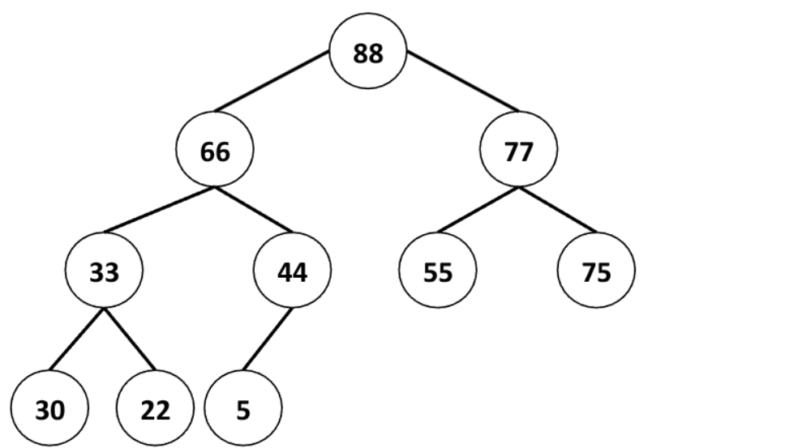

a) 88 66 33 44 30 22 5 77 55 75
b) 86 77 55 75 66 33 44 30 22 5
c) 86 77 75 66 55 44 33 30 22 5
d) 5 22 30 75 55 44 33 77 66 86
e) 88 66 77 33 44 55 75 30 22 5

#### QUESTÃO 17
Quantas pilhas são necessárias para implementar uma fila. Considere a situação em que nenhuma outra estrutura de dados, como matrizes, lista encadeada está disponível.

a) 0
b) 1
c) 2
d) 3
e) 4

#### QUESTÃO 18
Qual das afirmações abaixo sobre Insertion Sort está CORRETA?

a) Existem arrays de tamanhos variados N tais que o Insertion Sort é executado em Θ(N).
b) Existem arrays de tamanhos variados N tais que o Insertion Sort é executado em Θ(1).
c) Existem arrays de tamanhos variados N tais que o Insertion Sort é executado em Θ(N³).
d) Existem arrays de tamanhos variados N tais que o Insertion Sort é executado em Θ(2^N).
e) Nenhuma das sentenças anteriores está correta.

#### QUESTÃO 19
Ao se construir uma árvore AVL, inicialmente vazia, com as seguintes chaves na ordem indicada - 2, 3, 5, 6, 9, 8, 7, 4, 1 – e sabendo que que se uma inserção fizer com que a árvore fique desequilibrada, é necessário executar as rotações para manter o equilíbrio, o resultado final da árvore AVL é:

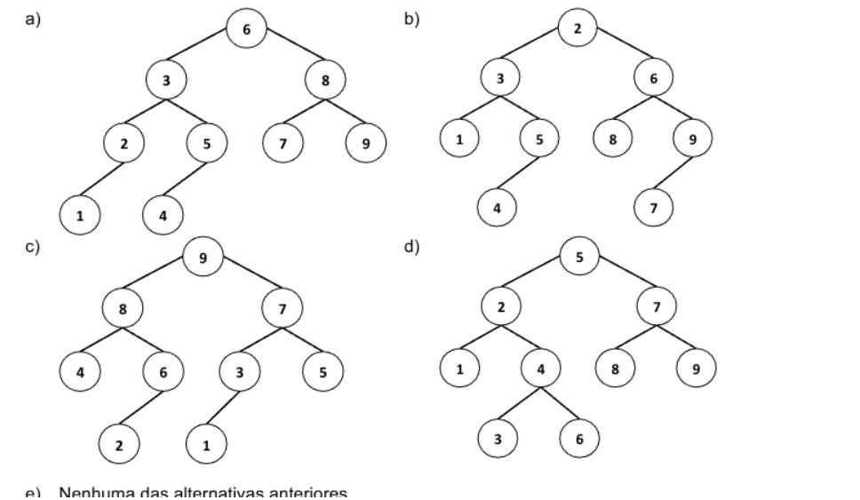

e) Nenhuma das alternativas anteriores

#### QUESTÃO 20
Sobre as afirmações abaixo, marque a alternativa CORRETA

I. A subárvore da raiz de um árvore vermelho e preto é sempre uma árvore vermelha e preta.
II. O irmão de uma referência de filho nulo em uma árvore vermelha e preta é outra referência de filho nulo ou um nó vermelho.
III. A pior complexidade de tempo da operação de inserção em uma árvore AVL é O(log n), onde n é o número de nós na árvore.

a) Somente a sentença I está correta
b) As sentenças II e III estão correta
c) Somente a sentença III está correta
d) As sentenças I e III estão correta
e) Somente a sentença II está correta

---

## Edital 060/2019

Fontes: `Caderno_de_Questões_-_Edital_0602019.pdf` (caderno) e `Folha_Resposta_-_Gabarito_30-01-2020.pdf` (folha de respostas com o gabarito marcado).
Questões 11, 13, 14 e 16 foram anuladas. Figuras em `2019-060/figuras/` (Q01, Q02, Q12).

A Questão 16 diz "figura abaixo", mas o PDF não traz a figura da árvore, o que talvez explique a anulação. Não há nada para capturar ali.

### Gabarito

| Questão | Resp. | Questão | Resp. |
|---|---|---|---|
| 01 | C | 11 | Anulada |
| 02 | A | 12 | D |
| 03 | D | 13 | Anulada |
| 04 | C | 14 | Anulada |
| 05 | B | 15 | A |
| 06 | C | 16 | Anulada |
| 07 | D | 17 | C |
| 08 | B | 18 | A |
| 09 | A | 19 | E |
| 10 | E | 20 | E |

### Questões

#### QUESTÃO 01
Suponha que você tenha a seguinte tabela hash implementada utilizando endereçamento aberto com sondagem linear (linear probing). A função hash que você está usando é uma função modular, h(x) = x MOD 9.

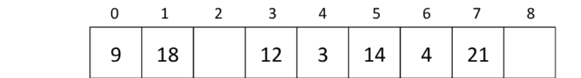

Qual das ordens abaixo pode ser a ordem em que os elementos foram adicionados à hash? Assuma que a hash nunca tenha sido redimensionada e que nenhum elemento tenha sido excluído ainda.

a) 9, 14, 4, 18, 21, 3, 12
b) 12, 3, 14, 18, 4, 9, 21
c) 12, 14, 3, 9, 4, 18, 21
d) 9, 12, 14, 3, 21, 18, 4
e) 18, 9, 12, 3, 14, 4, 21

#### QUESTÃO 02
Dado os seguintes elementos (10, 20, 15, 25, 30, 16, 18, 19), qual desenho representa uma árvore AVL, inicialmente vazia, que é preenchida com esses elementos, na ordem apresentada, e que tem as devidas rotações efetuadas?

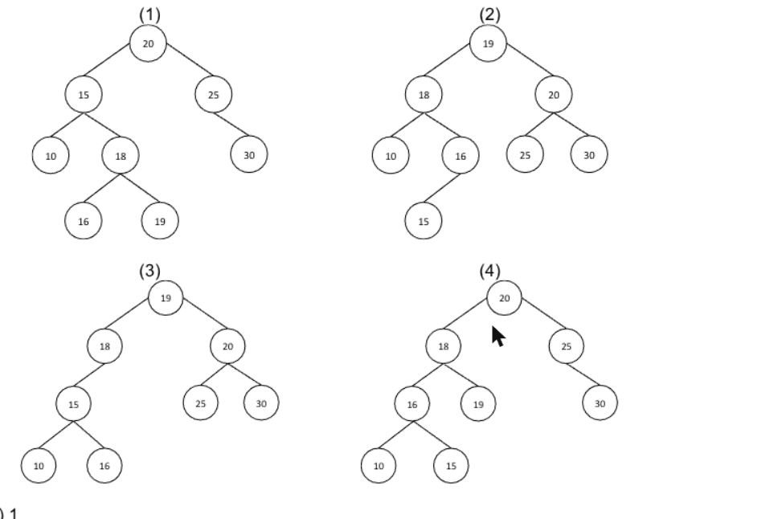

a) 1
b) 2
c) 3
d) 4
e) Nenhuma das árvores desenhadas representa uma AVL

#### QUESTÃO 03
Qual a alternativa que completa corretamente a seguinte frase: Um algoritmo que possui número de operações _______________ em função de uma entrada de tamanho n é linear.

a) n³ + 9
b) 3n² + 3n + 2
c) 6
d) 2n + 1
e) n² + 1

#### QUESTÃO 04
Considere um vetor com 25 elementos (posição 0 até a posição 24) que representam os números primos entre 1 a 100, em ordem crescente (Ex: [2, 3, 5, 7, 11, 13, ..., 89, 97]). Empregando pesquisa binária, quantos itens do vetor precisam ser examinados antes de se concluir que o número 52 não está no vetor e, portanto, não é primo?

a) 12
b) 7
c) 5
d) 1
e) 4

#### QUESTÃO 05
Considere o código da função abaixo:

```c
void fun1(struct node* head)
{
  if(head == NULL)
    return;
  fun1(head->next);
  printf("%d ", head->data);
}
```

O que essa função faz, dada uma lista encadeada de valores inteiros como entrada?

a) Imprime todos os nós da lista encadeada, começando com primeiro o nó da lista
b) Imprime todos os nós da lista encadeada, começando com o último nó da lista
c) Imprime apenas os nós de posições pares da lista encadeada
d) Imprime apenas os nós de posições impares da lista encadeada
e) Nenhuma das alternativas anteriores

#### QUESTÃO 06
Marque a alternativa CORRETA. Sobre um hash com encadeamento e com tabela de tamanho 100, pode-se dizer que:

a) Para casos em que se insere um número n muito grande de chaves, o tempo no caso médio de busca será O(1)
b) Para casos em que se insere um número n muito grande de chaves, o tempo de busca no pior caso será O(1)
c) Para casos em que se insere um número n muito grande de chaves, o tempo no caso médio de busca será O(n)
d) Para casos em que se insere um número n muito grande de chaves, o tempo de busca no pior caso será O(log n)
e) Nenhuma das alternativas anteriores

#### QUESTÃO 07
A seguinte função em C usa uma lista simplesmente encadeada como argumento de entrada. Ela modifica a lista, movendo o último elemento para a frente da lista e retorna a lista modificada.

```c
typedef struct node {
  int value;
  struct node *next;
}Node;

Node *move_to_front(Node *head) {
  Node *p, *q;
  if ((head == NULL || (head->next == NULL))
    return head;
  q = NULL; p = head;
  while (p-> next !=NULL)
  {
    q = p;
    p = p->next;
  }
  _ _ _ _ _ _ _ _ _ _ _ _ _ _
  return head;
}
```

Certa parte do código foi deixada em branco (linha tracejada). Escolha a alternativa CORRETA para substituir a linha em branco.

a) q = NULL; p->next = head; head = p;
b) q->next = NULL; head = p; p->next = head;
c) head = p; p->next = q; q->next = NULL;
d) q->next = NULL; p->next = head; head = p;
e) A função não precisa ser complementada.

#### QUESTÃO 08
Qual dos seguintes algoritmos apresenta tempo O(n) quando ordenando um vetor com n elementos idênticos de texto?

a) Heapsort
b) Insertion sort
c) Mergesort
d) Quicksort
e) Nenhum dos algoritmos apresenta tempo O(n) para essa entrada

#### QUESTÃO 09
Qual das afirmações a seguir é VERDADEIRA sobre árvores rubro-negra (vermelho e preto)?

a) O caminho do nó raiz até o nó folha mais distante não é maior que o dobro do número de nós do caminho da raiz para a folha mais próxima
b) O caminho do nó raiz para um nó folha ou para um nó nulo deve conter o mesmo número de nós pretos e vermelhos.
c) A raiz pode ser vermelha
d) Se um nó for vermelho, os nós filhos somente serão pretos. O inverso também acontece, ou seja, se um nó for preto, seus nós filhos somente serão vermelhos.
e) Nenhumas das afirmações é verdadeira

#### QUESTÃO 10
Qual das seguintes estruturas de dados é mais usada para implementar recursão?

a) Heap binário
b) Hash table
c) Fila
d) Árvore de busca
e) Pilha

#### QUESTÃO 11 (anulada)
Qual das alternativas a seguir é FALSA sobre a árvores B e B+

a) Árvores B e B+ criando um novo nível raiz (crescem para cima) sempre que sua altura muda, enquanto as árvores de pesquisa binária crescem adicionando novos nós folhas (para baixo) sempre que sua altura muda.
b) A complexidade de tempo para busca por uma chave é diferente das árvores rubro-negras, se considerarmos o pior caso
c) O número de ponteiros filhos em um nó da árvore B é sempre igual ao número de chaves nele mais uma.
d) Uma árvore B+, de ordem n, é uma árvore com as seguintes propriedades: (i) todos os nós das folhas são armazenados na mesma profundidade; (ii) todos as chaves são armazenadas em nós folha.
e) Uma árvore B, de ordem n, é uma árvore com as seguintes propriedades: (i) todos os nós das folhas são armazenados na mesma profundidade; (ii) todos os nós não raiz têm entre n - 1 e 2n – 1 chaves; (iii) a raiz tem no máximo 2n – 1 chaves.

#### QUESTÃO 12
Quais das seguintes árvores abaixo respeita as regras básicas de balanceamento de árvores AVL?

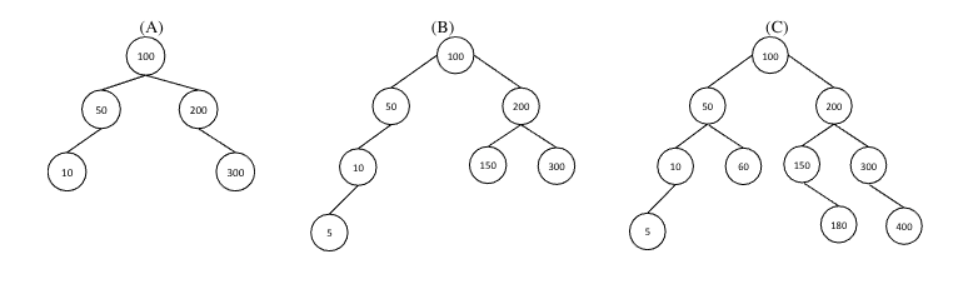

a) Somente B
b) A, B e C
c) B e C
d) A e C
e) Nenhuma das árvores é AVL

#### QUESTÃO 13 (anulada)
Quais das seguintes afirmações sobre árvores é INCORRETA?

a) O tempo de busca, no pior caso, para uma árvore AVL é O(log n)
b) No pior caso, uma inserção de árvore rubro-negra requer O(1) rotações
c) Uma árvore B+ tem todos as chaves armazenadas em nós folha
d) A busca por uma chave em uma árvore de pesquisa binária sem balanceamento com n nós leva tempo O(log n) no pior caso.
e) Pode-se dizer que uma árvore B é uma árvore balanceada

#### QUESTÃO 14 (anulada)
O número mínimo de comparações necessárias para determinar se um número inteiro aparece mais de n/2 vezes em um vetor ordenado de n números inteiros é:

a) Θ(n)
b) Θ(log n)
c) Θ(log *n)
d) Θ(1)
e) Θ(n/2)

#### QUESTÃO 15
Comparando árvores AVL e rubro-negras, qual das seguintes afirmações é VERDADEIRA:

a) As árvores AVL tendem a ter altura menor em comparação com as árvores rubro-negras, mas podem causar mais rotações durante operações de inserção e exclusão.
b) As alturas das árvores AVL e rubro-negras são as mesmas, mas as árvores AVL podem causar mais rotações durante a inserção e exclusão.
c) As árvores rubro-negras tendem a ter altura menor em comparação com as árvores AVL, mas podem causar mais rotações durante a inserção e exclusão.
d) As alturas das árvores AVL e rubro-negras são as mesmas, mas as árvores rubro-negras podem causar mais rotações durante a inserção e exclusão.
e) Todas as afirmações anteriores são falsas

#### QUESTÃO 16 (anulada)
Dada a seguinte árvore binária de busca (figura abaixo) e ao se realizar as seguintes operações em sequência - adicionar o nó 5, adicionar o nó 17, remover o nó 23 e remover o nó 9. Qual das alternativas representa a lista de nós desta árvore em pré-ordem e pós-ordem, respectivamente?

*(Figura ausente no PDF original.)*

a) 3, 9, 10, 12, 15, 19, 21, 23 e 23, 21, 19, 15, 12, 10, 9, 3
b) 15, 9, 23, 3, 12, 19, 10, 21 e 21, 10, 19, 12, 3, 23, 9, 15
c) 15, 10, 21, 3, 12, 19, 9, 23 e 15, 21, 10, 19, 12, 3, 23, 9
d) 10, 12, 9, 3, 15, 23, 19, 21 e 21, 19, 23, 15, 9, 3, 12, 10
e) 15, 10, 3, 5, 12, 21, 19, 17 e 5, 3, 12, 10, 17, 19, 21, 15

#### QUESTÃO 17
Suponha que, no pior caso, um algoritmo Merge Sort leve 30 segundos para ordenar uma entrada de tamanho 64. Qual das opções a seguir se aproxima mais do tamanho máximo de entrada de um problema que pode ser resolvido em 6 minutos?

a) 256
b) 1024
c) 512
d) 2048
e) 4096

#### QUESTÃO 18
Considere que os seguintes elementos {5,4,3,2,1} foram inseridos nesta ordem em um vetor. Em seguida, você aplicou o algoritmo Insertion Sort nele. Qual é a sequência de passos feitos durante o uso do Insertion Sort neste vetor?

a) 4 5 3 2 1 / 3 4 5 2 1 / 2 3 4 5 1 / 1 2 3 4 5
b) 5 4 3 1 2 / 5 4 1 2 3 / 5 1 2 3 4 / 1 2 3 4 5
c) 4 3 2 1 5 / 3 2 1 5 4 / 2 1 5 4 3 / 1 5 4 3 2
d) 4 5 3 2 1 / 2 3 4 5 1 / 3 4 5 2 1 / 1 2 3 4 5
e) 4 5 3 1 2 / 2 3 4 5 1 / 3 4 5 2 1 / 1 2 3 4 5

#### QUESTÃO 19
Considere uma lista duplamente encadeada não ordenada (com ponteiros na início e final da lista). Qual das seguintes operações a seguir pode ser implementada no tempo O(1)? Marque a alternativa CORRETA.

I. Inserção na frente da lista encadeada
II. Inserção no final da lista encadeada
III. Exclusão do nó frontal da lista encadeada
IV. Exclusão do último nó da lista encadeada

a) I e II
b) I e III
c) I, II e III
d) I, II e IV
e) Todas as afirmativa estão corretas

#### QUESTÃO 20
Suponha que uma fila circular de elementos com capacidade (n - 1) seja implementada com um vetor de n elementos. Suponha que a operação de inserção e exclusão seja realizada usando REAR (último elemento da fila) e FRONT (primeiro elemento da fila) como variáveis de índice do vetor, respectivamente. Inicialmente, REAR = FRONT = 0. As condições para detectar a fila cheia e a fila vazia são:

a) Full: (REAR+1) mod n == FRONT, empty: (FRONT+1) mod n == REAR
b) Full: REAR == FRONT, empty: (REAR+1) mod n == FRONT
c) Full: (FRONT+1) mod n == REAR, empty: REAR == FRONT
d) Full: REAR == FRONT, empty: (FRONT+1) mod n == REAR
e) Full: (REAR+1) mod n == FRONT, empty: REAR == FRONT

---

## Edital 057/2022 (prova de 27/01/2023)

Quatro alternativas por questão. O cartão de respostas veio sem a posição das marcas.

**01.** (Python) Saída de:
```python
class Vector():
    def __init__(self, row: list()):
        self.row = row
    def dot_product(self, column):
        return sum(self.row[i] * column.row[i] for i in range(len(self.row)))
vec_1 = Vector([0,2,0,0,5])
vec_2 = Vector([1,0,3,4,0])
print(vec_1.dot_product(vec_2))
```
a) 15 · b) [0, 0, 0, 0, 0] · c) [1, 2, 3, 4, 5] · d) 0

**02.** Árvores de pesquisa binária: 1. TODOS os nós da subárvore à esquerda são menores que o pai. 2. O nó mais à esquerda é o menor de TODOS os nós, e o mais à direita é o maior. 3. O sucessor de x (menor chave maior que a de x) está SEMPRE em um nível acima de x, mais próximo da raiz. Quais são verdadeiras?
a) Apenas 2 e 3 · b) Todas · c) Apenas 1 e 2 · d) Apenas 1

**03.** Ordenação: 1. O Quicksort tem complexidade de pior caso O(n log n). 2. Quicksort e Mergesort usam divisão e conquista. 3. O Mergesort é Θ(n log n) no caso médio. 4. Com a lista já ordenada, o Selectionsort é O(n). As afirmações são, respectivamente:
a) V, V, V, V · b) F, V, V, F · c) V, F, F, V · d) F, F, F, F

**04.** Itens inseridos numa árvore binária de busca: 8, 3, 4, 9, 5, 6, 2, 1, 7. Qual fica na raiz?
a) 1 · b) 4 · c) 8 · d) 9

**05.** Pilha O(1) com lista simplesmente encadeada: onde ficam push e pop?
a) push depois do último, pop no último · b) push antes do primeiro, pop no primeiro · c) push antes do primeiro, pop no último · d) push depois do último, pop no primeiro

**06.** (Python) Mesma classe `Vector`; `vec_1 = Vector([1,2,3,4,5])`, `vec_2 = vec_1`, `vec_2.row[2] = 15`, `print(vec_1.row)`.
a) [ 2 15 4 5] · b) [ 0 1 2 15 4 5] · c) [ 1 2 15 4 15] · d) [ 1 2 15 4 5]

**07.** f(n) = (n+1)(n−1) e g(n) = 8·log2(n) + 1, n > 0:
a) f e g são exponenciais · b) f é quadrática e g é linear · c) g(n) = Ω(f(n)) · d) g(n) = O(f(n))

**08.** (Python) `fibonacci(n)`: n == 1 → 0; n == 2 → 1; senão fibonacci(n-1) + fibonacci(n-2). Saída de `print(fibonacci(7))`:
a) 13 · b) 5 · c) 0 · d) 8

**09.** Um grafo é uma árvore se e somente se:
a) é planar · b) é conexo, não direcionado e não contém ciclos · c) é completamente conectado · d) todo grafo é uma árvore

**10.** Matrizes bidimensionais de inteiros. Alternativa INCORRETA:
a) O produto de uma matriz m×n por uma x×y resulta numa matriz de n linhas e y colunas · b) A soma dos elementos pode ser feita com dois laços aninhados e um acumulador · c) Uma matriz pode ser representada com listas encadeadas · d) Uma matriz m×n tem m·n espaços para inteiros

**11.** Pseudocódigo que insere `novo` num vetor ordenado `vetor[1..N]`: busca binária (`meio = floor((i+j)/2)`, `vetor[meio] > novo` → `j = meio-1`, senão `i = meio+1`) para achar a posição `i`; depois `vetor[N+1] = novo` e `for (k = N+1; k == i; k--) trocar(vetor, k, k-1);` (assim no original). 1. Insere com menos comparações que a ordenação por inserção. 2. Insere com o mesmo número de comparações. 3. Insere com o mesmo número de movimentações.
a) Somente 1 · b) 2 e 3 · c) Somente 3 · d) 1 e 3

**12.** Limite superior assintótico do Quick Sort no pior caso:
a) O(n) · b) O(n log n) · c) O(n!) · d) O(n²)

**13.** O que faz o código C?
```c
#include <stdio.h>
#define MAX 50
int main() {
  int m, soma=0;
  int mat[MAX][MAX];
  scanf("%d", &m);
  for (int i=0; i<m; i++)
    for (int j=0; j<m; j++)
      scanf("%d", &mat[i][j]);
  for (int i=0; i<m; i++)
    for (int j=i; j<m; j++)
      soma += mat[i][j];
  printf("%d\n", soma);
}
```
a) Soma dos elementos iguais ou acima da diagonal principal · b) Soma de todos os elementos · c) Imprime só mat[m][m] · d) Soma dos elementos iguais ou abaixo da diagonal principal

**14.** Saída do programa C:
```c
void func1 (int x) { x = 9 * x; }
void func2 (int v[]) { v[0] = 3 * v[0]; }
void main (void) {
  int x, v[2];
  x = 222;
  func1(x);
  printf("x: %d\n", x);
  v[0] = 333;
  func2(v);
  printf("v[0]: %d\n", v[0]);
}
```
a) x: 222 e v[0]: 999 · b) x: 222 e v[0]: 222 · c) x: 222 e v[0]: 666 · d) x: 222 e v[0]: 333

**15.** O que faz?
```c
Lista* abracadabra (Lista* l, int v) {
  Lista* novo = (Lista*) malloc(sizeof(Lista));
  novo->info = v;
  novo->prox = l;
  novo->ant = NULL;
  if (l) { l->ant = novo };
  return novo;
}
```
a) Insere no início de uma lista duplamente encadeada · b) Insere no final de uma lista dupla · c) Insere no início de uma lista simples · d) Insere no fim de uma lista simples

**16.** Hash com m = 9, endereçamento aberto, sondagem linear, h(k) = k mod 9; chaves 73, 24, 16, 46, 28, nessa ordem. Tabela final (posições 0 a 8):
a) ø 73 16 ø ø 28 24 46 ø · b) 28 46 73 ø ø ø ø 24 16 · c) ø 73 46 28 ø ø 24 16 · d) 73 46 ø ø ø ø 28 24 16

**17.** Árvores vermelho-preto: 1. A raiz é preta. 2. Toda subárvore nula é preta. 3. Se um nó é vermelho, os filhos são pretos.
a) Apenas 2 e 3 · b) Todas · c) Apenas 1 e 2 · d) Apenas 1

**18.** Grafos: 1. Dijkstra acha o menor caminho, mas só serve para casos pequenos ou médios por ter complexidade exponencial. 2. A busca em largura normalmente usa uma fila. 3. Em grafos esparsos, a matriz de adjacências consome mais memória do que a lista de adjacências.
a) Apenas 2 e 3 · b) Apenas 1 e 2 · c) Apenas 1 · d) Nenhuma

**19.** AVL, já com a referência para o nó a remover (sem busca): melhor e pior caso da remoção:
a) O(log n), O(log n) · b) O(1), O(log n) · c) O(1), O(n) · d) O(log n), O(n)

**20.** Lista implementada com vetor: busca por um elemento, acesso por índice, inserção no início, inserção no final, remoção por índice. Pior caso, nessa ordem:
a) O(n), O(1), O(1), O(n), O(n) · b) O(n), O(1), O(n), O(1), O(n) · c) O(1), O(n), O(n), O(n), O(1) · d) O(n), O(n), O(1), O(n), O(1)

---

## Edital 020/2023

Dez questões, quatro alternativas. As questões 9 e 10 traziam o pseudocódigo como imagem, que não veio no texto.

**01.** Vetor `10 30 50 60 70 80 90 100 120 130` (posições 0 a 9). Comparações da busca binária no pior caso:
A) 6 · B) 10 · C) 4 · D) 1

**02.** Ordenação por inserção:
A) Fica mais rápida com o vetor quase ordenado e é mais lenta com o vetor invertido · B) O tempo independe da ordem inicial, sempre quadrático · C) O tempo independe da ordem, sempre linear · D) Não ordena chaves negativas

**03.** Pilha `[4, 16, 1, 7, 8, 13]`, topo à esquerda. Três desempilhamentos, depois empilha 5 e empilha 2:
A) [7, 8, 13, 5, 2] · B) [4, 16, 2, 5, 2] · C) [5, 2, 7, 8, 13] · D) [2, 5, 7, 8, 13]

**04.** Hash por encadeamento: I. Não gera colisões secundárias. II. Tem custo O(n) no pior caso. III. Ao contrário do endereçamento aberto, aceita mais chaves que o tamanho da tabela.
A) Nenhuma · B) Apenas II · C) Apenas I e II · D) Todas

**05.** Vetor mantido ordenado × árvore binária de pesquisa balanceada: I. O vetor tem inserção e remoção mais baratas por não alocar nós. II. No pior caso, a busca custa assintoticamente o mesmo nos dois.
A) Apenas I · B) Apenas II · C) As duas · D) Nenhuma

**06.** Árvore com três nós e raiz 5 `[figura ausente]`. Alternativa correta:
A) Pode ser rubro-negra, pois está balanceada · B) Pode representar uma árvore binária de pesquisa, com ou sem balanceamento · C) Pode representar uma heap mínima · D) É AVL, pois está balanceada

**07.** Complexidade, alternativa correta:
A) A busca binária é O(N/2) no pior caso · B) Inserir sem ordem numa lista encadeada custa constante no pior caso · C) Inserir no início de um vetor custa constante no pior caso · D) Inserir numa árvore binária de pesquisa custa constante no pior caso

**08.** Código com `par` (intercala `v[inicio..meio]` e `v[meio+1..fim]` usando `vaux`), `sortR` (divide ao meio, chama a si mesma nas duas metades e depois `par`) e `sort` (aloca `vaux`, chama `sortR`, libera):
A) Quick Sort · B) Radix Sort · C) Merge Sort · D) Não ordena o vetor

**09.** Pseudocódigo recursivo com `len`, `max` e `lista[1:]` `[figura ausente]`. Saída:
A) 13 · B) 3 · C) 11 · D) 2

**10.** Pseudocódigo de produto de matrizes m×n por n×p, m = 2, n = 3, p = 2 `[figura ausente]`. Valor de resultMatrix:
A) {{0, 0}, {0, 0}} · B) {{0, 30, 0}, {45, 0, 0}} · C) {{0, 30}, {45, 0}, {9, 8}} · D) {{0, 30}, {45, 0}}

---

## Edital 071/2023 (processo seletivo 2024/1)

Quatro alternativas. **Gabarito definitivo oficial** (26/01/2024): 01 anulada, 02 A, 03 B, 04 C, 05 B, 06 B, 07 anulada, 08 D, 09 B, 10 anulada, 11 D, 12 B, 13 C, 14 D, 15 B, 16 A, 17 C, 18 D, 19 B, 20 B.

**01.** Código que deveria ordenar por seleção, de forma crescente:
```c
void algoritmo(int v[], int n) {
  int i,j,k, tmp;
  for(i = 0; i < n-1; i++) {
    k = i;
    for(j = 0; j < n; j++) {
      if(v[k] > v[j]) { k = j }
    }
    tmp = v[k];
    v[k] = v[i];
    v[i] = tmp;
  }
```
A) Ordena por seleção de forma crescente · B) Não ordena e não se corrige mudando uma linha · C) Pode ser corrigido em uma única linha · D) Ordena, mas não usa seleção

**02.** Heapsort: I. Custo O(n log n) no pior caso. II. Tem duas etapas: construir o heap e usá-lo para uma seleção eficiente. III. Tem custo máximo quadrático no pior caso.
A) Apenas I e II · B) Apenas II e III · C) Apenas I · D) Apenas III

**03.** Heap binário de mínimo com N elementos em vetor, mínimo na posição zero. Remover a raiz e deixar o heap correto custa, da melhor forma:
A) N log N no pior caso · B) log N no pior caso, mesmo sabendo que deslocar todo o vetor custa N · C) N no pior caso · D) O(1), pois o elemento está na posição zero

**04.** Programa Θ(n³) leva 1 minuto com n = 100. Com n = 300:
A) 3 min · B) 9 min · C) 27 min · D) 300 min

**05.** I. Todo algoritmo não vazio tem custo Ω(1). II. Todo algoritmo tem custo O(nⁿ). III. Nenhum algoritmo não vazio tem custo o(2), "ó pequeno de 2". (Os símbolos de I vieram ilegíveis no texto.)
A) I e II · B) I e III · C) II e III · D) Todas

**06.** Vetor `2 4 6 8 10 12 14 16 18` (posições 0 a 8). Busca binária pela chave 9 compara com:
A) 2, 6, 10, 14 e 18 · B) 10, 4, 6 e 8 · C) nenhum, porque a chave não existe · D) 10, 14 e 18

**07.** Busca em árvore vermelho e preto: I. Altura máxima log n. II. Altura máxima inferior a 3 log n. III. Pode degenerar no pior caso, com busca linear, em situações raras.
A) Apenas I · B) Apenas II · C) Apenas III · D) Apenas I e II

**08.** Pilha em lista encadeada com 2, 4, 6, 8 e 10 inseridos nessa ordem. Sobre uma remoção: I. Retira o 2. II. Retira o 10. III. Custo proporcional ao tamanho. IV. Custo constante.
A) I e III · B) I e IV · C) II e III · D) II e IV

**09.** Vetor mantido ordenado, com os melhores algoritmos:
A) Inserção, remoção e busca lineares · B) Inserção e remoção lineares, busca logarítmica · C) Inserção e remoção logarítmicas, busca constante · D) Inserção linear, remoção logarítmica, busca logarítmica

**10.** Quicksort, mergesort e inserção: I. O quicksort tem o melhor pior caso dos três. II. A inserção tende a ser a mais rápida quando os elementos fora de ordem são menos de um décimo de log N. III. O mergesort tem o menor custo assintótico de pior caso dos três.
A) Apenas I · B) Apenas II · C) Apenas III · D) Nenhuma das anteriores

**11.** Vetor sempre ordenado com n elementos; pior caso de inserção, remoção e busca pelo campo de ordenação:
A) O(n log n), O(n log n), O(log n) · B) O(n log n), O(n log n), O(n) · C) O(n), O(n), O(n) · D) O(n), O(n), O(log n)

**12.** Quicksort crescente; depois do primeiro particionamento o vetor está `2 5 9 1 7 2 1 9`. Pode ter sido o pivô:
A) 2 · B) 9 · C) 1 · D) 7

**13.** Hash por encadeamento, tamanho 5, h(k) = k mod 5; chaves 2, 5, 9, 20 e 7. Quantas colisões?
A) Nenhuma · B) Uma · C) Duas · D) Três

**14.** ABB sem balanceamento com 10, 5, 20, 1, 30, 7 e 15, nessa ordem. No pior caso, uma busca compara a chave com:
A) 7 nós · B) 6 nós · C) 2 nós · D) 3 nós

**15.** (Python) Busca binária recursiva em `A = [0, 100, 20, 30, 40, 50, 60, 70]` (vetor fora de ordem), procurando 100, com `meio = (esquerda + direita) // 2`. Saída de `print("Pesquisa com sucesso:", ...)`:
A) 100 · B) -1 · C) 1 · D) 2

**16.** Hash com encadeamento por lista, sem chave repetida: pior caso de inserção __ e de busca __; trocando a lista por árvore rubro-negra, inserção __ e busca __.
A) O(n), O(n), O(log n), O(log n) · B) O(1), O(n), O(1), O(log n) · C) O(n), O(1), O(log n), O(1) · D) O(1), O(1), O(1), O(1)

**17.** (Python) Mesma busca binária recursiva no mesmo vetor, agora procurando 70. Quantas vezes `pesquisa_binaria_recursiva()` é chamada?
A) 0 · B) 3 · C) 4 · D) 5

**18.** (Python) Produto de A = [[0, 2, 1], [1, 0, 0]] por B = [[7, 0], [0, 10], [11, 0]] com três laços:
A) [[0. 2. 1.] [1. 0. 0.]] · B) [[7. 0.] [0. 10.] [11. 0.]] · C) [[7. 0.] [11. 20.]] · D) [[11. 20.] [7. 0.]]

**19.** (Python) Classe `Stack` com lista; `popit` em pilha vazia imprime "empty stack". Comandos: push 1, push 3, pop, pop, pop, push 2, push 1, pop, `print(stack.stack)`.
A) [2, 1] · B) "empty stack" e [2] · C) "empty stack" e [] · D) []

**20.** (Python) `func1(fator)` devolve `func2(x)`, que retorna `x * fator`; `funcao = func1(3)`; `print(funcao(5))`.
A) Erro, porque não passou `fator` · B) 15 · C) 3 · D) 0
