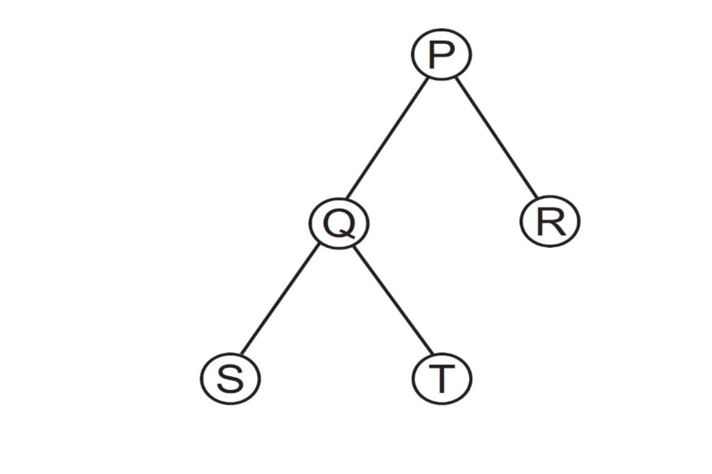

# PPGI/UFAM - Edital 053/2016 PROPESP/UFAM - Prova de Conhecimento

Fontes: `Prova_Edital053-2016.pdf` (caderno) e `Cartão_Resposta-Edital053-2016.pdf` (cartão com o gabarito marcado).
Nenhuma questão anulada. Figura em `2016-053/figuras/` (Q11).

## Gabarito

| Questão | Resp. | Questão | Resp. |
|---|---|---|---|
| 01 | A | 11 | C |
| 02 | A | 12 | B |
| 03 | A | 13 | A |
| 04 | C | 14 | A |
| 05 | E | 15 | B |
| 06 | D | 16 | A |
| 07 | A | 17 | E |
| 08 | A | 18 | A |
| 09 | A | 19 | A |
| 10 | D | 20 | A |

## Questões

### QUESTÃO 01
Seja um vetor de inteiros com 400 elementos distintos ordenados em ordem crescente. Qual é o número máximo de iterações necessárias para encontrar um elemento qualquer desse vetor, caso seja utilizado o algoritmo de busca binária?

a) 9
b) 8
c) 7
d) 200
e) 400

### QUESTÃO 02
Sobre as funções abaixo,

```c
Função I
int fatorial(int i) {
  if (i <= 1) {
    return 1;
  } else {
    fatorial(i-1);
  }
}

Função II
void fatorial() {
  int fat[0] = 1;
  for (int j=1; ; j++) {
    fat[j] = j * fat[j-1];
  }
}
```

Assinale a alternativa CORRETA:

a) Somente a função I é recursiva.
b) Ambas as funções são recursivas.
c) Somente a função II é recursiva.
d) A função I não é recursivo e a função II é orientada a objeto.
e) Ambas as funções não são recursivas.

### QUESTÃO 03
As seguintes afirmações sobre árvores estão corretas, com EXCEÇÃO de:

a) É um grafo conexo que admite ciclos.
b) É um grafo conexo e há exatamente um caminho entre dois vértices quaisquer.
c) Uma árvore com n vértices possui n-1 arestas.
d) Toda árvore é um grafo, mas nem todo grafo é uma árvore.
e) Uma união disjunta de árvores forma uma floresta

### QUESTÃO 04
Considere que o vetor abaixo será ordenado com o algoritmo de ordenação por seleção.

`4 5 5 3 17 2 1 22`

Considerando-se que o vetor tem sua primeira posição contada como 0 (zero), a segunda troca de valores entre posições do vetor ocorrerá entre:

a) Posição 0 e posição 2
b) Posição 0 e posição 7
c) Posição 1 e posição 5
d) Posição 1 e posição 6
e) Posição 3 e posição 5

### QUESTÃO 5
Considere uma estrutura de fila (disciplina FIFO) de números inteiros com duas operações: INSERE(n) e RETIRA( ). Considere, também, que a representação do estado da fila em um instante qualquer é realizada listando os elementos, de forma que o primeiro elemento, da esquerda para a direita, é o mais antigo presente na fila.

Se a fila começa vazia, a sequência:

INSERE(2) → INSERE(3) → RETIRA() → INSERE(1) → RETIRA() → INSERE(4) → INSERE(5) → RETIRA() → RETIRA()

O estado final da fila será:

a) 1 2 3 4 5
b) 2 3 1 4 5
c) 3 1 4
d) 4 5
e) 5

### QUESTÃO 6
Marque a alternativa CORRETA.
Uma lista duplamente encadeada tem como característica ser formada por elementos que:

a) se concatenam de forma circular, de tal maneira que, ao chegar ao final da lista, o próximo elemento volta a ser o primeiro.
b) contêm, além de um ou mais campos chave, mais um campo de ponteiro: o próximo, que permite o acesso ao elemento que sucede o atual (o próximo) presente na mesma lista.
c) contêm, além de um campo chave, mais um campo de ponteiro: o próximo, que permite o acesso ao elemento que sucede o atual (o próximo) presente na mesma lista, de tal forma que os campos chave estão ordenados, ou seja, a chave do próximo é sempre maior ou igual à chave do atual elemento.
d) contêm, além de um ou mais campos chave, dois outros campos de ponteiros: próximo e anterior, que permitem o acesso aos elementos adjacentes (próximo e anterior) presentes na mesma lista.
e) Estão em posições adjacentes da memória, permitindo o acesso sequencial ao próximo e ao anterior de cada elemento pelo simples uso de um índice.

### QUESTÃO 7
Considere a estrutura de dados Árvore Binária de Busca (ABB). Se inserirmos numa ABB inicialmente vazia os nós: 60, 10, 20, 80, 15, 75, 12 e 77, nessa ordem. Dado que a raiz encontra-se no nível 1, a altura da árvore e o nível do nó 15, respectivamente, serão:

a) 5 e 4
b) 5 e 5
c) 6 e 5
d) 6 e 4
e) 7 e 3

### QUESTÃO 8
Sabendo que as seguintes operações foram realizadas:

1. Dados foram inseridos numa PILHA na seguinte ordem: 11, 12, 23, 14, 25, 50, 8, 18, 29, 10.
2. Repetiu-se 10 vezes o par de operações: retirada da PILHA; inserção na FILA.
3. A FILA foi exibida (impressa).
4. Repetiu-se 10 vezes o par de operações: retirada da FILA; inserção na PILHA.
5. A PILHA foi exibida (impressa).

As possíveis estruturas exibidas nas operações 3 e 5 são:

I) FILA (começo) 10 - 29 - 18 - 8 - 50 - 25 - 14 - 23 - 12 - 11 (fim)
II) PILHA: (topo) 11 - 12 - 23 - 14 - 25 - 50 - 8 - 18 - 29 - 10
III) PILHA: (topo) 10 - 29 - 18 - 8 - 50 - 25 - 14 - 23 - 12 - 11
IV) FILA: (começo) 11 - 12 - 23 - 14 - 25 - 50 - 8 - 18 - 29 – 10 (fim)
V) A PILHA mostrada fica com os elementos em ordem invertida dos dados de entrada

As estruturas exibidas CORRETAMENTE nas operações 3 e 5 são:

a) I e II
b) I e
c) II e III
d) III e IV
e) III e IV

*(Nota: a alternativa b) aparece incompleta no PDF original, e d) e e) são idênticas.)*

### QUESTÃO 9
Os registros em uma lista duplamente encadeada com 20 elementos possuem, cada um, três campos:

1. próximo: um ponteiro para o próximo elemento da lista;
2. valor: informação armazenada pelo elemento;
3. anterior: um ponteiro para o elemento anterior da lista.

Sendo "Z" o décimo elemento desta lista e "X" e "Y" dois outros elementos que não pertencem à lista, sendo apontados, respectivamente, pelos seguintes ponteiros "PZ", "PX" e "PY", considere o trecho de código abaixo.

```
PY->próximo = PX;
PX->anterior = PY;
PX->próximo = PZ->próximo;
PZ->próximo->anterior = PX;
PZ->próximo = PY;
PY->anterior = PZ;
```

Este trecho de código é usado para inserir na lista os elementos:

a) Y, logo após o Z, e X, logo após o Y.
b) Y, antes do Z, e X, logo após o Z
c) Y, antes do Z, e X, antes do Y.
d) X, logo após o Z, e Y, logo após o X.
e) X, antes do Z, e Y, logo após o Z.

### QUESTÃO 10
Considere as afirmações sobre um hash linear (sem encadeamento):

I) É obrigatório o uso de várias funções de hash
II) Não funciona com número de chaves maior que o tamanho da tabela hash
III) Quando acontece uma colisão, o valor a ser inserido é colocado no local no lugar do já existente.

Sobre as afirmações, sabe-se que:

a) Todas são verdadeiras
b) Todas são falsas
c) Apenas I e III são verdadeiras
d) Apenas II é verdadeira
e) Apenas I e II são verdadeiras

### QUESTÃO 11
As sequências que representam os percursos da árvore da figura em pós-ordem e in-ordem são, respectivamente:



a) P Q S T R e P Q S T R
b) S T Q P R e S T Q R P
c) S T Q R P e S Q T P R
d) R P Q T S e S T Q R P
e) P T Q R S e P Q S T R

### QUESTÃO 12
Considere as afirmações sobre hash linear e hash encadeado

I) Hash encadeado funciona melhor em disco, pois as chaves sempre ficam próximas uma das outras, facilitando a varredura.
II) Para uma tabela hash de tamanho M, tanto o hash linear quanto o hash encadeado podem receber uma quantidade de chaves C, onde C > M.
III) Quanto acontece uma colisão no hash encadeado, a chave é inserida na posição livre mais próxima da chave original.

Sobre as afirmações, sabe-se que:

a) Todas são verdadeiras
b) Todas são falsas
c) Apenas I e III são verdadeiras
d) Apenas II é verdadeira
e) Apenas I e II são verdadeiras

### QUESTÃO 13
Em uma árvore AVL, todos os nós têm grau

a) 0, 1 ou 2.
b) divisível por 2.
c) 2
d) 1 e 2
e) maior ou igual a 2.

### QUESTÃO 14
A estrutura de dados conhecida como Árvore Binária de Busca (ABB) encontra diversas aplicações em soluções práticas. Sobre esta estrutura é CORRETO afirmar:

a) Uma ABB é um conjunto finito de nós que possui um nó especial, chamado raiz, do qual partem os nós de duas árvores binárias distintas: a da esquerda e a da direita.
b) Quando os elementos a serem inseridos na ABB estão em ordem crescente, resulta em uma ABB com altura mínima.
c) Para se utilizar uma ABB como método de ordenação, basta fazer o caminhamento ou percurso "em-ordem" e obter todos os elementos ordenados.
d) Uma característica que confere à ABB grande agilidade na pesquisa e recuperação de elementos é que seus nós são sempre rearranjados de forma que a árvore resultante é sempre perfeitamente balanceada.
e) ABB são um caso especial de listas encadeadas em que nenhum nó aponta para mais de 2 sucessores.

### QUESTÃO 15
Considere as afirmações a seguir sobre os algoritmos de ordenação Quicksort, MergeSort, HeapSort e InsertionSort

I) São algoritmos estáveis: InsertionSort, QuickSort e MergeSorte
II) Pior caso tem número de operações quadrático (proporcional a uma constante vezes n² : InsertionSort, QuickSort
III) Utiliza um espaço extra proporcional a n² (proporcional ao quadrado do número de elementos): HeapSort,
IV) A ordem das entradas é incapaz de influenciar o desempenho do algoritmo: InsertionSort, MergeSort

Marque a alternativa que indica TODAS as afirmações INCORRETAS feitas:

a) I e IV
b) I , III e IV
c) I, II e III
d) I, II, III e IV
e) II e IV

### QUESTÃO 16
Uma árvore AVL é uma árvore binária de busca com balanceamento automático que respeita algumas propriedades fundamentais. Como todas as árvores, ela tem uma propriedade chamada altura. Sabendo que a altura de uma folha é igual a um e que a altura de um nó pai é igual ao máximo das alturas de seus filhos mais um, qual estrutura NÃO pode representar uma árvore AVL?

a) Uma árvore com três nós e altura igual a três
b) Uma árvore com seis nós e altura igual a três
c) Uma árvore com três nós e altura igual a dois
d) Uma árvore vazia
e) Uma árvore com dois nós

### QUESTÃO 17
Considere os códigos de funções abaixo, assumindo que os mesmos são usados dentro de um programa e que os todos os cabeçalhos necessários são incluídos:

```c
/*QUADRO I) função que retorna 1 se a chave
de busca chave, passada como parâmetro, ocorre
dentro de um vetor de inteiros ordenado e
retorna 0 caso a chave não ocorra no vetor. O
vetor tem tamanho determinado pelo parâmetro
tm */
int buscaChave(int v[],int chave,int tm) {
  while((tm>= 0) && (v[tm]!= chave)) tm--;
  if (tm >= 0) return 0;
  return 1;
}
```

```c
/* QUADRO II) Conta ocorrências de uma
chave na lista encadeada, retornando o total de
ocorrências , zero caso a chave não ocorra
*/
int ContaOcorrenciasChave(tipoNo *prim, int
chave) {
  tipoNo *aux = prim;
  int cont = 0;
  int x;
  for (x = 0; aux[x] != NULL; x++){
    if(aux[x]. dado == chave) cont++;
  }
  return x;
}
```

Marque a alternativa correta dentre as afirmações abaixo:

a) Os dois códigos executam as tarefas propostas sem gerar qualquer tipo de erro de lógica ou de vazamento de memória
b) Apenas o código I executa sem erros a tarefa proposta
c) Apenas o código II executa sem erros a tarefa proposta
d) Os dois códigos geram erros de vazamento de memória ou de falha de segmentação
e) Nenhuma das alternativas anteriores

### QUESTÃO 18
Considere as definições a seguir.

I) O nível do nó raiz de uma árvore é 1.
II) O nível de qualquer nó subsequente é igual ao nível do seu nó pai mais 1.
III) A profundidade de uma árvore é igual ao maior nível encontrado dentre todos os seus nós

Partindo-se das premissas acima, a menor e a maior quantidade de nós, respectivamente, que poderiam existir em uma árvore binária de profundidade 4 são:

a) 4 e 15
b) 3 e 15
c) 3 e 16
d) 4 e 16
e) 5 e 14

### QUESTÃO 19
Uma árvore binária completa tem no 5º nível uma quantidade de nós igual a

a) 16
b) 15
c) 31
d) 64
e) 32

### QUESTÃO 20
Considere uma árvore binária de busca cujos nós armazenam números inteiros variando de 1 a 100, na qual se quer buscar o número 54. Qual das seguintes sequências representa uma sequência de busca válida dentro desta árvore?

a) 5, 18, 34, 60, 40, 52, 54
b) 25, 27, 28, 26, 60, 50, 58, 54
c) 37, 70, 32, <não encontrou>
d) 40, 70, 43, 44, 73, 57, 54
e) Nenhuma das alternativas anteriores
