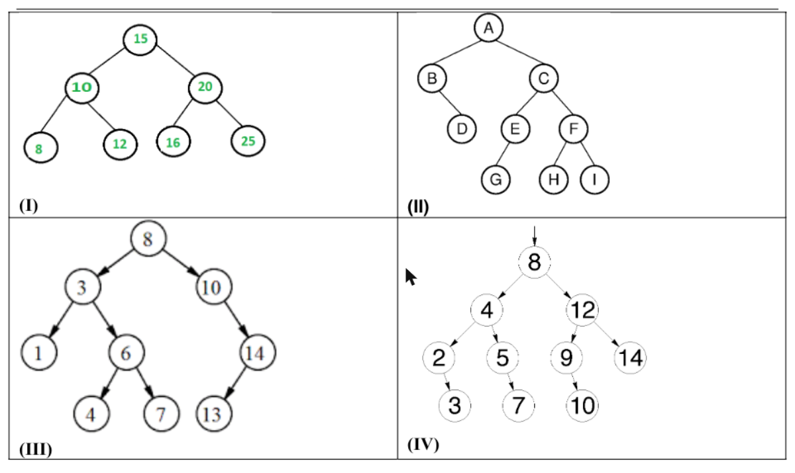
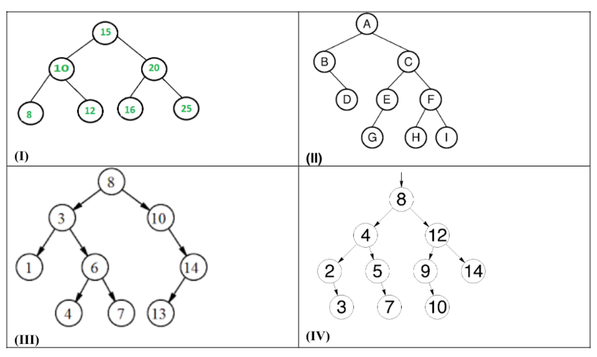
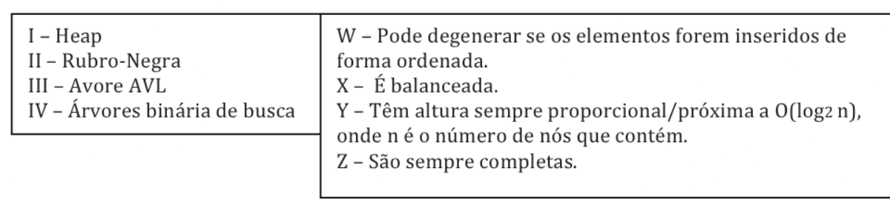

# PPGI/UFAM - Edital 024/2017 PROPESP/UFAM - Prova de Conhecimento

Fontes: `Prova_Edital024-2017.pdf` (caderno) e `Gabarito_Cartão_Resposta-Edital024-2017.pdf` (folha de respostas com o gabarito marcado).
Questões 9 e 17 foram anuladas. Figuras em `2017-024/figuras/` (Q08, Q10, Q17).

## Gabarito

| Questão | Resp. | Questão | Resp. |
|---|---|---|---|
| 01 | A | 11 | A |
| 02 | A | 12 | C |
| 03 | D | 13 | B |
| 04 | A | 14 | D |
| 05 | B | 15 | B |
| 06 | D | 16 | E |
| 07 | A | 17 | Anulada |
| 08 | E | 18 | E |
| 09 | Anulada | 19 | A |
| 10 | E | 20 | D |

## Questões

### QUESTÃO 01
Avaliando as seguintes sentenças a respeito de estrutura de dados:

I. A diferença entre árvore binária de busca e árvores AVL é o fato de que a segunda pode se reconfigurar dinamicamente, com o intuito de manter um bom nível de balanceamento.
II. Uma pilha garante que o último elemento inserido seja localizado no seu topo. Porém, do ponto de vista conceitual, qualquer elemento da pilha pode ser removido, ainda que não esteja no seu topo.
III. Do ponto de vista conceitual, não há diferença alguma entre uma estrutura de array e uma lista encadeada.
IV. Tabelas hash são estruturas de dados indicadas para armazenar grande volume de dados. Apesar dessas estruturas permitirem acesso indexado, mais de um elemento pode ter o mesmo índice. Elementos com o mesmo índice podem ser armazenados em uma mesma lista encadeada.

É CORRETO afirmar que:

a) apenas I e IV são verdadeiras.
b) apenas I é verdadeira.
c) apenas III e IV são verdadeiras.
d) apenas II e III são verdadeiras.
e) apenas I, II e IV são verdadeiras.

### QUESTÃO 02
Marque a alternativa CORRETA.
Qual dos algoritmos abaixo apresenta o menor custo (em termos de número comparações entre elementos) ao considerar-se, para cada algoritmo, a pior disposição possível para os elementos do vetor a ser ordenado. Considere que o vetor a ser ordenado é muito grande, acima de 1 milhão de elementos.

a) Heapsort
b) Quicksort
c) Inserção
d) Seleção
e) Nenhuma das anteriores porque todos apresentam custo igual

### QUESTÃO 03
Marque a alternativa CORRETA.
Qual dos algoritmos abaixo apresenta o menor custo (em termos de número movimentações de elementos realizadas) ao considerar-se, para cada algoritmo, a pior disposição possível para os elementos do vetor a ser ordenado. Considere que o vetor a ser ordenado é muito grande, acima de 1 milhão de elementos.

a) Heapsort
b) Quicksort
c) Inserção
d) Seleção
e) Mergesort

### QUESTÃO 04
Considere as seguintes afirmações sobre a estrutura lista encadeada dinâmica e marque a alternativa CORRETA.

I. A busca em tal estrutura realiza menos comparações do que a melhor opção de algoritmo de busca em um vetor ordenado quando se considera o pior cenário para cada estrutura.
II. É uma estrutura de dados usada para ordenar chaves por ser mais eficiente no processo de ordenação que o heapsort
III. É tipicamente utilizada como estrutura de dados básica na implementação de hash por endereçamento aberto

a) As três afirmações são falsas
b) As três afirmações são verdadeiras
c) Apenas a afirmação I é verdadeira
d) Apenas a afirmação II é verdadeira
e) Apenas a afirmação III é verdadeira

### QUESTÃO 05
Dada uma lista encadeada onde cada nó da lista é do tipo No, cujos campos são um ponteiro para o próximo elemento (campo prox) e um dado do tipo inteiro (campo dado). Dado também quatro (4) opções (versões) de funções para realizar a busca por um elemento em uma lista encadeada, onde recebe-se um ponteiro para o primeiro elemento da lista e uma chave. A função de busca deve retornar 1 (um) caso encontre o elemento buscado e 0 (zero) em caso contrário.

Com base nas informações anteriores, considere que: (1) a lista encadeada não possui um nó cabeça de lista, portanto todos os nós contém valores presentes na lista; (2) todos os tipos de dados foram previamente declarados no programa; (3) a função não deve ter problemas de alocação de memória, seja por deixar de alocar dinamicamente dados necessários ou por causar alocação dinâmica de dados desnecessária.

Analise as funções abaixo e marque a alternativa CORRETA

```c
/* versão I */
int busca(No *prim, int chave) {
  No *aux = (No *) malloc(sizeof(No));
  aux = prim;
  while(aux!= NULL) {
    if(aux->dado == chave) return 1;
    aux = aux>prox;
  }
  return 0;
}

/* versão II */
int busca(No *prim, int chave) {
  while(prim!= NULL) {
    if(prim->dado == chave) return 1;
    prim = prim->prox;
  }
  return 0;
}

/* versão III */
int busca(No *prim, int chave) {
  No * aux = prim;
  while(prim->prox!= NULL) {
    if(prim->dado == chave) return 1;
    aux = aux->prox;
  }
  return 0;
}

/* versão IV */
int busca(No *prim, int chave) {
  No *aux = (No *) malloc(sizeof(No));
  while(aux->prox!= NULL) {
    if(aux->dado == chave) return 1;
    aux = aux>prox;
  }
  return 0;
}
```

a) A versão I está correta e não apresenta problemas de alocação de memória.
b) A versão II está correta e não apresenta problemas de alocação de memória.
c) A versão III está correta e não apresenta problemas de alocação de memória
d) A versão IV está correta e não apresenta problemas de alocação de memória
e) Nenhuma das alternativas anteriores está correta

### QUESTÃO 06
Após a inserção da sequencia de números 3, 4, 6, 8 e 9 em uma pilha, o resultado CORRETO de 3 remoções sucessivas seria:

a) 3, 4 e 6, nesta ordem
b) 6, 3 e 4, nesta ordem
c) 6, 8 e 9, nesta ordem
d) 9, 8 e 6, nesta ordem
e) Nenhuma das alternativas anteriores

### QUESTÃO 07
Considere as seguintes afirmações:

I. Hash por encadeamento nunca apresenta colisões secundárias
II. Hash por encadeamento jamais permite que o número de comparações entre chaves em uma operação de busca passe de log n, onde n é o número de chaves inseridas no hash.
III. Hash por encadeamento realiza sempre menos comparações entre chaves do que qualquer hash por endereçamento aberto.

Marque a alternativa CORRETA:

a) Apenas a afirmação I é verdadeira
b) Apenas a afirmação II é verdadeira
c) Apenas a afirmação III é verdadeira
d) Apenas as afirmações II e III são verdadeiras
e) Nenhuma das alternativas anteriores está correta

### QUESTÃO 08
Considere as seguintes árvores onde são apresentados apenas os valores das chaves em cada nó, sem mostrar o valor de outros campos eventualmente existentes. Considerando em todos os casos que as árvores não estão em processo de rotação por inserção de chaves, estando portanto em seu estado final após a inserção do conjunto de chaves mostrado.



É CORRETO afirmar que:

a) Apenas a árvore do quadro I poderia ser uma árvore AVL
b) Todas as opções apresentadas nos quadros de I a IV podem ser exemplos de árvores AVL
c) Nenhuma das 4 opções apresentadas podem ser exemplos de árvores AVL
d) Apenas as opções I e III podem ser exemplos de árvores AVL
e) Nenhuma das alternativas anteriores (de A até D) está correta

### QUESTÃO 09 (anulada)
Marque a alternativa CORRETA:
Considere uma estrutura de fila (disciplina FIFO) de números inteiros com duas operações: INSERE (n) e RETIRA ( ). Considere, também, que a representação do estado da fila em um instante qualquer é realizada listando os elementos, de forma que o primeiro elemento, da esquerda para a direita, é o mais antigo presente na fila.

Se a fila começa vazia, a sequência:

INSERE (b) → INSERE (c) → RETIRA ( ) → INSERE (a) → RETIRA ( ) → INSERE (e) → INSERE (e) → RETIRA ( ) → RETIRA ( )

levará a uma fila no estado:

a) a b c e
b) e a
c) a
d) b c a e
e) c a e

### QUESTÃO 10
Considere as seguintes árvores onde são apresentados apenas os valores das chaves em cada nó, sem mostrar o valor de outros campos eventualmente existentes. Considerando em todos os casos que as árvores não estão em processo de rotação por inserção de chaves, estando portanto em seu estado final após a inserção do conjunto de chaves mostrado.



É CORRETO afirmar que:

a) Apenas a árvore do quadro I poderia ser uma árvore binária de pesquisa sem balanceamento
b) Todas as 4 opções podem ser exemplos de árvores binárias de pesquisa sem balanceamento
c) Nenhuma das 4 opções pode ser uma árvore binária de pesquisa sem balanceamento
d) Apenas as opções II e III podem de árvores binárias de pesquisa sem balanceamento
e) Nenhuma das alternativas anteriores (de A até D) está correta

### QUESTÃO 11
Sabendo que um arvore binária com 5 nós tem como resultados dos seus percursos pós-ordem e in-ordem, respectivamente S T Q R P e S Q T P R.
É CORRETO afirmar:

a) O nó raiz tem o valor P
b) Q é um nó folha
c) S é um nó interno
d) T é filho de S
e) Todas as alternativas estão corretas

### QUESTÃO 12
Sobre as afirmações abaixo:

I. A busca sequencial só pode ser realizada corretamente em vetores que não estejam ordenados
II. A busca por uma chave em um vetor ordenado pode ser realizada corretamente com número constante de operações, não dependendo do tamanho do vetor.
III. Pode-se encontrar o maior elemento de um vetor não ordenado com um algoritmo que realiza um número de operações proporcional ao tamanho do vetor na pior das situação possível para o algoritmo.

Pode-se dizer que:

a) Apenas I está correta
b) Apenas II está correta
c) Apenas III está correta
d) Apenas II e III estão corretas
e) Apenas I e III estão corretas

### QUESTÃO 13
Dada uma lista encadeada onde cada nó da lista é do tipo No, cujos campos são um ponteiro para o próximo elemento (campo prox) e um dado do tipo inteiro (campo dado). Considere que: (1) a lista encadeada não possui um nó cabeça de lista, portanto todos os nós contém valores presentes na lista; (2) todos os tipos de dados foram previamente declarados no programa; (3) a função não deve ter problemas de alocação de memória, seja por deixar de alocar dinamicamente dados necessários ou por causar alocação dinâmica de dados desnecessária.

Marque a alternativa CORRETA sobre as funções função I e função II

```c
/* função I */
void funcaoI(No *prim, int chave) {
  No *aux = (No *) malloc(sizeof(No));
  aux ->chave = chave;
  aux->prox = prim;
  prim = aux;
}

/* função II */
void funcaoI(No **prim, int chave) {
  No *aux = (No *) malloc(sizeof(No));
  aux ->chave = chave;
  aux->prox = *prim;
  *prim = aux;
}
```

a) Apenas a função função I pode ser usada para inserir corretamente elementos em uma pilha sem gerar qualquer problema de alocação de memória ou erro na pilha.
b) Apenas a função função II pode ser usada para inserir corretamente elementos em uma pilha sem gerar qualquer problema de alocação de memória ou erro na pilha.
c) Ambas as funções podem ser usadas para inserir elementos em uma pilha sem gerar qualquer problema de alocação de memória ou erro na pilha.
d) Apenas a função função I serve para inserir corretamente elementos em uma lista encadeada sem gerar erros, mas não em uma pilha.
e) Apenas a função função II serve para inserir corretamente elementos em uma lista encadeada sem gerar erros, mas não em uma pilha.

### QUESTÃO 14
Considere as afirmações sobre um hash linear (sem encadeamento):

I. No evento de uma colisão, o valor a ser inserido é sempre colocado no início do array;
II. A busca pela chave é realizada utilizando busca binária (mais eficiente)
III. É obrigatório o uso de funções diferentes para inserção e remoção de chaves
IV. É projetado para funcionar com arrays de tamanho previamente definido.

Sobre as afirmações, sabe-se que:

a) Todas são verdadeiras
b) Todas são falsas
c) Apenas II e IV são verdadeiras
d) Apenas IV é verdadeira
e) Apenas I e II são verdadeiras

### QUESTÃO 15
Considere as afirmações sobre hash linear vs hash encadeado

I. Para uma tabela hash de tamanho M, tanto o hash linear quanto o hash encadeado podem receber uma quantidade de chaves C, onde C > M.
II. Quanto acontece uma colisão no hash encadeado, a chave é inserida na posição livre mais próxima da chave original.
III. Hash linear funciona melhor em disco, pois as chaves obrigatoriamente ficam em espaços separados de memória, facilitando a varredura.
IV. O uso de uma segunda função de hash (no hash encadeado), garante um melhor espalhamento das chaves pela tabela hash

Sobre as afirmações, sabe-se que:

a) Todas são verdadeiras
b) Todas são falsas
c) Apenas I e III são verdadeiras
d) Apenas III é verdadeira
e) Apenas I e II são verdadeiras

### QUESTÃO 16
Considere que o vetor a seguir é uma heap mínima (assuma índice do array iniciando em zero)

`4 5 7 10 13 11 15 22`

Marque a alternativa que contem a afirmativa CORRETA:

a) Essa heap possui todos os nós folhas na mesma altura
b) Ao alterar o valor 22 por 6, 2 trocas são necessárias para corrigir a heap
c) O valor no índice 7 precisa ser necessariamente menor que o do índice 4
d) O valor no índice 6 precisa ser obrigatoriamente maior que o do índice 1
e) Ao alterar o valor 13 por 8, nada precisa ser feito para corrigir a heap

### QUESTÃO 17 (anulada)
As árvores são estruturas de dados poderosas e se subdividem em vários tipos, cada um dos quais com suas características próprias. Relacione os tipos de árvores, apresentados na coluna da esquerda, com as suas respectivas características, indicadas na coluna da direita:



| Tipo de árvore | Característica |
|---|---|
| I – Heap | W – Pode degenerar se os elementos forem inseridos de forma ordenada. |
| II – Rubro-Negra | X – É balanceada. |
| III – Avore AVL | Y – Têm altura sempre proporcional/próxima a O(log2 n), onde n é o número de nós que contém. |
| IV – Árvores binária de busca | Z – São sempre completas. |

Estão CORRETAS as associações:

a) I –X, IV – Z , II – Y
b) I – Z , IV– X , III – W
c) I – Z , IV– X , III – Y
d) I –Y , IV– W , III – X
e) I –X , IV– W , II – Y

### QUESTÃO 18
Considere o código abaixo, assumindo que o mesmo é usado dentro de um programa e que os todos os cabeçalhos necessários são incluídos:

```c
// Conta ocorrências de uma chave na lista encadeada, retornando o total de ocorrências , zero caso a chave não ocorra
int ContaOcorrenciasChave(tipoNo *prim, int chave) {
  tipoNo *aux = prim;
  int cont = 0;
  int x;
  for (x = 0; aux[x] != NULL; x++){
    if(aux[x].dado == chave)
      cont++;
  }
  return x;
}
```

Marque a alternativa CORRETA dentre as afirmações abaixo:

a) O código executa a tarefas proposta sem gerar qualquer tipo de erro de lógica ou de vazamento de memória
b) O código nem compila
c) O código executa a tarefa proposta sem erros de lógica
d) O código não gera erro de segmentação
e) Nenhuma das alternativas anteriores

### QUESTÃO 19
Uma lista encadeada simples é uma estrutura que corresponde a uma sequência lógica de entradas ou nós. Cada nó armazena a localização do próximo elemento na sequência, ou seja, de seu nó sucessor.

Marque a alternativa CORRETA:

a) A existência de um ponteiro apontando para o 1º elemento e outro para o fim da lista permite que a inserção ou deleção de dados de um nó que esteja nas extremidades da lista seja rapidamente executada
b) Enquanto a entrada que determina o topo da lista é mantida em um nó descritor dessa lista, a entrada que marca o fim da lista é mantida em todos os nós da lista.
c) O armazenamento de uma lista requer uma área contígua de memória para permitir a otimização no processamento de busca de valores chaves na lista
d) O armazenamento de uma lista requer uma área contígua de memória. Como listas são estruturas previamente projetadas e definidas, normalmente são definidos procedimentos que permitem inserir e remover valores com eficiência.
e) Para estabelecer a ligação entre um nó já pertencente a uma lista e um novo nó, basta fazer com que o novo nó referencie no campo next, o nó que anteriormente era referenciado pelo nó original, desde que esse campo não tenha o valor nulo

### QUESTÃO 20
Marque a alternativa CORRETA. Uma lista duplamente encadeada tem como característica ser formada por elementos que:

a) Se concatenam de forma circular, de tal maneira que, ao chegar ao final da lista, o próximo elemento volta a ser o primeiro.
b) Contêm, além de um ou mais campos chave, mais um campo de ponteiro: o próximo, que permite o acesso ao elemento que sucede o atual (o próximo) presente na mesma lista.
c) Contêm, além de um campo chave, mais um campo de ponteiro: o próximo, que permite o acesso ao elemento que sucede o atual (o próximo) presente na mesma lista, de tal forma que os campos chave estão ordenados, ou seja, a chave do próximo é sempre maior ou igual à chave do atual elemento.
d) Contêm, além de um ou mais campos chave, dois outros campos de ponteiros: próximo e anterior, que permitem o acesso aos elementos adjacentes (próximo e anterior) presentes na mesma lista.
e) Estão em posições adjacentes da memória, permitindo o acesso sequencial ao próximo e ao anterior de cada elemento pelo simples uso de um índice.
