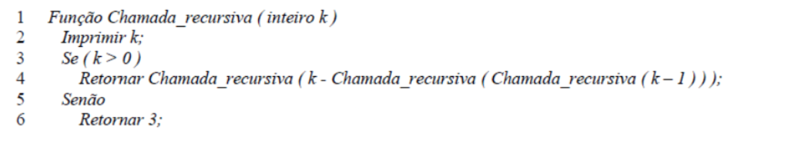
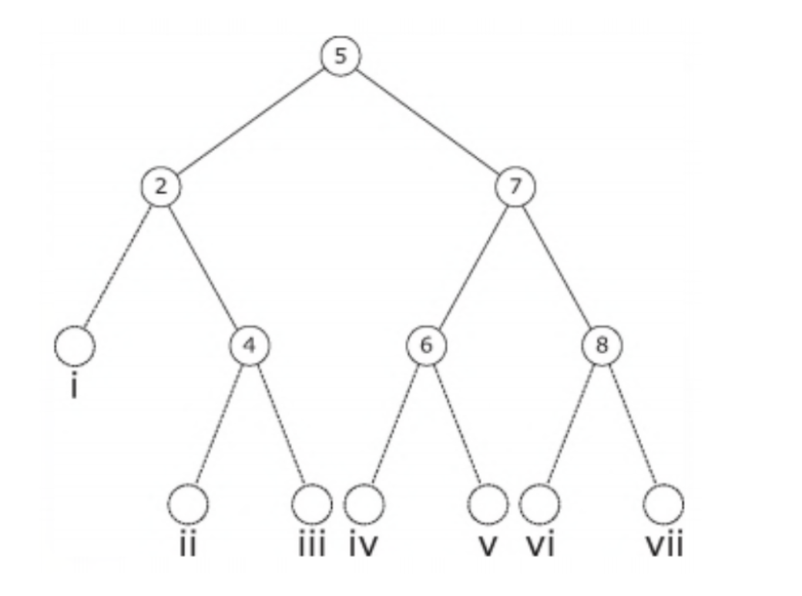
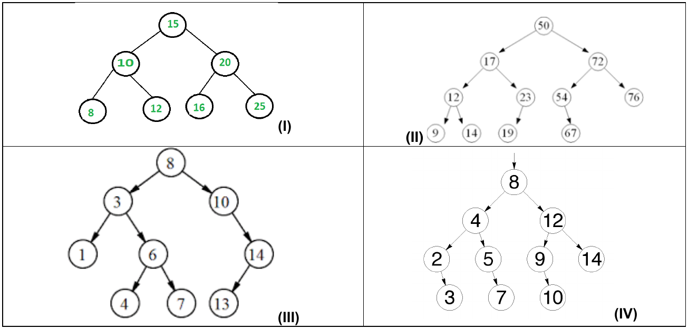

# PPGI/UFAM - Edital 055/2017 PROPESP/UFAM - Prova de Conhecimento

Fontes: `Prova_Edital_055-2017.pdf` (caderno) e `Gabarito-Edital055-2017.pdf` (gabarito).
Questões 3, 9 e 10 foram anuladas. Figuras em `2017-055/figuras/` (Q01, Q04, Q16).

## Gabarito

| Questão | Resp. | Questão | Resp. |
|---|---|---|---|
| 01 | E | 11 | D |
| 02 | C | 12 | C |
| 03 | Anulada | 13 | E |
| 04 | B | 14 | B |
| 05 | D | 15 | B |
| 06 | C | 16 | B |
| 07 | D | 17 | E |
| 08 | B | 18 | E |
| 09 | Anulada | 19 | A |
| 10 | Anulada | 20 | A |

## Questões

### QUESTÃO 01
Considere a função em pseudocódigo a seguir:



Marque a alternativa CORRETA.
A execução da função Chamada_recursiva(1) faz com que o algoritmo execute indefinidamente. Para este caso, os cinco primeiros valores impressos são:

A) 1, 0, 3, 1 e 0.
B) 1, 0, 3, 1 e 2.
C) 1, 0, 3, 2 e 0.
D) 1, 0, 3, 2 e 3.
E) 1, 0, 3, 2 e 1.

### QUESTÃO 02
Marque a alternativa INCORRETA.
Estrutura de Dados básicas como Fila são tipicamente usadas em uma gama variada de aplicações computacionais, EXCETO:

A) Sequência de trabalhos submetidas à impressora compartilhada em rede de computadores, onde o primeiro trabalho recebido será o primeiro trabalho a ter sua solicitação atendida.
B) Fila de processos de comunicação em redes de computadores.
C) Estruturas hierárquicas de diretórios e subdiretórios.
D) Buffer para gravação de dados em mídia.
E) Atendimento de processos requisitados ao um sistema operacional.

### QUESTÃO 03 (anulada)
Suponha que se tem números entre 1 e 1000 em uma Árvore Binária de Busca e se quer procurar pelo número 363. Qual das afirmativas a seguir não poderia ser a sequência de nós examinados?

A) 2, 252, 401, 398, 330, 344, 397, 363.
B) 924, 220, 911, 244, 898, 258, 362, 363.
C) 925, 202, 911, 240, 912, 245, 363.
D) 2, 399, 387, 219, 266, 382, 381, 278, 363.
E) 935, 278, 347, 621, 299, 392, 358, 363.

### QUESTÃO 04
Observe a árvore binária de pesquisa sem balanceamento:



Considere as afirmativas a seguir.

I. Os nós 6 e 8 são irmãos.
II. O nó 4 é uma das raízes da árvore.
III. O nó com valor 3, ao ser inserido, ocuparia a posição iv.
IV. O nó com valor 1, ao ser inserido, ocuparia a posição i.

Marque a alternativa CORRETA:

A) Apenas a afirmativa III está correta.
B) Apenas as afirmativas I e IV estão corretas.
C) Apenas as afirmativas II e III estão corretas.
D) Apenas as afirmativas I, II e IV estão corretas.
E) Todas as afirmativas estão corretas.

### QUESTÃO 05
Quando um algoritmo de hash produz um endereço para uma chave e esse endereço já está ocupado, isso é chamado de __________.

A) Sinônimo
B) Inicial
C) Prospecção
D) Colisão
E) Overflow

### QUESTÃO 06
Considere uma tabela hash com resolução de colisões por encadeamento com as seguintes características:

- As chaves são as letras A,B,C,D,H,J,K,M,N,O,P,R,S,T,U;
- A tabela possui 11 posições, referenciadas pelos índices de 0 até 10;
- A função de hash é definida como hash(x)=posição(x) mod 11, onde x é a chave, e posição(x) é a posição da chave no alfabeto ABCDEFGHIJKLMNOPQRSTUVWXYZ, tal que posição("A") retorna 1 e posição("Z") retorna 26.

Analise as afirmativas sobre a tabela após seu preenchimento com as chaves listadas acima.

I. Nenhuma chave foi alocada à posição 6;
II. A chave "K" foi alocada à posição zero;
III. As chaves "B" e "N" colidiram na posição 3;
IV. Apenas uma letra foi alocada à posição 9.

Com base nessas afirmativas, marque a alternativa CORRETA:

A) Apenas as afirmativas I e II estão corretas.
B) Apenas as afirmativas I e IV estão corretas.
C) Apenas as afirmativas I, II e IV estão corretas.
D) Apenas as afirmativas II e III.
E) Apenas as afirmativas II, III e IV estão corretas.

### QUESTÃO 07
Marque a alternativa CORRETA.
Suponha que T seja uma árvore binária de pesquisa sem balanceamento inicialmente vazia, e considere a inserção dos elementos 30, 50, 60, 20, 40, 10 e 25 em T, exatamente nessa ordem. Qual das sequências abaixo corresponde a um percurso de T em pré-ordem?

A) 30 50 60 40 20 25 10
B) 10 25 20 40 60 50 30
C) 10 20 25 30 40 50 60
D) 30 20 10 25 50 40 60
E) 60 50 40 30 25 20 10

### QUESTÃO 08
Marque a alternativa CORRETA.
Considerando um array R que contém 1.000.000 de chaves ordenadas, assinale o número máximo de acessos a R necessários para encontrar uma determinada chave ao se utilizar o algoritmo de busca binária.

A) 10
B) 20
C) 40
D) 80
E) 160

### QUESTÃO 09 (anulada)
Para remoção de uma chave cuja página esteja com o número mínimo, em árvore B, é CORRETO afirmar que:

A) Deve-se fazer o processo de SPLIT sempre na página onde se encontrar a chave.
B) Deve-se fazer o processo de SPLIT na página onde se encontrar a chave, exceto quanto é um elemento da raiz da árvore.
C) Se a página onde se encontrar a chave não é folha, deve-se fazer procedimento de concatenação ou redistribuição, considerando os irmãos.
D) Remove-se a chave, e a substitui por uma chave do nó irmão.
E) No caso de só haver uma única página, a remoção não causa a necessidade de balanceamento.

### QUESTÃO 10 (anulada)
Sobre árvores B e árvores binárias, analise as afirmativas e assinale a alternativa CORRETA.

I. De forma diferente das árvores binárias, cada nó de uma árvore B deverá sempre ter mais de dois filhos.
II. Um nó de árvore B tem um campo ou um método para indicar se é um nó folha ou não. Característica esta herdada da AVL.
III. As folhas da árvore B são dispostas mais flexivelmente que as da árvore binária: suas folhas poderão estar em níveis diferentes, desde zero até o valor da altura da árvore.
IV. A árvore B tem um método de balanceamento muito custoso, por isso, sua indicação para trabalhar com dispositivos de armazenamento secundário deve ser avaliada com muita cautela.

A) Todas as afirmativas estão corretas.
B) Somente as afirmativas II e III estão corretas
C) Somente as afirmativas I, II e IV estão corretas.
D) Somente as afirmativas I, III e IV estão corretas.
E) Todas as afirmativas estão incorretas

### QUESTÃO 11
Considere as seguintes afirmações sobre a estrutura lista encadeada dinâmica

I. A busca em tal estrutura realiza menos comparações do que a melhor opção de algoritmo de busca em um vetor ordenado quando se considera o pior cenário para cada estrutura.
II. É uma estrutura de dados usada unicamente no armazenamento de grandes quantidades de chaves por lista, dado o seu dinamismo e velocidade de busca quando comparada a outras estruturas de dados.
III. É utilizada como estrutura de dados na implementação de alguns tipos de hash.

Marque a alternativa CORRETA:

A) As três afirmações são falsas
B) Apenas a afirmação I é verdadeira
C) Apenas a afirmação II é verdadeira
D) Apenas a afirmação III é verdadeira
E) Apenas as afirmações I e II são verdadeiras.

### QUESTÃO 12
Qual dos algoritmos abaixo apresenta o menor custo (em termos de número comparações entre elementos) ao considerar-se que o vetor passado está previamente ordenado, a menos da ocorrência de duas chaves consecutivas que estão com posições trocadas. Considere que o vetor a ser ordenado é muito grande, com mais de 1 milhão de elementos.

A) Heapsort.
B) Quicksort.
C) Inserção.
D) Seleção.
E) Nenhuma das anteriores, pois todos apresentam custo igual.

### QUESTÃO 13
Marque a alternativa CORRETA.
Considerando-se para cada algoritmo o pior cenário possível em termos de uso de espaço, são algoritmos que utilizam espaço extra constante, independentemente do número de elementos do vetor de entrada a ser ordenado:

A) Mergesort e Seleção.
B) Quicksort e Mergesort.
C) Mergesort e Heapsort.
D) Inserção e Quicksort.
E) Nenhuma das alternativas acima está correta.

### QUESTÃO 14
Sobre as afirmações abaixo:

I. Pode-se implementar uma busca em um vetor não ordenado a custo máximo inferior a n/2 operações, onde n é o número de elementos do vetor, desde que a chave buscada ocorra no vetor, não importando qual a posição em que a mesma ocorre.
II. A busca por uma chave em um vetor ordenado pode ser realizada corretamente com um número de operações proporcional a log₂ n, onde n é o número de elementos do vetor.
III. O número de comparações realizadas para determinar se uma chave de busca está ou não em um vetor não ordenado é sempre menor do que o número de comparações envolvendo a mesma chave de busca em uma lista encadeada dinâmica, desde que a quantidade e a ordem dos elementos inseridos nas duas estruturas seja a mesma.

Marque a alternativa CORRETA:

A) Apenas a afirmativa I está correta.
B) Apenas a afirmativa II está correta.
C) Apenas a afirmativa III está correta.
D) Todas as afirmativas estão corretas.
E) Nenhuma das afirmativas está corretas.

### QUESTÃO 15
Considere as seguintes afirmações:

I. Hash por encadeamento pode apresentar colisões secundárias.
II. Hash por encadeamento pode permitir que o número de comparações entre chaves em uma operação de busca passe de √n, onde n é o número de chaves inseridas no hash.
III. Hash por endereçamento aberto realiza sempre menos comparações entre chaves do que qualquer hash por encadeamento.

Marque a alternativa CORRETA:

A) Apenas a afirmação I é verdadeira.
B) Apenas a afirmação II é verdadeira.
C) Apenas a afirmação III é verdadeira.
D) Apenas as afirmações II e III são verdadeiras.
E) Apenas as afirmações I e III são verdadeiras.

### QUESTÃO 16
Considere as seguintes árvores onde são apresentados apenas os valores das chaves em cada nó, sem mostrar o valor de outros campos eventualmente existentes. Além disso, note que em todos os casos, as árvores não estão em processo de rotação por inserção de chaves, estando portanto em seu estado final após a inserção do conjunto de chaves mostrado.



É CORRETO afirmar que:

A) Apenas a árvore do quadro I poderia ser uma árvore AVL.
B) Apenas a árvore III não poderia ser uma árvore AVL.
C) Nenhuma das 4 opções apresentadas poderiam ser exemplos de árvores AVL.
D) Apenas as opções I e II podem ser exemplos de árvores AVL.
E) Nenhuma das alternativas anteriores (de A, B, C ou D) está correta.

### QUESTÃO 17
Após a inserção da sequencia de números 10, 1, 3, 4, 6, 8 e 9 em uma pilha, o resultado de três (3) remoções sucessivas seria:

A) 10, 1 e 3 nessa ordem
B) 4, 3 e 1 nessa ordem
C) 6, 8 e 9 nessa ordem
D) 3, 1 e 10 nessa ordem
E) Nenhuma das alternativas anteriores (A, B, C ou D) está correta

### QUESTÃO 18
Considere uma lista encadeada onde cada nó da lista é do tipo No, cujos campos são um ponteiro para o próximo elemento (campo prox) e um dado do tipo inteiro (campo dado). Considere que a lista encadeada não possui um nó cabeça de lista, portanto todos os nós contém valores presentes na lista. Considere que todos os tipos de dados foram previamente declarados no programa. Considere que a função não deve ter problemas de alocação de memória, seja por deixar de alocar dinamicamente dados necessários ou por causar alocação dinâmica de dados desnecessária.

```c
/* funcaoI */
void funcaoI(No *prim, int chave) {
  No *aux = (No *) malloc(sizeof(No));
  aux->chave = chave;
  aux->prox = prim;
  prim = aux;
}

/* funcaoII */
void funcaoII(No **prim, int chave) {
  No *aux = (No *) malloc(sizeof(No));
  aux->chave = chave;
  aux->prox = *prim;
  *prim = aux;
}
```

Dadas as considerações, pode-se dizer sobre as funções funcaoI e funcaoII que:

A) Apenas a função funcaoI pode ser usada para inserir corretamente elementos em uma fila sem gerar qualquer problema de alocação de memória ou erro na fila.
B) Apenas a função funcaoII pode ser usada para inserir corretamente elementos em uma fila sem gerar qualquer problema de alocação de memória ou erro na fila.
C) Ambas as funções podem ser usadas para inserir elementos em uma fila sem gerar qualquer problema de alocação de memória ou erro na fila.
D) Apenas a função funcaoI serve para inserir corretamente elementos em uma lista encadeada sem gerar erros, mas não em uma fila.
E) Apenas a função funcaoII serve para inserir corretamente elementos em uma lista encadeada sem gerar erros, mas não em uma fila.

### QUESTÃO 19
Suponha que você recebeu a tarefa de depurar uma implementação de Quicksort, cujo objetivo é classificar um vetor em ordem decrescente. Após a primeira etapa da partição ser concluída, o conteúdo do vetor está na seguinte ordem:

`20 22 24 18 13 9 3 10`

Qual das seguintes afirmações está CORRETA sobre a fase de partição?

A) O pivô que gerou a partição pode ter o valor 13 ou 18.
B) O pivô que gerou a partição pode ter o valor 13, mas não pode ter o valor 18.
C) O pivô que gerou a partição pode ter o valor 18, mas não pode ter o valor 13.
D) O pivô que gerou a partição não pode ter o valor 13 nem 18.
E) O conteúdo do vetor não pode representar o resultado da etapa partição.

### QUESTÃO 20
Ao inserirmos as chaves 2, 4, 6, 8, 10 e 12, nessa ordem, em uma árvore AVL que estava originalmente vazia, a diferença de altura entre a sub-árvores que está à direita da raiz e a sub-árvore que está à esquerda da raiz será:

A) 0.
B) 2.
C) 4.
D) 6.
E) 8.
