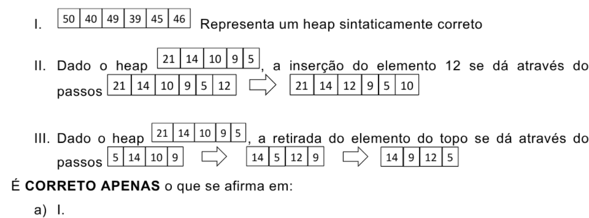
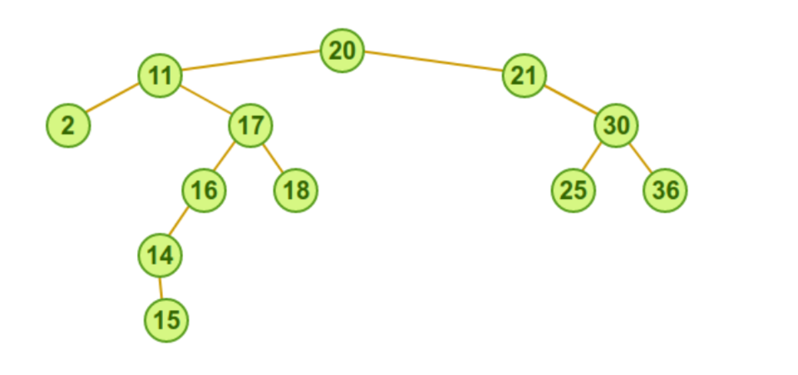

# PPGI/UFAM - Edital 023/2018 PROPESP/UFAM - Prova de Conhecimento

Fontes: `Prova-Edital023-2018.pdf` (caderno) e `Folha_Resposta_-_Gabarito.pdf` (folha de respostas com o gabarito marcado).
A Questão 5 foi anulada. Figuras em `2018-023/figuras/` (Q04 e Q10).

Observações sobre o caderno original: as Questões 03 e 05 têm enunciado idêntico, e o vetor da Questão 12 aparece no PDF como `32 8 12 16 20 24 28 16 36`.

## Gabarito

| Questão | Resp. | Questão | Resp. |
|---|---|---|---|
| 01 | C | 11 | C |
| 02 | C | 12 | E |
| 03 | D | 13 | E |
| 04 | B | 14 | D |
| 05 | Anulada | 15 | D |
| 06 | C | 16 | B |
| 07 | B | 17 | D |
| 08 | C | 18 | D |
| 09 | A | 19 | E |
| 10 | D | 20 | C |

## Questões

### QUESTÃO 01
Dois vetores ordenados, contendo, cada um deles, N números inteiros, precisam ser unidos em outro vetor maior, que conterá os 2N números, que também serão armazenados de forma ordenada. A complexidade de tempo de melhor caso desse processo será, então,

a) O(1), pois se precisa fazer apenas uma cópia simples de cada um dos elementos originais.
b) O(log N), pois se usa a busca binária para determinar qual será o próximo elemento copiado para o vetor de destino.
c) O(N), pois se precisa fazer uma cópia de cada um dos elementos originais, o que implica uma varredura completa de cada vetor de origem.
d) O(Nlog N), pois se precisa fazer uma busca de cada elemento para depois inseri-lo no vetor de destino.
e) O(N²), pois, como há dois vetores, precisa-se fazer dois laços de forma aninhada (um dentro do outro), gerando uma multiplicação das quantidades de elementos.

### QUESTÃO 02
Dadas as seguintes afirmações a respeito de árvores B,

I. Em uma árvore B de ordem "m" cada nó tem, no máximo, "m" filhos.
II. Em uma árvore B de ordem "m" cada nó (exceto a raíz e as folhas) tem pelo menos "m/2" filhos.
III. Árvores B precisam ser rebalanceadas frequentemente.
IV. Um nó não-folha com "k" filhos deve ter k chaves.
V. Todas as folhas aparecem no mesmo nível e carregam informação.

estão CORRETOS os itens

a) I e III, apenas.
b) I, III, IV e V.
c) I, II e V, apenas.
d) III, IV e V, apenas.
e) II, III e IV, apenas.

### QUESTÃO 03
Analise as duas afirmativas a seguir, relacionadas a árvores de busca:

I. Uma árvore AVL é uma árvore binária de busca autobalanceada que respeita algumas propriedades fundamentais.
II. Como todas as árvores, ela tem uma propriedade chamada altura, que é igual ao valor da altura de sua raiz.

Sabendo que a altura de uma folha é igual a um (01) e que a altura de um nó pai é igual ao máximo das alturas de seus filhos mais um, qual estrutura NÃO pode representar uma árvore AVL?

a) Uma árvore vazia
b) Uma árvore com dois nós
c) Uma árvore com três nós e altura igual a dois
d) Uma árvore com três nós e altura igual a três
e) Uma árvore com seis nós e altura igual a três

### QUESTÃO 04
Um heap (fila de prioridade) é uma estrutura de dados muito importante, que tem duas utilidades principais: organizar acesso a um recurso com base na prioridade dos requerentes (processos, impressões, etc.) ou servir como base a um algoritmo de ordenação muito eficiente denominado heapsort. Para poder servir a esses propósitos, um heap possui uma série de propriedades especiais que têm que ser mantidas por todas as operações nelas realizadas. Levando em consideração estas propriedades, analise as afirmativas abaixo.



I. `50 40 49 39 45 46` representa um heap sintaticamente correto
II. Dado o heap `21 14 10 9 5`, a inserção do elemento 12 se dá através dos passos `21 14 10 9 5 12` ⇒ `21 14 12 9 5 10`
III. Dado o heap `21 14 10 9 5`, a retirada do elemento do topo se dá através dos passos `5 14 10 9` ⇒ `14 5 12 9` ⇒ `14 9 12 5`

É CORRETO APENAS o que se afirma em:

a) I.
b) II.
c) III.
d) I e II.
e) II e III.

### QUESTÃO 05 (anulada)
Analise as duas afirmativas a seguir, relacionadas a árvores de busca:

I. Uma árvore AVL é uma árvore binária de busca autobalanceada que respeita algumas propriedades fundamentais.
II. Como todas as árvores, ela tem uma propriedade chamada altura, que é igual ao valor da altura de sua raiz.

Sabendo que a altura de uma folha é igual a um (01) e que a altura de um nó pai é igual ao máximo das alturas de seus filhos mais um, qual estrutura NÃO pode representar uma árvore AVL?

a) Uma árvore vazia
b) Uma árvore com dois nós
c) Uma árvore com três nós e altura igual a dois
d) Uma árvore com três nós e altura igual a três
e) Uma árvore com seis nós e altura igual a três

### QUESTÃO 06
Uma lista ordenada de N números é inserida em uma pilha e depois retirada, sendo que, a cada POP, o elemento retirado é inserido em uma árvore de busca binária. Após a completa inserção de todos os elementos nesta árvore, são feitas buscas de números na mesma. O tempo médio de busca de um número nesta árvore é

a) O(1)
b) O(log N)
c) O(N)
d) O(Nlog N)
e) O(N2)

### QUESTÃO 07
Assinale cada afirmativa abaixo como verdadeira (V) ou falsa (F). Em seguida, marque a opção que corresponde à sequência CORRETA.

( ) Uma árvore não-vazia é balanceada AVL se, pelo menos, uma de suas árvores, esquerda ou direita, for balanceada AVL;
( ) As árvores cheias são árvores balanceadas AVL;
( ) Uma boa condição de balanceamento AVL deve assegurar que a altura de uma árvore com n nós é da ordem de O(log n);
( ) Uma árvore AVL é uma árvore balanceada pela altura;
( ) Ao inserir ou remover um item em uma árvore AVL, o custo adicional para balancear esta árvore é da ordem de O(n/2).

a) V - V - F - V - V
b) F - V - V - V - F
c) V - F - F - V - F
d) F - V - V - F - V
e) F - F - V - V - F

### QUESTÃO 08
Considere uma estrutura do tipo árvore binária que começa vazia. Nela são introduzidos os números 2, 10, 5, 7, 1, 0 e 8, exatamente nessa ordem. Se essa árvore for lida em pós-ordem, que sequência de números será impressa?

a) 2, 1, 0, 8, 7, 5, 10
b) 2, 1, 0, 10, 5, 7, 8
c) 0, 1, 8, 7, 5, 10, 2
d) 0, 1, 2, 8, 7, 5, 10
e) 0, 1, 2, 10, 5, 7, 8

### QUESTÃO 09
Os registros em uma lista, duplamente encadeada com 20 elementos possuem cada um três campos:

- próximo: um ponteiro para o próximo elemento da lista;
- valor: informação armazenada pelo elemento;
- anterior: um ponteiro para o elemento anterior da lista.

Sendo "Z" o décimo elemento desta lista e "X" e "Y" dois outros elementos que não pertencem à lista, com seus respectivos ponteiros "pZ", "pX" e "pY", considere o trecho de código abaixo.

```
pY↑.próximo = pX;
pX↑.anterior = pY;
pX↑.próximo = pZ↑.próximo;
pZ↑.próximo↑.anterior = pX;
pZ↑.próximo = pY;
pY↑.anterior = pZ;
```

Este trecho de código é usado para inserir na lista os elementos:

a) Y, logo após o Z, e X, logo após o Y.
b) Y, antes do Z, e X, logo após o Z.
c) Y, antes do Z, e X, antes do Y.
d) X, logo após o Z, e Y, logo após o X.
e) X, antes do Z, e Y, logo após o Z.

### QUESTÃO 10
Considere a seguinte árvore de pesquisa binária:



Ao executarmos o procedimento de remoção da raiz, na nova árvore binária de busca, teremos como novo nó raiz:

a) 11
b) 2
c) 17
d) 18
e) Nenhuma das anteriores

### QUESTÃO 11
Considere o algoritmo a seguir que define a função recursiva "f".

```
função f(n){
  se n igual a 1 então retorne 0
  se n igual a 2 então retorne 1
  setorne f(n-1) + f(n-2)
}
```

Qual o valor retornado pela função "f" ao ser invocada passando o valor 4 como argumento?

a) 0
b) 1
c) 2
d) 3
e) 4

### QUESTÃO 12
Considere o vetor ordenado abaixo e indique quais os valores serão comparados com a chave de busca de valor 20 se for realizada uma busca binária no vetor. Considere que a primeira posição do vetor é a posição 0.

`32 | 8 | 12 | 16 | 20 | 24 | 28 | 16 | 36`

a) Chaves 20, 12, 8 e 4, nessa ordem
b) Chaves 20, 28,32 e 36, nessa ordem
c) Chaves 4, 8, 12, 16 e 20, nessa ordem
d) Chaves 36, 32, 28 e 24, nessa ordem
e) Apenas a chave 20

### QUESTÃO 13
Considere uma estrutura de dados do tipo vetor. Com respeito a tal estrutura, é CORRETO que seus componentes são, caracteristicamente:

a) heterogêneos e com acesso FIFO.
b) heterogêneos e com acesso LIFO.
c) heterogêneos e com acesso indexado-sequencial.
d) homogêneos e acesso não indexado.
e) homogêneos e de acesso aleatório por intermédio de índices.

### QUESTÃO 14
Considere as afirmações sobre busca binária:

I) é utilizada apenas sobre vetores ordenados
II) pode determinar se uma chave está ou não com um número de comparações de chave inferior a 2log2 n passos, onde n é o tamanho do vetor.
III) Supera a busca sequencial quando o vetor é grande, por exemplo com mais que mil elementos, e está ordenado.

a) Apenas as afirmações II e III estão corretas
b) Apenas as afirmações I e II estão corretas
c) Apenas as afirmações I e III estão corretas
d) Todas as afirmações estão corretas
e) Nenhuma das alternativas anteriores

### QUESTÃO 15
As árvores são estruturas de dados poderosas e se subdividem em vários tipos, cada um dos quais com suas características próprias. Relacione os tipos de árvores, apresentados na coluna da esquerda, com as suas respectivas características, indicadas na coluna da direita:

| Tipo de árvore | Característica |
|---|---|
| I – Heap | W – Pode degenerar se os elementos forem inseridos de forma ordenada. |
| II – Rubro-Negra | X – É balanceada. |
| III – Avore AVL | Y – Têm altura sempre proporcional/próxima a O(log2 n), onde n é o número de nós que contém. |
| IV – Árvores binária de busca | Z – São sempre completas. |

Estão CORRETAS as associações:

a) I–X, IV–Z, II–Y
b) I–Z, IV–X, III–W
c) I–Z, IV–X, III–Y
d) I–Y, IV–W, III–X
e) I–X, IV–W, II–Y

### QUESTÃO 16
Sobre o algoritmo de ordenação heapsort, marque a alternativa CORRETA:

a) Utiliza ordenação por árvore de decisão, ao invés de ordenação por comparação
b) A estrutura de dados que utiliza, chamada heap, pode ser interpretada como uma árvore binária
c) Seu desempenho de pior caso é pior do que o do algoritmo quicksort
d) Todas as alternativas estão corretas
e) Nenhuma das alternativas está correta

### QUESTÃO 17
Considerando os algoritmos de ordenação Quicksort, MergeSort, HeapSort e InsertionSort

I. São algoritmos estáveis: HeapSort, QuickSort e MergeSort
II. A complexidade de uso de espaço é O(n²): HeapSort,
III. A ordem das entradas é incapaz de influenciar o desempenho do algoritmo: InsertionSort, MergeSort
IV. Melhor caso da complexidade de tempo em Ω(n) : InsertionSort
V. A complexidade de uso de espaço é O(n): MergeSort

Marque a alternativa que indica SOMENTE afirmações INCORRETAS feitas:

a) I IV e V
b) I , III e IV
c) I, II, III e IV
d) I, II e III
e) II e V

### QUESTÃO 18
Considere uma tabela de espalhamento (hash table) de comprimento igual a 11, na qual a técnica de resolução de colisões utilizada é a de encadeamento. Nessa tabela, as posições são numeradas (indexadas) com os valores 0, 1, 2, ..., 10, o mapeamento de chaves para posições usa a função hash definida por h(k) = k mod 11, onde k é o valor da chave, e mod é o operador de módulo, e os números 1, 5, 18, 20, 4, 12, 10, 34, 15, 28 e 17 foram as chaves inseridas, nessa ordem, nessa tabela de espalhamento que estava inicialmente vazia. Qual a quantidade de posições em que houve colisão durante as inserções das chaves?

a) 0
b) 1
c) 2
d) 3
e) 4

### QUESTÃO 19
Marque a alternativa CORRETA. Uma lista encadeada simples é uma estrutura que corresponde a uma sequência lógica de entradas ou nós. Cada nó armazena a localização do próximo elemento na sequência, ou seja, de seu nó sucessor. Nessa estrutura:

a) Para estabelecer a ligação entre um nó já pertencente a uma lista e um novo nó, basta fazer com que o novo nó referencie no, campo next, o nó que anteriormente era referenciado pelo nó original, desde que esse campo não tenha o valor nulo.
b) A existência de um ponteiro apontando para o 1º elemento e outro para o fim da lista permite que a inserção ou deleção de dados de um nó que esteja no meio da lista seja rapidamente executada.
c) Enquanto a entrada que determina o topo da lista é mantida em um nó descritor dessa lista, a entrada que marca o fim da lista é mantida fora do descritor.
d) O armazenamento de uma lista requer uma área contígua de memória para permitir a otimização no processamento de criação e remoção de nós da lista.
e) O armazenamento de uma lista não requer uma área contígua de memória. Como listas são estruturas dinâmicas, normalmente são definidos procedimentos que permitem criar e remover nós na memória.

### QUESTÃO 20
A estrutura de dados é um modo de armazenamento e organização de dados para que possam ser usados eficientemente. Dentre as alternativas abaixo, sobre as afirmações de estrutura de dados, escolha a CORRETA:

I. Uma fila é uma estrutura de dados em que cada elemento tem um ou mais elementos associados.
II. A árvore é uma estrutura de dados baseada no princípio Last-in, First-out (LIFO), na qual os dados que foram inseridos primeiro serão os últimos a serem removidos.
III. Uma lista é uma estrutura de dados linear, que pode ser encadeada, a qual é composta por nós que apontam para o próximo elemento e o último elemento apontará para nulo.
IV. As pilhas são estruturas baseadas no princípio First-in, First-out (FIFO), em que os elementos que foram inseridos no início são os primeiros a serem removidos.

a) Somente a afirmação I é verdadeira.
b) Somente a afirmação II é verdadeira.
c) Somente a afirmação III é verdadeira.
d) Somente a afirmação IV é verdadeira.
e) Todas as afirmativas são verdadeiras.
