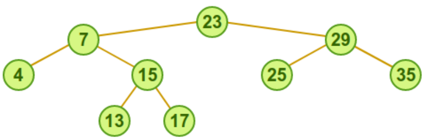

# PPGI/UFAM - Edital 061/2018 PROPESP/UFAM - Prova de Conhecimento

Fontes: `Caderno_-_Edital061-2018.pdf` (caderno) e `Folha_Resposta_-_Gabarito_01-02-2018.pdf` (folha de respostas com o gabarito marcado).
Questões 3, 4, 8, 9 e 17 foram anuladas. Figura em `2018-061/figuras/` (Q03).

## Gabarito

| Questão | Resp. | Questão | Resp. |
|---|---|---|---|
| 01 | B | 11 | E |
| 02 | D | 12 | A |
| 03 | Anulada | 13 | C |
| 04 | Anulada | 14 | E |
| 05 | B | 15 | E |
| 06 | D | 16 | A |
| 07 | E | 17 | Anulada |
| 08 | Anulada | 18 | E |
| 09 | Anulada | 19 | D |
| 10 | A | 20 | A |

## Questões

### QUESTÃO 01
Considere um arquivo sequencial com 10.000 registros, cujas chaves identificadoras são números inteiros de até 8 dígitos. Para criar um índice tipo hashing para esse arquivo, contendo endereços de 0 até 11.999, a mais adequada definição para uma função de hashing f(x), onde x é uma chave e (a mod b) é o resto da divisão de a por b, seria:

a) f = x mod 1000 + 12
b) f = x mod 12000
c) f = x / 10000
d) f = x / 11999
e) f = (x – 11999) /10000

### QUESTÃO 02
Matrizes são estruturas de dados de n-dimensões. Por simplicidade, chamaremos de matrizes as matrizes bidimensionais numéricas (que armazenam números inteiros). Sendo assim, marque a alternativa INCORRETA.

a) Uma matriz de m linhas e n colunas contêm (m * n) dados.
b) Uma matriz pode ser representada utilizando listas ligadas.
c) A soma dos elementos de uma matriz pode ser calculada fazendo dois laços aninhados, um sobre as linhas e o outro sobre as colunas.
d) A soma de duas matrizes de m linhas e n colunas resulta em uma matriz de 2*m linhas e 2*n colunas.
e) O produto de duas matrizes de n linhas e n colunas resulta em uma matriz de n linhas e n colunas.

### QUESTÃO 03 (anulada)
Considere a árvore AVL abaixo para responder à questão.

Qual é a sequência de chaves que constrói a referida árvore AVL, inicialmente vazia?

a) 23 – 7 – 29 – 15 – 4 – 25 – 35 – 13 – 17
b) 23 – 13 – 35 – 7 – 4 – 29 – 15 – 25 – 17
c) 23 – 29 – 7 – 17 – 13 – 4 – 35 – 25 – 15
d) 23 – 25 – 7 – 15 – 4 – 13 – 35 – 29 – 17
e) 23 – 7 – 29 – 17 – 4 – 35 -15 – 25 – 13

### QUESTÃO 04 (anulada)
Considere as afirmativas sobre métodos de ordenação. Sabendo que N se refere ao número de elementos do conjunto, a alternativa INCORRETA é:

a) Os algoritmos Bubble sort e Selection sort são ambos O(N²).
b) O Selection sort é o método mais rápido para qualquer tamanho de N se os elementos já estão ordenados, pois este é o seu melhor caso, que é O(Log2 N).
c) No método Quicksort, inicialmente o vetor é dividido em uma sublista da direita e uma da esquerda, de modo que todo elemento da sublista da esquerda seja menor que os da direita. Em seguida, ordenam-se, pelo mesmo processo, as duas sublistas de forma recursiva.
d) O tempo de execução dos algoritmos de ordenação aumenta na medida em que aumentamos o número de chaves se considerarmos o pior caso.
e) O método Quicksort é, essencialmente, uma aplicação do princípio "dividir para conquistar".

### QUESTÃO 05
A árvore binária de busca, formada pela inserção dos números 100, 80, 25, 72, 23, 42 e 5, nesta ordem, terá como nós folha os números __I__ e __II__, e como pai do nó 72 o número __III__. As lacunas I, II e III são preenchidas CORRETAMENTE e, respectivamente, por:

a) 100 – 80 – 100
b) 5 – 42 – 25
c) 23 – 25 – 72
d) 25 – 72 – 100
e) 72 – 5 – 23

### QUESTÃO 06
Marque a alternativa CORRETA. O método de ordenação QuickSort (ordenação rápida) é um método sofisticado de ordenação de vetores que:

a) Considera em cada passo somente um único elemento sucessor na sequência fonte e todos os elementos do vetor destino para encontrar o ponto correto da inserção.
b) Ordena todos os elementos que estiverem a intervalos de 4 posições entre si na sequência corrente.
c) É baseado nos princípios de ordenação por inserção direta através de incrementos decrescentes.
d) O Quicksort é um algoritmo que pode usar espaço extra linear no pior caso.
e) É baseado nos princípios de ordenação por seleção direta que consiste na seleção repetitiva da menor dentre as chaves de n elementos, e depois dentre os n-1 elementos restantes, e assim por diante.

### QUESTÃO 07
Avaliando as sentenças seguintes a respeito de estrutura de dados,

I. A diferença entre árvore binária simples e árvores AVL é o fato de que a segunda pode se reconfigurar dinamicamente, com o intuito de manter um bom nível de balanceamento.
II. Uma pilha garante que o último elemento inserido seja localizado no seu topo.
III. Do ponto de vista conceitual, não há diferença alguma entre uma estrutura de array e uma lista encadeada.
IV. Tabelas hash são estruturas de dados indicadas para armazenar grande volume de dados.

Verifica-se que:

a) As sentenças I e IV são verdadeiras.
b) Apenas a sentença I é verdadeira.
c) As sentenças III e IV são verdadeiras
d) As sentenças II e III são verdadeiras.
e) Apenas I, II e IV são verdadeiras.

### QUESTÃO 08 (anulada)
É INCORRETO afirmar que:

a) A fila de prioridade, uma estrutura de dados linear, é uma versão especial da fila.
b) Uma lista linear é uma estrutura de dados onde elementos do mesmo tipo são organizados de forma sequencial.
c) Na pilha, uma estrutura não linear, os elementos são colocados e retirados por um único lado da lista, ou seja, pelo topo.
d) Na tabela de Hash por endereçamento aberto, a chave é transformada num índice inteiro que é usado para acessar os dados.
e) Um array pode ser alocado dinamicamente, situação na qual ele passa a ser denominado lista ligada ou lista encadeada.

### QUESTÃO 09 (anulada)
Para uma árvore B, de ordem "m", o número mínimo de descendentes para um nível "d" da árvore é de:

a) 2 * m/2^(d-1)
b) d * m/2
c) (m*d/2)^2
d) [(m*d/2)^2]/2
e) d*(m/2)^2

*(Nota: `^` marca o expoente, que no PDF aparece sobrescrito. Na alternativa A o sobrescrito (d-1) está só no 2 de `m/2`, como no caderno.)*

### QUESTÃO 10
Dois vetores, v1 e v2, capazes de armazenar N inteiros cada um, estão ordenados de forma crescente e têm a propriedade de que o último elemento de v1 (v1[N-1]) é menor que o primeiro elemento de v2 (v2[0]). É retirado um elemento de cada vez de cada um desses vetores alternadamente, e cada elemento retirado é colocado em uma fila. Posteriormente, os elementos são retirados da fila e inseridos em uma árvore binária de busca. A árvore é percorrida em ordem simétrica, e os elementos são inseridos, assim que retirados, em uma pilha. Depois, cada elemento é retirado da pilha e inserido alternadamente em um dos vetores, começando por v1. Diante do exposto, conclui-se que:

a) v1[i] ≥ v2[i], ∀ i = 0,1,...,N-1
b) v1[i] ≤ v2[i], ∀ i = 0,1,...,N-1
c) v1[N-1] > v2[0]
d) As listas não estão mais ordenadas.
e) Todos os elementos de v1 estão armazenados em v2 e vice-versa.

### QUESTÃO 11
Para remoção de uma chave cuja página esteja com o número mínimo, em árvore B, é CORRETO afirmar que:

a) Deve-se fazer o processo de SPLIT sempre na página onde se encontrar a chave.
b) Deve-se fazer o processo de SPLIT na página onde se encontrar a chave, exceto quanto é um elemento da raiz da árvore.
c) Se a página onde se encontrar a chave não é folha, deve-se fazer procedimento de concatenação ou redistribuição, considerando os irmãos.
d) Remove-se a chave, e a substitui por uma chave do nó irmão.
e) No caso de só haver uma única página, a remoção não causa a necessidade de balanceamento.

### QUESTÃO 12
Lista circular encadeada é uma das estruturas de dados dinâmicas básicas. Uma questão que deve ser resolvida pelo algoritmo de busca em lista circular encadeada é:

a) Saber quando finalizar a busca, se o elemento procurado não estiver na lista circular.
b) Retornar o elemento anterior ao buscado, dada a propriedade de circularidade da lista.
c) Devolver o número de elementos constantes na lista.
d) Parar a busca assim que encontrar um elemento cujo ponteiro para o próximo elemento tenha valor nulo, o que indica o fim da lista.
e) Devolver o ponteiro de marcação de início, em sua nova posição

### QUESTÃO 13
Suponha que uma Árvore Binária de Busca possui números entre 1 e 1000 e que se quer procurar pelo número 363. Qual sequência abaixo NÃO poderia ser a sequência de nós examinados?

a) 2, 252, 401, 398, 330, 344, 397, 363.
b) 924, 220, 911, 244, 898, 258, 362, 363.
c) 925, 202, 911, 240, 912, 245, 363.
d) 2, 399, 387, 219, 266, 382, 381, 278, 363.
e) 935, 278, 347, 621, 350, 392, 358, 363.

### QUESTÃO 14
Analise as afirmativas a seguir sobre árvores B e árvores binárias

I. Diferente das árvores binárias, cada nó de uma árvore B deverá sempre ter mais de dois filhos.
II. Um nó de árvore B tem um campo ou um método para indicar se é um nó folha ou não. Característica esta herdada da AVL.
III. As folhas da árvore B são dispostas mais flexivelmente que as da árvore binária: suas folhas poderão estar em níveis diferentes, desde zero até o valor da altura da árvore.
IV. A árvore B tem um método de balanceamento muito custoso, por isso, sua indicação para trabalhar com dispositivos de armazenamento secundário, deve ser avaliada com muita cautela.

e assinale a alternativa CORRETA.

a) Todas as afirmativas estão corretas.
b) Somente as afirmativas II e III estão corretas
c) Somente as afirmativas I, II e IV estão corretas.
d) Somente as afirmativas I, III e IV estão corretas.
e) Todas as afirmativas estão incorretas

### QUESTÃO 15
Se em uma árvore binária de pesquisa a diferença de altura entre a subárvore à esquerda e a subarvore à direita de um dos nós for maior que 1, pode-se concluir que:

a) A árvore é uma árvore AVL.
b) Trata-se com certeza de uma árvore binária sem balanceamento.
c) Trata-se com certeza de uma árvore vermelho e preto.
d) Tal árvore não pode existir por não se tratar de uma árvore binária de pesquisa.
e) Nenhuma das alternativas anteriores está correta.

### QUESTÃO 16
Considere as seguintes afirmações:

I. Hash por encadeamento nunca apresenta colisões secundárias
II. Hash por encadeamento jamais permite que o número de comparações entre chaves em uma operação de busca passe de log n, onde n é o número de chaves inseridas no hash.
III. Hash por encadeamento realiza sempre menos comparações entre chaves do que qualquer hash por endereçamento aberto.

Agora marque a alternativa CORRETA:

a) Apenas a afirmação I é verdadeira
b) Apenas a afirmação II é verdadeira
c) Apenas a afirmação III é verdadeira
d) Apenas as afirmações II e III são verdadeiras
e) Nenhuma das alternativas anteriores está correta

### QUESTÃO 17 (anulada)
Considere as afirmações abaixo:

I. O RADIX sort não realiza comparação entre chaves para realizar a ordenação de um vetor
II. O número de vezes que é necessário passar por todos os elementos do vetor no RADIX sort é proporcional ao número médio de dígitos dos elementos do vetor na base utilizada pelo algoritmo para ordenação
III. O RADIX sort requer um espaço extra de armazenamento proporcional ao tamanho do vetor

Sobre as afirmações, sabe-se que:

a) Apenas a afirmação I é verdadeira
b) Apenas a afirmação II é verdadeira
c) Apenas a afirmação III é verdadeira
d) Apenas as afirmações II e III são verdadeiras
e) Nenhuma das afirmações é verdadeira

### QUESTÃO 18
Considere as afirmações sobre um hash por encadeamento:

I. Tem como desvantagem o fato de não ordenar as chaves inseridas
II. O número médio de operações esperado para realizar uma busca é constante se o hash for bem projetado
III. Mesmo quando bem implementado, ocupa mais espaço extra do que uma árvore B em memória.

Sobre as afirmações, sabe-se que:

a) Todas as afirmações são verdadeiras
b) Todas as afirmações são falsas
c) Apenas as afirmações I e III são verdadeiras
d) Apenas a afirmação III é verdadeira
e) Apenas as afirmações I e II são verdadeiras

### QUESTÃO 19
Quanto ao algoritmo e estrutura de dados no caso de árvore AVL, analise as afirmativas abaixo como verdadeiras (V) ou falsas (F) e assinale a alternativa que apresenta a sequência CORRETA de cima para baixo:

( ) Uma árvore AVL é dita balanceada quando, para cada nó da árvore, a diferença entre as alturas das suas sub-árvores (direita e esquerda) não é maior do que um.
( ) Caso haja diferença de altura maior que 1 ente as sub-árvores à direita e à esquerda de qualquer nó, é necessário que se realizem rotações com o objetivo de reduzir tal diferença.
( ) A operação de rotação realizada em um ponto da árvore, após a inserção, pode resultar em uma árvore ainda desbalanceada, podendo ser necessária a realização de novas rotações que, na pior das hipóteses, podem ser propagadas até a raiz.

a) F-V-V
b) F-F-V
c) V-F-F
d) V-V-F
e) V-V-V

### QUESTÃO 20
Dados os seguinte valores de entrada - 11, 12, 23, 14, 25, 50, 8, 18, 29, 10 -, insira-os em uma PILHA. Em seguida retire cada um dos valores da PILHA e insira numa FILA. Mostre a FILA. Depois retire os dados da FILA e insira na PILHA. Mostre a PILHA.

As valores MOSTRADOS ficam

I. FILA (começo) 10 - 29 - 18 - 8 - 50 - 25 - 14 - 23 - 12 - 11 (fim)
II. PILHA: (topo) 11 - 12 - 23 - 14 - 25 - 50 - 8 - 18 - 29 - 10
III. PILHA: (topo) 10 - 29 - 18 - 8 - 50 - 25 - 14 - 23 - 12 - 11
IV. FILA: (começo) 11 - 12 - 23 - 14 - 25 - 50 - 8 - 18 - 29 – 10 (fim)

Está CORRETO o que se afirma APENAS em:

a) I e II
b) I e IV
c) II e III
d) III e IV
e) III e IV
