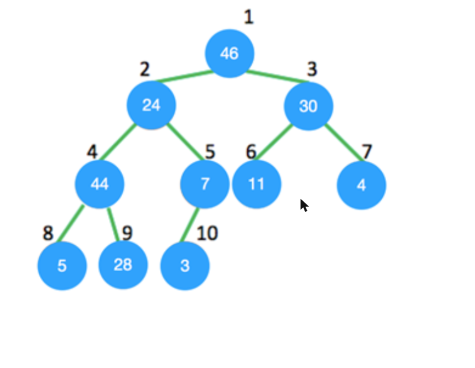
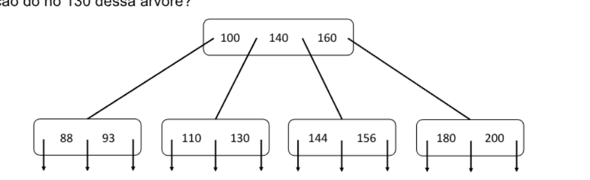
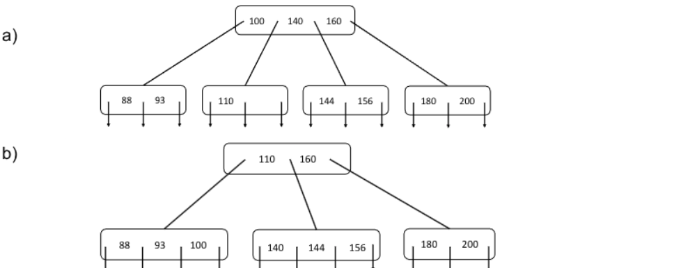
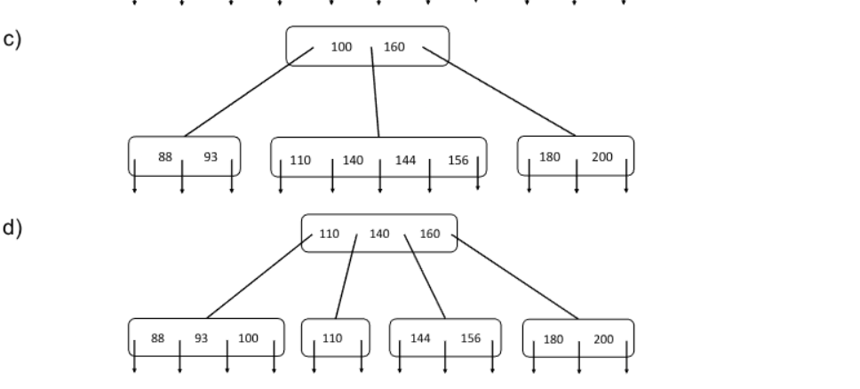
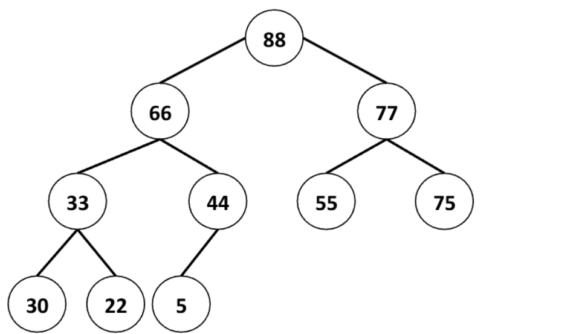
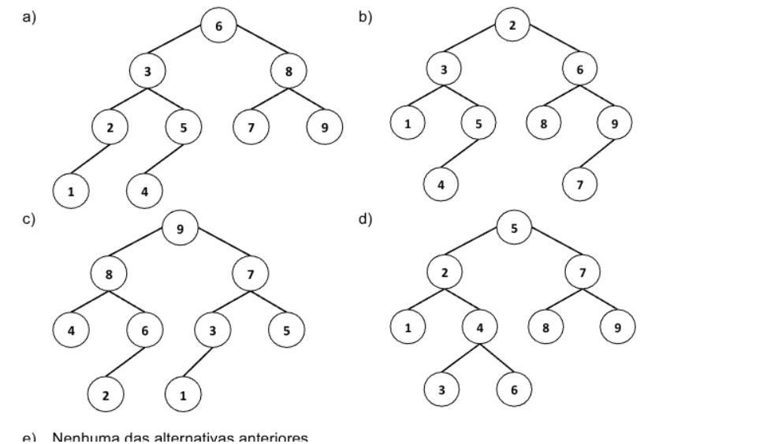

# PPGI/UFAM - Edital 033/2019 PROPESP/UFAM - Prova de Conhecimento

Fontes: `CadernoQuestões-Edital033-2019.pdf` (caderno) e `Folha_Resposta-Gabarito.pdf` (gabarito parcial).
Questões 5, 10, 13 e 15 constam como anuladas no gabarito parcial. Figuras em `2019-033/figuras/` (Q02, Q04, Q16, Q19).

## Gabarito parcial

| Questão | Resp. | Questão | Resp. |
|---|---|---|---|
| 01 | A | 11 | B |
| 02 | D | 12 | B |
| 03 | A | 13 | Anulada |
| 04 | C | 14 | D |
| 05 | Anulada | 15 | Anulada |
| 06 | D | 16 | E |
| 07 | B | 17 | C |
| 08 | D | 18 | A |
| 09 | A | 19 | A |
| 10 | Anulada | 20 | B |

## Questões

### QUESTÃO 01
Sabendo que o algoritmo Quick Sort classifica os elementos em ordem crescente usando o primeiro elemento como pivô, qual das seguintes sequências de entrada irá requerer o maior número de comparações quando o algoritmo for aplicado?

a) 22 25 33 42 56 67 89
b) 63 70 47 42 36 38 73
c) 42 25 22 33 67 56 89
d) 13 52 25 58 10 22 17
e) 23 25 33 42 11 22 30

### QUESTÃO 02
A parte essencial do Heap Sort é a construção do heap máximo. Considerando a árvore mostrada abaixo, o nó 24 viola a propriedade do heap máximo. Uma vez que o procedimento de heap é aplicado a ele, em que posição ele estará?



a) 4
b) 5
c) 8
d) 9
e) 6

### QUESTÃO 03
Considere a seguinte operação em uma pilha de tamanho 5:
Push(1); Pop(); Push(2); Push(3); Pop(); Push(4); Pop(); Pop(); Push(5);
Após a todos as operações serem realizadas, o número de elementos presentes na pilha é:

a) 1
b) 2
c) 3
d) 4
e) 5

### QUESTÃO 04
A figura abaixo mostra uma árvore B de ordem 5. Qual é o resultado da remoção do nó 130 dessa árvore?



Alternativas a) e b):



Alternativas c) e d):



e) Nenhuma das anteriores

### QUESTÃO 05 (anulada)
No pior dos casos, o número de comparações necessárias para pesquisar uma lista simplesmente encadeada de comprimento n para um dado elemento é

a) log2 n
b) n/2
c) log2 n - 1
d) n
e) Nenhuma das anteriores

### QUESTÃO 06
Qual é a saída da seguinte função que inicia apontando para o primeiro nó da seguinte lista encadeada?

`1->2->3->4->5->6`

```c
void fun(struct node* start)
{
  if(start == NULL)
    return;
  printf("%d ", start->data);
  if(start->next != NULL )
    fun(start->next->next);
  printf("%d ", start->data);
}
```

a) 1 4 6 6 4 1
b) 1 3 5 1 3 5
c) 1 2 3 5
d) 1 3 5 5 3 1
e) Nenhuma das anteriores

### QUESTÃO 07
Qual estrutura de dados é comumente usada para implementar recursão?

a) Queue (fila)
b) Stack (pilha)
c) Array (vetor)
d) Lista
e) Matriz

### QUESTÃO 08
Quais são, respectivamente, o pior caso e o caso médio de uma árvore de busca binária em termos de complexidade?

a) O(n), O(n)
b) O(logn), O(logn)
c) O(logn), O(n)
d) O(n), O(logn)
e) Nenhuma das respostas anteriores.

### QUESTÃO 09
Uma árvore B de ordem 4 e de altura 3, onde ordem é o número máximo de filhos em cada nó, terá um máximo de chaves igual a?

a) 255
b) 63
c) 127
d) 188
e) 256

### QUESTÃO 10 (anulada)
Suponha uma tabela hash vazia com tamanho m = 17, utilizando o método da divisão para chaves de valores naturais e endereçamento aberto. Considere as sentenças abaixo:

I. Após inserir as chaves 5, 10, 22, 42 e 39, utilizando sondagem linear, terá havido um total de 2 colisões
II. As chaves 5, 10, 22, 42 e 39 poderiam ser inseridas sem colisão se utilizássemos uma função dispersão dupla (double hash)
III. É possível inserir 17 chaves nessa tabela sem que ocorra nenhuma colisão.

Marque a alternativa CORRETA

a) Somente a sentença I está correta
b) As sentenças I e II estão correta
c) Somente a sentença III está correta
d) As sentenças I e III estão correta
e) Todas as sentenças estão corretas

### QUESTÃO 11
Qual a função do seguinte trecho de código?

```java
public void function(int data)
{
  int flag = 0;
  if( head != null)
  {
    Node temp = head.getNext();
    while((temp != head) && (!(temp.getItem() == data)))
    {
      temp = temp.getNext();
      flag = 1;
      break;
    }
  }
  if(flag)
    System.out.println("success");
  else
    System.out.println("fail");
}
```

a) Imprimir sucess se um determinado elemento não for encontrado
b) Imprimir fail se um determinado elemento não for encontrado
c) Imprimir sucess se um elemento em particular for igual a 1
d) Imprimir fail se a lista estiver vazia e success caso contrário
e) Nenhuma das respostas anteriores.

### QUESTÃO 12
Qual é a altura máxima de qualquer árvore AVL com 7 nós? Assuma que a altura de uma árvore com um único nó seja 0.

a) 2
b) 3
c) 4
d) 5
e) 6

### QUESTÃO 13 (anulada)
Dadas as sentenças abaixo, marque a alternativa CORRETA.

I. As raízes dos elementos das subárvores são menores que a raiz do heap.
II. Para restaurar a propriedade AVL depois de inserir um elemento, começamos no ponto de inserção e nos movemos em direção a raiz dessa árvore.
III. A árvore B e a árvore AVL têm a mesma complexidade de tempo do pior caso para inserção e exclusão.

a) Somente a sentença I está correta
b) As sentenças II e III estão correta
c) Somente a sentença III está correta
d) As sentenças I e III estão correta
e) Somente a sentença II está correta

### QUESTÃO 14
Dada a seguinte entrada (34, 8, 64, 51, 32, 21) e empregando o algoritmo Insertion Sort, qual será a aparência do array de elementos após a segunda rodada de ordenação?

a) 8, 21, 32, 34, 51, 64
b) 8, 32, 34, 51, 64, 21
c) 8, 34, 51, 64, 32, 21
d) 8, 34, 64, 51, 32, 21
e) 8, 51, 64, 34, 32, 21

### QUESTÃO 15 (anulada)
Qual é a vantagem do Bubble Sort em relação aos outros algoritmos de ordenação?

a) É o mais rápido
b) Consome menos memória
c) Pode detectar se a entrada já está ordenada
d) É o mais complexo em termos de implementação
e) Não possui vantagens

### QUESTÃO 16
Ao se representar a heap máxima da figura abaixo em um array, a ordem dos elementos no array será a seguinte:



a) 88 66 33 44 30 22 5 77 55 75
b) 86 77 55 75 66 33 44 30 22 5
c) 86 77 75 66 55 44 33 30 22 5
d) 5 22 30 75 55 44 33 77 66 86
e) 88 66 77 33 44 55 75 30 22 5

### QUESTÃO 17
Quantas pilhas são necessárias para implementar uma fila. Considere a situação em que nenhuma outra estrutura de dados, como matrizes, lista encadeada está disponível.

a) 0
b) 1
c) 2
d) 3
e) 4

### QUESTÃO 18
Qual das afirmações abaixo sobre Insertion Sort está CORRETA?

a) Existem arrays de tamanhos variados N tais que o Insertion Sort é executado em Θ(N).
b) Existem arrays de tamanhos variados N tais que o Insertion Sort é executado em Θ(1).
c) Existem arrays de tamanhos variados N tais que o Insertion Sort é executado em Θ(N³).
d) Existem arrays de tamanhos variados N tais que o Insertion Sort é executado em Θ(2^N).
e) Nenhuma das sentenças anteriores está correta.

### QUESTÃO 19
Ao se construir uma árvore AVL, inicialmente vazia, com as seguintes chaves na ordem indicada - 2, 3, 5, 6, 9, 8, 7, 4, 1 – e sabendo que que se uma inserção fizer com que a árvore fique desequilibrada, é necessário executar as rotações para manter o equilíbrio, o resultado final da árvore AVL é:



e) Nenhuma das alternativas anteriores

### QUESTÃO 20
Sobre as afirmações abaixo, marque a alternativa CORRETA

I. A subárvore da raiz de um árvore vermelho e preto é sempre uma árvore vermelha e preta.
II. O irmão de uma referência de filho nulo em uma árvore vermelha e preta é outra referência de filho nulo ou um nó vermelho.
III. A pior complexidade de tempo da operação de inserção em uma árvore AVL é O(log n), onde n é o número de nós na árvore.

a) Somente a sentença I está correta
b) As sentenças II e III estão correta
c) Somente a sentença III está correta
d) As sentenças I e III estão correta
e) Somente a sentença II está correta
