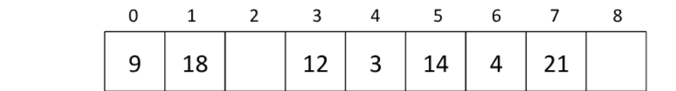
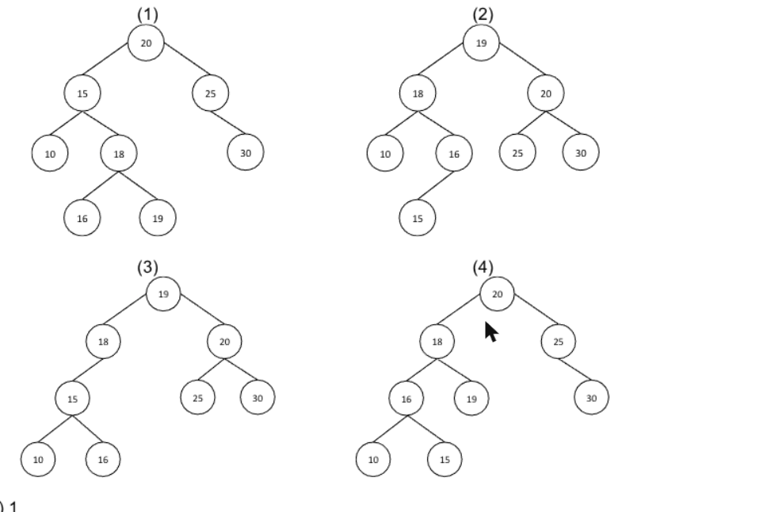
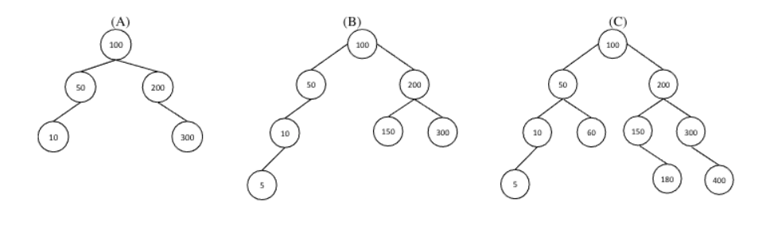

# PPGI/UFAM - Edital 060/2019 PROPESP/UFAM - Prova de Conhecimento

Fontes: `Caderno_de_Questões_-_Edital_0602019.pdf` (caderno) e `Folha_Resposta_-_Gabarito_30-01-2020.pdf` (folha de respostas com o gabarito marcado).
Questões 11, 13, 14 e 16 foram anuladas. Figuras em `2019-060/figuras/` (Q01, Q02, Q12).

A Questão 16 diz "figura abaixo", mas o PDF não traz a figura da árvore, o que talvez explique a anulação. Não há nada para capturar ali.

## Gabarito

| Questão | Resp. | Questão | Resp. |
|---|---|---|---|
| 01 | C | 11 | Anulada |
| 02 | A | 12 | D |
| 03 | D | 13 | Anulada |
| 04 | C | 14 | Anulada |
| 05 | B | 15 | A |
| 06 | C | 16 | Anulada |
| 07 | D | 17 | C |
| 08 | B | 18 | A |
| 09 | A | 19 | E |
| 10 | E | 20 | E |

## Questões

### QUESTÃO 01
Suponha que você tenha a seguinte tabela hash implementada utilizando endereçamento aberto com sondagem linear (linear probing). A função hash que você está usando é uma função modular, h(x) = x MOD 9.



Qual das ordens abaixo pode ser a ordem em que os elementos foram adicionados à hash? Assuma que a hash nunca tenha sido redimensionada e que nenhum elemento tenha sido excluído ainda.

a) 9, 14, 4, 18, 21, 3, 12
b) 12, 3, 14, 18, 4, 9, 21
c) 12, 14, 3, 9, 4, 18, 21
d) 9, 12, 14, 3, 21, 18, 4
e) 18, 9, 12, 3, 14, 4, 21

### QUESTÃO 02
Dado os seguintes elementos (10, 20, 15, 25, 30, 16, 18, 19), qual desenho representa uma árvore AVL, inicialmente vazia, que é preenchida com esses elementos, na ordem apresentada, e que tem as devidas rotações efetuadas?



a) 1
b) 2
c) 3
d) 4
e) Nenhuma das árvores desenhadas representa uma AVL

### QUESTÃO 03
Qual a alternativa que completa corretamente a seguinte frase: Um algoritmo que possui número de operações _______________ em função de uma entrada de tamanho n é linear.

a) n³ + 9
b) 3n² + 3n + 2
c) 6
d) 2n + 1
e) n² + 1

### QUESTÃO 04
Considere um vetor com 25 elementos (posição 0 até a posição 24) que representam os números primos entre 1 a 100, em ordem crescente (Ex: [2, 3, 5, 7, 11, 13, ..., 89, 97]). Empregando pesquisa binária, quantos itens do vetor precisam ser examinados antes de se concluir que o número 52 não está no vetor e, portanto, não é primo?

a) 12
b) 7
c) 5
d) 1
e) 4

### QUESTÃO 05
Considere o código da função abaixo:

```c
void fun1(struct node* head)
{
  if(head == NULL)
    return;
  fun1(head->next);
  printf("%d ", head->data);
}
```

O que essa função faz, dada uma lista encadeada de valores inteiros como entrada?

a) Imprime todos os nós da lista encadeada, começando com primeiro o nó da lista
b) Imprime todos os nós da lista encadeada, começando com o último nó da lista
c) Imprime apenas os nós de posições pares da lista encadeada
d) Imprime apenas os nós de posições impares da lista encadeada
e) Nenhuma das alternativas anteriores

### QUESTÃO 06
Marque a alternativa CORRETA. Sobre um hash com encadeamento e com tabela de tamanho 100, pode-se dizer que:

a) Para casos em que se insere um número n muito grande de chaves, o tempo no caso médio de busca será O(1)
b) Para casos em que se insere um número n muito grande de chaves, o tempo de busca no pior caso será O(1)
c) Para casos em que se insere um número n muito grande de chaves, o tempo no caso médio de busca será O(n)
d) Para casos em que se insere um número n muito grande de chaves, o tempo de busca no pior caso será O(log n)
e) Nenhuma das alternativas anteriores

### QUESTÃO 07
A seguinte função em C usa uma lista simplesmente encadeada como argumento de entrada. Ela modifica a lista, movendo o último elemento para a frente da lista e retorna a lista modificada.

```c
typedef struct node {
  int value;
  struct node *next;
}Node;

Node *move_to_front(Node *head) {
  Node *p, *q;
  if ((head == NULL || (head->next == NULL))
    return head;
  q = NULL; p = head;
  while (p-> next !=NULL)
  {
    q = p;
    p = p->next;
  }
  _ _ _ _ _ _ _ _ _ _ _ _ _ _
  return head;
}
```

Certa parte do código foi deixada em branco (linha tracejada). Escolha a alternativa CORRETA para substituir a linha em branco.

a) q = NULL; p->next = head; head = p;
b) q->next = NULL; head = p; p->next = head;
c) head = p; p->next = q; q->next = NULL;
d) q->next = NULL; p->next = head; head = p;
e) A função não precisa ser complementada.

### QUESTÃO 08
Qual dos seguintes algoritmos apresenta tempo O(n) quando ordenando um vetor com n elementos idênticos de texto?

a) Heapsort
b) Insertion sort
c) Mergesort
d) Quicksort
e) Nenhum dos algoritmos apresenta tempo O(n) para essa entrada

### QUESTÃO 09
Qual das afirmações a seguir é VERDADEIRA sobre árvores rubro-negra (vermelho e preto)?

a) O caminho do nó raiz até o nó folha mais distante não é maior que o dobro do número de nós do caminho da raiz para a folha mais próxima
b) O caminho do nó raiz para um nó folha ou para um nó nulo deve conter o mesmo número de nós pretos e vermelhos.
c) A raiz pode ser vermelha
d) Se um nó for vermelho, os nós filhos somente serão pretos. O inverso também acontece, ou seja, se um nó for preto, seus nós filhos somente serão vermelhos.
e) Nenhumas das afirmações é verdadeira

### QUESTÃO 10
Qual das seguintes estruturas de dados é mais usada para implementar recursão?

a) Heap binário
b) Hash table
c) Fila
d) Árvore de busca
e) Pilha

### QUESTÃO 11 (anulada)
Qual das alternativas a seguir é FALSA sobre a árvores B e B+

a) Árvores B e B+ criando um novo nível raiz (crescem para cima) sempre que sua altura muda, enquanto as árvores de pesquisa binária crescem adicionando novos nós folhas (para baixo) sempre que sua altura muda.
b) A complexidade de tempo para busca por uma chave é diferente das árvores rubro-negras, se considerarmos o pior caso
c) O número de ponteiros filhos em um nó da árvore B é sempre igual ao número de chaves nele mais uma.
d) Uma árvore B+, de ordem n, é uma árvore com as seguintes propriedades: (i) todos os nós das folhas são armazenados na mesma profundidade; (ii) todos as chaves são armazenadas em nós folha.
e) Uma árvore B, de ordem n, é uma árvore com as seguintes propriedades: (i) todos os nós das folhas são armazenados na mesma profundidade; (ii) todos os nós não raiz têm entre n - 1 e 2n – 1 chaves; (iii) a raiz tem no máximo 2n – 1 chaves.

### QUESTÃO 12
Quais das seguintes árvores abaixo respeita as regras básicas de balanceamento de árvores AVL?



a) Somente B
b) A, B e C
c) B e C
d) A e C
e) Nenhuma das árvores é AVL

### QUESTÃO 13 (anulada)
Quais das seguintes afirmações sobre árvores é INCORRETA?

a) O tempo de busca, no pior caso, para uma árvore AVL é O(log n)
b) No pior caso, uma inserção de árvore rubro-negra requer O(1) rotações
c) Uma árvore B+ tem todos as chaves armazenadas em nós folha
d) A busca por uma chave em uma árvore de pesquisa binária sem balanceamento com n nós leva tempo O(log n) no pior caso.
e) Pode-se dizer que uma árvore B é uma árvore balanceada

### QUESTÃO 14 (anulada)
O número mínimo de comparações necessárias para determinar se um número inteiro aparece mais de n/2 vezes em um vetor ordenado de n números inteiros é:

a) Θ(n)
b) Θ(log n)
c) Θ(log *n)
d) Θ(1)
e) Θ(n/2)

### QUESTÃO 15
Comparando árvores AVL e rubro-negras, qual das seguintes afirmações é VERDADEIRA:

a) As árvores AVL tendem a ter altura menor em comparação com as árvores rubro-negras, mas podem causar mais rotações durante operações de inserção e exclusão.
b) As alturas das árvores AVL e rubro-negras são as mesmas, mas as árvores AVL podem causar mais rotações durante a inserção e exclusão.
c) As árvores rubro-negras tendem a ter altura menor em comparação com as árvores AVL, mas podem causar mais rotações durante a inserção e exclusão.
d) As alturas das árvores AVL e rubro-negras são as mesmas, mas as árvores rubro-negras podem causar mais rotações durante a inserção e exclusão.
e) Todas as afirmações anteriores são falsas

### QUESTÃO 16 (anulada)
Dada a seguinte árvore binária de busca (figura abaixo) e ao se realizar as seguintes operações em sequência - adicionar o nó 5, adicionar o nó 17, remover o nó 23 e remover o nó 9. Qual das alternativas representa a lista de nós desta árvore em pré-ordem e pós-ordem, respectivamente?

*(Figura ausente no PDF original.)*

a) 3, 9, 10, 12, 15, 19, 21, 23 e 23, 21, 19, 15, 12, 10, 9, 3
b) 15, 9, 23, 3, 12, 19, 10, 21 e 21, 10, 19, 12, 3, 23, 9, 15
c) 15, 10, 21, 3, 12, 19, 9, 23 e 15, 21, 10, 19, 12, 3, 23, 9
d) 10, 12, 9, 3, 15, 23, 19, 21 e 21, 19, 23, 15, 9, 3, 12, 10
e) 15, 10, 3, 5, 12, 21, 19, 17 e 5, 3, 12, 10, 17, 19, 21, 15

### QUESTÃO 17
Suponha que, no pior caso, um algoritmo Merge Sort leve 30 segundos para ordenar uma entrada de tamanho 64. Qual das opções a seguir se aproxima mais do tamanho máximo de entrada de um problema que pode ser resolvido em 6 minutos?

a) 256
b) 1024
c) 512
d) 2048
e) 4096

### QUESTÃO 18
Considere que os seguintes elementos {5,4,3,2,1} foram inseridos nesta ordem em um vetor. Em seguida, você aplicou o algoritmo Insertion Sort nele. Qual é a sequência de passos feitos durante o uso do Insertion Sort neste vetor?

a) 4 5 3 2 1 / 3 4 5 2 1 / 2 3 4 5 1 / 1 2 3 4 5
b) 5 4 3 1 2 / 5 4 1 2 3 / 5 1 2 3 4 / 1 2 3 4 5
c) 4 3 2 1 5 / 3 2 1 5 4 / 2 1 5 4 3 / 1 5 4 3 2
d) 4 5 3 2 1 / 2 3 4 5 1 / 3 4 5 2 1 / 1 2 3 4 5
e) 4 5 3 1 2 / 2 3 4 5 1 / 3 4 5 2 1 / 1 2 3 4 5

### QUESTÃO 19
Considere uma lista duplamente encadeada não ordenada (com ponteiros na início e final da lista). Qual das seguintes operações a seguir pode ser implementada no tempo O(1)? Marque a alternativa CORRETA.

I. Inserção na frente da lista encadeada
II. Inserção no final da lista encadeada
III. Exclusão do nó frontal da lista encadeada
IV. Exclusão do último nó da lista encadeada

a) I e II
b) I e III
c) I, II e III
d) I, II e IV
e) Todas as afirmativa estão corretas

### QUESTÃO 20
Suponha que uma fila circular de elementos com capacidade (n - 1) seja implementada com um vetor de n elementos. Suponha que a operação de inserção e exclusão seja realizada usando REAR (último elemento da fila) e FRONT (primeiro elemento da fila) como variáveis de índice do vetor, respectivamente. Inicialmente, REAR = FRONT = 0. As condições para detectar a fila cheia e a fila vazia são:

a) Full: (REAR+1) mod n == FRONT, empty: (FRONT+1) mod n == REAR
b) Full: REAR == FRONT, empty: (REAR+1) mod n == FRONT
c) Full: (FRONT+1) mod n == REAR, empty: REAR == FRONT
d) Full: REAR == FRONT, empty: (FRONT+1) mod n == REAR
e) Full: (REAR+1) mod n == FRONT, empty: REAR == FRONT
