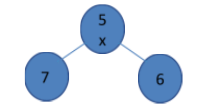

# PPGI/UFAM - Edital 020/2023 PROPESP/UFAM - Prova de Conhecimento

Fontes: `provappgi_Gabarito_Edital_020_2023_ano_2023_02.pdf` (caderno com a resposta oficial marcada em negrito).
Figuras em `2023-020/figuras/` (Q06). Nenhuma questão anulada.

## Gabarito (alternativa em negrito no PDF)

| Questão | Resp. | Questão | Resp. |
|---|---|---|---|
| 01 | C | 06 | C |
| 02 | A | 07 | B |
| 03 | D | 08 | C |
| 04 | D | 09 | A |
| 05 | B | 10 | D |

## Questões

### QUESTÃO 01
Dado o vetor abaixo, uma busca binária realizará a comparação de uma chave qualquer com elementos do vetor. Quantas comparações serão necessárias no pior caso (aquele que maximiza o número de comparações feitas pelo algoritmo) ?

| 0 | 1 | 2 | 3 | 4 | 5 | 6 | 7 | 8 | 9 |
|---|---|---|---|---|---|---|---|---|---|
| 10 | 30 | 50 | 60 | 70 | 80 | 90 | 100 | 120 | 130 |

a) 6 comparações
b) 10 comparações
c) 4 comparações
d) 1 comparação

### QUESTÃO 02
Sobre o algoritmo de ordenação por inserção (Insertion Sort), marque a alternativa correta.

a) Ele tende a ficar mais rápido para vetores que estão quase ordenados de acordo com o critério usado pelo algoritmo é mais lento quando o vetor está invertido
b) O tempo de ordenação independe da ordem inicial dos elementos, sendo sempre quadrático
c) O tempo de ordenação independe da ordem dos elementos, sendo sempre linear
d) Ele não ordena chaves de valor negativo, dado que a inserção em posições negativas é inviável

### QUESTÃO 03
Dada a pilha de números inteiros [4, 16, 1, 7, 8, 13] onde o topo é o elemento mais à esquerda, após a realização de três (3) operações de desempilhar elementos, uma (1) operação de empilhar que insere o valor 5 e uma (1) operação de empilhar que insere o valor 2, a pilha ficará com qual configuração?

a) [7, 8, 13, 5, 2]
b) [4, 16, 2, 5, 2]
c) [5, 2, 7, 8, 13]
d) [2, 5, 7, 8, 13]

### QUESTÃO 04
Sobre um Hash por Encadeamento, pode-se afirmar que:

a. Ele não gera colisões secundárias
b. Ele tem custo temporal O(n) no pior caso, sendo n o número de elementos na tabela
c. Ao contrário do endereçamento aberto, o encadeamento permite trabalhar com quantidade de chaves superior ao tamanho da tabela

a) Nenhuma alternativa é verdadeira
b) Apenas II é verdadeira
c) Apenas I e II são verdadeiras
d) Todas são verdadeiras

### QUESTÃO 05
Considerando-se as operações com um vetor, mantido ordenado a cada inserção de chave, e uma árvore binária de pesquisa balanceada, pode-se dizer que:

a. O vetor ordenado apresenta custo de inserção e de remoção menores que o da árvore, pois não exigir alocação dinâmica de nós
b. No pior caso, o custo da operação de busca por uma chave é assintoticamente igual tanto no vetor ordenado quanto na árvore

a) Apenas I é verdadeira
b) Apenas II é verdadeira
c) As duas são verdadeiras
d) Nenhuma é verdadeira

### QUESTÃO 06
Considere a figura abaixo, que ilustra uma árvore com três nós contendo chaves inteiras, sendo que a raiz da árvore (marcada com "x") contém a chave 5, e marque a alternativa correta.



a) A árvore pode ser uma árvore vermelho e preto (RB-tree), visto que está balanceada (lembrando que não é necessário representar os nós com as cores vermelho e preto no desenho)
b) A árvore pode representar uma árvore binária de pesquisa, a qual pode estar com ou sem balanceamento
c) A árvore pode representar uma heap mínima
d) A árvore é do tipo AVL, pois está balanceada

### QUESTÃO 07
Sobre a complexidade de algoritmos, marque a alternativa correta:

a) A busca binária em vetor ordenado é realizada em tempo O(N/2) no pior caso, sendo N o tamanho do vetor de chaves
b) É possível inserir elementos de forma não ordenada em uma lista encadeada a custo constante no pior caso, independentemente da quantidade de elementos da lista encadeada
c) A inserção de elementos no início de um vetor é feita a custo constante no pior caso, independentemente da quantidade de elementos do vetor
d) A inserção em uma árvore binária de pesquisa pode ser realizada a custo constante no pior caso, independentemente da quantidade de elementos da árvore

### QUESTÃO 08
Considere o pseudo-código abaixo e escolha a opção correta:

```c
void par ( int v[], int inicio, int meio, int fim, int vaux[]) {
    unsigned i=inicio, j=meio+1, k=inicio;
    while((i <= meio) && (j <= fim) ) {
        if ( v[i] < v[j]) { vaux[k] = v[i]; i++; }
        else { vaux[k] = v[j]; j++; }
        k++;
    }
    while(i <= meio) { vaux[k] = v[i]; i++; k++; }
    while(j <= fim) { vaux[k] = v[j]; j++; k++; }
    for(i = inicio; i <= fim ; i++) { v[i] = vaux[i]; }
}

void sortR (int v[], int inicio, int fim, int vaux[]) {
    int meio;
    if(inicio < fim) {
        meio = (inicio+fim)/2;
        sortR(v, inicio, meio, vaux);
        sortR(v, meio+1, fim, vaux);
        par (v, inicio, meio, fim, vaux);
    }
}

void sort (int v[], int tam) {
    int * vaux;
    vaux = (int*) malloc (sizeof(int) * tam);
    sortR( v, 0, tam -1 , vaux);
    free(vaux);
}
```

a) Ela implementa um algoritmo recursivo conhecido como Quick Sort ao chamar a função recursiva sortR para ordenar o vetor v
b) Ela implementa um algoritmo recursivo conhecido como Radix Sort ao chamar a função recursiva sortR para ordenar o vetor v
c) Ela implementa um algoritmo recursivo conhecido como Merge Sort ao chamar a função recursiva sortR para ordenar o vetor v
d) Ela não ordena o vetor v

### QUESTÃO 09
Qual é a saída do seguinte pseudo-código? Considere que:

- len(lista) retorna o número de elementos em uma lista
- max(a, b) retorna o maior dos argumentos. Por exemplo, max(5, 8) retorna 8 e max(3, 1) retorna 3
- A notação lista[1:] equivale a uma cópia da lista sem o primeiro elemento. Por exemplo, se a lista for lista = [1, 2, 3], então lista[1:] será a lista [2, 3]

```python
def recursao(lista):
    if len(lista) == 1:
        return lista[0]
    else:
        return max(lista[0], recursao(lista[1:]))

print(recursao([11, 2, 13, 5, 7, 3]))
```

a) 13
b) 3
c) 11
d) 2

### QUESTÃO 10
Qual é o resultado do seguinte pseudo-código na variável resultMatrix quando as entradas são duas matrizes "matrixA" e "matrixB" de dimensões m x n e n x p, respectivamente? Sendo m=2, n=3 e p=2

```java
int[][] matrixA = {{1, 0, 2}, {0, 5, 0}};
int[][] matrixB = {{0, 8}, {9, 0}, {0, 11}};
int[][] resultMatrix = new int[m][p];

for (int i = 0; i < m; i++) {
    for (int j = 0; j < p; j++) {
        int sum = 0;
        for (int k = 0; k < n; k++) {
            sum += matrixA[i][k] * matrixB[k][j];
        }
        resultMatrix[i][j] = sum;
    }
}
```

a) resultMatrix = {{0 , 0}, {0, 0}}
b) resultMatrix = {{0 , 30, 0}, {45, 0, 0}}
c) resultMatrix = {{0 , 30}, {45, 0}, {9, 8}}
d) resultMatrix = {{0 , 30}, {45, 0}}
