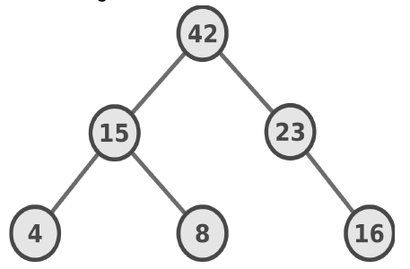

# PPGI/UFAM - Edital 031/2024 PROPESP/UFAM - Prova de Conhecimento

Fontes: `Prova de conceitos - PPGI - edital 031_2024 (2024-02).pdf` (caderno, 9 páginas, prova de
17/06/2024, seleção 2024/2) e `v2-PPGI - edital 031_2024 (2024-02) - GABARITO - FINAL.pdf`
(gabarito final). Os dois estão na página do edital no site do PPGI. Questões 01, 07 e 16 constam
como anuladas no gabarito final.

## Gabarito final

| Questão | Resp. | Questão | Resp. |
|---|---|---|---|
| 01 | Anulada | 11 | C |
| 02 | C | 12 | A |
| 03 | A | 13 | B |
| 04 | D | 14 | A |
| 05 | A | 15 | B |
| 06 | A | 16 | Anulada |
| 07 | Anulada | 17 | B |
| 08 | A | 18 | A |
| 09 | C | 19 | C |
| 10 | C | 20 | C |

## Questões

### QUESTÃO 01
Considere a função abaixo escrita em linguagem C e com o objetivo de ordenar um vetor de inteiros com n elementos de maneira crescente:

```c
void ordena(int v[], unsigned tamanhoDoVetor) {
   int i,j,k;
   for(i = 1; i < tamanhoDoVetor; i++) {
      k = v[i];
      for(j=i-1; ((j>=0) && (v[j]>k)); j--) {
         v[j+1] = v[j];
      }
      v[j]= k;
   }
}
```

Assinale a alternativa correta:

a) O código ordena o vetor por inserção de maneira crescente
b) O código ordena o vetor de maneira crescente por seleção
c) É possível alterar o código em uma única linha para ordenar o vetor de maneira crescente por inserção
d) É possível alterar o código em uma única linha para ordenar o vetor de maneira crescente por seleção

### QUESTÃO 02
Se um programador fez testes para avaliar o tempo de execução para entradas de tamanho 1000 em um programa O(n²) e obteve tempo de 1 minuto, quanto tempo demoraria para uma entrada de tamanho 2000? (considere que 1000 é suficientemente grande para desprezar fatores menores na função de custo e que o custo unitário por operação não variou com o tamanho do problema entre os dois experimentos)

a) 2 minutos
b) 3 minutos
c) 4 minutos
d) 9 minutos

### QUESTÃO 03
Sobre as afirmativas abaixo:

I) Se f(n)=log2(n) então f(n) é O(log10(n))
II) Se um algoritmo tem função de custo T(n) = 3n então é correto afirmar que o algoritmo é O(n²)
III) Se um algoritmo A tem função de custo T1(n) na classe de complexidade Ω(n) e um algoritmo B tem função de custo T2(n) na classe de complexidade Ω(n²) então sabe-se com certeza que T1(n) está na classe O(T2(n)).

a) Apenas I e II estão corretas
b) Apenas I e III estão corretas
c) Apenas II e III estão corretas
d) Todas estão corretas

### QUESTÃO 04
Dado o vetor abaixo, o qual é apresentado em uma tabela onde a primeira linha indica a posição dos elementos e a segunda linha os valores armazenados.

| 0 | 1 | 2 | 3 | 4 | 5 | 6 | 7 | 8 |
|---|---|---|---|---|---|---|---|---|
| 2 | 4 | 6 | 8 | 10 | 12 | 14 | 16 | 18 |

Uma busca binária no mesmo compararia a chave 13 com os seguintes valores do vetor:

a) 2, 6, 10, 14 e 18
b) 10, 14 e 18
c) Nenhuma porque a chave não existe no vetor
d) 10, 14 e 12

### QUESTÃO 05
Considere a árvore binária a seguir:



Se ela for percorrida em-ordem (*inorder*), a sequência de nós visitados será:

a) 4 15 8 42 23 16
b) 4 8 15 16 23 42
c) 42 15 4 8 23 16
d) 42 15 23 4 8 16

### QUESTÃO 06
Sobre árvores vermelho e preto contento pelo menos 128 elementos, sabe-se que:

I) Uma árvore vermelho e preto tem altura máxima inferior a 3 log2(n), onde n é o número de chaves, pois ela é balanceada
II) No pior caso, uma árvore vermelho e preto tem altura pior do que o pior caso de uma árvore binária de pesquisa
III) O balanceamento na árvore falha apenas para os casos de inserção em ordem crescente, situação em que a altura esperada da árvore pode chegar a passar da raiz quadrada do número de elementos quando o número de elementos for muito grande.

a) Apenas I é verdadeira
b) Apenas II é verdadeira
c) Apenas III é verdadeira
d) Apenas I e II são verdadeiras

### QUESTÃO 07
Considere as seguintes afirmações sobre a tarefa de pesquisa por chaves em uma coleção de elementos.

I) A busca binária permite encontrar chaves eficientemente, mas não funciona se houver chaves repetidas na coleção
II) Uma estrutura de dados pode ser usada para organizar os elementos, sacrificando custo espacial (memória) e ao mesmo tempo favorecendo o custo temporal
III) Se for necessário fazer muitas alterações na coleção (inserção, remoção e alteração de chaves), então a busca sequencial poderá ser melhor do que a busca binária no caso médio.

a) Todas as afirmações são verdadeiras
b) Apenas I e II são verdadeiras
c) Apenas I e III são verdadeiras
d) Apenas II e III são verdadeiras

### QUESTÃO 08
Dentro das árvores AVL, considera-se uma árvore balanceada somente quando:

a) A diferença de altura da subárvore esquerda para a subárvore direita não exceda de 1, e as subárvores esquerda e direita também são balanceadas.
b) Todos os nós da árvore têm 0 ou 2 subárvores, e a altura mínima da raiz é 2.
c) Não existe diferença entre as alturas das subárvores dos nós.
d) Todos os nós com chaves de busca menores que a chave da raiz encontram-se na subárvore esquerda.

### QUESTÃO 09
Considere uma lista ligada na qual cada nó contém um campo info (um valor inteiro) e um campo prox (um ponteiro para o próximo nó). O início da lista é indicado simplesmente por um ponteiro para o primeiro elemento. A declaração a seguir especifica o tipo da lista e declara uma lista inicialmente vazia.

```c
typedef struct lista Lista;
struct lista {
      int info;
      Lista *prox;
} *uma_lista = NULL;
```

Qual das alternativas a seguir contém um código que insere corretamente um novo nó no início da lista?

a)

```c
void insere(Lista *lista, int info) {
     Lista *novo = malloc(sizeof (Lista));
     novo->info = info;
     novo->prox = *lista;
     *lista = novo;
}
```

b)

```c
void insere(Lista *lista, int info) {
     Lista *novo = malloc(sizeof (Lista));
     novo->info = info;
     novo->prox = lista->prox;
     *lista = novo;
}
```

c)

```c
void insere(Lista **lista, int info) {
     Lista *novo = malloc(sizeof (Lista));
     novo->info = info;
     novo->prox = *lista;
     *lista = novo;
}
```

d)

```c
void insere(Lista **lista, int info) {
     Lista *novo = malloc(sizeof (Lista));
     novo->info = info;
     novo->prox = NULL;
     if (*lista == NULL) { *lista = novo; }
     else { *lista->prox = novo; }
}
```

### QUESTÃO 10
Considere as seguintes afirmações sobre algoritmos de ordenação.

I) O método da inserção (insertion sort) pode ser mais eficiente do que o quick sort se o vetor for pequeno e tiver poucos elementos fora de ordem.
II) O quick sort é o melhor algoritmo de ordenação em situações típicas e, para vetores muito grandes, ele é sempre aconselhável em detrimento de outros algoritmos de ordenação.
III) O método da intercalação (merge sort) é eficiente, mas normalmente requer memória adicional para realizar a intercalação. É possível intercalar os elementos no próprio vetor, mas isso exige passos adicionais.

a) Todas as afirmações são verdadeiras
b) Apenas I e II são verdadeiras
c) Apenas I e III são verdadeiras
d) Apenas II e III são verdadeiras

### QUESTÃO 11
Considere a função em Python a seguir.

```python
def chamada(n):
     print("PPGI")
     if n <= 1:
          return n
     else:
          return (chamada(n-1) + chamada(n-2))
```

Quantas vezes a palavra PPGI é impressa na tela ao executar chamada(4)?

a) 3
b) 5
c) 9
d) 15

### QUESTÃO 12
Considere a função em Python a seguir.

```python
def chamada(n):
     print("PPGI")
     if n <= 1:
          return n
     else:
          return (chamada(n-1) + chamada(n-2))
```

Qual o retorno da execução chamada(4)?

a) 3
b) 5
c) 8
d) 13

### QUESTÃO 13
Sobre árvores vermelho-preto, considere as afirmações:

I) A raiz é preta
II) Toda subárvore nula é preta
III) Se um nó é preto, então os filhos são vermelhos

São verdadeiras:

a) Apenas a afirmação I
b) Apenas as afirmações I e II
c) Apenas as afirmações II e III
d) Todas as afirmações

### QUESTÃO 14
As árvores rubro-negras têm como uma de suas características

a) Todo nó vermelho (rubro) tem dois filhos pretos
b) A diferença de altura da subárvore esquerda para a subárvore direita não exceda de 1, e as subárvores esquerda e direita também são balanceadas
c) Todo nó preto (negro) tem, pelo menos, uma subárvore cuja raiz é vermelha (rubra)
d) A altura das subárvores é o fator usado para determinar o balanceamento, e pode exceder em 50% a diferença entre elas.

### QUESTÃO 15
A altura de uma árvore rubro negra com n nós é:

a) de, no máximo, n * log(n)
b) de, no máximo, 2 * log(n+1)
c) no pior caso, n*n
d) de, no máximo, log(n-1)

### QUESTÃO 16
Considere o seguinte trecho de código em C:

```c
int main() {
     int *ptr;
     ptr = (int *)malloc(sizeof(int));
     *ptr = 10;
     printf("O valor armazenado em ptr é: %d", *ptr);
     free(ptr);
     return 0;
}
```

O que o trecho de código faz?

a) Atribui o valor 10 a uma variável inteira, imprime o valor e depois libera a memória alocada.
b) Aloca memória para um ponteiro, atribui o valor 10 a ele, imprime o valor e depois libera a memória alocada.
c) Aloca dinamicamente memória para um inteiro, atribui o valor 10 a ele, imprime o valor e depois libera a memória alocada.
d) Aloca memória para um ponteiro, imprime o endereço de memória alocado e depois libera a memória alocada.

### QUESTÃO 17
Qual é a principal diferença entre uma pilha e uma fila?

a) Uma pilha segue o princípio FIFO (First In, First Out), enquanto uma fila segue o princípio LIFO (Last In, First Out).
b) Uma pilha segue o princípio LIFO (Last In, First Out), enquanto uma fila segue o princípio FIFO (First In, First Out).
c) Pilhas e filas funcionam da mesma forma, não há diferença entre elas.
d) Pilhas e filas não são estruturas de dados comuns na programação.

### QUESTÃO 18
Na linguagem de programação C, quando um vetor é passado para uma sub-rotina/função como argumento, o que realmente é passado:

a) O endereço de memória do primeiro elemento do vetor
b) O endereço de memória do primeiro e do último elemento do vetor
c) Os valores dos elementos do vetor
d) O número de elementos na memória do vetor

### QUESTÃO 19
Analise o código a seguir:

```c
int subrotina(int x){
     int i,z=0;
     for(i=1;i<x;i++)
       z += i;
     return z;
}

int main(){
     int z, i, x;
     for(i=1;i<5;i++){
          printf("Informe um numero: ");
          scanf("%d",&z);
          x=subrotina(z);
          printf("%d\n",x);
     }
     return 0;
}
```

Qual o resultado impresso na tela, considerando que o usuário informou os respectivos valores de entrada (9, 7, 6, 10)?

a) 15, 105, 28, 3
b) 28, 45, 91, 21
c) 36, 21, 15, 45
d) 36, 55, 78, 45

### QUESTÃO 20
Marque a alternativa CORRETA do programa em C que atende o seguinte enunciado: "Alguns restaurantes nos EUA cobram gorjeta de 18% para o garçom. Faça um programa em C que leia o valor gasto com as despesas realizadas em um restaurante e imprima o valor total com a gorjeta":

a)

```c
#include<stdio.h>
int main(void){
  float PT, E;
  printf("Informe o valor");
  scanf("%f",&E);
  PT = E + E * 1.18;
  printf("Valor Total: %.2f", PT);
  return 0;
}
```

b)

```c
#include<stdio.h>
int main(void){
  float X, TG;
  printf("Informe o valor");
  scanf("%f",&X);
  TG = X * 0.18;
  printf("Valor Total: %.2f", TG);
  return 0;
}
```

c)

```c
#include<stdio.h>
int main(void){
  float K, W;
  printf("Informe o valor");
  scanf("%f",&K);
  W = K + K * 0.18;
  printf("Valor Total: %.2f", W);
  return 0;
}
```

d)

```c
#include<stdio.h>
int main(void){
  float PT, E;
  printf("Informe o valor");
  scanf("%f",&E);
  PT = E * E * 18/100;
  printf("Valor Total: %.2f", PT);
  return 0;
}
```
