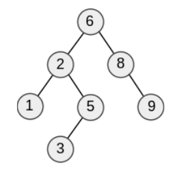
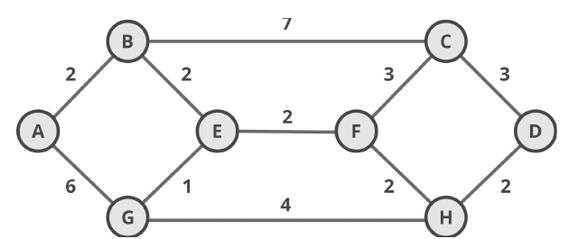
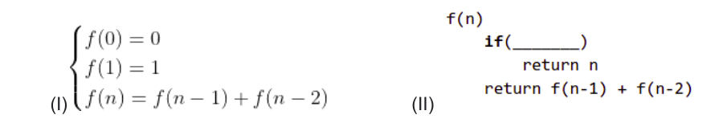

# PPGI/UFAM - Edital 092/2024 PROPESP/UFAM - Prova de Conhecimento

Fontes: `Prova de conceitos - PPGI - edital 092_2024 (2025-01).pdf` (caderno, 12 páginas) e
`Gabarito Final Final - PPGI - edital 092_2024 (2025-01).pdf` (gabarito final de 30/01/2025),
publicados na página da Seleção 2025/01 do PPGI. Questões 02, 05, 06 e 15 constam como anuladas no
gabarito final.

## Gabarito final

| Questão | Resp. | Questão | Resp. |
|---|---|---|---|
| 01 | A | 11 | B |
| 02 | Anulada | 12 | C |
| 03 | A | 13 | B |
| 04 | E | 14 | D |
| 05 | Anulada | 15 | Anulada |
| 06 | Anulada | 16 | E |
| 07 | C | 17 | C |
| 08 | C | 18 | C |
| 09 | B | 19 | E |
| 10 | D | 20 | D |

## Questões

### QUESTÃO 01
Ao compilar e executar o programa a seguir escrito em linguagem de programação C, quantas vezes será impressa a string Teste?

```c
#include <stdio.h>

int main(void) {
    int i, j;

    for (i = 2; i <= 4; i++) {
        for(j = 1; j < 3; j++) {
            printf("Teste\n");
        }
    }
}
```

a) 6
b) 3
c) 4
d) 5
e) 8

### QUESTÃO 02
Considere que o algoritmo de ordenação Insertion Sort foi empregado para ordenar, de maneira crescente, o vetor (4, 3, 2, 1). Analise as afirmativas abaixo.

I. A configuração (4, 4, 2, 1) jamais pode ocorrer durante os passos da ordenação;
II. A configuração (2, 3, 4, 1) necessariamente ocorre durante os passos da ordenação;
III. A configuração (1, 4, 3, 2) jamais ocorre durante os passos da ordenação.

Assinale a alternativa correta.

a) Apenas as afirmativas I e II são verdadeiras.
b) Apenas as afirmativas II e III são verdadeiras.
c) Apenas as afirmativas I e III são verdadeiras.
d) Apenas a afirmativa I é verdadeira.
e) Apenas a afirmativa II é verdadeira.

### QUESTÃO 03
Ao compilar e executar o programa a seguir escrito em linguagem de programação C, o que será impresso?

```c
#include <stdio.h>
int main(void) {
    int x, i, cont = 0;
    x = 18;
    for(i = 1; i <= x; i++) {
        if ((x % i) == 0) {
            cont = cont + 1;
        }
    }
    printf("%d", cont);
}
```

a) 6
b) 7
c) 5
d) 8
e) 4

### QUESTÃO 04
Considere a seguinte sequência de operações em uma pilha inicialmente vazia, considerando que Push implementa a operação de empilhar um elemento e Pop a operação de desempilhar um elemento:

Push(4); Pop(); Push(2); Push(3); Pop(); Push(1); Pop(); Pop(); Push(6); Push(7).

Após todas as operações serem realizadas, qual será o número de elementos na pilha?

a) 3
b) 1
c) 4
d) 10
e) 2

### QUESTÃO 05
Considere as seguintes afirmações sobre pilhas e filas:

I. Uma forma de implementar pilhas é usando um vetor alocado dinamicamente. Sempre que a pilha ficar cheia, o vetor pode ser redimensionado (realocado).
II. Se a fila for armazenada em uma lista simplesmente ligada, então uma forma eficiente de implementar é realizando inserções no final e remoções no início da lista, guardando sempre um ponteiro para o primeiro nó e um ponteiro para o último nó.
III. Se a pilha for armazenada em uma lista duplamente encadeada, então as operações de inserção e remoção serão eficientes tanto se elas forem realizadas no início quanto no final da lista.

Assinale a alternativa correta.

a) Apenas as afirmativas I e II são verdadeiras.
b) Apenas as afirmativas II e III são verdadeiras.
c) Apenas as afirmativas I e III são verdadeiras.
d) Todas as afirmativas são verdadeiras.
e) Nenhuma afirmativa é verdadeira.

### QUESTÃO 06
A seguir é apresentada uma árvore AVL com 9 nós.



Considere as seguintes afirmativas acerca dessa árvore e de árvores AVL em geral.

I. Esta árvore é incorreta, pois o nó que contém a chave 8 está desbalanceado.
II. É possível inserir ao menos uma chave nessa árvore sem que seja necessário realizar rotações.
III. Se a chave 4 for inserida na árvore, será necessário realizar uma rotação simples que altera a raiz da árvore, a qual contém atualmente o nó com valor 6, para que ela permaneça balanceada.

Assinale a alternativa correta.

a) As afirmativas I e II são verdadeiras.
b) As afirmativas II e III são verdadeiras.
c) Apenas a afirmativa I é verdadeira.
d) Apenas a afirmativa II é verdadeira.
e) Apenas a afirmativa III é verdadeira.

### QUESTÃO 07
Qual é a altura máxima de qualquer árvore AVL com 9 nós, considerando aqui que a altura de uma árvore com um único nó é zero e com dois nós é 1 ?

a) 4
b) 5
c) 3
d) 6
e) 9

### QUESTÃO 08
Considere que o particionamento realizado em um vetor pelo algoritmo Quicksort deve garantir que ao final o vetor esteja corretamente ordenado e considere uma implementação na qual a escolha do pivô é feita de forma aleatória a partir de um dos elementos do vetor. O vetor abaixo apresenta o resultado do primeiro particionamento do Quicksort em um processo de ordenação de forma crescente, feito portanto considerando o vetor completo como intervalo. Selecione a alternativa correta.

```
3   7   2   5   4   7   8   8
```

a) O valor do pivô que gerou a partição pode ter sido apenas 3 ou 8, não podendo ter sido 2, 4, 5 e nem 7.
b) O valor do pivô que gerou a partição pode ter sido apenas 4 ou 5, não podendo ter sido 2, 3, 7 e nem 8.
c) O valor do pivô que gerou a partição pode ter sido apenas 7 ou 8, não podendo ter sido 2, 3, 4 e nem 5.
d) O valor do pivô que gerou a partição pode ter sido apenas o 8, não podendo ter sido 2, 3, 4, 5 e nem 7
e) Nenhuma das alternativas anteriores está correta

### QUESTÃO 09
Considerando que você está ordenando um vetor com 1 bilhão de posições e considerando o pior dos cenários em termos de número de comparações envolvendo chaves para cada algoritmo, ao considerarmos apenas QuickSort, MergeSort, Ordenação por Inserção e Ordenação por Seleção

a) O quicksort faz menos comparações de valores envolvendo valores das chaves de ordenação dos elementos que os outros três citados nas opções
b) O Mergesort faz menos comparações envolvendo valores das chaves de ordenação dos elementos que os outros três citados nas opções
c) Ordenação por Inserção faz menos comparações envolvendo valores das chaves de ordenação dos elementos que os outros três citados nas opções
d) Ordenação por seleção faz menos comparações envolvendo valores das chaves de ordenação dos elementos que os outros três citados nas opções
e) Há um empate entre os algoritmos Quicksort e Mergesort no número de comparações envolvendo valores das chaves de ordenação dos elementos, sendo os dois melhores que Ordenação por Inserção e Ordenação por seleção

### QUESTÃO 10
Considere o seguinte programa (pseudocódigo) e indique qual das alternativas é a verdadeira.

```c
#include <stdio.h>
#include <stdlib.h>
typedef struct No { int dado; struct No* prox; } No;
No* criarNo(int valor) {
    No* novo = malloc(sizeof (No));
    novo->dado = valor;
    novo->prox = NULL;
    return novo;
}
void inserirNo(No** cabeca, int valor) {
    No* novo = criarNo(valor);
    novo->prox = *cabeca;
    *cabeca = novo;
}
int main() {
    No* lista = NULL;
    inserirNo(&lista, 10);
    inserirNo(&lista, 20);
    inserirNo(&lista, 30);
    printf("Lista criada com os elementos!\n");
    return 0;
}
```

a) O programa não utiliza alocação dinâmica de memória para criar o nós da lista encadeada. Os elementos são inseridos no início da lista. A lista é representada por um ponteiro para o primeiro nó. Não há liberação explícita da memória alocada para os nós.
b) O programa utiliza alocação dinâmica de memória para criar o nós da lista encadeada. Os elementos são inseridos no fim da lista. A lista é representada por um ponteiro para o primeiro nó. Não há liberação explícita da memória alocada para os nós.
c) O programa utiliza alocação dinâmica de memória para criar o nós da lista encadeada. Os elementos são inseridos no início da lista. A lista é representada por um ponteiro para o primeiro nó. Há liberação explícita da memória alocada para os nós.
d) O programa utiliza alocação dinâmica de memória para criar o nós da lista encadeada. Os elementos são inseridos no início da lista. A lista é representada por um ponteiro para o primeiro nó. Não há liberação explícita da memória alocada para os nós.
e) Nenhuma das opções anteriores é verdadeira.

### QUESTÃO 11
Considerando o seguinte programa (pseudocódigo) indique qual das afirmações é a verdadeira.

```c
#include <stdio.h>
#include <stdlib.h>
typedef struct No { int dado; struct No* prox;} No;
No* criarNo(int valor) {
    No* novo = malloc(sizeof (No));
    novo->dado = valor;
    novo->prox = NULL;
    return novo;
}
void inserirNo(No** cabeca, int valor) {
    No* novo = criarNo(valor);
    if (*cabeca == NULL) {
        *cabeca = novo;
    } else {
        No* atual = *cabeca;
        while (atual->prox != NULL) {   // linha em negrito no caderno
            atual = atual->prox;
        }
        atual->prox = novo;
    }
}
int main() {
    No* lista = NULL;
    inserirNo(&lista, 10);
    inserirNo(&lista, 20);
    inserirNo(&lista, 30);
    return 0;
}
```

a) Ao inserir o elemento 30 na lista, na terceira chamada da função inserirNo feita na função main, a linha de comando destacada em negrito, com o comando while, é executada 3 vezes. De forma geral, a quantidade de vezes que esta linha é executada depende da quantidade de elementos na lista.
b) Ao inserir o elemento 30 na lista, na terceira chamada da função inserirNo feita na função main, a linha de comando destacada em negrito, com o comando while, é executada 2 vezes. De forma geral, a quantidade de vezes que esta linha é executada depende da quantidade de elementos na lista.
c) Ao inserir o elemento 30 na lista, na terceira chamada da função inserirNo feita na função main, a linha de comando destacada em negrito, com o comando while, é executada 3 vezes. Ao inserir o elemento 30 na lista o loop while executa 3 vezes. De forma geral, a quantidade de vezes que este loop executa não depende da quantidade de elementos já inseridos na lista.
d) Ao inserir o elemento 30 na lista, na terceira chamada da função inserirNo feita na função main, a linha de comando destacada em negrito, com o comando while, é executada 0 vezes.
e) Ao inserir o elemento 30 na lista, na terceira chamada da função inserirNo feita na função main, a linha de comando destacada em negrito, com o comando while, é executada 1 vez.

### QUESTÃO 12
Considerando o seguinte programa (pseudocódigo) indique qual das afirmações é a verdadeira.

```c
#include <stdio.h>
int buscaBinaria(int vetor[], int tamanho, int valor) {
    int inicio = 0;
    int fim = tamanho - 1;
    while (inicio <= fim) {   // linha em negrito no caderno
        int meio = (inicio + fim) / 2;
        if (vetor[meio] == valor) {
            return meio;
        }
        if (vetor[meio] < valor) {
            inicio = meio + 1;
        } else {
            fim = meio - 1;
        }
    }
    return -1;
}
int main() {
    int vetor[] = {1, 3, 5, 7, 9, 11, 13, 15, 17, 19};
    int tamanho = sizeof(vetor) / sizeof(vetor[0]);
    int valor = 15;
    int resultado = buscaBinaria(vetor, tamanho, valor);
    printf("%d\n", resultado);
    return 0;
}
```

a) A linha em negrito, loop while, será executada 2 vezes e o programa imprime 15.
b) A linha em negrito, loop while, será executada 3 vezes e o programa imprime 7.
c) A linha em negrito, loop while, será executada 2 vezes e o programa imprime 7.
d) A linha em negrito, loop while, 3 vezes e o programa imprime -1.
e) Nenhuma das afirmações anteriores é verdadeira

### QUESTÃO 13
Considere a função em Python a seguir.

```python
def funcao(n):
    if n == 0:
        return 0
    return n % 10 + funcao(n // 10)
```

Qual o valor retornado pela função quando chamada da seguinte forma: `funcao(42)`?

a) 4
b) 6
c) 8
d) 24
e) 40

### QUESTÃO 14
Considere a função em Python a seguir.

```python
def funcao(n, r=0):
    if n == 0:
        return r
    return funcao(n // 10, r * 10 + n % 10)
```

Qual o retorno da função quando chamada da seguinte forma: `funcao(42)`?

a) 4
b) 6
c) 8
d) 24
e) 40

### QUESTÃO 15
Considere o grafo a seguir:



Ao executar o algoritmo de Dijkstra para calcular o caminho mínimo entre os vértices A e D, qual das alternativas abaixo representa uma possível ordem em que os vértices são visitados (i.e., o vértice é retirado da fila de vértices a visitar)?

a) A-G-E-B-C-F-H-D
b) A-G-E-F-H-D
c) A-B-E-F-H-D
d) A-B-E-G-H-D
e) A-B-E-G-F-H-C-D

### QUESTÃO 16
Assinale a opção que contém uma implementação correta, em C, de uma função que realiza a seguinte tarefa: "escreva uma função que recebe como entrada o valor de uma compra, aplicando desconto de 15% ao total se o valor inicial da compra for superior a 100 reais".

a)
```c
float calcula_preco(float valor_compra) {
    if (valor_compra > 100)
        valor_compra = valor_compra - (valor_compra * 15%);
    return valor_compra;
}
```
b)
```c
float calcula_preco(float valor_compra) {
    if (valor_compra > 100)
        valor_compra = valor_compra - (valor_compra * 0.85);
    return valor_compra;
}
```
c)
```c
float calcula_preco(float valor_compra) {
    if (valor_compra > 100)
        valor_compra = valor_compra - valor_compra * 1.15;
    return valor_compra;
}
```
d)
```c
float calcula_preco(float valor_compra) {
    if (valor_compra > 100)
        valor_compra = valor_compra / 1.15;
    return valor_compra;
}
```
e)
```c
float calcula_preco(float valor_compra) {
    if (valor_compra > 100)
        valor_compra = valor_compra * 0.85;
    return valor_compra;
}
```

### QUESTÃO 17
Analise as afirmações a seguir sobre tabelas de espalhamento (hash).

I. A sondagem linear (linear probing) pode causar aglomeração de chaves devido ao excesso de colisões em regiões muito próximas da posição de inserção original de uma chave qualquer.
II. Uma estratégia importante para evitar que o algoritmo entre em loop infinito é sempre manter ao menos uma posição vazia na tabela. Assim, sempre será possível inserir uma chave na sua posição correta, independentemente da estratégia de resolução de colisão adotada.
III. Na sondagem quadrática (quadratic probing), é possível que a sondagem entre em loop infinito mesmo que a tabela ainda tenha várias posições vazias.

Assinale a alternativa correta.

a) Apenas as afirmações I e II são verdadeiras.
b) Apenas as afirmações II e III são verdadeiras.
c) Apenas as afirmações I e III são verdadeiras.
d) Todas as afirmações são verdadeiras.
e) Nenhuma das afirmações é verdadeira.

### QUESTÃO 18
O código abaixo imprime como resultado:

```c
#include <stdio.h>
#include <stdlib.h>
typedef struct tipoNo {
  int d;
  struct tipoNo *prox;
} tipoNo;
typedef struct tipoLista {
  tipoNo * ea;
  tipoNo * eb;
} tipoLista;
void funcao(tipoLista *p, int num) {
  tipoNo *aux;
  aux = (tipoNo *) malloc(sizeof(tipoNo));
  aux -> d = num;
  aux -> prox = p->ea;
  p->ea = aux;   p->eb = p->ea->prox;
}

void mostra(tipoLista *p) {
  tipoNo *temp = p->eb;
  while(temp) {   printf("%d ", temp->d);   temp = temp->prox;
  }
}

int main() {
  tipoLista l;
  l.ea = NULL;
  l.eb = NULL;
  funcao(&l,2);
  funcao(&l,4);
  funcao(&l,6);
  funcao(&l,8);
  mostra(&l);
}
```

a) 2 4 6 8
b) 8 6 4 2
c) 6 4 2
d) 2 4 6
e) Nenhuma das alternativas anteriores

### QUESTÃO 19
Para gerar a sequência de Fibonacci usamos a relação de recorrência abaixo (I). Complete o pseudo-código (II) para que o cálculo da sequência de Fibonacci esteja correto utilizando uma das opções abaixo:



```
(I)  f(0) = 0
     f(1) = 1
     f(n) = f(n-1) + f(n-2)

(II) f(n)
         if(_______)
             return n
         return f(n-1) + f(n-2)
```

a) n==0
b) n<=0
c) n==1
d) n<=2
e) n<=1

### QUESTÃO 20
Considere as afirmações abaixo sobre diferentes tipos de árvores binárias de pesquisa e marque uma das alternativas

I) Os algoritmos de busca tanto em árvores sem balanceamento, quanto em árvores com balanceamento, têm o número máximo de comparações da chave de busca com valores na árvore, na pior das hipóteses, proporcional a altura da árvore, não importando se a árvore é sem balanceamento ou com balanceamento.
II) Dependendo da ordem de inserção dos elementos, é possível que a altura de uma árvore sem balanceamento seja menor ou igual que a de uma árvore com balanceamento, mesmo que as duas contenham os mesmos elementos, todos inseridos na mesma ordem
III) O mesmo algoritmo de busca pode ser usado tanto para árvores com balanceamento quanto para árvores sem balanceamento

a) Apenas as afirmações I e II estão corretas
b) Apenas as afirmações II e III estão corretas
c) Apenas as afirmações I e III estão corretas
d) Todas as afirmações estão corretas
e) Nenhuma das alternativas anteriores (a,b,c ou d) está certa.
