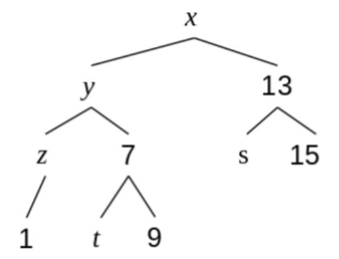

# PPGI/UFAM - Edital 048/2025 PROPESP/UFAM - Prova de Conhecimento

Fontes: `Prova de conceitos.pdf` (caderno da seleção 2025/2, 12 páginas, aplicado em 15/08/2025) e
`Gabarito 2025 02 - Final.docx.pdf` (gabarito final). Questões 05, 06 e 19 constam como anuladas no
gabarito final.

## Gabarito final

| Questão | Resp. | Questão | Resp. |
|---|---|---|---|
| 01 | B | 11 | B |
| 02 | A | 12 | D |
| 03 | A | 13 | C |
| 04 | C | 14 | B |
| 05 | Anulada | 15 | D |
| 06 | Anulada | 16 | A |
| 07 | A | 17 | D |
| 08 | A | 18 | D |
| 09 | C | 19 | Anulada |
| 10 | B | 20 | A |

## Questões

### QUESTÃO 01
Um navegador mantém um histórico ativo de páginas visitadas usando uma pilha:

- Visitar("Página") → adiciona a página informada no topo da pilha.
- Voltar() → remove a página que está no topo da pilha, voltando para a anterior.

Considere a seguinte sequência de comandos:

```
Visitar("UFAM")
Visitar("PPGI")
Visitar("Edital")
Voltar()
Visitar("Biblioteca")
Voltar()
```

Ao final dessa sequência, quantas páginas permanecem no histórico ativo do navegador?

a) 1
b) 2
c) 3
d) 4

### QUESTÃO 02
Um consultório mantém a lista de espera de pacientes usando uma lista encadeada simples, qual:

- Inserir no fim → adiciona um novo paciente após o último da fila.
- Remover no início → remove o paciente que está no início da fila (próximo a ser atendido).

Inicialmente, a lista está vazia. Então ocorre a seguinte sequência de eventos:

Chegam: Ana, João, Maria, Pedro (nesta ordem).
Dois pacientes são atendidos.
Chegam: Carla e Lucas (nesta ordem).

Qual é a ordem da lista neste momento? Considere que o primeiro nome é o que está no início da lista encadeada.

a) Maria, Pedro, Carla, Lucas
b) Ana, João, Carla, Lucas
c) Carla, Lucas, Maria, Pedro
d) Lucas, Carla, Pedro, Maria

### QUESTÃO 03
Um call center processa pedidos em uma fila, na qual:

- Novo(código) → insere o pedido no fim da fila.
- Atender() → remove o pedido que está no início da fila (o mais antigo).

A fila inicialmente contém:

[101, 102, 103]

Durante o expediente, as seguintes ações ocorrem:

```
Atender()
Novo(104)
Novo(105)
Atender()
Novo(106)
```

Qual será o conteúdo final da fila? Considere que o primeiro elemento representa o início da fila

a) [103, 104, 105, 106]
b) [104, 105, 106]
c) [103, 104, 106]
d) [104, 106]

### QUESTÃO 04
Um sistema de biblioteca armazena livros em uma árvore binária de busca não balanceada. A inserção dos livros ocorre sempre de acordo com o código numérico

A sequência de inserção é:

50, 30, 70, 20, 40, 60, 80

Se a árvore for visitada em um percurso pré-ordem, qual será a sequência em que os códigos numéricos dos livros serão encontrados?

a) 20, 30, 40, 50, 60, 70, 80
b) 80, 70, 60, 50, 40, 30, 20
c) 50, 30, 20, 40, 70, 60, 80
d) 30, 20, 40, 50, 60, 70, 80

### QUESTÃO 05
Um sistema armazena identificadores de acesso em uma tabela hash com tamanho 7 (índices de 0 a 6).

- A função de hash utilizada é h(x) = x % 7 (resto da divisão por 7).
- O método de tratamento de colisões é a sondagem linear.
- A função da sondagem linear é h'(x, i) = (h(x) + i) % 7.
- Considere que a tabela começa vazia.

Insira, nessa ordem, os valores:

10, 21, 4, 18, 25

Quantas colisões ocorrem durante essas inserções?

a) 1
b) 2
c) 3
d) 4

### QUESTÃO 06
Considere que desejamos ordenar em ordem crescente um vetor de preços usando Quicksort. Considere ainda que o conteúdo do vetor, após o primeiro particionamento e antes da primeira divisão, é o seguinte:

12, 8, 7, 10, 14, 15, 18

Conhecendo o funcionamento do algoritmo Quick Sort, qual das seguintes opções pode pode ter sido o valor do pivô?

a) 10
b) 14
c) 12
d) 8

### QUESTÃO 07
Considere o vetor abaixo, que será ordenado em ordem crescente usando o algoritmo Merge Sort:

[42, 17, 8, 99, 23, 4, 16, 50, 31]

O Merge Sort será implementado sem otimizações (sempre divide o vetor exatamente ao meio e intercala as metades), seguindo estas regras:

1. Divide recursivamente até obter sublistas de tamanho 1.
2. Durante a intercalação, se dois elementos são iguais, mantém primeiro o que veio da sublista da esquerda (estabilidade).
3. Cada intercalação é feita totalmente, produzindo uma sublista ordenada, antes de passar à próxima.

A execução é acompanhada passo a passo. Queremos saber o estado exato do vetor imediatamente após concluir a intercalação da sublista que originalmente ocupava as posições 0 a 4 do vetor inicial.

Atenção:

- Esse momento ocorre antes de começar a intercalação da parte direita (posições 5 a 8).
- As posições 0 a 4 estarão ordenadas entre si, mas o restante do vetor (posições 5 a 8) ainda estará na mesma ordem original.

Qual será o vetor nesse momento?

a) [8, 17, 23, 42, 99, 4, 16, 50, 31]
b) [8, 17, 23, 42, 99, 16, 4, 50, 31]
c) [8, 17, 42, 23, 99, 4, 16, 31, 50]
d) [17, 8, 23, 42, 99, 4, 16, 50, 31]

### QUESTÃO 08
Você vai inserir, nesta ordem, as chaves abaixo em uma árvore rubro-negra inicialmente vazia, usando as regras padrão (novo nó nasce vermelho; raiz sempre preta; rotações e recolorações conforme os casos de violação do vermelho-vermelho; árvore é binária de busca):

41, 38, 31, 12, 19, 8

Após todas as inserções e correções, quais nós ficam vermelhos no estado final?

a) {8, 19}
b) {12, 31}
c) {31, 38}
d) {38, 41}

### QUESTÃO 09
Uma tabela hash tem tamanho m = 11 (índices 0 a 10).

- A função de hash primária é h(k) = k % 11.
- A resolução de colisões usa sondagem quadrática com: h'(k, i) = (h(k) + i²) % 11
- A tabela inicia vazia.

Insira, nessa ordem, as chaves:

22, 1, 13, 11, 24, 33

Em qual índice a chave 33 ficará armazenada ao final?

a) 4
b) 7
c) 9
d) 10

### QUESTÃO 10
Uma árvore AVL armazena inteiros e faz rebalanceamentos automáticos após cada inserção.

Regras usadas:

- Inserção segue a ordem da árvore binária de busca.
- Se o fator de balanceamento (altura esquerda − altura direita) de algum nó ficar fora de {−1, 0, 1}, aplica-se a rotação necessária (incluindo casos LL, RR, LR, RL).

Considere as inserções, nesta ordem:

30, 5, 10, 42, 15, 20

Qual será a chave na raiz da árvore após todas as inserções e rebalanceamentos?

a) 5
b) 15
c) 20
d) 30

### QUESTÃO 11
Um editor de imagens mantém um histórico de ações usando uma pilha para implementar a função Desfazer.

- Aplicar(filtro) → coloca o filtro no topo da pilha.
- Desfazer() → remove o filtro no topo da pilha, voltando para o estado anterior.

Um designer está editando uma foto e executa a seguinte sequência:

```
Aplicar("Brilho+10")
Aplicar("Saturação+20")
Aplicar("Desfoque")
Desfazer()
Aplicar("Contraste-15")
Desfazer()
Desfazer()
```

Qual é o conteúdo final da pilha de filtros?

a) [] (nenhum filtro aplicado)
b) ["Brilho+10"]
c) ["Brilho+10", "Saturação+20"]
d) ["Saturação+20"]

### QUESTÃO 12
Um serviço de streaming mantém um catálogo de filmes ordenado alfabeticamente pelo título. Para encontrar rapidamente um filme, o sistema usa busca binária.

O catálogo (ordenado) é:

["Avatar", "Duna", "Gladiador", "Interestelar", "Matrix", "Oppenheimer", "Titanic"]

O usuário procura pelo filme "Matrix".

Na busca binária, qual é a sequência de títulos verificados até encontrar o filme?

a) Interestelar → Matrix
b) Avatar → Duna →Gladiador → Interestelar → Matrix
c) Avatar → Titanic → Interestelar → Matrix
d) Interestelar → Oppenheimer → Matrix

### QUESTÃO 13
Considere uma árvore binária de busca não balanceada inicialmente vazia. Insira as seguintes chaves, na ordem dada:

50, 30, 70, 20, 40, 60, 80, 35, 45

Em seguida, remova a chave 30. Qual das alternativas representa uma das possíveis ordens de caminhamento pré-ordem da árvore resultante?

a) 35, 45, 40, 20, 60, 80, 70, 50
b) 20, 35, 40, 45, 50, 60, 70, 80
c) 50, 35, 20, 40, 45, 70, 60, 80
d) 50, 40, 35, 20, 45, 70, 60, 80

### QUESTÃO 14
Uma biblioteca digital armazena IDs de livros em uma tabela hash de tamanho m = 7 usando:

- Função hash: h(k) = k % 7
- Sondagem linear: hi(k) = (h(k) + i) mod 7
- Remoção: quando um livro é excluído, o índice recebe uma marca de tombstone (vaga especial que pode ser reutilizada, mas não interrompe buscas).

A tabela começa vazia e recebe as seguintes operações, nesta ordem:

```
Inserir 10
Inserir 24
Inserir 31
Inserir 18
Remover 24
Inserir 38
Buscar 24
```

Sabendo que a operação Buscar 24 retorna "não encontrado", em qual índice o 38 está armazenado ao final?

a) 3
b) 4
c) 5
d) 6

### QUESTÃO 15
Qual alternativa a seguir é uma implementação correta de um algoritmo recursivo para encontrar o maior elemento de uma lista?

a)
```python
def maior(lista):
    res = list[0]
    for i in range(1, len(lista)):
        if lista[i] > res:
            res = lista[i]
    return res
```

b)
```python
def maior(lista):
    if len(lista) == 1:
        return lista[0]
    primeiro = lista[0]
    resto = lista[1:]
    return max(primeiro, resto)
```

c)
```python
def maior(lista):
    if len(lista) == 1:
        return lista[0]
    primeiro = lista[0]
    resto = lista[1:]
    if primeiro > resto:
        return primeiro
    else:
        return maior(resto)
```

d)
```python
def maior(lista):
    if len(lista) == 1:
        return lista[0]
    primeiro = lista[0]
    resto = lista[1:]
    return max(primeiro, maior(resto))
```

### QUESTÃO 16
Um sistema de aeroporto mantém os horários de decolagem (em minutos após 00:00) em um vetor ordenado. A busca por um voo específico usa busca binária iterativa com limites inclusivos esq e dir e cálculo do meio meio = (esq + dir) // 2.

Vetor de horários:

[510, 540, 555, 600, 615, 660, 705, 720, 735, 780]

O passageiro procura o voo que decola às 12:15 (ou seja, 735 minutos).

Na execução da busca binária, qual é a sequência de valores comparados, o número de iterações até encontrar, e o índice retornado?

a) 615 → 720 → 735; 3 iterações; índice 8
b) 600 → 660 → 705 → 735; 4 iterações; índice 8
c) 660 → 705 → 720 → 735; 4 iterações; índice 8
d) 615 → 705 → 735; 3 iterações; índice 7

### QUESTÃO 17
Considere a árvore de busca binária a seguir. Observe que algumas chaves foram substituídas por incógnitas.



Assinale a alternativa verdadeira. Considere que todas as chaves **devem** ser inteiras e que a árvore **não admite** chaves repetidas.

a) Um possível valor de s é 14.
b) Se y=5, então um possível valor de x é 8.
c) O único valor possível de t é 6.
d) Se y=5, então necessariamente t=6.

### QUESTÃO 18
Um sistema de controle de estoque ordena códigos de produtos usando um algoritmo que funciona assim:

1. Percorre o vetor da **esquerda para a direita**, mantendo a parte inicial sempre **ordenada**.
2. Para ordenar o próximo elemento, **desloca para a direita** todos os elementos **maiores** até encontrar a posição correta.
3. Insere o elemento na posição encontrada, mantendo a ordenação.
4. É **eficiente para listas pequenas** ou **quase ordenadas**, mas lento para listas grandes desordenadas.
5. O algoritmo é **estável**, **in-place** e **não usa pivôs**.

Qual é o algoritmo de ordenação descrito?

a) Merge Sort
b) Quick Sort
c) Heap Sort
d) Insertion Sort

### QUESTÃO 19
Um sistema de autenticação mantém registros de usuários em uma Árvore Rubro-Negra (ARN).

Durante a inserção do valor 40, a árvore passou a ter a seguinte configuração (apenas os nós relevantes mostrados, N representa nó nulo/preto):

```
             (50, preto)
            /           \
     (30, vermelho)   (70, preto)
      /         \
(20, preto) (40, vermelho)
```

Problema detectado: o nó (30, vermelho) tem um filho (40, vermelho), violando a regra de que um nó vermelho não pode ter filho vermelho.

O desenvolvedor implementou quatro possíveis funções de correção.

Qual delas corrige o problema seguindo o algoritmo de inserção da ARN?

a)
```c
if (pai->cor == VERMELHO && tio->cor == VERMELHO) {
    pai->cor = PRETO;
    tio->cor = PRETO;
    avo->cor = VERMELHO;
}
```

b)
```c
if (pai->cor == VERMELHO && tio->cor == PRETO && no == pai->dir) {
    rotacaoEsquerda(pai);
    no = pai;
}
```

c)
```c
if (pai->cor == VERMELHO && tio->cor == PRETO && no == pai->esq) {
    rotacaoDireita(avo);
    trocarCores(pai, avo);
}
```

d)
```c
if (pai->cor == PRETO && tio->cor == PRETO) {
    rotacaoEsquerda(avo);
}
```

### QUESTÃO 20
Um sistema de listas de músicas mantém as faixas em uma lista duplamente encadeada.

Durante a implementação da função removerMusica(No *musica), o desenvolvedor identificou que, ao remover um nó que não é nem o primeiro nem o último, a lista ficava corrompida (links quebrados).

Considere a estrutura:

```c
typedef struct No {
    char titulo[50];
    struct No *prev;
    struct No *next;
} No;
```

Qual dos trechos de código abaixo corrige corretamente o problema ao remover um nó intermediário?

a)
```c
if (musica->prev != NULL)
    musica->prev->next = musica->next;
if (musica->next != NULL)
    musica->next->prev = musica->prev;
free(musica);
```

b)
```c
musica->prev->next = NULL;
musica->next->prev = NULL;
free(musica);
```

c)
```c
if (musica->next != NULL)
    musica->next->next = musica->prev;
if (musica->prev != NULL)
    musica->prev->prev = musica->next;
free(musica);
```

d)
```c
free(musica->prev);
free(musica->next);
free(musica);
```
