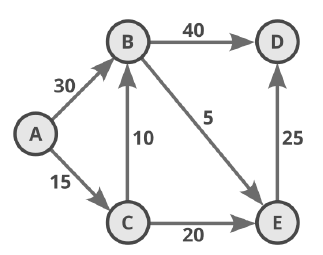
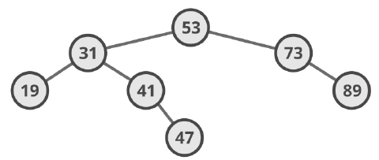
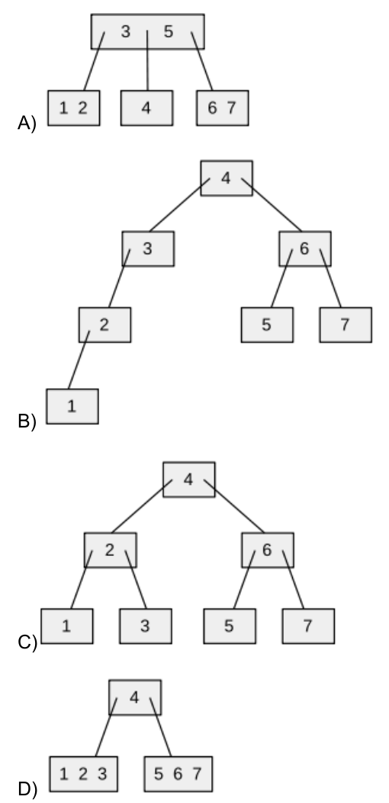
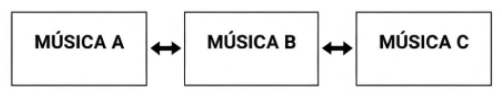
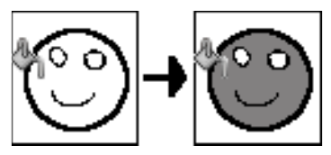
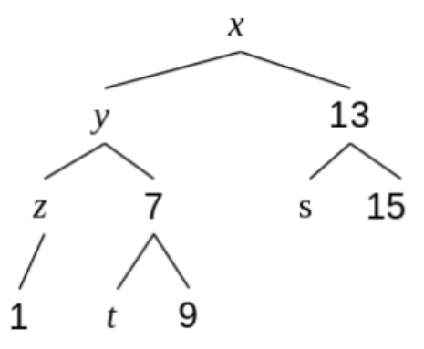
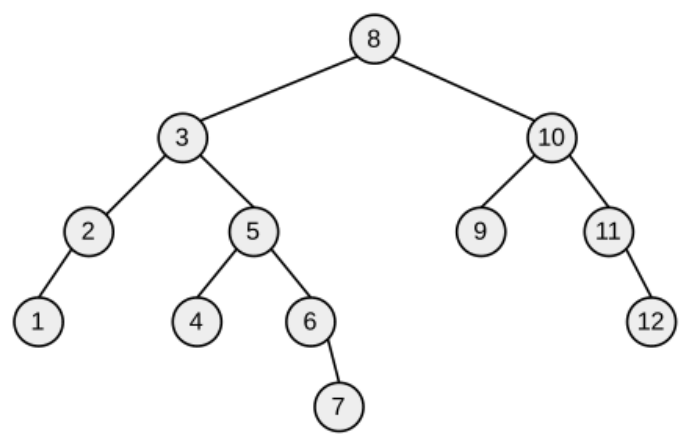

# PPGI/UFAM - Edital 098/2025 PROPESP/UFAM - Prova de Conhecimento

Fontes: `2026-01 Prova de conceitos.pdf` (caderno, 13 páginas, com o cartão de respostas; prova
aplicada em 05/02/2026, seleção de mestrado 2026/1) e `2026-01 Prova de conceitos-GABARITO
FINAL.docx.pdf` (gabarito final). Questões 05, 07, 09, 10, 11, 12 e 15 constam como anuladas no
gabarito final.

## Gabarito final

| Questão | Resp. | Questão | Resp. |
|---|---|---|---|
| 01 | C | 11 | Anulada |
| 02 | D | 12 | Anulada |
| 03 | A | 13 | C |
| 04 | C | 14 | C |
| 05 | Anulada | 15 | Anulada |
| 06 | B | 16 | B |
| 07 | Anulada | 17 | B |
| 08 | C | 18 | A |
| 09 | Anulada | 19 | B |
| 10 | Anulada | 20 | C |

## Questões

### QUESTÃO 01
Considere a função seguinte, desenvolvida na linguagem C:

```c
int f(int n) {
    int count = 0;
    for (int i = 0; i < 10; i++) {
          for (int j = 1; j <= n; j++) {
               for (int k = 0; k < n; k++) {
                    count++;
               }
          }
    }
    return count;
}
```

Qual será o valor retornado por f para qualquer n ≥ 0?

a) n²
b) n³
c) 10n²
d) n² + 10

### QUESTÃO 02
Considere uma tabela hash de tamanho m = 10, que utiliza encadeamento separado para tratar colisões.

A função hash usada é:

h(k) = k mod 10

Suponha que as seguintes chaves inteiras sejam inseridas nesta ordem:

22, 42, 31, 52, 62, 14, 72

Após todas as inserções, qual será o tamanho da maior lista encadeada presente na tabela?

a) 2
b) 3
c) 4
d) 5

### QUESTÃO 03
Considere o grafo ponderado e direcionado abaixo, com pesos não negativos:



Aplicando o algoritmo de Dijkstra a partir do vértice A, utilizando uma fila de prioridades (min-heap) para selecionar o próximo vértice, qual será a ordem em que os vértices são removidos da fila de prioridades (do primeiro ao último)?

a) A, C, B, E, D
b) A, C, E, B, D
c) A, B, C, E, D
d) A, C, B, D, E

### QUESTÃO 04
Considere a árvore binária de busca (BST) a seguir, em que cada nó armazena um número inteiro:



Dois novos nós com chaves 37 e 67 são inseridos nesta ordem (primeiro 37, depois 67), seguindo as regras de inserção de uma BST.

Após as duas inserções, qual é a sequência resultante do caminhamento em pós-ordem?

a) 19, 31, 41, 37, 47, 53, 73, 67, 89
b) 19, 47, 37, 41, 31, 67, 89, 73, 53
c) 19, 37, 47, 41, 31, 67, 89, 73, 53
d) 19, 37, 47, 41, 31, 89, 67, 73, 53

### QUESTÃO 05
Considere as afirmações abaixo sobre a eficiência de operações em diferentes estruturas de dados:

I. Se uma lista encadeada estiver ordenada, o acesso aos elementos tem a mesma eficiência de uma árvore balanceada, pois pode-se usar busca binária para a pesquisa.
II. Uma tabela hash com encadeamento separado requer mais memória do que uma tabela hash com sondagem linear ou quadrática de igual tamanho, mesmo quando os elementos armazenados nas duas são idênticos.
III. Se a árvore de busca binária não for balanceada, a pesquisa pode ser tão ineficiente (em número de acessos) quanto a pesquisa linear em um vetor não ordenado.
IV. Uma árvore AVL pode ser tão eficiente (em número de acessos) quanto a pesquisa binária em um vetor ordenado e ainda tem a vantagem de permitir inserção e remoção eficientes.

Quais afirmações são verdadeiras?

a) Apenas I, II e III
b) Apenas II, III e IV
c) Apenas I, II e IV
d) Todas as afirmações são verdadeiras

### QUESTÃO 06
Considere os seguintes cenários:

I. Desfazer/refazer operações em um editor de texto.
II. Gerenciamento de requisições em uma impressora compartilhada.
III. Inserção e remoção frequente de elementos em posições arbitrárias.

A alternativa que melhor representa a associação correta entre cenário e estrutura de dados é:

a) I – Fila, II – Pilha, III – Vetor
b) I – Pilha, II – Fila, III – Lista encadeada
c) I – Lista, II – Pilha, III – Fila
d) I – Pilha, II – Lista, III – Fila

### QUESTÃO 07
Qual será o resultado do primeiro particionamento obtido pelo algoritmo de ordenação Quick Sort ao ordenar de maneira crescente o vetor abaixo se a estratégia de particionamento adotada for o algoritmo de Hoare e o pivô for escolhido a partir do elemento central?

42, 67, 23, 54, 42, 18, 16, 45, 58

a) 16, 18, 23, 42, 42, 54, 67, 45, 58
b) 42, 16, 23, 18, 42, 54, 67, 45, 58
c) 42, 23, 18, 16, 42, 45, 54, 58, 67
d) 16, 18, 23, 42, 54, 67, 42, 45, 58

### QUESTÃO 08
Selecione a alternativa que preenche corretamente o espaços vazios do código abaixo para que a função buscaBin seja uma implementação correta do algoritmo de busca binária.

```c
int buscaBin(int vetor[], int tamanho, int chave) {
    int i = 0;
    int j =     I   ;
    while (   II    ) {
        int meio = (i + j) / 2;
        if (vetor[meio] == chave) return meio;
        if (vetor[meio] < chave)    III ;
        else     IV    ;
    }
    return -1;
}
```

a) I: `tamanho - 1` · II: `j >= i` · III: `i = meio + 1` · IV: `j = meio`
b) I: `tamanho` · II: `j >= i` · III: `i = meio + 1` · IV: `j = meio - 1`
c) I: `tamanho - 1` · II: `j >= i` · III: `i = meio + 1` · IV: `j = meio - 1`
d) I: `tamanho - 1` · II: `i <= j` · III: `i = meio - 1` · IV: `j = meio + 1`

### QUESTÃO 09
Insira as chaves 4, 8, 15, 22, 5 e 12 (nessa ordem) em uma tabela de espalhamento com tamanho m = 7, utilizando endereçamento aberto pelo método da divisão (também conhecido como congruência linear ou hashing by division) e sondagem quadrática (também conhecido como quadratic probing).

Assinale a alternativa que mostra o conteúdo final da tabela.

a) 12, 8, 15, vazio, 4, 22, 5
b) vazio, 8, 15, 22, 5, 4, 12
c) vazio, 8, 15, 22, 4, 5, 12
d) Nenhuma das anteriores

### QUESTÃO 10
Sabendo que o operador ~, denominado operador de complemento bit-a-bit (bitwise NOT), "inverte" todos os bits de um número inteiro em C, o que o programa a seguir imprime?

```c
#include <stdio.h>
int main(void) {
        int d = 42;
        printf("%d\n", ~d + 1);
}
```

a) -42
b) 42
c) 43
d) Nenhuma das anteriores

### QUESTÃO 11
Insira as chaves 4, 3, 6, 2, 5, 7 e 1 (nessa ordem) em uma árvore B de ordem m = 3 (grau máximo da página/nó). Qual das alternativas é um desenho que corresponde à árvore resultante?



### QUESTÃO 12
O que a função em C a seguir faz? Considere que unsigned é o tipo de dados para armazenar números inteiros sem sinal.

```c
unsigned f(unsigned A, unsigned B) {
        if (A < B)
                return 0;
        else
                return 1 + f(A - B, B);
}
```

a) Verifica o máximo divisor comum (mdc) entre A e B
b) Verifica se B é maior que A
c) Calcula a divisão inteira de A por B
d) Nada, pois o código tem um erro

### QUESTÃO 13
Qual alternativa a seguir implementa corretamente as operações de inserção e remoção de elementos em uma lista para que ela funcione como uma fila?

a)
```python
def insere(lista, elemento):
    lista.insert(elemento)

def remove(lista, elemento):
    lista.pop()
```
b)
```python
def insere(lista, elemento):
    lista.insert(-1, elemento)

def remove(lista, elemento):
    lista.pop()
```
c)
```python
def insere(lista, elemento):
    lista.append(elemento)

def remove(lista, elemento):
    lista.pop(0)
```
d)
```python
def insere(lista, elemento):
    lista.append(elemento, 0)

def remove(lista, elemento):
    lista.remove(0)
```

### QUESTÃO 14
Qual alternativa a seguir implementa corretamente uma função que recebe como entrada uma matriz quadrada de tamanho N×N e verifica se ela é a matriz identidade?

a)
```c
int ident(int N, int mat[][N]) {
    int flag = 0;

    for (int i = 0; i < N; i++) {
        if (mat[i][i] == 1)
            flag = 1;

        for (int j = i + 1; j < N; j++)
            if (mat[i][j] == 0 || mat[j][i] == 0)
                flag = 1;
     }

     return flag;
}
```
b)
```c
int ident(int N, int mat[][N]) {
    int flag = 0;

    for (int i = 0; i < N; i++) {
        for (int j = i + 1; j < N; j++)
            if (i == j && mat[i][j] == 1)
                flag = 1;
            else if (mat[i][j] == 0)
                flag = 1;
     }

     return flag;
}
```
c)
```c
int ident(int N, int mat[][N]) {
    int flag = 1;

    for (int i = 0; i < N; i++) {
        if (mat[i][i] != 1)
            flag = 0;

        for (int j = i + 1; j < N; j++)
            if (mat[i][j] != 0 || mat[j][i] != 0)
                flag = 0;
     }

     return flag;
}
```
d)
```c
int ident(int N, int mat[][N]) {
    int flag = 1;

    for (int i = 0; i < N; i++) {
        for (int j = i + 1; j < N; j++)
            if (i == j && mat[i][j] == 0)
                flag = 0;
            else if (i != j && mat[i][j] != 0)
                flag = 0;
            else
                flag = 1;
     }

     return flag;
}
```

### QUESTÃO 15
Considere as afirmações abaixo sobre implementações eficientes para pilhas e filas.

I. Se uma pilha for implementada com uma lista armazenada em vetor, o topo da pilha deve estar no fim da lista.
II. Se uma lista simplesmente encadeada for usada, então o topo da pilha deve estar no início da lista.
III. Ao implementar filas, se uma lista duplamente encadeada circular for usada, então o início/a frente da fila pode ser tanto o primeiro nó quanto o último nó da lista.
IV. Ao implementar filas, se uma lista simplesmente encadeada for usada, então o primeiro nó deve ser considerado o início/a frente da fila e o último nó deve ser considerado o fim.

Quais afirmações são verdadeiras?

a) Apenas I, II e IV
b) Apenas II, III e IV
c) Apenas I e II
d) Todas as afirmações são verdadeiras

### QUESTÃO 16
Você está programando o motor de um aplicativo de *streaming* de música. A fila de reprodução atual é uma lista duplamente encadeada, na qual cada música é um nó que possui os ponteiros "próxima" e "anterior".

Considere a seguinte sequência de músicas na fila:



O usuário decide remover a [Música B] da lista. Para que a lista continue funcionando corretamente (permitindo que o usuário mude da Música A diretamente para a C, e volte da C para a A) quais alterações de ponteiros são estritamente necessárias?

a) Alterar o ponteiro "próxima" da Música A para apontar para a Música C e alterar o ponteiro "anterior" da Música B para apontar para NULL.
b) Alterar o ponteiro "próxima" da Música A para apontar para a Música C e alterar o ponteiro "anterior" da Música C para apontar para a Música A.
c) Alterar o ponteiro "anterior" da Música C para apontar para a Música A e o ponteiro "próxima" da Música C para apontar para NULL.
d) Nenhuma: basta excluir o objeto Música B da memória e os ponteiros da Música A e da Música C se ajustarão automaticamente por estarem em uma lista duplamente encadeada.

### QUESTÃO 17
Um editor de imagens possui uma funcionalidade "balde" que preenche uma região de pixels com uma nova cor, como mostrado na figura abaixo. Todos os pixels que tinham cor branca sob o ponteiro do mouse foram coloridos de cinza.



Essa funcionalidade é implementada com os seguintes passos:

1. Uma lista inicialmente vazia é criada
2. As coordenadas do pixel inicial são inseridas na lista
3. Enquanto a lista não estiver vazia…
   - 3a. O último elemento da lista é removido
   - 3b. O pixel nas coordenadas desse último elemento é colorido com a cor de preenchimento do "balde"
   - 3c. As coordenadas dos quatro pixels adjacentes ao pixel que foi colorido que tiverem cor igual à cor do pixel inicial são inseridas no fim da lista

A forma como a lista é utilizada nesse algoritmo descreve uma estrutura de dados clássica. Que estrutura de dados é essa?

a) Fila
b) Pilha
c) Árvore
d) Heap

### QUESTÃO 18
Considere a árvore de busca binária a seguir. Observe que algumas chaves foram substituídas por incógnitas.



Assinale a alternativa **verdadeira**. Considere que todas as chaves **devem** ser inteiras e que a árvore **não admite** chaves repetidas.

a) Existem apenas dois valores possíveis para a chave x.
b) Um possível valor de s é 10.
c) O único valor possível de t é 6.
d) É impossível afirmar qualquer coisa sobre os valores das chaves desconhecidas.

### QUESTÃO 19
Considere a árvore AVL balanceada a seguir.



Após remover a chave 9 e aplicar as rotações necessárias, qual será a chave localizada na raiz da árvore?

a) 3
b) 5
c) 8
d) 10

### QUESTÃO 20
Analise o código a seguir e responda o que se pede:

```c
int f(int n) {

     if (n == 0) return 1;

     return n * f(n - 1);

}
```

Qual valor é retornado por f(4)?

a) 10
b) 16
c) 24
d) 120
