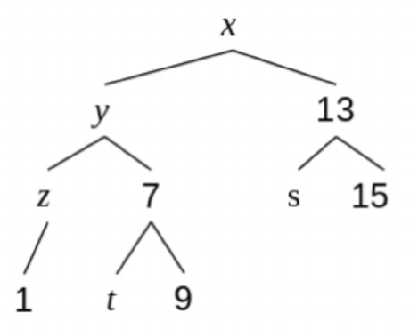
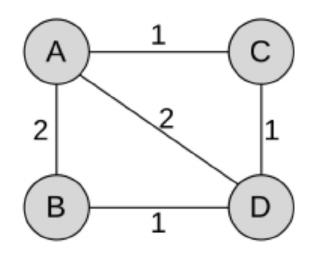
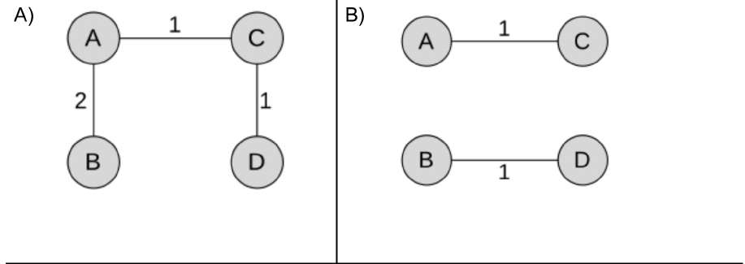
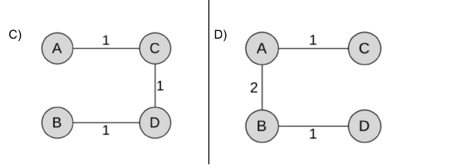

# PPGI/UFAM - Edital 014/2026 PROPESP/UFAM - Prova de Conhecimento

Fontes: `Edital 14-2026_2-Prova de Conceitos.pdf` (caderno, 12 páginas, seleção de mestrado
2026/2, prova de 28/05/2026) e `12_Gabarito FINAL da Prova de Conhecimentos_14-2026.pdf` (gabarito
final, de 05/06/2026). Questões 11, 13 e 20 anuladas no gabarito final.

O caderno publicado é escaneado, sem texto selecionável: os enunciados abaixo foram transcritos à
mão a partir das imagens das páginas. Nenhum trecho ficou ilegível.

## Gabarito final

| Questão | Resp. | Questão | Resp. |
|---|---|---|---|
| 01 | B | 11 | Anulada |
| 02 | B | 12 | D |
| 03 | C | 13 | Anulada |
| 04 | B | 14 | C |
| 05 | D | 15 | D |
| 06 | D | 16 | A |
| 07 | C | 17 | A |
| 08 | A | 18 | D |
| 09 | D | 19 | C |
| 10 | C | 20 | Anulada |

## Questões

### QUESTÃO 01
Considere o pseudocódigo a seguir, no qual `conta(A, n)` recebe um vetor `A` de tamanho `n`. Suponha que as operações aritméticas, comparações e acessos a vetores têm custo constante.

```c
int conta(int A[], int n) {
    int s = 0;
    int i, j;

    for (i = 1; i <= n; i = i * 2) {
        for (j = 0; j < i && j < n; j++) {
            s = s + A[j];
        }
    }

    return s;
}
```

Quais as complexidades de tempo e espaço auxiliar do algoritmo em função de *n*?

a) Tempo Θ(n log n) e espaço auxiliar Θ(1).
b) Tempo Θ(n) e espaço auxiliar Θ(1).
c) Tempo Θ(n^2) e espaço auxiliar Θ(1).
d) Tempo Θ(log n) e espaço auxiliar Θ(n).

### QUESTÃO 02
Com relação à estrutura de *heap* implementada como uma árvore binária, quais afirmações são verdadeiras?

I. O maior valor em um *heap* máximo está no elemento raiz da árvore;
II. O menor valor no *heap* máximo está no elemento raiz da árvore;
III. O *heap* pode ser utilizado como base para o método de ordenação *Heap Sort*;
IV. O *heap* pode ser utilizado como uma fila de prioridades.

a) Apenas I, II e III.
b) Apenas I, III e IV.
c) Apenas II, III e IV.
d) Todas as afirmações são verdadeiras.

### QUESTÃO 03
O pseudocódigo seguinte é uma função recursiva para calcular a potência `b^e`, com o pré-requisito de que o parâmetro `e` seja um inteiro maior ou igual a 1.

```python
def pot(b, e):
    if e <= 1:
        return b

    if e % 2 == 1:
        fator = b
        e -= 1
    else:
        fator = 1

    return fator * pot(b, e//2) * pot(b, e//2)
```

Qual é a complexidade temporal do algoritmo, respectivamente, no melhor e no pior caso? Considere que a operação de multiplicação tem complexidade constante.

a) Θ(1) e Θ(log(e)).
b) Θ(log(e)) e Θ(e).
c) Θ(e) e Θ(e).
d) Θ(e) e Θ(e·log(e)).

### QUESTÃO 04
Sejam x[i] e x[j] dois elementos de iguais chaves armazenados em um vetor. Um algoritmo de ordenação é dito estável se ao final da ordenação x[i] e x[j] mantêm suas posições relativas inalteradas. Considere as seguintes afirmações:

I. A implementação clássica do algoritmo Quick Sort não é estável;
II. A implementação clássica do algoritmo Merge Sort é sempre estável, independentemente do critério de desempate adotado na fase de intercalação;
III. A implementação clássica do algoritmo *Heap* Sort não é estável.

Considere que, por implementação clássica, a questão refere-se à versão usual dos algoritmos, na qual o algoritmo apenas realiza comparações de chaves, sem fazer uso de mecanismos auxiliares para garantir a estabilidade.

Quais afirmações são verdadeiras?

a) Apenas I.
b) Apenas I e III.
c) Apenas II e III.
d) Todas as afirmações são verdadeiras.

### QUESTÃO 05
Seja um vetor semi-ordenado que contém 16 elementos indexados de 1 a 16 com a seguinte propriedade: cada elemento `a[i]` contém a chave `i`, mas a subsequência em que `i` é múltiplo de 3 contém uma permutação aleatória das chaves 3, 6, 9, 12 e 15. Por exemplo, o conteúdo do vetor pode ser o seguinte (as chaves em negrito são múltiplos de 3):

1, 2, **6**, 4, 5, **12**, 7, 8, **9**, 10, 11, **15**, 13, 14, **3**, 16

Considere a situação em que **algum** vetor respeitando essa propriedade (não necessariamente o exemplo mostrado acima) foi usado como entrada para uma implementação clássica do algoritmo Merge Sort—isto é, aquele que divide o vetor em duas metades de tamanhos iguais, ordena recursivamente cada metade de maneira **crescente** e depois as intercala.

Identifique as afirmativas verdadeiras.

I. As chaves 2 e 10 jamais serão comparadas entre si;
II. Sempre que as chaves 2 e 6 forem comparadas entre si, as chaves 4 e 6 também serão comparadas entre si;
III. As chaves 1 e 3 necessariamente serão comparadas entre si.

a) Apenas I e II são verdadeiras.
b) Apenas I e III são verdadeiras.
c) Apenas II e III são verdadeiras.
d) Todas as afirmativas são verdadeiras.

### QUESTÃO 06
Considere um vetor com *n* elementos no qual apenas um está fora de ordem (contém um único elemento a[i] < a[i - 1]) e não sei em que posição está esse elemento. Finalmente, considere como "busca binária" apenas o algoritmo clássico apresentado na bibliografia do presente edital de seleção, sem alterações.

I. Posso descobrir onde está o elemento fora de ordem usando busca binária, que o identificaria em no máximo log₂(*n*)+1 comparações entre chaves, mesmo para *n* > 20;
II. Posso fazer uma busca binária por qualquer chave no vetor com garantia de corretude da busca caso o valor de *n*, que indica o número de elementos do vetor, seja menor ou igual a 20;
III. Posso fazer uma busca sequencial no vetor, seja qual for o valor de *n*, e ela encontrará o elemento buscado, ou indicará se o elemento não existe, ao comparar a chave com, no máximo *n*, elementos do vetor.

a) Apenas as afirmações I e III estão corretas.
b) Apenas as afirmações II e III estão corretas.
c) Apenas as afirmações I e II estão corretas.
d) Nenhuma das opções anteriores, A, B ou C, está certa.

### QUESTÃO 07
Considere o pseudocódigo a seguir, no qual uma linha do algoritmo foi substituída pela string `???`

```c
void f(int v[], int n) {
    int tmp1, tmp2, x, y;

    for (x = 0; x < n; x++) {
        tmp1 = v[x];
        tmp2 = x;

        for (y = x + 1; y < n; y++) {
            ???
        }

        tmp1 = v[tmp2];
        v[tmp2] = v[x];
        v[x] = tmp1;
    }
}
```

Considere ainda as opções:

I. `if (v[y] < v[tmp2]) { tmp2 = y; }`
II. `if (v[y] > v[tmp2]) { tmp2 = y; }`
III. `if (v[y] > v[tmp2]) { v[y] = v[y+1]; }`

Assinale a alternativa **correta**.

a) Se ??? for trocado pela opção I, então a função ordena o vetor v em ordem crescente usando ordenação por inserção.
b) Se ??? for trocado pela opção II, então a função ordena o vetor v em ordem decrescente usando ordenação por inserção.
c) Se ??? for trocado por I, então a função ordena o vetor por seleção em ordem crescente.
d) Se ??? for trocado pela opção III, então a função ordena o vetor v em ordem crescente usando ordenação por seleção.

### QUESTÃO 08
Considere uma árvore AVL inicialmente vazia na qual serão inseridos os valores **30, 20, 10, 40, 50 e 25**, exatamente nessa ordem, com aplicação imediata das rotações necessárias após cada inserção que causar desbalanceamento.

I. Após a inserção dos **três primeiros** valores (30, 20 e 10), o nó **20** torna-se raiz da árvore em decorrência de uma **rotação simples** aplicada no nó 30;
II. Após a inserção dos **cinco primeiros** valores (30, 20, 10, 40 e 50), é necessária **exatamente uma rotação simples** no nó **30** para restaurar o balanceamento da árvore;
III. Após a inserção do **sexto** valor (25), uma **rotação simples** no nó **20** é suficiente para restaurar o balanceamento da árvore.

a) Apenas as afirmações I e II estão corretas.
b) Apenas as afirmações II e III estão corretas.
c) Apenas as afirmações I e III estão corretas.
d) Todas as afirmações (I, II e III) estão corretas.

### QUESTÃO 09
Considere o programa em C abaixo. Qual será o valor impresso?

```c
#include <stdio.h>

int main(void) {
    unsigned v1 = 16;
    unsigned *v2 = &v1;
    int cont = 0;

    while (*v2 > 0) {
        v1 >>= 1;
        cont++;
    }

    printf("%d\n", cont);
    return 0;
}
```

a) 2.
b) 3.
c) 4.
d) 5.

### QUESTÃO 10
Em uma estrutura de dados, cada item é armazenado em um registro que possui três campos: uma chave numérica e exatamente dois ponteiros para registros do mesmo tipo.

Assinale a alternativa que contém apenas estruturas de dados que são adequadamente descritos por esse tipo de item.

a) Lista simplesmente encadeada e árvore binária de busca.
b) Lista duplamente encadeada, árvore binária de busca e árvore B.
c) Lista duplamente encadeada circular e árvore binária de busca.
d) Lista simplesmente encadeada.

### QUESTÃO 11
Deseja-se ordenar um vetor A com *n* ≥ 2 inteiros não negativos, todos menores que *n*³. Considere as seguintes afirmações sobre o uso de Radix Sort com Counting Sort como sub-rotina.

I. Se for usada base *n*, cada número terá no máximo 3 dígitos, e cada chamada ao Counting Sort custará Θ(*n*). Portanto, o tempo total será Θ(*n*);
II. Para que o Radix Sort funcione corretamente ordenando do dígito menos significativo para o mais significativo, o algoritmo usado para ordenar por cada dígito deve ser estável;
III. Se for usado Counting Sort diretamente sobre os valores inteiros completos, sem decomposição em dígitos, o tempo será Θ(*n*), pois há apenas *n* elementos no vetor;
IV. Se for usada base 10, cada valor terá no máximo log(*n*) dígitos e, como cada chamada ao Counting Sort tem custo temporal Θ(*n*), o tempo total do Radix Sort será Θ(n log(*n*)).

Quais afirmações são verdadeiras?

a) Apenas I, II e IV.
b) Apenas I, II e III.
c) Apenas II, III e IV.
d) Todas as afirmações são verdadeiras.

### QUESTÃO 12
Em uma tabela de espalhamento com tamanho *m* = 7, foram inseridas 6 chaves. A função de dispersão utilizada foi

h'(k) = k mod m.

A ordem exata de inserção das chaves é desconhecida, mas a chave k₆ = 9 foi a última. O conteúdo final da tabela imediatamente após a inserção das chaves k₆ = 9 foi o seguinte (o símbolo Ø representa uma posição vazia):

```
índices:     0,  1,  2,  3,  4,   5,  6
elementos: [70,  9,  2,  Ø,  4, 705, 27]
```

Sabendo que as colisões foram tratadas por endereçamento aberto e que nenhuma outra operação de inserção ou remoção foi realizada, selecione a alternativa que representa uma possível função de sondagem empregada na elaboração dessa tabela.

a) h(k, i) = (h'(k) + i) mod *m*.
b) h(k, i) = (h'(k) + i²) mod *m*.
c) h(k, i) = (h'(k) + 2i + i²) mod *m*.
d) h(k, i) = (h'(k) + 3i) mod *m*.

### QUESTÃO 13
Considere uma implementação do algoritmo Quick Sort para ordenar vetores em ordem crescente que emprega a estratégia de particionamento de Lomuto **ou** a estratégia de Hoare.

Suponha que essa implementação foi utilizada para ordenar o vetor

`[2, 8, 3, 10, 5, 1, 7, 6, 4]`

Suponha ainda que, imediatamente após o primeiro particionamento e antes de qualquer chamada recursiva ser realizada, o conteúdo do vetor era

`[2, 3, 1, 4, 5, 8, 7, 6, 10]`

Com base nisso, analise as afirmativas e assinale a alternativa correta.

I. Tanto a chave 4 quanto a chave 5 podem ter sido escolhidas como pivô para particionar esse vetor;
II. Foi empregado o algoritmo de Hoare para particionar esse vetor;
III. Foi empregado o algoritmo de Lomuto para particionar esse vetor.

a) Apenas a afirmativa I é verdadeira.
b) Apenas a afirmativa II é verdadeira.
c) Apenas as afirmativas I e II são verdadeiras.
d) Apenas as afirmativas I e III são verdadeiras.

### QUESTÃO 14
Considere a seguinte definição de tipo de dados para pilha com vetor na linguagem de programação C:

```c
struct TipoPilha {
  int n;      /* número de elementos armazenados */
  int dim;    /* tamanho do vetor */
  float* vet; /* vetor dos elementos */
} pilha;
```

Considere que

- `struct TipoPilha` é o nome do tipo de dados;
- `pilha` é uma variável global desse tipo de dados;
- `pilha.vet` é um vetor usado para armazenar os elementos da pilha;
- `pilha.dim` é a capacidade máxima da pilha (número de elementos do vetor);
- `pilha.n` é o número de elementos armazenados na pilha.

Supondo que desejamos uma implementação eficiente, em qual elemento deve ser encontrado o topo da pilha não vazia?

a) `pilha.vet[0]`.
b) `pilha.vet[pilha.n]`.
c) `pilha.vet[pilha.n - 1]`.
d) `pilha.vet[pilha.dim - 1]`.

### QUESTÃO 15
Qual será a saída da função a seguir se os parâmetros de entrada forem `a=200` e `b=-50`?

```python
def fun(a, b):
  if (a < 0 and b < 0) or (a > 0 and b > 0):
    passo = 1
  else:
    passo = -1

  res = 0
  for i in range(abs(a)):
    for j in range(abs(b)):
      res += passo

  return res
```

a) 250.
b) 150.
c) 10.000.
d) -10.000.

### QUESTÃO 16
Considere a inserção de um elemento `v` em uma fila implementada com lista simplesmente encadeada em C:

```c
struct No
{
  float info;      // valor da chave
  struct No *prox; // próximo nó da lista
};

struct Fila
{
    struct No* ini;  // início da lista
    struct No* fim;  // fim da lista
};

void fila_insere(struct Fila* f, float v)
{
    struct No* n = malloc(sizeof (struct No));
    if (n == NULL)
      return;

    n->info = v;
    n->prox = NULL;

    if (f->fim != NULL) { f->fim->prox = n; }
    else { f->ini = n; }

    f->fim = n;
}
```

O que acontece quando a fila está vazia antes da inserção?

a) `ini` e `fim` passam a apontar para o novo nó.
b) Apenas `ini` aponta para o novo nó.
c) Apenas `fim` aponta para o novo nó.
d) O novo nó é descartado, pois a fila está vazia.

### QUESTÃO 17
Considere a árvore de busca binária a seguir. Observe que algumas chaves foram substituídas por incógnitas.



Considere que as chaves dessa árvore devem necessariamente ser **valores inteiros** e que a árvore **não admite** inserção de chaves repetidas.

Considere que os valores de *x*, *y*, *z*, *s* e *t* são tais que é possível inserir a chave 10 nessa árvore.

Qual será o percurso pré-ordem da árvore após a inserção da chave 10?

a) *x*, *y*, *z*, 1, 7, *t*, 9, 10, 13, *s*, 15.
b) *x*, *y*, *z*, 1, 7, *t*, 9, 13, *s*, 10, 15.
c) 1, *z*, *t*, 10, 9, 7, *y*, *s*, 15, 13, *x*.
d) 1, *z*, *t*, 9, 7, *y*, 10, *s*, 15, 13, *x*.

### QUESTÃO 18
Considere um grafo ponderado e direcionado que possui um número finito de vértices e de arestas. Assinale a alternativa **incorreta**.

a) Se houver algum caminho entre dois vértices ***u*** e ***v***, é possível encontrá-lo com uma busca em profundidade a partir de ***u***.
b) É possível utilizar a busca em largura para verificar se o grafo é fortemente conexo.
c) Se houver pelo menos um caminho entre dois vértices, o algoritmo de Dijkstra encontrará o valor do caminho mínimo, contanto que todos os pesos sejam não negativos.
d) O algoritmo de Floyd-Warshall encontra o valor do caminho mínimo entre cada par de vértices e identifica os vértices que não são alcançáveis uns a partir dos outros para quaisquer pesos.

### QUESTÃO 19
A figura a seguir representa um grafo ponderado e não direcionado com 4 vértices e 5 arestas.



Qual das alternativas é um subgrafo encontrado pelo algoritmo de Prim durante o processamento do grafo acima?





### QUESTÃO 20
Seja G = (V, E) um dígrafo no qual V é um conjunto de vértices e E é um conjunto de arestas. Construímos um grafo Gᵀ a partir de G com os seguintes passos:

1. Gᵀ é inicialmente vazio;
2. Cada vértice vᵢ ∈ V é inserido em Gᵀ;
3. Para cada aresta (u, v) ∈ E, inserimos uma aresta (v, u) em Gᵀ.

Assinale a alternativa correta.

a) O grafo Gᵀ é chamado grafo transposto de G e pode ser usado, por exemplo, para verificar se G é fortemente conexo.
b) O grafo Gᵀ é chamado grafo transposto de G e pode ser usado, por exemplo, para encontrar distâncias mínimas em grafos com pesos negativos usando algoritmos que não são capazes de lidar com pesos negativos em G.
c) O grafo Gᵀ é chamado grafo simétrico e pode ser usado para identificar se os vértices de G possuem vizinhança simétrica entre si.
d) O grafo Gᵀ é chamado grafo simétrico e só pode ser calculado para grafos não direcionados.
