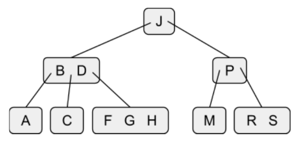
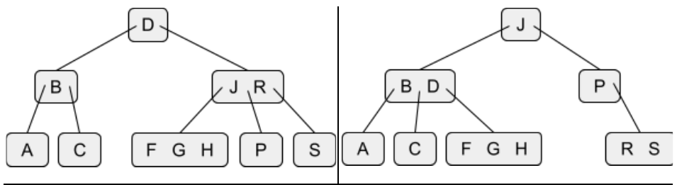
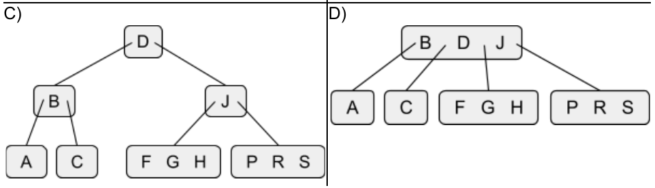

# PPGI/UFAM - Edital 070/2026 PROPESP/UFAM - Prova de Conhecimento

Fontes: `Caderno de Questões_Seleção 2027_1.pdf` (caderno, 10 páginas; o mesmo caderno vale para o
edital 071/2026, do doutorado) e `2027 1 - Prova de Conceitos_Gabarito Prévio.pdf` (gabarito
preliminar do processo seletivo 2027/1, de 27/11/2026). Nenhuma questão anulada no gabarito
preliminar.

## Gabarito preliminar

| Questão | Resp. | Questão | Resp. |
|---|---|---|---|
| 01 | C | 11 | C |
| 02 | B | 12 | C |
| 03 | C | 13 | D |
| 04 | A | 14 | D |
| 05 | B | 15 | A |
| 06 | A | 16 | D |
| 07 | B | 17 | B |
| 08 | C | 18 | C |
| 09 | A | 19 | D |
| 10 | A | 20 | B |

## Questões

### QUESTÃO 01
Existe uma única árvore binária de busca que possui a seguinte pré-ordem: 7, 3, 2, 13, 8, 12, 19, 17, 21, 20. Qual será o percurso in-ordem dessa mesma árvore se removermos a chave 13?

a) 7, 3, 2, 8, 12, 19, 17, 21, 20.
b) 7, 3, 2, 17, 8, 12, 19, 21, 20.
c) 2, 3, 7, 8, 12, 17, 19, 20, 21.
d) 2, 3, 12, 8, 20, 21, 19, 17, 7.

### QUESTÃO 02
Existe uma única árvore AVL que possui o seguinte percurso pré-ordem: 3, 1, 2, 5, 4, 7, 6, 8. Se removermos a chave 1 dessa árvore, qual será o percurso pré-ordem da árvore AVL resultante?

a) 2, 3, 4, 5, 6, 7, 8.
b) 5, 3, 2, 4, 7, 6, 8.
c) 3, 2, 5, 4, 7, 6, 8.
d) 4, 2, 3, 6, 5, 7, 8.

### QUESTÃO 03
Em uma tabela de espalhamento com tamanho m = 7, foram inseridas 4 chaves. A função de dispersão utilizada foi o método da divisão, conforme a equação a seguir.

h(k) = k mod m.

Para tratar as colisões, foi empregada uma técnica de endereçamento aberto, de modo que as chaves foram armazenadas no próprio vetor. Não é necessário conhecer a equação para a resolução da questão.

O conteúdo final da tabela imediatamente após a inserção das chaves foi o seguinte (o símbolo Ø representa posições vazias):

```
índices:     0   1   2   3   4   5   6
elementos: [ 3, 23,  2,  1,  Ø,  Ø,  Ø]
```

Sabendo que nenhuma outra operação de inserção ou remoção foi realizada e que nenhuma chave foi deslocada após a inserção inicial, selecione a alternativa que representa a ordem na qual as chaves foram inseridas na tabela.

a) 1, 2, 3, 23.
b) 2, 1, 3, 23.
c) 2, 23, 1, 3.
d) 2, 23, 3, 1.

### QUESTÃO 04
Sobre algoritmos de ordenação, pode-se dizer que:

I. O algoritmo Quicksort pode realizar um número maior de trocas de valores entre posições do vetor durante o processo de ordenação quando comparado ao algoritmo de ordenação por seleção, mesmo em casos onde o Quicksort é mais rápido e termina a ordenação em menos tempo.
II. O algoritmo Heapsort sempre é mais lento que o algoritmo Quicksort, não importando o tamanho do vetor ou seu conteúdo.

a) Apenas a afirmação I é correta.
b) Apenas a afirmação II é correta.
c) As duas afirmações (I e II) são corretas.
d) Nenhuma das afirmações (I e II) é correta.

### QUESTÃO 05
Sobre uma tabela hash com tratamento de colisões por encadeamento, considere as afirmações:

I. A busca por uma chave em uma tabela hash com encadeamento tem custo constante com número de operações máximo que independe da quantidade de elementos inseridos no hash ao se considerar o pior caso, garantindo desempenho de tempo constante independentemente da quantidade de elementos armazenados na tabela.
II. Em uma tabela hash com encadeamento, é possível que o fator de carga (número de elementos dividido pelo número de posições da tabela) seja maior que 1, ou seja, é possível haver mais elementos armazenados do que posições na tabela.
III. A qualidade da função hash escolhida influencia o desempenho das operações da tabela: uma função que distribui mal as chaves pode fazer com que a busca degenere para tempo proporcional ao número de elementos armazenados.

a) Apenas as afirmações I e II estão corretas.
b) Apenas as afirmações II e III estão corretas.
c) Apenas as afirmações I e III estão corretas.
d) Todas as afirmações (I, II e III) estão corretas.

### QUESTÃO 06
Sobre árvores binárias de pesquisa (ABP) e árvores AVL, considere as afirmações:

I. Em uma árvore binária de pesquisa contendo n chaves, a busca por uma chave pode requerer até n comparações no pior caso, dependendo da ordem em que os elementos foram inseridos.
II. Em uma árvore AVL, o fator de balanceamento de qualquer nó — definido como a diferença entre as alturas das subárvores esquerda e direita — é sempre −1, 0 ou 1 ao final de qualquer operação de inserção ou remoção.
III. Inserir, em uma árvore binária de pesquisa sem balanceamento inicialmente vazia, os valores consecutivos de 1 a n (1, 2, 3, ..., n), nessa ordem crescente, produz uma árvore com altura proporcional a log n.

a) Apenas as afirmações I e II estão corretas.
b) Apenas as afirmações II e III estão corretas.
c) Apenas as afirmações I e III estão corretas.
d) Todas as afirmações (I, II e III) estão corretas.

### QUESTÃO 07
Considere o seguinte cenário fictício: a arqueóloga Rachel Weintraub, nascida no ano 2714, teve sua vida mudada quando, em 2739, aos 25 anos, visitou as Tumbas do Tempo, no planeta Hyperion, e contraiu a "doença de Merlin". A partir dali, sua idade física e aparente passou a regredir: a cada ano que passa, Rachel fica um ano mais jovem, até chegar à idade 0 (zero).

Qual das implementações em Python abaixo calcula corretamente a idade aparente de Rachel para qualquer ano informado? Considere que:

- A variável `ano` contém o ano informado, sendo 2714 ≤ ano ≤ 2764.
- A idade é calculada apenas pela diferença entre anos, ignorando os meses.
- Em 2740, Rachel tem 24 anos.

a) `idade_aparente = 2739 - ano`
b) `idade_aparente = (2739 - 2714) - abs(ano - 2739)`
c) `idade_aparente = min(ano - 2714, 2739 - ano)`
d) `idade_aparente = 2 * 2739 - 2714 - ano`

### QUESTÃO 08
Considere o seguinte cenário fictício: o Relógio do Dragão do Tempo tem um mostrador com 13 horas, em vez de 12. Uma volta completa do seu ponteiro das horas leva exatamente o mesmo tempo que no relógio comum, ou seja, 12 horas comuns (720 minutos). Assim, cada hora do Relógio do Dragão dura 720/13 (aproximadamente 55,4) minutos comuns.

Qual das implementações em Python abaixo converte corretamente um horário do relógio comum para a hora marcada no Relógio do Dragão do Tempo? Assuma que:

- As variáveis `h` e `m` contêm, respectivamente, a hora e os minutos do relógio comum, sendo 0 ≤ h ≤ 11 e 0 ≤ m ≤ 59 (o valor 0 de h representa 12 horas).
- Às 0h00 do relógio comum, o Relógio do Dragão marca 0 hora, e os dois passam a avançar juntos.
- A variável `hora_dragao` deve conter apenas o número de horas completas do Relógio do Dragão, desprezando-se a parte fracionária, sendo um inteiro entre 0 e 12 (inclusive).

a) `hora_dragao = (h * 60 + m) * 12 // (13 * 60)`
b) `hora_dragao = (h * 60 + m) // 720 * 13`
c) `hora_dragao = (h * 60 + m) * 13 // 720`
d) `hora_dragao = round((h * 60 + m) * 13 / 720)`

### QUESTÃO 09
Considere uma árvore B descrita da seguinte forma:

- O grau mínimo de cada nó interno é 2 e o máximo é 4;
- Cada chave é uma única letra e não pode haver chaves repetidas;
- Para a remoção, use o algoritmo *top-down*, que efetua o rebalanceamento na descida (também chamado rebalanceamento preventivo).

Dadas essas especificações, remova a chave M da árvore abaixo.



Identifique a alternativa que mostra uma possível árvore resultante dessa operação.





### QUESTÃO 10
Considere uma árvore AVL, inicialmente vazia, em que as chaves são inteiros comparados pela ordem numérica usual. As chaves abaixo são inseridas nesta ordem, e após cada inserção são aplicadas as rotações necessárias para restaurar o balanceamento:

30, 20, 40, 10, 25, 22

Assinale a alternativa que apresenta o percurso em pré-ordem da árvore resultante.

a) 25, 20, 10, 22, 30, 40
b) 20, 10, 30, 25, 22, 40
c) 30, 20, 10, 25, 22, 40
d) 30, 25, 20, 10, 22, 40

### QUESTÃO 11
O *Guia do Mochileiro das Galáxias* calcula rotas interestelares com o algoritmo de Dijkstra, sobre um grafo direcionado em que o peso de cada aresta é o tempo do salto. Entretanto, na nave *Coração de Ouro*, o Gerador de Improbabilidade Infinita faz alguns saltos terminarem antes de começar, o que equivale a arestas de peso negativo. Sobre o algoritmo de Dijkstra, em sua versão clássica, aplicado a esse novo grafo, é correto afirmar:

a) Funciona normalmente. A cada passo ele escolhe o vértice com a menor distância, e um peso negativo só torna essa distância menor.
b) Somar a todas as arestas uma constante igual ao módulo do menor peso negativo e depois executar o Dijkstra produz os mesmos caminhos mínimos do grafo original.
c) Pode devolver uma distância errada, porque considera definitiva a distância de um vértice no momento em que ele sai da fila de prioridade.
d) Só falha quando o grafo tem um ciclo de peso total negativo. Sem esse tipo de ciclo, ele sempre devolve as distâncias corretas.

### QUESTÃO 12
Quando segmentos TCP chegam fora de ordem na placa de rede, o receptor precisa guardá-los até os segmentos que faltam chegarem, mantendo tudo ordenado pelo número de sequência. Até 2016, o kernel Linux guardava esses segmentos numa lista encadeada ordenada. Naquele ano, uma alteração proposta por engenheiros do Google trocou essa lista por uma árvore binária de busca balanceada. Considerando n o número de segmentos armazenados, analise as afirmações a seguir.

I. No pior caso, encontrar o ponto de inserção de um novo segmento custa O(n) na lista encadeada ordenada e O(log n) na árvore binária de busca balanceada.
II. Como a lista encadeada está ordenada, o ponto de inserção pode ser localizado por busca binária em tempo O(log n).
III. Percorrer todos os segmentos em ordem crescente de número de sequência custa O(n) tanto na lista quanto na árvore.
IV. Na maior parte do tempo, os segmentos chegam com número de sequência maior que o de todos os já armazenados. Por isso, uma árvore binária de busca sem balanceamento também manteria altura O(log n), e o balanceamento só é necessário em casos raros.

Assinale a alternativa correta.

a) Apenas as afirmações I e II estão corretas.
b) Apenas as afirmações II e IV estão corretas.
c) Apenas as afirmações I e III estão corretas.
d) Apenas as afirmações I, III e IV estão corretas.

### QUESTÃO 13
Aplique o algoritmo de Floyd (também conhecido como "Build-Max-Heap" ou "Constrói") no vetor abaixo para transformá-lo em uma heap binária máxima. Na realização das trocas, em caso de empate, favoreça o elemento de menor índice.

3, 4, 1, 4, 6, 8, 8, 2, 8, 4, 1, 2

Selecione a alternativa que representa a heap resultante.

a) 8, 6, 8, 4, 4, 8, 1, 2, 3, 4, 1, 2.
b) 8, 6, 8, 4, 4, 2, 8, 2, 3, 4, 1, 1.
c) 8, 6, 8, 4, 4, 8, 1, 2, 4, 3, 1, 2.
d) 8, 6, 8, 4, 4, 2, 8, 2, 4, 3, 1, 1.

### QUESTÃO 14
Vetórea inseriu 5 tuplas no formato (string, inteiro), referentes a suas cores preferidas, em uma fila de prioridades. A ordem de inserção foi a seguinte:

1. Azul, 7;
2. Branco, 7;
3. Ciano, 9;
4. Dourado, 10;
5. Esmeralda, 9.

Depois, ela removeu as cores, uma por uma, e anotou a ordem de saída. Em que ordem as cores saíram da fila? Considere que:

- A fila de prioridades é uma heap binária, inicialmente vazia, na qual apenas o valor numérico da tupla é chave e valores maiores têm maior prioridade;
- A manutenção da heap é feita com os algoritmos usuais, que promovem trocas sempre e somente quando necessário preservar a propriedade de heap e favorecem o elemento de menor índice em caso de empate.

a) Dourado, Ciano, Esmeralda, Azul, Branco.
b) Dourado, Esmeralda, Ciano, Branco, Azul.
c) Dourado, Ciano, Azul, Branco, Esmeralda.
d) Dourado, Esmeralda, Ciano, Azul, Branco.

### QUESTÃO 15
Um deque é uma estrutura de dados que permite inserção e remoção nas duas extremidades. Considere uma implementação de deque usando vetor circular com capacidade suficiente para todos os elementos armazenados. Analise as afirmações:

I. A operação de inserção no início pode ser implementada em tempo Θ(1).
II. A operação de remoção no fim pode ser implementada em tempo Θ(1).
III. Para acessar o elemento na posição lógica k, a partir do início do deque, é sempre necessário percorrer Θ(k) elementos.
IV. Em uma implementação com vetor circular, pode ser necessário usar aritmética modular para mapear posições lógicas para posições físicas do vetor.

Quais afirmações são verdadeiras?

a) Apenas I, II e IV
b) Apenas I, III e IV
c) Apenas II, III e IV
d) Todas as afirmações são verdadeiras

### QUESTÃO 16
Considere o pseudocódigo a seguir no qual a função realiza remoção de um elemento de uma fila não vazia implementada com listas simplesmente encadeadas:

```c
struct nodo {
    float info;
    struct nodo *prox;
};

struct fila {
    struct nodo *ini; // início da fila
    struct nodo *fim; // fim da fila
};

float fila_retira(struct fila* f) {
    struct nodo* t = f->ini;
    float v = t->info;
    f->ini = t->prox;

    if (f->ini == NULL)
        f->fim = f->ini;

    free(t);
    return v;
}
```

Por que é necessário atribuir `f->fim = f->ini` na função de remoção quando se verifica que `f->ini == NULL`?

a) Porque toda fila f precisa ter f->fim == NULL, mesmo quando ela não está vazia.
b) Porque, em uma lista circular, o último nó sempre deve apontar de volta para o início da fila.
c) Porque o nó removido ainda precisa ser acessado depois da execução da linha free(t).
d) Porque isso indica que, após a remoção, a fila ficou vazia.

### QUESTÃO 17
Considere o pseudocódigo a seguir, no qual a função retira um elemento de uma pilha na qual os elementos são armazenados em vetor—a função tem como pré-requisito a pilha não estar vazia.

Considere que `p->vet` é um ponteiro para o primeiro elemento de um vetor dinamicamente alocado que armazena os elementos da pilha e que `p->n` é uma variável do tipo int que é manipulada pelas funções de inserção e remoção.

```c
float pilha_pop(struct pilha *p) {
    p->n = p->n - 1;
    float v = p->vet[p->n];
    return v;
}
```

Por que o valor de `p->n` é decrementado antes do acesso ao elemento `p->vet[p->n]`?

a) Porque o vetor começa no índice zero.
b) Porque p->n representa o índice no qual o próximo elemento será empilhado.
c) Porque p->n representa o índice do elemento que está no topo.
d) Porque a pilha precisa liberar memória antes de remover o valor.

### QUESTÃO 18
Selecione a alternativa que preenche corretamente os espaços vazios do código abaixo para que o programa imprima os bits de um caractere. Considere uma arquitetura na qual 1 byte possui 8 bits.

```c
#include <stdio.h>
int main(void) {
    unsigned char x = 'c';
    unsigned char mask = 128; // em binário: 10000000
    printf("0b");
    for (int i = 0; i <    I    ; i++) {
        if (   II   ) printf("1");
        else printf("0");
        mask =    III    >> 1;
    }
}
```

a) I: `sizeof(x)*8` · II: `x & mask` · III: `x`
b) I: `sizeof(x)` · II: `x & mask` · III: `mask`
c) I: `sizeof(x)*8` · II: `x & mask` · III: `mask`
d) I: `sizeof(x)*8` · II: `x | mask` · III: `mask`

### QUESTÃO 19
Considere a seguinte sequência de instruções em um programa em C. O espaço reservado com o marcador ??? deve ser completado conforme as alternativas da questão.

```c
int *pti;
int i = 10;
pti = &i;
???   ;
```

Considerando-se os valores de pti e i após a execução das quatro instruções, qual afirmativa é falsa?

a) Se o espaço reservado for trocado por um comando vazio, *pti valerá 10.
b) Se o espaço reservado for trocado por *pti = 20, então o valor de i será 20.
c) Se o espaço reservado for trocado por i++, então o valor de *pti será igualmente modificado.
d) Se o espaço reservado for trocado por um comando vazio, pti valerá 10.

### QUESTÃO 20
A função conta recebe um inteiro não negativo. Qual é o valor retornado por conta(2040)?

```c
int conta(int n) {
    if (n == 0)
        return 0;
    if (n % 10 == 0)
        return 1 + conta(n / 10);
    return conta(n / 10);
}
```

a) 1
b) 2
c) 3
d) 4
